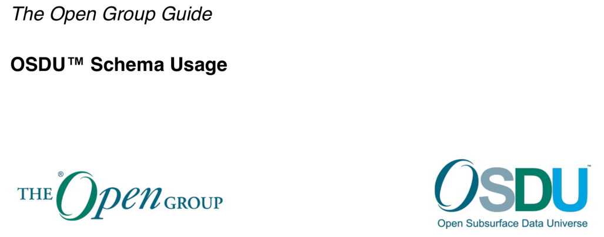

 Previous Chapter: [0 Preface](00-Preface.md)

[[_TOC_]]

# 1 Introduction

---

## 1.1 Objective

This document explains some of the finer points about the design of the schema and data definitions of the OSDU™ Data
Platform. It is always possible to use a data model in ways other than the modelers intended. In a system with a goal of
interoperability, such variance can break the operation of the system. A clear understanding of intentions, as provided
in this document, will help prevent such breakage.

## 1.2 Audience

This document is intended for any users in a position to manipulate the design or content of data schema. This includes:

- Data modelers who are designing new schema or modifying existing OSDU designs
- Data loaders who are populating records and need to understand what kind of data is expected in document properties
- Application developers who write applications which consume data and need to predict how data will be delivered

It is assumed that the reader is familiar with JSON Schema syntax. Draft-07 is the version currently in use for OSDU
schema; see [1.5 Available Resources](#15-available-resources).

## 1.3 Overview

The OSDU data schema defines the shape of information that is stored in the OSDU Data Platform, aside from data files.
Due to the nature of the NoSQL cloud design of the platform, certain design choices were made in constructing the schema
that differ from traditional relational data modeling. Because of the flexibility of the NoSQL approach, it is possible
to interpret the schema in many ways, and it is very difficult to impose constraints that limit such interpretations.
Hence, in many cases, it is left to manual business processes to protect the integrity of the design. This document
should help to inform users of the platform of those who can provide that protection. It covers issues such as:

- How to use the facility vertical measurements structure for wellbore reference datums
- How to interpret the properties which describe various lifecycles
- The meaning of group type
- Understanding Seismic projects
- Options for recording provenance
- Properties which record a history of values
- How to use Frames of Reference (FoRs)
- and many more topics, see the [table of contents](../README.md).

## 1.4 Trade-offs

* OSDU well-known schemas are designed to make ingestion easy. With few exceptions, incomplete records are supported, in
  other words, few properties are required to make a record valid.
  * Properties not available at the time of ingestion should be left absent. Search will return those as `null`.
  * Data loaders should not be tempted to make guesses and add values just to satisfy schema requirements.
* Consumers will have to guard themselves against incomplete data. The following mechanisms can be used:
  * Technical Assurance — this is a sophisticated method to tag data records for usage by specific personas and
    workflows, for more details, see [6.3 Technical Assurance](06-LifecycleProperties.md#63-technical-assurance).
  * Data Quality Assessments — [DataQualityRule](../../E-R/reference-data/DataQualityRule.1.1.0.md) aggregated in
    [DataQualityRuleSet](../../E-R/reference-data/DataQualityRuleSet.1.0.1.md) supply the rules, which can be required
    for data to become consumable according to company standards and application requirements. Results can be captured
    by [DataQuality](../../E-R/work-product-component/DataQuality.2.0.0.md) records associated to the assessed objects.

### 1.4.1 Search, Discoverability

There are four services playing a role,
1. [Schema Service](https://community.opengroup.org/osdu/platform/system/schema-service/-/blob/master/docs/docs/api.md)
   where the contributions by OSDU Data Definitions are bootstrapped and custom schemas can be added. Schemas are
   identified by their `kind`.
2. [Storage Service](https://community.opengroup.org/osdu/platform/system/schema-service/-/blob/master/docs/docs/api.md),
   which receives the PUT requests for records, where `kind` is mandatory.
3. [Indexer Service](https://community.opengroup.org/osdu/platform/system/indexer-service/-/blob/master/docs/docs/api.md),
   which responds to Storage change events. It transforms the records into searchable index records and performs
   potentially dynamic index extensions, see [Appendix D.6.2 Index Extensibility](./93-OSDU-Schemas.md#appendix-d62-index-extensibility).
4. [Search](https://community.opengroup.org/osdu/platform/system/search-service/-/blob/master/docs/docs/api.md),
   finally, uses the index to respond to queries.

The `data.ExtensionProperties` is intended as container for non-OSDU content, however, the OSDU schema is
`"type": "object"` which doesn't provide the indexer with any useful information. All content in
`data.ExtensionProperties` remains invisible to Search.

Arrays of objects are a challenge for the indexer and search - there are metadata in the schema, explained in
[Appendix D.3.3 `x-osdu-indexing` - Indexing Hints](93-OSDU-Schemas.md#appendix-d33-x-osdu-indexing-indexing-hints).
There is [Indexer Hints Report](../../E-R/IndexerHintsReport.md) listing the settings for all the arrays in all
entities.

### 1.4.2 Extensions

JSON schemas may restrict the creation of additional properties in JSON records.

* OSDU does generally permit adding additional properties in the `data` block and nested objects under `data`.
* OSDU system properties ([AbstractSystemProperties](../../E-R/abstract/AbstractSystemProperties.1.0.0.md)) are not
  extensible; added properties are rejected by the Storage service. The name-value pair `"additionalProperties": false`
  is therefore added programmatically in each of the OSDU schema subject to Storage service interaction.

**Recommendation:**

> 1. **_Do not_** add additional properties to records referring to well-known OSDU kinds, which are not defined in the
     corresponding OSDU schemas. Such additional values are not indexed and therefore not discoverable via Search.
>    * Exception: If a future OSDU schema version is published but not yet registered on the platform instance, it is
       acceptable to create records referring to an older schema version kind but populate records with content defined
       by future schema versions.
> 2. Place additional content in `data.ExtensionProperties`. This is the designated extension point for Storage records.
     All OSDU schemas subject to Storage service interaction have this property defined as `object` with no further
     properties. Content under `data.ExtensionProperties` is not discoverable via Search.
>    * `data.ExtensionProperties` can be used as parking lot for properties, which are, e.g., suggested as extensions
       to OSDU schemas and submitted as enhancements to OSDU Data
       Concepts. [JOLT configurations](https://github.com/bazaarvoice/jolt) can later move values
       from `data.ExtensionProperties` to the designated, new OSDU properties. The configurations are provided
       via [reference-data--SchemaUpgradeSpecification](../../E-R/reference-data/SchemaUpgradeSpecification.1.0.0.md).
       Further details in [Appendix D.4.1 Schema Upgrade](93-OSDU-Schemas.md#appendix-d4-schema-upgrade).
> 3. If discoverability is required for extensions, custom schemas can be employed. Add a relationship to the OSDU
     well-known kind to the `data` block, e.g., as described
     in [Appendix C.3 SideCar](92-Proposals.md#appendix-c3-sidecar). Register your custom schema with the Schema
     service.

## 1.5 Available Resources

For further information and resources, refer to:
https://community.opengroup.org/osdu/data/data-definitions/-/tree/master.

---

## Links

1. Return to the [Beginning of the Chapter](#TOC)
2. Next Chapter: [2 Group Type](02-GroupType.md)
3. Browse to the [Schema Usage Guide Table of Contents](../README.md)