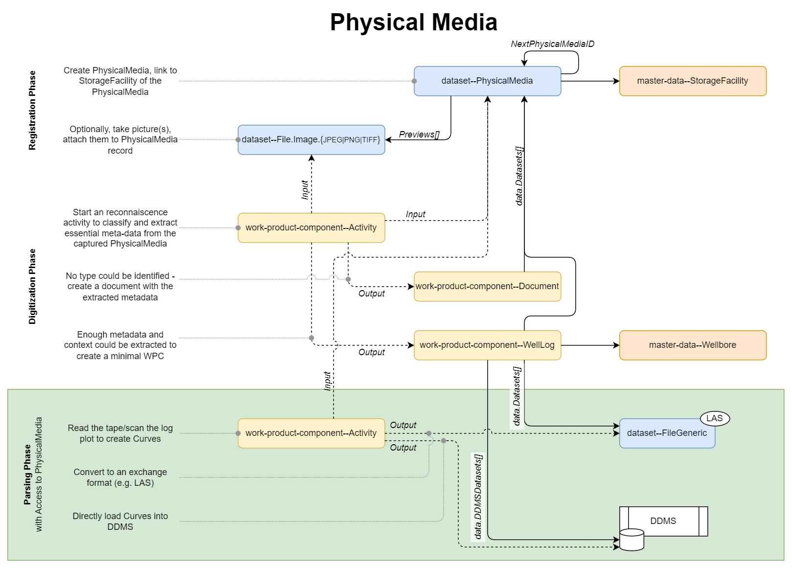
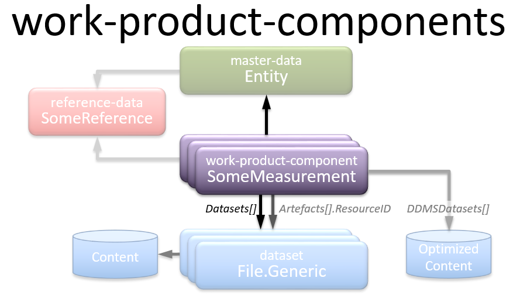
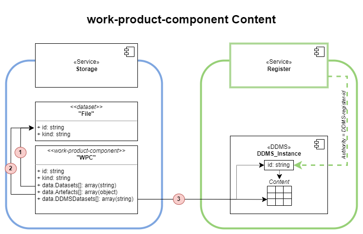
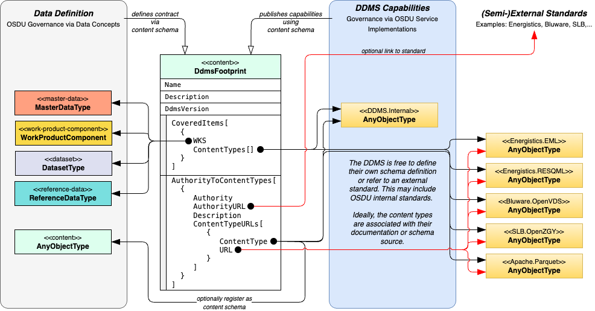
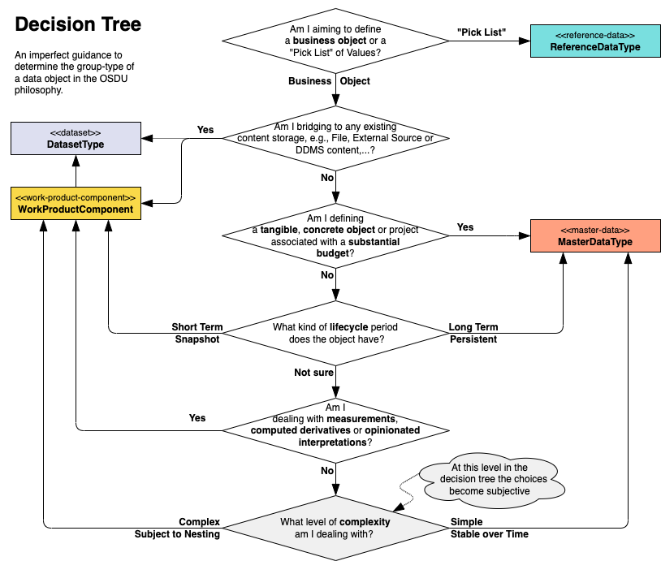

<a name="TOC"></a> Previous Chapter: [1 Introduction](01-Introduction.md)

[[_TOC_]]

# 2 Group Type

All OSDU entities must be classified by a single group type. Group type is a classification that helps to organize the
entities, and it affects some system behaviors. This chapter provides guidance on how to distinguish the main types,
even though the distinctions are not always clear or rigidly followed.

In this document, the term “business content” carries a special meaning that requires elaboration. Metadata about a
digital file is descriptive information about the file and not the file information itself. We may divide the metadata
informally into three classes:

- Business content: information extracted or inferred from the file which summarizes or highlights the subject matter
  contained in the file
- Contextual metadata: information about how the file is used or abides in the digital environment
- File information: information about the computer characteristics of the file

## 2.1 Master Data

When applied to OSDU group types, the term “master” must not be confused with conventional uses of the term in the
industry. It is not the same as mastering or golden or other such meanings. Here, an entity of the group type “master
data” refers to the information about business objects managed in the OSDU Record catalog. These objects tend to be
real-world things with natural identifiers. The function of the schema entity is to collect information about these
real-world things, so they can be tracked and related to digital objects, and to provide their context. This leads to
some characteristics:

- Objects are typically created by a company’s business processes; the catalog of objects grows steadily over time
- The ID can be created separately from the OSDU platform

  Since master data objects typically have a presence in the real world, they also often have established identifiers
  that can be supplied, possibly with some modification, before the ingestion process. Where they do not exist, the
  platform implementer may choose to establish an internal company unique identifier.

- A single version of truth is desired

  While there may be different understandings about the properties of the master object in different source systems,
  there is only one truth, and business processes are established to try to reconcile those differences. When a single
  version of truth has been established, the object is referred to as a well-known entity. This is to say that the
  well-known entity for a master data record is the authoritative source for what the implementing company knows about
  the object.

- Business processes operate on the object over time and may change its properties

  This means that the object is versioned while its identity remains the same.

- The objects tend to be physical (e.g., wellbore, oil field) or business activities (e.g., seismic acquisition); refer
  to Section 4.3.2 of the *OSDU Technical Standard* (
  see [1.5 Available Resources](01-Introduction.md#15-available-resources)) for a list of current entities

## 2.2 Reference Data

Reference data refers to data objects that are similar to master data objects, but their existence is more static. Like
master data objects, they provide context to digital objects, but rather than track their properties it is more
interesting to just know and standardize their names, as in a controlled value list. They tend to refer to concepts that
exist outside a company’s business processes. They have the following characteristics:

- The set of instance object names grows slowly (generally).
- They are often “type” concepts, i.e., they are object types that mainly express a classification of another object
  type.
- Their names and identities may be defined by entities outside the company, such as organizations that are responsible
  or are delegated responsibility for clarity in classifying Data Object Type concepts that they manage or own.
- Refer to Section 4.3.2 of the *OSDU Technical Standard*
  (see [1.5 Available Resources](01-Introduction.md#15-available-resources))
  for a list of current entities; for example, AgreementType, DocumentType, ExistenceKind, FeatureType, LogType,
  MarkerType, ProjectRole, VelocityAnalysisMethod, and UnitOfMeasure

It is useful to note that like other Group Types, Reference Data Object Types are populated with objects (object
instances) through data platform owner/operator data management policies and practices using applications/systems/tools
fit for that purpose. A small subset of Reference Data Object Types are directly associated with the operation and
behavior of the OSDU DP. In these cases, OSDU Data Platform related administrative tools or embedded specifications
serve this purpose.

It is an unavoidable requirement that some Reference (and maybe also some Master) Data Object Types become
multi-dialect/multilingual. This will address definitions as well as behavior during app/Data Platform interactions
guided by configuration contexts and/or local override dialect/language indicators.

Some Reference Data Object Type definitions and sets of object instances are supplied with the OSDU Data Platform
[^1]. These are controlled for each Reference Data Object Type by the level of governance established by the OSDU
Forum. The governance level for a particular Reference Data Object Type is defined in the schema definition for that
entity using the JSON schema extension property `x-osdu-governance-model`, see [Appendix D.3.6 Reference Value Governance Definition](93-OSDU-Schemas.md#appendix-d36-reference-value-governance-definition). The levels are defined as follows:

- **FIXED**: the values are pre-determined by agreement in the OSDU Forum

  This level of governance is usually used for reference data types that have short well-known lists and are highly
  benefited by interoperability between companies, or are required for the proper operation of the Data Platform. [^2]

- **OPEN**: a set of values agreed by the OSDU Forum, but companies may extend the list with custom values

  Custom values should not conflict with Forum values. This level of governance is used for Reference Data Object Types that
  will benefit from some amount of interoperability but also are uncontrolled enough that companies can add their own
  values. [^3]

- **LOCAL**: the OSDU Forum makes no declaration about the values, though it may provide a seed list to help explain the
  entity by way of example [^4]

  Companies need to create their own value list. These reference data types have little benefit apart from
  interoperability, and agreed-upon values are hard to come by.

## 2.3 Dataset

The `dataset` group-type gives metadata about digital Files, FileCollections or external datasets. It does not describe
the business content of the dataset, only the computer science aspects. There are a number of variants covered by the
`dataset` group-type. The common denominator is the inclusion of [AbstractDataset](../../E-R/abstract/AbstractDataset.1.0.0.md),
mandating a defined object structure `data.DatasetProperties`, to be filled by the variants.

Dataset group-type records are referenced by work-product-component records holding the discoverable metadata about
the 'business object', see section [2.4 Work Product Component](#24-work-product-component)
and [2.4.1 Content References](#241-content-references).

### 2.3.1 File, FileCollection on the Platform

This dataset variant includes [AbstractFile](../../E-R/abstract/AbstractFile.1.0.0.md) or
[AbstractFileCollection](../../E-R/abstract/AbstractFileCollection.1.0.0.md). It enables the association of a 'string
of bytes' that are stored on a computer system. For example, it has properties like `Filesize`, the number of bytes
comprising the file, or `Checksum`, a hash of the file using the MD5 digest expressed in 32 hexadecimal characters.
Key characteristics about datasets are:

- They are typically immutable; the underlying binary file is not updated or replaced, and only new dataset objects are
  created
- There are generic entities defined in this group type, which are meant to cover all kinds of files,
  [dataset--File.Generic](../../E-R/dataset/File.Generic.1.1.0.md) and
  [dataset--FileCollection.Generic](../../E-R/dataset/FileCollection.Generic.1.1.0.md).
- And there are a growing number of specialized schemas for specific file types. For example:
    - [dataset--File.GeoJSON](../../E-R/dataset/File.GeoJSON.1.1.0.md): a dataset schema representing a geographic shape
      on earth.
    - [dataset--FileCollection.SEGY](../../E-R/dataset/FileCollection.SEGY.1.3.0.md): a dataset schema for seismic files
      in the SEGY Format
      (see [Appendix A.1 External Document References](../Chapters/90-References.md#appendix-a1-external-document-references))
      will be useful to include the specialized properties needed for reading non-standard variants - without re-writing
      the content file.

### 2.3.2 Connected External Data Sources

The objectives of the External Data Service (EDS) functionality are to retrieve metadata from a registered External Data
Source and ingest it into the administrator’s OSDU Platform so that the data can be discoverable and accessible to
consuming OSDU applications through the OSDU Search API. EDS uses its own dataset variant,
[dataset--ConnectedSource.Generic](../../E-R/dataset/ConnectedSource.Generic.1.0.1.md).

For more details, please refer to the
[EDS worked examples](../../Examples/WorkedExamples/ExternalDataServices/README.md) and the
[OSDU External Data Service](https://community.opengroup.org/osdu/platform/data-flow/ingestion/external-data-sources/eds-dms).

### 2.3.3 Physical Media

Legacy data may often be stored as physical media in warehouses. OSDU aims to make even those data discoverable,
provided they have been registered with minimal metadata on the platform.

The [dataset--PhysicalMedia](../../E-R/dataset/PhysicalMedia.1.0.1.md) provides the stand-in for the not yet
online-available physical media, like tape reels, tape cassettes, maps, drawings, printed reports, etc. The business
object metadata may be very incomplete, should however provide enough hints to let prospective consumers decide whether
to request a digitization or loading of the tape data.



The diagram above tells multiple stories:

1. **Registration Phase**
    1. Large datasets can spread over multiple physical media, e.g. tape cassettes. The sequence of media is then
       represented as linked list of multiple dataset--PhysicalMedia, linked via the `NextPhysicalMediaID` relationship.
    2. One dataset--PhysicalMedia instance may contain multiple business objects. This would be expressed by multiple
       master-data or work-product-component records referring to the same dataset--PhysicalMedia record
       in `data.Datasets[]`.
    3. Physical media may first be created as 'orphaned' dataset--PhysicalMedia. Pictures of the media labels or table
       of contents are added to the dataset--PhysicalMedia as image datasets, via `data.Previews[]`.

2. **Digitization Phase**
    1. In the dataset analysis and enrichment, data managers can then decipher the images or labels and create
       appropriate work-product-component business object placeholders. Details can be captured by an
       [Activity](../../E-R/work-product-component/Activity.1.4.0.md) record.
    2. Paper prints and maps become discoverable as, e.g., generic
       [work-product-component--Document](../../E-R/work-product-component/Document.1.3.0.md) records.
    3. Other physical media may be further classified into, e.g.,
       [work-product-component--Document--WellLog](../../E-R/work-product-component/WellLog.1.5.0.md) if the tape
       cassette is known to contain a LAS file, or, work-product-component--SeismicTraceData if the tape reels contain
       a seismic dataset. Often it is possible to relate the work-product-component to the logical 'parent' master-data.
       This is indicated in the example by the relationship to
       [master-data--Wellbore](../../E-R/master-data/Wellbore.1.5.1.md).

At this point, data are still not digitally accessible online. Once such a placeholder work-product-component attracted
the interest of a prospective consumer, the dataset can be requested for loading and parsing.

3. **Parsing Phase**
    1. In the example, the tape is physically retrieved from the warehouse and parsed. Details can be captured by an
       [Activity](../../E-R/work-product-component/Activity.1.4.0.md) record.
    2. Assuming a standard formatted LAS File was read from the tape, the
       [work-product-component--WellLog](../../E-R/work-product-component/WellLog.1.5.0.md) instance is
       augmented with a second member in `data.Datasets[]` referring to the local version of the ingested
       a LAS file behind `dataset--File.Generic`, identical to
       [2.3.1 File, FileCollection on the Platform](#231-file-filecollection-on-the-platform).
    3. For application consumption, that dataset can now be transformed into optimized content and recorded
       in `data.DDMSDatasets[]`.

## 2.4 Work Product Component



Work product components are metadata about the digital objects, typically associated with business objects in the
master-data group type category. Unlike the `dataset` group type, work product components
describe the business content of a File or FileCollection entity. A work product component may describe a set of files
when the individual files are not meant to stand on their own but have information about a single logical concept spread
across more than one file. An example would be a seismic trace dataset that separates its headers from the traces into
two or more separate files. These are some characteristics of work product components:

- They are typically about a business object which is master data; for example, they may be measurements or
  observations from that business object, or derivatives and interpretations of those original outputs

  Note: Files (dataset group-type) are described by work product components, not master data. Any file related to a
  master data object is just that – a relation, not the master data itself. That is why master data never has its own
  files.

- As work product components are metadata about digital objects, copies and derivatives can be created at will, making
  identification arbitrary; that is, there is not a natural identifier that exists outside the digital world and
  concepts like Globally Unique Identifier (GUID) are better suited for identification

  Typically, the data platform will automatically supply the unique identifier when ingested. The identifier may be
  supplied prior to ingestion under certain circumstances when an existing work product component needs to be updated.
  This creates a new record with the same identifier but a new version number. Referencing objects may include the
  version number to access a particular record or omit it to access the current record. For more details, refer to *OSDU
  Data Object Identifiers*; see [1.5 Available Resources](01-Introduction.md#15-available-resources).

- Along with the file entity, work product components are immutable in the sense that if any of the business content is
  changed they become a new work product component, with a new identity

- A work product component may be versioned if *contextual* metadata is changed

- Concepts like status, purpose, or relationship may change without causing a new work product component to be formed

  Rather, the work product component may be versioned and the underlying File remains as-is. Under some circumstances,
  correcting errors or omissions in the metadata may also be legitimate reasons to version a work product component.

- The meaning of *well-known entity* takes on a different sense compared to master data

  Unlike master data, there is no single version of truth for work product components. A digital file can be copied,
  processed, transformed, interpreted, reformatted, etc. These derivatives have complicated relationships to the
  original, leaving their status and identity ambiguous. The well-known entity, then, does not designate the
  authoritative record, but it designates a work product component that is preferred over similar objects. This is the
  case when the object has been through some assurance process that allows it to be labeled as superior, which is the
  purpose of the `TechnicalAssurance` property (see [Chapter 6](06-LifecycleProperties.md)).

- Work product components may refer exclusively to content in Domain Data Management Services (DDMS)

  Then no dataset records would be associated with the work product-component. Examples for such cases are
  work-product-components with content managed in a time-series database acting as DDMS.

### 2.4.1 Content References

Work product components are meta-data about _content_. There are multiple ways to relate content. All options are
provided via properties in the [AbstractWPCGroupType](../../E-R/abstract/AbstractWPCGroupType.1.2.0.md) schema fragment,
which is included by all work-product-component entity types[^5]. The following figure illustrates the options with
marked relationships (1), (2), (3).



- **Work product components can have 'files' (1)**

  `data.Datasets[]` Files, documents, content in general may be associated via dataset group-type relationships. Schemas
  in the dataset group-type provide links to cloud service provider specific locations, accessible via the platform
  File/Dataset services.

<details>

<summary markdown="span">Example original content reference (1) in <code>data.Datasets[]</code>.</summary>

<OsduImportJSON>[Wavelet as WellLog, full record](../../Examples/WorkedExamples/SeismicWellTie/records/WellLog.Ricker40.json#only.data.Datasets)</OsduImportJSON>

```json
{
  "data": {
    "Datasets": [
      "partition-id:dataset--File.LAS2:1013_akm11_1978_ricker40.las:"
    ]
  }
}
```

</details>

* _Dataset/File Formats_

  When work-product-components have 'files' (1) as their content, this raises the question of what the structure and
  format of those files should be. In most cases, any structure and format of file is theoretically supported. However,
  the OSDU Forum encourages the use of industry standard storage formats to foster platform interoperability, and a part
  of the
  formal ["Definition of Done"](https://gitlab.opengroup.org/osdu/json-schemas/-/wikis/Definition%20of%20Done%20criteria)
  for the Data Definitions & Modeling subcommittee includes defined file templates with each attribute defined. Each
  dataset type may have one or more pre-existing industry standard formats (e.g. LAS, DLIS, P7, WITSML, SEG-Y), and each
  may have its pros and cons.

  In case no suitable industry standard is available, or in case a more basic format is preferred, there are other
  approaches that can reduce the variation of the structure and format of data content:

    1. [OSDU-Forum recommended CSV Templates](https://gitlab.opengroup.org/osdu/subcommittees/data-def/work-products/schema/-/wikis/Principles-for-Creating-OSDU-CSV-Templates#approved-templates):
       For certain data types, including WellboreMarkerSet, WellboreTrajectory, PPFG, TubularAssembly, TubularComponent,
       and TubularUmbilical, the OSDU Forum has defined CSV column names and descriptions. In addition, some
       work-product-components have a searchable property that exposes which column names are populated within the CSV.
       When present, this property uses a respective reference value list which should match the CSV column names.
       For example, [MarkerPropertyType](../../E-R/reference-data/MarkerPropertyType.1.0.0.md) for the CSV columns
       in [WellboreMarkerSet](../../E-R/work-product-component/WellboreMarkerSet.1.5.1.md)
       in [TrajectoryStationPropertyType](../../E-R/reference-data/TrajectoryStationPropertyType.1.0.0.md)
       for [WellboreTrajectory](../../E-R/work-product-component/WellboreTrajectory.1.4.0.md). The
       work-product-component records hold then a searchable inventory of the available CSV columns.
    2. Forum-and-system-registered JSON schemas as "content" Group Type: See section [2.6.4 Content](#264-content)
       for more on this.

- **Work product components can have artefacts (2)**

  `data.Artefacts[]` These are files that may be created as part of the ingestion process to expand on the original in some helpful way.
  Examples are renderings from optical character recognition or thumbnail images. Because artifacts are not new business
  content and are based on the original file, they may be added later to a work product component without forcing a new
  work product component to be created with a new identity. Of course, since all records are immutable, a new version of
  the work product component record is created with the original identity.

<details>

<summary markdown="span">Example artefact content reference (2) in <code>data.Artefacts[]</code>.</summary>

<OsduImportJSON>[Wavelet as WellLog, full record, Artefacts](../../Examples/WorkedExamples/SeismicWellTie/records/WellLog.Ricker40.json#only.data.Artefacts)</OsduImportJSON>

```json
{
  "data": {
    "Artefacts": [
      {
        "RoleID": "partition-id:reference-data--ArtefactRole:ThumbnailImage:",
        "ResourceKind": "osdu:wks:dataset--File.Image.PNG:1.0.1",
        "ResourceID": "partition-id:dataset--File.Image.PNG:Wavelet-Thumbnail-f2721c59-7b69-4ef0-8ded-6e5fa5ee74cb:"
      }
    ]
  }
}
```

</details>


- `data.DDMSDataSets[]` **Work product components can have DDMS managed content (3)**

  The content is present in a Domain Data Management Service (DDMS). The values are formed as standard URIs, see
  [RFC 3986, page 16](https://www.rfc-editor.org/rfc/rfc3986#page-16). The URIs assist DDMSs in finding the appropriate
  content. DDMSs can identify their own contributions by using the DDMS id in the
  [Register DDMS Service](https://community.opengroup.org/osdu/platform/system/register/-/blob/master/docs/api/register_openapi.yaml).
  - **Note 1**: The content of the `data.DDMSDataSets[]` array is exclusively managed by the DDMS(s) owning the content.
  - **Note 2**: Consumers of the work-product-component record should **_not_** attempt to interpret or to draw any
    conclusions from the `data.DDMSDataSets[]` content.

<details>

<summary markdown="span">Example original content reference (3) in <code>data.DDMSDatasets[]</code>.</summary>

<OsduImportJSON>[Wavelet as WellLog, full record, DDMSDatasets](../../Examples/WorkedExamples/SeismicWellTie/records/WellLog.Ricker40.json#only.data.DDMSDatasets)</OsduImportJSON>

```json
{
  "data": {
    "DDMSDatasets": [
      "urn://wddms-3/uuid:cc9c7145-760f-4414-9579-7b9f25565893"
    ]
  }
}
```

</details>

- **Combinations of content (1) and/or (2) and/or (3)**

  The properties `data.Datasets[]`, `data.Artefacts[]` and `data.DDMSDatasets[]` are all optional, i.e. the arrays can
  be empty or absent altogether. One frequent case is where content only exists in `data.DDMSDatasets[]` as optimized
  content. In the extreme case, all content types can be present is in the example below.

<details>

<summary markdown="span">Example original content reference (1) with artefacts (2) and optimized content (3).</summary>

<OsduImportJSON>[Wavelet as WellLog, full record, DDMSDatasets](../../Examples/WorkedExamples/SeismicWellTie/records/WellLog.Ricker40.json#only.data.Datasets|Artefacts|DDMSDatasets)</OsduImportJSON>

```json
{
  "data": {
    "Datasets": [
      "partition-id:dataset--File.LAS2:1013_akm11_1978_ricker40.las:"
    ],
    "Artefacts": [
      {
        "RoleID": "partition-id:reference-data--ArtefactRole:ThumbnailImage:",
        "ResourceKind": "osdu:wks:dataset--File.Image.PNG:1.0.1",
        "ResourceID": "partition-id:dataset--File.Image.PNG:Wavelet-Thumbnail-f2721c59-7b69-4ef0-8ded-6e5fa5ee74cb:"
      }
    ],
    "DDMSDatasets": [
      "urn://wddms-3/uuid:cc9c7145-760f-4414-9579-7b9f25565893"
    ]
  }
}
```

</details>

- **No content**

  Since all properties `data.Datasets[]`, `data.Artefacts[]` and `data.DDMSDatasets[]` are optional, there is a forth case,
  no content at all. Some work-product-components are rich enough to keep all content in the work-product-component
  Storage record and may be complete with empty `data.Datasets[]`, `data.Artefacts[]` and `data.DDMSDatasets[]`. Typical
  examples for such types are
  [StratigraphicColumn](../../E-R/work-product-component/StratigraphicColumn.1.2.0.md),
  [StratigraphicColumnRankInterpretation](../../E-R/work-product-component/StratigraphicColumnRankInterpretation.1.3.0.md)
  and [StratigraphicUnitInterpretation](../../E-R/work-product-component/StratigraphicUnitInterpretation.1.3.0.md) with
  examples in [Stratigraphic Column](../../Examples/WorkedExamples/Reservoir%20Data/Stratigraphy/README.md).

### 2.4.2 Content and Content Transformations

Consider a work-product-component life cycle:

1. **Raw** &rarr; `data.Datasets[]`

   During raw document or file ingestion, the `data.Datasets[]` is populated with one or more references to dataset
   group-type records, which hold the references to cloud service provider specific content storage. The
   work-product-component may only cover part of the content in the original document or file. This will be the initial
   version of the work-product-component.

   The content is not generally available for consumption by applications, but consumable by specialized processes for
   inspection and transformation.

2. **Scanning** &rarr; `data.Artefacts[]`

   A specialized inspection may scan the content in the associated datasets identified by `data.Datasets[]` and extract
   information aiding the parsing. Examples for this are extraction of tables and keywords from text documents, image
   thumbnails or trace header scans for seismic SEG-Y files. The results are datasets and recorded
   in `data.Artefacts[].ResourceID` and assigned a role `data.Artefacts[].RoleID`. Assuming a single scan, the
   work-product-component record is updated tom its second version (if independent scans happen, more record versions
   arise).

   Artefacts do not add new value - they can be regenerated from the original content.

3. **Parsing and adding content to a DDMS** &rarr; `data.DDMSDatasets[]`

   Content only becomes generally accessible to applications after parsing files/datasets and creating content in DDMSs.
   The core system service [Register](https://community.opengroup.org/osdu/platform/system/register/-/blob/master/docs/api/register_openapi.yaml)
   holds DDMS and entity-type to API specifications. Typically, the DDMSs allow the creation of sessions to enable bulk
   content transfer to the DDMS. The storage technology is optimized for the purpose, e.g., Apache Parquet for WellLog
   curves, OpenVDS/OpenZGY for seismic trace data. The DDMS records the existence of content in `data.DDMSDatasets[]`.

4. **Creative Transformation** &rarr; new work-product-component records

   Assuming this is a transformation involving the same datatype, like well log corrections, filtering. An application
   takes the content delivered by the DDMS (after step 3) and applies processing. This creates a new record of the
   work-product-component with a different id. The content is exclusively managed by the DDMS.
   Only `data.DDMSDatasets[]` are populated; `data.Datasets` and perhaps `data.Artefacts` stay empty or absent from the
   record.
   <br><br>
   **Best Practice (strong Recommendation)**

   >   The `data.LineageAssertions[].ID` refers to the preceding work-product-component record id
   with `data.LineageAssertions[].LineageRelationshipType` as DIRECT (if it is a direct dependency).
   [Activity](../../E-R/work-product-component/Activity.1.4.0.md) records
   describe further details, see [5.4 Activity](05-Provenance.md#54-activity). In any case, this way it is possible to
   trace the 'creatively transformed' data back to their original content.

More examples of work-product-component usages can be found in
* [9.2 Seismic Acquisition Survey](./09-SeismicProjectsAndRelatedData.md#92-seismic-acquisition-survey)
* [9.5 Seismic Project Relationships](./09-SeismicProjectsAndRelatedData.md#95-seismic-project-relationships)
* in the [WorkedExamples](../../Examples/WorkedExamples) area, specifically:
  * [Wellbore and WellboreTrajectory](../../Examples/WorkedExamples/WellboreTrajectory/README.md#main-entities)
  * [WellboreMarkerSet](../../Examples/WorkedExamples/WellboreMarkerSet/README.md#overview-wellboremarkerset-using-dataset)

### 2.4.3 Relationships to DDMS Capabilities

As explained in the previous chapters [2.4.1 Content References](#241-content-references)
and [2.4.2 Content and Content Transformations](#242-content-and-content-transformations), Domain Data Management
Services (DDMS) play an increasingly important role in providing efficient, and domain driven access to content, which
is beyond the governance of OSDU Data Definition. DDMSs should keep their autonomy in provided data access capabilities,
yet describe and publish the capabilities independently of the published OSDU 'catalog' schemas.

For this purpose a content schema [content--DdmsFootprint](../../E-R/content/DdmsFootprint.1.0.0.md) has been created,
which is used as contract for the definition of DDMS capabilities related to OSDU 'content' schemas. The possible
relationships and associations are demonstrated in the illustration below:

|             |
|:------------------------------------------------------------------------:|
| **DdmsFootprint as contract linking 'catalog' schemas to DDMS content**  |

Similar to the API specification, DDMSs publish their DdmsFootprint at a well-defined location in GitLab. The
capabilities are described via the [DdmsFootprint](../../E-R/content/DdmsFootprint.1.0.0.md) schema. Name, description
and version are part of the record.

The core information is captured in the array of `CoveredItems[]`, where the well-known schema `WKS` is linked to one or
more DDMS internal content types.

DDMS internal types can be based on
1. Standards external to OSDU, e.g., Energistics
2. Internal standards, e.g., OSDU Bluware.OpenVDS or SLB.OpenZGY
3. Internally defined types, only known to the DDMS itself
4. Back-published content schemas, available via OSDU content schemas

This optional documentation is provided in the array `AuthorityToContentTypes[]`.

Please refer to a [worked example as well](../../Examples/WorkedExamples/Capabilities/README.md).

## 2.5 Work Product

A work product is a set of work product components brought together to the data platform for ingestion. This set may
comprise different entity types and with different genesis. What ties them together is only that they have been
delivered together for ingestion. A close analogy in the physical world is a “shipment” in that it represents a package
of materials brought to the “door” of the data system from the outside to be cataloged at that time. This entity is
helpful for audit purposes and for preventing orphans when business relationships are missing. There is only one entity
type: work product.

Sometimes, it may actually be a shipment. In this case, the properties of WorkProduct may be used to capture information
from the transmittal. For example, Name can be the shipment identifier, bar code, and so on. An AuthorID can be the
company name of the supplier. The transmittal or other supplied documents can be stored as “Documents” and included in
the set of components.

## 2.6 Other Group Types

There are a number of schemas and schema fragments, which are not supported by the Storage Service. A clear indicator is
the absence of the [system properties](../../E-R/abstract/AbstractSystemProperties.1.0.0.md), which are required for in
included by Storage record types.

### 2.6.1 Abstract

This group-type just a pseudo-group-type to organize all re-usable schema fragments. These fragments are Schema included
by the JSON schema keyword `"$ref"`. Schema fragments may be included by other schema fragments, or included by one of
the main group-type entities. Another usage for abstract schema fragments is in API specifications; they can also be
used for code generation. Schema fragments are documented in this [section](../../E-R/README.md#abstract-schemas).

### 2.6.2 Manifest

Manifest records are not persisted by the platform but used during ingestion of one or more Storage records, which
contain the persistable data. Nevertheless, there is a pseudo-group-type folder, which contains the manifest schema and the
minimum requirements for the Storage records contained in the manifest. These 'dummy' types carry the prefix "Generic"
and the group-type name transformed from kebab-case to PascalCase. The manifest and the generic group-type schemas are
documented in this [overview](../../E-R/README.md#manifest-schemas).

### 2.6.3 DataCollection

This pseudo-group-type only contains a single schema, DataCollection. It is intended as a transient context exchange
structure, which is not persisted. The documentation is provided [here](../../E-R/data-collection/DataCollection.1.0.0.md).

### 2.6.4 Content

OSDU encourages the use of industry standard storage formats. In case no suitable industry standard is available,
content schemas can be defined to foster platform interoperability. This is not restricted to 'file' formats but can
also cover content provided by [Domain Data Management Systems (DDMS)](./91-Glossary.md#DDMS). These schemas do not
include the system properties required by the Storage service. The available schemas are provided in this
[overview](../../E-R/README.md#content-group-type-schemas).

## 2.7 Determining the group-type

The following decision tree may aid to select the 'best' group-type:

|  |
|:------------------------------------------------------------------------------:|
|            Decision Tree to determine the group-type of an entity.             |

Over time, the community has realized that there is a considerable "gray zone" between the master-data and
work-product-component group-types. In the past, some group-type assignments have been revised, for example,
[master-data--FluidsReport to work-product-component--WellFluidsReport](../MigrationGuides/M22/master-data--FluidsReport.1.2.0.md).
In milestone M22 (tag v0.25.1) quite a few group-type migrations were
executed, [see ChangeReport](../../E-R/ChangeReport.md#milestone-m22-tag-v0251). Such migrations can be very costly when
done after applications have started creating records according to the 'theoretically wrong' group-type.

## 2.8 GroupType Example

To help explain, here is an example of the group types for a cohesive set of entities. The JSON portion is removed just
to show the meaningful parts. Note that the reference data values are just samples for illustrative purposes and are not
necessarily drawn from the OSDU Forum-approved value lists.

- Master data – Wellbore

  A Wellbore record describes the characteristics of the real-world business object of an actual drilled (or planned)
  borehole.

- Reference data – MaterialType

  A MaterialType record standardizes the names of different kinds of materials. A Wellbore record may refer to a
  MaterialType record through its `PrimaryMaterialID` property to describe what is produced by the wellbore, such as
  “Oil”.

- Work product – WorkProduct

  A WorkProduct record ties together a set of work product components ingested together. Such a set could be a group of
  well logs measured in a particular wellbore.

- Work product component – WellLog

  A WellLog record describes important business information about a Well Log file. A critical property is the identity
  of the Wellbore which was measured by the well log. Other useful properties include the Top and Bottom-Measured Depth
  represented in the well log or description of the tools used. It also tells which file or files contain the actual
  well log data.

- Dataset – File/FileCollection

  A File record describes data file information. In the case of a well log, the data file would be something like a LAS
  or DLIS file. The File record contains metadata about it, such as the location of the file in the storage system or
  the format of the file.

<details>

<summary markdown="span">master-data--Wellbore record worked example</summary>

<OsduImportJSON>[master-data--Wellbore, Full record](../../Examples/WorkedExamples/WellboreTrajectory/master-data/Wellbore.8816.2.json#only.data)</OsduImportJSON>

```json
{
  "data": {
    "NameAliases": [
      {
        "AliasName": "8816",
        "AliasNameTypeID": "partition-id:reference-data--AliasNameType:UWI:"
      },
      {
        "AliasName": "L15-FA-103",
        "AliasNameTypeID": "partition-id:reference-data--AliasNameType:Borehole%20Code:"
      },
      {
        "AliasName": "L15-FA-103",
        "AliasNameTypeID": "partition-id:reference-data--AliasNameType:Borehole:"
      }
    ],
    "GeoContexts": [
      {
        "GeoPoliticalEntityID": "partition-id:master-data--GeoPoliticalEntity:L15:",
        "GeoTypeID": "partition-id:reference-data--GeoPoliticalEntityType:BlockID:"
      },
      {
        "FieldID": "partition-id:master-data--Field:L15b-A:",
        "GeoTypeID": "Field"
      }
    ],
    "InitialOperatorID": "partition-id:master-data--Organisation:NAM:",
    "CurrentOperatorID": "partition-id:master-data--Organisation:Neptune%20Energy%20Netherlands%20B.V.:",
    "OperatingEnvironmentID": "partition-id:reference-data--OperatingEnvironment:OFF:",
    "FacilityStates": [
      {
        "FacilityStateTypeID": "partition-id:reference-data--FacilityStateType:Technisch%20mislukt%20en%20sidetracked:"
      }
    ],
    "FacilityEvents": [
      {
        "FacilityEventTypeID": "partition-id:reference-data--FacilityEventType:Drilling%20Start:",
        "EffectiveDateTime": "1992-04-10T00:00:00"
      },
      {
        "FacilityEventTypeID": "partition-id:reference-data--FacilityEventType:Drilling%20Finish:",
        "EffectiveDateTime": "1992-06-11T00:00:00"
      }
    ],
    "WellID": "partition-id:master-data--Well:8816:",
    "FacilityTypeID": "partition-id:reference-data--FacilityType:Wellbore:",
    "SequenceNumber": 1,
    "VerticalMeasurements": [
      {
        "VerticalMeasurementID": "Measured_From",
        "VerticalMeasurement": 42.51,
        "VerticalMeasurementTypeID": "partition-id:reference-data--VerticalMeasurementType:RotaryTable:",
        "VerticalMeasurementPathID": "partition-id:reference-data--VerticalMeasurementPath:TrueVerticalHeight:",
        "VerticalMeasurementUnitOfMeasureID": "partition-id:reference-data--UnitOfMeasure:m:",
        "VerticalCRSID": "partition-id:reference-data--CoordinateReferenceSystem:Vertical:EPSG::5714:"
      },
      {
        "VerticalMeasurementID": "TD-Original",
        "VerticalMeasurement": 2790.0,
        "VerticalMeasurementTypeID": "partition-id:reference-data--VerticalMeasurementType:TotalDepth:",
        "VerticalMeasurementPathID": "partition-id:reference-data--VerticalMeasurementPath:MeasuredDepth:",
        "VerticalMeasurementUnitOfMeasureID": "partition-id:reference-data--UnitOfMeasure:m:",
        "VerticalReferenceID": "Measured_From"
      },
      {
        "VerticalMeasurementID": "TVD",
        "VerticalMeasurement": 2543.27,
        "VerticalMeasurementTypeID": "partition-id:reference-data--VerticalMeasurementType:TotalDepth:",
        "VerticalMeasurementPathID": "partition-id:reference-data--VerticalMeasurementPath:TrueVerticalDepth:",
        "VerticalMeasurementUnitOfMeasureID": "partition-id:reference-data--UnitOfMeasure:m:",
        "VerticalReferenceID": "Measured_From"
      }
    ],
    "DefaultVerticalMeasurementID": "Measured_From",
    "DrillingReasons": [
      {
        "LaheeClassID": "partition-id:reference-data--LaheeClass:Development:"
      }
    ],
    "TrajectoryTypeID": "partition-id:reference-data--WellboreTrajectoryType:Gedevieerd:",
    "PrimaryMaterialID": "partition-id:reference-data--MaterialType:FLR:",
    "ProjectedBottomHoleLocation": {
      "AsIngestedCoordinates": {
        "type": "AnyCrsFeatureCollection",
        "CoordinateReferenceSystemID": "partition-id:reference-data--CoordinateReferenceSystem:BoundProjected:EPSG::23031_EPSG::1133:",
        "persistableReferenceCrs": "{\"authCode\":{\"auth\":\"OSDU\",\"code\":\"23031001\"},\"lateBoundCRS\":{\"authCode\":{\"auth\":\"EPSG\",\"code\":\"23031\"},\"name\":\"ED_1950_UTM_Zone_31N\",\"type\":\"LBC\",\"ver\":\"PE_10_9_1\",\"wkt\":\"PROJCS[\\\"ED_1950_UTM_Zone_31N\\\",GEOGCS[\\\"GCS_European_1950\\\",DATUM[\\\"D_European_1950\\\",SPHEROID[\\\"International_1924\\\",6378388.0,297.0]],PRIMEM[\\\"Greenwich\\\",0.0],UNIT[\\\"Degree\\\",0.0174532925199433]],PROJECTION[\\\"Transverse_Mercator\\\"],PARAMETER[\\\"False_Easting\\\",500000.0],PARAMETER[\\\"False_Northing\\\",0.0],PARAMETER[\\\"Central_Meridian\\\",3.0],PARAMETER[\\\"Scale_Factor\\\",0.9996],PARAMETER[\\\"Latitude_Of_Origin\\\",0.0],UNIT[\\\"Meter\\\",1.0],AUTHORITY[\\\"EPSG\\\",23031]]\"},\"name\":\"ED50 * DMA-mean / UTM zone 31N [23031,1133]\",\"singleCT\":{\"authCode\":{\"auth\":\"EPSG\",\"code\":\"1133\"},\"name\":\"ED_1950_To_WGS_1984_1\",\"type\":\"ST\",\"ver\":\"PE_10_9_1\",\"wkt\":\"GEOGTRAN[\\\"ED_1950_To_WGS_1984_1\\\",GEOGCS[\\\"GCS_European_1950\\\",DATUM[\\\"D_European_1950\\\",SPHEROID[\\\"International_1924\\\",6378388.0,297.0]],PRIMEM[\\\"Greenwich\\\",0.0],UNIT[\\\"Degree\\\",0.0174532925199433]],GEOGCS[\\\"GCS_WGS_1984\\\",DATUM[\\\"D_WGS_1984\\\",SPHEROID[\\\"WGS_1984\\\",6378137.0,298.257223563]],PRIMEM[\\\"Greenwich\\\",0.0],UNIT[\\\"Degree\\\",0.0174532925199433]],METHOD[\\\"Geocentric_Translation\\\"],PARAMETER[\\\"X_Axis_Translation\\\",-87.0],PARAMETER[\\\"Y_Axis_Translation\\\",-98.0],PARAMETER[\\\"Z_Axis_Translation\\\",-121.0],AUTHORITY[\\\"EPSG\\\",1133]]\"},\"type\":\"EBC\",\"ver\":\"PE_10_9_1\"}",
        "features": [
          {
            "type": "AnyCrsFeature",
            "geometry": {
              "type": "AnyCrsPoint",
              "coordinates": [
                622814.1397135333,
                5910169.953753791,
                -2500.7606121688996
              ]
            },
            "properties": {}
          }
        ]
      },
      "Wgs84Coordinates": {
        "type": "FeatureCollection",
        "features": [
          {
            "type": "Feature",
            "geometry": {
              "type": "Point",
              "coordinates": [
                4.84256724021784,
                53.32455542464951,
                -2500.7606121688996
              ]
            },
            "properties": {}
          }
        ]
      },
      "AppliedOperations": [
        "conversion from ED_1950_TM_5_NE to GCS_European_1950; 1 points converted",
        "conversion from GCS_European_1950 to ED_1950_UTM_Zone_31N; 1 points converted",
        "conversion from ED_1950_UTM_Zone_31N to GCS_European_1950; 1 points converted",
        "transformation GCS_European_1950 to GCS_WGS_1984 using ED_1950_To_WGS_1984_1; 1 points successfully transformed"
      ]
    },
    "DefinitiveTrajectoryID": "partition-id:work-product-component--WellboreTrajectory:0362ff79-26c2-440f-98a7-7aad2305022b:"
  }
}
```

</details>

<details>

<summary markdown="span">work-product--WorkProduct example in a manifest</summary>

<OsduImportJSON>[work-product--WorkProduct, Full manifest record](../../Examples/WorkedExamples/SeismicLoadingManifests/Examples/Manifests/seismic-manifest.json#only.Data.WorkProduct)</OsduImportJSON>

```json
{
  "Data": {
    "WorkProduct": {
      "kind": "osdu:wks:work-product--WorkProduct:1.0.0",
      "acl": {
        "owners": [
          "someone@company.com"
        ],
        "viewers": [
          "someone@company.com"
        ]
      },
      "legal": {
        "legaltags": [
          "Example legaltags"
        ],
        "otherRelevantDataCountries": [
          "US"
        ]
      },
      "meta": [],
      "data": {
        "Source": "Equinor",
        "ExistenceKind": "partition-id:reference-data--ExistenceKind:Actual:",
        "Components": [
          "surrogate-key:wpc-1"
        ],
        "Name": "ST0202R08-PS_PSDM_FULL_OFFSET_DEPTH",
        "Description": "ST0202R08-PS_PSDM_FULL_OFFSET_DEPTH.MIG_FIN.POST_STACK.3D.JS-017534.segy"
      }
    }
  }
}
```

</details>

<details>

<summary markdown="span">work-product-component--WellLog worked example</summary>

<OsduImportJSON>[work-product-component--WellLog, Full record](../../Examples/WorkedExamples/WellLog/work-product-component/WellLog.in-depth.json#only.data)</OsduImportJSON>

```json
{
  "data": {
    "WellLogTypeID": "partition-id:reference-data--LogType:Raw:",
    "WellboreID": "partition-id:master-data--Wellbore:1013:",
    "Name": "1013_akm11_1978_comp.las",
    "Description": "Inspired by https://community.opengroup.org/osdu/data/open-test-data/-/blob/master/rc--3.0.0/4-instances/TNO/work-products/well%20logs/load_log_1.0.0_1013_akm11_1978_comp_las.json",
    "ServiceCompanyID": "partition-id:master-data--Organisation:SomeUniqueOrganisationID:",
    "HoleTypeLogging": "OPENHOLE",
    "Datasets": [
      "partition-id:dataset--File.LAS2:1013_akm11_1978_comp.las:"
    ],
    "VerticalMeasurement": {
      "VerticalMeasurement": 11.5,
      "VerticalMeasurementTypeID": "partition-id:reference-data--VerticalMeasurementType:RotaryTable:",
      "VerticalMeasurementPathID": "partition-id:reference-data--VerticalMeasurementPath:TrueVerticalHeight:",
      "VerticalMeasurementUnitOfMeasureID": "partition-id:reference-data--UnitOfMeasure:m:",
      "VerticalCRSID": "partition-id:reference-data--CoordinateReferenceSystem:Vertical:EPSG::5709:",
      "VerticalMeasurementSourceID": "partition-id:reference-data--VerticalMeasurementSource:LOG:",
      "VerticalMeasurementDescription": "Example for an absolute reference 11.5 m above Normaal Amsterdams Peil, EPSG 5709."
    },
    "SeismicReferenceElevation": {
      "VerticalMeasurement": 0.0,
      "VerticalMeasurementTypeID": "partition-id:reference-data--VerticalMeasurementType:SeismicReferenceDatum:",
      "VerticalMeasurementPathID": "partition-id:reference-data--VerticalMeasurementPath:TrueVerticalHeight:",
      "VerticalMeasurementSourceID": "partition-id:reference-data--VerticalMeasurementSource:LOG:",
      "VerticalMeasurementUnitOfMeasureID": "partition-id:reference-data--UnitOfMeasure:m:",
      "VerticalCRSID": "partition-id:reference-data--CoordinateReferenceSystem:Vertical:EPSG::5709:",
      "VerticalMeasurementDescription": "Example for an absolute reference at Normaal Amsterdams Peil, EPSG 5709."
    },
    "TopMeasuredDepth": 2182.0,
    "BottomMeasuredDepth": 2481.0088,
    "FrameIdentifier": "0",
    "ReferenceCurveID": "MeasuredDepth",
    "SamplingInterval": 0.0254,
    "SamplingStart": 2182.0,
    "SamplingStop": 2481.0088,
    "SamplingDomainTypeID": "partition-id:reference-data--WellLogSamplingDomainType:Depth:",
    "CompanyID": "partition-id:master-data--Organisation:SomeUniqueOrganisationID:",
    "CandidateReferenceCurveIDs": [
      "MeasuredDepth",
      "ElapsedLoggingTime",
      "TravelTime"
    ],
    "ZeroTime": "2020-02-13T09:13:15.55Z",
    "IsRegular": true,
    "Curves": [
      {
        "CurveID": "MeasuredDepth",
        "Mnemonic": "MD",
        "CurveUnit": "partition-id:reference-data--UnitOfMeasure:m:",
        "LogCurveTypeID": "partition-id:reference-data--LogCurveType:Schlumberger:MD:",
        "LogCurveFamilyID": "namespace:reference-data--LogCurveFamily:Measured%20Depth:"
      },
      {
        "CurveID": "GR",
        "Mnemonic": "GR",
        "CurveUnit": "partition-id:reference-data--UnitOfMeasure:GAPI:",
        "LogCurveTypeID": "partition-id:reference-data--LogCurveType:Schlumberger:GR:",
        "LogCurveFamilyID": "namespace:reference-data--LogCurveFamily:Gamma%20Ray:",
        "LogCurveMainFamilyID": "namespace:reference-data--LogCurveMainFamily:Gamma%20Ray:"
      },
      {
        "CurveID": "Sonic",
        "Mnemonic": "DT",
        "CurveUnit": "partition-id:reference-data--UnitOfMeasure:us%2Fft:",
        "LogCurveTypeID": "partition-id:reference-data--LogCurveType:Schlumberger:DT:",
        "LogCurveFamilyID": "namespace:reference-data--LogCurveFamily:Acoustic%20Slowness:",
        "LogCurveMainFamilyID": "namespace:reference-data--LogCurveMainFamily:Geophysics:"
      },
      {
        "CurveID": "Density",
        "Mnemonic": "RHOB",
        "CurveUnit": "partition-id:reference-data--UnitOfMeasure:g%2Fcm3:",
        "LogCurveTypeID": "partition-id:reference-data--LogCurveType:Schlumberger:RHOB:",
        "LogCurveFamilyID": "namespace:reference-data--LogCurveFamily:Bulk%20Density%20Correction:",
        "LogCurveMainFamilyID": "namespace:reference-data--LogCurveMainFamily:Density:",
        "TopDepth": 2282.0,
        "BaseDepth": 2460.0
      },
      {
        "CurveID": "DensityCorrection",
        "Mnemonic": "DRHO",
        "CurveUnit": "partition-id:reference-data--UnitOfMeasure:g%2Fcm3:",
        "LogCurveTypeID": "partition-id:reference-data--LogCurveType:Schlumberger:DRHO:",
        "LogCurveFamilyID": "namespace:reference-data--LogCurveFamily:Bulk%20Density:",
        "LogCurveMainFamilyID": "namespace:reference-data--LogCurveMainFamily:Density:",
        "TopDepth": 2282.0,
        "BaseDepth": 2460.0
      },
      {
        "CurveID": "NeutronPorosity",
        "Mnemonic": "NPHI",
        "CurveUnit": "partition-id:reference-data--UnitOfMeasure:m3%2Fm3:",
        "LogCurveTypeID": "partition-id:reference-data--LogCurveType:Schlumberger:NPHI:",
        "LogCurveFamilyID": "namespace:reference-data--LogCurveFamily:Neutron%20Porosity:",
        "LogCurveMainFamilyID": "namespace:reference-data--LogCurveMainFamily:Porosity:",
        "TopDepth": 2282.0,
        "BaseDepth": 2460.0
      },
      {
        "CurveID": "ElapsedLoggingTime",
        "Mnemonic": "ETIM",
        "LogCurveTypeID": "partition-id:reference-data--LogCurveType:Schlumberger:ETIM:",
        "CurveUnit": "partition-id:reference-data--UnitOfMeasure:us:",
        "LogCurveFamilyID": "namespace:reference-data--LogCurveFamily:Time:"
      },
      {
        "CurveID": "TravelTime",
        "Mnemonic": "TIME",
        "LogCurveTypeID": "partition-id:reference-data--LogCurveType:Schlumberger:TIME:",
        "CurveUnit": "partition-id:reference-data--UnitOfMeasure:ms:",
        "LogCurveFamilyID": "namespace:reference-data--LogCurveFamily:Two-Way%20Time:"
      }
    ],
    "ExtensionProperties": {}
  }
}
```

</details>

<details>

<summary markdown="span">dataset--File.Generic.CSV schema fragment example</summary>

Please note that OSDU has not yet published a schema kind `osdu:wks:dataset--File.Generic.CSV:1.*.*`.

<OsduImportJSON>[dataset--File.Generic.CSV, Full record](../../Examples/WorkedExamples/WellboreTrajectory/datasets/File.Generic.CSV.8816.completed.json#only.data)</OsduImportJSON>

```json
{
  "data": {
    "Name": "Dataset Trajectory 8816 completed",
    "Description": "As computed.",
    "TotalSize": "51793",
    "EncodingFormatTypeID": "partition-id:reference-data--EncodingFormatType:text%2Fcsv:",
    "DatasetProperties": {
      "FileSourceInfo": {
        "FileSource": "s3://default_bucket/r1/data/provided/documents/trajectories/8816.completed.csv",
        "PreloadFileCreateUser": "somebody@acme.org",
        "PreloadFileCreateDate": "2019-12-16T11:46:20.163Z",
        "PreloadFileModifyUser": "somebody.else@acme.org",
        "PreloadFileModifyDate": "2019-12-20T17:20:05.356Z",
        "Name": "8816.completed.csv",
        "FileSize": "51793"
      }
    },
    "ExtensionProperties": {}
  }
}
```

</details>

## Links

1. Return to the [Beginning of the Chapter](#TOC)
2. Next Chapter: [3 Vertical Measurements](03-VerticalMeasurements.md)
3. Browse to the [Schema Usage Guide Table of Contents](../README.md)

---
Footnotes
[^1]: The completeness of the OSDU Forum delivered sets depends on the governance model.
[^2]: For **Fixed** governance, OSDU is obliged to provide the complete set of Reference Data Object Types.
[^3]: For **Open** governance the OSDU Forum a fairly complete set of Reference Data Object Types, with the purpose of
achieving platform and application interoperability.
[^4]: The set of Reference Data Object Types provided by OSDU for **Local** governance may range from a set sufficient
for OSDU Forum release test cases to opportunistic sets that are believed by the Forum to be enablers for use by Data
Platform owners/operators to support their needs and foster interoperability.
[^5]: The explicit support of DDMS content is only available with [AbstractWPCGroupType:1.1.0](../../E-R/abstract/AbstractWPCGroupType.1.1.0.md) and higher.