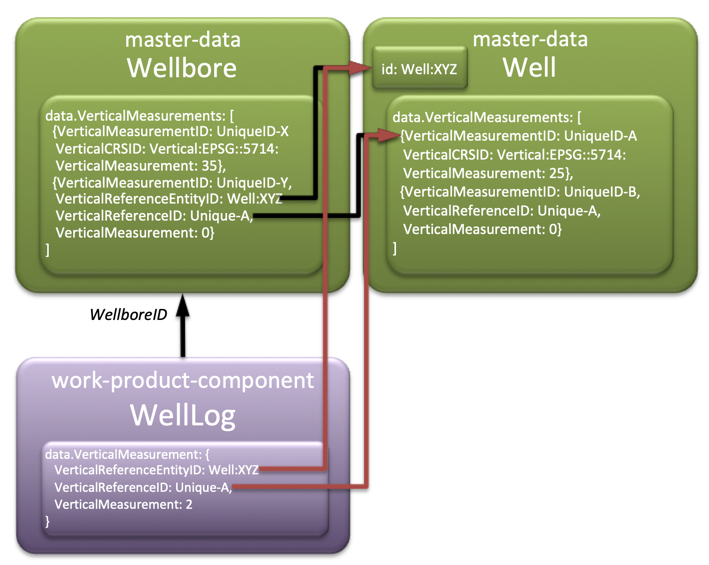
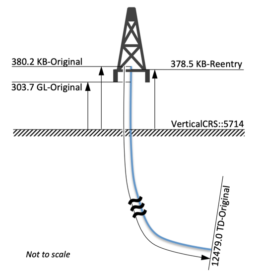
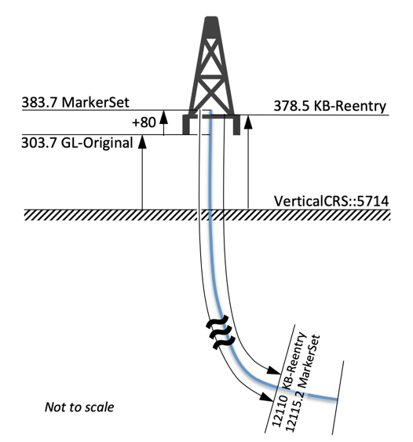

<a name="TOC"></a> Previous Chapter: [2 Group Type](02-GroupType.md)

[[_TOC_]]

# 3 Vertical Measurements

Facility entities have a generalized structure for capturing the vertical location of points of interest in the
facility. This usually applies to Wellbore facilities and where in the hole the point occurs, though it may apply to
other facilities such as where ground level is relative to a well head, or where the deck in a production platform is.
This generic style is a shift from many systems, which capture each reference point as a separate, explicit entry. The
benefit of this style is that it is fully extensible and is easy for related objects to reference.

## 3.1 Vertical Measurement Schema

For clarity, the schema fragment shown here resolves all the “abstract” references as they are manifested in the
Wellbore entity, and omits unrelated properties. The actual vertical measurements structure begins with
the `VerticalMeasurements` object. The additional `DefaultVerticalMeasurementID` property is a special addition in
Wellbore and shows one way the vertical measurements structure can be used. The same structure is present in Well. It
also uses some special properties that reference the structure – `DefaultVerticalCRSID`
and `DefaultVerticalMeasurementID`.

<details>
<summary markdown="span">master-data--Wellbore Schema Fragment with <code>VerticalMeasurements[]</code> </summary>

The full documentation and access to schemas see [Wellbore](../../E-R/master-data/Wellbore.1.5.1.md).

```json
{
  "$schema": "http://json-schema.org/draft-07/schema#",
  "title": "Wellbore",
  "properties": {
    "data": {
      "type": "object",
      "properties": {
        "DefaultVerticalMeasurementID": {
          "description": "The default datum reference point, or zero depth point, used to determine other points vertically in a wellbore. References an entry in the Vertical Measurements array of this wellbore.",
          "type": "string"
        },
        "VerticalMeasurements": {
          "description": "List of all depths and elevations pertaining to the wellbore, like, plug back measured depth, total measured depth, KB elevation",
          "type": "array",
          "x-osdu-indexing": {
            "type": "nested"
          },
          "items": {
            "allOf": [
              {
                "type": "object",
                "title": "Vertical Measurement ID",
                "properties": {
                  "VerticalMeasurementID": {
                    "description": "The ID for a distinct vertical measurement within the Wellbore VerticalMeasurements array so that it may be referenced by other vertical measurements if necessary.",
                    "type": "string"
                  },
                  "RigID": {
                    "type": "string",
                    "title": "Rig ID",
                    "description": "The relationship to the rig, which was used while this vertical measurement was in active use.",
                    "pattern": "^[\\w\\-\\.]+:master-data\\-\\-Rig:[\\w\\-\\.\\:\\%]+:[0-9]*$",
                    "x-osdu-relationship": [
                      {
                        "GroupType": "master-data",
                        "EntityType": "Rig"
                      }
                    ]
                  }
                }
              },
              {
                "$ref": "#/definitions/osdu:wks:AbstractFacilityVerticalMeasurement:1.0.0"
              }
            ]
          }
        }
      }
    }
  },
  "definitions": {
    "osdu:wks:AbstractFacilityVerticalMeasurement:1.0.0": {
      "x-osdu-schema-source": "osdu:wks:AbstractFacilityVerticalMeasurement:1.0.0",
      "title": "AbstractFacilityVerticalMeasurement",
      "description": "A location along a wellbore, _usually_ associated with some aspect of the drilling of the wellbore, but not with any intersecting _subsurface_ natural surfaces.",
      "type": "object",
      "properties": {
        "EffectiveDateTime": {
          "type": "string",
          "description": "The date and time at which a vertical measurement instance becomes effective.",
          "format": "date-time",
          "x-osdu-frame-of-reference": "DateTime"
        },
        "VerticalMeasurement": {
          "type": "number",
          "description": "The value of the elevation or depth. Depth is positive downwards from a vertical reference or geodetic datum along a path, which can be vertical; elevation is positive upwards from a geodetic datum along a vertical path. Either can be negative.",
          "x-osdu-frame-of-reference": "UOM_via_property:VerticalMeasurementUnitOfMeasureID"
        },
        "TerminationDateTime": {
          "type": "string",
          "description": "The date and time at which a vertical measurement instance is no longer in effect.",
          "format": "date-time",
          "x-osdu-frame-of-reference": "DateTime"
        },
        "VerticalMeasurementTypeID": {
          "type": "string",
          "description": "Specifies the type of vertical measurement (TD, Plugback, Kickoff, Drill Floor, Rotary Table...).",
          "pattern": "^[\\w\\-\\.]+:reference-data\\-\\-VerticalMeasurementType:[\\w\\-\\.\\:\\%]+:[0-9]*$",
          "x-osdu-relationship": [
            {
              "GroupType": "reference-data",
              "EntityType": "VerticalMeasurementType"
            }
          ]
        },
        "VerticalMeasurementPathID": {
          "type": "string",
          "description": "Specifies Measured Depth, True Vertical Depth, or Elevation.",
          "pattern": "^[\\w\\-\\.]+:reference-data\\-\\-VerticalMeasurementPath:[\\w\\-\\.\\:\\%]+:[0-9]*$",
          "x-osdu-relationship": [
            {
              "GroupType": "reference-data",
              "EntityType": "VerticalMeasurementPath"
            }
          ]
        },
        "VerticalMeasurementSourceID": {
          "type": "string",
          "description": "Specifies Driller vs Logger.",
          "pattern": "^[\\w\\-\\.]+:reference-data\\-\\-VerticalMeasurementSource:[\\w\\-\\.\\:\\%]+:[0-9]*$",
          "x-osdu-relationship": [
            {
              "GroupType": "reference-data",
              "EntityType": "VerticalMeasurementSource"
            }
          ]
        },
        "WellboreTVDTrajectoryID": {
          "type": "string",
          "description": "Specifies what directional survey or wellpath was used to calculate the TVD.",
          "pattern": "^[\\w\\-\\.]+:work-product-component\\-\\-WellboreTrajectory:[\\w\\-\\.\\:\\%]+:[0-9]*$",
          "x-osdu-relationship": [
            {
              "GroupType": "work-product-component",
              "EntityType": "WellboreTrajectory"
            }
          ]
        },
        "VerticalMeasurementUnitOfMeasureID": {
          "type": "string",
          "description": "The unit of measure for the vertical measurement. If a unit of measure and a vertical CRS are provided, the unit of measure provided is taken over the unit of measure from the CRS.",
          "pattern": "^[\\w\\-\\.]+:reference-data\\-\\-UnitOfMeasure:[\\w\\-\\.\\:\\%]+:[0-9]*$",
          "x-osdu-relationship": [
            {
              "GroupType": "reference-data",
              "EntityType": "UnitOfMeasure"
            }
          ]
        },
        "VerticalCRSID": {
          "type": "string",
          "description": "A vertical coordinate reference system defines the origin for height or depth values. It is expected that either VerticalCRSID or VerticalReferenceID reference is provided in a given vertical measurement array object, but not both.",
          "pattern": "^[\\w\\-\\.]+:reference-data\\-\\-CoordinateReferenceSystem:[\\w\\-\\.\\:\\%]+:[0-9]*$",
          "x-osdu-relationship": [
            {
              "GroupType": "reference-data",
              "EntityType": "CoordinateReferenceSystem"
            }
          ]
        },
        "VerticalReferenceID": {
          "type": "string",
          "description": "The reference point from which the relative vertical measurement is made. This is only populated if the measurement has no VerticalCRSID specified. The value entered must match the VerticalMeasurementID for another vertical measurement array element in Wellbore or Well or in a related parent facility. The relationship should be  declared explicitly in VerticalReferenceEntityID. Any chain of measurements must ultimately resolve to a Vertical CRS. It is expected that a VerticalCRSID or a VerticalReferenceID is provided in a given vertical measurement array object, but not both."
        },
        "VerticalReferenceEntityID": {
          "type": "string",
          "description": "This relationship identifies the alternative entity the VerticalReferenceID is found in, when not referencing a measurement contained within its own array; for example, a wellbore referencing a vertical measurement from its parent well.",
          "pattern": "^[\\w\\-\\.]+:(master-data\\-\\-Wellbore|master-data\\-\\-Well):[\\w\\-\\.\\:\\%]+:[0-9]*$",
          "x-osdu-relationship": [
            {
              "GroupType": "master-data",
              "EntityType": "Wellbore"
            },
            {
              "GroupType": "master-data",
              "EntityType": "Well"
            },
            {
              "GroupType": "master-data",
              "EntityType": "Rig"
            }
          ]
        },
        "VerticalMeasurementDescription": {
          "type": "string",
          "description": "Text which describes a vertical measurement in detail."
        }
      }
    }
  }
}
```

</details>

## 3.2 Vertical Measurement Design

### 3.2.1 Definition

A vertical measurement is a location in a facility as measured up or down. X/Y locations are handled through other
structures. Elevations may sometimes be used in those other structures, so vertical measurement is intended to be used
more for points where the X/Y location is constrained or unimportant. The best example is in the context of a wellbore,
where a vertical measurement is a location within the borehole. It may be a point used as a reference for taking
distance measurements, or it may indicate the location of a special event, such as the total depth or a plug-back. It is
not meant to show where subsurface geologic interfaces occur, since that is the purpose of the wellbore marker. It is
also not meant to describe the detailed wellbore schematic, as that is a special class to be developed.

### 3.2.2 Structure

#### 3.2.2.1 Vertical Measurements in Facilities (Well, Wellbore, Rig, ...)

A vertical measurement is a member of an array of vertical measurements associated with a facility such as a wellbore.
Each measurement consists of properties which describe the context and content of the measurement: its position in the
facility, what the position is referenced to, what it is a measurement of, whether the measurement is vertical or along
the path (and which path description), the units of measure, and so on. The `VerticalMeasurementSourceID` property tells
what facility operation resulted in the measurement. This is typically used in Wellbore to define whether the depth came
from the Driller’s drill string estimate or the Logger’s wireline estimate. Note that most properties in the OSDU schema
are optional.

#### 3.2.2.2 VerticalMeasurementID

The measurement is identified by a `VerticalMeasurementID`. This is an arbitrary name, number (as string), or other
string that is unique among all the vertical measurements within that facility. Although this is a free text string,
some guidelines for naming will help consistency and usability.

The `VerticalMeasurementID` should:

* Be concise: it will likely appear as a label in data entry applications, so it needs to be clearly readable by humans.
  <br>In order to guarantee uniqueness, a company might choose to use a GUID or other computer identifier, but this may
  make it harder to use and understand when the ID is being used in another entity that references the
  Wellbore's `VerticalMeasurements[]` array.
* Be descriptive: it needs to distinguish between similar measurements to avoid confusion where data managers need to be
  careful about selecting the right value
* Avoid company jargon: its meaning needs to be clear if it is part of a data trade
  * Example: KB February 1998 Workover

Each measurement is referenced to some starting point. The starting point may either be another point in the facility,
identified by its `VerticalMeasurementID` via the `VerticalReferenceID`, or by a proper geodetic datum as specified in
the `VerticalCRSID`.

#### 3.2.2.3 VerticalReferenceID, VerticalReferenceEntityID



Figure "Vertical Reference by Entity Relationships"

The figure above shows how `VerticalMeasurementID` references can be made using the
`VerticalReferenceID`. `VerticalReferenceID` **_should_** be paired with a `VerticalReferenceEntityID` clearly defining
the entity, which contains a `data.VerticalMeasurements[]` array element with `VerticalMeasurementID`
== `VerticalReferenceID`. If the `VerticalReferenceID` is present without a `VerticalReferenceEntityID`, then
the `VerticalReferenceEntityID` is by definition the record itself.

The meaning of the other properties should be evident from their descriptions, although one is worthy of note.
The `VerticalMeasurementPathID` is not a concept typically separated out on its own. Most traditional data models have
separate properties for measured depths, true vertical depths, or elevations. Here, they are mixed together, and it is
the role of the `VerticalMeasurementPathID` to identify which type a measurement is. A good example is the treatment of
the position of the seabed. This could be either designated as a water depth, which is a True Vertical Depth, or a
mudline, which is an Elevation. The True Vertical Depth is a positive number, and the Elevation is a negative number.
The sense of direction is explained in the definition of `VerticalMeasurement`. Both are most likely referenced to the
Mean Sea Level (MSL) through the `VerticalCRSID`.

#### 3.2.2.4 Vertical Measurement in Work-Product-Components

WellLog, WellboreMarkerSet, WellboreTrajectory, for example, do **_not_** contain an array of vertical measurement like
facilities but a single `data.VerticalMeasurement`. This structure is the same as an element in the
facility's `data.VerticalMeasurements[]`, an
[AbstractFacilityVerticalMeasurement](../../E-R/abstract/AbstractFacilityVerticalMeasurement.1.0.0.md).
Work-product-components do not contain a vertical measurement identifier but may refer to a `VerticalMeasurementID` via
the `VerticalReferenceID`. The WellLog in the figure "_Vertical Reference by Entity Relationships_" above exemplified
this.

Work-product-components can contain absolute references, independent of the 'facility' they belong to, or by reference
as in the figure "_Vertical Reference by Entity Relationships_" above.

## 3.3 Vertical Measurement Usage

### 3.3.1 Within a Wellbore

As a master data entity, Wellbore information will be modified over time as additional operations are carried out.
Hence, the vertical measurement array will grow over time when new points are established. Initially, it would be
expected that the usual datum reference points will be entered: Kelly Bushing (KB), drill floor, rotary table, and so
on. As new operations are completed, those points would also get added to the array, such as total depth, plug-back
depth, kick-off point, and so on.

As mentioned previously, each vertical measurement is referenced to some datum or zero-point. In many cases, the
measurement is taken from a geodetic surface, such as MSL. Then, the `VerticalCRSID` is used to formally identify the
surface. There is no MSL or “permanent datum” member in the vertical measurement array because elevations are directly
referenced to the appropriate vertical Coordinate Reference System (CRS).

In other cases, when the measurement, such as total depth, is taken from a wellbore reference point, like the drill
floor, then the total depth entry references the drill floor entry through the `VerticalReferenceID`, and the drill
floor entry references its geodetic datum.

A property is added to Wellbore to contain a `DefaultVerticalMeasurementID`. This contains the unique identifier in the
Wellbore’s array of vertical measurements, which is the most likely reference point for measured depths. If measured
depth data in objects related to the Wellbore has no vertical measurement reference, such as the Top or Bottom-Measured
Depth in a WellLog, this one could be used.

### 3.3.2 Within a Well

The Well case is not much different from the Wellbore. Since the Well has more to do with the surface location, the
points contained here should be ones that are more static during the life of the Well and more associated with the
surface than with the subsurface. Typical reference points would be mudline elevation, water depth, ground level, etc.

Additional properties are added to the Well to contain a `DefaultVerticalMeasurementID` and a `DefaultVerticalCRSID`.
The `DefaultVerticalMeasurementID` is used in the same way as the equivalent property in Wellbore. No statement is made
about using this value for Wellbore objects when the Wellbore’s default is null. In the case of
the `DefaultVerticalCRSID`, it provides a default datum where elevation information does not have an explicit datum in
either the Well or its Wellbores.

### 3.3.3 From Another Entity

When other entities refer to points in a wellbore, they should use the vertical measurement list by reference and not
re-create their own datum points. This ensures integrity in the vertical measurement.

For example, the wellbore marker lists the measured depths for which geologic formation tops intersect the wellbore. To
give meaning to the depths, the set carries a `VerticalReferenceID` property, which is the name of the entry in the
Wellbore’s `data.VerticalMeasurements[]` array to which the marker-measured depths are referenced, such as the KB. There is no
need to specify the datum elevation and its geodetic reference in all the marker sets that make use of it. The identity
of the single entry in the Wellbore’s array is sufficient to locate all the measured depths in the marker set.

### 3.3.4 JSON Example

Here is a scenario with an example following.



There are four references recorded, all eventually referencing the VerticalCRS::5714 as the Vertical Reference Surface
(VRS) in the figure (The example uses human-readable names for `VerticalMeasurementID`, however, using GUIDs would
reduce the risk of duplicate `VerticalMeasurementID` keys.):

1. **KB-Original**, an elevation (i.e. a height, positive upwards), 380.2 ft above the Mean Sea Level (MSL) represented
   as VerticalCRS::5714.
2. **GL-Original**, an elevation, 303.7 ft above the MSL represented as VerticalCRS::5714.
3. **TD-Original**, a measured driller's depth (i.e. downwards positive), which uses **KB-Original** 380.2 as zero depth
   point (ZDP). It is good practice to identify the source entity defining the vertical measurement reference
   via `VerticalReferenceEntityID`, here the wellbore itself.
4. **KB-Reentry**, an elevation, 378.5 ft above the Mean Sea Level (MSL) represented as VerticalCRS::5714.

As default, the KB-Original is identified.

This scenario translates into the following record fragment:

<details>
<summary markdown="span">master-data--Wellbore Example Record Fragment</summary>

More complete examples are provided in context
of [wellbore trajectory computation](../../Examples/WorkedExamples/WellboreTrajectory/README.md).

<OsduImportJSON>[Excerpt of a Wellbore record replicating the figure above](../../Examples/WorkedExamples/_Guide/WellboreVerticalMeasurementFragment.json#only.data.VerticalMeasurements[]|DefaultVerticalMeasurementID)</OsduImportJSON>

```json
{
  "data": {
    "VerticalMeasurements": [
      {
        "VerticalMeasurementID": "KB-Original",
        "VerticalMeasurement": 380.2,
        "VerticalMeasurementTypeID": "partition-id:reference-data--VerticalMeasurementType:KellyBushing:",
        "VerticalMeasurementPathID": "partition-id:reference-data--VerticalMeasurementPath:TrueVerticalHeight:",
        "VerticalMeasurementUnitOfMeasureID": "partition-id:reference-data--UnitOfMeasure:ft:",
        "VerticalCRSID": "partition-id:reference-data--CoordinateReferenceSystem:Vertical:EPSG::5714:"
      },
      {
        "VerticalMeasurementID": "GL-Original",
        "VerticalMeasurement": 303.7,
        "VerticalMeasurementTypeID": "partition-id:reference-data--VerticalMeasurementType:GroundLevel:",
        "VerticalMeasurementPathID": "partition-id:reference-data--VerticalMeasurementPath:TrueVerticalHeight:",
        "VerticalMeasurementUnitOfMeasureID": "partition-id:reference-data--UnitOfMeasure:ft:",
        "VerticalCRSID": "partition-id:reference-data--CoordinateReferenceSystem:Vertical:EPSG::5714:"
      },
      {
        "VerticalMeasurementID": "TD-Original",
        "VerticalMeasurement": 12479.0,
        "VerticalMeasurementTypeID": "partition-id:reference-data--VerticalMeasurementType:TotalDepth:",
        "VerticalMeasurementPathID": "partition-id:reference-data--VerticalMeasurementPath:MeasuredDepth:",
        "VerticalMeasurementUnitOfMeasureID": "partition-id:reference-data--UnitOfMeasure:ft:",
        "VerticalMeasurementSourceID": "partition-id:reference-data--VerticalMeasurementSource:DRL:",
        "VerticalReferenceID": "KB-Original",
        "VerticalReferenceEntityID": "partition-id:master-data--Wellbore:AB1234-1:"
      },
      {
        "VerticalMeasurementID": "KB-Reentry",
        "VerticalMeasurement": 378.5,
        "VerticalMeasurementTypeID": "partition-id:reference-data--VerticalMeasurementType:KellyBushing:",
        "VerticalMeasurementPathID": "partition-id:reference-data--VerticalMeasurementPath:TrueVerticalHeight:",
        "VerticalMeasurementUnitOfMeasureID": "partition-id:reference-data--UnitOfMeasure:ft:",
        "VerticalCRSID": "partition-id:reference-data--CoordinateReferenceSystem:Vertical:EPSG::5714:",
        "EffectiveDateTime": "2019-11-16"
      }
    ],
    "DefaultVerticalMeasurementID": "KB-Original"
  }
}
```

</details>

The corresponding entry in our marker example for a top identified from data acquired during the re-entry might look
like this snippet:

<details>
<summary markdown="span">work-product-component--WellboreMarkerSet Example Record Fragment</summary>

A more complete worked example record can
be [found here](../../Examples/WorkedExamples/WellboreMarkerSet/README.md).

<OsduImportJSON>[Excerpt of a WellboreMarkerSet record showing a VerticalReferenceID "KB-Reentry"](../../Examples/WorkedExamples/_Guide/WellboreMarkerSetVerticalReferenceByName.json#only.data.VerticalMeasurement)</OsduImportJSON>


```json
{
  "data": {
    "VerticalMeasurement": {
      "VerticalReferenceID": "KB-Reentry",
      "VerticalReferenceEntityID": "partition-id:master-data--Wellbore:AB1234-1:",
      "VerticalMeasurement": 0
    }
  }
}
```

In this case the consumer of the WellboreMarkerSet has to look up the definition of the parent Wellbore's
`data.VerticalMeasurements[]`.

</details>

### 3.3.5 From Another Entity and With Local Offsets

While it is preferred to point directly at a datum point in the Wellbore array, there may be circumstances where a work
product component has a private datum. In this case, the datum should be an offset from an existing point in the
Wellbore array. To accomplish this, elements of the vertical measurements structure may be included to provide the
additional offset information. Here is an example where the wellbore marker was measured directly from its own datum,
which was assessed to be 80 feet above ground level. Rather than modify the master Wellbore record, the local offset is
recorded within the marker:



<details>
<summary markdown="span">work-product-component--WellboreMarkerSet Example Record Fragment</summary>

<OsduImportJSON>[Excerpt of a WellboreMarkerSet record showing an explicit VerticalMeasurement](../../Examples/WorkedExamples/_Guide/WellboreMarkerSetVerticalReferenceExplicit.json#only.data.VerticalMeasurement)</OsduImportJSON>

```json
{
  "data": {
    "VerticalMeasurement": {
      "VerticalMeasurement": 80.0,
      "VerticalMeasurementTypeID": "partition_id:reference-data--VerticalMeasurementType:GroundLevel:",
      "VerticalMeasurementPathID": "partition_id:reference-data--VerticalMeasurementPath:TrueVerticalHeight:",
      "VerticalMeasurementUnitOfMeasureID": "partition_id:reference-data--UnitOfMeasure:ft:",
      "VerticalReferenceID": "GL-Original",
      "VerticalReferenceEntityID": "partition-id:master-data--Wellbore:AB1234-1:"
    }
  }
}
```

</details>

The same wellbore marker at 12110 ft from Original-GL would then appear at 12115.2 ft from WellboreMarkerSet's
`data.VerticalMeasurement` ('MarkerSet'). The cumulative height from MSL is 'MarkerSet' 383.7 ft, which is 5.2 ft above
**KB-Reentry**.

## 3.4 Recommendations, Best Practice

Data with incomplete or absent vertical references are unreliable and cannot be trusted. Complete `VerticalMeasurements`
/ `VerticalMeasurement` are essential for data quality.

> * When using chained `VerticalMeasurements` as vertical references, make sure that they **_always_** end in an absolute
  reference, i.e., a populated  `VerticalCRSID`, acting as Vertical Reference Surface (VRS).
>   * If values are absent the following defaults are to be assumed:
>     * absent `VerticalCRSID` and `VerticalReferenceID` (unchained, unreferenced VerticalMeasurement) — assume Mean Sea
Level `"partition-id:reference-data--CoordinateReferenceSystem:Vertical:EPSG::5714:"`.
>     * absent numeric value in VerticalMeasurement — assume `0.0` (no relative offset).
> * **Avoid complex or unnecessary chained vertical references** where possible. Generally single-level chains are
    sufficient, e.g. KellyBushing &rarr; GroundLevel with elevation from MSL should be sufficient. Justification:
    Processing chained vertical references by all consumers is error-prone.
> * When using "**shared vertical references**" in a facility, e.g., a Well, make sure the `VerticalReferenceID` is paired
    with a `VerticalReferenceEntityID` indicating which record the `VerticalMeasurementID` == `VerticalReferenceID` is
    found. If the `VerticalReferenceEntityID` value is absent, the `VerticalMeasurementID` == `VerticalReferenceID`
    element must be found in the same record.
> * **Fallback** procedures in case `VerticalMeasurements` / `VerticalMeasurement` are not populated (indicating data quality issues):
>   * Absent or empty `data.VerticalMeasurement` in work-product-components like WellLog, WellboreTrajectory:
>     * navigate to the parent **Wellbore** via `WellboreID` and use `data.DefaultVerticalMeasurementID` to identify the `data.VerticalMeasurements[]` member where `VerticalMeasurementID` is equal to `data.DefaultVerticalMeasurementID`,
>     * else, navigate to the parent **Well** via data.WellID and use the Well's
>       * `data.DefaultVerticalMeasurementID` to identify the data.VerticalMeasurements[] member where `VerticalMeasurementID` is equal to `data.DefaultVerticalMeasurementID`,
>       * else, assume offset `0.0` from `MSL`, which is unlikely to be correct.
> * It is good practice indicating the WellboreTrajectory, which is used for MD &rarr; TVD conversions in
  the `data.VerticalMeasurements[].WellboreTVDTrajectoryID` or `data.VerticalMeasurement.WellboreTVDTrajectoryID` for
  work-product-components, if true vertical data are included in the context. If no such relationship is declared, the
  Wellbore's `data.DefinitiveTrajectoryID` is assumed.
> * Always declare `VerticalMeasurementPathID` to indicate the direction of measurement (elevation `TrueVerticalHeight` or depth `MeasuredDepth`, `TrueVerticalDepth`).
>   * If absent, assume `TrueVerticalHeight` as elevation for vertical references.
> * **Use the same vertical CRS**, if possible.
> * **Use the same vertical units**, if possible.
> * Despite explicit definitions of the vertical units inside the data structures (`VerticalMeasurementUnitOfMeasureID`),
  also declare the vertical units in the `meta[]` block. The normalizer is using those declarations as the basis for
  unit of measure normalization. More details in the [Frame of Reference section](04-FrameOfReference.md).


---

## Links

1. Return to the [Beginning of the Chapter](#TOC)
2. Next Chapter: [4 Frame of Reference](04-FrameOfReference.md)
3. Browse to the [Schema Usage Guide Table of Contents](../README.md)