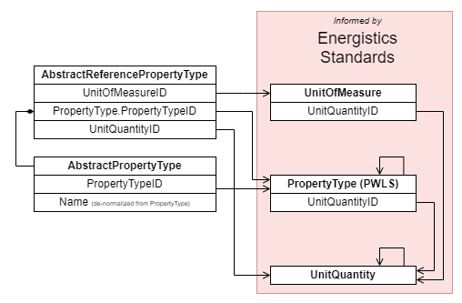
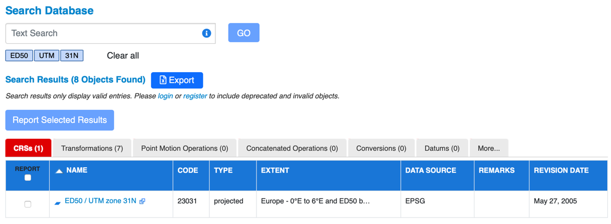
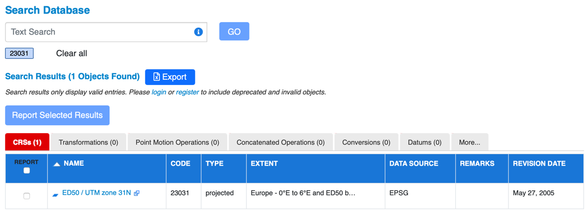
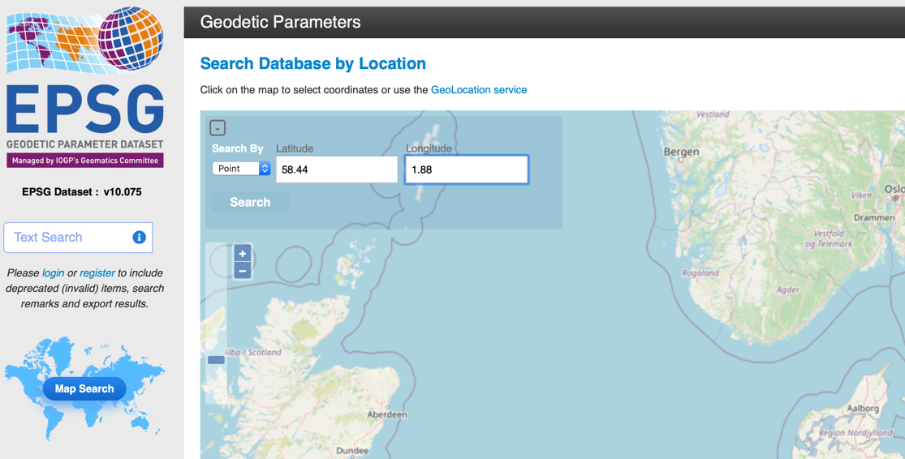
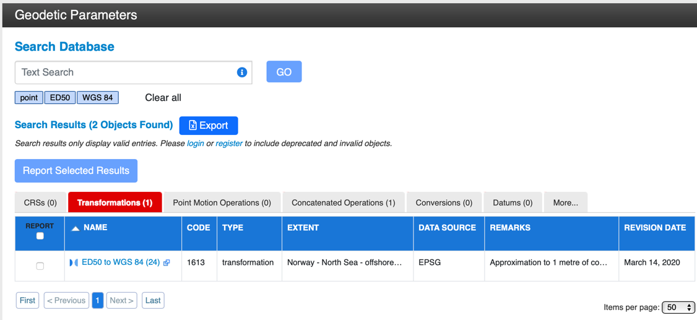
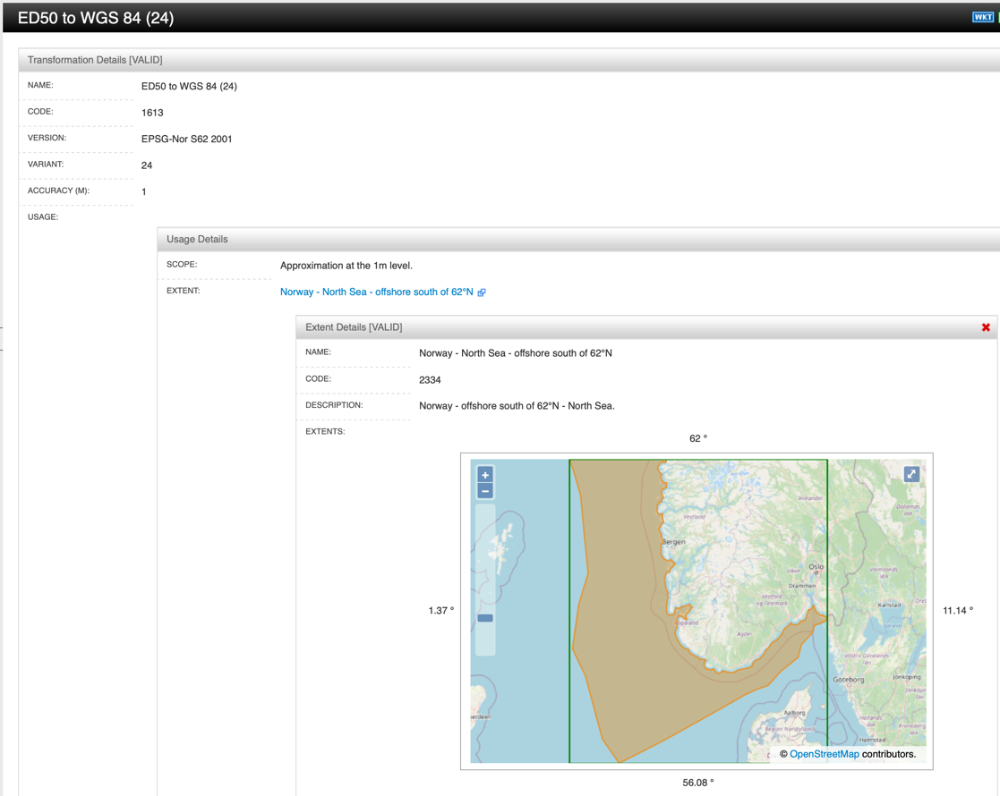

<a name="TOC"></a> Previous Chapter: [3 Vertical Measurements](03-VerticalMeasurements.md)

[[_TOC_]]

# 4 Frame of Reference

The general term Frame of Reference (FoR) includes definitions of:

- Units of Measure
- Coordinate Reference System (CRS)
- Date and time zones, DateTime formatting
- Azimuth reference

With the exception of `Dates` and `DateTimes`, all FoR definitions provide context for numeric properties or arrays of
numbers. The standard JSON Schema has no means to carry the additional FoR context. For `DateTime` properties there is
rudimentary support; however, only stating that the property carries a `DateTime` string;

<details>
<summary markdown="span">the exact format and that the time zone is left open:</summary>

```
  "CreationDateTime": {
    "type": "string",
    "format": "date-time",
    "description": "Creation DateTime"
  }
```

</details>

> **Attention:**
>
> Software libraries designed to validate JSON records against JSON schemas may apply _strict_ validation of string if
> the `format` is set to date or date-time. In the strict JSON schema interpretation, the strings must refer to the
> standard format defined in [ISO 8601](https://en.wikipedia.org/wiki/ISO_8601).
>
> Strict validation is **_not recommended_** in OSDU since the dates and times are expected to be ingested as is,
> without conversions on ingestion.

## 4.1 Unit of Measure Foundation

OSDU uses the Energistics Unit Of Measure Standard for dimensions, quantities and units. The main standards are

1. Energistics Unit of Measure Standard V1, represented in OSDU via
   1. [UnitQuantity](../../E-R/reference-data/UnitQuantity.1.0.0.md) covering Energistics unit dimension and unit
      quantity. The OSDU catalog contains the Energistics definitions and OSDU specific extensions not supported by
      Energistics.
   2. [UnitOfMeasure](../../E-R/reference-data/UnitOfMeasure.1.0.0.md) covering Energistics units, as well as OSDU
      extensions not supported by Energistics.
2. Energistics PWLS 3 Properties
   1. [PropertyType](../../E-R/reference-data/PropertyType.1.0.0.md), a hierarchical framework of property, which add
      additional semantics to the unit quantities.<br>
      For historical reasons and name ambiguities, PropertyType records are identified by UUIDs. For human friendliness,
      OSDU created [AbstractPropertyType](../../E-R/abstract/AbstractPropertyType.1.0.0.md), which adds a de-normalized
      name to the `PropertyTypeID` reference.

Further context can be provided via
[AbstractReferencePropertyType](../../E-R/abstract/AbstractReferencePropertyType.1.2.0.md).

The diagram below shows the relationships between the different re-usable abstract schema fragments and the
Energistics-sourced reference data record types:



> **_Recommendation_**
>
> In many cases, data can be contextualized at different levels in one or more ways:
> * Direct reference to UnitOfMeasure, implying a dimension via UnitOfMeasure &rarr; UnitQuantity.
> * Reference to UnitQuantity, implying a subset of units.
> * Reference to PropertyType &rarr; UnitQuantity
>
> If more than one relationship is populated, the 'competing' references must eventually end up in the same unit
> dimension (=root) UnitQuantity record (lower right in the diagram).

[Back to TOC](#TOC)

## 4.2 Challenge

One of the principles of the OSDU Data Platform is to keep data unconverted in its original FoR context. This enables
the original data to be reprocessed in case of incorrectly specified FoR parameters, avoiding re-ingestion.

### 4.2.1 Normalization

Normalization is the process of converting data values into a standardized form (common units, single coordinate
reference system, consistent format, and so on). Since the OSDU Data Platform holds data in its original, un-normalized
state, it must be possible to normalize data records automatically when requested by consumers. One of the primary
consumers of normalization is the indexer for search, which requires comparable numerical values for all FoR sensitive
data. Other consumers require similar transformations into an application FoR context.

> **Note**<br>
> The normalization is performed by the Storage Service's
> [_"Fetch Records"_](https://community.opengroup.org/osdu/platform/system/storage/-/blob/master/docs/docs/api.md#fetch-records)
> API. The normalization is currently **_only_** processing the frame of reference information in the `meta[]` property.
> Traditionally, relationships to reference-data--UnitOfMeasure were embedded in the record. These definitions are
> **_not_** processed.

The frame of reference definition via `meta[]` supports an inhomogeneous context with different units associated to
different properties and in the example below, where `SamplingInterval`, `StartTime` and `EndTime`, and `TraceLength`
are represented in three different units, `us`, `ms` and `s`.

<details>
<summary markdown="span">Example <code>meta[]</code> section in a <code>SeismicTraceData</code> record with different units associated to individual properties.</summary>

<OsduImportJSON>[Complete, though abridged `SeismicTraceData` record](../../Examples/WorkedExamples/SeismicLoadingManifests/Examples/Records/seismic/seismic-wpc-inhomogeneous-for.json#only.meta)</OsduImportJSON>

```json
{
  "meta": [
    {
      "kind": "Unit",
      "name": "us",
      "persistableReference": "{\"abcd\":{\"a\":0.0,\"b\":1e-06,\"c\":1.0,\"d\":0.0},\"symbol\":\"us\",\"baseMeasurement\":{\"ancestry\":\"T\",\"type\":\"UM\"},\"type\":\"UAD\"}",
      "unitOfMeasureID": "partition-id:reference-data--UnitOfMeasure:us:",
      "propertyNames": [
        "SampleInterval"
      ]
    },
    {
      "kind": "Unit",
      "name": "ms",
      "persistableReference": "{\"abcd\":{\"a\":0.0,\"b\":0.001,\"c\":1.0,\"d\":0.0},\"symbol\":\"ms\",\"baseMeasurement\":{\"ancestry\":\"T\",\"type\":\"UM\"},\"type\":\"UAD\"}",
      "unitOfMeasureID": "partition-id:reference-data--UnitOfMeasure:ms:",
      "propertyNames": [
        "StartTime",
        "EndTime"
      ]
    },
    {
      "kind": "Unit",
      "name": "s",
      "persistableReference": "{\"abcd\":{\"a\":0.0,\"b\":1.0,\"c\":1.0,\"d\":0.0},\"symbol\":\"s\",\"baseMeasurement\":{\"ancestry\":\"T\",\"type\":\"UM\"},\"type\":\"UAD\"}",
      "unitOfMeasureID": "partition-id:reference-data--UnitOfMeasure:s:",
      "propertyNames": [
        "TraceLength"
      ]
    }
  ]
}
```

</details>

> **Recommendation 1**<br>
> This demonstrates the power of the `meta[]` section. For the benefit of the consumers, it is, however, strongly
> recommended reducing the complexity by using the _same_ units for the _same_ measurements (or UnitQuantity) in one
> and the _same_ record.

> **Recommendation 2**<br>
> If an inhomogeneous frame of reference is required, then omit the explicit `UnitOfMeasure` relationships in the
> record - in the example the `TraceDomainUOM` (see schema for
> [SeismicTraceData](../../E-R/work-product-component/SeismicTraceData.1.8.0.md)) is not present.
> This avoids confusion.

[Back to TOC](#TOC)

### 4.2.2 Data Consistency and Validation

Data quality management and validation require additional indicators to constrain a specific FoR context for a property.
Certain depth properties, for example, must be associated with a length unit; should the record instance come with a
unit belonging to a dimension other than length, the record property can be flagged as inconsistent.

## 4.3 OSDU Conventions

The OSDU Data Platform introduces JSON Schema extension tags to fill in the required details. Following the JSON Schema
recommendation the tags are prefixed by “x-”, followed by the extension authority; for example, for FoR the tag is
called `x-osdu-frame-of-reference`. All OSDU extension tags are declared and described in the `OsduJsonExtensions`
reference value type.

The following section explains how the FoR is manifested in the JSON Schema data definition. The section after that
provides examples of how the schema is used with excerpts from sample record JSON documents.

### 4.3.1 FoR in the Schema

The `x-osdu-frame-of-reference` tags are added to the property definitions. The tag values describe the meta-context;
i.e., to which context the property is sensitive. The following contexts are described:

- [4.3.1.1 Unit of Measure Schema](#4311-unit-of-measure-schema)
- [4.3.1.2 Coordinate Reference System (CRS) Schema](#4312-coordinate-reference-system-crs-schema)
- [4.3.1.3 DateTime Schema](#4313-datetime-schema)
- [4.3.1.4 Azimuth Reference Schema](#4314-azimuth-reference-schema)

#### 4.3.1.1 Unit of Measure Schema

Properties sensitive to a unit of measure context are marked with "`x-osdu-frame-of-reference`": "`UOM`". This indicates
the 'frame of reference' sensitivity to the normalizer[^1]. A given data record will contain a unit of measure reference
to this property name providing the detailed context. The schema can further constrain the context by adding
a `UnitQuantity`;

<details>

<summary markdown="span">A schema fragment with <code>"x-osdu-frame-of-reference": "UOM:unit quantity"</code>:</summary>

<OsduImportJSON>[AbstractReferenceLevel, full schema.](../../Authoring/abstract/AbstractReferenceLevel.1.0.0.json#only.properties.SeismicReplacementVelocity)</OsduImportJSON>

```json
{
  "properties": {
    "SeismicReplacementVelocity": {
      "type": "number",
      "title": "Seismic Replacement Velocity",
      "description": "The replacement velocity value used to produce vertical static shifts in seismic data.",
      "example": 1480,
      "x-osdu-frame-of-reference": "UOM:length per time"
    }
  }
}
```

</details>

**Special Case**: Arrays of structures may contain explicit references in the array data structures. The unit of measure
context may be shared across multiple properties, which may vary across array elements.

<details>

<summary markdown="span">A schema fragment  with <code>"x-osdu-frame-of-reference": "UOM_via_property:PropertyName"</code>:</summary>

<OsduImportJSON>[AbstractFacilityVerticalMeasurement, full schema.](../../Authoring/abstract/AbstractFacilityVerticalMeasurement.1.0.0.json#only.properties.VerticalMeasurement|VerticalMeasurementUnitOfMeasureID)</OsduImportJSON>

```json
{
  "properties": {
    "VerticalMeasurement": {
      "type": "number",
      "description": "The value of the elevation or depth. Depth is positive downwards from a vertical reference or geodetic datum along a path, which can be vertical; elevation is positive upwards from a geodetic datum along a vertical path. Either can be negative.",
      "x-osdu-frame-of-reference": "UOM_via_property:VerticalMeasurementUnitOfMeasureID"
    },
    "VerticalMeasurementUnitOfMeasureID": {
      "type": "string",
      "description": "The unit of measure for the vertical measurement. If a unit of measure and a vertical CRS are provided, the unit of measure provided is taken over the unit of measure from the CRS.",
      "pattern": "^[\\w\\-\\.]+:reference-data\\-\\-UnitOfMeasure:[\\w\\-\\.\\:\\%]+:[0-9]*$"
    }
  }
}
```
</details>

The value "`UOM_via_property:VerticalMeasurementUnitOfMeasureID`" refers to a sibling
property "`VerticalMeasurementUnitOfMeasureID`" to "`VerticalMeasurement`"
which contains the unit of measure information.

#### 4.3.1.2 Coordinate Reference System (CRS) Schema

Coordinates typically consist of two or three numbers which need to be grouped. The Unit of Measure context is given by
the CRS itself and is not required. A data record may contain more than a single coordinate tuple, which require
separate CRS contexts. The schema marks properties to be CRS context-sensitive by "`x-osdu-frame-of-reference`": "`CRS`"
. Individual coordinates; i.e., unstructured properties, are then marked by their axis. The order does not follow the
CRS axis order but follows the rule X = Easting/Westing/Longitude, Y = Northing/Southing/Latitude, Z-Depth (downwards
increasing), and Z-Height (upwards increasing). A counter allows the grouping of multiple tuples.

OSDU well-known schemas use a standardized data structure, which does not require the CRS meta declarations. Instead, a
modified GeoJSON structure, [AbstractAnyCrsFeatureCollection](../../E-R/abstract/AbstractAnyCrsFeatureCollection.1.1.0.md),
is used, which contains the CRS description and/or reference to `reference-data--CoordinateReferenceSystem` embedded.
This structure fits the CRS converter service API's end-point `/convertGeoJson`, see the
[respective API specification](https://community.opengroup.org/osdu/platform/system/reference/crs-conversion-service/-/blob/master/docs/v3/api_spec/crs_converter_openapi.json).

[AbstractAnyCrsFeatureCollection](../../E-R/abstract/AbstractAnyCrsFeatureCollection.1.1.0.md) use the coordinate order
of GeoJSON, independent of the CRS's coordinate system axis order:

1. Easting/Westing/Longitude
2. Northing/Southing/Latitude
3. (optionally) elevation or depth, depending on the `VerticalCoordinateReferenceSystemID`.<br>
   **Note:** The correct treatment of 3D or 2D+1D coordinates is limited by the support of the CRS conversion service.
   At the time of writing this is limited to unit conversion and no proper vertical transformations. The data
   structures, however, are prepared to support any future capabilities of the CRS conversion service.

Non-standard, custom schemas may, however, use individually named coordinate properties matching, e.g., imported data
structures. Here the `meta` can still provide frame of reference context, like for units.

<details>
<summary markdown="span">An example set is presented below:</summary>

```json
{
  "X": {
    "description": "Easting coordinate.",
    "type": "number",
    "x-osdu-frame-of-reference": "CRS:0:X"
  },
  "Y": {
    "description": "Northing coordinate.",
    "type": "number",
    "x-osdu-frame-of-reference": "CRS:0:Y"
  },
  "Longitude": {
    "description": "Longitude coordinate.",
    "type": "number",
    "x-osdu-frame-of-reference": "CRS:1:X"
  },
  "Latitude": {
    "description": "Latitude coordinate.",
    "type": "number",
    "x-osdu-frame-of-reference": "CRS:1:Y"
  },
  "Height": {
    "description": "Elevation above MSL.",
    "type": "number",
    "x-osdu-frame-of-reference": "CRS:1:Z-Height"
  }
}

```

</details>

The properties X and Y are grouped by "`x-osdu-frame-of-reference`": "`CRS:0`" into a 2D coordinate tuple. The
properties Longitude, Latitude, and Height are grouped by "`x-osdu-frame-of-reference`": "`CRS:1`" into a 3D coordinate
tuple. The sequence is controlled by the :X, :Y, and :Z-Height.

A given data record will contain a CRS reference to these property names providing the detailed context; see FoR in the
Storage Record, see
[4.3.2.2 Coordinate Reference System (CRS) as meta Element](#4322-coordinate-reference-system-crs-as-meta-element)
below.

**Special Case**: The canonical OSDU schemas generally avoid individual coordinate values. The
`AbstractSpatialLocation`, for example, refers to GeoJSON (`AbstractFeatureCollection`) for the World Geodetic System
(WGS) 84[^2] object geometries and a self-contained `AbstractAnyCrsFeatureCollection`. GeoJSON does not require an
explicit CRS context since GeoJSON is referring to WGS 84 by definition. `AbstractAnyCrsFeatureCollection` carries the
CRS definition inside the structure, which is also directly consumed by the OSDU geodetic engine implementation
(CRS converter helper service, see
[Appendix A.2 OSDU System Services](90-References.md#appendix-a2-osdu-system-services)).

#### 4.3.1.3 DateTime Schema

As mentioned earlier, JSON Schema only marks properties as date-time by format. Dates and times are marked in the schema
as "`x-osdu-frame-of-reference`": "`DateTime`";

<details>

<summary markdown="span">A schema fragment with <code>"x-osdu-frame-of-reference": "DateTime"</code>:</summary>

<OsduImportJSON>[AbstractReferenceLevel, full schema](../../Authoring/abstract/AbstractReferenceLevel.1.0.0.json#only.properties.EffectiveDateTime)</OsduImportJSON>

```json
{
  "properties": {
    "EffectiveDateTime": {
      "type": "string",
      "title": "Effective Date Time",
      "description": "The date and time at which this reference level instance becomes effective.",
      "format": "date-time",
      "x-osdu-frame-of-reference": "DateTime"
    }
  }
}
```

</details>

The JSON Schema would allow further constraint of the format via the pattern keyword, but that would mean a global
decision and all records would have to follow the same format. Generally, the pattern is not used so as to leave the
actual description to the record.

#### 4.3.1.4 Azimuth Reference Schema

The Azimuth reference is listed here for completeness and future specification. The goal is to describe the Azimuth
context completely for magnetic North, map, or grid North *versus* true North/geographic North.

[Back to TOC](#TOC)

### 4.3.2 FoR in Records

The system property `meta[]` is part of every OSDU schema and contains the FoR contexts for the record. The schema is
defined in `AbstractMetaItem`. The array members describe one of the four FoR contexts. The discriminator type is
the `kind` property value.

Currently, the properties `kind`, `name`, and `persistableReference` are common for all. `persistableReference` strings
are serialized JSON structures; their schema is defined
in [`AbstractPersistableReference`](../../E-R/abstract/AbstractPersistableReference.1.0.0.md). Code generators
like [quicktype](https://quicktype.io) can be employed to create code, which, embedded in applications, can produce the
persistable reference strings. The optional `name`
property is acting as a human-readable, natural key, and may help in checking and validating the records.
Specialized `meta` array items contain additional references to the OSDU reference value types, such as `UnitOfMeasure`
and `CoordinateReferenceSystem`. The following contexts are described:

- [4.3.2.1 Unit of Measure as meta Element](#4321-unit-of-measure-as-meta-element)
- [4.3.2.2 Coordinate Reference System (CRS) as meta Element](#4322-coordinate-reference-system-crs-as-meta-element)
- [4.3.2.3 DateTime as meta Element](#4323-datetime-as-meta-element)
- [4.3.2.4 Azimuth Reference as meta Element](#4324-azimuth-reference-as-meta-element)

#### 4.3.2.1 Unit of Measure as meta Element

The `meta` array item `kind` is `Unit`.

<details>

<summary markdown="span">A record fragment example addressing the length data properties:</summary>

<OsduImportJSON>[SeismicAcquisitionSurvey, Full record](../../Examples/master-data/SeismicAcquisitionSurvey.1.3.0.json#only.meta[0])</OsduImportJSON>

```json
{
  "meta": [
    {
      "kind": "Unit",
      "name": "m",
      "persistableReference": "{\"abcd\":{\"a\":0.0,\"b\":1.0,\"c\":1.0,\"d\":0.0},\"symbol\":\"m\",\"baseMeasurement\":{\"ancestry\":\"L\",\"type\":\"UM\"},\"type\":\"UAD\"}",
      "unitOfMeasureID": "namespace:reference-data--UnitOfMeasure:m:",
      "propertyNames": [
        "ProjectSpecifications[0].ProjectSpecificationQuantity",
        "Parameters[0].DataQuantityParameter",
        "MinOffsetDistance",
        "MaxOffsetDistance",
        "SourceConfigurations[].ShotpointSpacing",
        "SourceConfigurations[].SourceArraySpacing",
        "SourceConfigurations[].SourceArrayDepth",
        "SourceConfigurations[].SourceArrayMinDepth",
        "SourceConfigurations[].SourceArrayMaxDepth",
        "ReceiverConfigurations[].CableLength",
        "ReceiverConfigurations[].CableSpacing",
        "ReceiverConfigurations[].CableDepth",
        "ReceiverConfigurations[].ReceiverSpacingInterval",
        "ReceiverConfigurations[].ReceiverGroupSpacing",
        "ReceiverConfigurations[].WellboreReceiverMinDepth",
        "ReceiverConfigurations[].WellboreReceiverMaxDepth",
        "VerticalMeasurement.VerticalMeasurement"
      ]
    }
  ]
}
```

</details>

The `propertyNames` connect this definition to the property names, which are put into context by this element - in this
case `ShotpointIncrementDistance`. References to properties in nested data structures are represented in dot-notation,
skipping the default “data”;

<details>

<summary markdown="span">Nested <code>data.ReceiverConfigurations</code> in SeismicAcquisitionSurvey schema fragment for example:</summary>

<OsduImportJSON>[SeismicAcquisitionSurvey, Full record](../../Examples/master-data/SeismicAcquisitionSurvey.1.3.0.json#only.data.ReceiverConfigurations[0])</OsduImportJSON>

```json
{
  "data": {
    "ReceiverConfigurations": [
      {
        "VesselName": "Example Vessel Name",
        "CableCount": 2,
        "CableLength": 12345.6,
        "CableSpacing": 12345.6,
        "CableDepth": 12345.6,
        "ReceiverTypeID": "namespace:reference-data--SeismicReceiverType:MarineStreamer:",
        "ReceiverCount": 2,
        "ReceiverSpacingInterval": 12345.6,
        "ReceiverGroupSpacing": 12345.6,
        "Remarks": "Example Remarks",
        "WellboreID": "namespace:master-data--Wellbore:SomeUniqueWellboreID:",
        "WellboreReceiverMinDepth": 12345.6,
        "WellboreReceiverMaxDepth": 12345.6
      }
    ]
  }
}
```

</details>


The `persistableReference` carries self-contained conversion instructions; for example, for the normalizer or
applications, which want to present the data in their own context.

The `unitOfMeasureID` represents the relationship to the `UnitOfMeasure` catalog item. At the moment only
the `persistableReference` is actually used. This temporary condition may cause a little confusion with Unit of Measure
symbol names until the normalization code can be caught up to the reference data represented in `unitOfMeasureID`. For
now, the `persistableReference` is detached from the reference data, but the intent is that it can be inferred from the
reference data contained in `unitOfMeasureID`. Then there will not be any ambiguity between the symbol named
in `unitOfMeasureID` and the one named in `persistableReference`. Note that the name represented in `name` is immaterial
– it is simply a label.

#### 4.3.2.2 Coordinate Reference System (CRS) as meta Element

The `meta` array item `kind` is `CRS`. **Note** that such declarations are not in use for well-known OSDU schemas. These
schemas use a structure [AbstractAnyCrsFeatureCollection](../../E-R/abstract/AbstractAnyCrsFeatureCollection.1.1.0.md),
which include references to `reference-data--CoordinateReferenceSystem` records. Similarly, vertical references are
defined explicitly via a schema fragment,
[AbstractFacilityVerticalMeasurement](../../E-R/abstract/AbstractFacilityVerticalMeasurement.1.0.0.md). More details in
section [3.3 Vertical Measurement Usage](03-VerticalMeasurements.md#33-vertical-measurement-usage).

<details>

<summary markdown="span">Record fragment addressing the <code>propertyNames</code> for <code>ExtensionProperties.KickOffPosition.X</code>:</summary>

<OsduImportJSON>[Manifest, Full record](../../Examples/WorkedExamples/_Guide/NonStandardCoordinates.json#only.meta[0])</OsduImportJSON>

```json
{
  "meta": [
    {
      "kind": "CRS",
      "name": "WGS 84 / UTM zone 15N",
      "persistableReference": "{\"authCode\":{\"auth\":\"EPSG\",\"code\":\"32615\"},\"type\":\"LBC\",\"ver\":\"PE_10_9_1\",\"name\":\"WGS_1984_UTM_Zone_15N\",\"wkt\":\"PROJCS[\\\"WGS_1984_UTM_Zone_15N\\\",GEOGCS[\\\"GCS_WGS_1984\\\",DATUM[\\\"D_WGS_1984\\\",SPHEROID[\\\"WGS_1984\\\",6378137.0,298.257223563]],PRIMEM[\\\"Greenwich\\\",0.0],UNIT[\\\"Degree\\\",0.0174532925199433]],PROJECTION[\\\"Transverse_Mercator\\\"],PARAMETER[\\\"False_Easting\\\",500000.0],PARAMETER[\\\"False_Northing\\\",0.0],PARAMETER[\\\"Central_Meridian\\\",-93.0],PARAMETER[\\\"Scale_Factor\\\",0.9996],PARAMETER[\\\"Latitude_Of_Origin\\\",0.0],UNIT[\\\"Meter\\\",1.0],AUTHORITY[\\\"EPSG\\\",32615]]\"}",
      "coordinateReferenceSystemID": "namespace:reference-data--CoordinateReferenceSystem:Projected:EPSG::32615:",
      "propertyNames": [
        "ExtensionProperties.KickOffPosition.X",
        "ExtensionProperties.KickOffPosition.Y"
      ]
    }
  ]
}
```

</details>

The `persistableReference` in `the meta[]` block carries the self-contained, machine-consumable CRS definitions. For
example, this data can be used by the normalizer or applications, which want to present the data in its own context.

The `coordinateReferenceSystemID` represents the relationship to the CRS catalog item. At the moment, only
the `persistableReference` is actually used.

`propertyNames` connects this definition to the property names, which are put into context by this element – in this
case `ExtensionProperties.KickOffPosition.X` and `ExtensionProperties.KickOffPosition.Y`.

<details>

<summary markdown="span">Record fragment with individual coordinate values in CRS context:</summary>

<OsduImportJSON>[Manifest, Full record](../../Examples/WorkedExamples/_Guide/NonStandardCoordinates.json#only.data.ExtensionProperties.KickOffPosition)</OsduImportJSON>

```json
{
  "data": {
    "ExtensionProperties": {
      "KickOffPosition": {
        "X": 500000.0,
        "Y": 6000000.0
      }
    }
  }
}
```
</details>

#### 4.3.2.3 DateTime as meta Element

The `meta` array item `kind` is `DateTime`.

Records can declare values to be:

- `Date` (hours, minutes, seconds, and time zones do not matter; the internal `persistableReference` type code is DAT)
- `DateTime` (the time zone context is critical, resolution up to fractions of milliseconds; the
  internal `persistableReference` type code is DTM)

The `persistableReference` contains the format string for the date or `DateTime` – and a time zone encoding
for `DateTimes`. Time zones are encoded as follows:

- For data in UTC (see also  [ISO 8601 - Wikipedia](https://en.wikipedia.org/wiki/ISO_8601))
- With UTC offset; this is “UTC” or the serialized Windows `TimeZoneInfo`

<details>

<summary markdown="span">Record fragment <code>meta</code> with the <code>kind</code> <code>DateTime</code>:</summary>


```json
{
   "meta": [
      {
         "kind": "DateTime",
         "name": "UTC",
         "persistableReference": "{\"format\":\"MM/dd/yyyy HH:mm:ss.SSS\",\"timeZone\":\"UTC\",\"type\":\"DTM\"}",
         "propertyNames": [
            "MeasurementTime"
         ]
      }
   ]
}
```

</details>

<details>

<summary markdown="span">Record value fragment for <code>MeasurementTime</code> in non-ISO date time format:</summary>


```json
{
   "data": {
      "MeasurementTime": "04/01/2016 20:15:26.289"
   }
}
```

</details>

The date ambiguity is resolved by the `persistableReference` with embedded `format` specification.

#### 4.3.2.4 Azimuth Reference as meta Element

The `meta` array item `kind` is the `AzimuthReference`. The normalizer does not act on this reference yet. The definition
follows the same pattern as for the other `meta` specializations.

<details>
<summary markdown="span">An example for a <code>TrueNorth</code> reference looks like:</summary>

```json
{
  "kind": "AzimuthReference",
  "name": "TN",
  "persistableReference": "{\"code\":\"TrueNorth\",\"type\":\"AZR\"}",
  "propertyNames": [
    "DipAzimuth"
  ]
}
```

</details>

The code `GridNorth` will eventually require a CRS reference, and `MagneticNorth` would require the model reference and
the measurement epoch.

[Back to TOC](#TOC)

### 4.3.3 Conventions for CoordinateReferenceSystem and CoordinateTransformation

OSDU ships a comprehensive list of `CoordinateReferenceSystem` (CRS) and `CoordinateTransformation` (CT) reference value
records. Operators reserve the right to use different names and customized definitions for the "same" coordinate
reference systems or transformations, which means replace the example catalog provided by OSDU with operator curated
content. This is permitted because `reference-data--CoordinateReferenceSystem`
and `reference-data--CoordinateTransformation` are under LOCAL governance. It is good practice, though, to keep the
original standard names provided by EPSG[^3] for (late-bound) CRSs and CTs.

It is however desirable for interoperability to recognize standard CRSs and CTs across environments governed by
different operators. A standard for the creation of record `id`s is defined to achieve this.

#### 4.3.3.1 Record `id`, `data.ID` for CoordinateReferenceSystem

CRSs are very 'visible' as they are referenced in the schemas, e.g., in `AbstractSpatialLocation`'s
[AsIngestedCoordinates `CoordinateReferenceSystemID` and `VerticalCoordinateReferenceSystemID`](../../E-R/abstract/AbstractAnyCrsFeatureCollection.1.1.0.md).
It becomes possible to reconnect CRS relationships when exchanging data between different platform instances by using a
convention for the record `id` and `data.ID`.

The elements for un-bound CRSs are:

1. **CRS-Kind**: `data.Kind` is used to create the first element, however PascalCased with 'Dynamic' prefix removed. <br>
   Example: `"data.Kind": "geographic 2D"` &rarr; `Geographic2D`
2. **CRS-CodeSpace** is derived from `data.CodeSpace`, e.g. `EPSG`
3. **CRS-Code** is derived from `data.Code` (string) or `data.CodeAsNumber` converted to a string.

The `data.ID` is then composed like this:

> `{CRS-Kind}:{CRS-CodeSpace}::{CRS-Code}` <br>
> Examples
> * `Geographic2D:EPSG::4267`
> * `Projected:EPSG::32039`
> * `Vertical:EPSG::5714`

The record `id` then becomes:

> `{data-partition-id}:reference-data--CoordinateReferenceSystem:{data.ID}` <br>
> Example `id`s
> * `data-partition-id:reference-data--CoordinateReferenceSystem:Geographic2D:EPSG::4267`
> * `data-partition-id:reference-data--CoordinateReferenceSystem:Projected:EPSG::32039`
> * `data-partition-id:reference-data--CoordinateReferenceSystem:Vertical:EPSG::5714`

The elements for bound CRSs are:

1. **BoundCRS-Kind**: The `data.SourceCRS`'s `data.Kind` is used to create the first element, however PascalCased with 'Dynamic' prefix removed; the kind is then prefixed with `Bound` to indicate the BoundCRS. <br>
   Example: from the SourceCRS `"data.Kind": "geographic 2D"` &rarr; `BoundGeographic2D`
2. **SourceCRS-CodeSpace** is derived from the `data.SourceCRS`'s `data.CodeSpace`, e.g. `EPSG`
3. **SourceCRS-Code** is derived from the `data.SourceCRS`'s `data.Code` (string) or `data.CodeAsNumber` converted to a string.
4. **Transformation-CodeSpace** is derived from the `data.Transformation`'s `data.CodeSpace`, e.g. `EPSG`
3. **Transformation-Code** is derived from the `data.Transformation`'s `data.Code` (string) or `data.CodeAsNumber` converted to a string.

The `data.ID` for a BoundCRS is then composed like this:

> `{BoundCRS-Kind}:{SourceCRS-CodeSpace}::{SourceCRS-Code}_{Transformation-CodeSpace}::{Transformation-Code}` <br>
> Examples
> * `BoundGeographic2D:EPSG::4267_EPSG::15851`
> * `BoundProjected:EPSG::32039_EPSG::15851`

The record `id` then becomes:

> `{data-partition-id}:reference-data--CoordinateReferenceSystem:{data.ID}` <br>
> Example `id`s
> * `data-partition-id:reference-data--CoordinateReferenceSystem:BoundGeographic2D:EPSG::4267_EPSG::15851`
> * `data-partition-id:reference-data--CoordinateReferenceSystem:BoundProjected:EPSG::32039_EPSG::15851`

#### 4.3.3.2 Record `id`, `data.ID` for CoordinateTransformation

Transformations are less visible in the data record references. The record `id` and `data.ID` are simply built from
1. **Transformation-CodeSpace** is derived from the `data.CodeSpace`, e.g. `EPSG`
2. **Transformation-Code** is derived from the `data.Code` (string) or `data.CodeAsNumber` converted to a string.

The `data.ID` for CoordinateTransformations is composed like this:

> {Transformation-CodeSpace}::{Transformation-Code} <br>
> Examples
> * `EPSG::15851`
> * `EPSG::1613`

The record `id` then becomes:

> `{data-partition-id}:reference-data--CoordinateTransformation:{data.ID}` <br>
> Example `id`s
> * `data-partition-id:reference-data--CoordinateTransformation:EPSG::15851`
> * `data-partition-id:reference-data--CoordinateTransformation:EPSG::1613`

[Back to TOC](#TOC)

## 4.4 Ingestion, Mapping to Platform Unit of Measure Standard

The OSDU platform standard for _Unit of Measure_ is based on Energistics. Unit quantities and unit of measure
definitions are unambiguous. The level of correctness is higher than previous standards. Data loading, however, is often
exposed to previous, legacy standards. The OSDU platform content must be protected against ambiguous contradicting unit
definitions.

The following system of types specifically designed to describe platform external unit quantity and unit definitions is
designed to assist in mapping the incoming unit of measure context to the platform Energistics standard:

1. [`ExternalCatalogNamespace`](../../E-R/reference-data/ExternalCatalogNamespace.1.0.0.md) defining "bounded contexts"
   of unique symbol look-up and mappings to the platform standard.
2. [`ExternalUnitQuantity`](../../E-R/reference-data/ExternalUnitQuantity.1.0.0.md)
   containing `ExternalCatalogNamespace`
   specific external unit quantity definitions and their mappings to the platform standard `UnitQuantity`.
3. [`ExternalUnitOfMeasure`](../../E-R/reference-data/ExternalUnitOfMeasure.1.0.0.md)
   containing `ExternalCatalogNamespace` specific external unit symbol definitions and their mappings to the platform
   standard 'UnitOfMeasure'.

All reference values are under LOCAL governance, meaning that platform operators and users are requested to provide and
curate the content. OSDU ships an example namespace `LIS-LAS` as example and assistance to the most common ingestion
cases for well logs based on legacy unit definitions.


The [worked example](../../Examples/WorkedExamples/UnitOfMeasureLookUp/README.md) illustrates in detail how direct
mappings and conversions prior to ingestion are preformed. Simple, mapped external unit quantities or unit of measures
can simply adopt the mapped relationship to the platform standard.

<details>
<summary markdown="span">Example <code>ExternalUnitOfMeasure</code> record for LIS unit <code>F</code>.</summary>

<OsduImportJSON>[ExternalUnitOfMeasure, complete record](../../Examples/WorkedExamples/UnitOfMeasureLookUp/records/LOCAL/LIS-LAS--F.json#only.data)</OsduImportJSON>

```json
{
  "data": {
    "Name": "foot",
    "ID": "F",
    "Code": "LIS-LAS::F",
    "AttributionAuthority": "Schlumberger",
    "AttributionRevision": "2021-10-08T12:00:00Z",
    "CoefficientA": 0,
    "CoefficientB": 0.3048,
    "CoefficientC": 1,
    "CoefficientD": 0,
    "ExternalUnitQuantityID": "partition-id:reference-data--ExternalUnitQuantity:SLB-OSDD::Length:",
    "MapStateID": "partition-id:reference-data--CatalogMapStateType:identical:",
    "NamespaceID": "partition-id:reference-data--ExternalCatalogNamespace:LIS-LAS:",
    "PersistableReference": "{\"scaleOffset\":{\"scale\":0.3048,\"offset\":0.0},\"symbol\":\"F\",\"baseMeasurement\":{\"ancestry\":\"Length\",\"type\":\"UM\"},\"type\":\"USO\"}",
    "UnitOfMeasureID": "partition-id:reference-data--UnitOfMeasure:ft:",
    "Source": "Workbook Published/ExternalUnitOfMeasure.1.0.0.xlsx; commit SHA 54e89405.",
    "CommitDate": "2022-02-05T15:50:17+01:00"
  }
}
```

</details>

The symbol `F` is mapped as `reference-data--CatalogMapStateType:identical` to the platform standard `ft`. The instance
diagram looks like this:


[Back to TOC](#TOC)

## 4.5 Finding the correct CoordinateReferenceSystem

The goal is to provide a reference to a CoordinateReferenceSystem (CRS), which supports the 'normalization'
of `AsIngestedCoordinates` to `Wgs84Coordinates` in the
[AbstractSpatialLocation](../../E-R/abstract/AbstractSpatialLocation.1.1.0.md) structures. For this to work, the CRS
needs to be bound to a transformation to WGS 84 so that the normalizer is provided with the details to perform the
transformation to WGS 84. Such CRSs are called BoundCRS, a geographic or projected CRS bound to a transformation to WGS
84[^4].

It can be challenging to find the correct EPSG codes for a coordinate reference system and coordinate transformation. If
possible, delegate the task to a Geomatics subject-matter expert, or at least confirm the findings with that role.

First, review some basics:

1. Schemas for [Coordinate Reference System](../../E-R/reference-data/CoordinateReferenceSystem.1.2.0.md),
   [Coordinate Transformation](../../E-R/reference-data/CoordinateTransformation.1.2.0.md).
2. Section [4.3.3 Conventions for CoordinateReferenceSystem and CoordinateTransformation](#433-conventions-for-coordinatereferencesystem-and-coordinatetransformation) above.

Then, collect contextual spatial information about the data instance. Typically, some hints are available, for example,
textual information in a seismic EBCDIC header. Use these hints to narrow the search for coordinate reference systems.

Even without the OSDU reference-value catalogs for coordinate reference systems and coordinate transformations there is
some help via the [EPSG Geodetic Parameter Dataset](https://epsg.org/home.html) [^3] provided. The following
use cases demonstrate strategies about how to narrow in on good candidates and enabling decent choices.

[Back to TOC](#TOC)

### 4.5.1 Finding the unbound CRS from Textual Hints

This is using Text Search in [EPSG Geodetic Parameter Dataset](https://epsg.org/home.html) [^3]. Let us assume that the
following text fragments are considered as hints, which can be useful. Taking the example of the Volve seismic volume
in the [OSDU Open Test Data](https://community.opengroup.org/osdu/platform/data-flow/data-loading/open-test-data/-/tree/master/),
one finds the spatial reference in the TextualFileHeader:

```text
C37 GEODETIC DATUM ED50(NOR) PROJECTION UTM ZONE 31N CENTRAL MERID.3 0 0.000E
C38 FALSE EASTING: 500000.00E  SPHEROID INT. ORIGO GRID ROTATION IN SECONDS
```

The keywords to use in EPSG are `ED50`, `UTM`, `31N`



Select the CRSs tab in the results table. With these keywords the search resulted in one CRS, "ED50 / UTM zone 31N" with code 23031. The EBCDIC header contained a
few other parameters to cross-check with the detailed report (by clicking on the link in the Name column) from the EPSG
GeoRepository:

- [x] from the header: `GEODETIC DATUM ED50` &rarr; this aligns with 23031's Base CRS: "ED50"
- [x] from the header: `(NOR)` &rarr; this does not contradict 23031's Extent, which includes Norway
- [x] from the header: `CENTRAL MERID.3 0 0.000E` &rarr; this aligns with 23031's Conversion parameter "Longitude of natural origin": 3 degree (a positive number means E)
- [x] from the header: `FALSE EASTING: 500000.00` &rarr; this aligns with 23031's Conversion parameter "False easting": 500000 metre
- [x] from the header: `SPHEROID INT.` &rarr; this does not contradict with 23031's  Base CRS &rarr; Datum &rarr; Ellipsoid: "International 1924"

Some clues like `ORIGO GRID ROTATION IN SECONDS` remain a mystery and cannot be associated. It is likely part of the bin
grid definition.

For the next step in defining the transformation to WGS 84, the 'normalized spatial reference' for spatial indexing, it
is important to extract the Geographic CRS name "ED50". It happened to be part of the original hints, but it is
important to get the correct name and spelling confirmed.

[Back to TOC](#TOC)

### 4.5.2 Finding the unbound CRS via a Code

Often an EPSG code, a 4-5 digit number, is provided. This method is more precise and easier to use. The EPSG code
number is simply entered in the Text Search field:



Via the link in the Name column the name of the Geographic CRS can be found, which is important for the next step, the
definition of the transformation to WGS 84.

[Back to TOC](#TOC)

### 4.5.3 Finding the CoordinateTransformation to WGS 84

For the global spatial indexing it is required to select a common Geographic CRS as the basis for normalization - just
as the SI base units are used for numeric values in unit of measure context.

The hints for the selection are given by

1. An approximate, representative location (in WGS 84 latitude and longitude) and a box drawn on the EPSG
   GeoRepository's map selector.
2. The name of the Geographic CRS, as discovered in the previous steps.
3. The name of the WGS 84 Geographic CRS itself to narrow the filter.

After clearing any previous search conditions, select the "Map Search" option, which opens a map.



As representative position a well location in the vicinity is selected - but the precision of the location is less
important. Select "Search By Point" and enter the numbers for latitude and longitude. Box and polygon selections are
also possible by require 'knowing' where the area of interest is, which may be difficult offshore.

The resulting list is now filtered by the Geographic CRS names — in our example `ED50` and `WGS 84`



Select the **Transformations** tab in the search results table. In this case the filtering left only one item, The
CoordinateTransformation "ED50 to WGS 84 (24)" with code `1613`. Such successful filtering is not always guaranteed,
however, the remaining list is usually short. When multiple choices are left it is good practice to look at the "
Accuracy" property in the detailed report. It is recommended to select the CoordinateTransformation with the highest
accuracy.

If multiple CoordinateTransformations are offered, please also doublecheck the area of use for the selected
Transformation. Click on the link, e.g., "ED50 to WGS 84 (24)" and expand the EXTENT tab (the given Point is guaranteed
to be inside the drawn polygon area, rectangles and polygons may not):



With the code `1613` the context to identify the bound CRS for spatial normalization is complete: CRS `23031`, CT: `1613`.

### 4.5.4 Finding the BoundCRS

OSDU provides default CRS catalog content as part in the community resource
[ReferenceValues/Manifests/reference-data/LOCAL/CRS_CT.json](https://community.opengroup.org/osdu/data/data-definitions/-/blob/master/ReferenceValues/Manifests/reference-data/LOCAL/CRS_CT.json).
This is a large file, which — after downloading — can be subjected to a simple test search.

The record `id` for BoundCRSs is constructed using the EPSG code of the unbound CRS and the CoordinateTransformation combined in this format:

```text
EPSG::{{CRS_CODE}}_EPSG::{{CT_CODE}}
```

When replacing the variables {{CRS_CODE}} and {{CT_CODE}} in the current example, the text search value is:


```text
EPSG::23031_EPSG::1613
```


<details>
<summary>The CRS_CT.json manifest contains a complete BoundCRS definition - search for <code>EPSG::23031_EPSG::1613</code>.</summary>

The `{{NAMESPACE}}` is to be replaced by the data-partition-id for the environment in question.

```json
{
   "id": "{{NAMESPACE}}:reference-data--CoordinateReferenceSystem:BoundProjected:EPSG::23031_EPSG::1613",
   "data": {
      "ID": "BoundProjected:EPSG::23031_EPSG::1613",
      "Kind": "BoundProjected",
      "Name": "ED50 * EPSG-Nor S62 2001 / UTM zone 31N [23031,1613]",
      "PersistableReference": "{\"authCode\":{\"auth\":\"OSDU\",\"code\":\"23031024\"},\"lateBoundCRS\":{\"authCode\":{\"auth\":\"EPSG\",\"code\":\"23031\"},\"name\":\"ED_1950_UTM_Zone_31N\",\"type\":\"LBC\",\"ver\":\"PE_10_9_1\",\"wkt\":\"PROJCS[\\\"ED_1950_UTM_Zone_31N\\\",GEOGCS[\\\"GCS_European_1950\\\",DATUM[\\\"D_European_1950\\\",SPHEROID[\\\"International_1924\\\",6378388.0,297.0]],PRIMEM[\\\"Greenwich\\\",0.0],UNIT[\\\"Degree\\\",0.0174532925199433]],PROJECTION[\\\"Transverse_Mercator\\\"],PARAMETER[\\\"False_Easting\\\",500000.0],PARAMETER[\\\"False_Northing\\\",0.0],PARAMETER[\\\"Central_Meridian\\\",3.0],PARAMETER[\\\"Scale_Factor\\\",0.9996],PARAMETER[\\\"Latitude_Of_Origin\\\",0.0],UNIT[\\\"Meter\\\",1.0],AUTHORITY[\\\"EPSG\\\",23031]]\"},\"name\":\"ED50 * EPSG-Nor S62 2001 / UTM zone 31N [23031,1613]\",\"singleCT\":{\"authCode\":{\"auth\":\"EPSG\",\"code\":\"1613\"},\"name\":\"ED_1950_To_WGS_1984_24\",\"type\":\"ST\",\"ver\":\"PE_10_9_1\",\"wkt\":\"GEOGTRAN[\\\"ED_1950_To_WGS_1984_24\\\",GEOGCS[\\\"GCS_European_1950\\\",DATUM[\\\"D_European_1950\\\",SPHEROID[\\\"International_1924\\\",6378388.0,297.0]],PRIMEM[\\\"Greenwich\\\",0.0],UNIT[\\\"Degree\\\",0.0174532925199433]],GEOGCS[\\\"GCS_WGS_1984\\\",DATUM[\\\"D_WGS_1984\\\",SPHEROID[\\\"WGS_1984\\\",6378137.0,298.257223563]],PRIMEM[\\\"Greenwich\\\",0.0],UNIT[\\\"Degree\\\",0.0174532925199433]],METHOD[\\\"Position_Vector\\\"],PARAMETER[\\\"X_Axis_Translation\\\",-90.365],PARAMETER[\\\"Y_Axis_Translation\\\",-101.13],PARAMETER[\\\"Z_Axis_Translation\\\",-123.384],PARAMETER[\\\"X_Axis_Rotation\\\",0.333],PARAMETER[\\\"Y_Axis_Rotation\\\",0.077],PARAMETER[\\\"Z_Axis_Rotation\\\",0.894],PARAMETER[\\\"Scale_Difference\\\",1.994],OPERATIONACCURACY[1.0],AUTHORITY[\\\"EPSG\\\",1613]]\"},\"type\":\"EBC\",\"ver\":\"PE_10_9_1\"}"
   }
}
```
</details>

[Back to TOC](#TOC)

### 4.5.5 Platform Native Search

When running live on the OSDU platform, a similar procedure can be applied using the
[CRS Catalog Service (V3)](https://community.opengroup.org/osdu/platform/system/reference/crs-catalog-service/-/blob/master/docs/api_spec/crs-catalog-openapi-v3.yaml#/Coordinate%20Reference%20Systems/post_coordinate_reference_system).
The query payload to be POSTED needs to be populated with the hints as exercised above in the GeoRepository example.

If no CRS, no transformation or no BoundCRS could be found, this is a case for the Geomatics subject-matter expert to
augment the CRS catalog if necessary.

### 4.5.6 Setting the AsIngestedCoordinates CRS

The purpose of section [4.5 Finding the correct CoordinateReferenceSystem](#45-finding-the-correct-coordinatereferencesystem)
is to identify the CRS, which has to be inserted in the [AbstractSpatialLocation](../../E-R/abstract/AbstractSpatialLocation.1.1.0.md)'s `AsIngestedCoordinates.CoordinateReferenceSystemID`. Please expand the section below to inspect the relevant details.

<details>

<summary>Worked Example, SeismicTraceData, LiveTraceOutline AsIngestedCoordinates</summary>

<OsduImportJSON>[Full example record](../../Examples/WorkedExamples/SeismicLoadingManifests/Examples/Records/seismic/seismic-wpc.json#only.data.LiveTraceOutline.AsIngestedCoordinates.type|CoordinateReferenceSystemID|persistableReferenceCrs|features)</OsduImportJSON>

```json
{
  "data": {
    "LiveTraceOutline": {
      "AsIngestedCoordinates": {
        "type": "AnyCrsFeatureCollection",
        "CoordinateReferenceSystemID": "partition-id:reference-data--CoordinateReferenceSystem:BoundProjected:EPSG::23031_EPSG::1613:",
        "persistableReferenceCrs": "{\"authCode\":{\"auth\":\"OSDU\",\"code\":\"23031024\"},\"lateBoundCRS\":{\"authCode\":{\"auth\":\"EPSG\",\"code\":\"23031\"},\"name\":\"ED_1950_UTM_Zone_31N\",\"type\":\"LBC\",\"ver\":\"PE_10_9_1\",\"wkt\":\"PROJCS[\\\"ED_1950_UTM_Zone_31N\\\",GEOGCS[\\\"GCS_European_1950\\\",DATUM[\\\"D_European_1950\\\",SPHEROID[\\\"International_1924\\\",6378388.0,297.0]],PRIMEM[\\\"Greenwich\\\",0.0],UNIT[\\\"Degree\\\",0.0174532925199433]],PROJECTION[\\\"Transverse_Mercator\\\"],PARAMETER[\\\"False_Easting\\\",500000.0],PARAMETER[\\\"False_Northing\\\",0.0],PARAMETER[\\\"Central_Meridian\\\",3.0],PARAMETER[\\\"Scale_Factor\\\",0.9996],PARAMETER[\\\"Latitude_Of_Origin\\\",0.0],UNIT[\\\"Meter\\\",1.0],AUTHORITY[\\\"EPSG\\\",23031]]\"},\"name\":\"ED50 * EPSG-Nor S62 2001 / UTM zone 31N [23031,1613]\",\"singleCT\":{\"authCode\":{\"auth\":\"EPSG\",\"code\":\"1613\"},\"name\":\"ED_1950_To_WGS_1984_24\",\"type\":\"ST\",\"ver\":\"PE_10_9_1\",\"wkt\":\"GEOGTRAN[\\\"ED_1950_To_WGS_1984_24\\\",GEOGCS[\\\"GCS_European_1950\\\",DATUM[\\\"D_European_1950\\\",SPHEROID[\\\"International_1924\\\",6378388.0,297.0]],PRIMEM[\\\"Greenwich\\\",0.0],UNIT[\\\"Degree\\\",0.0174532925199433]],GEOGCS[\\\"GCS_WGS_1984\\\",DATUM[\\\"D_WGS_1984\\\",SPHEROID[\\\"WGS_1984\\\",6378137.0,298.257223563]],PRIMEM[\\\"Greenwich\\\",0.0],UNIT[\\\"Degree\\\",0.0174532925199433]],METHOD[\\\"Position_Vector\\\"],PARAMETER[\\\"X_Axis_Translation\\\",-90.365],PARAMETER[\\\"Y_Axis_Translation\\\",-101.13],PARAMETER[\\\"Z_Axis_Translation\\\",-123.384],PARAMETER[\\\"X_Axis_Rotation\\\",0.333],PARAMETER[\\\"Y_Axis_Rotation\\\",0.077],PARAMETER[\\\"Z_Axis_Rotation\\\",0.894],PARAMETER[\\\"Scale_Difference\\\",1.994],OPERATIONACCURACY[1.0],AUTHORITY[\\\"EPSG\\\",1613]]\"},\"type\":\"EBC\",\"ver\":\"PE_10_9_1\"}",
        "features": [
          {
            "type": "AnyCrsFeature",
            "properties": {},
            "geometry": {
              "type": "AnyCrsPolygon",
              "coordinates": [
                [
                  [
                    438727.0,
                    6475514.4
                  ],
                  [
                    431401.3,
                    6477341.0
                  ],
                  [
                    432562.5,
                    6481998.4
                  ],
                  [
                    439888.3,
                    6480171.9
                  ],
                  [
                    438727.0,
                    6475514.4
                  ]
                ]
              ]
            }
          }
        ]
      }
    }
  }
}
```
</details>

With this information present, the [CRS Converter](https://community.opengroup.org/osdu/platform/system/reference/crs-conversion-service/-/blob/master/docs/v3/api_spec/crs_converter_openapi.json#/CRS%20Conversion/convertGeoJson)
can provide the WGS 84 normalized GeoJSON for spatial indexing. The data can also be persisted in the Storage records under Wgs84Coordinates:

<details>

<summary>Worked Example, SeismicTraceData, LiveTraceOutline Wgs84Coordinates</summary>

<OsduImportJSON>[Full example record](../../Examples/WorkedExamples/SeismicLoadingManifests/Examples/Records/seismic/seismic-wpc.json#only.data.LiveTraceOutline.AppliedOperations|Wgs84Coordinates)</OsduImportJSON>

```json
{
  "data": {
    "LiveTraceOutline": {
      "AppliedOperations": [
        "conversion from ED_1950_UTM_Zone_31N to GCS_European_1950; 5 points converted",
        "transformation GCS_European_1950 to GCS_WGS_1984 using ED_1950_To_WGS_1984_24; 5 points successfully transformed"
      ],
      "Wgs84Coordinates": {
        "type": "FeatureCollection",
        "features": [
          {
            "type": "Feature",
            "properties": {},
            "geometry": {
              "type": "Polygon",
              "coordinates": [
                [
                  [
                    1.823767236,
                    58.42946998
                  ],
                  [
                    1.949673713,
                    58.4141567
                  ],
                  [
                    1.968324105,
                    58.45614207
                  ],
                  [
                    1.84227351,
                    58.47147214
                  ],
                  [
                    1.823767236,
                    58.42946998
                  ]
                ]
              ]
            }
          }
        ],
        "bbox": [
          1.823767236,
          58.4141567,
          1.968324105,
          58.45614207
        ]
      }
    }
  }
}
```
</details>

The CRS Converter logs the `operationsApplied` in the response, which are recommended to be stored
in `data.LiveTraceOutline.Wgs84Coordinates.AppliedOperations` for traceability.

[Back to TOC](#TOC)

---

## Links

1. Return to the [Beginning of the Chapter](#TOC)
2. Next Chapter: [5 Provenance](05-Provenance.md)
3. Browse to the [Schema Usage Guide Table of Contents](../README.md)

---
Footnotes
[^1]: Currently, the Storage service does **_not_** evaluate the schema indicated by the record `kind`. The schema,
however is populated such that a schema frame of reference evaluation **_can_** be performed.
[^2]: For more information about WGS 84, please refer to: https://en.wikipedia.org/wiki/World_Geodetic_System.
[^3]: For EPSG, see [The EPSG Geodetic Parameter Set](https://epsg.org/home.html) and [IOGP Geomatics](https://www.iogp.org/geomatics/).
[^4]: There is an exception to this rule: CRSs based on WGS 84 do **_not_** have to be associated with a transformation to achieve the normalization to WGS 84.