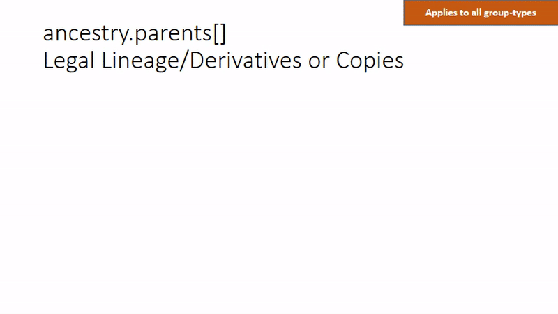
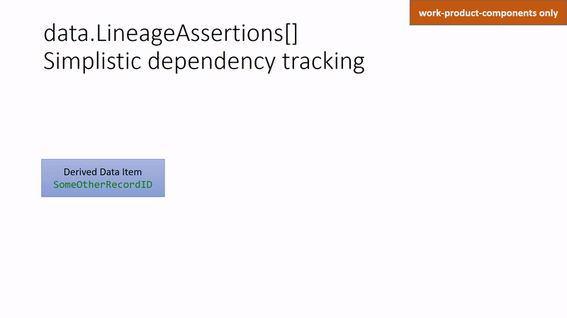
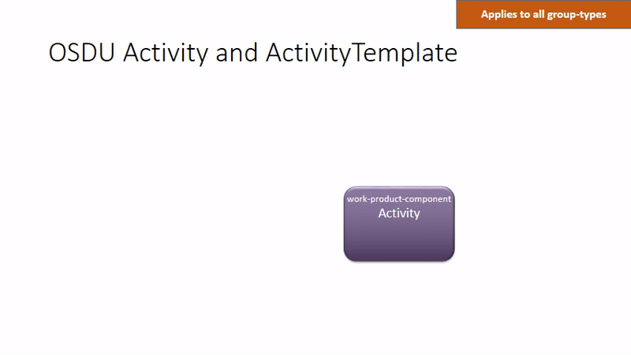
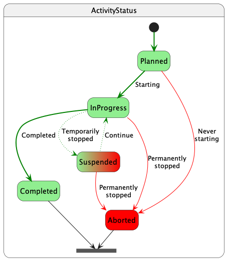

<a name="TOC"></a> Previous Chapter: [4 Frame of Reference](04-FrameOfReference.md)

[[_TOC_]]

# 5 Provenance

The OSDU schema supplies several ways to track the provenance of a resource. Each amplifies a different aspect of an
information object’s history and genesis.

## 5.1 LegalTags

While `LegalTags` is primarily used to support compliance and entitlements, it also describes some aspects of provenance
related to the entities that originated a data object. Here are some of the properties used in compliance that also
provide provenance information:

- `dataType` – the class of ownership of the data relative to the company’s data platform; shows whether the data
  originated internally or externally
- `originator` – the company that owns the data, and is a proxy for the source organization

For detailed information, see
the [Compliance Service or Legal Service](https://community.opengroup.org/osdu/platform/security-and-compliance/legal/-/blob/master/docs/docs/api.md)
, which is part of system Security and Compliance.

## 5.2 Ancestry

The system property `ancestry.parents[]` is used to mark derivatives in the legal sense. The derivative identifies the
related data objects from which it is derived. On Storage `PUT /records` requests, the system will collect the legal
tags from the sources or parents and aggregate them in the derived record's `legal.legaltags[]`. These definitions
enable the system to change discoverability and access permissions if a legal tag is associated with e.g., a time
limited contract.

Details are described in the system Security and Compliance
section ['What are Derivatives'](https://community.opengroup.org/osdu/platform/security-and-compliance/legal/-/blob/master/docs/docs/api.md#what-are-derivatives)
.



Data records, which are not derivatives, carry an empty `ancestry.parents[]` array and require a non-empty, properly
defined `legal.legaltags[]` array of legal tags.

## 5.3 Lineage Assertion

Work products and work product components can be asserted from other objects, from which they have been digitally
derived, either directly, indirectly or by reference. This is always a backward reference. For example, a Well Log might
be the edited version of an original, raw log. The edited log points back to the raw log. Such was the case in the
example about group types. Thus, it is common for one work product component to point back to another work product
component from which it was derived. A work product component may also point back to a master data object. It is common
for work product components to be the outgrowth of a master data object. For example, a work product component may be a
measurement or observation made in the master data object, such as a well log, directional survey, or a marker location
in a wellbore. The reverse is not true, however, so master data does not have Lineage Assertions. The purpose of this
assertion is to explain the history of transformations that data has passed through to arrive at the current object.
These relationships are suitable for inclusion in a graph database.



There are three types of references:

- `Direct` describes prior objects which have been transformed by a set of processes to arrive at the current object
- `Indirect` describes resources which were used in the transformation processes such as control, but were not directly
  transformed
- `Reference` describes resources which provide background information

The definitions of the reference values expand on these definitions.

<details>

<summary markdown="span">The following schema fragment definition provides some additional explanation:</summary>

<OsduImportJSON>[AbstractWorkProductComponent, Full](../../Generated/abstract/AbstractWorkProductComponent.1.0.0.json#only.properties.LineageAssertions)</OsduImportJSON>

```json
{
  "properties": {
    "LineageAssertions": {
      "type": "array",
      "description": "Defines relationships with other objects (any kind of Resource) upon which this work product component depends.  The assertion is directed only from the asserting WPC to ancestor objects, not children.  It should not be used to refer to files or artefacts within the WPC -- the association within the WPC is sufficient and Artefacts are actually children of the main WPC file. They should be recorded in the data.Artefacts[] array.",
      "x-osdu-indexing": {
        "type": "flattened"
      },
      "items": {
        "type": "object",
        "title": "LineageAssertion",
        "description": "Defines relationships with other objects (any kind of Resource) upon which this work product component depends.  The assertion is directed only from the asserting WPC to ancestor objects, not children.  It should not be used to refer to files or artefacts within the WPC -- the association within the WPC is sufficient and Artefacts are actually children of the main WPC file. They should be recorded in the data.Artefacts[] array.",
        "properties": {
          "ID": {
            "type": "string",
            "description": "The object reference identifying the DIRECT, INDIRECT, REFERENCE dependency.",
            "pattern": "^[\\w\\-\\.]+:[\\w\\-\\.]+:[\\w\\-\\.\\:\\%]+:[0-9]*$",
            "x-osdu-relationship": []
          },
          "LineageRelationshipType": {
            "type": "string",
            "description": "Used by LineageAssertion to describe the nature of the line of descent of a work product component from a prior Resource, such as DIRECT, INDIRECT, REFERENCE.  It is not for proximity (number of nodes away), it is not to cover all the relationships in a full ontology or graph, and it is not to describe the type of activity that created the asserting WPC.  LineageAssertion does not encompass a full provenance, process history, or activity model.",
            "pattern": "^[\\w\\-\\.]+:reference-data\\-\\-LineageRelationshipType:[\\w\\-\\.\\:\\%]+:[0-9]*$",
            "x-osdu-relationship": [
              {
                "GroupType": "reference-data",
                "EntityType": "LineageRelationshipType"
              }
            ]
          }
        }
      }
    }
  }
}
```

</details>

## 5.4 Activity

The Activity Model plays a key role in explaining how a resource came to be with unlimited levels of detail. While
Lineage Assertion covers the basic topology of the information resources, it does not describe the details of how the
resources were created. This is the purpose of the Activity Model (when applied to a processing flow)
. It stores a workflow description – the processes, parameters, sequence, inputs, and outputs.

An Activity is a transformational event. It may be a high-level, or “blocky” event, or it may be broken down into more
specific events with narrower scope, or it may be a mix of Activities at any level. An Activity has parameters which
tell what was involved in performing the Activity. These parameters may be values, arrays, data objects, or other
activities. Since data objects are included, there is overlap with Lineage Assertion and also the possibility of
conflict.

In parallel with an Activity is an Activity Template. It lays out what parameters are expected for an Activity and any
constraints that apply to it.

The entity relationships are depicted in the following figure, animated to follow the narrative text below the figure:



Activities manifest themselves either as master-data 'Projects',
e.g., [including AbstractProjectActivity](../../E-R/abstract/AbstractProjectActivity.1.1.0.md)
or work-product-component activities, e.g. [Activity](../../E-R/work-product-component/Activity.1.4.0.md)
including [AbstractWPCActivity](../../E-R/abstract/AbstractWPCActivity.1.1.0.md)
. Ordinary activity records can identify a ParentProject. All projects and activity instances can be nested using the
parent-child. The core content lies in the `data.Parameters[]` elements. They can represent different value types,
including relationships to other data objects in the platform.

The optional relationships to [ActivityTemplate](../../E-R/master-data/ActivityTemplate.1.2.0.md)
allow the abstraction: Describe the essence of an activity, provide defaults, where desired. A common ActivityTemplate
defines a classification of 'executed' activity instances. ActivityTemplates themselves can be bound together to build
workflows. This is achieved by [ActivityTemplateArcs](../../E-R/master-data/ActivityTemplateArc.1.1.0.md)
. The latter is not only used to create sequences of ActivityTemplates but also to bind outputs of preceding
ActivityTemplates to inputs of succeeding ActivityTemplates.

The flexibility and power of the OSDU Activity model may be hard to grasp at the beginning. The schema documentation
delivers [WorkedExamples for Activity](../../Examples/WorkedExamples/Activity/README.md), which show simple examples.
More complex workflows are demonstrated in the
[WorkedExamples for Seismic Well-Tie](../../Examples/WorkedExamples/SeismicWellTie/README.md)
The [Activity](../../E-R/work-product-component/Activity.1.4.0.md)
documentation may lead to more worked examples in different domains.

From Milestone 14 on, activities can record a sequence of `data.ActivityStates[]`, each referring to a
`ActivityStatusID`. The following diagram shows the expected state transitions:



For convenience, the `data.LastActivityState` is replicated outside the array `data.ActivityStates[]` to enable simple
queries about the current or last recorded state. This structure can also be used to short-running activities, where
just the final state is relevant and recorded as the only state. The `data.ActivityStates[]` can stay empty in this
case.

A worked example for a longer running activity is demonstrated with [Activity](../../Examples/WorkedExamples/Activity/README.md#activitystatus).
A worked example for a 'single state' Activity is given in context of the [Seismic Well-Tie example](../../Examples/WorkedExamples/SeismicWellTie/README.md#activitystate).

## 5.5 System Properties

The root-level properties that all information resources possess describe some essential provenance characteristics at a
high level:

- `createUser` – names the entity that instantiated the original data object in the data platform
- `modifyUser` – names the entity that updated the data object
- `createTime` – shows when the data object first entered the system
- `modifyTime` – shows when the data object was updated
- `ancestry` - see [5.2 Ancestry](#52-ancestry) and [6.1.8 Record `ancestry`](06-LifecycleProperties.md#618-record-ancestry) for details.

However, rather than ancestry in the sense of derivation, this property shows the parentage for the purpose of cascading
entitlement decisions. It may give a different perspective on provenance. Ideally, Lineage Assertions should be fully
complete to show how each data object has been transformed from its predecessors. In contrast, `ancestry.parents` will
be limited to relationships where legal claims apply; for example, a set of seismic volumes which have been derived from
a licensed volume with a restrictive license agreement may all use `ancestry.parents` to point back at the original
licensed volume, regardless of what intermediate products exist within the set.

## 5.6 Work Product Component Properties

All work product components share a set of universal properties, several of which explain provenance. In addition to
Lineage Assertion, described above, there are some useful properties of data genesis:

- `data.SubmitterName` – the person that provided the work product component to the data platform. This may have some
  overlap with `createUser` except that `createUser` can apply to any resource data type and is not restricted to
  people.
- `data.AuthorIDs` – the list of people that originally created the work product component
- `data.CreationDateTime` – differentiated from `createTime`, this is not the date the work product component entered
  the data platform, but the date when it was first made available anywhere
- `data.BusinessActivities` – although not getting down to the level of applications or processes which generated the
  data, this property is useful for describing the high-level business context of the origin and treatment of the data

## 5.7 Business Object Properties

Various properties are used in specific cases to convey additional provenance information. There is not a systematic
approach, so some ambiguity and gaps may arise. Here are some examples:

- `data.Interpreter` – in [SeismicHorizon](../../E-R/work-product-component/SeismicHorizon.1.3.0.md)
  and `data.Curves[].InterpreterName` in [WellLog](../../E-R/work-product-component/WellLog.1.5.0.md), these name the
  people who interpreted the object They may be redundant with `AuthorIDs`.
- `data.ServiceCompanyID` and [PPFGDataset](../../E-R/work-product-component/PPFGDataset.1.2.0.md)
  , [WellLog](../../E-R/work-product-component/WellLog.1.5.0.md)
  , [WellboreTrajectory](../../E-R/work-product-component/WellboreTrajectory.1.4.0.md) in WellLog relate to the
  companies that did the work.
- `data.Contractors[]` – Seismic projects, these relate to the companies that did the work.
- `data.ProcessingParameters`, `data.SeismicProcessingStageTypeID`, `data.SeismicMigrationTypeID`, and others –
  in [SeismicTraceData](../../E-R/work-product-component/SeismicTraceData.1.8.0.md) has numerous ways to describe the
  processes that have been applied to a dataset. Some of these may be superseded by `Activity`.

---

## Links

1. Return to the [Beginning of the Chapter](#TOC)
2. Next Chapter: [6 Common Properties](06-LifecycleProperties.md)
3. Browse to the [Schema Usage Guide Table of Contents](../README.md)

---