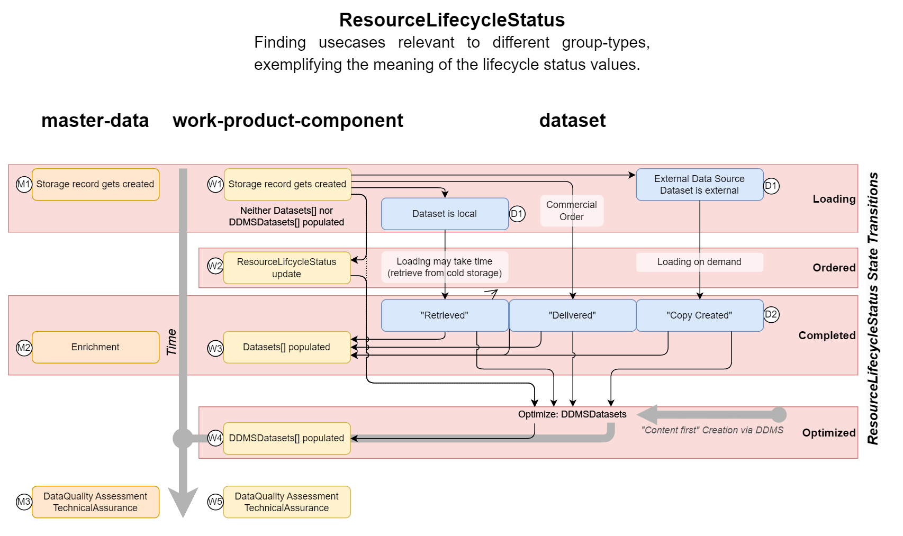

<a name="TOC"></a> Previous Chapter: [5 Provenance](05-Provenance.md)

[[_TOC_]]

# 6 Common Properties

This section describes the properties, which are common for all storable records. There are two types of common
properties:

* System Properties or root-level properties, the schema fragment representing the system properties
  is [AbstractSystemProperties](../../E-R/abstract/AbstractSystemProperties.1.0.0.md).
* The second group of common properties are included in the data block
  via [AbstractCommonResources](../../E-R/abstract/AbstractCommonResources.1.0.0.md), which are included by all storable
  entities.

## 6.1 System Properties

The root-level schema is fixed. No additional properties can be added at the root level.

### 6.1.1 Record `id`

The system property `id` is the unique record identifier, independent of different versions. The format consists of
three elements separated by a colon `:`

1. The partition-id or namespace.
2. The entity type identifier, see part 3 of `kind`, see `kind` below.
3. The unique object identifier, typically a UUID or optionally a natural key records with the group-type reference-data
   or master-data.

Example: `"partition-id:work-product-component--WellLog:16461acd-687c-421f-ae08-8628cf7d25ad"`

the Storage API does not require the `id` to be populated in the `PUT /records` request. In such a case the system
assigns a unique `id`. This feature is exploited in the case of surrogate keys in manifest records.

If natural keys are used as unique object identifier, please keep in mind that the `id` value must not contain
characters other than alphanumeric and underscore (`[a-zA-Z0-9_]`), dot (`.`), colon (`:`) and the URL-encoding
character, the percent symbol (`%`).

All reference-data types, with few exceptions like
[PropertyType](../../ReferenceValues/Manifests/reference-data/OPEN/PropertyType.1.json), use natural keys as
unique object identifier. The id values are derived from either `data.Code` or `data.Name`. If the `id` is derived this
way, the `data.Code` or `data.Name` **_must_** be [URL-encoded](https://en.wikipedia.org/wiki/URL_encoding). Contrary
to the [RFC 3986](https://datatracker.ietf.org/doc/html/rfc3986#section-2.2) reserved character list, the colon is
permitted in `id`s unencoded. In Python, for example, this code is used:

> `urllib.parse.quote(in_code, safe=':', encoding='utf-8')`

As an example, please note that, as a consequence, the Energistics unit `%` has the
record `"id": "patition-id:reference-data--UnitOfMeasure:%25"`.

For references to the Storage Service, please refer
to [Appendix A.2 OSDU System Services](90-References.md#appendix-a2-osdu-system-services).

### 6.1.2 Record `kind`

This is a required property. The kind declares the schema, to which the record is expected to conform to. The indexer
will use this schema reference to determine, which properties to index. The `kind` is the schema `id`, which is resolved
by the Schema service. A failure to resolve the kind will cause the indexer to fail; no properties in the data block
will be searchable.

The `kind`, or schema id, consists of four parts separated by a colon `:`

1. The schema authority or namespace for `SHARED` schemas, or, the partition-id for `INTERNAL` schemas, which are in
   partition scope only. OSDU canonical schemas use `osdu` as authority. These schemas are bootstrapped as `SHARED`
   schemas and therefore expected to be present in all OSDU deployments. **Exception:** the authority `system-meta-data`
   is a reserved authority code for system metadata indexing and **_shall never be used_** by ordinary data schemas.
2. A source or purpose identifier - for the OSDU canonical schemas the code `wks` for well-known-schema is used.
3. The entity type identifier, for example `master-data--GeoPoliticalEntity`. OSDU schemas combine the group-type and
   entity type names, separated by a double-dash `--` separator. This part of the kind appears in the `id` as second
   part, see above. The entity type identifier is used to constrain the target object types in relationships (via a
   regular expression value associated with the `pattern` JSON schema keyword in the schema definition).
4. The semantic version number of the schema. This is a three-part number separated by dots `.`. See also the
   [semantic version website](https://semver.org). <br>**Note:** The version number is composed of
   `{major}.{minor}.{patch}`numbers. In OSDU the `{major}` version `"0"` is understood as an **_experimental_** schema,
   which is by definition treated as in status `DEVELOPMENT`. It is not recommended to use such schemas in production as
   the schema content may change in place and require re-indexing.

For references to the Schema Service, please refer
to [Appendix A.2 OSDU System Services](90-References.md#appendix-a2-osdu-system-services).

### 6.1.3 Record `version`

The record `version` is a long integer, which is set by the system on record creation or update. The version changes if
any changes to the `data` block are made using Storage `PUT /records`. The version number passed to the PUT request is
ignored. Using the Storage PATCH API may keep the version `unchanged`.

### 6.1.4 Record `data` Block

The real business content of the record is carried in the `data`. Each schema will contain property definitions specific
to the business object in question. See the [schema documentation](../../E-R/README.md) for further details.

### 6.1.5 Access Control List `acl`

The access control list is a mandatory system property. The usage is described in
the [Storage Service Tutorial](https://community.opengroup.org/osdu/platform/system/storage/-/blob/master/docs/docs/index.md#record-structure)
.

The Storage `PATCH` API enables the modification of the `acl` without changing the record version number. For
details, see
the [Storage Service tutorial](https://community.opengroup.org/osdu/platform/system/storage/-/blob/master/docs/docs/api.md#metadata-update-api)
.

### 6.1.6 Legal context

Another mandatory root property is `legal` containing the so-called legal tags. These tags are owned by
the [Compliance Service](https://community.opengroup.org/osdu/platform/security-and-compliance/legal/-/blob/master/docs/docs/api.md)
and bundle a number of legal properties like country of origin, export classification, contract information, potential
expiration dates, and more.

The `legal.status` property is populated by the system and ignored on Storage `PUT`.

The Storage `PATCH` API enables the modification of the legal tags without changing the record version number. For
details, see
the [Storage Service tutorial](https://community.opengroup.org/osdu/platform/system/storage/-/blob/master/docs/docs/api.md#metadata-update-api)
.

### 6.1.7 Record Dates and Users

The following properties are set by the system and describe the record version's creation/modification date and users:

* `createTime` - _Timestamp of the time at which initial version of this OSDU resource object was created. Set by the
  System. The value is a combined date-time string in ISO-8601 given in UTC._
* `createUser` - _The user reference, which created the first version of this resource object. Set by the System._
* `modifyTime` - _Timestamp of the time at which this version of the OSDU resource object was created. Set by the
  System. The value is a combined date-time string in ISO-8601 given in UTC._
* `modifyUser` - _The user reference, which created this version of this resource object. Set by the System._

### 6.1.8 Record `ancestry`

This optional system property is relevant for derivatives, i.e. records, which are not directly ingested. The list of
exact `object_id:version_number` determine the sources, from which the current record is derived and therefore is
required to inherit the legal tags. The description for `ancestry.parents[]` reads as follows:
> _An array of none, one or many entity references
of 'direct parents' in the data platform, which mark the current record as a derivative. In contrast to other
relationships, the source record version is required. During record creation or update the ancestry.parents[]
relationships are used to collect the legal tags from the sources and aggregate them in the legal.legaltags[] array. As
a consequence, should e.g., one or more of the legal tags of the source data expire, the access to the derivatives is
also terminated. For details, see ComplianceService tutorial, 'Creating derivative Records'._

### 6.1.9 Record `tags`

The `tags` property can hold a simple dictionary of string values. Dictionary keys are of type string as well.
The `tags` dictionary is indexed and available for queries through the Search service.

The Storage `PATCH` API enables the modification of the `tags` without changing the record version number. For
details, see
the [Storage Service tutorial](https://community.opengroup.org/osdu/platform/system/storage/-/blob/master/docs/docs/api.md#metadata-update-api)
.

The `tags` dictionary values are **_not supposed_** to contain data, which should be located in the `data` block and
cause record version updates if values change. Instead, the dictionary should be used for data management purposes only.
Values are not constrained by OSDU.

### 6.1.10 Frame of Reference `meta[]`

This block defines the unit context of numeric property fields, date and date-time formats for date or time strings. The
meta[] member structure is defined by the [AbstractMetaItem](../../E-R/abstract/AbstractMetaItem.1.0.0.md). Details
about how this works is described in chapter [4 Frame of Reference](04-FrameOfReference.md).

## 6.2 Abstract Common Resources

The OSDU platform tracks numerous types of objects throughout their lifecycle. At any point in time, users need to know
at which stage the objects are at for different purposes. This has led to the creation of several types of properties.
It is not always obvious which properties serve which purposes. This chapter is designed to clarify the meaning and use
of them. The properties are located in the `data` block and thus any change will imply creating a new record version.
All properties in this section are optional and OSDU does not mandate usage. Operators may however define their own
rules.

### 6.2.1 ResourceLifecycleStatus

The `data.ResourceLifecycleStatus` property describes where in the ingestion process a resource lies. It currently has
states of `Loading`, `Ordered`, `Completed`, and `Optimized`. When it is `Completed`, it is available for consumption.
There are differences between group-types as shown in the following diagram:



Records in the [2.1 Master Data](02-GroupType.md#21-master-data) group-type record have the simplest lifecycle going
from (M1) `Loading` to (M2) `Completed` after enrichment.

The dependency on content adds more possible states to the lifecycle for
[2.4 Work Product Component](02-GroupType.md#24-work-product-component) group-type records. `Loading` includes ingestion of the
content. The [2.3 Dataset](02-GroupType.md#23-dataset) group-type records capture the content aspect. Large content may require
significant time before the content becomes available to the consumers. `Loading` (W1) for work-product-component and (D1) for
dataset indicates the initial phase. Longer content acquisition is indicated by `Ordered` (W2) for
work-product-component records. The state `Ordered` includes a number of different flavors of content provisioning:

* Initial uploads of large datasets.
* Retrieve content from cold or offline storage.
* Replication of content in the local instance with data served via external, connected sources.
* Commercially delivered content made available after a commercial transaction.

Once the content is available, work-product-component and dataset records change to status `Completed`, (W3), (D2).

When work-product-component content is added as optimized content via Domain Data Management Services, the state can
change to `Optimized`, (W4). This state implies `Completed`. It is not mandatory, though, that work-product-components
have relationships to content via dataset. There is also a transition path from `Loading` (optionally via `Ordered`)
to `Optimized` if the content is loaded directly into a DDMS. Neither is the `Loading` state mandatory: there are known
so called 'content first' use cases involving DDMSs, which publish their content simultaneously with creating the
work-product-component records with ResourceLifecycleStatus `Optimized` from the very start. In this case the initial
version of the record starts with (W4).

### 6.2.2 ResourceCurationStatus

The `data.ResourceCurationStatus` property allows a resource to pass through a curation process during ingestion so that
it can be “worked on”. It currently has states of `Created`, `Curating`, and `Curated`. When in the Curating state, it
is on hold while adequate information is gathered to describe the resource. When it is sufficiently well-defined, it is
passed to the `Curated` state, at which time the resource is available for consumption.

Resources with a group type of work-product or work product component have an additional flag called `IsExtendedLoad`,
which is in conflict with the use of `ResourceCurationStatus`, as stated above. It signifies that the resource is in a
state where it may be updated before completing the ingestion process, as with e.g., real time data feeds. These
properties need to be reconciled and checked against the behavior of the platform to see if either or both are actually
used and what to settle on.

### 6.2.3 ExistenceKind

The `data.ExistenceKind` property explains the status of the resource in the business context, rather than the data
platform view of the two preceding properties. Values have not been finalized, but they will likely be similar to
Proposed, Planned, Active (or Actual), Inactive, and Marked for Disposal. A resource takes on these states depending on
how “real” and usable the data is. Changes may be expected before final release, both in the value list and also in how
the property may apply differently to master data and work product components.

### 6.2.4 Domain Object Lifecycle Status

Some objects may have lifecycles specific to their role in the business. This lifecycle is more appropriate to master
data as it generally reflects the real-world disposition of a physical entity. A good example is
the [FacilityState](../../E-R/abstract/AbstractFacilityState.1.0.0.md)
in `data.FacilityStates[]` of a well. It refers
to [FacilityStateType](../../E-R/reference-data/FacilityStateType.1.0.0.md)
. Values are currently _Planning_, _Constructing_, _Operating_, _Closing_, _Closed_.

There is overlap between this property class and `data.ExistenceKind`. The difference is that this property class
applies to the physical object while the `data.ExistenceKind` property applies to the data record. This is not a clean
separation and suggests that more work is needed to clarify usage.

### 6.2.5 Source

`data.Source` – classifies a data object into a bucket useful for data management and readily recognizing a pool of
information; it can indicate data-providing entities like an organization, a data system, an application, or a
combination of them

## 6.3 Technical Assurance

A property for Technical Assurance was added in M10 and enhanced in M12. Technical Assurance describes the record's
overall suitability for general business consumption based on data quality. Technical Assurance values are not intended
to be used for the identification of a single "preferred" or "definitive" record by comparison with other records.

Technical Assurance provides a standard set of reference values that describe various levels of quality and confidence
in the data. It is important to note that Certified is the highest classification of suitable quality, any further
change or versioning of a Certified record should be carefully considered and justified. If a Technical Assurance value
is not populated, then one can assume the data has not been evaluated or its quality is unknown (i.e., equals
Unevaluated). Governance of the reference values is FIXED. Refer to the Table 1 below for a full list of reference
values.

| Name        | Description                                                                                                                                                                                                                                       |
|-------------|---------------------------------------------------------------------------------------------------------------------------------------------------------------------------------------------------------------------------------------------------|
| Certified   | A record can be used with high confidence for general business use, and it has undergone extensive quality verification to have met or exceeded defined business requirements. Confirmation may be associated with an auditable business process. |
| Trusted     | A record can be used with high confidence for general business use due to its high level of known quality.                                                                                                                                        |
| Suitable    | A record has been deemed acceptable for general business use due to its adequate level of known quality even though it may contain minor quality issues. Use does not pose a significant business risk.                                           |
| Unsuitable  | A record has been deemed unacceptable for general business use due to known or assumed quality issues. Use can pose a business risk.                                                                                                              |
| Unevaluated | A record's quality and suitability for business use has not been assessed by a data quality process or otherwise assumed. "Unevaluated" is used as the "absent value" for Technical Assurance.                                                    |

**Table 1**. Technical Assurance reference values as of M12 in order of highest to lowest in data quality.

The above values are used in `data.TechnicalAssuranceTypeID` (master-data)
and `data.TechnicalAssurances[].TechnicalAssuranceTypeID` (work-product-component). The values represent relationships
to [`osdu:wks:reference-data--TechnicalAssuranceType:1.0.0`](../../E-R/reference-data/TechnicalAssuranceType.1.0.0.md)
records.

### 6.3.1 Changes with M12

Starting with M12, Technical Assurance was enhanced to provide greater context for the Technical Assurance values
assigned to Work Product Components (interpreted data products), while maintaining simplicity for Master data objects,
which are less volatile in their life cycle.
The following changes were made in M12 to achieve this:

1. Deprecated `TechnicalAssuranceID` in [`AbstractCommonResources`](../../E-R/abstract/AbstractCommonResources.1.0.0.md)
   (schema) (added with M10).
2. Added `TechnicalAssuranceTypeID` to `AbstractMaster` (versions [1.0.0](../../E-R/abstract/AbstractMaster.1.0.0.md)
   and [1.1.0](../../E-R/abstract/AbstractMaster.1.1.0.md), same change to both). This reflects
   the different style of ‘mastering’ for master-data. We do not need the full context here as we would want to have
   with work-product-components.
3. Added `TechnicalAssurances[]` to `AbstractWPCGroupType`, which is included by all work-product-components. This is an
   array of type [`AbstractTechnicalAssurance`](../../E-R/abstract/AbstractTechnicalAssurance.1.2.0.md). With this, all
   work-product-components include indirectly `TechnicalAssurances[]`.
4. Added `TechnicalAssurances[]` to `AbstractMaster` (M19) and with that `TechnicalAssurances[]` is included in all
   master-data entity types.

### 6.3.2 Assigning Technical Assurance on Work Product Components

Similar to Master data, preserving the determination of Technical Assurance for Work Product Components (WPCs) can be
achieved using the same methods noted above. The primary difference between Technical Assurance on Master data vs. Work
Product Components is that Technical Assurance on WPCs enable the preservation of additional context for the
determination for the Technical Assurance value. This can help the consumer of the data consumer (e.g. geologist,
reservoir engineer) better understand what the assessed quality is and be aware of any limitations or conditions that
the assessment may have. For example, a seismic volume could have a Technical Assurance value of “Trusted” and the
Acceptable Use indicated for “Seismic Processing”. This would imply that the quality of the data has been assessed
high (based on the Trusted Technical Assurance value) and the data is fit for use for seismic processing, but not
necessarily for other uses.

Additional context that can be captured with Technical Assurance on WPCs:

* **'Reviewers'** - One or more reviewers (roles and/or individuals) that contributed to the Technical Assurance
  determination
* **'AcceptableUse'** & **'UnacceptableUse'** - suggested workflows that the Technical Assurance value supports or
  should not be
  assumed to be acceptable for (e.g., Trace data is “Trusted” for seismic processing and use with seismic processors,
  but the Technical Assurance value of Trusted does not imply the data is trusted for general seismic interpretation).
* **'EffectiveDate'** - Date for when the Technical Assurance value was determined
* **'Comment'** - Any additional context for the determination of Technical Assurance

The array usage of the [AbstractTechnicalAssurance](../../E-R/abstract/AbstractTechnicalAssurance.1.2.0.md) in
[AbstractWPCGroupType](../../E-R/abstract/AbstractWPCGroupType.1.2.0.md) implies the possibility of contradicting
`data.TechnicalAssurances[]` members.

**Recommendation:**

> When there are multiple perspectives for TechnicalAssurance and they are in conflict with one another, the operator's
> business process is responsible to resolve disagreements/conflicts. In these cases, applications should present the
> context to the data consumer and the consumer will need to make a determination on the overall quality or trust for a
> record.

### 6.3.3 Example Use Cases

Below are a few example use cases on when providing additional context for Technical Assurance could be needed. They are
not intended to represent every use case.

#### 6.3.3.1 Example: Well and wellbore data

In large organizations, the well and wellbore metadata may vary in quality from business unit to business unit.

Let’s consider a simple example with two business units:

- Business Unit A: The well and wellbore data is of high quality, with all records including accurate surface locations,
  wellbore depths, and other metadata.
- Business Unit B: All the wells and wellbores have records associated with them, but much of the metadata is of dubious
  quality.

**Use Case 1**: The company is generating a list of all wells that the company operates. In this case, the data from
both Business Units A and B would be acceptable.
**Use Case 2**: The company is generating a map of all the wells it operates and the surface locations of each. In this
case, Business Unit A’s data would be acceptable, but Business Unit B’s data would not.

In the above scenarios, the data would be captured in Persisted Collections by business unit.

The technical assurance would be associated with each set of data as shown below:

* **Business Unit A**: Well and Wellbore PersistedCollections

*Technical Assurance*:

| Property                   | Example Value                                   |
|----------------------------|-------------------------------------------------|
| `TechnicalAssuranceTypeID` | Trusted                                         |
| `AcceptableUsage`          | `WorkflowUsage`: All <br>`WorkflowPersona`: All |
| `UnacceptableUsage`        | None                                            |

* **Business Unit B**: Well and Wellbore PersistedCollections

*Technical Assurance*:

| Property                   | Example Value                                                                                                    |
|----------------------------|------------------------------------------------------------------------------------------------------------------|
| `TechnicalAssuranceTypeID` | Suitable                                                                                                         |
| `AcceptableUsage`          | `WorkflowUsage`: Global Well Count reporting <br>`WorkflowPersona`: All                                          |
| `UnacceptableUsage`        | `WorkflowUsage`: Well location mapping, Well trajectory planning, collision avoidance <br>`WorkflowPersona`: All |

If a subsequent collection is created that includes data from both business units, the Technical Assurance for the
entire dataset would be the same as the least trusted – in this case, Business Unit B.

#### 6.3.3.2 Example: Seismic Processing to Seismic Interpretation

In large organizations, there may be a handoff or delivery of data from one persona (role/function/discipline) to
another persona. Let’s consider a simple example of the following two personas:

* **Persona A**: A seismic processor generates 100 seismic volumes for a particular survey based on different scenarios
  and parameters. 45 are considered high quality volumes with trusted metadata (history, spatial navigation, etc.).
* **Persona B**: A seismic interpreter is ready to receive and interpret on trusted seismic volumes, but the volumes
  that should be used are dependent upon the activity or workflow.

**Use Case 1**: The seismic interpreter wants to use the latest seismic volume that has been generated, QC’d, and
finalized for general seismic interpretation (full stack volume).

Only 1 of the 45 volumes were identified or recommended for this use. Since there is only one volume, or record, we
could achieve this by updating the Work Product Component record with:

*Technical Assurance*:

| Property                   | Example Value                                                                      |
|----------------------------|------------------------------------------------------------------------------------|
| `TechnicalAssuranceTypeID` | Trusted                                                                            |
| `AcceptableUsage`          | `WorkflowUsage`: Seismic Interpretation<br> `WorkflowPersona`: Seismic Interpreter |
| `UnacceptableUsage`        | `WorkflowUsage`: None                                                              |

Using the PersistentCollection method could also be used, but in this example likely would have required unnecessary
overhead.

**Use Case 2**: The seismic interpreter wants to use the latest trusted seismic volumes that have been generated and
finalized for direct hydrocarbon indicator (DHI) analysis.
Only 6 of the 45 seismic volumes are recommended for this use and were indicated by the following Technical Assurance
update on a PersistentCollection record.

*Technical Assurance*:

| Property                   | Example Value                                                            |
|----------------------------|--------------------------------------------------------------------------|
| `TechnicalAssuranceTypeID` | Trusted                                                                  |
| `AcceptableUsage`          | `WorkflowUsage`: DHI Analysis <br>`WorkflowPersona`: Seismic Interpreter |
| `UnacceptableUsage`        | `WorkflowUsage`: None                                                    |

**Use Case 3**: The seismic interpreter wants to use the latest trusted seismic volumes that have been generated and
finalized for stratigraphic analysis to compute the thickness of the reservoirs.

Only 3 of the 45 volumes were identified and recommended for this use (Quad Phase Near to Mid-Stack for example) and
although the seismic volumes capture the thicknesses of reservoirs, they are not recommended for general seismic
interpretation for creating regional horizons/surfaces. This was indicated by the following Technical Assurance update
on a PersistentCollection record.

*Technical Assurance*:

| Property                   | Example Value                                                                                |
|----------------------------|----------------------------------------------------------------------------------------------|
| `TechnicalAssuranceTypeID` | Trusted                                                                                      |
| `AcceptableUsage`          | `WorkflowUsage`: Stratigraphic Analysis<br> `WorkflowPersona`: Seismic Interpreter           |
| `UnacceptableUsage`        | `WorkflowUsage`: Regional Surfaces Interpretation<br> `WorkflowPersona`: Seismic Interpreter |

If we can distinguish a context of trust of what the data should be used for, we can make it easier on the person
receiving the data to know which ones to use for their job role or activity.

#### 6.3.3.3 Example: Raw Well Logs to Interpreted Well Logs

In large organizations, there may be a handoff or delivery of data from one persona (role/function/discipline) to
another persona. Let’s consider a simple example across three personas:

* **Persona A**: A drilling operations geologist defines what raw logs will be delivered. 100 raw logs are brought into
  the company with the proper meta-data, depth, and location with over half coming from separate log runs.
* **Persona B**: A petrophysicist processes raw logs into 25 new interpreted well logs.
* **Persona C**: A stratigrapher is ready to use trusted well logs in their project for defining stratigraphic surfaces
  using wellbore markers (“tops”).

Which logs should be used by each persona? If no trust context is defined within Technical Assurance, all 125 logs might
be assumed to be trusted and available for use.

**Use Case 1**: The stratigrapher wants to interpret stratigraphic surfaces using wellbore markers, but only needs to
use the petrophysicist’s main suite of interpreted logs for this purpose.

Only 15 interpreted logs are designated as trusted for the stratigrapher to use for picking stratigraphic surfaces using
wellbore markers.

*Technical Assurance*:

| Property                   | Example Value                                                                              |
|----------------------------|--------------------------------------------------------------------------------------------|
| `TechnicalAssuranceTypeID` | Trusted                                                                                    |
| `AcceptableUsage`          | `WorkflowUsage`: Wellbore Stratigraphy Interpretation <br>`WorkflowPersona`: Stratigrapher |
| `UnacceptableUsage`        | `WorkflowUsage`: None                                                                      |

**Use Case 2**: The drilling operations geologist wants to use only the final set of raw logs that were delivered after
the last log run.

Only 50 raw logs are designated as the final set trusted for the operations geologist to use. These raw logs are not
recommended to be used by the Stratigrapher for wellbore stratigraphy.

*Technical Assurance*:

| Property                   | Example Value                                                                              |
|----------------------------|--------------------------------------------------------------------------------------------|
| `TechnicalAssuranceTypeID` | Trusted                                                                                    |
| `AcceptableUsage`          | `WorkflowUsage`: Final Drilling Report <br>`WorkflowPersona`: Operations Geologist         |
| `UnacceptableUsage`        | `WorkflowUsage`: Wellbore Stratigraphy Interpretation <br>`WorkflowPersona`: Stratigrapher |

---

## 6.4 How to form Relationships

### 6.4.1 Relationship Property Definition in the Schema

Relationships in OSDU are defined as string properties. Generally, OSDU expects relationships to specific target types.
Example: WellLog refers to the 'parent' Wellbore via the `data.WellboreID` string property. Expand the example section
below and notice:

1. Property name definition `WellboreID` — OSDU convention is to suffix relationships with `ID` or to-many relationships
   with suffix `IDs`.
2. Property `type` is defined as `string`.
3. A `pattern` definition with a regex expression to validate the correctness of the target object during schema
   validation.
4. A proprietary OSDU JSON schema extension tag `x-osdu-relationship`, (more details
   in [Appendix D.3.2 `x-osdu-relationship` - Relationship Decorators](93-OSDU-Schemas.md#appendix-d32-x-osdu-relationship-relationship-decorators))

<details>

<summary markdown="span">WellLog relationship to parent Wellbore.</summary>

<OsduImportJSON>[WellLog, Full](../../Generated/work-product-component/WellLog.1.2.0.json#only.properties.data.allOf[3].properties.WellboreID)</OsduImportJSON>

```json
{
  "properties": {
    "data": {
      "allOf": {
        "properties": {
          "WellboreID": {
            "type": "string",
            "description": "The Wellbore where the Well Log Work Product Component was recorded",
            "pattern": "^[\\w\\-\\.]+:master-data\\-\\-Wellbore:[\\w\\-\\.\\:\\%]+:[0-9]*$",
            "x-osdu-relationship": [
              {
                "GroupType": "master-data",
                "EntityType": "Wellbore"
              }
            ]
          }
        }
      }
    }
  }
}
```

</details>

Further example sections below:
<details>

<summary markdown="span">A to-many relationship from SeismicHorizon to many SeismicLineGeometry instances.</summary>

<OsduImportJSON>[SeismicHorizon, Full](../../Generated/work-product-component/SeismicHorizon.1.1.0.json#only.properties.data.allOf[4].properties.SeismicLineGeometryIDs)</OsduImportJSON>

```json
{
  "properties": {
    "data": {
      "allOf": {
        "properties": {
          "SeismicLineGeometryIDs": {
            "type": "array",
            "title": "Seismic Line Geometry IDs",
            "description": "The list of explicit 2D seismic line geometries overriding any definitions inferred from Seismic2DInterpretationSet. If empty and Seismic2DInterpretationSetID is populated, Seismic2DInterpretationSet.SeismicLineGeometries[].SeismicLineGeometryID apply.",
            "items": {
              "type": "string",
              "pattern": "^[\\w\\-\\.]+:work-product-component\\-\\-SeismicLineGeometry:[\\w\\-\\.\\:\\%]+:[0-9]*$",
              "x-osdu-relationship": [
                {
                  "GroupType": "work-product-component",
                  "EntityType": "SeismicLineGeometry"
                }
              ]
            }
          }
        }
      }
    }
  }
}
```

</details>

<details>

<summary markdown="span">A relationship to specific, but multiple target types.</summary>

<OsduImportJSON>[StratigraphicUnitInterpretation, Full](../../Generated/work-product-component/StratigraphicUnitInterpretation.1.0.0.json#only.properties.data.allOf[5].properties.FeatureID)</OsduImportJSON>

```json
{
  "properties": {
    "data": {
      "allOf": {
        "properties": {
          "FeatureID": {
            "type": "string",
            "title": "Local Rock Volume Feature ID",
            "description": "The reference to a local rock volume feature, to which this interpretation is associated.",
            "example": "namespace:work-product-component--LocalRockVolumeFeature:85348741-3433-406B-9189-22B298C2A2D2:",
            "pattern": "^[\\w\\-\\.]+:(master-data\\-\\-RockVolumeFeature|work-product-component\\-\\-LocalRockVolumeFeature):[\\w\\-\\.\\:\\%]+:[0-9]*$",
            "x-osdu-relationship": [
              {
                "GroupType": "master-data",
                "EntityType": "RockVolumeFeature"
              },
              {
                "GroupType": "work-product-component",
                "EntityType": "LocalRockVolumeFeature"
              }
            ]
          }
        }
      }
    }
  }
}
```

</details>

<details>

<summary markdown="span">AbstractWorkProductComponent relationship to any target type: <code>LineageAssertions[].ID</code>.</summary>

<OsduImportJSON>[WellLog, Full](../../Generated/abstract/AbstractWorkProductComponent.1.1.0.json#only.properties.LineageAssertions)</OsduImportJSON>

```json
{
  "properties": {
    "LineageAssertions": {
      "type": "array",
      "description": "Defines relationships with other objects (any kind of Resource) upon which this work product component depends.  The assertion is directed only from the asserting WPC to ancestor objects, not children.  It should not be used to refer to files or artefacts within the WPC -- the association within the WPC is sufficient and Artefacts are actually children of the main WPC file. They should be recorded in the data.Artefacts[] array.",
      "x-osdu-indexing": {
        "type": "flattened"
      },
      "items": {
        "type": "object",
        "title": "LineageAssertion",
        "description": "Defines relationships with other objects (any kind of Resource) upon which this work product component depends.  The assertion is directed only from the asserting WPC to ancestor objects, not children.  It should not be used to refer to files or artefacts within the WPC -- the association within the WPC is sufficient and Artefacts are actually children of the main WPC file. They should be recorded in the data.Artefacts[] array.",
        "properties": {
          "ID": {
            "type": "string",
            "description": "The object reference identifying the DIRECT, INDIRECT, REFERENCE dependency.",
            "pattern": "^[\\w\\-\\.]+:[\\w\\-\\.]+:[\\w\\-\\.\\:\\%]+:[0-9]*$",
            "x-osdu-relationship": []
          },
          "LineageRelationshipType": {
            "type": "string",
            "description": "Used by LineageAssertion to describe the nature of the line of descent of a work product component from a prior Resource, such as DIRECT, INDIRECT, REFERENCE.  It is not for proximity (number of nodes away), it is not to cover all the relationships in a full ontology or graph, and it is not to describe the type of activity that created the asserting WPC.  LineageAssertion does not encompass a full provenance, process history, or activity model.",
            "pattern": "^[\\w\\-\\.]+:reference-data\\-\\-LineageRelationshipType:[\\w\\-\\.\\:\\%]+:[0-9]*$",
            "x-osdu-relationship": [
              {
                "GroupType": "reference-data",
                "EntityType": "LineageRelationshipType"
              }
            ]
          }
        }
      }
    }
  }
}
```

</details>

### 6.4.2 Relationship Values in Records

OSDU uses the following convention to encode relationships in Storage data records:

```text
{{record-id}}:{{record-version}}    for a references to specific record versions, or
{{record-id}}:                      for the latest version of the target reference
                                    Mind the training colon :
```

where

* `{{record-id}}` is the target record's `id` (system property); see [6.1.1 Record `id`](#611-record-id), and
* `{{record-version}}` is the target record's `version` (system property);
  see [6.1.3 Record `version`](#613-record-version).

Following the different relationship definitions in the schema above, below the corresponding record examples:

<details>

<summary markdown="span">WellLog relationship to parent Wellbore in an example record.</summary>

<OsduImportJSON>[WellLog, Full](../../Examples/WorkedExamples/SeismicWellTie/records/WellLog.Synthetic.json#only.data.WellboreID)</OsduImportJSON>

```json
{
  "data": {
    "WellboreID": "partition-id:master-data--Wellbore:1013:"
  }
}
```

</details>

<details>

<summary markdown="span">A to-many relationship from SeismicHorizon to many SeismicLineGeometry instances in a record.</summary>

<OsduImportJSON>[SeismicHorizon, Full](../../Examples/WorkedExamples/_Guide/SeismicHorizonFragment.json#only.data.SeismicLineGeometryIDs[])</OsduImportJSON>

```json
{
  "data": {
    "SeismicLineGeometryIDs": [
      "partition-id:work-product-component--SeismicLineGeometry:1ef722bb-09e3-439b-81dc-847b41eb2cbd:",
      "partition-id:work-product-component--SeismicLineGeometry:005da015-8148-4de6-bd31-f8ea6dfb743a:",
      "partition-id:work-product-component--SeismicLineGeometry:f868d4b2-191f-4066-b78e-10bc4f56547d:",
      "partition-id:work-product-component--SeismicLineGeometry:d173abce-e684-40ce-a631-d592088790bc:",
      "partition-id:work-product-component--SeismicLineGeometry:b93b79bb-8abb-44c1-adc4-07d61fcee5de:",
      "partition-id:work-product-component--SeismicLineGeometry:6cd50524-19bf-46a6-bce1-d4a5dc5d7686:"
    ]
  }
}
```

</details>

<details>

<summary markdown="span">A relationship to specific, but multiple target types - single choice in record.</summary>

<OsduImportJSON>[StratigraphicUnitInterpretation, Full](../../Examples/WorkedExamples/Reservoir Data/Stratigraphy/Rank2/1-Sola.json#only.data.FeatureID)</OsduImportJSON>

```json
{
  "data": {
    "FeatureID": "partition-id:work-product-component--LocalRockVolumeFeature:Sola-:"
  }
}
```

</details>

<details>

<summary markdown="span">WellLog record with 3 relationships to any target type: <code>LineageAssertions[].ID</code>.</summary>

<OsduImportJSON>[WellLog, Full](../../Examples/WorkedExamples/SeismicWellTie/records/WellLog.Synthetic.json#only.data.LineageAssertions[])</OsduImportJSON>

```json
{
  "data": {
    "LineageAssertions": [
      {
        "ID": "partition-id:work-product-component--WellLog:Impedance--RC:",
        "LineageRelationshipType": "partition-id:reference-data--LineageRelationshipType:Direct:"
      },
      {
        "ID": "partition-id:work-product-component--WellLog:Ricker40:",
        "LineageRelationshipType": "partition-id:reference-data--LineageRelationshipType:Direct:"
      },
      {
        "ID": "partition-id:work-product-component--Activity:Synthetic-Example:",
        "LineageRelationshipType": "partition-id:reference-data--LineageRelationshipType:Reference:"
      }
    ]
  }
}
```

</details>

The examples above all use references to the latest version. Explicit version specification is optional for all OSDU
relationships, except for the legal relationship in `ancestry.parents[]`, here the parent records'
`id` and `version` are required : `{{record-id}}:{{record-version}}`. See also
[6.1.8 Record `ancestry`](#618-record-ancestry).

> **_Mind the trailing colon for relationships to the latest record version!_**

---

## Links

1. Return to the [Beginning of the Chapter](#TOC)
2. Next Chapter: [7 History Properties](07-HistoryProperties.md)
3. Browse to the [Schema Usage Guide Table of Contents](../README.md)

---