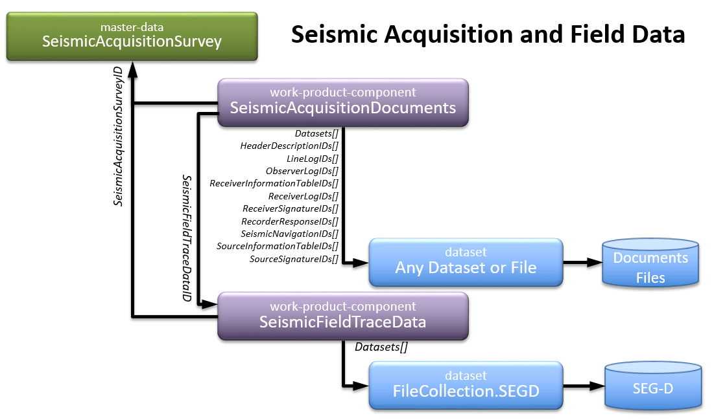
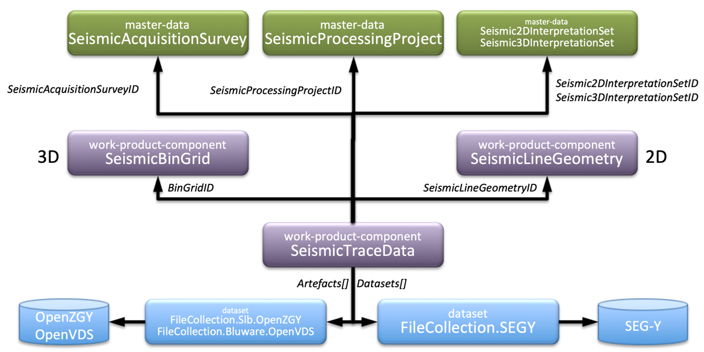
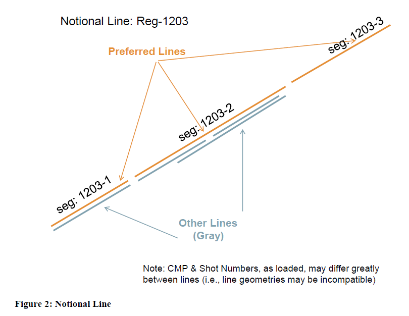
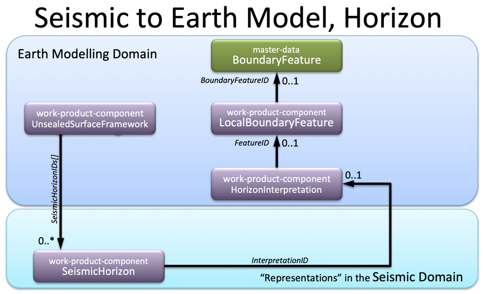
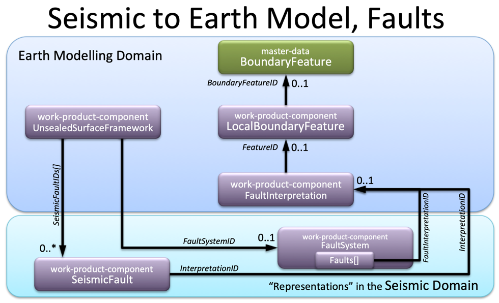

 Previous Chapter: [8 Geographic Entities](08-GeographicEntities.md)

[[_TOC_]]

# 9 Seismic Projects and Related Data

Just as Wells and Wellbores are kinds of facilities, the seismic domain has activities that are kinds of projects. This
chapter describes the meaning of “project” and how it is used for seismic data.

## 9.1 Abstract Project

It is assumed that the reader is already familiar with the abstraction method used for OSDU schema. The concept of
“project” is an abstraction that serves the purpose of a virtual entity. It defines a business activity that involves
people, money, deadlines, contractors, and so on. It is currently realized in four specialized forms: Seismic
Acquisition survey, Seismic Processing project, Seismic 2D Interpretation Set, and Seismic 3D Interpretation Set. All
these types can double as “Activities”, see [5.4 Activity](05-Provenance.md#54-activity).

Projects are master data. They describe specific business activities. Digital products (work product components) are
related to them, usually as the outcome of the activity, and typically by observation or processing.

## 9.2 Seismic Acquisition Survey

The [Seismic Acquisition Survey](../../E-R/master-data/SeismicAcquisitionSurvey.1.4.0.md) is the activity of fielding
personnel and material to record seismic data; that is, to observe the elastic response of the earth. The outcome is
field seismic data plus a number of ancillary products that provide context to the seismic data, such as navigation
files and observer logs. Navigation files, it should be noted, describe the layout of the surface equipment (energy
sources, receivers, and their relationships) not subsurface processing coordinates. Similarly, the spatial area that all
projects have will then refer to the bounding area of the acquisition footprint. Although 2D acquisition has not yet
been defined, the intent is that the Acquisition survey for 2D encompasses all the lines in a single program; that is,
the single deployment by an operator to record one area of investigation with a consistent set of personnel and
parameters.

Recently, SeismicAcquisitionSurvey has been extended to support Vertical Seismic Profiles (VSP). Details are
demonstrated in the worked example section for
[Time Depth Curves and VSP](../../Examples/WorkedExamples/CheckshotVSP/README.md).

Tightly related to the acquisition are the seismic field data and documents. Reports, navigation, observer logs, etc.,
are grouped in the [SeismicAcquisitionDocuments](../../E-R/work-product-component/SeismicAcquisitionDocuments.1.1.0.md).
The type contains named references to the files and datasets containing the file references.

The raw seismic acquisition data are managed by the [SeismicFieldTraceData](../../E-R/work-product-component/SeismicFieldTraceData.1.1.0.md).

SeismicAcquisitionDocuments and SeismicFieldTraceData refer to the
[SeismicAcquisitionSurvey](../../E-R/master-data/SeismicAcquisitionSurvey.1.4.0.md) as their logical parent.

## 9.3 Seismic Processing Project

The [Seismic Processing Project](../../E-R/master-data/SeismicProcessingProject.1.4.0.md) is the activity of assembling
a team of data processors to carry a discrete set of seismic data through a set of workflows with some business
objective in mind. The chief outcome is a number of trace datasets. Ancillary products appear here, too, such as in
velocity models. Processing assigns traces to subsurface bin nodes, during which geometrics appear. We call those bin
grids in 3D and line geometries in 2D. Bin nodes may also be referred to as Common Depth Points (CDPs), Common
Midpoints (CMPs), or Common Reflection Points (CRPs). More than one Acquisition project may be involved in a single
Processing project.

## 9.4 Seismic Interpretation Sets

The [Seismic 2D Interpretation Set](../../E-R/master-data/Seismic2DInterpretationSet.1.2.0.md)
and [Seismic 3D Interpretation Set](../../E-R/master-data/Seismic3DInterpretationSet.1.2.0.md) stretch the business
activity meaning of a project. They are loosely associated with the activity of assembling a team of interpreters to
analyze a set of seismic trace datasets. It is a loose association because an additional constraint is placed on this
definition to restrict the set of datasets to those that have been culled to yield a uniform set. This satisfies the
needs of interpretation systems to be able to hang interpretations on the binning geometry rather than on the trace
datasets. In the case of 3D, the Interpretation Set can only have one bin grid. In the case of 2D, it can only have one
[geometry line](../../E-R/work-product-component/SeismicLineGeometry.1.2.0.md) per line. The Interpretation Set is
distinguished from a typical interpretation project because a typical interpretation project is merely a collection of
datasets that are used together for interpretation. The term “Application project” is preferred here. The term “set” is
being used to differentiate it from Application project and reflects standard usage in interpretation applications. It
should not be confused with usage in the technical geophysics community where *survey* refers to the field experiment (
i.e., Acquisition Survey). An Interpretation Set has nothing to do with acquisition.

## 9.5 Seismic Project Relationships

The previous discussion hints at some relationships which are more clearly shown in an Entity Relationship diagram; see
Figure 1.

**Figure 1: Seismic Entity Relationship Diagram**

- A Processing project reflects all the Acquisition surveys that contribute to it so that merged volumes can maintain
  their provenance
- A [trace dataset](../../E-R/work-product-component/SeismicTraceData.1.8.0.md) may relate to
  its [Acquisition survey](../../E-R/master-data/SeismicAcquisitionSurvey.1.4.0.md) if there is only one or a chief one,
  but a merged dataset needs to rely on its relation to
  the [Processing project](../../E-R/master-data/SeismicProcessingProject.1.4.0.md)

Typically, any trace dataset should be related to its chief Acquisition project and to its generating Processing project
using the explicit properties. This holds for any trace data, whether field, pre-stack, or stacked.

- A [trace dataset](../../E-R/work-product-component/SeismicTraceData.1.8.0.md) can belong to many Interpretation Sets,
  but there is one preferred that is the “go to” set in an area
- Although one volume may be selected for a 3D interpretation, the main relationship for interpretations such as Seismic
  Horizon is through the Interpretation Set

This relationship defines the [binning geometry](../../E-R/work-product-component/SeismicBinGrid.1.3.0.md) to which the
picks are tied. An interpretation is located with inline/crossline, or CDP/line name. The relationship to geometry
through the Interpretation Set is how the picks can be located in the map space. This allows any trace dataset to be
used for a pick as long as it maps to the geometry.

- The [Notional Seismic Line](../../E-R/work-product-component/NotionalSeismicLine.1.3.0.md) is not an acquisition line;
  it is just an optional bundling concept that allows a set of Seismic Line Geometries to be tied together because they
  relate to the same conceptual line, or transect along the earth’s surface

This is more useful as a data management concept, such as for cleaning up many descriptions of the same line.
[Figure 2](#figure-2) explains this further. Each orange and gray segment denotes a
separate [line geometry](../../E-R/work-product-component/SeismicLineGeometry.1.2.0.md). These may have come from
different suppliers or different national entities, but may refer to the same acquisition event or have some other
commonality. It would be possible to identify them all as belonging to the same line concept. Some of the geometries may
be deemed to be more “correct” and identified as preferred by association with a preferred Interpretation Set.

- VelocityModeling does not appear in the diagram as it does not have any explicit relationships to the objects
  represented

It will usually be related to the appropriate trace datasets through Lineage Assertions. In particular,
a [`VelocityModeling`](../../E-R/work-product-component/VelocityModeling.1.4.0.md) object that is created by velocity
analysis of a set of gathers would show a direct lineage to the Gathers object. A migrated volume would show an indirect
lineage to the `VelocityModeling` object used for migration.

Files like 2D or 3D navigation, reports, observer notes, etc. can be loaded as
[documents](../../E-R/work-product-component/Document.1.3.0.md) and related to the Acquisition project using Lineage
Assertion. 

**Figure 2: Seismic Line Geometry, Notional Line**

## 9.6 Seismic Project Locations and Related Objects

There are a number of ways to express the geographic location of seismic objects. Note that for each of the 3D seismic
outlines, there are several ways to represent it; for example, using this informal nomenclature:

- The “bounding box” is the smallest rectangle containing the object using the axes of the standard coordinate system

This is, for instance, the minimum and maximum latitude and longitude.

- The “extent” uses the corner points for the smallest rectangle enclosing the object using the axes of the object’s
  local coordinate system

This is, for instance, the box defining the minimum and maximum inline and crossline.

- The “perimeter” is a polygon that outlines the object with more or less precision as dictated by the business

### 9.6.1 Acquisition Footprint

Since seismic acquisition has not been fully modeled it is important to recognize there is more to come. Specifically,
navigation information, which is contained in a file and will deserve its own work product component, may have a
mappable metadata component. For now, the outline of the acquisition area should be represented by the `SpatialLocation`
of the Acquisition project. Although bin information might be used as a proxy to define the outline, bear in mind that
acquisition geometry refers to the surface positions (sources and receivers) and not subsurface bin positions used in
processing. An extent or bounding box is often sufficient precision.

### 9.6.2 Processing Footprint

The geography for processing is defined by the bin grid. As a work product component, the `SpatialLocation` property in
the Seismic Bin Grid is available to contain the outline of the bin grid. Since the precise details of the bin grid are
contained in the bin grid file and the International Association of Oil & Gas Producers (IOGP) P6/11 (see [Appendix A.1 External Document References](../Chapters/90-References.md#appendix-a1-external-document-references))
metadata properties, the `SpatialLocation` should be the extent. Since the Seismic Bin Grid serves as the description
for any processed trace dataset from a processing job, this extent should be the full range of the bin grid as defined
for the Processing project. Consequently, the spatial coverage provided by an individual seismic trace dataset should
not be represented by its bin grid. Instead, the `LiveTraceOutline` property of the seismic trace dataset is for the
detailed perimeter (including null regions if desired). The generic `SpatialLocation` available to all work product
components can then be used for a low precision perimeter or extent for fast mapping.

### 9.6.3 2D Differences

Instead of a [3D Bin Grid](../../E-R/work-product-component/SeismicBinGrid.1.3.0.md), processed 2D data
uses [Seismic Line Geometry](../../E-R/work-product-component/SeismicLineGeometry.1.2.0.md) to express the processing
location. That work product component’s generic spatial location should be the low precision line position (“ends and
bends”), while precise bin-by-bin coordinate information should be in the work product component’s file (CDP, X, Y, SP).

## 9.7 SeismicTraceData Content

### 9.7.1 Original Content

It is important to understand the relationships between
[SeismicTraceData](../../E-R/work-product-component/SeismicTraceData.1.8.0.md) and the content representations. Original
seismic SEG-Y files are represented by a
dataset, [dataset--FileCollection.SEGY](../../E-R/dataset/FileCollection.SEGY.1.3.0.md).

#### 9.7.1.1 Recommended FileSource Specifications

The dataset candidates for SeismicTraceData content are
* [dataset--FileCollection.SEGY](../../E-R/dataset/FileCollection.SEGY.1.3.0.md)
* [dataset--FileCollection.Bluware.OpenVDS](../../E-R/dataset/FileCollection.Bluware.OpenVDS.1.2.0.md)
* [dataset--FileCollection.Slb.OpenZGY](../../E-R/dataset/FileCollection.Slb.OpenZGY.1.2.0.md)

and
* [dataset--FileCollection.SEGD](../../E-R/dataset/FileCollection.SEGD.1.2.0.md)
* [dataset--FileCollection.SEGA](../../E-R/dataset/FileCollection.SEGA.1.1.0.md)
* [dataset--FileCollection.SEGB](../../E-R/dataset/FileCollection.SEGB.1.1.0.md)

All include the [AbstractFileCollection](../../E-R/abstract/AbstractFileCollection.1.0.0.md) schema fragment with
`data.DatasetProperties.FileSourceInfos[]` - although most of the time there will only be one, single 'file'. The file
collection opens for more than one 'file' reference; cases like that may have been caused by file size limitations or
multipart 2D seismic files.

**Recommendation:**
> * Each element in `data.DatasetProperties.FileSourceInfos[]` should have a `FileSource` that is a full path
> (`startswith("sd://"`).
> * Alternatively, `data.DatasetProperties.FileSourceInfos[]` can have a `FileSource` that is relative
> (`startswith("./")`). In that case, it should be prefixed/joined with `data.DatasetProperties.FileCollectionPath` to
> construct the full path.

#### 9.7.1.2 Textual Header Recommendation

Standard SEG-Y comes with a textual header, which often contains important contextual information. This text should be
made available to Search.

> * The conventional EBCDIC header (3200 bytes) should be extracted into **_one single string_** into
the `data.TextualFileHeader[]` string array. The EBCDIC header should be the first element in that array.
> * Extended  textual file headers should be added as additional strings to `data.TextualFileHeader[]`. Consecutive extended header
stanzas **shall be concatenated into a single string**. Formatting of the strings is left to the consumers.
>
> Younger revisions of SEG-Y [^1] may contain multiple extended textual headers. The standard says that the SEG-Y file
> is not intended as a comprehensive ancillary data exchange format, though there are no limits set in the standard.
> * Due to the limited size of records in Storage service, SEG-Y parsers should **truncate** the `data.TextualFileHeader[]`
    to a maximum of 100 stanzas à 3200 bytes.

#### 9.7.1.3 SEG-Y Parsing Challenges

OSDU's goal is to keep content in their original state, if possible. For SEG-Y data, especially when using revision 0, a
number of challenges arise. Sometimes the trace header values required for correct consumption of the SeismicTraceData
do not appear at the recommended location. For this OSDU offers header mappings, which are defined with
the [dataset--FileCollection.SEGY](../../E-R/dataset/FileCollection.SEGY.1.3.0.md). This type
includes [AbstractVectorHeaderMapping](../../E-R/abstract/AbstractVectorHeaderMapping.1.1.0.md).

The following on-the-fly correction mechanisms are available:

1. **_Read_** a trace header value from a **_specific_** byte location in the SEG-Y trace header; this may not be the
   location defined by the standard. This is achieved by `data.VectorHeaderMapping[]` elements, which associate a
   symbolic [reference-data--HeaderKeyName](../../E-R/reference-data/HeaderKeyName.1.0.0.md) with trace header byte
   locations to read from.
2. **_Override_** a trace header value if the dataset was written incorrectly. This can be repaired
   by `data.TraceHeaderOverrides[]` elements using constants or other trace headers values (
   via [reference-data--HeaderKeyName](../../E-R/reference-data/HeaderKeyName.1.0.0.md)) to compute the corrected value
   instead.
3. **_Override_** a binary header value if the dataset was written incorrectly. This can be repaired
   by `data.BinaryHeaderOverrides[]` elements.

The [worked examples](../../Examples/WorkedExamples/SeismicLoadingManifests/README.md#seg-y-header-challenges) provide
more details.

### 9.7.2 Optimized Content

Optimized content representations
like [dataset--FileCollection.Bluware.OpenVDS](../../E-R/dataset/FileCollection.Bluware.OpenVDS.1.2.0.md)
and [dataset--FileCollection.Slb.OpenZGY](../../E-R/dataset/FileCollection.Slb.OpenZGY.1.2.0.md) can become content
providers or artefacts, depending on the workflow sequence. The management of optimized content representations is
deferred to
the [Seismic DMS](https://community.opengroup.org/osdu/platform/domain-data-mgmt-services/seismic/seismic-dms-suite/seismic-store-service).

Please refer to the WorkedExamples section for further details:
* [Seismic data Loading manifests](../../Examples/WorkedExamples/SeismicLoadingManifests/README.md) (not involving Seismic DMS)
* [Pre-Stack examples](../../Examples/WorkedExamples/SeismicPreStack/README.md)

## 9.8 Seismic Interpretation Representations

Seismic Interpretation is tightly related to the seismic
geometry, [3D Bin Grid](../../E-R/work-product-component/SeismicBinGrid.1.3.0.md) for 3D
and [Seismic Line Geometry](../../E-R/work-product-component/SeismicLineGeometry.1.2.0.md) for 2D seismic. This is
reflected in the interpretation
representations [SeismicHorizon](../../E-R/work-product-component/SeismicHorizon.1.3.0.md)
and [SeismicFault](../../E-R/work-product-component/SeismicFault.1.3.0.md).

The figures above and below show the seismic interpretation representations and their relationships to earth modelling
entities. Please note that the term representation has a specific meaning in the Energistics RESQML Knowledge Hierarchy
of _Feature_, _Interpretation_, _Representation_ and _Property_. In this
definition [SeismicHorizon](../../E-R/work-product-component/SeismicHorizon.1.3.0.md)
and [SeismicFault](../../E-R/work-product-component/SeismicFault.1.3.0.md) are representations. They include the
properties of [AbstractRepresentation](../../E-R/abstract/AbstractRepresentation.1.0.0.md) The seismic interpretation
representations can be aggregated in
an [UnsealedSurfaceFramework](../../E-R/work-product-component/UnsealedSurfaceFramework.1.3.1.md).

For fault interpretation representations OSDU offers two ways of aggregation into a [UnsealedSurfaceFramework](../../E-R/work-product-component/UnsealedSurfaceFramework.1.3.1.md).
1. One alternative is the usage of a collection of faults in
   a [FaultSystem](../../E-R/work-product-component/FaultSystem.1.4.1.md), which may contain different representations
   of faults in one dataset. Each member of the `data.Faults[]` array is described by representation role and type.
2. The reference of individual fault interpretation
   representations [SeismicFault](../../E-R/work-product-component/SeismicFault.1.3.0.md) is the other alternative,
   which is symmetric to the way [SeismicHorizon](../../E-R/work-product-component/SeismicHorizon.1.3.0.md) are
   referenced from the framework.

## 9.9 4D/Timelapse

* **Definitions**
    * **Timelapse Seismic:** Seismic that is acquired to assess changes in the subsurface over time and is accomplished
      by acquiring new seismic over an existing survey, typically using the previous survey acquisition geometry.
    * **4D Seismic:** 3D seismic data that is acquired to assess changes in the subsurface over time and is accomplished
      by acquiring new 3D seismic over an existing 3D survey, typically using the previous 3D survey geometry

4D is more of a process than an explicit data type. The term '4D' is sometimes used as shorthand to describe reservoir
monitoring, simulation, & forward casting utilizing 4D seismic; this document does not expand beyond the seismic itself.

SeismicAcquisitionSurveys can become part of a time-lapse series. From schema version 1.3.0 on, SeismicAcquisitionSurvey
has `data.PrecedingTimeLapseSurveyID` referring to the preceding survey.

Please refer to the WorkedExamples section for further details:
* [Seismic 4D](../../Examples/WorkedExamples/Seismic4D/README.md)

## 9.10 Non-Seismic Geophysics

Non-seismic geophysical methods and schemas are gradually being introduced into the OSDU Data Platform, beginning with
the [Gravity Magnetic Acquisition Survey](../../E-R/master-data/GravityMagneticAcquisitionSurvey.1.0.0.md) master-data
schema.

A Gravity Magnetic Acquisition Survey record captures the information related to a particular gravity, including gravity
gradiometry, and magnetic geophysical acquisition survey. Information captured includes properties related to the
overall acquisition project activity, such as financial and human resources information, location, spatial and technical
assurance information, and gravity and magnetic survey acquisition specific properties such as:
* an array of data acquisition types, for example gravity, gradiometry, and magnetic,
* the platform method, such as land, airborne, marine, satellite and wellbore,
* the details of all the equipment used to acquire the geophysical data and
* the flying parameters for airborne surveys.

Relationships to other objects can be seen in the figure below and
include; [SeismicAcquisitionSurvey](../../E-R/master-data/SeismicAcquisitionSurvey.1.4.0.md) record, applicable when
gravity and magnetic surveys are carried out at the same time as a seismic survey, typically through a marine platform,
and a [Wellbore](../../E-R/master-data/Wellbore.1.5.1.md) record, applicable when gravity and magnetic surveys are
acquired from a borehole or wellbore platform. When a wellbore survey is acquired the included
wellbore [VerticalMeasurement](../../E-R/abstract/AbstractFacilityVerticalMeasurement.1.0.0.md) properties may also be
required to be captured to identify the zero datum for that survey.

Time-lapse or 4D acquisition surveys are accommodated by populating the `PrecedingTimeLapseSurveyID` property. This
property identifies the preceding Gravity Magnetic Acquisition Survey by the `GravityMagneticAcquisitionSurveyID`. The
first survey record in the sequence has an empty or absent `PrecedingTimeLapseSurveyID` property.

Please refer to the WorkedExamples section for further details:
* [GravityMagneticAcquisitionSurvey](../../Examples/WorkedExamples/GravityMagnetic/AcquisitionSurvey/README.md)

---

## Links

1. Return to the [Beginning of the Chapter](#TOC)
2. Next Chapter: [10 Well Domain](10-WellBasics.md)
3. Browse to the [Schema Usage Guide Table of Contents](../README.md)

---
Footnotes
[^1]: [SEG-Y revision 2.0 Data Exchange format](https://seg.org/Portals/0/SEG/News%20and%20Resources/Technical%20Standards/seg_y_rev2_0-mar2017.pdf) and [Appendix A.1 External Document References](90-References.md#appendix-a1-external-document-references)