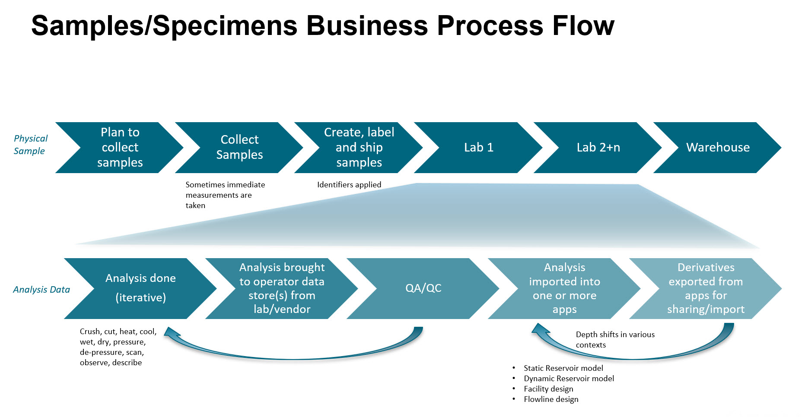
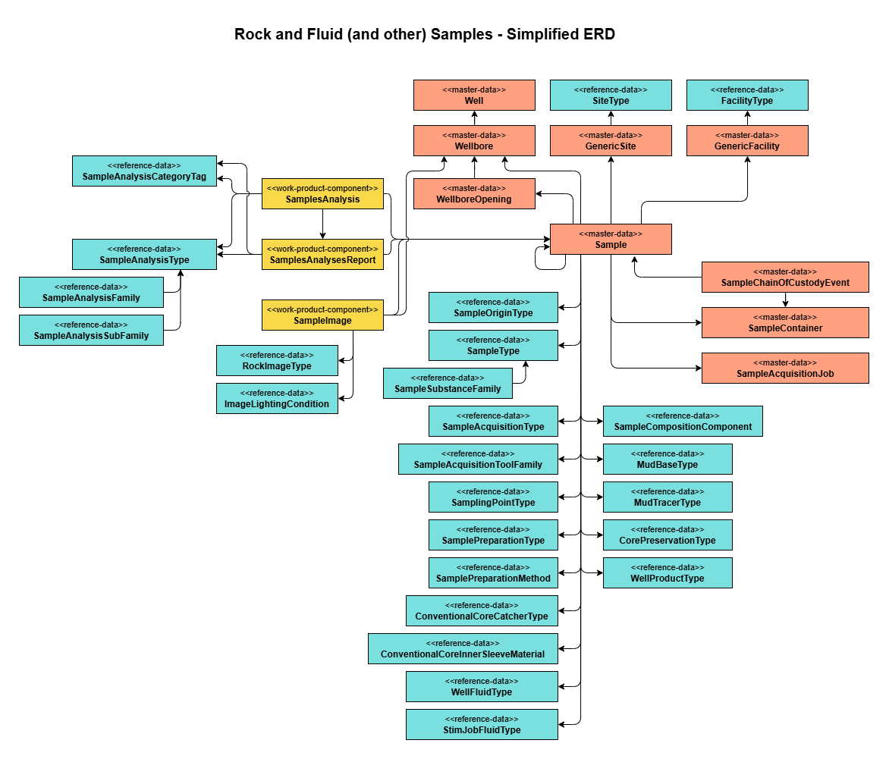
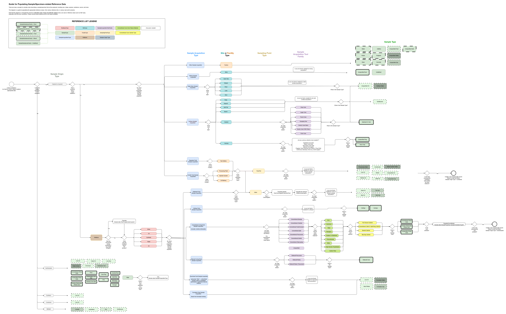
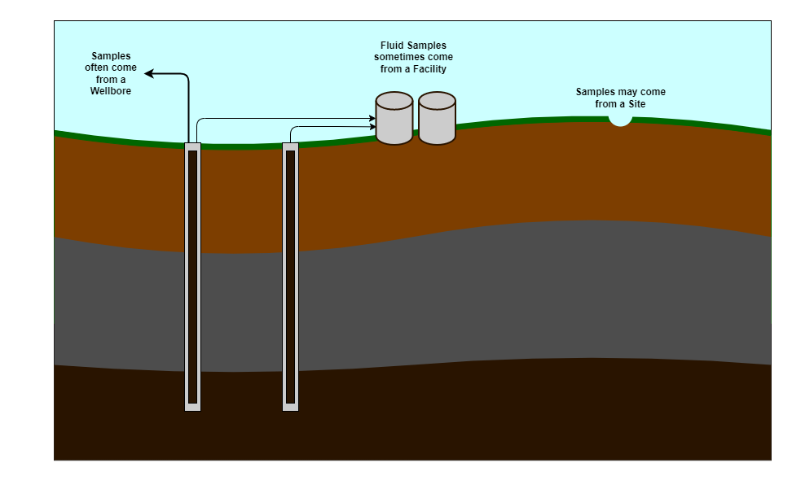

<a name="TOC"></a> Previous Chapter: [11 Well Planning and Execution](11-WellPlanningExecution.md)

[[_TOC_]]

# 12 Rock and Fluid Sample Analysis

## 12.1 The Unified Sample Model

Some industry data models strongly distinguish rock samples (e.g. core, sidewall core) from fluid samples (e.g. oil from a formation test), including their inventory, acquisition, and analysis. In contrast, in OSDU, the Unified Sample model approach provides a common, unified, way to manage the “sample” ("specimen-to-analyze") concept for both rock and fluid sample types, as well as other materials that might be analyzed in a scientific lab (e.g., glass, metal, plastic).

The unified approach includes capturing data for the associated processes used to acquire, create, store, analyze and characterize samples. This unified model leverages the commonalities available between both rock and fluid samples as well as accounting for the differences between both sample types. A key deliverable for this approach is establishing the relationship, where applicable, between rock and fluid samples which are acquired from a single source; e.g. fluid samples extracted from core samples acquired from target formations.

Note that, previous to 2024, the OSDU data model had schemas that were specific to "Rock", such as `master-data--RockSample`, `work-product-component--RockImage`, `master-data--Coring`, `reference-data--RockSampleType`, and `work-product-component--RockSampleAnalysis`. In 2025 (M26), the process of deprecating those was completed and they were fully replaced by the unified Sample data model approach.

## 12.2 The Life Cycle of Samples

|            |
|:----------------------------------------------------------------------------------:|
| A simplified business process for sample acquisition and analysis. |

Various types of physical samples get acquired in order for a scientific lab and/or specialist to analyze them. They are usually natural rock or fluid, but may be other materials, like metal, glass, plastic, or concrete.

Those specimens are acquired...

- from different locations
- by different methods
- with different equipment
- under different conditions
- for different purposes

Samples are then often physically cut, crushed, split, or otherwise physically or chemically modified to better transport them or analyze them. For example, a conventional core section is cut into a slab, a plug is drilled from that slab, and an endtrim is cut from that plug. In some cases, batches of specimens are recombined.

They undergo different kinds of lab analyses where they may be photographed, x-rayed, scanned, heated, burnt, tested with other fluids, put in vacuums, and more. The lab or other specialists deliver various kinds of objective and subjective analysis data in reports and datasets. Samples are often stored in containers, and they are inventoried and physically moved from location to location.

All of this has been taken into consideration in the unified Sample data model.

Each time a Sample is created, whether newly-acquired, subsampled from a previous sample, or created in a lab, a new `master-data--Sample` record should be created to represent that Sample.

|            |
|:----------------------------------------------------------------------------------:|
| A simplified entity-relationship diagram of the unified sample data model. (This png image has embedded draw.io instructions) |

The diagram is simplified. It does not show the relationships to:
* Field
* GeoPoliticalEntity (Country, County, Block,...)
* Basin
* Play
* Prospect

Each of the master-data and work-product-component entities include those relationships by default via the
data.GeoContexts[] array.

<a name="121-rock-samples"></a>

## 12.3 Sample and Sample Classification

`master-data--Sample` is the schema that represents the physical sample/specimen such as a core slab, a core plug, rock cuttings, or a vial of oil.

A Sample is primarily classified by `reference-data--SampleType` which can further be filtered by `reference-data--SampleSubstanceFamily`. In addition to SampleType, the schema captures many other pieces of metadata/data in order to avoid overloading the SampleType reference list with too many concepts. Other schema properties allow one to capture acquisition sources, methods, and tools, accompanying wellbore fluid and mud tracer, aspects of sample preparation and preservation, and more.

The `Sample` schema is used for **any** of these kinds of samples/specimens, and the chain of relationship of these _physical_ specimens to each other is captured via `ParentSampleIDs`.

While the schema does not enforce such implications, certain selected reference values logically imply other reference values. The following thought-flow diagram may be helpful to think about these implications.


|            |
|:----------------------------------------------------------------------------------:|
| An indicative thought-flow for classifying Samples with reference data. (This png image has embedded draw.io instructions) |


### 12.3.1 Sample Container

The sample container (represented by `master-data--SampleContainer`) is used in storing samples generated or acquired through some sample creation process (e.g. initial acquisition events / operations, sample recombination processes, subsampling processes, etc.). Sample containers are usually associated with the life cycle of the sample and could change over time especially during chain of custody events. Sample containers, especially for fluids, will also typically undergo a certification process to determine their viability for both storage and transportation. Information about the certification process are part of the collection of attributes stored within the sample container data object.

Typical attributes captured within the sample container object includes the manufacturers, make, and model, capacity, construction material, operating condition rating, certification process, container type, container service type, service dates, owners.

### 12.3.2 Sample Origin and Physical Modifications

Look for `SampleOriginTypeID` to identify this. The sample at hand may be **original as-acquired**, or it might be a smaller portion taken or extracted from the original (**subsampled**), a chemical derivation of the original (**derived**), a **combination** of multiple samples, or a **synthetic** lab-creation that approximates the natural sample.

As mentioned elsewhere, for rock sample subsampling, a conventional core section is cut into a slab, a plug is drilled from that slab, and an endtrim is cut from that plug. In OSDU, sample extraction is also a form of subsampling; This can refer to the extraction of fluid samples from rock samples, or, for fluids, subsampling indicates the aliquoting of samples -- that is, the process of extracting a part of a sample while ensuring the smaller sample extracted has the same chemical composition and properties of the larger sample. However, if the fluid changes chemically and is not an aliquot, it is "derived" rather than "subsampled".

All such Samples are represented by `master-data--Sample`. The `SampleOriginType` will differ for some of them, and the subsampled Samples will use `ParentSampleIDs` to identify their source Sample(s).

#### 12.3.2.1 Sample Recombination

Sample recombination is a process which involves combining fractions of different samples to create a new sample. Examples of scenarios where samples area created through recombination process can be seen below:
- **Combining** oil and gas fluid samples **obtained from separators or production streams** at certain conditions to emulate reservoir operating conditions. This sample could then be subjected to further PVT analysis to get a better understanding of fluid regime within the reservoirs from which the parent samples were obtained.
- Creation of **synthetic** fluid samples. A synthetic sample is one that is **created by a recombination of fluids that are not necessary collected from production stream directly**. For example, if you replace a separator gas sample with a mixture of pure component gas such as C1, C2, C3 in the lab to mimic the separator gas sample, then you will end up with a synthetic fluid. In other words, if you create mixtures of pure gases and liquids in the lab to either mimic sample obtained directly from production streams, then you will end up with a synthetic sample.

Within the Sample model, there is a nested `RecombinationSpecification` object which captures information pertaining to the parent samples and associated fractions (volumetric, mass or molar) used in the recombination process, the recombination conditions. (pressure and temperature) as well as the expected / target composition for the final sample created.
Note: If using the recombination method in creating a Sample, ensure the `SampleOriginTypeID` refers to either `Synthetic` or `Combined`, as appopriate.

### 12.3.3 Sample Preparation

At various times in their life cycle, rock and fluid samples are prepared for subsequent steps via slicing, crushing, cleaning, acidizing, washing, drying, and more. The properties referring to reference lists `SamplePreparationMethod` and `SamplePreparationType` help capture this information, as it can affect the interpretation of sample lab analysis.

### 12.3.4 Sample Depths

The depth at which a sample was acquired, as well as its recorded original depth when it is analyzed or subsampled, are vital when correlating sample analyses with wireline data and reservoir model data.  Additionally, these depths can be reported as a range with a top and base depth.

#### 12.3.4.1 Sample and Subsample Depths as Reported
The sample or sub-sample depth measurements, as they are currently reported, are located within `DepthMeasurement` of the `master-data--Sample`schema.  This object references `AbstractFacilityVerticalMeasurement`, which stores the value, unit of measure, type, and other properties of any depths and associated elevations of the identified sample or subsample.

Example of `SampleTop` and `SampleBase` depth measurements recorded within `Sample.DepthMeasurement`:
<details><summary>Click to expand</summary>

```JSON

"VerticalMeasurements": [
      {
        "VerticalMeasurementID": "SAMPLE_TOP_MD_DRILLER",
        "VerticalMeasurement": 1500.0,
        "VerticalMeasurementTypeID": "namespace:reference-data--VerticalMeasurementType:SampleTop:",
        "VerticalMeasurementPathID": "namespace:reference-data--VerticalMeasurementPath:MeasuredDepth:",
        "VerticalMeasurementSourceID": "namespace:reference-data--VerticalMeasurementSource:Driller:",
        "VerticalReferenceEntityID": "namespace:master-data--Wellbore:wellbore-456:",
        "VerticalReferenceID": "MD_ELEV_VALUE_KB",
        "VerticalMeasurementUnitOfMeasureID": "namespace:reference-data--UnitOfMeasure:m:",
        "EffectiveDateTime": "2024-01-15T08:00:00Z",
        "TerminationDateTime": "2024-01-16T14:30:00Z",
        "VerticalMeasurementDescription": "Initial depth from core recovery sheet"
      },
    {
        "VerticalMeasurementID": "SAMPLE_BASE_MD_DRILLER",
        "VerticalMeasurement": 1504.7,
        "VerticalMeasurementTypeID": "namespace:reference-data--VerticalMeasurementType:SampleBase:",
        "VerticalMeasurementPathID": "namespace:reference-data--VerticalMeasurementPath:MeasuredDepth:",
        "VerticalMeasurementSourceID": "namespace:reference-data--VerticalMeasurementSource:Driller:",
        "VerticalReferenceEntityID": "namespace:master-data--Wellbore:wellbore-456:",
        "VerticalReferenceID": "MD_ELEV_VALUE_KB",
        "VerticalMeasurementUnitOfMeasureID": "namespace:reference-data--UnitOfMeasure:m:",
        "EffectiveDateTime": "2024-01-16T14:30:00Z"
      },
      {
        "VerticalMeasurementID": "MD_ELEV_VALUE_KB",
        "VerticalMeasurement": 1499.2,
        "VerticalMeasurementTypeID": "namespace:reference-data--VerticalMeasurementType:KB:",
        "VerticalMeasurementPathID": "namespace:reference-data--VerticalMeasurementPath:TrueVerticalHeight:",
        "VerticalReferenceEntityID": "namespace:master-data--Wellbore:wellbore-456:",
        "VerticalReferenceID": "KB_ELEVATION",
        "VerticalMeasurementUnitOfMeasureID": "namespace:reference-data--UnitOfMeasure:m:",
        "EffectiveDateTime": "2024-01-16T14:30:00Z",
        "VerticalMeasurementDescription": "Corrected depth based on wireline log correlation with gamma ray markers"
    "VerticalCRSID": "namespace:reference-data--CoordinateReferenceSystem:MSL:",
      },
      {
        "VerticalMeasurementID": "SAMPLE_TOP_TVD_MSL",
        "VerticalMeasurement": 1480.2,
        "VerticalMeasurementTypeID": "namespace:reference-data--VerticalMeasurementType:SampleTop:",
        "VerticalMeasurementPathID": "namespace:reference-data--VerticalMeasurementPath:TrueVerticalDepth:",
        "VerticalMeasurementSourceID": "namespace:reference-data--VerticalMeasurementSource:Logger:",
        "WellboreTVDTrajectoryID": "namespace:work-product-component--WellboreTrajectory:survey-123:",
        "VerticalCRSID": "namespace:reference-data--CoordinateReferenceSystem:MSL:",
        "VerticalMeasurementUnitOfMeasureID": "namespace:reference-data--UnitOfMeasure:m:",
        "EffectiveDateTime": "2024-01-16T14:30:00Z"
      },
      {
        "VerticalMeasurementID": "SAMPLE_BASE_TVD_MSL",
        "VerticalMeasurement": 1485.1,
        "VerticalMeasurementTypeID": "namespace:reference-data--VerticalMeasurementType:SampleBase:",
        "VerticalMeasurementPathID": "namespace:reference-data--VerticalMeasurementPath:TrueVerticalDepth:",
        "VerticalMeasurementSourceID": "namespace:reference-data--VerticalMeasurementSource:Logger:",
        "WellboreTVDTrajectoryID": "namespace:work-product-component--WellboreTrajectory:survey-123:",
        "VerticalCRSID": "namespace:reference-data--CoordinateReferenceSystem:MSL:",
        "VerticalMeasurementUnitOfMeasureID": "namespace:reference-data--UnitOfMeasure:m:",
        "EffectiveDateTime": "2024-01-16T14:30:00Z"
      }
    ],
```

</details>

Note the above example is self-referencing.  The `SAMPLE_TOP_MD_DRILLER`, for example, has a VerticalReferenceID of `MD_ELEV_VALUE_KB`, which is another object in the same DepthMeasurement array that defines the elevation from which the sample depths were measured.

#### 12.3.4.2 Sample Depths as Acquired
Sample Depths recorded when the original Sample was acquired are stored within the `master-data--Sample` schema using `SampleAcquisition.SampleAcquisitionDetail.TopDepth` and `SampleAcquisition.SampleAcquisitionDetail.BaseDepth`.  Additional properties are further described in `SampleAcquisition.SampleAcquisitionDetail.VerticalMeasurement`.  Note these depth values are not necessarily different from those stored within `DepthMeasurement'.

## 12.4 Sample Acquisition

The sample acquisition process is a critical piece in modelling the Unified Sample object. It seeks to provide information and understanding on the sample acquisition method used, acquisition parameters recorded during sample retrieval, site from which the sample was acquired, equipment used, quality control applied as well as other relevant information needed for the subsequent laboratory analysis. There are two (2) master data objects primarily responsible for modelling the acquisition process – `master-data--SampleAcquisitionJob` and `SampleAcquisition` events that are a part of `master-data--Sample`. The information here provides information about the Sample Acquisition Job object.

The **sample acquisition job** is an overarching project containing a series of activities capable of handling acquisition of samples using varied sample acquisition events. High level information about the project, its description, operator, and service companies involved are captured within this object definition. An important note here is that the model accommodates a single acquisition job having multiple acquisition events of varying types e.g. a single acquisition job used for both conventional core sample acquisition events as well as formation sample acquisition events.

**Sample Acquisition** is a nested object within the `Sample` schema. It captures information about the acquisition of the sample from the original source location from which it was obtained, before subsequent sub-sampling and analysis. This set of attributes should only be used when associating the sample with an acquisition event from its original source and not for sub-sampling or derivative sources.

### 12.4.1 Sample Acquisition Location

Look for `WellboreID` or `SiteID` to identify one of the three types of acquisition locations:

- Wellbore (`master-data--Wellbore`)
- Non-wellbore Facility (`master-data--GenericFacility`, with `FacilityType`)
- Natural Site (`master-data--GenericSite`, with `SiteType`)



### 12.4.2 Sample Acquisition Type

Look for `SampleAcquisitionTypeID` to identify the following in a `Sample` data record. (Also, consider the Thought Flow diagram above to consider how the Sample Acquisition relates to other Sample classifications.)

The Sample acquisition events refers to the various types of acquisition events or approaches used in retrieving either rock or fluid samples. OSDU maintains a reference list of the different types of sample acquisition events: `SampleAcquisitionType`.

It should be noted that different types of acquisition events will model different acquisition parameters. However, there are parameters that are common across board such as the Acquisition Condition (Pressure and Temperature). Within the OSDU data model, the Sample Acquisition parameters are stored within nested objects (`SampleAcquisition`->`SampleAcquisitionDetail`) in the Sample object.

Itemized below are the different types of sample acquisition events and the typical attributes provided that support their use case.

#### 12.4.2.1 Formation Testing Fluid Sample Acquisition Event

Formation testing activities provide pressure measurements at different depths as well as **fluid** samples which when analyzed provide information that can be used in understanding the pressure profile within the formation as well as characterizing aspects of the target formation. Typical parameters captured during sample formation testing acquisition events include VerticalMeasurements, TopDepth, BaseDepth, WellboreID, FormationCondition (Pressure and Temperature), SampleCarrierSlotName, ToolSectionName, GrossFluidKindID, Acquisition GOR and AcquisitionCondition (Pressure and Temperature). For more information on the definition, refer to the SampleAcquisition->SampleAcquisitionDetail nested object under the Sample object.


#### 12.4.2.2 Downhole Fluid Sample Acquisition

This is focused on acquiring **fluid** samples from already completed wells. The production streams from these wells could either come from completions within specific wellbore contact intervals (perforated or open hole). Special sampling tools are run down the well on wireline in order to extract the fluids produced from a completed interval. Typical parameters captured as part of the bottom hole sampling event include: VerticalMeasurements, TopDepth, BaseDepth, WellboreID, ContributingWellboreOpeningIDs, ToolKind, RunNumber, FormationCondition (Pressure and Temperature), Acquisition GOR and AcquisitionCondition (Pressure and Temperature).  For more information on the definition, refer to the SampleAcquisition->SampleAcquisitionDetail nested object under the Sample object.


#### 12.4.2.3 Wellhead Fluid Sample Acquisition

This is focused on acquiring **fluid** samples from production streams from a well using a flow port available at the wellhead. Depending on the completion and production configuration, this type of acquisition can handle samples acquired from both single or comingled (multiple completion intervals) production streams. Typical parameters captured as part of the wellhead sampling event include: WellboreID, ContributingWellboreOpeningIDs, WellheadOperatingCondition (Pressure and Temperature), SamplingPoint, FormationCondition (Pressure and Temperature), Acquisition GOR and AcquisitionCondition (Pressure and Temperature).  For more information on the definition, refer to the SampleAcquisition->SampleAcquisitionDetail nested object under the Sample object.


#### 12.4.2.4 Separator Fluid Sample Acquisition

This acquisition event type takes place at the separator and is used for **gas condensates and saturated oil streams**.  Typical parameters captured as part of the separator sampling event include: WellboreID, ContributingWellboreOpeningIDs, SeparatorOperatingCondition (Pressure and Temperature), SamplingPoint, FormationCondition (Pressure and Temperature), Acquisition GOR and AcquisitionCondition (Pressure and Temperature), CorrectedOilRate, CorrectedGasRate, CorrectedWaterRate, MeasuredOilRate, MeasuredGasRate, MeasuredWaterRate and CorrectionRemarks. For more information on the definition, refer to the SampleAcquisition->SampleAcquisitionDetail nested object under the Sample object.


#### 12.4.2.5 Facility Fluid Sample Acquisition

This **fluid** acquisition event takes place at any topside facility within the production chain. Typical parameters captured as part of the separator sampling event include: FacilityEquipmentOperatingCondition (Pressure and Temperature), SamplingPoint, SiteID, Acquisition GOR and AcquisitionCondition (Pressure and Temperature).  Note that the SiteID should be of OSDU reference data type “GenericFacility”. For more information on the definition, refer to the SampleAcquisition->SampleAcquisitionDetail nested object under the Sample object.


#### 12.4.2.6 Conventional Coring Rock Sample Acquisition

This references the downhole acquisition event type for a conventional core sample acquired from a coring operation using a coring bit and coring barrel. Typical parameters captured as part of the conventional coring event include: VerticalMeasurements, TopDepth, BaseDepth, ToolKind, RunNumber, WellboreID, FormationCondition, ToolSectionName, SampleRecoveredLengthPlanned, SampleRecoveredLengthActual, PreservationTypeID, AcquisitionCondition (Pressure and Temperature), MudBaseTypeID and MudTracerTypeID.  For more information on the definition, refer to the SampleAcquisition->SampleAcquisitionDetail nested object under the Sample object.


#### 12.4.2.7 Sidewall Coring Rock Sample Acquisition

This references the downhole acquisition event type for a sidewall core sample acquired from a coring operation. Typical parameters captured as part of the sidewall coring event include: VerticalMeasurements, TopDepth, BaseDepth, ToolKind, RunNumber, WellboreID, FormationCondition, ToolSectionName, SampleRecoveredLengthPlanned, SampleRecoveredLengthActual, PreservationTypeID, AcquisitionCondition (Pressure and Temperature), MudBaseTypeID and MudTracerTypeID.  For more information on the definition, refer to the SampleAcquisition->SampleAcquisitionDetail nested object under the Sample object.


#### 12.4.2.8 Cuttings Rock Sample Acquisition

This references the downhole acquisition event type for a cuttings sample acquired from a wellbore through rotary, percussion, or auger methods during drilling operations. Typical parameters captured as part of the cuttings acquisition event include: VerticalMeasurements, TopDepth, BaseDepth, ToolKind, RunNumber, WellboreID, FormationCondition, ToolSectionName, PreservationTypeID, AcquisitionCondition (Pressure and Temperature), MudBaseTypeID and MudTracerTypeID.  For more information on the definition, refer to the SampleAcquisition->SampleAcquisitionDetail nested object under the Sample object.

#### 12.4.2.9 Mining Sample Acquisition
An acquisition event type involving the collection of specimens/samples from mining activities that extract minerals from the earth.

#### 12.4.2.10 Water Body Sample Acquisition
An acquisition event type involving the collection of specimens/samples from the surface or midst of the body of water (e.g., oil slick), but not from its bottom.

#### 12.4.2.11 Surface Sample Acquisition
This replaced and expanded the deprecated "Surface Sediment Acquisition" and "Outcrop Sample Acquisition".

An acquisition event type involving the collection of specimens/samples of rock, sediment, or fluid from the surface of the earth - either exposed dry land (e.g., outcrop), or from the base of a water body (e.g., seabed).

#### 12.4.2.12 Other Sample Acquisition
An acquisition event type not otherwise captured by this list.

## 12.5 Sample Chain of Custody Event
This provides historical information on the events that affect the physical sample, such as sub-sampling, or changing storage container or storage location.

It has been adapted to OSDU from Energistics PRODML.

## 12.6 Samples Analyses Report
 The `SamplesAnalysesReport` work-product-component is intended to catalog:
 - a document (e.g. PDF, Excel, etc.) that is delivered in its full form and contains more than one type of rock and/or fluid analysis, or...
 - a data file that contains more than one type of rock and/or fluid analysis (e.g. PRODML).

Often it also references more than rock or fluid sample, and sometimes references even more than one wellbore. Such a document may be only a few pages or hundreds of pages or data frames.

If data is delivered in a form where it contains only one `SampleAnalysisType` from one site/facility/wellbore, then `SamplesAnalyesReport` is optional and unneeded; Instead, only `work-product-component--SamplesAnalysis` can be used.

On the other hand, if a `SamplesAnalysesReport` is needed, a best practice is to create more than one `work-product-component--SamplesAnalysis`, where each one represents a single SampleAnalysisType dataset within the parent report, and with each one relating back to its parent SampleAnalysisReport via the section `data.ParentSamplesAnalysesReports[]`.

<a name="1212-rocksampleanalysis"></a>

## 12.7 Samples Analysis
`work-product-component--SamplesAnalysis` has been designed flexibly and somewhat generically, to function as the catalog schema for practically any kind of sample analysis dataset, governed by the reference list `SampleAnalysisType`, such as routine core analysis, electrical properties, constant composition expansion, or GCMS. For ease of filtering, SampleAnalysisTypes have a `SampleAnalysisFamily`, and in most cases, a `SampleAnalysisSubFamily`.

Note that custom `SamplesAnalysisCategoryTagIDs` can be assigned to a `SamplesAnalysis` record to assist with search and filtering, in cases where the industry and OSDU Forum do not agree on which analyses can be grouped in that "family" of analyses; For example, "SCAL" (Special Core Analysis).

In contrast to `SamplesAnalysesReport`, the `SamplesAnalysis` work-product-component is intended to catalog a single dataset of a single `SampleAnalysisType`.

(Note: Previous schema versions technically allowed an array of `SampleAnalysisTypes` to accommodate edge cases, but this caused more confusion than good, so starting with `SamplesAnalysis.2.0.0`, the schema enforces a single `SampleAnalysisType`.)

Consistent with this, the RAFS (Rock and Fluids) DDMS expects a single `SampleAnalysisType` in order to provide a content schema structure appropriate to that `SampleAnalysisType`. (See the following section, "Samples Analysis Content" for more.)

As mentioned with `SamplesAnalysesReport`, sometimes a `SamplesAnalysis` record will have a file of its own, representing its dataset. In other cases, a `SamplesAnalysis` record will reference a parent `SamplesAnalysesReport` and the location in that original report where the current dataset can be found. These references and relationships can be established in an ingestion and/or enrichment process.

<a name="1213-rockimage"></a>

### 12.7.1 Samples Analysis Content
In the OSDU Data Platform, data content (as opposed to a data catalog record/metadata), can be captured various ways.

1. In rare cases, no content/file is necessary. All data needed is captured in the OSDU well known schema.
2. Sometimes a file is attached via `Datasets`
3. Sometimes an optimized dataset is related via `DDMSDatasets`

When content must be captured and a DDMS exists, the DDMS option is the optimal solution recommended by the OSDU Forum.

(See the relevant section of the OSDU Schema Usage Guide for more on this.)

For Rock and Fluid Samples (RAFS), there is a RAFS DDMS. This DDMS supports more than 40 Sample Analysis Types via structured schemas and optimized indexing and storage.

Learn more in the [RAFS DDMS wiki](https://community.opengroup.org/osdu/platform/domain-data-mgmt-services/rock-and-fluid-sample/rafs-ddms-services/-/wikis/home) and associated pages.


## 12.8 Worked Examples

For further explanation and worked examples with public data, see
[WorkedExamples/SampleAnalysis](../../Examples/WorkedExamples/SampleAnalyses/README.md).

---

## Links

1. Return to the [Beginning of the Chapter](#TOC)
2. Next Chapter: [13 Earth Modelling (Static Subsurface Model Data, Geomodelling)](13-EarthModelling.md)
3. Browse to the [Schema Usage Guide Table of Contents](../README.md)

---