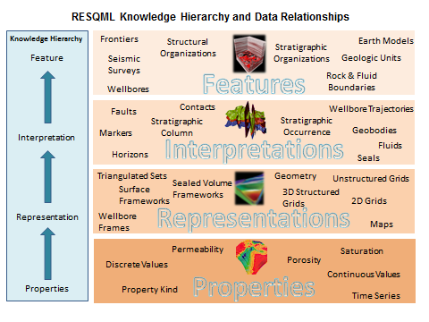

 Previous Chapter: [12 Rock and Fluid Sample Analysis](12-RockAndFluidSampleAnalysis.md)

[[_TOC_]]

# 13 Earth Modelling (Static Subsurface Model Data, Geomodelling)

Predictive subsurface modelling workflows require handling of a variety of datatypes such as seismic interpretations, well markers, structural models, 2D and 3D grids with associated properties. A common characteristic of these data is that they are related and organized in hierarchies such as stratigraphic columns. Maintaining these relationships is crucial when persisting and exchanging such data.

The *RESQML* standard developed originally by the Energistics consortium provides the data model and API to represent data relevant for the reservoir domain. A mapping of meta-data between RESQML objects  and OSDU types has been established, and is used to generate the manifest for general search indexing.

For optimized handling of RESQML-formatted subsurface data, the Reservoir
DDMS (https://community.opengroup.org/osdu/platform/domain-data-mgmt-services/reservoir) supports ingestion, storage and consumption via ETP and REST APIS, and RESQML files. While ETP is a fast web-socket-based protocol enabling deep query, a REST wrapper API is provided for convenience.

## 13.1 The RESQML conceptual data model

RESQML delivers a "knowledge hierarchy" to organize data and transform it into knowledge. OSDU types conating RESQML data carry the repsective term in their name, such as the WPC "HorizonInterpretation".

**The RESQML conceptual data model**

| **Construct/Term**                           | **Definition**                                                                                                                                                                                                                                                                                                                                                                                                                                                                                                                                                                           |
|----------------------------------------------|------------------------------------------------------------------------------------------------------------------------------------------------------------------------------------------------------------------------------------------------------------------------------------------------------------------------------------------------------------------------------------------------------------------------------------------------------------------------------------------------------------------------------------------------------------------------------------------|
| Feature                                      | Something that has physical existence at some point during the exploration, development, production, or abandonment of a reservoir. For example: It can be a boundary, a rock volume, a basin area, but also extends to a drilled well, a drilling rig, an injected or produced fluid, or a 2D, 3D, or 4D seismic survey. Features are divided into these categories: i) Geological, for objects that exist a priori, in the natural world, for example, rock formations and how they are positioned ii) Technical, for objects that exist by the actions of humans, for example, wells. |
| Interpretation (of a feature)                | RESQML uses the definition of David Gawith, which explains an interpretation as a single consistent description of a feature. An interpretation is subjective and very strongly tied to the intellectual activity of the project team members. The initial curiosity and reasoning of the people on the project team initiates the early pre-screening campaign (remote sensing, surveys). They make hypotheses that consist of as many interpretations as necessary to describe the features.                                                                                           |
| Representation (of a feature interpretation) | A digital description of a feature or an interpretation. For example, currently in RESQML, a horizon interpretation may be represented by a point set, a set of triangulated surfaces, or a set of orthogonal grids. A representation contains the topology and the geometry of the data objects.                                                                                                                                                                                                                                                                                        |
| Properties                                   | A property can be attached to any indexable element of any representation. Properties refer to semantic variables (for example, porosity, permeability, etc.) and the corresponding data values, which are recorded in arrays, which may be stored in HDF5 datasets.                                                                                                                                                                                                                                                                                                                     |

## 13.2 OSDU type mapping

**Supported RESQML types and their WPC equivalents**

The table below refers to RESQML 2.0.1 which is currently supported by the production versions of
the [fesapi](https://github.com/F2I-Consulting/fesapi). See also
the [OSDU RESQML parser project](https://community.opengroup.org/osdu/platform/data-flow/ingestion/energistics/resqml-parser/-/blob/main/README.md#mapping-resqml-to-osdu-schema-),
which aims to offer support for 2.0.1 and 2.2.

| **RESQML 2.0.1**                                                                                                                    | **OSDU**                                                                                                                 |
|-------------------------------------------------------------------------------------------------------------------------------------|--------------------------------------------------------------------------------------------------------------------------|
| [obj_Activity](https://docs.energistics.org/#RESQML/RESQML_TOPICS/RESQML-500-292-0-R-sv2010.html)                                     | [Activity](../../E-R/work-product-component/Activity.1.4.0.md)                                                           |
| [obj_ActivityTemplate](https://docs.energistics.org/#RESQML/RESQML_TOPICS/RESQML-500-293-0-R-sv2010.html)                                                                                                                | [ActivityTemplate](../../E-R/master-data/ActivityTemplate.1.2.0.md)                                                      |
| [obj_BlockedWellboreRepresentation](https://docs.energistics.org/#RESQML/RESQML_TOPICS/RESQML-500-280-0-R-sv2010.html)                                                                                                   |                                                                                                                          |
| [obj_BoundaryFeature](https://docs.energistics.org/#RESQML/RESQML_TOPICS/RESQML-500-031-0-R-sv2010.html)                                                                                                                 | [LocalBoundaryFeature](../../E-R/work-product-component/LocalBoundaryFeature.1.2.0.md)                                   |
| [obj_BoundaryFeatureInterpretation](https://docs.energistics.org/#RESQML/RESQML_TOPICS/RESQML-500-093-0-R-sv2010.html)                                                                                                   |                                                                                                                          |
| [obj_CategoricalProperty](https://docs.energistics.org/#RESQML/RESQML_TOPICS/RESQML-500-134-0-R-sv2010.html) [obj_CommentProperty](https://docs.energistics.org/#RESQML/RESQML_TOPICS/RESQML-500-135-0-R-sv2010.html) [obj_ContinuousProperty](https://docs.energistics.org/#RESQML/RESQML_TOPICS/RESQML-500-136-0-R-sv2010.html) [obj_DiscreteProperty](https://docs.energistics.org/#RESQML/RESQML_TOPICS/RESQML-500-137-0-R-sv2010.html) (if not on [obj_WellboreFrameRepresentation](https://docs.energistics.org/#RESQML/RESQML_TOPICS/RESQML-500-283-0-R-sv2010.html)) | [GenericProperty](../../E-R/work-product-component/GenericProperty.1.3.0.md)                                             |
| [obj_DeviationSurveyRepresentation](https://docs.energistics.org/#RESQML/RESQML_TOPICS/RESQML-500-281-0-R-sv2010.html)                                                                                                   | [WellboreTrajectory](../../E-R/work-product-component/WellboreTrajectory.1.4.0.md)                                       |
| [obj_DoubleTableLookup](https://docs.energistics.org/#RESQML/RESQML_TOPICS/RESQML-500-142-0-R-sv2010.html)                                                                                                               | [ColumnBasedTable](../../E-R/work-product-component/ColumnBasedTable.1.4.0.md)                                           |
| [obj_EarthModelInterpretation](https://docs.energistics.org/#RESQML/RESQML_TOPICS/RESQML-500-095-0-R-sv2010.html)                                                                                                        | [EarthModelInterpretation](../../E-R/work-product-component/EarthModelInterpretation.1.2.0.md)                           |
| [obj_FaultInterpretation](https://docs.energistics.org/#RESQML/RESQML_TOPICS/RESQML-500-096-0-R-sv2010.html)                                                                                                             | [FaultInterpretation](../../E-R/work-product-component/FaultInterpretation.1.3.0.md)                                     |
| [obj_FluidBoundaryFeature](https://docs.energistics.org/#RESQML/RESQML_TOPICS/RESQML-500-033-0-R-sv2010.html)                                                                                                            | [LocalBoundaryFeature](../../E-R/work-product-component/LocalBoundaryFeature.1.2.0.md)                                   |
| [obj_FrontierFeature](https://docs.energistics.org/#RESQML/RESQML_TOPICS/RESQML-500-045-0-R-sv2010.html)                                                                                                                 |                                                                                                                          |
| [obj_GenericFeatureInterpretation](https://docs.energistics.org/#RESQML/RESQML_TOPICS/RESQML-500-098-0-R-sv2010.html)                                                                                                    |                                                                                                                          |
| [obj_GeneticBoundaryFeature](https://docs.energistics.org/#RESQML/RESQML_TOPICS/RESQML-500-034-0-R-sv2010.html)                                                                                                          | [LocalBoundaryFeature](../../E-R/work-product-component/LocalBoundaryFeature.1.2.0.md)                                   |
| [obj_GeobodyBoundaryInterpretation](https://docs.energistics.org/#RESQML/RESQML_TOPICS/RESQML-500-099-0-R-sv2010.html)                                                                                                   | [GeobodyBoundaryInterpretation](../../E-R/work-product-component/GeobodyBoundaryInterpretation.1.2.0.md)                 |
| [obj_GeobodyFeature](https://docs.energistics.org/#RESQML/RESQML_TOPICS/RESQML-500-035-0-R-sv2010.html)                                                                                                                  | [LocalRockVolumeFeature](../../E-R/work-product-component/LocalRockVolumeFeature.1.2.0.md)                               |
| [obj_GeobodyInterpretation](https://docs.energistics.org/#RESQML/RESQML_TOPICS/RESQML-500-100-0-R-sv2010.html)                                                                                                           | [GeobodyInterpretation](../../E-R/work-product-component/GeobodyInterpretation.1.3.0.md)                                 |
| [obj_GeologicUnitFeature](https://docs.energistics.org/#RESQML/RESQML_TOPICS/RESQML-500-036-0-R-sv2010.html)                                                                                                             | [LocalRockVolumeFeature](../../E-R/work-product-component/LocalRockVolumeFeature.1.2.0.md)                               |
| [obj_Grid2dRepresentation](https://docs.energistics.org/#RESQML/RESQML_TOPICS/RESQML-500-255-0-R-sv2010.html) (if representing a horizon feature on a seismic lattice)                                                   | [SeismicHorizon](../../E-R/work-product-component/SeismicHorizon.1.3.0.md)                                               |
| [obj_Grid2dRepresentation](https://docs.energistics.org/#RESQML/RESQML_TOPICS/RESQML-500-255-0-R-sv2010.html) (if representing a seismic lattice technical feature)                                                      | [SeismicBinGrid](../../E-R/work-product-component/SeismicBinGrid.1.3.0.md)                                               |
| [obj_Grid2dRepresentation](https://docs.energistics.org/#RESQML/RESQML_TOPICS/RESQML-500-255-0-R-sv2010.html) (if a general one)                                                                                         | [GenericRepresentation](../../E-R/work-product-component/GenericRepresentation.1.2.0.md)                                 |
| [obj_GridConnectionSetRepresentation](https://docs.energistics.org/#RESQML/RESQML_TOPICS/RESQML-500-214-0-R-sv2010.html)                                                                                                 | [GridConnectionSetRepresentation](../../E-R/work-product-component/GridConnectionSetRepresentation.1.2.0.md)             |
| [obj_HorizonInterpretation](https://docs.energistics.org/#RESQML/RESQML_TOPICS/RESQML-500-103-0-R-sv2010.html)                                                                                                           | [HorizonInterpretation](../../E-R/work-product-component/HorizonInterpretation.1.2.0.md)                                 |
| [obj_IjkGridRepresentation](https://docs.energistics.org/#RESQML/RESQML_TOPICS/RESQML-500-217-0-R-sv2010.html)                                                                                                           | [IjkGridRepresentation](../../E-R/work-product-component/IjkGridRepresentation.1.2.0.md)                                 |
| [obj_LocalDepth3dCrs](https://docs.energistics.org/#RESQML/RESQML_TOPICS/RESQML-500-012-0-R-sv2010.html) [obj_LocalTime3dCrs](https://docs.energistics.org/#RESQML/RESQML_TOPICS/RESQML-500-013-0-R-sv2010.html)                                                                                              | [LocalModelCompoundCrs](../../E-R/work-product-component/LocalModelCompoundCrs.1.2.0.md)                                 |
| [obj_MdDatum](https://docs.energistics.org/#RESQML/RESQML_TOPICS/RESQML-500-282-0-R-sv2010.html)                                                                                                                         | [AbstractFacilityVerticalMeasurement](../../E-R/abstract/AbstractFacilityVerticalMeasurement.1.0.0.md)                   |
| [obj_NonSealedSurfaceFrameworkRepresentation](https://docs.energistics.org/#RESQML/RESQML_TOPICS/RESQML-500-259-0-R-sv2010.html)                                                                                         | [UnsealedSurfaceFramework](../../E-R/work-product-component/UnsealedSurfaceFramework.1.3.1.md)                           |
| [obj_OrganizationFeature](https://docs.energistics.org/#RESQML/RESQML_TOPICS/RESQML-500-038-0-R-sv2010.html)                                                                                                             | [LocalModelFeature](../../E-R/work-product-component/LocalModelFeature.1.2.0.md)                                         |
| [obj_StratigraphicUnitFeature](https://docs.energistics.org/#RESQML/RESQML_TOPICS/RESQML-500-040-0-R-sv2010.html)                                                                                                        | [LocalRockVolumeFeature](../../E-R/work-product-component/LocalRockVolumeFeature.1.2.0.md)                               |
| [obj_PlaneSetRepresentation](https://docs.energistics.org/#RESQML/RESQML_TOPICS/RESQML-500-262-0-R-sv2010.html) [obj_PointSetRepresentation](https://docs.energistics.org/#RESQML/RESQML_TOPICS/RESQML-500-263-0-R-sv2010.html) [obj_TriangulatedSetRepresentation](https://docs.energistics.org/#RESQML/RESQML_TOPICS/RESQML-500-271-0-R-sv2010.html)                                             | [GenericRepresentation](../../E-R/work-product-component/GenericRepresentation.1.2.0.md)                                 |
| [obj_PointsProperty](https://docs.energistics.org/#RESQML/RESQML_TOPICS/RESQML-500-151-0-R-sv2010.html)                                                                                                                  |                                                                                                                          |
| [obj_PolylineRepresentation](https://docs.energistics.org/#RESQML/RESQML_TOPICS/RESQML-500-264-0-R-sv2010.html) (if representing a seismic line technical feature)                                                       | [SeismicLineGeometry](../../E-R/work-product-component/SeismicLineGeometry.1.2.0.md)                                     |
| [obj_PolylineRepresentation](https://docs.energistics.org/#RESQML/RESQML_TOPICS/RESQML-500-264-0-R-sv2010.html) (if a general one)                                                                                       | [GenericRepresentation](../../E-R/work-product-component/GenericRepresentation.1.2.0.md)                                 |
| [obj_PolylineSetRepresentation](https://docs.energistics.org/#RESQML/RESQML_TOPICS/RESQML-500-266-0-R-sv2010.html) (if representing a horizon feature on a seismic line)                                                 | [SeismicHorizon](../../E-R/work-product-component/SeismicHorizon.1.3.0.md)                                               |
| [obj_PolylineSetRepresentation](https://docs.energistics.org/#RESQML/RESQML_TOPICS/RESQML-500-266-0-R-sv2010.html) (if representing a fault feature on a seismic support)                                                | [SeismicFault](../../E-R/work-product-component/SeismicFault.1.3.0.md)                                                   |
| [obj_PolylineSetRepresentation](https://docs.energistics.org/#RESQML/RESQML_TOPICS/RESQML-500-266-0-R-sv2010.html) (if a general one)                                                                                    | [GenericRepresentation](../../E-R/work-product-component/GenericRepresentation.1.2.0.md)                                 |
| [obj_PropertyKind](https://docs.energistics.org/#RESQML/RESQML_TOPICS/RESQML-500-152-0-R-sv2010.html)                                                                                                                    | [PropertyType](../../E-R/reference-data/PropertyType.1.0.0.md)                                                           |
| [obj_PropertySet](https://docs.energistics.org/#RESQML/RESQML_TOPICS/RESQML-500-154-0-R-sv2010.html) [obj_RepresentationSetRepresentation](https://docs.energistics.org/#RESQML/RESQML_TOPICS/RESQML-500-172-0-R-sv2010.html)                                                                                 | [PersistedCollection](../../E-R/work-product-component/PersistedCollection.1.2.0.md)                                     |
| [obj_RockFluidOrganizationInterpretation](https://docs.energistics.org/#RESQML/RESQML_TOPICS/RESQML-500-106-0-R-sv2010.html)                                                                                             | [FluidOrganizationInterpretation](../../E-R/work-product-component/RockFluidOrganizationInterpretation.1.2.0.md)         |
| [obj_RockFluidUnitFeature](https://docs.energistics.org/#RESQML/RESQML_TOPICS/RESQML-500-039-0-R-sv2010.html)                                                                                                            | [LocalRockVolumeFeature](../../E-R/work-product-component/LocalRockVolumeFeature.1.2.0.md)                               |
| [obj_RockFluidUnitInterpretation](https://docs.energistics.org/#RESQML/RESQML_TOPICS/RESQML-500-107-0-R-sv2010.html)                                                                                                     | may be sometimes [AquiferInterpretation](../../E-R/work-product-component/AquiferInterpretation.1.2.0.md)                |
| [obj_SealedSurfaceFrameworkRepresentation](https://docs.energistics.org/#RESQML/RESQML_TOPICS/RESQML-500-268-0-R-sv2010.html)                                                                                            | [SealedSurfaceFramework](../../E-R/work-product-component/SealedSurfaceFramework.1.2.0.md)                               |
| [obj_SealedVolumeFrameworkRepresentation](https://docs.energistics.org/#RESQML/RESQML_TOPICS/RESQML-500-269-0-R-sv2010.html)                                                                                             | [SealedVolumeFramework](../../E-R/work-product-component/SealedVolumeFramework.1.2.0.md)                                 |
| [obj_SeismicLatticeFeature](https://docs.energistics.org/#RESQML/RESQML_TOPICS/RESQML-500-046-0-R-sv2010.html)                                                                                                           |                                                                                                                          |
| [obj_SeismicLineFeature](https://docs.energistics.org/#RESQML/RESQML_TOPICS/RESQML-500-048-0-R-sv2010.html)                                                                                                              |                                                                                                                          |
| [obj_SeismicLineSetFeature](https://docs.energistics.org/#RESQML/RESQML_TOPICS/RESQML-500-049-0-R-sv2010.html)                                                                                                           |                                                                                                                          |
| [obj_StratigraphicColumn](https://docs.energistics.org/#RESQML/RESQML_TOPICS/RESQML-500-109-0-R-sv2010.html)                                                                                                             | [StratigraphicColumn](../../E-R/work-product-component/StratigraphicColumn.1.2.0.md)                                     |
| [obj_StratigraphicColumnRankInterpretation](https://docs.energistics.org/#RESQML/RESQML_TOPICS/RESQML-500-110-0-R-sv2010.html)                                                                                           | [StratigraphicColumnRankInterpretation](../../E-R/work-product-component/StratigraphicColumnRankInterpretation.1.3.0.md) |
| [obj_StratigraphicOccurrenceInterpretation](https://docs.energistics.org/#RESQML/RESQML_TOPICS/RESQML-500-111-0-R-sv2010.html)                                                                                           |                                                                                                                          |
| [obj_StratigraphicUnitFeature](https://docs.energistics.org/#RESQML/RESQML_TOPICS/RESQML-500-040-0-R-sv2010.html)                                                                                                        | [LocalRockVolumeFeature](../../E-R/work-product-component/LocalRockVolumeFeature.1.2.0.md)                               |
| [obj_StratigraphicUnitInterpretation](https://docs.energistics.org/#RESQML/RESQML_TOPICS/RESQML-500-112-0-R-sv2010.html)                                                                                                 | [StratigraphicUnitInterpretation](../../E-R/work-product-component/StratigraphicUnitInterpretation.1.3.0.md)             |
| [obj_StreamlinesFeature](https://docs.energistics.org/#RESQML/RESQML_TOPICS/RESQML-500-313-0-R-sv2010.html)                                                                                                              |                                                                                                                          |
| [StreamlinesRepresentation](https://docs.energistics.org/#RESQML/RESQML_TOPICS/RESQML-500-314-0-R-sv2010.html)                                                                                                           |                                                                                                                          |
| [obj_StringTableLookup](https://docs.energistics.org/#RESQML/RESQML_TOPICS/RESQML-500-158-0-R-sv2010.html)                                                                                                               | [ColumnBasedTable](../../E-R/work-product-component/ColumnBasedTable.1.4.0.md)                                           |
| [obj_StructuralOrganizationInterpretation](https://docs.energistics.org/#RESQML/RESQML_TOPICS/RESQML-500-114-0-R-sv2010.html)                                                                                            | [StructuralOrganizationInterpretation](../../E-R/work-product-component/StructuralOrganizationInterpretation.1.2.0.md)   |
| [obj_SubRepresentation](https://docs.energistics.org/#RESQML/RESQML_TOPICS/RESQML-500-173-0-R-sv2010.html)                                                                                                               | [SubRepresentation](../../E-R/work-product-component/SubRepresentation.1.2.0.md)                                         |
| [obj_TectonicBoundaryFeature](https://docs.energistics.org/#RESQML/RESQML_TOPICS/RESQML-500-041-0-R-sv2010.html)                                                                                                         | [LocalBoundaryFeature](../../E-R/work-product-component/LocalBoundaryFeature.1.2.0.md)                                   |
| [obj_TimeSeries](https://docs.energistics.org/#RESQML/RESQML_TOPICS/RESQML-500-018-0-R-sv2010.html)                                                                                                                      | [TimeSeries](../../E-R/work-product-component/TimeSeries.1.2.0.md)                                                       |
| [obj_UnstructuredGridRepresentation](https://docs.energistics.org/#RESQML/RESQML_TOPICS/RESQML-500-241-0-R-sv2010.html)                                                                                                  | [UnstructuredGridRepresentation](../../E-R/work-product-component/UnstructuredGridRepresentation.1.2.0.md)               |
| [obj_WellboreFeature](https://docs.energistics.org/#RESQML/RESQML_TOPICS/RESQML-500-050-0-R-sv2010.html)                                                                                                                 | [Wellbore](../../E-R/master-data/Wellbore.1.5.1.md)                                                                      |
| [obj_WellboreFrameRepresentation](https://docs.energistics.org/#RESQML/RESQML_TOPICS/RESQML-500-283-0-R-sv2010.html)                                                                                                     | (MD values) part of [WellLog](../../E-R/work-product-component/WellLog.1.5.0.md)                                         |
| [obj_WellboreInterpretation](https://docs.energistics.org/#RESQML/RESQML_TOPICS/RESQML-500-116-0-R-sv2010.html)                                                                                                          |                                                                                                                          |
| [obj_CategoricalProperty](https://docs.energistics.org/#RESQML/RESQML_TOPICS/RESQML-500-134-0-R-sv2010.html) [obj_CommentProperty](https://docs.energistics.org/#RESQML/RESQML_TOPICS/RESQML-500-135-0-R-sv2010.html) [obj_ContinuousProperty](https://docs.energistics.org/#RESQML/RESQML_TOPICS/RESQML-500-136-0-R-sv2010.html) [obj_DiscreteProperty](https://docs.energistics.org/#RESQML/RESQML_TOPICS/RESQML-500-137-0-R-sv2010.html) (if on [obj_WellboreFrameRepresentation](https://docs.energistics.org/#RESQML/RESQML_TOPICS/RESQML-500-283-0-R-sv2010.html))     | (sample values) part of [WellLog](../../E-R/work-product-component/WellLog.1.5.0.md)                                     |
| [obj_WellboreMarkerFrameRepresentation](https://docs.energistics.org/#RESQML/RESQML_TOPICS/RESQML-500-285-0-R-sv2010.html)                                                                                               | [WellboreMarkerSet](../../E-R/work-product-component/WellboreMarkerSet.1.5.1.md)                                         |
| [obj_WellboreTrajectoryRepresentation](https://docs.energistics.org/#RESQML/RESQML_TOPICS/RESQML-500-287-0-R-sv2010.html)                                                                                                | [WellboreTrajectory](../../E-R/work-product-component/WellboreTrajectory.1.4.0.md)                                       |

[Worked Examples](../../Examples/WorkedExamples/Reservoir%20Data/README.md).

---

## Links

1. Return to the [Beginning of the Chapter](#TOC)
2. Next Chapter: [14 Reservoir Management](14-ReservoirManagement.md)
3. Browse to the [Schema Usage Guide Table of Contents](../README.md)

---