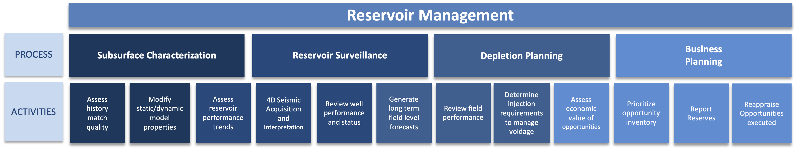

 Previous Chapter: [13 Earth Modelling (Static Subsurface Model Data, Geomodelling)](13-EarthModelling.md)

[[_TOC_]]

# 14 Reservoir Management

|  |
|:--------------------------------------------------:|
|                Reservoir Management                |

Reservoir Management spans the entire lifecycle of a field. It defines itself as:

* Reservoir Management is the dynamic process of maximizing value of hydrocarbons recovered over the full life cycle of
  the asset linking technical evaluation/prediction and business value assessment.
* Determine if reservoir management concepts are adequately covered in the existing scope of the OSDU platform.
* Focus initial scope on activities in producing assets; broaden to other phases of asset life cycle in future phases.
* The concepts below to describe reservoir management activities in producing assets.

|               |
|:-------------------------------------------------------------:|
| Reservoir Management Activities over the lifecycle of a field |

OSDU data schemas contribute to Reservoir Management. Subsurface models were already described in the previous chapter
[13 Earth Modelling (Static Subsurface Model Data, Geomodelling)](13-EarthModelling.md). The following types address
more specific details relevant to Reservoir Management:

## 14.1 Reservoir and Reservoir Segments

|  |
|:-------------------------------------------------------------------------------------------------:|
|                  Overview over Reservoir and ReservoirSegment with Relationships                  |

[Reservoir](../../E-R/master-data/Reservoir.1.2.0.md) and [ReservoirSegment](../../E-R/master-data/ReservoirSegment.1.2.0.md)
belong to the [2.1 Master Data](02-GroupType.md#21-master-data). These objects represent the reservoir as
tangible business objects, to which more interpretive or opinionated work-product-components refer.

More explanations are provided in the [ReservoirManagement](../../Examples/WorkedExamples/ReservoirManagement/README.md)
worked examples.

## 14.2 Estimated Volumes

[ReservoirEstimatedVolume](../../E-R/work-product-component/ReservoirEstimatedVolumes.1.1.1.md) work-product-component
records carry a discriminator
property [`EstimatedVolumeTypeID`](../../E-R/reference-data/ReservoirEstimatedVolumeType.1.0.0.md),
either `EstimatedInPlaceVolumes` or `EstimatedUltimateRecoverableVolumes`. It carries details on hydrocarbons estimated
in place or estimated ultimate technical recoverables at some reservoir entity level.
The scope is given by the related ParentObjectID, which is either a Field, Reservoir or ReservoirSegment.

Please refer to worked examples in the [ReservoirManagement](../../Examples/WorkedExamples/ReservoirManagement/README.md)
domain.

## 14.3 Geo-Labels

The [GeoLabelSet](../../E-R/work-product-component/GeoLabelSet.1.1.0.md) acts as an object for collecting consolidated
geological properties or information related to a labelled
master entity, which could be a Reservoir, Reservoir Segment, Field, Prospect, etc. Individual labels are name-value
pairs categorised by a GeoLabelType which allows for specifying characteristics such as: the average porosity of a
Reservoir as 20%, the average initial reservoir pressure for Reservoir Segment as at 8000 psi, or identifying the
predominant depositional environment of a Field as “marine shallow”. The content may have been identified through
various methods, including measurement, interpretation, estimation, data collection from reports, delivered data
packages, data mining etc.

|  |
|:-----------------------------------------------------------------------------------------------------:|
|                                 Entity Relationships for GeoLabelSet                                  |

The [worked examples section](../../Examples/WorkedExamples/ReservoirManagement/GeoLabels/README.md) demonstrates two
use cases for GeoLabelSets and their application.

---

## Links

1. Return to the [Beginning of the Chapter](#TOC)
2. Next Chapter: [15 Production](15-Production.md)
3. Browse to the [Schema Usage Guide Table of Contents](../README.md)