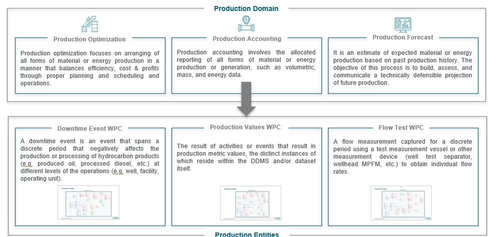
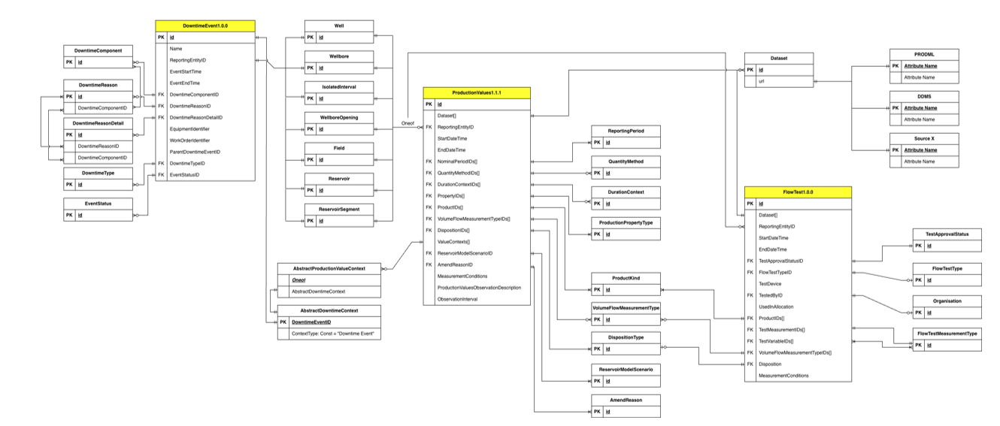

 Previous Chapter: [14 Reservoir Management](14-ReservoirManagement.md)

[[_TOC_]]

# 15 Production

The **Production domain** applies to all forms of material, fluid or energy production or generation, such as those from conventional hydrocarbons, material mining, mineral production, or renewable sources. It also includes fluid injection or disposal (such as water injection or disposal, or carbon dioxide injection as part of CCUS activities). Production encompasses details about the entities involved, output quantities, the method of production and distribution, and information on the extraction, injection or generation process.

The domain describes a standardized and governed way for managing production data, covering how fluids and energy are produced, measured, analysed, optimized, and forecasted at different operational levels — from well and facility operations to field and asset performance. It consists of subdomains, namely production optimisation, production accounting, production forecast, and production operations (newly introduced in 2026 and currently a work in progress), to support consistent, traceable, and decision-ready production intelligence across the asset lifecycle. This ensures a common semantic foundation across operational, subsurface, and commercial workflows.

The core of the Production domain is the **Production Accounting** subdomain, which consists of three important production-specific Work Product Components (WPCs): Production Values, Flow Test, and Downtime Event. These WPCs capture discrete production results, test measurements, and operational interruptions in a structured and interoperable manner, while remaining linked to OSDU master data (e.g. wells, reservoirs, fields) and OSDU reference data as authoritative anchors. This enables consistent characterization of production information and eliminates the need to redefine common entities and concepts.

This guide explains how production entities are organized, how they relate to upstream master data and reference data in OSDU, and the usage of the three important Work Product Components as described in the following sub-sections.

|  |
|:--------------------------------------------------:|
|                Production Domain              |

|  |
|:-------------------------------------------------------------------------------:|
|                Production Domain Work-Product-Component ER Diagram              |

---

## 15.1 Production Values WPC

The **Production Values WPC** represents the core output of production accounting activities. It captures various *QuantityMethod* (e.g. measured, allocated) and *Property* (e.g. volume, rate, and energy) for defined reporting periods and products. These values are derived from measurements, tests, and operational events, and are associated with the relevant producing or injecting entities (e.g. well, wellbore, facility, reservoir segment). Production Values serve as the primary WPC for reporting purposes.

[ER Link](../../E-R/work-product-component/ProductionValues.2.0.0.md)

[Worked Example Link](../../Examples/WorkedExamples/Production/records/ProductionValues.2.0.0-Payload.json)

---

## 15.2 Flow Test WPC

The **Flow Test WPC** captures discrete, time-bound production measurements obtained through test measurement devices or well test equipment, such as test separators and multiphase flow meters (MPFMs). It provides detailed, well-level measurement data, including individual phase flow rates that underpin allocation logic and production validation. Flow Test acts as a key reference point for calibrating production calculations and supporting confidence in production accounting results.

[ER Link](../../E-R/work-product-component/FlowTest.1.0.0.md)

---

## 15.3 Downtime Event WPC

The **Downtime Event WPC** records periods during which production or processing is partially or fully interrupted. These events may impact different entity levels, such as reservoir, well, facilities, or operating units, and can be associated with specific causes or activities. By explicitly capturing production downtime, this WPC enables accurate net production accounting, loss attribution, and operational performance analysis, while providing essential context for interpreting production values.

[ER Link](../../E-R/work-product-component/DowntimeEvent.1.0.0.md)

---

## Links

1. Return to the [Beginning of the Chapter](#TOC)
2. Next Chapter: [16 Well & Reservoir Pressure Tests Domain](16-PressureTests.md)
3. Browse to the [Schema Usage Guide Table of Contents](../README.md)