 Previous Chapter: [15 Production](15-Production.md)

[[_TOC_]]

# 16 Well & Reservoir Pressure Tests Domain

## 16.1 Well Pressure Tests

At this stage of the development - the Well Pressure Tests schemas are aiming at covering the following type of tests:
    * Flow Tests (to be checked with Production Team)
    * Formation Tests
    * Transient Tests
    * Transient Interference Tests
Formation Integrity Tests have been already delivered from Well Delivery Team.

As of today - the delivered schemas have been tested and validated against Formation Tests. Other categories have still
to be tested (with potential updates to come).

The example (happy pass) of data used has been built on the top of the [Volve OpenTest DataSet 15_9-F-1](https://gitlab.opengroup.org/osdu/subcommittees/data-def/projects/well-delivery/docs/-/tree/master/Design%20Documents/WellLogExtensions/Volve_WellLog_examples/formation_pressure/Formation_Pressure_Raw_Time_Depth/15_9-F-1)
Some more complex use cases have been illustrated on the top of AkerBP corporate dataset.

### 16.1.1 Process Management

The first set of deliveries are aiming at supporting the most common workflow - without any derivatives interpretations - meaning:
- Acquisition Description
- Raw Measurements
- Basic Processing - consisting on selecting a subset of stations - subset of pre-test to compute derived measurements (pressure, mobilities,...) at those stations.

This will involve 2 new schemas and 2 previously existing ones.
- A newly created master-data to capture Acquisition Description
- A newly created work-product-component to capture Raw Measurements
- The existing WellLog WPC schema to capture the output from basic Processing
- The existing Document WPC schema to capture the acquisition & processing report.

This can be summarized as below - either from an "Acquisition to Data Processing" point of view....

|                                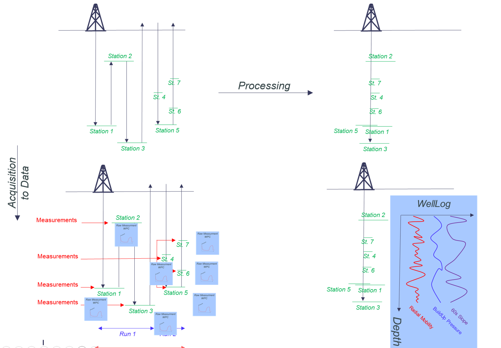                                 |
|:-------------------------------------------------------------------------------------------------------------------------------:|
| Understanding the relationships and aggregation from Station to Station Acquisition - to a single Log resulting Processed Data. |

.... Or from a Workflow/Schema usage perspective:

| 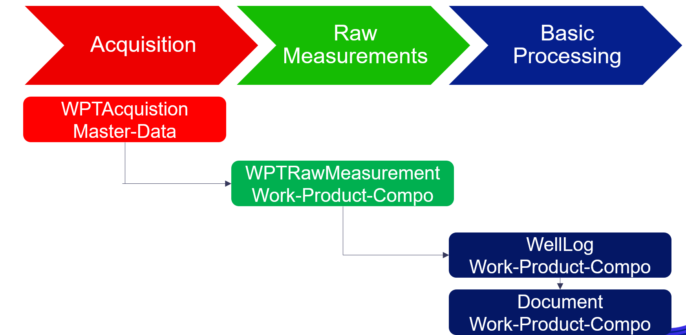 |
|:-------------------------------------------------------------------------------------------------:|
|                  Basic Well Pressure Test Workflow and related involved OSDU entities             |

### 16.1.2 Wellbore Data Acquisition

**WARNING:** Wellbore Data Acquisitions are currently being designed per type of data - and will be reworked early 2025 to be more generic.
The following part will detail main differences between Well Pressure Tests & Well Logs - in Well Pressure Tests Acquisition context.

#### 16.1.2.1 Well Pressure Tests Design

##### 16.1.2.1.1 Generalities

In "Well Pressure Testing" Context - an overall acquisition is designed in an Acquisition Program (currently not covered by OSDU).
This program can be split in one or multiple jobs (generally one job is assigned per Contracting Company).

Each job consists of multiple phases, with different set of equipments (probes and gauges).
A Job will consist of multiple downward and upward travels within the hole - with multiple stops (stations) - and with the possibility to take out the overall string from the ground, from time to time.
Obviously the acquisition string will remain constant between two consecutive 'outting' from the hole - and can be changed (but not necessarily) at each outting.

Consequently, the continuous period between two consecutive 'outtings' will be named **"Run"**. Within a run, each continuous travel within the hole - without change of direction - will be named **"Pass"**. Each Stop at a given depth, to proceed with measurements will be named **"Station"**.

Multiple **"Measurements"** (with different orientations/Azimuths) can be made a single station - some of them being "failed", other ones being "success".

The diagram describes those concepts:

| 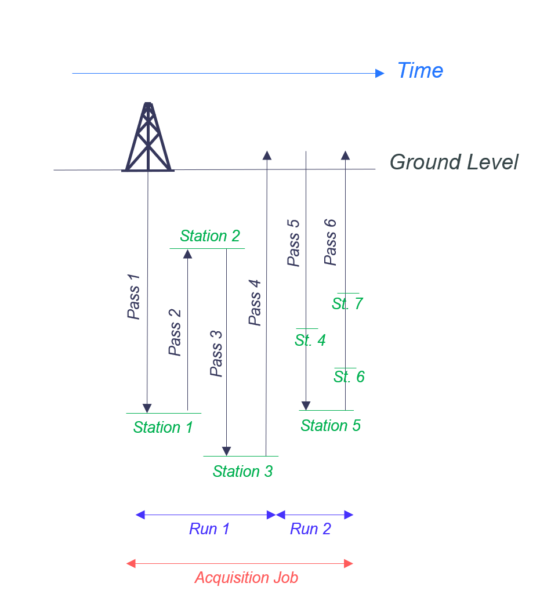 |
|:-------------------------------------------------------------------------------------------------:|
|                  Overview of Acquisition Phases while acquiring Well Pressure Tests               |

##### 16.1.2.1.2 Definitions
As such, we can then provide the following definitions:

- **"A Well Pressure Test Acquisition Job"**:_A Well Pressure Test Acquisition Job is a subset of a Well Pressure Test Acquisition Program - usually assigned to a single contracting company and summarizing the overall testing phases (multiple measurement stations, run over multiple passes from one or more runs).
The Acquisition String can change between two different runs - and at each station, only a subset of the "in place" string can be activated - which subset can evolve from one measurement to the other._

- **"A Well Pressure Test Acquisition Run"**:_A Run is defined between two consecutive "outting from the ground" from acquisition string - meaning a single run has necessarily the same probes and gauges installed. A run is made of multiple (at least 2) passes._

- **"A Well Pressure Test Acquisition Pass"**:_A Pass is a subset of a run - composed by a continuous, single direction wise, travel of the acquisition string into within the Well/Wellbore._

- **"A Well Pressure Test Acquisition Station"**:_A Station is defined as a static point within the pass - where one or many tests can be tried out._
    * It worth knowing that specific cases with two different gauges, at two different depths, contributing to the measurement at a single "stop" within the run - will be considered as a single depth. The Master gauge will be used as reference for the station depth - while the acquisition string setting will be captured in the measurement WPC (see below)

| 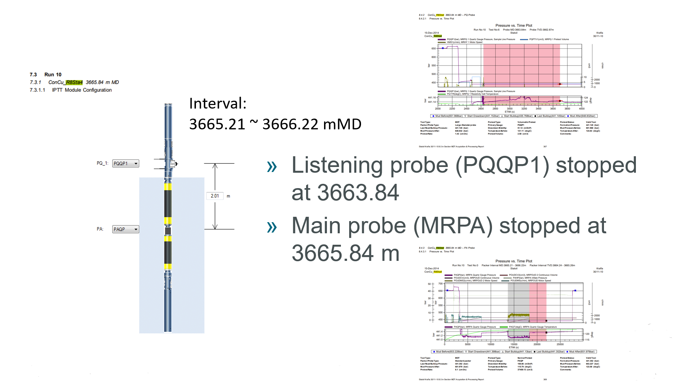 |
|:-------------------------------------------------------------------------------------------------:|
|                  Overview of Complex Acquisition Setting - Acquisition Station @3665.84m          |

#### 16.1.2.2 WellLogs Design
##### 16.1.2.2.1 Generalities
In "Well Loging" Context - an overall acquisition is designed in an Acquisition Program (currently not covered by OSDU).
The events of a well logging project including the mobilising of resources (financial, equipment & people) to the wellsite to conduct a well logging activity and acquire well logging information. May be referred to as the logging job.

The tools **Run** in the hole for the purpose of acquiring well logging measurements. A log run may consist of one or many log **Passes** - which can be defined as an independent, unitary delivery of data/measurements acquired during a log run, typically a set of measurements and derived properties, all sharing one common time and/or depth reference, e.g. a "well log delivery".

| 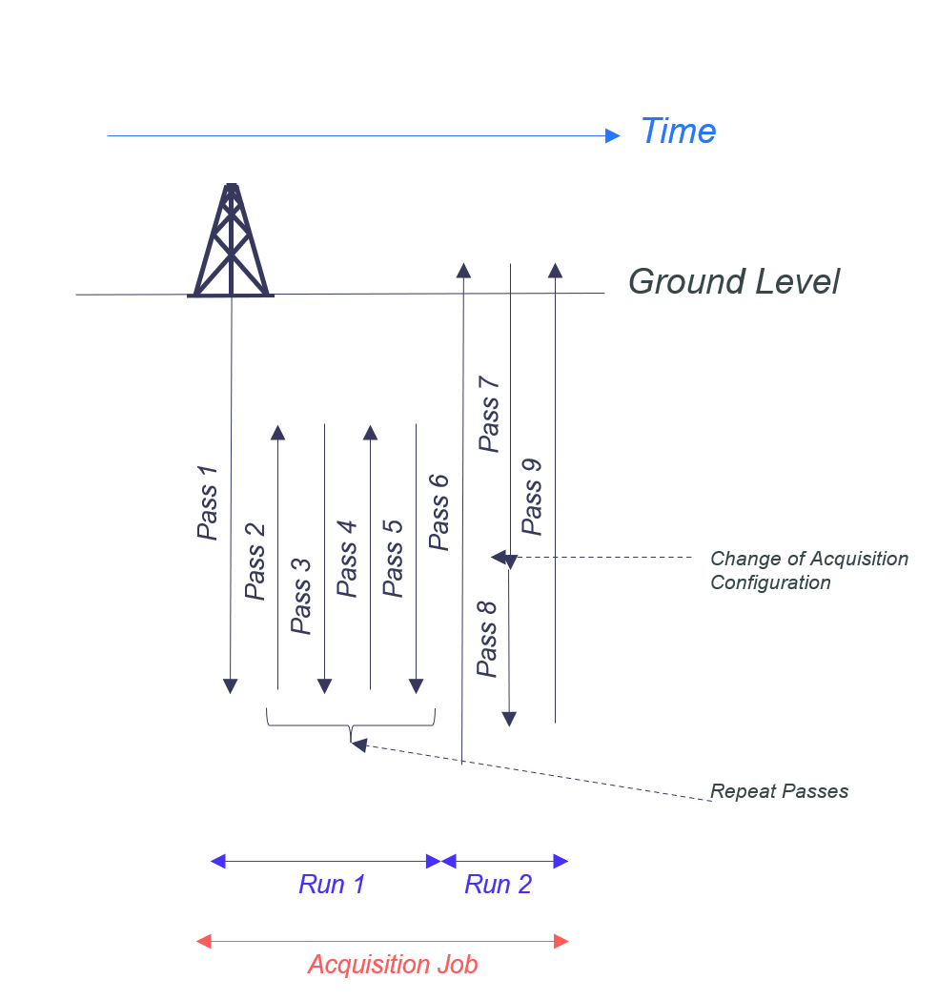 |
|:-------------------------------------------------------------------------------------------------:|
|                  Overview of Acquisition Phases while acquiring WellLogs                          |

##### 16.1.2.2.2 Definitions
As such, we can then provide the following definitions:

- **"A WellLogAcquisition (Job)"**:_The events of a well logging project including the mobilising of resources (financial, equipment & people) to the wellsite to conduct a well logging activity and acquire well logging information. May be referred to as the logging job._

- **"A LogRun"**:_The tools run in the hole for the purpose of acquiring well logging measurements. A log run may consist of one or many log passes.A log run is commonly defined as the activity from when a logging tool string (containing a single or multiple, active or passive sensors) is lowered into the wellbore until it is back at the surface.
More precisely, in the case of an MWD/LWD logging operation a run is initiated when the drilling bit is run below the drill floor, or below the (zero) reference datum elevation and ended when the drill bit is back above the same elevation._

- **"A LogPass"**:_A log pass can be defined as either:_
    + _An independent, unitary delivery of data/measurements acquired during a log run, typically a set of measurements and derived properties, all sharing one common time and/or depth reference, e.g. a "well log delivery"._
    + _A specific acquisition or modus operandi where the logging instrumentation (or parts of the string instrumentation) is run in a specific data acquisition configuration._
    + _This entails:_
        * _A suite of logging tools can be run over the same logging interval multiple times in the same configuration resulting in multiple passes_
        * _A suite of logging tools can be run over multiple, but separate intervals resulting in multiple passes._
        * _A single tool (or specific instruments) can be run in different configurations, with different logging speeds or different resolutions resulting in multiple passes._
        * _An operation might be temporarily interrupted for other operations or data acquisitions. This might result in multiple passes._

#### 16.1.2.3 Comparison & Usage Hints

##### 16.1.2.3.1 Main Differences
- Datawise, the main differences between WellLogs and Well Pressure Tests consists on what the curve represents.
    + In WellLogs, each sample represents a unique measurement made on a specific depth of the borehole. As such, the curve represents, either in Depth or in Time, a set of individual measurements made along the borehole path - and can be pasted on the Trajectory GeoRepresentation.
    + In Well Pressure Test, an acquisition consists multiple time samples recorded at a single depth. A curve represents multiple time samples at a unique position within the well. As such, the curves are recorded in a dimension orthogonal to the Trajectory GeoRepresentation.
- To summarize - A Curve is:
    + In WellLoging, made of a set of
        * Unique measurement....
        * ...made a multiple depths
    + In Well Pressure Testing, made of a set of
        * Multiple measurements....
        * ...made at a unique depth
        * (_Despite we may have multiple stations recorded in a single dataset file_)
        * A Typical Exemple can be seen from Volve Dataset [Here](https://gitlab.opengroup.org/osdu/subcommittees/data-def/projects/well-delivery/docs/-/tree/master/Design%20Documents/WellLogExtensions/Volve_WellLog_examples/formation_pressure/Formation_Pressure_Raw_Time_Depth/15_9-F-1)
            - This is a subset of a MultiWellbores-MultiRuns Campaign.
            - 6 Different Stations - with their individual raw LAS files [1](https://gitlab.opengroup.org/osdu/subcommittees/data-def/projects/well-delivery/docs/-/blob/master/Design%20Documents/WellLogExtensions/Volve_WellLog_examples/formation_pressure/Formation_Pressure_Raw_Time_Depth/15_9-F-1/FM_PRESS_RAW_RUN4_MWD_1.LAS), [2](https://gitlab.opengroup.org/osdu/subcommittees/data-def/projects/well-delivery/docs/-/blob/master/Design%20Documents/WellLogExtensions/Volve_WellLog_examples/formation_pressure/Formation_Pressure_Raw_Time_Depth/15_9-F-1/FM_PRESS_RAW_RUN4_MWD_2.LAS), [3](https://gitlab.opengroup.org/osdu/subcommittees/data-def/projects/well-delivery/docs/-/blob/master/Design%20Documents/WellLogExtensions/Volve_WellLog_examples/formation_pressure/Formation_Pressure_Raw_Time_Depth/15_9-F-1/FM_PRESS_RAW_RUN4_MWD_3.LAS), [4](https://gitlab.opengroup.org/osdu/subcommittees/data-def/projects/well-delivery/docs/-/blob/master/Design%20Documents/WellLogExtensions/Volve_WellLog_examples/formation_pressure/Formation_Pressure_Raw_Time_Depth/15_9-F-1/FM_PRESS_RAW_RUN4_MWD_4.LAS), [5](https://gitlab.opengroup.org/osdu/subcommittees/data-def/projects/well-delivery/docs/-/blob/master/Design%20Documents/WellLogExtensions/Volve_WellLog_examples/formation_pressure/Formation_Pressure_Raw_Time_Depth/15_9-F-1/FM_PRESS_RAW_RUN4_MWD_5.LAS), [6](https://gitlab.opengroup.org/osdu/subcommittees/data-def/projects/well-delivery/docs/-/blob/master/Design%20Documents/WellLogExtensions/Volve_WellLog_examples/formation_pressure/Formation_Pressure_Raw_Time_Depth/15_9-F-1/FM_PRESS_RAW_RUN4_MWD_6.LAS)
            - A Summary File Created using LAS standard [Here](https://gitlab.opengroup.org/osdu/subcommittees/data-def/projects/well-delivery/docs/-/blob/master/Design%20Documents/WellLogExtensions/Volve_WellLog_examples/formation_pressure/Formation_Pressure_Raw_Time_Depth/15_9-F-1/FM_PRESS_RAW_RUN4_MWD_1-6_INF_1.ASC),
            - A Final Report [Here](https://gitlab.opengroup.org/osdu/subcommittees/data-def/projects/well-delivery/docs/-/blob/master/Design%20Documents/WellLogExtensions/Volve_WellLog_examples/formation_pressure/Formation_Pressure_Raw_Time_Depth/15_9-F-1/FM_PRESS_RAW_RUN4_MWD_REPORT_1.PDF)

|                        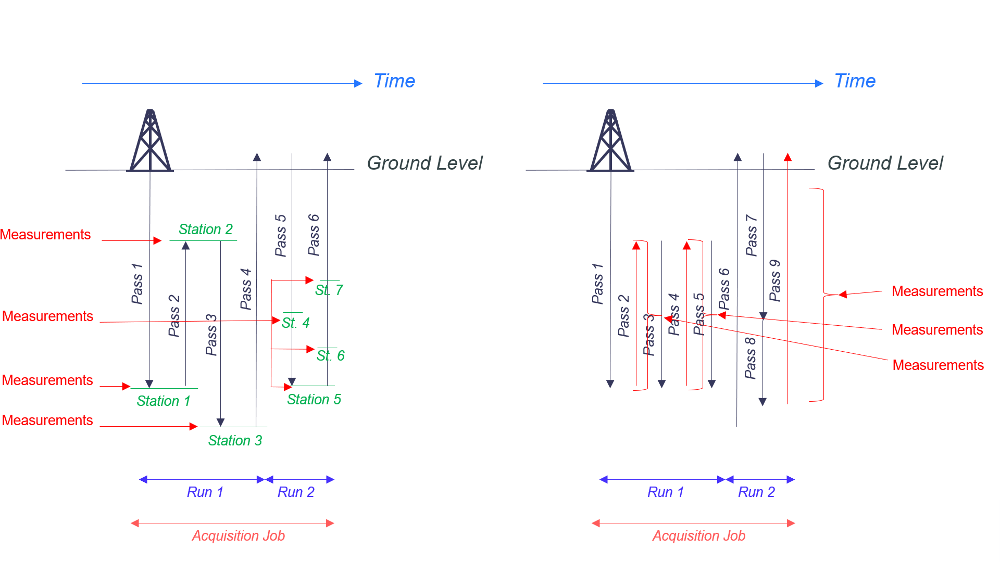                         |
|:---------------------------------------------------------------------------------------------------------------------:|
| Main Conceptual Differences in "Phasing Acquisition" between Well Pressure Tests Acquisition & Well Logs Acquisitions |

- These differences reflect the difference of Business Usages which are made from one and the other type of Well Data - and the difference of end users consuming them.
    + WellLoging addressing mainly Geology, Petrophysics and Well Drilling Teams
    + Well Pressure Tests addressing mainly Reservoir Management, Well Performance & Production.
- **Geometry-wise:**
    + **A WellLog Curve stands along the borehole trajectory**
    + **A Well Pressure Test Curve stands orthogonally to the borehole trajectory**

|              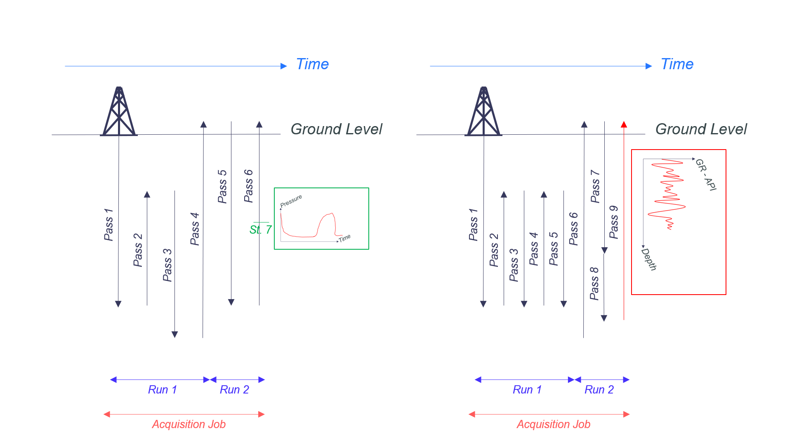               |
|:---------------------------------------------------------------------------------------------:|
| Main Dimensional Differences between Well Pressure Tests Acquisition & Well Logs Acquisitions |

##### 16.1.2.3.2 Shared Characteristics
- **Business-wise:**
    + The main common property stands on the realization of this acquisition. Both WellLogs and Well Pressure Tests can be acquired within the same acquisition program - and even with a same Acquisition Job (_NB: to be double-checked with SMEs !!!!_)
- **Data-wise:**
    + Despite the difference of "dimension" (in the Trajectory Referential) - Both WellLogs and WellPressureTests are Curves recorder along a Wellbore.
    + **As such, a Well Pressure Test "Station" could be modeled using a "Pass" with a direction considered as "Static"**

### 16.1.3 Well Pressure Test Acquisition - Master-Data
#### 16.1.3.1 General Introduction
According to the description above, the Acquisition parameter of a Well Pressure Test Survey will be captured in a specific schema (called WellPressureTestAcquisitionJob) and which is split in 3 different level:
- The Job itself - capturing a set of general information about the job itself
- An array of Runs - capturing general information about each run & describing the complete set of installed equipments,
- An array of Stations - capturing general information about each station & describing depth and predicted objectives.

**The schema support the following Relationships:  [1]Job > [1..N] Runs > [1..N] Stations.**

#### 16.1.3.2 Illustrating the implementation using Volve 15_9-F-1 Dataset

- The following will gives you an illustration of usage - based on the Open Test Volve Dataset [15_9-F-5](https://gitlab.opengroup.org/osdu/subcommittees/data-def/projects/well-delivery/docs/-/tree/master/Design%20Documents/WellLogExtensions/Volve_WellLog_examples/formation_pressure/Formation_Pressure_Raw_Time_Depth/15_9-F-1) which has 6 different stations

- **This Dataset is a subset of a broader, multi-wellbores and multi-run campaign. OSDU schemas are design for mono-wellbore campaign - which implies the following assumptions:**
    - Each Wellbore Subset of the campaign will be considered as an individual acquisition (here we'll consider 15_9-F-1 as an individual acquisition from a single run)
    - We could otherwise capture 15_9 as the complete acquisition - and each tested wellbore as a run (see future worked example)
- **A summary - the basic illustration below shows the usage of 15_9-F-1 as an individual campaign with a single run**

The main Summary Las File is displayed below

| 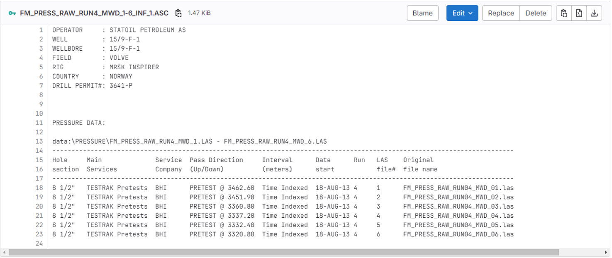 |
|:-------------------------------------------------------------------------------------------------:|
|    Raw LAS file describing the acquisition parameter of 15_9-F-1 Acquisition DataSet               |

This shows a couple of information - such as:
- Start Dates
- Contracting Company
- Tested Wellbore
- 6 Stations and their respective depths.
- Service Company (BHI - eg. Baker Hugues)
- Main service applied.
- Link to specific raw measurements LAS Files (from which we can derive additional information - such as end dates, installed equipments,....)

##### 16.1.3.2.1 Schema Usage (from v.1.0.0 schema version)

The Image below shows the way the WellPressureTestAcquisitionJob json file should be filled up to create the ingestion manifest (please note that small updates has been applied after this picture - see next section).

|                 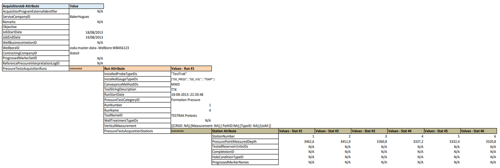             |
|:--------------------------------------------------------------------------------------------------:|
| Excel Example of attributes to be filled up into the JSON payload - accommodating 15_9-F-1 Dataset |

This shows the following information (**From Information above**) to be used (and derived to accommodate OSDU syntax) to create the JSON Payload
- **JOB**
    - ServiceCompanyID: **BakerHughes**
    - JobStartDate: **18/08/2013**
    - JobStartDate: **19/08/2013**
    - WellboreID: **osdu:master-data--Wellbore;WB456123**
    - ContractingCompanyID: **Statoil**
    - ReferencePressureInterpretationLogID: _ToBeFilledUp At the End of the Processing Phase_
    - **RUN 1**
        - InstalledProbeTypeIDs: **[{TestTrak}]**
        - InstalledGaugeTypeIDs: **[{"DD_PRESS"}; {"DD_VOL"}; {"TEMP"}]**
        - ConveyanceMethodIDs: **MWD**
        - ToolStringDescription: **TTK**
        - PressureCategoryType: **FormationPressure**
        - RunNumber: **1**
        - RunName: **4**
        - ToolNameID; **TESTRAK PresTests**
        - VerticalMeasurement: **AnyVerticalReference - either point on parentWellbore OR detailed CRS here**
        - **STATION 1**
            - StationNumber: **1**
            - PressurePointMeasuredDepth: **3462.6**
        - **STATION 2**
            - StationNumber: **2**
            - PressurePointMeasuredDepth: **3451.9**
        - **STATION 3**
            - StationNumber: **3**
            - PressurePointMeasuredDepth: **3360.8**
        - **STATION 4**
            - StationNumber: **4**
            - PressurePointMeasuredDepth: **3337.2**
        - **STATION 5**
            - StationNumber: **5**
            - PressurePointMeasuredDepth: **3332.4**
        - **STATION 6**
            - StationNumber: **6**
            - PressurePointMeasuredDepth: **3320.8**

##### 16.1.3.2.2 Schema Simplification (including AbstractProject).
Some schema simplifications has been applied - and can be seen on the final JSON schemas - among which we can quote the following.

**At the JOB level**
- The WellPressureAcquisitionJob is - de facto - an activity from the type project. The schema has been updated to integrate the AbstractProject - implying:
    * Using of "Purpose" attribute (instead of identified Objective)
    * Using of "ProjectBeginDate" attribute (instead of identified JobStartDate)
    * Using of "ProjectEndDate" attribute (instead of identified JobEndDate)
    * Using of "Operator" attribute (instead of identified ContractingCompanyID)
    * Using of "Contractors" attribute (instead of identified ServiceCompanyID)
- The WellBusinessIntention has been removed in favor of using the child to parent Wellbore/Well relationship.
- The ID of resulting WellLog has been renamed "ReferencePressureProcessedLogID" to accommodate the semantic updates from interpretation to processing of the resulting derivative values recording WellLog.
- In order to give flexibility in capturing the predicted elements used to define the acquisition setting - the "PrognosedMarkerSetID" has been renamed "PrognosedInterpretationSetID" to allow both Markers and Intervals.

**At the RUN level**
- RunNumber has been changed to RunIdentifier (gives the flexibility of using GUID)
- RunEndDate has been added.
- A Reference Point for Vertical Measurements has been added.
- An identifier to the Assembly the run has been going through has been added.

**At the STATION level**
- As for the Job - the PrognosedMarkerName has been switched to PrognosedInterpretationName
- As for the Run - the StationNumber has been updated to StationIdentifier

##### 16.1.3.2.3 Worked Example
A Detailed work example (JSON payload) accommodating the overall tunings (abstractions, minor updates,...) for version 1.0.0 is accessible
[Here - 101](../../Examples/WorkedExamples/WellPressureTest/README.md)

##### 16.1.3.2.4 TO BE CREATED : Complex Case with complete 15_9 campaign
A Detailed work example (JSON payload) accommodating the overall tunings (abstractions, minor updates,...) for version 1.0.0 is accessible
[Here - 201](../../Examples/WorkedExamples/WellPressureTest/README.md)

### 16.1.4 Well Pressure Test Raw Measurement - Work-Product-Component
#### 16.1.4.1 General Introduction
The schema aims at indexing Raw Measurements - where we know we have a single LAS file being recorded at each individual Station.
Accommodating the acquisition schema - it's designed as follows:
- The main recording description - capturing first of all required information to map to the relevant acquisition station (Job ID, Run Identifier and Station Identifier) + specific information specific to the station (Tool Geometry, Dates,...).
- An Array of Measurements - Each Individual Measurement describing the parameter related to the recording probe and gauge identifier and depths + References for Vertical Measurements - and a couple of related information (validity,....)
- An Array of MeasurementPeriods - nested under measurements - describing Index, StartTime & EndTime, Type of Period (such as PreTest, BuildUps,...), as well as an abstract column base table to capture searchable measurements, for each individual sub-period within the measurement.
    + This is an evolution (from v.1.1.0) from _PreTest_ notion which has been deprecated.
- An Array of Curve - describing the main information constituting the curve (Null Value, Discrete, Regular,...)

**The schema support the following Relationships:** 
**~~[1]Job > [1..N] Measurements > [0..N] PreTests > [1..N] Curves~~** 
**[1]Job > [1..N] Measurements > [0..N] MeasurementPeriods** 
**-------------------------------> [1..N] Curves**

#### 16.1.4.2 Illustrating the implementation using Volve 15_9-F-1 Dataset

At this stage - we'll focus on the Station #3 related WPC.
The Measurement is described in this LAS file [Station 3](https://gitlab.opengroup.org/osdu/subcommittees/data-def/projects/well-delivery/docs/-/blob/master/Design%20Documents/WellLogExtensions/Volve_WellLog_examples/formation_pressure/Formation_Pressure_Raw_Time_Depth/15_9-F-1/FM_PRESS_RAW_RUN4_MWD_3.LAS)
Some information related to the Pre-Tests are also shared in the Final Report.

Those two elements can be seen below:

| 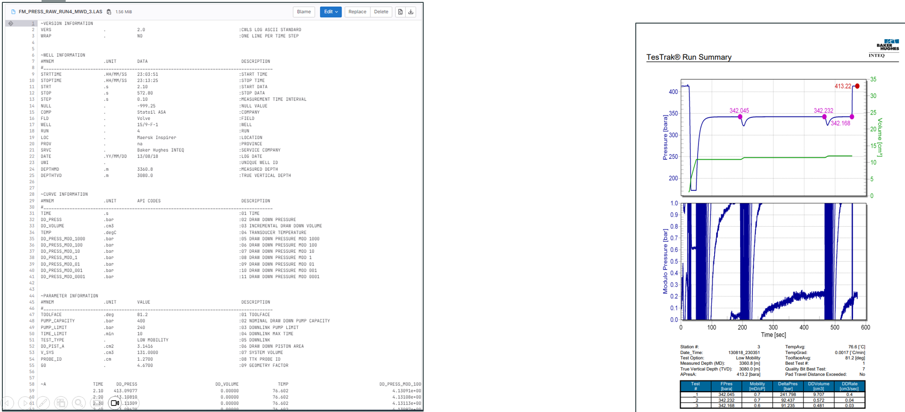  |
|:-----------------------------------------------------------------------------------:|
|     Overview of both Station #3 recording LAS File and its report's counterpart     |

#### 16.1.4.3 Schema Usage (from v.1.0.0 schema version)
The Image below shows the way the WellPressureTestAcquisitionJob json file should be filled up to create the ingestion manifest (please note that small updates has been applied after this picture - see next section).

|             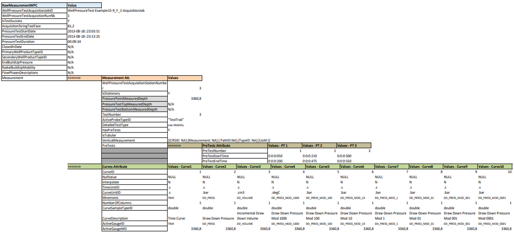             |
|:--------------------------------------------------------------------------------------------------:|
| Excel Example of attributes to be filled up into the JSON payload - accommodating 15_9-F-1 Dataset |

This shows the following information (**From Information above**) to be used (and derived to accommodate OSDU syntax) to create the JSON Payload

- **MEASUREMENT WPC**
    - WellPressureTestAcquisitionJobID: **osdu:master-data--WellPressureTestAcquisitionJob:GUID** -_Capturing the OSDU identifier of the Acquisition job_
    - WellPressureTestAcquisitionRunNb: **1** -_Capturing the identifier of the Run in the acquisition Job._
    - IsTestSuccess: **Yes**
    - AcquisitionStringToolFace: **81.2** -_Capturing the angle of rotation of the acquisition string compared to the drilling rig_
    - PressureTestStartDate: **2013-08-18::23:03:51** -_Capturing the actual start time of the measurement indexed in the WPC_
    - PressureTestEndDate: **2013-08-18::23:13:25**
    - PressureTestDuration: **00:09:34**
    - **MEASUREMENT 1**
        - WellPressureTestAcquisitionStationNb: **3** -_Capturing the identifier of the Station in the acquisition Job.Run_
        - IsStationary: **Yes** -_Aiming at capturing the differences between nominal tests from cases when the acquisition string is moving over the borehole_
        - PressureTestMeasuredDepth: **3360.8** _Actual Measured Depth from Master Gauge - mono gauge & stationary cases_
        - PressureTestTopMeasuredDepth: EMPTY _Used when capturing multi-gauges at multiple depth OR for non-stationary measurements_
        - PressureTestBottomMeasuredDepth: EMPTY _Used when capturing multi-gauges at multiple depth OR for non-stationary measurements_
        - TestNumber: **3** _Test Number in the acquisition job... Different from station number when failed tests have happened and stations have to be tested multiple time._
        - ActiveProbeTypeIDs: **[{TestTrak}]** _Capturing ONLY the active probe - in the overall array of installed ones._
        - DetailedTestType: **osdu:reference-data--DetailedWellPressureTestType:"Low Mobility"** - _Identifier of the reference data reflecting the detailed test run - beyond FormationTest,..._
        - HasPreTest (_Deprecated after 1.1.0_): **Y** _Capturing the fact this test has some pretest (see report)._
        - **PRETEST 1 (_Deprecated after 1.1.0_)**
            - PreTestNumber: **1**
            - PreTestStartTime: **0:0:0:050** _Time, in the Pressure vs. Time curve, of the beginning of the pretest._
            - PreTestEndTime: **0:0:0:200** _Time, in the Pressure vs. Time curve, of the beginning of the pretest._
        - **PRETEST 2 (_Deprecated after 1.1.0_)**
            - PreTestNumber: **2**
            - PreTestStartTime: **0:0:0:210** _Time, in the Pressure vs. Time curve, of the beginning of the pretest._
            - PreTestEndTime: **0:0:0:475** _Time, in the Pressure vs. Time curve, of the beginning of the pretest._
        - **PRETEST 3 (_Deprecated after 1.1.0_)**
            - PreTestNumber: **3**
            - PreTestStartTime: **0:0:0:500** _Time, in the Pressure vs. Time curve, of the beginning of the pretest._
            - PreTestEndTime: **0:0:0:550** _Time, in the Pressure vs. Time curve, of the beginning of the pretest._
    - **CURVE1**
        - CurveID: **1** - _Index of the Curve in the Content Storage Curve array_.
        - NullValue: **NULL** _Gives the Standard String used - in the content storage - to indicate there is no value at a given curve index_
        - Interpolate:  **N**
        - TimeUnit:  **osdu:reference-data--UnitOfMeasure:".s"** - _Identifier of the reference data record giving the unit of time in the Pressure vs. Time curves._
        - CurveUnit:  **osdu:reference-data--UnitOfMeasure:".s"** - _Identifier of the reference data record giving the unit of records in the Pressure vs. Time curves._
        - Mnemonic:  **osdu:reference-data--PressureTestMnemonic:"TIME"** - _Identifier of the reference data record giving the mnemonic of the recording channel._
        - NumberOfColumns:  **1** - _Allows complex curve records with multiple columns - when a tool is recording different information OR when we aggregate different information in the content storage._
        - CurveSampleTypeID:  **osdu:reference-data--SampleType:"double"** - _Identifier of the reference data record giving the type of the recorded sample - such as double, integer, string,....._
        - CurveDescription:  **TimeCurve** - _Free Text describing the recorded information in the curve._
        - ActiveGaugeTypeID: **TIME** _Capturing ONLY the active gauge - in the overall array of installed ones._
        - ActiveGaugeMeasuredDepth: **3360.8** _Capturing the actual measured depth of the active gauge._
    - **CURVE2**
        - .....
    - **CURVE3**
        - .....
    - **CURVE4**
        - .....
    - **CURVE5**
        - .....
    - **CURVE6**
        - .....
    - **CURVE7**
        - .....
    - **CURVE8**
        - .....
    - **CURVE9**
        - .....
    - **CURVE10**
        - .....

#### 16.1.4.4 Schema Usage - Specific Case of Multi-Gauge/Multi-Depth at a single Station Management (from v.1.0.0 schema version)
In the specific case mentioned above - of a single station with multiple gauges at different depths - reminder below:

|  |
|:-------------------------------------------------------------------------------------------------:|
|                  Overview of Complex Acquisition Setting - Acquisition Station @3665.84m          |

In that case we have:
- One probe PAQP - stopped @ 3665.84 m of measured depth - considered as Master
- One probe PQQP1 - stopped @ 3663.84 m of measured depth.

The WPC will be built with:
- Identifier of a station #2 - itself referenced at 3665.84m
- 2 Measurements - on per probe
    - One for the PAQP - at a measured depth of 3665.84 m (with intervals - as it moves during the recording)
    - One for the PQQP1 - at a measured depth of 3663.84 m - which is static
- A single array of curve - describing in the right order - the recording of each individual sequence in the curves array.

Which gives the following:

| 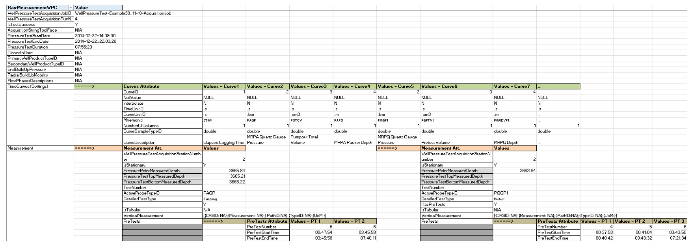 |
|:----------------------------------------------------------------------------:|
|       Overview of Complex Acquisition Setting - Implementation in WPC        |

In that case - the key elements to look at are:
- **MEASUREMENT WPC**
    - **MEASUREMENT1**
        - WellPressureTestAcquisitionStationNb: **2** -_Unique Station for the whole WPC_
        - PressureTestMeasuredDepth: **3665.84** _Actual Measured Depth from Master Gauge_
        - IsStationary: **N** _Flagged as yes in the screenshot - as a typo_
        - PressureTestTopMeasuredDepth: **3665.21** _Top Depth of the master gauge_
        - PressureTestBottomMeasuredDepth: **3666.22** _Bottom Depth of the master gauge
        - ActiveProbeTypeID: **PAQP** _Identifier of the master active probe in the installed probes array_
    - **MEASUREMENT2**
        - WellPressureTestAcquisitionStationNb: **2** -_Unique Station for the whole WPC - **same as above**_
        - PressureTestMeasuredDepth: **3663.84** _Actual Measured Depth from Auxiliary Gauge_
        - IsStationary: **Y**
        - ActiveProbeTypeID: **PQQP1** _Identifier of the active auxiliary probe in the installed probes array_
    - **CURVE1 to 5** _Description of the curves recorded by Probe PAQP
    - **CURVE6 to 8** _Description of the curves recorded by Auxiliary Probe PQQP1

#### 16.1.4.5 Schema Updates
Some schema simplifications has been applied - and can be seen on the final JSON schemas - among which we can quote the following.

**At the WPC level**
- The notion of "FlowDescription" has been postponed to later developments
- The "RunNumber" attribute has been switched to "RunIdentifier" confirming to the change in the acquisition job.
- The "IsTestSuccess" has been deferred to Measurement - and updated (see below).
- The notions of Primary & Secondary Products has been removed - in favor of referring to the parent Well & Wellbore - already capturing the information.
- The processed measurement (EndBuildUpPressure & RadialMobility) have been taken out - will be captured in the processed WellLog.
- PressureTestEndDate & Duration has been taken out.
- The Curve array has been promoted here from Measurement level.

**At the MEASUREMENT level**
- The ActiveGaugeID has been moved up there from CurveDescription.
- The boolean "IsTestValid" has been updated to "TestReliabilityID" - capturing a relationship to a reference object.
- The boolean "HasPreTest" has been removed - presence/absence of records in the PreTest array is acting as boolean de facto.
- The Curve array as been promoted upward

**At the CURVE level**
- The curve level has been simplified from "settings" information - ActiveGaugeID and ActiveGaugeMD - upscaled at measurement level.

#### 16.1.4.6 Worked Example

A Detailed work example (JSON payload) accommodating the overall tunings (abstractions, minor updates,...) for version 1.0.0 is accessible [Here - 102 - 302](../../Examples/WorkedExamples/WellPressureTest/README.md)

### 16.1.5 Well Pressure Test Processed WellLog - Work-Product Component
#### 16.1.5.1 General Process
After Processing - Tests Selection & Computations - a set of discrete curves can be computed, such as:
- End Build-Up Pressure
- Radial Mobility
- 60 Second Slopes,....

Those curves are recorded as "Pressure vs. Depth" and not "vs. time" anymore - they will be stored in a "traditional" WellLog (some reference data still needs to be updated to enable this properly).

**This Resulting WellLog - once created - will get an OSDU id - which must be referred on the AcquisitionMasterData - within the "ReferencePressureInterpretationLogID" attribute.**

#### 16.1.5.2 Schema Usage
1) The WellLog will have to be created following the regular usage (see here [WellLog](../../Examples/WorkedExamples/WellLog)) - considering some updated reference data such as:
- WellLogClass
- CurveMainFamily
- CurveFamily
-...

| 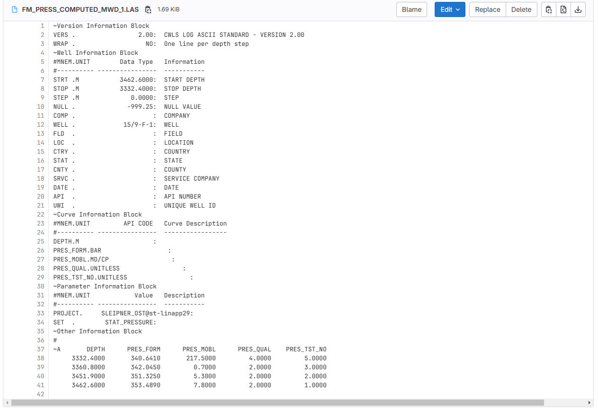 |
|:-------------------------------------------------------------------------------------------------:|
|                  Overview of the processed LAS File showing the resulting WellLog for 15_9-F-1    |

2) Once created - we must update the Acquisition Master Data as follows:

| 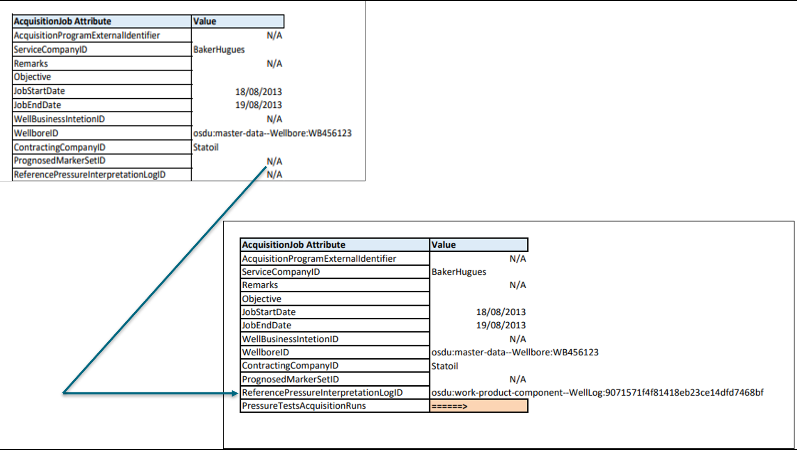 |
|:-------------------------------------------------------------------------------------------------:|
|                  Update of Acquisition Job to capture Processed Log Identifier                    |

#### 16.1.5.3 Content Management - DDMS Usage
In order to properly tie each station of the resulting WellLog to its corresponding raw measurement - we recommend to add a string curve in the WellLog Content where we'll capture for each station either:
- The Raw Measurement WPC id
OR - the combination of:
- Run Identifier
- Station Identifier

As described below - based on AkerBP Worked Example

| 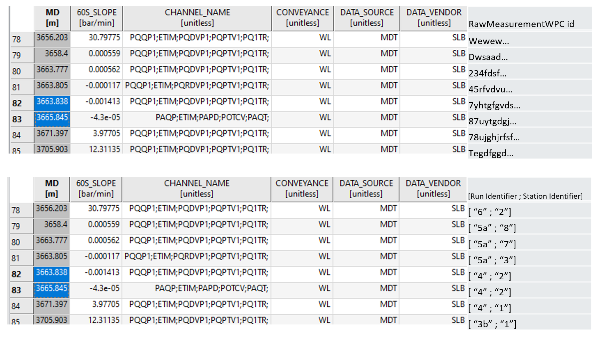 |
|:-------------------------------------------------------------------------------------------------:|
|                  Update of Acquisition Job to capture Processed Log Identifier                    |

#### 16.1.5.4 Worked Example

A Detailed work example (JSON payload) accommodating the overall tunings (abstractions, minor updates,...) for version 1.0.0 is accessible [Here - 103](../../Examples/WorkedExamples/WellPressureTest/README.md)

### 16.1.6 Final Report Document - Work-Product Component
The final report will be stored using a Document WPC - according to the relevant taxonomy.
A basic example based on the reference Vovle 15_9-F-1 is accessible here [Here - 104](../../Examples/WorkedExamples/WellPressureTest/README.md)

## 16.2 Interpretations

### 16.2.1 General Introduction - Well vs. Reservoir Interpretations Workflows
- TO BE WRITTEN BY PIERRICK

### 16.2.2 Well Pressure Test Interpretations
This section intends to explain the usage of schema WellPressureTestInterpretation to capture the results of interpretations of a well test activity. Intended to be partnered with a WellPressureTestRawMeasurement WPC that captures raw measurements before any kind of processing, composing, interpretation or analysis

After completing any of the Pressure Interpretation workflows (e.g., Pressure Transient Analysis, mobility estimation), the interpretation results typically include:

- Reservoir Pressure Estimates at different points or depths: reservoir depth datum, top of the reservoir (usually, if the wellbore is perforated, the top depth of the perforated interval is used)
- Skin Factor
- Permeability / Mobility
- Productivity Index

These results are not time-series curves but discrete interpretation outputs. They will be stored as a Work-Product Component (WPC) under the schema WellPressureTestInterpretation

-

- TO BE WRITTEN BY SERGIO

### 16.2.3 Reservoir Pressure Test Interpretations
- Pending on Definition
---

## Links

1. Return to the [Beginning of the Chapter](#TOC)
2. Next Chapter: [Appendix A References](90-References.md)
3. Browse to the [Schema Usage Guide Table of Contents](../README.md)

---