<a name="TOC"></a> Previous Chapter: [Appendix B Glossary of Terms](91-Glossary.md)

[[_TOC_]]

# Appendix C Proposals

This is relevant for Data Definitions workstream(s) in OSDU who intend to create new data types (synonyms: data objects,
entities). Use the Proposal Excel workbook template to define specific properties in the new data type, relationship to
another data type, which Group Type this new data type belongs to, etc.

To create a new master-data--EntityType.1.0.0 Proposal workbook for example, use `OsduSchemaComposer.py` with the
following option to start the user interface:

```shell
python OsduSchemaComposer.py -app
```

Then, under the menu options Proposals, select "Create new Proposal"

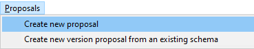

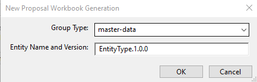

This will create new `EntityType.1.0.0.xlsx` Excel workbook in `\Proposals\master-data` directory.

Another usage is the creation of a proposal based on an **_existing_** schema. This will pre-populate the proposal with the
properties as they are defined in the existing schema. Assuming the `osdu:wks:master-data--EntityType:1.0.0` exists in
the schema repository, the command to create a proposal for the 1.1.0 version is:

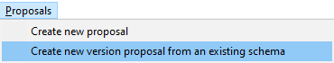

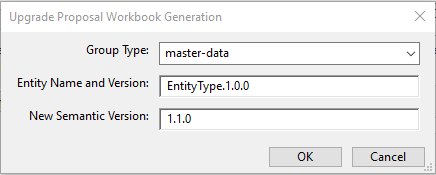

The user interface will highlight in red color non-existing schema versions as source or already existing versions. New
and upgraded proposals will always pick up the latest versions of schema fragments (`Abstract*`).

This document explains the use of different Group Types and what schema fragments will be included given the different
group-type and group-type specializations settings. There is one schema fragment, which is included in **_all_** schema
variants and that is [AbstractCommonResources](../../E-R/abstract/AbstractCommonResources.1.0.0.md). The exact version
of the fragment being included is explained in the later section
[Appendix C.9.3 Schema Fragment Versioning, Updates](#appendix-c93-schema-fragment-versioning-updates).

## Appendix C.1 Master Data (Facility)

**Master Data (Facility)** Group Type includes `AbstractFacility` schema fragment. A facility is a grouping of equipment
that is located within a specific geographic boundary or site and that is used in the context of energy-related
activities such as exploration, extraction, generation, storage, processing, disposal, supply, or transfer.
Clarifications: (1) A facility may be surface or subsurface located. (2) Usually facility equipment is commonly owned or
operated. (3)
Industry definitions may vary and differ from this one. This schema fragment is included by Well, Wellbore, Rig, as well
as Tank Batteries, Compression Stations, Storage Facilities, Wind Farms, Wind Turbines, Mining Facilities, etc., once
these types are included in to the OSDU.

In a Proposal Excel workbook, select `master-data/Facility` in the Group Type pull down menu:

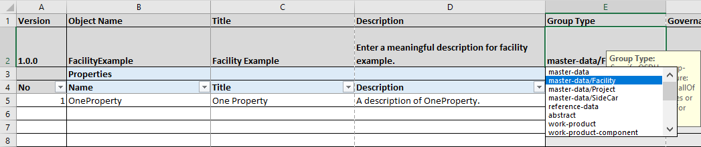

<details>

<summary markdown="span">Example of .json schema record of "L15-FA-103" Well (which is a facility) containing <code>AbstractFacility</code> schema fragment:</summary>

<OsduImportJSON>[Well.8816, Full record](../../Examples/WorkedExamples/WellboreTrajectory/master-data/Well.8816.1.json#only.data)</OsduImportJSON>

```json
{
  "data": {
    "Source": "TNO",
    "NameAliases": [
      {
        "AliasName": "L15-FA-103",
        "AliasNameTypeID": "partition-id:reference-data--AliasNameType:WELL_NAME:"
      },
      {
        "AliasName": "8816",
        "AliasNameTypeID": "partition-id:reference-data--AliasNameType:UWI:"
      }
    ],
    "GeoContexts": [
      {
        "GeoPoliticalEntityID": "partition-id:master-data--GeoPoliticalEntity:Netherlands:",
        "GeoTypeID": "partition-id:reference-data--GeoPoliticalEntityType:Country:"
      },
      {
        "GeoPoliticalEntityID": "partition-id:master-data--GeoPoliticalEntity:L15:",
        "GeoTypeID": "partition-id:reference-data--GeoPoliticalEntityType:BlockID:"
      }
    ],
    "SpatialLocation": {
      "AsIngestedCoordinates": {
        "type": "AnyCrsFeatureCollection",
        "CoordinateReferenceSystemID": "partition-id:reference-data--CoordinateReferenceSystem:BoundProjected:EPSG::23031_EPSG::1133:",
        "persistableReferenceCrs": "{\"authCode\":{\"auth\":\"OSDU\",\"code\":\"23031001\"},\"lateBoundCRS\":{\"authCode\":{\"auth\":\"EPSG\",\"code\":\"23031\"},\"name\":\"ED_1950_UTM_Zone_31N\",\"type\":\"LBC\",\"ver\":\"PE_10_9_1\",\"wkt\":\"PROJCS[\\\"ED_1950_UTM_Zone_31N\\\",GEOGCS[\\\"GCS_European_1950\\\",DATUM[\\\"D_European_1950\\\",SPHEROID[\\\"International_1924\\\",6378388.0,297.0]],PRIMEM[\\\"Greenwich\\\",0.0],UNIT[\\\"Degree\\\",0.0174532925199433]],PROJECTION[\\\"Transverse_Mercator\\\"],PARAMETER[\\\"False_Easting\\\",500000.0],PARAMETER[\\\"False_Northing\\\",0.0],PARAMETER[\\\"Central_Meridian\\\",3.0],PARAMETER[\\\"Scale_Factor\\\",0.9996],PARAMETER[\\\"Latitude_Of_Origin\\\",0.0],UNIT[\\\"Meter\\\",1.0],AUTHORITY[\\\"EPSG\\\",23031]]\"},\"name\":\"ED50 * DMA-mean / UTM zone 31N [23031,1133]\",\"singleCT\":{\"authCode\":{\"auth\":\"EPSG\",\"code\":\"1133\"},\"name\":\"ED_1950_To_WGS_1984_1\",\"type\":\"ST\",\"ver\":\"PE_10_9_1\",\"wkt\":\"GEOGTRAN[\\\"ED_1950_To_WGS_1984_1\\\",GEOGCS[\\\"GCS_European_1950\\\",DATUM[\\\"D_European_1950\\\",SPHEROID[\\\"International_1924\\\",6378388.0,297.0]],PRIMEM[\\\"Greenwich\\\",0.0],UNIT[\\\"Degree\\\",0.0174532925199433]],GEOGCS[\\\"GCS_WGS_1984\\\",DATUM[\\\"D_WGS_1984\\\",SPHEROID[\\\"WGS_1984\\\",6378137.0,298.257223563]],PRIMEM[\\\"Greenwich\\\",0.0],UNIT[\\\"Degree\\\",0.0174532925199433]],METHOD[\\\"Geocentric_Translation\\\"],PARAMETER[\\\"X_Axis_Translation\\\",-87.0],PARAMETER[\\\"Y_Axis_Translation\\\",-98.0],PARAMETER[\\\"Z_Axis_Translation\\\",-121.0],AUTHORITY[\\\"EPSG\\\",1133]]\"},\"type\":\"EBC\",\"ver\":\"PE_10_9_1\"}",
        "persistableReferenceUnitZ": "{\"scaleOffset\":{\"scale\":1.0,\"offset\":0.0},\"symbol\":\"m\",\"baseMeasurement\":{\"ancestry\":\"Length\",\"type\":\"UM\"},\"type\":\"USO\"}",
        "features": [
          {
            "type": "AnyCrsFeature",
            "properties": {},
            "geometry": {
              "type": "AnyCrsPoint",
              "coordinates": [
                622011.96,
                5910706.37
              ]
            }
          }
        ]
      }
    },
    "FacilityID": "L15-FA-103",
    "FacilityTypeID": "partition-id:reference-data--FacilityType:Well:",
    "FacilityOperators": [
      {
        "FacilityOperatorOrganisationID": "partition-id:master-data--Organisation:NAM:"
      }
    ],
    "OperatingEnvironmentID": "partition-id:reference-data--OperatingEnvironment:OFF:",
    "FacilityStates": [
      {
        "FacilityStateTypeID": "partition-id:reference-data--FacilityStateType:Technisch%20mislukt%20en%20sidetracked:"
      }
    ],
    "FacilityEvents": [
      {
        "FacilityEventTypeID": "partition-id:reference-data--FacilityEventType:SPUD:",
        "EffectiveDateTime": "1992-10-04T00:00:00"
      },
      {
        "FacilityEventTypeID": "partition-id:reference-data--FacilityEventType:DRILLING%20FINISH:",
        "EffectiveDateTime": "1992-11-06T00:00:00"
      }
    ],
    "DefaultVerticalMeasurementID": "Rotary Table",
    "VerticalMeasurements": [
      {
        "VerticalMeasurementID": "Rotary Table",
        "VerticalMeasurement": 42.51,
        "VerticalMeasurementTypeID": "partition-id:reference-data--VerticalMeasurementType:RotaryTable:",
        "VerticalMeasurementPathID": "partition-id:reference-data--VerticalMeasurementPath:TrueVerticalHeight:",
        "VerticalMeasurementUnitOfMeasureID": "partition-id:reference-data--UnitOfMeasure:m:",
        "VerticalCRSID": "partition-id:reference-data--CoordinateReferenceSystem:Vertical:EPSG::5714:"
      }
    ]
  }
}
```

</details>

A complete list of `osdu:wks:AbstractFacility:1.0.0` Properties (Version 1.0.0) can be found
at [here](../../E-R/abstract/AbstractFacility.1.0.0.md#table-of-abstractfacility-properties-version-100).

## Appendix C.2 Master Data (Project)

**Master Data (Project)** Group Type includes `AbstractProject` schema fragment. A Project is a business activity that
consumes financial and human resources and produces (digital) work products.`

In a Proposal Excel workbook, select `master-data/Project` in the Group Type pull down menu:

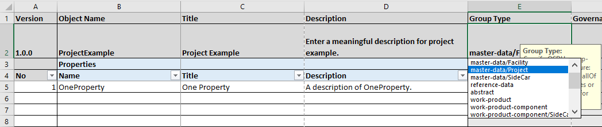

<details>

<summary markdown="span">Example of .json schema record of project-related data type containing <code>AbstractProject</code> schema fragment:</summary>

<OsduImportJSON>[SeismicProcessingProject, Full record](../../Examples/master-data/SeismicProcessingProject.1.0.0.json#only.data)</OsduImportJSON>

```json
{
  "data": {
    "ResourceHomeRegionID": "namespace:reference-data--OSDURegion:AWSEastUSA:",
    "ResourceHostRegionIDs": [
      "namespace:reference-data--OSDURegion:AWSEastUSA:"
    ],
    "ResourceCurationStatus": "namespace:reference-data--ResourceCurationStatus:Created:",
    "ResourceLifecycleStatus": "namespace:reference-data--ResourceLifecycleStatus:Loading:",
    "Source": "Example Data Source",
    "ExistenceKind": "namespace:reference-data--ExistenceKind:Prototype:",
    "NameAliases": [
      {
        "AliasName": "Example AliasName",
        "AliasNameTypeID": "namespace:reference-data--AliasNameType:RegulatoryIdentifier:",
        "DefinitionOrganisationID": "namespace:master-data--Organisation:SomeUniqueOrganisationID:",
        "EffectiveDateTime": "2020-02-13T09:13:15.55Z",
        "TerminationDateTime": "2020-02-13T09:13:15.55Z"
      }
    ],
    "GeoContexts": [
      {
        "GeoPoliticalEntityID": "namespace:master-data--GeoPoliticalEntity:SomeUniqueGeoPoliticalEntityID:",
        "GeoTypeID": "namespace:reference-data--GeoPoliticalEntityType:Area:"
      },
      {
        "BasinID": "namespace:master-data--Basin:SomeUniqueBasinID:",
        "GeoTypeID": "namespace:reference-data--BasinType:ArcWrenchOceanContinent:"
      },
      {
        "FieldID": "namespace:master-data--Field:SomeUniqueFieldID:",
        "GeoTypeID": "Field"
      },
      {
        "PlayID": "namespace:master-data--Play:SomeUniquePlayID:",
        "GeoTypeID": "namespace:reference-data--PlayType:CarbonCaptureAndStorage:"
      },
      {
        "ProspectID": "namespace:master-data--Prospect:SomeUniqueProspectID:",
        "GeoTypeID": "namespace:reference-data--ProspectType:Structural.Anticline:"
      }
    ],
    "SpatialLocation": {
      "SpatialLocationCoordinatesDate": "2020-02-13T09:13:15.55Z",
      "QuantitativeAccuracyBandID": "namespace:reference-data--QuantitativeAccuracyBand:Length.LessThan1m:",
      "QualitativeSpatialAccuracyTypeID": "namespace:reference-data--QualitativeSpatialAccuracyType:Assumed:",
      "CoordinateQualityCheckPerformedBy": "Example CoordinateQualityCheckPerformedBy",
      "CoordinateQualityCheckDateTime": "2020-02-13T09:13:15.55Z",
      "CoordinateQualityCheckRemarks": [
        "Example CoordinateQualityCheckRemarks"
      ],
      "AsIngestedCoordinates": {
        "type": "AnyCrsFeatureCollection",
        "CoordinateReferenceSystemID": "namespace:reference-data--CoordinateReferenceSystem:BoundProjected:EPSG::32021_EPSG::15851:",
        "VerticalCoordinateReferenceSystemID": "namespace:reference-data--CoordinateReferenceSystem:Vertical:EPSG::5714:",
        "persistableReferenceCrs": "{\"authCode\":{\"auth\":\"OSDU\",\"code\":\"32021079\"},\"lateBoundCRS\":{\"authCode\":{\"auth\":\"EPSG\",\"code\":\"32021\"},\"name\":\"NAD_1927_StatePlane_North_Dakota_South_FIPS_3302\",\"type\":\"LBC\",\"ver\":\"PE_10_9_1\",\"wkt\":\"PROJCS[\\\"NAD_1927_StatePlane_North_Dakota_South_FIPS_3302\\\",GEOGCS[\\\"GCS_North_American_1927\\\",DATUM[\\\"D_North_American_1927\\\",SPHEROID[\\\"Clarke_1866\\\",6378206.4,294.9786982]],PRIMEM[\\\"Greenwich\\\",0.0],UNIT[\\\"Degree\\\",0.0174532925199433]],PROJECTION[\\\"Lambert_Conformal_Conic\\\"],PARAMETER[\\\"False_Easting\\\",2000000.0],PARAMETER[\\\"False_Northing\\\",0.0],PARAMETER[\\\"Central_Meridian\\\",-100.5],PARAMETER[\\\"Standard_Parallel_1\\\",46.18333333333333],PARAMETER[\\\"Standard_Parallel_2\\\",47.48333333333333],PARAMETER[\\\"Latitude_Of_Origin\\\",45.66666666666666],UNIT[\\\"Foot_US\\\",0.3048006096012192],AUTHORITY[\\\"EPSG\\\",32021]]\"},\"name\":\"NAD27 * OGP-Usa Conus / North Dakota CS27 South zone [32021,15851]\",\"singleCT\":{\"authCode\":{\"auth\":\"EPSG\",\"code\":\"15851\"},\"name\":\"NAD_1927_To_WGS_1984_79_CONUS\",\"type\":\"ST\",\"ver\":\"PE_10_9_1\",\"wkt\":\"GEOGTRAN[\\\"NAD_1927_To_WGS_1984_79_CONUS\\\",GEOGCS[\\\"GCS_North_American_1927\\\",DATUM[\\\"D_North_American_1927\\\",SPHEROID[\\\"Clarke_1866\\\",6378206.4,294.9786982]],PRIMEM[\\\"Greenwich\\\",0.0],UNIT[\\\"Degree\\\",0.0174532925199433]],GEOGCS[\\\"GCS_WGS_1984\\\",DATUM[\\\"D_WGS_1984\\\",SPHEROID[\\\"WGS_1984\\\",6378137.0,298.257223563]],PRIMEM[\\\"Greenwich\\\",0.0],UNIT[\\\"Degree\\\",0.0174532925199433]],METHOD[\\\"NADCON\\\"],PARAMETER[\\\"Dataset_conus\\\",0.0],OPERATIONACCURACY[5.0],AUTHORITY[\\\"EPSG\\\",15851]]\"},\"type\":\"EBC\",\"ver\":\"PE_10_9_1\"}",
        "persistableReferenceVerticalCrs": "{\"authCode\":{\"auth\":\"EPSG\",\"code\":\"5714\"},\"name\":\"MSL_Height\",\"type\":\"LBC\",\"ver\":\"PE_10_9_1\",\"wkt\":\"VERTCS[\\\"MSL_Height\\\",VDATUM[\\\"Mean_Sea_Level\\\"],PARAMETER[\\\"Vertical_Shift\\\",0.0],PARAMETER[\\\"Direction\\\",1.0],UNIT[\\\"Meter\\\",1.0],AUTHORITY[\\\"EPSG\\\",5714]]\"}",
        "persistableReferenceUnitZ": "{\"scaleOffset\":{\"scale\":1.0,\"offset\":0.0},\"symbol\":\"m\",\"baseMeasurement\":{\"ancestry\":\"Length\",\"type\":\"UM\"},\"type\":\"USO\"}",
        "features": [
          {
            "type": "AnyCrsFeature",
            "properties": {},
            "geometry": {
              "type": "AnyCrsPoint",
              "coordinates": [
                12345.6,
                12345.6
              ],
              "bbox": [
                12345.6,
                12345.6,
                12345.6,
                12345.6
              ]
            },
            "bbox": [
              12345.6,
              12345.6,
              12345.6,
              12345.6
            ]
          }
        ],
        "bbox": [
          12345.6,
          12345.6,
          12345.6,
          12345.6
        ]
      },
      "Wgs84Coordinates": {
        "type": "FeatureCollection",
        "features": [
          {
            "type": "Feature",
            "properties": {},
            "geometry": {
              "type": "Point",
              "coordinates": [
                12345.6,
                12345.6
              ],
              "bbox": [
                12345.6,
                12345.6,
                12345.6,
                12345.6
              ]
            },
            "bbox": [
              12345.6,
              12345.6,
              12345.6,
              12345.6
            ]
          }
        ],
        "bbox": [
          12345.6,
          12345.6,
          12345.6,
          12345.6
        ]
      },
      "AppliedOperations": [
        "conversion from ED_1950_UTM_Zone_31N to GCS_European_1950; 1 points converted",
        "transformation GCS_European_1950 to GCS_WGS_1984 using ED_1950_To_WGS_1984_24; 1 points successfully transformed"
      ],
      "SpatialParameterTypeID": "namespace:reference-data--SpatialParameterType:Outline:",
      "SpatialGeometryTypeID": "namespace:reference-data--SpatialGeometryType:Point:"
    },
    "VersionCreationReason": "Example VersionCreationReason",
    "TechnicalAssuranceTypeID": "namespace:reference-data--TechnicalAssuranceType:Certified:",
    "ProjectID": "Example External Project Identifier",
    "ProjectName": "Example ProjectName",
    "Purpose": "Example Purpose",
    "ProjectBeginDate": "2020-02-13T09:13:15.55Z",
    "ProjectEndDate": "2020-02-13T09:13:15.55Z",
    "FundsAuthorizations": [
      {
        "AuthorizationID": "Example AuthorizationID",
        "EffectiveDateTime": "2020-02-13T09:13:15.55Z",
        "FundsAmount": 12345.6,
        "CurrencyID": "namespace:reference-data--Currency:AFN:"
      }
    ],
    "ContractIDs": [
      "namespace:master-data--Agreement:SomeUniqueAgreementID:"
    ],
    "Operator": "namespace:master-data--Organisation:SomeUniqueOrganisationID:",
    "Contractors": [
      {
        "ContractorOrganisationID": "namespace:master-data--Organisation:SomeUniqueOrganisationID:",
        "ContractorCrew": "Example ContractorCrew",
        "ContractorTypeID": "namespace:reference-data--ContractorType:Record:"
      }
    ],
    "Personnel": [
      {
        "PersonName": "Example PersonName",
        "CompanyOrganisationID": "namespace:master-data--Organisation:SomeUniqueOrganisationID:",
        "ProjectRoleID": "namespace:reference-data--ProjectRole:ProjMgr:"
      }
    ],
    "ProjectSpecifications": [
      {
        "EffectiveDateTime": "2020-02-13T09:13:15.55Z",
        "TerminationDateTime": "2020-02-13T09:13:15.55Z",
        "ProjectSpecificationQuantity": 12345.6,
        "ProjectSpecificationDateTime": "2020-02-13T09:13:15.55Z",
        "ProjectSpecificationIndicator": true,
        "ProjectSpecificationText": "Example ProjectSpecificationText",
        "UnitOfMeasureID": "namespace:reference-data--UnitOfMeasure:m:",
        "ParameterTypeID": "namespace:reference-data--ParameterType:SlotName:"
      }
    ],
    "ProjectStates": [
      {
        "EffectiveDateTime": "2020-02-13T09:13:15.55Z",
        "TerminationDateTime": "2020-02-13T09:13:15.55Z",
        "ProjectStateTypeID": "namespace:reference-data--ProjectStateType:Prop:"
      }
    ],
    "SeismicAcquisitionSurveys": [
      "namespace:master-data--SeismicAcquisitionSurvey:SomeUniqueSeismicAcquisitionSurveyID:"
    ],
    "ExtensionProperties": {}
  }
}
```

</details>

A complete list of `osdu:wks:AbstractProject:1.0.0` Properties (Version 1.0.0) can be found
at [here](../../E-R/abstract/AbstractProject.1.0.0.md#table-of-abstractproject-properties-version-100).

## Appendix C.3 SideCar

- Reference: [Domain Specific Extensions](../../_doc/DomainSpecificExtensions.md) (This link only works on the
  OSDU Forum Member GitLab).

Data types such as [`master-data--Well`](../../E-R/master-data/Well.1.5.0.md)
and [`master-data--Wellbore`](../../E-R/master-data/Wellbore.1.5.1.md)
are of well-known master-data Group Type in OSDU. They are often used in a shared context for interoperability with
other data types across multiple domains. Some domains may have a requirement to create domain-specific data types that
extend the definition of an existing data type in a specific functional area without necessarily having to modify the
already well-known data type. This is where the concept of "side-car" data type is introduced in OSDU.

The shared context is captured by the 'main', domain-independent data types as schema definition. Bounded context by a
domain is added by a side-car schema. The side-car data type extension refers to the shared context by id. This is
illustrated in the following diagram:

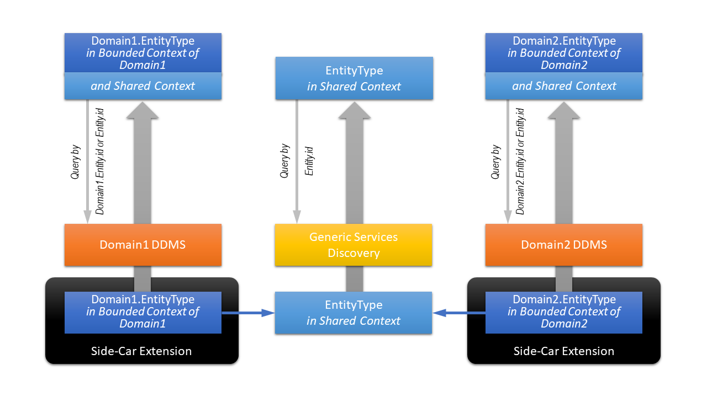

The center column shows the shared context. Domain-specific extensions are defined by the domains independently. Such
extensions can use domain driven language, which may be ambiguous outside the bounded domain context.

In a Proposal Excel workbook, select `master-data/SideCar` or `work-product-component/SideCar` in the Group Type pull
down menu:

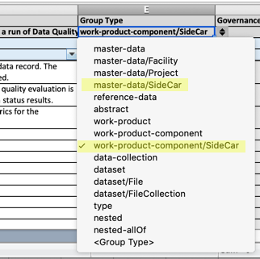

The Well Planning donation to OSDU has a couple of side-car data types, which are provided below as examples,
e.g., [`master-data--WellPlanningWell`](../../E-R/master-data/WellPlanningWell.1.1.0.md)
and [`master-data--WellPlanningWellbore`](../../E-R/master-data/WellPlanningWellbore.1.4.0.md).

### Appendix C.3.1 WellPlanningWell Side-Car Example

This side-car data type contains the WellPlanning specific information for a Well. In this case, it is the additional
data for the Well (Geopolitical information and operator information) that is not available from the main OSDU Well
master-data Group Type.

<details>

<summary markdown="span">Example of .json schema record of <code>osdu:wks:WellPlanningWell:1.0.0</code> side-car data type containing the additional data for planning a well:</summary>

<OsduImportJSON>[`osdu:wks:WellPlanningWell:1.0.0` side-car, Full record](../../Examples/WorkedExamples/WellPlanning/master-data/WellPlanningWell.json#only.data)</OsduImportJSON>

```json
{
  "data": {
    "ExistenceKind": "namespace:reference-data--ExistenceKind:planned:",
    "Name": "Jorge_Well-01",
    "WellID": "namespace:master-data--Well:920c7e6d-1e9f-496d-ba4f-fe5bf5503d57:1635454815323",
    "TimeZone": "+00:00",
    "ExtensionProperties": {
      "Name": "Jorge_Well-01",
      "NameLegal": "Jorge_Well-01",
      "Field": "Big Field",
      "Country": "United States of America (the)",
      "Region": "Big Area",
      "TimeZone": "+00:00",
      "Operator": "Big Oil",
      "StatusWell": "namespace:reference-data--WellStatus:abandoned:",
      "PurposeWell": "namespace:reference-data--WellPurpose:unknown:",
      "FluidWell": "namespace:reference-data--WellFluid:oil:",
      "DirectionWell": "namespace:reference-data--WellDirection:huffnpuff:",
      "GroundElevation": 982.98,
      "WellDatum": [
        {
          "VerticalMeasurementID": "KB",
          "VerticalMeasurement": 9.144000000000005,
          "VerticalMeasurementPathID": "namespace:reference-data--VerticalMeasurementPath:Elevation:",
          "VerticalMeasurementDescription": "RKB"
        },
        {
          "VerticalMeasurementID": "SL",
          "VerticalMeasurementDescription": "Mean Sea Level"
        },
        {
          "VerticalMeasurementID": "GL",
          "VerticalMeasurement": 982.98,
          "VerticalMeasurementPathID": "namespace:reference-data--VerticalMeasurementPath:Elevation:",
          "VerticalMeasurementDescription": "Ground Level"
        }
      ],
      "WellLocation": [
        {
          "Coordinates": [
            {
              "y": 32.123457532416346,
              "x": -103.98126039256375
            }
          ]
        },
        {
          "Coordinates": [
            {
              "x": 870696.75,
              "y": 912081.0
            }
          ]
        },
        {
          "Coordinates": [
            {
              "y": 32.12358147091861,
              "x": -103.98174563044829
            }
          ]
        }
      ]
    }
  }
}
```

</details>

### Appendix C.3.2 WellPlanningWellbore Side-Car Example

This side-car data type contains the WellPlanning specific information for a Wellbore. In this case, it is the
additional data for the Wellbore that is not available from the main OSDU Wellbore master-data Group Type. This includes
links to the Definitive Trajectory, SurveyProgram, Targets, WellboreGeometry and the PPFGDataset for the job.

<details>

<summary markdown="span">Example of .json schema record of <code>osdu:wks:WellPlanningWellbore:1.0.0</code> side-car data type containing the additional data for planning a wellbore:</summary>

<OsduImportJSON>[`osdu:wks:WellPlanningWellbore:1.0.0` side-car, Full record](../../Examples/WorkedExamples/WellPlanning/master-data/WellPlanningWellbore.json#only.data)</OsduImportJSON>

```json
{
  "data": {
    "ExistenceKind": "namespace:reference-data--ExistenceKind:planned:",
    "WellboreID": "namespace:master-data--Wellbore:bfa6c73d-4b12-4980-be91-80ce7cdb3291:1635454816654",
    "WellPlanningWellID": "namespace:master-data--WellPlanningWell:wp_well_920c7e6d-1e9f-496d-ba4f-fe5bf5503d57:1635454816060",
    "SurveyProgramIDs": [
      "namespace:master-data--SurveyProgram:sp_4b44b41a-6373-5373-8971-e16c99ec34f0:1635454828206"
    ],
    "TargetID": "namespace:master-data--GeometricTargetSet:056af576-8040-4ef9-9c88-f933f02a753a:1635454828841",
    "WellboreMarkerSetID": "namespace:work-product-component--WellboreMarkerSet:019bf7c3-feb9-49e9-afb5-aa88a7175f3f:1635454827754",
    "PPFGDatasetID": "namespace:work-product-component--PPFGDataset:ppfg_bfa6c73d-4b12-4980-be91-80ce7cdb3291:1635454829421"
  }
}
```

</details>

## Appendix C.4 Master Data

All **master-data** Group Type include `AbstractMaster` schema fragment.

In a Proposal Excel workbook, select `master-data` in the Group Type pull down menu:

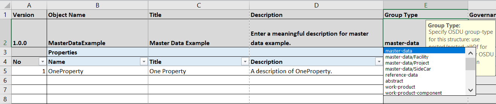

<details>

<summary markdown="span">Example of .json schema record of "L15-FA-103" Well (which Group Type is master-data) containing <code>AbstractMaster</code> schema fragment:</summary>

<OsduImportJSON>[Well.8816, Full record](../../Examples/WorkedExamples/WellboreTrajectory/master-data/Well.8816.2.json#only.data)</OsduImportJSON>

```json
{
  "data": {
    "Source": "TNO",
    "NameAliases": [
      {
        "AliasName": "L15-FA-103",
        "AliasNameTypeID": "partition-id:reference-data--AliasNameType:WELL_NAME:"
      },
      {
        "AliasName": "8816",
        "AliasNameTypeID": "partition-id:reference-data--AliasNameType:UWI:"
      }
    ],
    "GeoContexts": [
      {
        "GeoPoliticalEntityID": "partition-id:master-data--GeoPoliticalEntity:Netherlands:",
        "GeoTypeID": "partition-id:reference-data--GeoPoliticalEntityType:Country:"
      },
      {
        "GeoPoliticalEntityID": "partition-id:master-data--GeoPoliticalEntity:L15:",
        "GeoTypeID": "partition-id:reference-data--GeoPoliticalEntityType:BlockID:"
      }
    ],
    "SpatialLocation": {
      "AsIngestedCoordinates": {
        "type": "AnyCrsFeatureCollection",
        "CoordinateReferenceSystemID": "partition-id:reference-data--CoordinateReferenceSystem:BoundProjected:EPSG::23031_EPSG::1133:",
        "persistableReferenceCrs": "{\"authCode\":{\"auth\":\"OSDU\",\"code\":\"23031001\"},\"lateBoundCRS\":{\"authCode\":{\"auth\":\"EPSG\",\"code\":\"23031\"},\"name\":\"ED_1950_UTM_Zone_31N\",\"type\":\"LBC\",\"ver\":\"PE_10_9_1\",\"wkt\":\"PROJCS[\\\"ED_1950_UTM_Zone_31N\\\",GEOGCS[\\\"GCS_European_1950\\\",DATUM[\\\"D_European_1950\\\",SPHEROID[\\\"International_1924\\\",6378388.0,297.0]],PRIMEM[\\\"Greenwich\\\",0.0],UNIT[\\\"Degree\\\",0.0174532925199433]],PROJECTION[\\\"Transverse_Mercator\\\"],PARAMETER[\\\"False_Easting\\\",500000.0],PARAMETER[\\\"False_Northing\\\",0.0],PARAMETER[\\\"Central_Meridian\\\",3.0],PARAMETER[\\\"Scale_Factor\\\",0.9996],PARAMETER[\\\"Latitude_Of_Origin\\\",0.0],UNIT[\\\"Meter\\\",1.0],AUTHORITY[\\\"EPSG\\\",23031]]\"},\"name\":\"ED50 * DMA-mean / UTM zone 31N [23031,1133]\",\"singleCT\":{\"authCode\":{\"auth\":\"EPSG\",\"code\":\"1133\"},\"name\":\"ED_1950_To_WGS_1984_1\",\"type\":\"ST\",\"ver\":\"PE_10_9_1\",\"wkt\":\"GEOGTRAN[\\\"ED_1950_To_WGS_1984_1\\\",GEOGCS[\\\"GCS_European_1950\\\",DATUM[\\\"D_European_1950\\\",SPHEROID[\\\"International_1924\\\",6378388.0,297.0]],PRIMEM[\\\"Greenwich\\\",0.0],UNIT[\\\"Degree\\\",0.0174532925199433]],GEOGCS[\\\"GCS_WGS_1984\\\",DATUM[\\\"D_WGS_1984\\\",SPHEROID[\\\"WGS_1984\\\",6378137.0,298.257223563]],PRIMEM[\\\"Greenwich\\\",0.0],UNIT[\\\"Degree\\\",0.0174532925199433]],METHOD[\\\"Geocentric_Translation\\\"],PARAMETER[\\\"X_Axis_Translation\\\",-87.0],PARAMETER[\\\"Y_Axis_Translation\\\",-98.0],PARAMETER[\\\"Z_Axis_Translation\\\",-121.0],AUTHORITY[\\\"EPSG\\\",1133]]\"},\"type\":\"EBC\",\"ver\":\"PE_10_9_1\"}",
        "persistableReferenceUnitZ": "{\"scaleOffset\":{\"scale\":1.0,\"offset\":0.0},\"symbol\":\"m\",\"baseMeasurement\":{\"ancestry\":\"Length\",\"type\":\"UM\"},\"type\":\"USO\"}",
        "features": [
          {
            "type": "AnyCrsFeature",
            "properties": {},
            "geometry": {
              "type": "AnyCrsPoint",
              "coordinates": [
                622011.96,
                5910706.37
              ]
            }
          }
        ]
      },
      "Wgs84Coordinates": {
        "type": "FeatureCollection",
        "features": [
          {
            "type": "Feature",
            "geometry": {
              "type": "Point",
              "coordinates": [
                4.83073672457101,
                53.32956038067355
              ]
            },
            "properties": {}
          }
        ]
      },
      "AppliedOperations": [
        "conversion from ED_1950_UTM_Zone_31N to GCS_European_1950; 1 points converted",
        "transformation GCS_European_1950 to GCS_WGS_1984 using ED_1950_To_WGS_1984_1; 1 points successfully transformed"
      ]
    },
    "FacilityID": "L15-FA-103",
    "FacilityTypeID": "partition-id:reference-data--FacilityType:Well:",
    "FacilityOperators": [
      {
        "FacilityOperatorOrganisationID": "partition-id:master-data--Organisation:NAM:"
      }
    ],
    "OperatingEnvironmentID": "partition-id:reference-data--OperatingEnvironment:OFF:",
    "FacilityStates": [
      {
        "FacilityStateTypeID": "partition-id:reference-data--FacilityStateType:Technisch%20mislukt%20en%20sidetracked:"
      }
    ],
    "FacilityEvents": [
      {
        "FacilityEventTypeID": "partition-id:reference-data--FacilityEventType:SPUD:",
        "EffectiveDateTime": "1992-10-04T00:00:00"
      },
      {
        "FacilityEventTypeID": "partition-id:reference-data--FacilityEventType:DRILLING%20FINISH:",
        "EffectiveDateTime": "1992-11-06T00:00:00"
      }
    ],
    "DefaultVerticalMeasurementID": "Rotary Table",
    "VerticalMeasurements": [
      {
        "VerticalMeasurementID": "Rotary Table",
        "VerticalMeasurement": 42.51,
        "VerticalMeasurementTypeID": "partition-id:reference-data--VerticalMeasurementType:RotaryTable:",
        "VerticalMeasurementPathID": "partition-id:reference-data--VerticalMeasurementPath:TrueVerticalHeight:",
        "VerticalMeasurementUnitOfMeasureID": "partition-id:reference-data--UnitOfMeasure:m:",
        "VerticalCRSID": "partition-id:reference-data--CoordinateReferenceSystem:Vertical:EPSG::5714:"
      }
    ],
    "LocationUncertainty": {
      "Radius3D": 2.0,
      "ConfidenceLevel": 1.0
    }
  }
}
```

</details>

A complete list of `osdu:wks:AbstractMaster:1.0.0` Properties (Version 1.0.0) can be found
at [here](../../E-R/abstract/AbstractMaster.1.0.0.md#table-of-abstract-master-properties-version-100).

## Appendix C.5 Work Product Component

All **work-product-component** Group Type include `AbstractWorkProductComponent` and `AbstractWPCGroupType` schema
fragments.

In a Proposal Excel workbook, select `work-product-component` in the Group Type pull down menu:

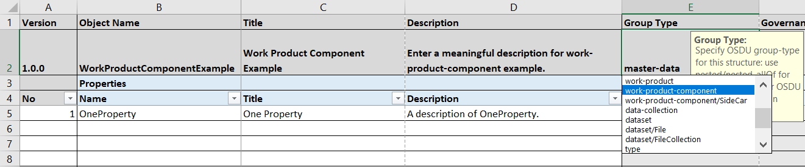

<details>

<summary markdown="span">Example of .json schema record of WellboreMarkerSetVerticalReferenceExplicit (which Group Type is work-product-component) containing <code>AbstractWorkProductComponent</code> schema fragment:</summary>

<OsduImportJSON>[WellboreMarkerSetVerticalReferenceExplicit, Full record](../../Examples/WorkedExamples/_Guide/WellboreMarkerSetVerticalReferenceExplicit.json#only.data)</OsduImportJSON>

```json
{
  "data": {
    "WellboreID": "partition-id:master-data--Wellbore:AB1234-1:",
    "VerticalMeasurement": {
      "VerticalMeasurement": 80.0,
      "VerticalMeasurementTypeID": "partition_id:reference-data--VerticalMeasurementType:GroundLevel:",
      "VerticalMeasurementPathID": "partition_id:reference-data--VerticalMeasurementPath:TrueVerticalHeight:",
      "VerticalMeasurementUnitOfMeasureID": "partition_id:reference-data--UnitOfMeasure:ft:",
      "VerticalReferenceID": "GL-Original",
      "VerticalReferenceEntityID": "partition-id:master-data--Wellbore:AB1234-1:"
    },
    "Markers": [
      {
        "MarkerName": "OWC",
        "MarkerMeasuredDepth": 12115.2
      }
    ]
  }
}
```

</details>

A complete list of `osdu:wks:AbstractWorkProductComponent:1.0.0` Properties (Version 1.0.0) can be found
at [here](../../E-R/abstract/AbstractWorkProductComponent.1.0.0.md#table-of-abstractworkproductcomponent-properties-version-100)
.

<details>

<summary markdown="span">Example of .json schema record of WellboreTrajectory.8816.raw (which Group Type is work-product-component) containing <code>AbstractWPCGroupType</code> schema fragment:</summary>

<OsduImportJSON>[WellboreTrajectory.8816.raw, Full record](../../Examples/WorkedExamples/WellboreTrajectory/work-product-component/WellboreTrajectory.8816.raw.1.json#only.data)</OsduImportJSON>

```json
{
  "data": {
    "Name": "8816.csv",
    "Description": "Wellbore Trajectory; the column with name HorizontalCRS contains the EPSG code for the 'grid', in which the column Azimuth is computed.",
    "Datasets": [
      "partition-id:dataset--File.Generic.CSV:7dee8cae-886a-4c68-b520-4eb26546e0cb:"
    ],
    "WellboreID": "partition-id:master-data--Wellbore:8816:",
    "TopDepthMeasuredDepth": 22.0,
    "BaseDepthMeasuredDepth": 2790.0,
    "AzimuthReferenceType": "partition-id:reference-data--AzimuthReferenceType:GridNorth:",
    "ProjectedCRSID": "partition-id:reference-data--CoordinateReferenceSystem:BoundProjected:EPSG::23095_EPSG::1133:",
    "VerticalMeasurement": {},
    "AvailableTrajectoryStationProperties": [
      {
        "TrajectoryStationPropertyTypeID": "partition-id:reference-data--TrajectoryStationPropertyType:MD:",
        "StationPropertyUnitID": "partition-id:reference-data--UnitOfMeasure:m:",
        "Name": "MeasuredDepth"
      },
      {
        "TrajectoryStationPropertyTypeID": "partition-id:reference-data--TrajectoryStationPropertyType:AzimuthGN:",
        "StationPropertyUnitID": "partition-id:reference-data--UnitOfMeasure:dega:",
        "Name": "Azimuth"
      },
      {
        "TrajectoryStationPropertyTypeID": "partition-id:reference-data--TrajectoryStationPropertyType:Inclination:",
        "StationPropertyUnitID": "partition-id:reference-data--UnitOfMeasure:dega:",
        "Name": "Inclination"
      },
      {
        "Name": "UWBI"
      },
      {
        "Name": "AzimuthReference"
      },
      {
        "Name": "HorizontalCRS"
      }
    ]
  }
}
```

</details>

A complete list of `osdu:wks:AbstractWPCGroupType:1.2.0` Properties (Version 1.0.0) can be found
at [here](../../E-R/abstract/AbstractWPCGroupType.1.2.0.md#table-of-abstractwpcgrouptype-properties-version-120).

### Appendix C.5.1 work-product-component/Activity

In a Proposal Excel workbook, select `work-product-component/Activity` in the Group Type pull down menu:

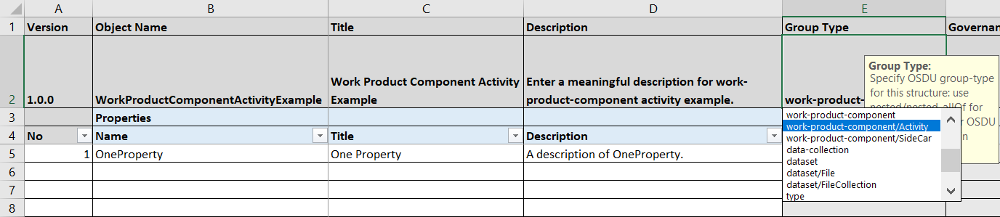

<details>

<summary markdown="span">Example of .json schema record of Activity:Simple (which Group Type is work-product-component/Activity) containing <code>AbstractWPCActivity</code> schema fragment:</summary>

<OsduImportJSON>[Activity:Simple, Full record](../../Examples/WorkedExamples/Activity/Activity_Simple.1.0.0.json#only.data)</OsduImportJSON>

```json
{
  "data": {
    "Source": "Made-up Example",
    "ExistenceKind": "namespace:reference-data--ExistenceKind:Actual:",
    "IsExtendedLoad": false,
    "IsDiscoverable": true,
    "Name": "Volume Above Contact Computation Activity",
    "Description": "Example activity record demonstrating the 'compute volume above contact'.",
    "CreationDateTime": "2021-04-04T09:13:15.55Z",
    "LineageAssertions": [
      {
        "ID": "namespace:work-product-component--SeismicHorizon:H1-4ed87e4f-9919-4011-aa39-499953051cce:",
        "LineageRelationshipType": "namespace:reference-data--LineageRelationshipType:Direct:"
      }
    ],
    "ActivityTemplateID": "namespace:master-data--ActivityTemplate:SimpleExample-44d649a3-8d8b-532c-8b77-b10f589a876b:",
    "ParentActivityID": "namespace:work-product-component--AnyActivity:AnyActivity-911bb71f-06ab-4deb-8e68-b8c9229dc76b:",
    "Parameters": [
      {
        "Title": "Horizon Above Contact",
        "Selection": "Selected by end-user",
        "DataObjectParameter": "namespace:work-product-component--SeismicHorizon:H1-4ed87e4f-9919-4011-aa39-499953051cce:",
        "ParameterKindID": "namespace:reference-data--ParameterKind:DataObject:",
        "ParameterRoleID": "namespace:reference-data--ParameterRole:Input:"
      },
      {
        "Title": "Contact Depth",
        "Selection": "Selected by end-user",
        "DataQuantityParameter": 1500.0,
        "ParameterKindID": "namespace:reference-data--ParameterKind:Double:",
        "ParameterRoleID": "namespace:reference-data--ParameterRole:Input:",
        "DataQuantityParameterUOMID": "namespace:reference-data--UnitOfMeasure:m:"
      },
      {
        "Title": "Volume above Contact",
        "Selection": "Computed by the process",
        "DataQuantityParameter": 8200.0,
        "ParameterKindID": "namespace:reference-data--ParameterKind:Double:",
        "ParameterRoleID": "namespace:reference-data--ParameterRole:Output:",
        "DataQuantityParameterUOMID": "namespace:reference-data--UnitOfMeasure:m3:"
      }
    ],
    "PriorActivityIDs": [
      "namespace:work-product-component--AnyActivity:AnyActivity-911bb71f-06ab-4deb-8e68-b8c9229dc76b:"
    ],
    "ExtensionProperties": {}
  }
}
```

</details>

A complete list of `osdu:wks:AbstractWPCActivity:1.0.0` Properties (Version 1.0.0) can be found
at [here](../../E-R/abstract/AbstractWPCActivity.1.1.0.md#table-of-abstractwpcactivity-properties-version-110).

## Appendix C.6 Reference Data

All **reference-data** Group Type include `AbstractReferenceType` schema fragment.

In a Proposal Excel workbook, select `reference-data` in the Group Type pull down menu:

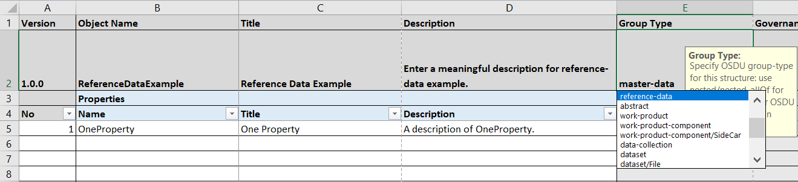

<details>

<summary markdown="span">Example of .json schema record of "Phanerozoic Eon" chronostratigraphic unit (which Group Type is reference-data) containing <code>AbstractReferenceType</code> schema fragment:</summary>

<OsduImportJSON>[ChronoStratigraphy:Phanerozoic, Full record](../../Examples/WorkedExamples/ChronoStratigraphy/records/Phanerozoic.json#only.data)</OsduImportJSON>

```json
{
  "data": {
    "Name": "Phanerozoic",
    "NameAlias": [
      {
        "AliasName": "Phanerozoic",
        "AliasNameTypeID": "{{NAMESPACE}}:reference-data--AliasNameType:UniqueIdentifier:",
        "DefinitionOrganisationID": "{{NAMESPACE}}:reference-data--StandardsOrganisation:ICS:"
      }
    ],
    "Description": "The Phanerozoic Eon [541.0-0.0]",
    "Code": "Phanerozoic",
    "AttributionAuthority": "ICS https://stratigraphy.org",
    "AttributionPublication": "https://github.com/CSIRO-enviro-informatics/interactive-geological-timescale/tree/master/src/assets",
    "AgeBegin": 541,
    "AgeEnd": 0,
    "ChildCodes": [
      "Phanerozoic.Cenozoic",
      "Phanerozoic.Mesozoic",
      "Phanerozoic.Paleozoic"
    ],
    "Colour": "#A1D4E2",
    "StratigraphicColumnRankUnitTypeID": "{{NAMESPACE}}:reference-data--StratigraphicColumnRankUnitType:Chronostratigraphic.Eonothem:",
    "ParentIDs": [],
    "Source": "Workbook Authoring/ChronoStratigraphy.1.0.0.xlsx; commit SHA 4aad0c73."
  }
}
```

</details>

A complete list of `osdu:wks:AbstractReferenceType:1.0.0` Properties (Version 1.0.0) can be found
at [here](../../E-R/abstract/AbstractReferenceType.1.0.0.md#table-of-abstractreferencetype-properties-version-100).

## Appendix C.7 Dataset

All **dataset** Group Type include `AbstractDataset` schema fragment.

In a Proposal Excel workbook, select `dataset` in the Group Type pull down menu:

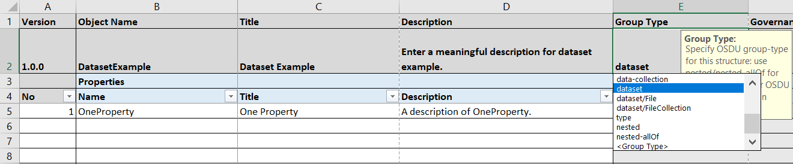

<details>

<summary markdown="span">Example of .json schema record of "Dataset X221/15" CSV file (which Group Type is dataset) containing <code>AbstractDataset</code> schema fragment:</summary>

<OsduImportJSON>[Dataset X221/15 CSV file, Full record](../../Examples/dataset/File.Image.PNG.1.0.0.json#only.data)</OsduImportJSON>

```json
{
  "data": {
    "ResourceHomeRegionID": "namespace:reference-data--OSDURegion:AWSEastUSA:",
    "ResourceHostRegionIDs": [
      "namespace:reference-data--OSDURegion:AWSEastUSA:"
    ],
    "ResourceCurationStatus": "namespace:reference-data--ResourceCurationStatus:Created:",
    "ResourceLifecycleStatus": "namespace:reference-data--ResourceLifecycleStatus:Loading:",
    "Source": "Example Data Source",
    "ExistenceKind": "namespace:reference-data--ExistenceKind:Prototype:",
    "Name": "Dataset X221/15",
    "Description": "As originally delivered by ACME.com.",
    "TotalSize": "13245217273",
    "EncodingFormatTypeID": "namespace:reference-data--EncodingFormatType:text%2Fcsv:",
    "SchemaFormatTypeID": "namespace:reference-data--SchemaFormatType:CWLS%20LAS3:",
    "Endian": "BIG",
    "DatasetProperties": {
      "FileSourceInfo": {
        "FileSource": "s3://default_bucket/r1/data/provided/documents/1000.witsml",
        "PreloadFilePath": "s3://staging-area/r7/raw-data/provided/documents/1000.witsml",
        "PreloadFileCreateUser": "somebody@acme.org",
        "PreloadFileCreateDate": "2019-12-16T11:46:20.163Z",
        "PreloadFileModifyUser": "somebody.else@acme.org",
        "PreloadFileModifyDate": "2019-12-20T17:20:05.356Z",
        "Name": "1000.witsml",
        "FileSize": "95463",
        "EncodingFormatTypeID": "namespace:reference-data--EncodingFormatType:application%2Fgeo%2Bjson:",
        "Checksum": "d41d8cd98f00b204e9800998ecf8427e",
        "ChecksumAlgorithm": "SHA-256"
      }
    },
    "Checksum": "d41d8cd98f00b204e9800998ecf8427e",
    "ExtensionProperties": {}
  }
}
```

</details>

A complete list of `osdu:wks:AbstractDataset:1.0.0` Properties (Version 1.0.0) can be found
at [here](../../E-R/abstract/AbstractDataset.1.0.0.md#table-of-abstractdataset-properties-version-100).

Depending on whether the dataset is a File or a FileCollection (set of files), properties from respective
dataset-specific schema fragment will also be included, which are provided below as examples.

### Appendix C.7.1 dataset/File

In a Proposal Excel workbook, select `dataset/File` in the Group Type pull down menu:

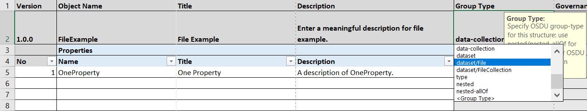

<details>

<summary markdown="span">Example of .json schema record of "NPD-LithoChartNorthSea" PNG image file (which Group Type is dataset/File) containing <code>AbstractFile</code> schema fragment:</summary>

<OsduImportJSON>[NPD-LithoChartNorthSea PNG image file, Full record](../../Examples/WorkedExamples/GeoReferencedImage/dataset/File.Image.PNG-Example.json#only.data)</OsduImportJSON>

```json
{
  "data": {
    "ExistenceKind": "partition-id:reference-data--ExistenceKind:Actual:",
    "Name": "NPD-LithoChartNorthSea",
    "Description": "As originally delivered by ACME.com.",
    "TotalSize": "13245217273",
    "EncodingFormatTypeID": "partition-id:reference-data--EncodingFormatType:image%2Fpng:",
    "SchemaFormatTypeID": "partition-id:reference-data--SchemaFormatType:Image.PNG:",
    "Endian": "BIG",
    "DatasetProperties": {
      "FileSourceInfo": {
        "FileSource": "s3://default_bucket/r1/data/provided/documents/geo-referenced-curtains/NPD-LithoChartNorthSea.png",
        "PreloadFilePath": "s3://staging-area/r7/raw-data/provided/documents/geo-referenced-curtains/NPD-LithoChartNorthSea.png",
        "PreloadFileCreateUser": "somebody@acme.org",
        "PreloadFileCreateDate": "2019-12-16T11:46:20.163Z",
        "PreloadFileModifyUser": "somebody.else@acme.org",
        "PreloadFileModifyDate": "2019-12-20T17:20:05.356Z",
        "Name": "NPD-LithoChartNorthSea.png",
        "FileSize": "95463",
        "EncodingFormatTypeID": "partition-id:reference-data--EncodingFormatType:image%2Fpng:",
        "Checksum": "d41d8cd98f00b204e9800998ecf8427e",
        "ChecksumAlgorithm": "SHA-256"
      }
    },
    "Checksum": "d41d8cd98f00b204e9800998ecf8427e",
    "ExtensionProperties": {}
  }
}
```

</details>

A complete list of `osdu:wks:AbstractFile:1.0.0` Properties (Version 1.0.0) can be found
at [here](../../E-R/abstract/AbstractFile.1.0.0.md#table-of-abstractfile-properties-version-100).

### Appendix C.7.2 dataset/FileCollection

In a Proposal Excel workbook, select `dataset/FileCollection` in the Group Type pull down menu:

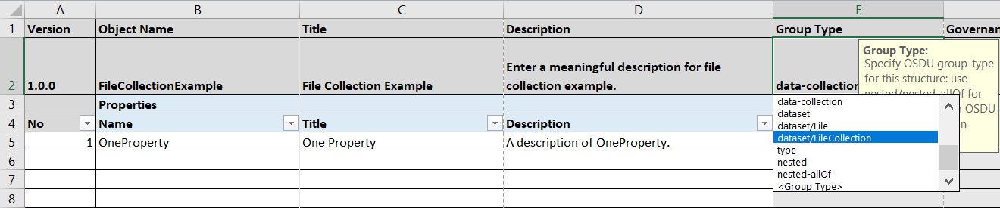

<details>

<summary markdown="span">Example of .json schema record of "Dataset X221/15" with multiple Bluware OpenVDS files (which Group Type is dataset/FileCollection) containing <code>AbstractFileCollection</code> schema fragment:</summary>

<OsduImportJSON>[Dataset X221/15 with multiple Bluware OpenVDS file collection, Full record](../../Examples/dataset/FileCollection.Bluware.OpenVDS.1.0.0.json#only.data)</OsduImportJSON>

```json
{
  "data": {
    "ResourceHomeRegionID": "namespace:reference-data--OSDURegion:AWSEastUSA:",
    "ResourceHostRegionIDs": [
      "namespace:reference-data--OSDURegion:AWSEastUSA:"
    ],
    "ResourceCurationStatus": "namespace:reference-data--ResourceCurationStatus:Created:",
    "ResourceLifecycleStatus": "namespace:reference-data--ResourceLifecycleStatus:Loading:",
    "Source": "Example Data Source",
    "ExistenceKind": "namespace:reference-data--ExistenceKind:Prototype:",
    "Name": "Dataset X221/15",
    "Description": "As originally delivered by ACME.com.",
    "TotalSize": "13245217273",
    "EncodingFormatTypeID": "namespace:reference-data--EncodingFormatType:text%2Fcsv:",
    "SchemaFormatTypeID": "namespace:reference-data--SchemaFormatType:CWLS%20LAS3:",
    "Endian": "BIG",
    "DatasetProperties": {
      "FileCollectionPath": "s3://default_bucket/opendes/data/vds-dataset/",
      "IndexFilePath": "s3://default_bucket/opendes/data/vds-dataset/vds-dataset.index",
      "FileSourceInfos": [
        {
          "FileSource": "s3://default_bucket/opendes/data/vds-dataset/vds-file-1",
          "PreloadFilePath": "s3://staging-area/r7/raw-data/provided/documents/vds-file-1",
          "Name": "vds-file-1",
          "PreloadFileCreateUser": "somebody@acme.org",
          "PreloadFileCreateDate": "2019-12-16T11:46:20.163Z",
          "PreloadFileModifyUser": "somebody.else@acme.org",
          "PreloadFileModifyDate": "2019-12-20T17:20:05.356Z",
          "FileSize": "439452464",
          "Checksum": "d41d8cd98f00b204e9800998ecf8427e",
          "ChecksumAlgorithm": "MD5"
        },
        {
          "FileSource": "s3://default_bucket/opendes/data/vds-dataset/vds-file-2",
          "PreloadFilePath": "s3://staging-area/r7/raw-data/provided/documents/vds-file-2",
          "Name": "vds-file-2",
          "PreloadFileCreateUser": "somebody@acme.org",
          "PreloadFileCreateDate": "2019-12-16T11:50:40.321Z",
          "PreloadFileModifyUser": "somebody.else@acme.org",
          "PreloadFileModifyDate": "2019-12-20T17:59:03.456Z",
          "FileSize": "433645463",
          "Checksum": "204e9800998ecf8427ed41d8cd98f00b",
          "ChecksumAlgorithm": "MD5"
        }
      ],
      "Checksum": "d41d8cd98f00b204e9800998ecf8427e"
    },
    "ImportTimeStamp": "2020-12-16T11:52:24.477Z",
    "ExtensionProperties": {}
  }
}
```

</details>

A complete list of `osdu:wks:AbstractFileCollection:1.0.0` Properties (Version 1.0.0) can be found
at [here](../../E-R/abstract/AbstractFileCollection.1.0.0.md#table-of-abstractfilecollection-properties-version-100).

## Appendix C.8 Relationship Properties

A relationship to another data object instance, persisted individually in the data platform with its own `kind` and
`id`, is defined with a 'decorated string' type in JSON. Relationships to a single target data object are represented
via a single `string`, relationships to multiple target data objects are represented by an `array` of type `string`.

> **Note:** Relationships never require a version in the **RO Version** cell. Any values specified will be silently
> ignored.

### Appendix C.8.1 Relationship to a Single Target

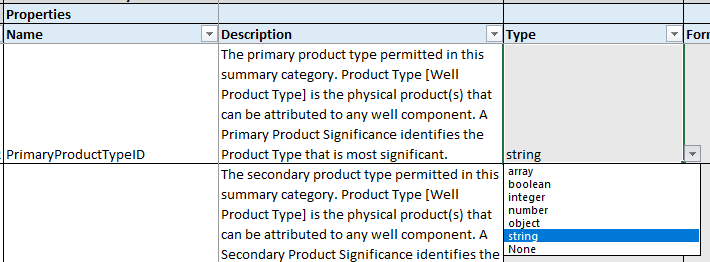

The **Type** is set to a JSON `string` property type. It is good practice to suffix the property name with `ID`, which
indicates that this property is holding a reference to another data record `id`.

### Appendix C.8.2 Relationship to Multiple Targets

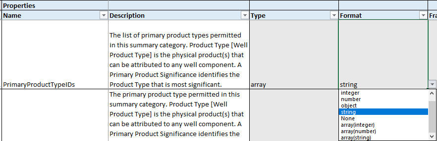

The **Type** is set to a JSON `array` property type with the **Format** set to the JSON `string` type. This will create
a JSON schema structure of type `array` with items of type `string`.
It is good practice to suffix the property name with `IDs` (plural!), which
indicates that this property is holding references to another data record `id`s.

### Appendix C.8.3 Relationship Target Type

Proposals can identify a required data object type as relationship target. This is done via the cells in columns
labelled **Referenced Object** for the target entity type name and **RO Group Type** for the target group-type.
Wildcards `*` are permitted. The example below shows a common example, a relationship to a reference-data type. As a
consequence the `pattern` associated with this property will require the id string to contain the target type name
`reference-data--WellProductType`.

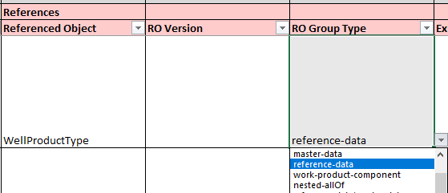

In some cases, it is desirable to create references to a number of optional target types:

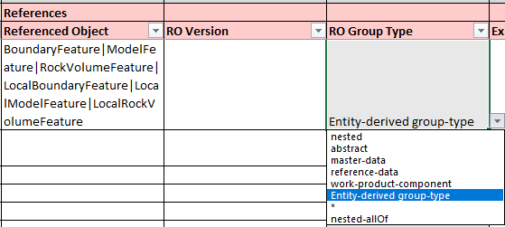

In this case the names of the target object types are listed in the **Referenced Object** column and
the multiple names are separated by the pipe symbol `|`. The **RO Group Type** cell is set to the option
`Entity-derived group-type`.

## Appendix C.9 Composition

JSON schema fragments are of **Type** `object` — or if declared as arrays — **Type** `array` with item type `object`
set in column **Format**

### Appendix C.9.1 Fragments included by `$ref`

JSON schemas can be composed by reference to other schema fragments. The definition is similar to a relationship, only
that the **RO Group Type** is set to `abstract`. In this case it is required to specify the exact version of the schema
fragment in **RO Version**

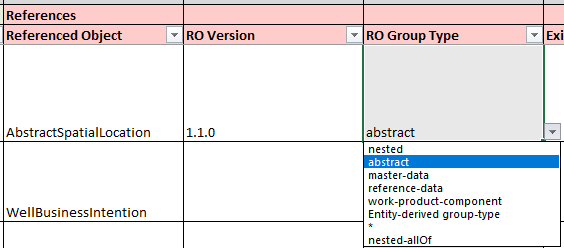

In the example above the version 1.1.0 of the AbstractSpatialLocation is included by `$ref` under the property in
**Name**.

### Appendix C.9.2 Composition by Nesting

Another way of composition is by nested object definitions. This definition requires the **RO Group Type** to be set to
`nested`. No **RO Version** is required, instead, a workbook sheet ('tab') with the name declared in **Referenced
Object** must be specified.

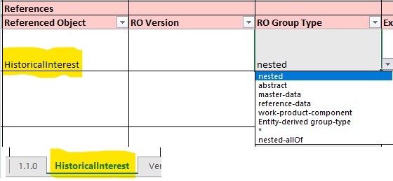

### Appendix C.9.3 Schema Fragment Versioning, Updates

All schema fragments in the abstract group or folder are versioned just like any other schema. Schemas make explicitly
versioned references to such schema fragments. This protects composed schemas to be changes. However, composed schemas
must be explicitly updated to include newer schema fragment versions.

The **_Included Schema Fragments_** sheet in the proposal workbooks controls the main, group-type specific versioning.
The figure below shows an example.

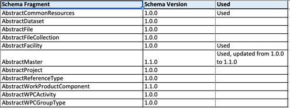

The example above shows the result of a proposal derived from an existing schema, here using the schema composer with
user interface

```shell
python OsduSchemaComposer.py -app
```

and running menu "Proposals" with option "Create new version proposal from an existing schema" with

> * Group Type: master-data
> * Entity Name and Version: Wellbore.1.0.0
> * New semantic version: 1.1.0

It takes the Wellbore.1.0.0 and proposes and 'opportunistic' upgrade to version 1.1.0 by picking up the latest versions
of each used schema fragment. The schema fragments included by the Group Type setting in the header are marked as
_Used_. Updated fragments are suffixed by the transition information, here _Used, updated from 1.0.0 to 1.1.0_.

The Group Type selection determines, which of the schema fragments listed are actually used, e.g.:


Details are described above in sections [Appendix C.1 Master Data (Facility)](#appendix-c1-master-data-facility),
[Appendix C.2 Master Data (Project)](#appendix-c2-master-data-project),
[Appendix C.4 Master Data](#appendix-c4-master-data),
[Appendix C.5 Work Product Component](#appendix-c5-work-product-component),
[Appendix C.6 Reference Data](#appendix-c6-reference-data) and
[Appendix C.7 Dataset](#appendix-c7-dataset)

Ordinary schema fragments are referenced in the columns **Referenced Object**, **RO Version**, **RO Group Type**. In
the update example with Wellbore.1.1.0, updated versions are marked in the **Action** column as _Update_ and in the
**Additional Comments** with information which version transition happened, for example, _Abstract schema fragment version updated from 1.0.0 to 1.1.0_.

---

## Appendix C.10 Dictionaries

JSON dictionaries with complex objects as values are generally not supported by the indexer, thus invisible to search
queries. Dictionaries are handled as a workaround by defining a separate `type` in the Type option list:

* `object/patternProperties` to be used for dictionaries where the key has to match a pattern.
* `object/additionalProperties` to be used for unconstrained keys.

In both cases it is expected that the object is defined as [nested object](#appendix-c92-composition-by-nesting).

In order to achieve strict validation, it is necessary to add restrictions by defining `"additionalProperties": false`
(the default is true). This setting can be added via the Example column in the representation as JSON, see the next
chapter [Appendix C.13 Special Cases, Tricks](#appendix-c13-special-cases-tricks).

---

## Appendix C.11 Fixed, Constant Values `const`

OSDU Proposal Workbooks come with a dedicated column for constant definitions (Column H). The JSON schema
keyword `const` is valid in the JSON schema standard. However, OSDU JSON schemas can/should also be used to create code
or API request/response payloads. Many code generators and some Open API Spec versions do not support `const`.

An effective workaround, which is also employed by GeoJSON (see
[FeatureCollection](../../Authoring/abstract/AbstractFeatureCollection.1.0.0.json)), is to use an `enum` with a single
array element.

> **Recommendation**<br>
> In this case,
> * leave the Const cell (Column H) empty
> * populate the Example (Column I) with the `text enum:{{constant-value}}`<br>
>   where {{constant-value}} is the value intended as const.


<details>

<summary markdown="span">An example of a single value <code>enum</code> can be found in AbstractDowntimeEvent.</summary>

<OsduImportJSON>[full generated schema](../../Generated/abstract/AbstractDowntimeContext.1.0.0.json#only.properties.ContextType)</OsduImportJSON>

```json
{
  "properties": {
    "ContextType": {
      "type": "string",
      "title": "Context Type",
      "description": "The fixed type 'Downtime Event' for this AbstractDowntimeContext",
      "enum": [
        "Downtime Event"
      ]
    }
  }
}
```

</details>

---

## Appendix C.12 Example Values

OSDU schemas employ the keyword `"example"` for this purpose.

> **Important Note:** The [https://json-schema.org/draft-07/schema](https://json-schema.org/draft-07/schema) has
> `"examples"`defined as array of items, which is inconvenient as OSDU wants to provide the correct cardinality, i.e.
> single values for simple properties and arrays of objects for schema properties defined as arrays.

OSDU uses therefore consistently the singular `"example"` keyword associated with values of the correct cardinality as
defined for the schema property.

The following subsections show Proposal workbook screen captures for a variety of value types in expandable blocks,
followed by the generated schema fragment for the property in question. Please click the triangle to expand the relevant
subsections.

### Appendix C.12.1 Boolean Example

<details>

<summary markdown="span">Example definition in the Proposal.</summary>

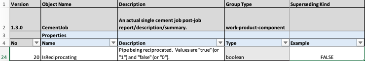

</details>

<details>

<summary markdown="span">An example of a boolean example value definition.</summary>

<OsduImportJSON>[full generated schema](../../Generated/work-product-component/CementJob.1.3.0.json#only.properties.data.allOf[3].properties.IsReciprocating)</OsduImportJSON>

```json
{
  "properties": {
    "data": {
      "allOf": {
        "properties": {
          "IsReciprocating": {
            "type": "boolean",
            "title": "Is Reciprocating",
            "description": "Pipe being reciprocated.  Values are \"true\" (or \"1\") and \"false\" (or \"0\").",
            "example": false,
            "x-osdu-existing-standard": "N"
          }
        }
      }
    }
  }
}
```

</details>

> **Note:** Boolean properties only support two values, `true` and `false`. The value `false` is the default and
> represents the 'absent value' simultaneously.
>
> If the example value is not set in the proposal workbook, the auto-generated example property value will be set to
`true`.

### Appendix C.12.2 String Example

#### Appendix C.12.2.1 Simple String Example

<details>

<summary markdown="span">Example simple string definition in the Proposal.</summary>

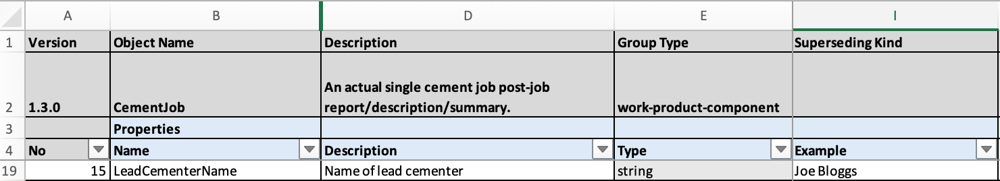

</details>

<details>

<summary markdown="span">An example of a boolean example value definition.</summary>

<OsduImportJSON>[full generated schema](../../Generated/work-product-component/CementJob.1.3.0.json#only.properties.data.allOf[3].properties.LeadCementerName)</OsduImportJSON>

```json
{
  "properties": {
    "data": {
      "allOf": {
        "properties": {
          "LeadCementerName": {
            "type": "string",
            "title": "Lead Cementer Name",
            "description": "Name of lead cementer",
            "example": "Joe Bloggs",
            "x-osdu-existing-standard": "N"
          }
        }
      }
    }
  }
}
```

</details>

> **Note:** Example values in column `I` are validated against the schema type and potentially pattern.
>
> If the example value is not set in the proposal workbook, the auto-generated example property value will be set to the
> value `"Example <PropertyName>"`.

#### Appendix C.12.2.2 Relationship Example

Relationship references are encoded as string values in the format `record-id:record-version` or more common
`record-id:` for references to the last record version number.

<details>

<summary markdown="span">Example relationship definition in the Proposal.</summary>

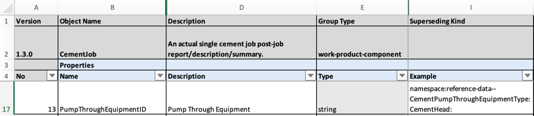

</details>

<details>

<summary markdown="span">An example of a relationship example value definition.</summary>

<OsduImportJSON>[full generated schema](../../Generated/work-product-component/CementJob.1.3.0.json#only.properties.data.allOf[3].properties.PumpThroughEquipmentID)</OsduImportJSON>

```json
{
  "properties": {
    "data": {
      "allOf": {
        "properties": {
          "PumpThroughEquipmentID": {
            "type": "string",
            "title": "Pump Through Equipment",
            "description": "Pump Through Equipment",
            "example": "namespace:reference-data--CementPumpThroughEquipmentType:CementHead:",
            "x-osdu-existing-standard": "N",
            "pattern": "^[\\w\\-\\.]+:reference-data\\-\\-CementPumpThroughEquipmentType:[\\w\\-\\.\\:\\%]+:[0-9]*$",
            "x-osdu-relationship": [
              {
                "GroupType": "reference-data",
                "EntityType": "CementPumpThroughEquipmentType"
              }
            ]
          }
        }
      }
    }
  }
}
```

</details>

> **Note:** Example relationship values in column `I` are validated against the schema type `string` and `pattern`.
> **Please mind the trailing colon `:` as separator between `id` and most likely omitted version number.**
> If the example value is not set in the proposal workbook, the auto-generated example property value will be set to the
> following value:
> * target type reference-data: for a given type, the first reference-data record is selected, e.g. for
    `reference-data--QuantitativeAccuracyBand` it will be the id of the first record in
    the [manifest](../../ReferenceValues/Manifests/reference-data/OPEN/QuantitativeAccuracyBand.1.json), example
    `"namespace:reference-data--QuantitativeAccuracyBand:Length.LessThan1m:"` .
> * any other target type will use the following convention:
    `"namespace:target-group-type--TargetEntityType:SomeUniqueRelationshipNameID:"`; example for a property named
    ProspectID relating to a master-data--Prospect record: `"namespace:master-data--Prospect:SomeUniqueProspectID:"`

### Appendix C.12.3 Numeric Examples

#### Appendix C.12.3.1 Integer Example

<details>

<summary markdown="span">Example integer definition in the Proposal.</summary>

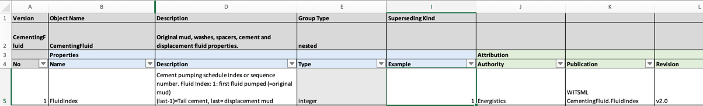

</details>

<details>

<summary markdown="span">An example of an integer example value definition.</summary>

<OsduImportJSON>[full generated schema](../../Generated/work-product-component/CementJob.1.3.0.json#only.properties.data.allOf[3].properties.CementStages.items.properties.CementingFluid.items.properties.FluidIndex)</OsduImportJSON>

```json
{
  "properties": {
    "data": {
      "allOf": {
        "properties": {
          "CementStages": {
            "items": {
              "properties": {
                "CementingFluid": {
                  "items": {
                    "properties": {
                      "FluidIndex": {
                        "type": "integer",
                        "title": "Fluid Index",
                        "description": "Cement pumping schedule index or sequence number. Fluid Index: 1: first fluid pumped (=original mud)\n\t\t\t\t\t(last-1)=Tail cement, last= displacement mud",
                        "example": 1,
                        "x-osdu-attribution-authority": "Energistics",
                        "x-osdu-attribution-publication": "WITSML CementingFluid.FluidIndex",
                        "x-osdu-attribution-revision": "v2.0",
                        "x-osdu-existing-standard": "N"
                      }
                    }
                  }
                }
              }
            }
          }
        }
      }
    }
  }
}
```

</details>

> **Note:** Example integer values in column `I` are validated against the schema type `integer`.
> If the example value is not set in the proposal workbook, the auto-generated example property value will be set the
> value `2`.

#### Appendix C.12.3.2 Number Example

Number values without a unit quantity context, i.e., an empty column `G`cell (Frame of Reference) can be decorated with
an explicit example value in column `I`.

> **Note:** Example floating point number values in column `I` are validated against the schema type `number`.
>
> If the example value is not set in the proposal workbook, the auto-generated example property value will be set the
> value `12345.6`.

#### Appendix C.12.3.3 Number Example with Frame of Reference

1. The unit quantity reference is specified in column `G` using the keyword `UOM:` followed by the unit quantity code
   like `UOM:plane angle` for properties measured in plane angle units. The text string following the prefix `UOM:` must
   match an Energistics UnitQuantity code exactly. Codes are typically lower case and words are separated by spaces.
2. The value and value unit are declared as a text string in column `I` consisting of a number followed by a single
   space and a valid Energistics UnitOfMeasure code.

The example string value is literally in conflict with the schema `"type": "number"`. The OsduSchemaComposer.py script
will, however, extract the number into a correct property value and add a unit specification into the `meta[]` block of
the record.


<details>

<summary markdown="span">Example number with frame of reference definition in the Proposal.</summary>

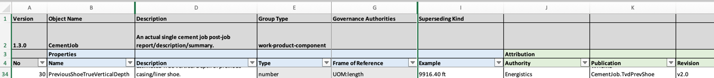

</details>

<details>

<summary markdown="span">An example number with frame of reference and example value definition.</summary>

<OsduImportJSON>[full generated schema](../../Generated/work-product-component/CementJob.1.3.0.json#only.properties.data.allOf[3].properties.PreviousShoeTrueVerticalDepth)</OsduImportJSON>

```json
{
  "properties": {
    "data": {
      "allOf": {
        "properties": {
          "PreviousShoeTrueVerticalDepth": {
            "type": "number",
            "title": "Previous Shoe True Vertical Depth",
            "description": "Estimated True Vertical Depth of previous casing/liner shoe.",
            "example": "9916.40 ft",
            "x-osdu-frame-of-reference": "UOM:length",
            "x-osdu-attribution-authority": "Energistics",
            "x-osdu-attribution-publication": "WITSML CementJob.TvdPrevShoe",
            "x-osdu-attribution-revision": "v2.0",
            "x-osdu-existing-standard": "N"
          }
        }
      }
    }
  }
}
```

</details>

The resulting example record contains the specified example value and the meta[] block entry for the length unit `ft`, declaring that the property name `PreviousShoeTrueVerticalDepth` is measured in `ft`.

<details>

<summary markdown="span">Auto-generated example number value.</summary>

<OsduImportJSON>[full auto-generated example record](../../Examples/work-product-component/CementJob.1.3.0.json#only.data.PreviousShoeTrueVerticalDepth)</OsduImportJSON>

```json
{
  "data": {
    "PreviousShoeTrueVerticalDepth": 9916.4
  }
}
```

</details>

<details>

<summary markdown="span">Auto-generated <code>meta[]</code> definition.</summary>

<OsduImportJSON>[full auto-generated example record](../../Examples/work-product-component/CementJob.1.3.0.json#only.meta[1])</OsduImportJSON>

```json
{
  "meta": [
    {
      "kind": "Unit",
      "name": "ft",
      "persistableReference": "{\"abcd\":{\"a\":0.0,\"b\":0.3048,\"c\":1.0,\"d\":0.0},\"symbol\":\"ft\",\"baseMeasurement\":{\"ancestry\":\"L\",\"type\":\"UM\"},\"type\":\"UAD\"}",
      "unitOfMeasureID": "namespace:reference-data--UnitOfMeasure:ft:",
      "propertyNames": [
        "HoleMeasuredDepth",
        "StringSetMeasuredDepth",
        "StringSetTrueVerticalDepth",
        "StageCollarMeasuredDepth",
        "LandingFloatCollarMeasuredDepth",
        "RatholeLength",
        "PreviousShoeMeasuredDepth",
        "PreviousShoeTrueVerticalDepth",
        "EstimatedCementTopMeasuredDepth",
        "CementStages[].CementingFluid[].TopMeasuredDepth",
        "CementStages[].CementingFluid[].BaseMeasuredDepth",
        "CementStages[].CementingFluid[].SlurryHeight",
        "CementStages[].ShoeTrackLength",
        "CementStages[].AnnularLength",
        "ShoeTest.OpenHoleLength",
        "ShoetrackCement.ShoetrackMeasuredDepth",
        "ShoetrackCement.ShoetrackLength",
        "ShoetrackCement.ShoetrackDrillMeasuredDepth"
      ]
    }
  ]
}
```

</details>

> **Note:** If column `I` is empty with column `G` specifying a value UnitQuantity, then the value is set to `12345.6`
> and the unit is selected to be the first UnitOfMeasure record with CoefficientA=0, CoefficientB=1, CoefficientC=1,
> CoefficientD=0. Examples for `length` would refer to `m` and `plane angle` would use `rad`.

### Appendix C.12.4 Object Example

Often schemas make reference to external schema fragments. It is possible to override the individual auto-generated
example value in the proposal workbook. The value in column `I` must be a valid JSON structure matching the expected
schema fragment. Optional properties can be omitted.

Please note, that these explicit example objects are included in the auto-generated example records under the
[Examples folder](../../Examples). If newer schema fragment versions are included, please make sure that the example
objects are updated and adjusted such that deprecated properties are removed from the example and the auto-generated
example remain a trustworthy resource for developers.

<details>

<summary markdown="span">Example object definition in the Proposal.</summary>

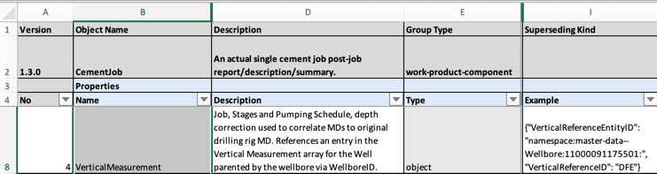

</details>

<details>

<summary markdown="span">An example of an object example value definition.</summary>

<OsduImportJSON>[full generated schema](../../Generated/work-product-component/CementJob.1.3.0.json#only.properties.data.allOf[3].properties.VerticalMeasurement)</OsduImportJSON>

```json
{
  "properties": {
    "data": {
      "allOf": {
        "properties": {
          "VerticalMeasurement": {
            "$ref": "../abstract/AbstractFacilityVerticalMeasurement.1.0.0.json",
            "title": "Depth Reference Elevation",
            "description": "ID to the Zero Depth Point Vertical Measure elevation for depths contained in the Cement Job, Stages and Pumping Schedule, depth correction used to correlate MDs to original drilling rig MD. References an entry in the Vertical Measurement array for the Well parented by the wellbore via WellboreID.",
            "example": {
              "VerticalReferenceEntityID": "namespace:master-data--Wellbore:11000091175501:",
              "VerticalReferenceID": "DFE"
            },
            "x-osdu-existing-standard": "Y"
          }
        }
      }
    }
  }
}
```

</details>

<details>

<summary markdown="span">The auto-generated example value.</summary>

<OsduImportJSON>[full generated schema](../../Examples/work-product-component/CementJob.1.3.0.json#only.data.VerticalMeasurement)</OsduImportJSON>

```json
{
  "data": {
    "VerticalMeasurement": {
      "VerticalReferenceEntityID": "namespace:master-data--Wellbore:11000091175501:",
      "VerticalReferenceID": "DFE"
    }
  }
}
```

</details>

> **Note:** Example object values in column `I` are validated against the schema fragment. There is a risk that
> important enhancements of newer fragment schema versions are missed when updating the included fragment versions. Please
> check if the changed version in column `N` may require an updated example object.
>
> If the example object value is not provided in the proposal workbook, the auto-generated example will be derived from
> all the included schema fragment property definitions.

---

## Appendix C.13 Special Cases, Tricks

In some exceptional cases it is necessary to convey extra payload to be included in the generated JSON schemas. This is
achieved by encoding the additional specifications as JSON structure in the **Example** column associated to the
property or object.

### Appendix C.13.1 `pattern`

An example for a pattern combined with an example is given in the
[AbstractFileSourceInfo](../../Generated/abstract/AbstractFileSourceInfo.1.0.0.json#L78-84):

```json
{
  "Checksum": {
    "type": "string",
    "title": "Checksum",
    "description": "Checksum of file bytes - a hexadecimal number with even number of bytes.",
    "example": "d41d8cd98f00b204e9800998ecf8427e",
    "pattern": "^([0-9a-fA-F]{2})+$"
  }
}
```

The `keywords` type, `title` and `description` find their dedicated columns in the proposal workbook,  `pattern`
and `example`, however need to be turned into a JSON structure and added into the Example cell.

| Property Name | Example                                                                             |
|---------------|-------------------------------------------------------------------------------------|
| `Checksum`    | `{"pattern": "^([0-9a-fA-F]{2})+$", "example": "d41d8cd98f00b204e9800998ecf8427e"}` |

### Appendix C.13.2 `enum`

Generally, enumerations with keyword `enum`are **_not_** used in OSDU. Instead, properties refer to reference-data
record ids, typically with human-readable codes (natural keys).

In the exceptional cases where `enum` is used, it does not compete or coincide with a pattern definition, or JSON
example values needed — the permitted values are explicit. In this case enumerations are expressed simply by a keyword
and a `|`-separated list:

| Property Name | Example cell value     |
|---------------|------------------------|
| `Endian`      | `enum:BIG&#124;LITTLE` |

The resulting JSON structure is then (as in
[AbstractDataset](../../Generated/abstract/AbstractDataset.1.0.0.json#L57-64)):

```json
{
  "Endian": {
    "type": "string",
    "description": "Endianness of binary value.  Enumeration: \"BIG\", \"LITTLE\".  If absent, applications will need to interpret from context indicators.",
    "enum": [
      "BIG",
      "LITTLE"
    ]
  }
}
```

### Appendix C.13.3 `additionalProperties`

For dictionaries (not used frequently in OSDU) it is often necessary to constrain the value content. This can be
achieved by adding the instruction `"additionalProperties": false`.

````json
{ "additionalProperties": false }
````

Note the combination of the `additionalProperties` and `example` keywords in the JSON fragment.

| Property Name          | Example Cell Value                                                                                                                                                                                         |
|------------------------|------------------------------------------------------------------------------------------------------------------------------------------------------------------------------------------------------------|
| SomeDictionaryProperty | `{"additionalProperties": false, "example": {"osdu:wks:master-data--OperationsReport:1.0.0": ["data.BitRecord[].TypeBit"], "osdu:wks:master-data--OperationsReport:1.1.0": ["data.BitRecord[].TypeBit"]}}` |

---

## Appendix C.14 Deprecation

OSDU Data Definitions may discourage usage of properties or entire entity types by declaring them **_DEPRECATED_**. The
properties are still indexed and the schemas are still including the definitions.

When deprecating properties in abstract schemas (schema fragments), there may be explicit example objects in schemas,
which **_include_** the new fragment version with deprecated properties. In order to keep the auto-generated examples
trustworthy, any explicit example (see
[Appendix C.12.4 Object Example](#appendix-c124-object-example)) must be checked for possible use of deprecated
properties and values. The E-R documentation of the abstract schema fragment provides the table of usage.

### Appendix C.14.1 Property Deprecation

Properties in higher semantic versions are deprecated by prefixing the `description` with DEPRECATED in capital letters,
typically followed by a colon and an instruction, which property to use instead.

<details>

<summary markdown="span">Property Deprecation Example</summary>

<OsduImportJSON>[master-data--SeismicAcquisitionSurvey, Full schema](../../Authoring/master-data/SeismicAcquisitionSurvey.1.3.0.json#only.allOf[3].properties.ShotpointIncrementDistance)</OsduImportJSON>

```json
{
  "allOf": {
    "properties": {
      "ShotpointIncrementDistance": {
        "type": "number",
        "description": "DEPRECATED: Use SourceConfigurations[].ShotpointSpacing.  Horizontal distance between shotpoint locations.",
        "x-osdu-frame-of-reference": "UOM:length"
      }
    }
  }
}
```

</details>

When working with Proposal workbooks, the Description cell content is prefixed by DEPRECATED accordingly.

**_Consequences_**

Deprecated properties are
* listed in the schema documentation in strike-through font, e.g.: ~~data.ShotpointIncrementDistance~~,
* omitted in auto-generated example records.

### Appendix C.14.2 Entity Type Deprecation

Similar to property deprecation, entity types deprecations works the same way: The entity type `description` property is
prefixed by the string DEPRECATED.

<details>

<summary markdown="span">Entity Type Deprecation Example</summary>

<OsduImportJSON>[reference-data--ActualIndicatorType, Full schema](../../Authoring/reference-data/ActualIndicatorType.1.0.0.json)</OsduImportJSON>

```json
{
  "$id": "https://schema.osdu.opengroup.org/json/reference-data/ActualIndicatorType.1.0.0.json",
  "$schema": "http://json-schema.org/draft-07/schema#",
  "title": "ActualIndicatorType",
  "description": "DEPRECATED: (not used anywhere) Object that describes the actual planning status of an object - such as Tubular Assembly - to indicate if it is planned, concrete, prototyped or any other relevant status.",
  "x-osdu-governance-authorities": [
    "None"
  ],
  "x-osdu-governance-model": "LOCAL",
  "type": "object",
  "allOf": [
    {
      "$ref": "../abstract/AbstractReferenceType.1.0.0.json"
    }
  ]
}


```

</details>

**_Consequences_**

In the entity list the [E-R/README.md "reference-data" Schemas](../../E-R/README.md) shows the entity type description in
strike-through font, see ActualIndicatorType.1.0.0.

---

### Appendix C.14.3 Group Type Migration

From time to time the initial group-type classification may turn out to be incorrect/inconvenient. Such group-type
migrations are implying braking changes. Typically, one wants to keep the original schema untouched. In order to do so,
the "Superseding Kind" field in the main header of the proposal gets populated (old proposals may not carry this header
cell, but creating a new Proposal will add this). The cell below "Superseding Kind" must contain the `kind` of the
schema being superseded. The schema generation will then treat the superseded kind as deprecated and prepare the schema
upgrade resources as well as the (breaking) changes list in
the [Migration Guides](../../Guides/MigrationGuides/README.md). Superseded entities are removed from the active list of
schemas in the [documentation](../../E-R/README.md), individual schema version documentations are decorated with links
to the preceding or superseding versions.

---

## Links

1. Return to the [Beginning of the Chapter](#TOC)
2. Next Chapter: [Appendix D OSDU Schemas](93-OSDU-Schemas.md)
3. Browse to the [Schema Usage Guide Table of Contents](../README.md)