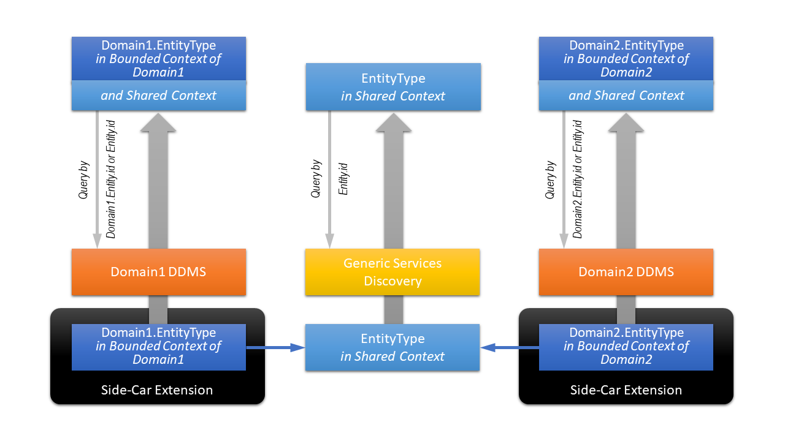
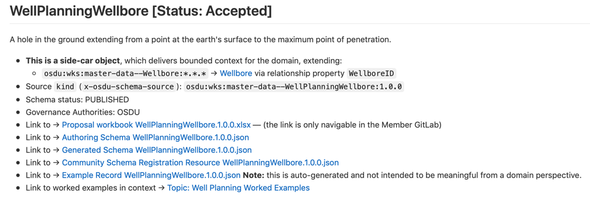
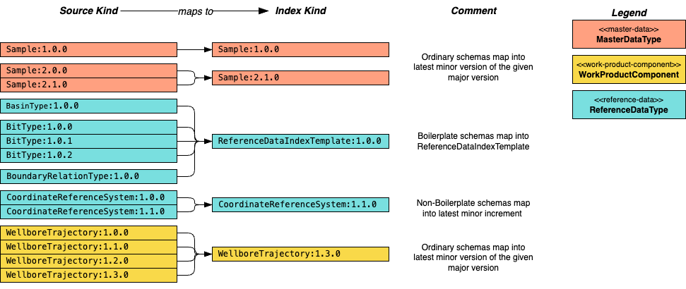

<a name="TOC"></a> Previous Chapter: [Appendix C Proposals](92-Proposals.md)

[[_TOC_]]

# Appendix D OSDU Schemas

## Appendix D.1 Basics

OSDU defines entity type schemas as JSON schemas using JSON schema draft #7 standard (see draft #7 meta schema
[https://json-schema.org/draft-07/schema](https://json-schema.org/draft-07/schema)). This is **_not_** the latest JSON
schema standard but widely accepted in, e.g., Open API Specification 3 standards.

### Appendix D.1.1 Known Deviations

JSON schemas declare a global identity via the `$id` keyword. OSDU schemas come with populated `$id` values, however,
the urls are not resolvable. Example:

```json
{
  "$id": "https://schema.osdu.opengroup.org/json/master-data/Agreement.1.0.0.json"
}
```

There is no server at `schema.osdu.opengroup.org` serving the schemas. Instead, OSDU schemas are resolved by the Schema
service, see [Appendix A.2 OSDU System Services](90-References.md#appendix-a2-osdu-system-services).

### Appendix D.1.2 Schema Resolution Recommendations

Given the above deviation, here the OSDU platform recommendation:

> 1. **Do not use or rely on `$id`!**
> 2. **Use** the OSDU's system **Schema Service** to resolve schemas instead (see
     [OSDU Schema Service API](https://community.opengroup.org/osdu/platform/system/schema-service/-/blob/master/docs/api/schema_openapi.yaml),
     more links in [Appendix A.2 OSDU System Services](90-References.md#appendix-a2-osdu-system-services))
> 3. The Schema service identifies schemas by `kind`, see below and
     [6.1.2 Record `kind`](06-LifecycleProperties.md#612-record-kind).

### Appendix D.1.3 Schema Identifier `kind` Limitations

The definition of kind is given in [6.1.2 Record `kind`](06-LifecycleProperties.md#612-record-kind). Generally OSDU uses
mixed-case notation for `kind` values. However, casing **_is not significant_** for certain services[^1].

Example: the following two example kind values are considered equal to for the downstream platform services like, e.g.,
Indexing and Search:

```
osdu:wks:master-data--BHARun:1.0.0
osdu:wks:master-data--BhaRun:1.0.0
```

In relationship validation the casing **_is_** significant, e.g., in the `"pattern"` values defining the expected target
types[^2].

It is safe to follow the OSDU naming convention which uses for

1. schema authority lower case, e.g., osdu - **Exception:** the schema authority `system-meta-data`
   is a reserved authority code for system metadata indexing and **_shall never be used_** by ordinary data schemas.
2. schema source lower case, e.g., wks;
3. group-type in lower case words, separated by dash (aka. kebab-case)
4. entity-type name in PascalCase, i.e., each word capitalized. When the entity-type name contains abbreviations, this
   requires attention and consistent usage because of the potential risk of aliasing with similar spellings like
   with `osdu:wks:master-data--BHARun:1.0.0` and `osdu:wks:master-data--BhaRun:1.0.0`. OSDU's style is to keep
   abbreviations capitalized as in `BHARun`, however, there are exceptions.

**Recommendation:**

> **_Avoid schema kinds, which only differ in casing under all circumstances._**

### Appendix D.1.4 Reserved Property Names

There are currently two reserved keywords defined:

1. `"VirtualProperties"` - currently reserved for derived default name and location properties.
2. `"AssociatedIdentities"` - a property reserved by the Indexer, [see Indexer tutorial](https://community.opengroup.org/osdu/platform/system/indexer-service/-/blob/master/docs/docs/IndexAugmenter.md#accepted-limitations).

If properties with such names are attempted to be created, the schema generation aborts with a fatal error.

## Appendix D.2 OSDU Schema Design Patterns

The following sections explain aspects of OSDU schema design.

### Appendix D.2.1 Schema Fragments

Frequently used schema fragments can be defined as separate schema definitions and re-used in many places. This is
advantageous to standardization and keeps schemas smaller. Such schema fragments are organized under the abstract
folder; there is no formal group-type. Schema fragments receive their own kind as `osdu:wks:AbstractSomething:1.0.0`,
which is the schema identifier. References will be resolved during the registration of the _consuming_ schema via
the `"$ref": "osdu:wks:AbstractSomething:1.0.0"`. During the schema creation phase the references are expressed via
relative file paths, both in [Authoring](../../Authoring) and [Generated](../../Generated) folders,
e.g., `"$ref": "../abstract/AbstractLegalTags.1.0.0.json"`. When the
[SchemaRegistrationResources](https://community.opengroup.org/osdu/data/data-definitions/-/tree/master/SchemaRegistrationResources/shared-schemas/osdu)
are published on the OSDU Schema Mirror Site, the relative file references are replaced by the formal schema
fragment `kind`s or identifiers, e.g., `"$ref": "osdu:wks:AbstractLegalTags:1.0.0"`. The _SchemaRegistrationResources_
are JSON payloads ready to be registered with the Schema Service (after replacing the `{{schema-authority}}` variables).

Schema fragments can also be used to create boilerplate class definitions for elements useful outside the host
objects. One gode generator is, e.g., [quicktype](https://quicktype.io). An example of such application is the
[AbstractPersistableReference](../../E-R/abstract/AbstractPersistableReference.1.0.0.md), which is a schema fragment
not referenced by any OSDU schemas, however, the string serialized version is used in a number of places as
"persistableReference". This schema fragment allows the generation of code to produce such string serializations.

### Appendix D.2.2 Nested Objects

The opposite of re-usable schema fragments are embedded, nested schemas. In this case the proposal can define an object
once, but it will be copied into the main schema during proposal parsing. This is the indicated pattern for schema
fragments which only occur once.

Code generators will not create independent class definitions.

Practicalities in context of schema proposal workbooks are described in
[Appendix C.9.2 Composition by Nesting](92-Proposals.md#appendix-c92-composition-by-nesting).

### Appendix D.2.3 Side-Car Extensions

OSDU aims to be a cross-domain platform. Some core entities like Well and Wellbore are relevant tom many domains, which
may want to associate domain specific properties with the entities.

**Goal 1: "Slim Entities"**

It is OSDU's goal to keep the shared context

* relevant to everybody (=domain independent)
* unambiguous

**Goal 2: "Agile Domains"**

Domains must be empowered to promote change for the benefit of the domain without impacting
all other domains. As a consequence schema must be split into,

* a shared context for interoperability, and
* a bounded, domain specific context for the domain.

**Side-Car Pattern for Schemas**

The shared context is captured by the 'main', domain-independent entities as schema definition - in the analogy the
'motorbike'. Bounded context by a domain is added by a side-car schema. The side-car entity extension refers to the
shared context by `id`. This is illustrated in the following diagram:



The center column shows the shared context. Generic discoverability is provided via
platform services like Search and GIS.

Domain specific extensions are defined by the domains independently. Such extensions can
use domain driven language, which may be ambiguous outside the bounded domain context.

Often domains create their own Domain Data Management Services (DDMS). Such services
understand the composition of shared and bounded contexts and can shield applications
and users from the complexity of the side-car record implementations. This means that
the DDMSs can return the combination of the bounded and shared contexts on queries.

**Example WellPlanningWellbore**

An example side-car type documentation is given in
[`master-data--WellPlanningWellbore`](../../E-R/master-data/WellPlanningWellbore.1.4.0.md).

The practicalities of defining side-car schemas are discussed in
[Appendix C.3 SideCar](92-Proposals.md#appendix-c3-sidecar), the actual schema decoration is discussed below in
[Appendix D.3.4 `x-osdu-side-car-type-to` Side-Car Relationship](93-OSDU-Schemas.md#appendix-d34-x-osdu-side-car-type-to-side-car-relationship)

## Appendix D.3 OSDU Extension Tags

JSON standard keywords are extended by OSDU-specific extension decorations following the recommended naming convention
using an `x-osdu-` prefix. All OSDU decorator keywords are declared as OSDU reference values (FIXED governance) in the
[reference-data--OSDUJsonExtensions](../../E-R/reference-data/OSDUJsonExtensions.1.0.0.md).

### Appendix D.3.1 `x-osdu-virtual-properties` VirtualProperties

OSDU schemas are not always yielding

1. standard properties like `data.Name`
2. a single location or area.

To address this application challenge a specific extension `x-osdu-virtual-properties` tag was devised. It consists of a
`data.VirtualProperties.DefaultName` and `data.VirtualProperties.DefaultLocation` path specification. The specification
can hold a prioritized list of property names to check for populated values. The first found property value (or object)
is used.

<details>

<summary markdown="span">Virtual Properties as declared in the Wellbore schema.</summary>

<OsduImportJSON>[master-data--Wellbore:1.1.0, Full record](../../Generated/master-data/Wellbore.1.1.0.json#only.x-osdu-virtual-properties)</OsduImportJSON>

```json
{
  "x-osdu-virtual-properties": {
    "data.VirtualProperties.DefaultLocation": {
      "type": "object",
      "priority": [
        {
          "path": "data.ProjectedBottomHoleLocation"
        },
        {
          "path": "data.GeographicBottomHoleLocation"
        },
        {
          "path": "data.SpatialLocation"
        }
      ]
    },
    "data.VirtualProperties.DefaultName": {
      "type": "string",
      "priority": [
        {
          "path": "data.FacilityName"
        }
      ]
    }
  }
}
```

</details>

1. Wellbore offers three location candidates. `data.ProjectedBottomHoleLocation` prioritized
   over `data.GeographicBottomHoleLocation` because the associated projected coordinate reference system can be more
   useful for trajectory computations[^3] than a geographic coordinate reference system. Finally, the
   generic `data.SpatialLocation` is the ultimate fallback if none of the bottom hole locations are populated.
2. Wellbore does not carry Name property, instead `data.FacilityName`. This acts as the single source for a default
   name.

The scope of `x-osdu-virtual-properties` is the schema.

### Appendix D.3.2 `x-osdu-relationship` - Relationship Decorators

Relationships are represented in OSDU Storage records as `string` type values, which are expected to hold the related
target record `id:version`. The `id` and `version` are the system properties. The version may be left out if the
relationship directs implicitly to the latest record version. **_Note:_** in case of not-versioned relationships, the
trailing colon `:` is required and is an indicator for the "latest version".

There are two ways a relationship is declared in OSDU:

1. String properties representing a relationship have a `pattern` property, which allows the validation of records
   against the schema. The constraints are expressed as a regex pattern following the Storage service's rules and
   conventions - one of which demands that the `kind`'s entity type name is repeated in the record id after the first
   colon separator.
2. String properties representing a relationship are decorated by `x-osdu-relationship`. The value structure is an array
   defining the target entity type where that is constrained. In most cases the target entity type is well-defined and
   there is only a single array member specifying the expected target `GroupType` and `EntityType`. Below is a more
   complicated list. This is the workaround for the lack of object inheritance in the JSON schema. In conventional
   object-oriented design the relationship would go to the abstraction while the concrete implementations narrow this
   down to a specific type.

The scope of `x-osdu-relationship` is the tagged string property.

<details>

<summary markdown="span">Multi-target type relationship in AbstractInterpretation schema.</summary>

<OsduImportJSON>[AbstractInterpretation:1.0.0, Full schema fragment](../../Generated/abstract/AbstractInterpretation.1.0.0.json#only.properties.FeatureID.x-osdu-relationship)</OsduImportJSON>

```json
{
  "properties": {
    "FeatureID": {
      "x-osdu-relationship": [
        {
          "GroupType": "master-data",
          "EntityType": "BoundaryFeature"
        },
        {
          "GroupType": "master-data",
          "EntityType": "ModelFeature"
        },
        {
          "GroupType": "master-data",
          "EntityType": "RockVolumeFeature"
        },
        {
          "GroupType": "work-product-component",
          "EntityType": "LocalBoundaryFeature"
        },
        {
          "GroupType": "work-product-component",
          "EntityType": "LocalModelFeature"
        },
        {
          "GroupType": "work-product-component",
          "EntityType": "LocalRockVolumeFeature"
        }
      ]
    }
  }
}
```

</details>

There are cases where a large number of entity types are permitted — the unconstrained part is omitted from the
structure. An example can be found in [AbstractWPCGroupType](../../E-R/abstract/AbstractWPCGroupType.1.2.0.md), where
the `EntityType` property is omitted and any dataset group-type kinds are permitted:

<details>

<summary markdown="span">Unconstrained <code>EntityType</code> but required <code>"GroupType": "dataset"</code> relationship in AbstractWPCGroupType schema.</summary>

<OsduImportJSON>[AbstractWPCGroupType:1.0.0, Full schema fragment](../../Generated/abstract/AbstractWPCGroupType.1.0.0.json#only.properties.Datasets.items.x-osdu-relationship)</OsduImportJSON>

```json
{
  "properties": {
    "Datasets": {
      "items": {
        "x-osdu-relationship": [
          {
            "GroupType": "dataset"
          }
        ]
      }
    }
  }
}
```

</details>

Finally, permitting **_any_** kind ot target entity type is another option in this case the `x-osdu-relationship` value
is an empty array, meaning there are no constraints. One example is given in the

<details>

<summary markdown="span">Unconstrained relationship in AbstractWorkProductComponent schema.</summary>

<OsduImportJSON>[AbstractWorkProductComponent:1.1.0, Full schema fragment](../../Generated/abstract/AbstractWorkProductComponent.1.1.0.json#only.properties.LineageAssertions.items.properties.ID.x-osdu-relationship)</OsduImportJSON>

```json
{
  "properties": {
    "LineageAssertions": {
      "items": {
        "properties": {
          "ID": {
            "x-osdu-relationship": []
          }
        }
      }
    }
  }
}
```

</details>

### Appendix D.3.3 `x-osdu-indexing` - Indexing Hints

OSDU schemas often include arrays of objects. Such structures challenge the indexer. Not all arrays of objects
**_must_** be open to queries via the Search service. In such cases the arrays may only be returned as part of the
payload. In cases where it is required to query object properties in arrays, extra effort is demanded by the indexer.
The schema can provide guidance, what type of indexing is appropriate to balance indexing cost and size versus query
sophistication. This is controlled by the `x-osdu-indexing` tag.

The `x-osdu-indexing` tag value is a JSON object; the only property currently in use is `"type"`. The scope of the tag
is limited to the array the tag decorates. The query syntax depends on the indexing type. It can have the following
values (ordered from simple/cheap to sophisticated/costly:

| `x-osdu-indexing` Value | Description                                                                                                                                                                         |
|-------------------------|-------------------------------------------------------------------------------------------------------------------------------------------------------------------------------------|
| `{"type":"object"}`     | No visibility of array object member properties to queries but the array objects are returned in the Search response payload.                                                       |
| `{"type":"flattened"}`  | No conditional expressions involving array properties. See [Elastic Search documentation](https://www.elastic.co/guide/en/elasticsearch/reference/master/flattened.html#flattened). |
| `{"type":"nested"}`     | Conditional expressions enabled, see [Elastic Search documentation](https://www.elastic.co/guide/en/elasticsearch/reference/master/nested.html#nested).                             |

<details>

<summary markdown="span">Example type flattened, AbstractWorkProductComponent.</summary>

<OsduImportJSON>[Indexing: AbstractWorkProductComponent:1.1.0, Full schema fragment](../../Generated/abstract/AbstractWorkProductComponent.1.1.0.json#only.properties.LineageAssertions)</OsduImportJSON>

```json
{
  "properties": {
    "LineageAssertions": {
      "type": "array",
      "description": "Defines relationships with other objects (any kind of Resource) upon which this work product component depends.  The assertion is directed only from the asserting WPC to ancestor objects, not children.  It should not be used to refer to files or artefacts within the WPC -- the association within the WPC is sufficient and Artefacts are actually children of the main WPC file. They should be recorded in the data.Artefacts[] array.",
      "x-osdu-indexing": {
        "type": "flattened"
      },
      "items": {
        "type": "object",
        "title": "LineageAssertion",
        "description": "Defines relationships with other objects (any kind of Resource) upon which this work product component depends.  The assertion is directed only from the asserting WPC to ancestor objects, not children.  It should not be used to refer to files or artefacts within the WPC -- the association within the WPC is sufficient and Artefacts are actually children of the main WPC file. They should be recorded in the data.Artefacts[] array.",
        "properties": {
          "ID": {
            "type": "string",
            "description": "The object reference identifying the DIRECT, INDIRECT, REFERENCE dependency.",
            "pattern": "^[\\w\\-\\.]+:[\\w\\-\\.]+:[\\w\\-\\.\\:\\%]+:[0-9]*$",
            "x-osdu-relationship": []
          },
          "LineageRelationshipType": {
            "type": "string",
            "description": "Used by LineageAssertion to describe the nature of the line of descent of a work product component from a prior Resource, such as DIRECT, INDIRECT, REFERENCE.  It is not for proximity (number of nodes away), it is not to cover all the relationships in a full ontology or graph, and it is not to describe the type of activity that created the asserting WPC.  LineageAssertion does not encompass a full provenance, process history, or activity model.",
            "pattern": "^[\\w\\-\\.]+:reference-data\\-\\-LineageRelationshipType:[\\w\\-\\.\\:\\%]+:[0-9]*$",
            "x-osdu-relationship": [
              {
                "GroupType": "reference-data",
                "EntityType": "LineageRelationshipType"
              }
            ]
          }
        }
      }
    }
  }
}
```

</details>

<details>

<summary markdown="span">Example type nested, AbstractMaster.</summary>

<OsduImportJSON>[Indexing: AbstractMaster:1.1.0, Full schema fragment](../../Generated/abstract/AbstractMaster.1.1.0.json#only.properties.NameAliases)</OsduImportJSON>

```json
{
  "properties": {
    "NameAliases": {
      "type": "array",
      "description": "Alternative names, including historical, by which this master data is/has been known (it should include all the identifiers).",
      "x-osdu-indexing": {
        "type": "nested"
      },
      "items": {
        "$ref": "../abstract/AbstractAliasNames.1.0.0.json"
      }
    }
  }
}
```

</details>

### Appendix D.3.4 `x-osdu-side-car-type-to` Side-Car Relationship

This extension tag declares a schema as a 'side-car' extension to a main schema ('motorbike'). The value of the tag is a
JSON object similar to `x-osdu-relationship`, i.e., consisting of a relationship target definition and a root 'data'
property name holding the relationship value.

<details>

<summary markdown="span">Example Side-Car Decoration: WellPlanningWellbore.</summary>

<OsduImportJSON>[Side-car declaration: WellPlanningWellbore:1.1.0, Full schema](../../Generated/master-data/WellPlanningWellbore.1.0.0.json#only.x-osdu-side-car-type-to)</OsduImportJSON>

```json
{
  "x-osdu-side-car-type-to": [
    {
      "GroupType": "master-data",
      "EntityType": "Wellbore",
      "SideCarToPropertyName": "WellboreID"
    }
  ]
}
```

</details>

For reference, here the documentation for [WellPlanningWellbore](../../E-R/master-data/WellPlanningWellbore.1.4.0.md),
which indicates the side-car status in the overview:



### Appendix D.3.5 `x-osdu-schema-source` Source

The `x-osdu-schema-source` decorator simply carries the `kind`, for example:

```json
{
  "x-osdu-schema-source": "osdu:wks:master-data--Wellbore:1.1.0"
}
```

This makes it easy to evaluate the entity type at hand when parsing the JSON schema definition. The tag is located at
root level. The scope of this value is the schema itself.

### Appendix D.3.6 Reference Value Governance Definition

This custom JSON tag indicates the schema governance model for reference value schemas. Values are

* **FIXED** like an enumeration with OSDU standard contents,
* **OPEN** OSDU standard contents, which however be extended by customers,
* **LOCAL** OSDU examples; contents expected to be defined by the customer.

There is another optional extension tag `x-osdu-governance-authorities`, which is informal only. It lists the
authorities or organisations, which are producing the reference value list content.

**Scope:** Reference value type schema.

<details>

<summary markdown="span">Example <code>x-osdu-governance-model</code> setting for AdditiveRole</summary>

<OsduImportJSON>[Full schema for AdditiveRole](../../Generated/reference-data/AdditiveRole.1.0.0.json#only.x-osdu-schema-source|x-osdu-governance-model|x-osdu-governance-authorities)</OsduImportJSON>

```json
{
  "x-osdu-schema-source": "osdu:wks:reference-data--AdditiveRole:1.0.0",
  "x-osdu-governance-model": "OPEN",
  "x-osdu-governance-authorities": [
    "PPDM"
  ]
}
```

</details>


### Appendix D.3.7 `x-osdu-natural-key` - Domain Identifier

The `x-osdu-natural-key` tag identifies a property as the natural domain identifier
for the entity: records with the same value represent the same real-world object.

The tag value is a priority integer used when more than one property is tagged: `0` is
the first choice; `1` is the fallback. For reference-data schemas this priority
determines which property value is URL-encoded to form the record `id` — see
[6.1.1 Record `id`](06-LifecycleProperties.md#611-record-id). Outside reference-data the
tag is informational only.

```json
{
  "Code": { "x-osdu-natural-key": 0 },
  "Name": { "x-osdu-natural-key": 1 }
}
```

The tag is placed on individual property definitions.

### Appendix D.3.8 `x-osdu-license` - License Statement

The `x-osdu-license` tag carries the Apache 2.0 license statement for the schema as
published by OSDU. It is present at the root of every Generated schema and has no
runtime effect.

### Appendix D.3.9 `x-osdu-review-status` - Schema Review Status

The `x-osdu-review-status` tag records the schema's review state during development. It
has no runtime effect.

| Value | Meaning |
|-------|---------|
| `Accepted` | Schema has passed review and is considered stable |
| `Pending` | Schema is still under review or in draft |

```json
{
  "x-osdu-review-status": "Accepted"
}
```

The tag is placed at the schema root level.

### Appendix D.3.10 `x-osdu-inheriting-from-kind` - Logical Inheritance

JSON Schema has no native inheritance mechanism. The `x-osdu-inheriting-from-kind` tag
documents logical single-inheritance: the child schema is expected to include all
properties of the listed parent kind(s). This allows tooling and documentation generators
to reconstruct the inheritance hierarchy without parsing `allOf` references.

The value is an array of objects, each with a human-readable `name` and the parent `kind`
string.

<details>

<summary markdown="span">Example from WellLog schema.</summary>

```json
{
  "x-osdu-inheriting-from-kind": [
    {
      "name": "WorkProductComponent",
      "kind": "osdu:wks:AbstractWPCGroupType:1.0.0"
    }
  ]
}
```

</details>

The tag is placed at the schema root level.

### Appendix D.3.11 `x-osdu-superseding-kind` - Kind Migration

The `x-osdu-superseding-kind` tag provides a reverse pointer from a new schema to the
previous kind it supersedes. It is used **only** when the entity name or group-type
changed — for example, when a `work-product-component` is promoted to `master-data`. It
is **not** used for normal version increments where the name and group-type stay the same.

The value is the full `kind` string of the superseded schema.

<details>

<summary markdown="span">Example from TubularAssembly promoted from work-product-component to master-data.</summary>

```json
{
  "x-osdu-superseding-kind": "osdu:wks:work-product-component--TubularAssembly:1.3.0"
}
```

</details>

The tag is placed at the schema root level.

### Appendix D.3.12 `x-osdu-supported-file-formats` - Supported File Formats

The `x-osdu-supported-file-formats` tag lists the file formats typically associated with
a work-product-component schema. It is informational only and intended to guide data
providers on what file types to expect.

<details>

<summary markdown="span">Example from WellLog schema.</summary>

```json
{
  "x-osdu-supported-file-formats": ["WITSML", "DLIS", "LIS", "LAS2", "LAS3", "csv"]
}
```

</details>

The tag is placed at the schema root level.

### Appendix D.3.13 `x-osdu-is-derived` - Derived Property

The `x-osdu-is-derived` tag marks a property as not required to be persisted by data
providers. The value can instead be derived at read time — either computed by the indexer
from related records, or denormalised from a referenced entity for query convenience.

The tag value is an object that instructs the indexer how to derive the value. The
structure specifies the `RelationshipPropertyName` (the property on this record that
holds the related record `id`) and the `TargetPropertyName` (the property on the related
record to copy).

<details>

<summary markdown="span">Example from AbstractGeoBasinContext: GeoTypeID derived from the referenced Basin record.</summary>

```json
{
  "GeoTypeID": {
    "type": "string",
    "description": "The BasinType reference of the Basin (via BasinID) for application convenience.",
    "x-osdu-is-derived": {
      "RelationshipPropertyName": "BasinID",
      "TargetPropertyName": "BasinTypeID"
    },
    "x-osdu-relationship": [
      { "GroupType": "reference-data", "EntityType": "BasinType" }
    ]
  }
}
```

</details>

The tag is placed on individual property definitions.

### Appendix D.3.14 Attribution Tags - Provenance from External Standards

Four tags work together to record that a property is sourced from an external standard.
They are placed directly on the property definition they annotate, alongside `"type"`,
`"description"`, and other standard JSON Schema keywords.

| Tag | Purpose |
|-----|---------|
| `x-osdu-existing-standard` | Names the external standard from which the property is sourced (e.g. `"WITSML"`, `"Energistics PWLS 3"`, `"RESQML"`). The value `"N"` or `"No"` indicates no existing standard applies. |
| `x-osdu-attribution-authority` | The standards body or organisation that governs the standard (e.g. `"Energistics"`, `"ISO"`, `"API"`). |
| `x-osdu-attribution-publication` | The publication, document, or URL of the standard source. |
| `x-osdu-attribution-revision` | The specific revision, version number, or date of that publication. |

<details>

<summary markdown="span">Example from a WITSML-sourced property.</summary>

```json
{
  "TvdPrevShoe": {
    "type": "number",
    "x-osdu-frame-of-reference": "UOM:length",
    "x-osdu-existing-standard": "WITSML",
    "x-osdu-attribution-authority": "Energistics",
    "x-osdu-attribution-publication": "WITSML CementJob.TvdPrevShoe",
    "x-osdu-attribution-revision": "v2.0"
  }
}
```

</details>

### Appendix D.3.15 `x-osdu-frame-of-reference` - Frame of Reference Context

The `x-osdu-frame-of-reference` tag signals that a property's numeric value is expressed
in a specific unit-of-measure, coordinate reference system, or time context, and is
therefore subject to conversion by the Storage service normaliser.

The tag value is a string instruction to the normaliser. The three main forms are:

| Value form | Meaning |
|------------|---------|
| `"DateTime"` | ISO-8601 date-time value; subject to time-zone normalisation |
| `"CRS"` | Spatial coordinates; subject to CRS transformation |
| `"UOM:<quantity>"` | Numeric value in the named unit quantity (e.g. `"UOM:length"`, `"UOM:pressure"`) |
| `"UOM_via_property:<PropName>"` | Unit quantity is read at runtime from the sibling property named `<PropName>` |

```json
{
  "MeasuredDepth": {
    "type": "number",
    "x-osdu-frame-of-reference": "UOM:length"
  },
  "TraceValues": {
    "type": "number",
    "x-osdu-frame-of-reference": "UOM_via_property:SeismicDomainUOM"
  }
}
```

The tag is placed on individual property definitions. For full coverage of how frame of
reference context is declared in schemas and carried in records, see
[4 Frame of Reference](04-FrameOfReference.md#4-frame-of-reference).

---

## Appendix D.4 Schema Upgrade

OSDU schemas undergo evolutionary growth following the principles of semantic versioning,
[https://semver.org](https://semver.org). To enable (automated) upgrades, OSDU data Definitions provides resources to
enable upgrade. Very often, better upgrades can be performed with contextual knowledge, i.e., knowledge about usage
patterns, custom reference-data values present in the platform.

The resources support two kinds of upgrades, structural upgrades and reference-data value mappings.

### Appendix D.4.1 Schema Upgrade

OSDU data Definitions provides default schema upgrade configurations in the
[SchemaUpgradeResources folder](../../SchemaUpgradeResources). Instructions are expressed as
[JOLT operations](https://github.com/bazaarvoice/jolt#readme). The default transformation changes the record kind from
the previous version to the next version. An expected value is added so that the data Definitions script can test that
the values was actually transformed. Please refer to the [JOLT CheatSheet](../../SchemaUpgradeResources/CheatSheet.md)
for further help in context of OSDU JOLT configurations.

OSDU data Definitions and Operators can augment the operations list - the JOLT operations are kept in
[reference-data--SchemaUpgradeSpecification](../../E-R/reference-data/SchemaUpgradeSpecification.1.0.0.md), which is
under LOCAL governance. For detailed examples, please see the
[WorkedExamples/Upgrades](../../Examples/WorkedExamples/Upgrades/README.md).

### Appendix D.4.2 Reference Value Upgrade

Over time, OSDU in collaboration with PPDM have improved reference-value lists. This means that a number of reference
values have been deprecated and superseded by better codes.

Deprecations are indicated by a standardised text in the reference value's `data.Description` property value, for OSDU
governed lists these are editable in the reference value workbooks, column Description,
under [ReferenceValues/Authoring](../../ReferenceValues/Authoring)
and [ReferenceValues/Published](../../ReferenceValues/Published). During the manifest generation, these prefixes are
inspected using a fixed regular expression. The hints for supersession are extracted automatically. The format is as
follows:

```text
DEPRECATED: Please use Code="{{optional-DifferentType:}}{data.Code-value}" with Name="{data.Name-value}" instead.{optional-other-text}
```

Example for the reference-data--AdditiveType record data.Code=Accelerator, which is superseded by a value belonging to a different reference value list reference-data--AdditiveRole with data.Code=Accelerator :

```text
DEPRECATED: Please use Code="AdditiveRole:Accelerator" with Name="Accelerator" instead.  A chemical that speeds up the rate of a reaction...
```

All characters are relevant due to the regular expression:
```regexp
'DEPRECATED: Please use Code=\"([^\]]+)\" with Name=\"([^\]]+)\" instead.'
```
The period after instead is required as well as single blanks and exact casing.

The OSDU Data Definitions manifest creation process transforms the deprecation information into upgrade look-up tables.
At the same time, the usage of the reference-data types is known via the schema definitions. This usage information is
packaged together with the value look-up
into [reference-data--ReferenceValueUpgradeLookUp](../../E-R/reference-data/ReferenceValueUpgradeLookUp.1.0.0.md) to
feed the Schema Upgrade Service.

A number of examples have been worked out in
the [WorkedExamples/Upgrades](../../Examples/WorkedExamples/Upgrades/README.md). The documentation also offers a detailed
sequence of steps to create and validate reference value deprecations and supersession in
section [**_How to deprecate/supersede a reference value?_**](../../Examples/WorkedExamples/Upgrades/README.md#how-to-deprecatesupersede-a-reference-value)

## Appendix D.5 Schema Version Management/Configuration

With milestone M19 a reference value list is introduced, which allows the definition of:

* `PreferredKindVersion` : _The preferred schema kind for the entity type. This expresses the desired kind by the
  platform owner/operator. The kind may not be the latest kind registered with the Schema service._
* `MinimumKindVersion`: _The minimum required schema kind for the entity type. This expresses the minimum required kind
  by the platform owner/operator._
* `MaximumKindVersion`: _The maximum or highest permitted schema kind for the entity type. Versions higher than the
  maximum version kind are not accepted by the platform owner/operator._
* `IsPreferredMajorVersion`: _In case of multiple major versions active simultaneously, this flag identifies the
  preferred major schema version._

> **Recommendation/Best Practice**
>
> * Applications and services should avoid hard-coding schema versions to include minor and patch versions. The schema
    service guarantees that breaking schema changes like removed properties or changes to required properties are
    rejected.
> * Search queries should use wildcards for minor and patch version numbers.
> * Nevertheless, platform owners/operators may want to constrain the usage of certain schema versions to achieve
>   * homogenous record kind usage or
>   * recognizing limitations or constraints by applications or services running on a given platform instance.

This control is available via
the [reference-data--PreferredSchemaVersion](../../E-R/reference-data/PreferredSchemaVersion.1.0.0.md).
OSDU ships default reference value records
in [this manifest](../../ReferenceValues/Manifests/reference-data/LOCAL/PreferredSchemaVersion.1.json). The list is
under LOCAL governance and therefore only considered as example for local modification.

'Good citizen' applications and services will query PreferredSchemaVersion and create Storage records with the preferred
schema version (kind) or pay attention to the minimum and maximum schema version restrictions set up by the platform
owner/operator.

## Appendix D.6 Index Extensions

### Appendix D.6.1 Entity Schema versus Index Schema

The [Indexer system service](https://community.opengroup.org/osdu/platform/system/indexer-service/-/blob/master/docs/docs/api.md)
uses the schema definitions registered with the
[Schema service](https://community.opengroup.org/osdu/platform/system/schema-service/-/blob/master/docs/docs/index.md)
as the basis for the indexing schema. The index schema is not identical to the Storage record schema but a transformed
version of the original schema. Notable differences are:

* GeoJSON Wgs84Coordinates are transformed and simplified into Elastic's spatial query structures. These are similar to
  GeoJSON's geometry collection but not identical.
* Nested objects transformed into flattened properties; property names are altered and concatenated using a dot (`.`) as
  separator.
* Arrays of objects are - by default - not indexed for search, except when decorated by `x-osdu-indexing` instructions.
  For details, see [Appendix D.3.3 `x-osdu-indexing` - Indexing Hints](./93-OSDU-Schemas.md#appendix-d33-x-osdu-indexing-indexing-hints).

### Appendix D.6.2 Index Extensibility

From milestone M18 (v0.19.0) on, an index schema extension mechanism is introduced, initially as experimental feature, which has to be
[enabled explicitly](https://community.opengroup.org/osdu/platform/system/indexer-service/-/blob/master/docs/docs/PreviewFeatures.md#index-extension).

Index extensibility is configurable by platform owners/operators via reference values,
[reference-data--IndexPropertyPathConfiguration](../../E-R/reference-data/IndexPropertyPathConfiguration.1.0.0.md).
The mechanism is explained with worked examples in the
[IndexExtensions section](../../Examples/WorkedExamples/IndexExtensions/README.md). For troubleshooting hints, please
refer to the
[Indexer Service API](https://community.opengroup.org/osdu/platform/system/indexer-service/-/blob/master/docs/docs/api.md) or the dedicated section for
[Index Augmentation](https://community.opengroup.org/osdu/platform/system/indexer-service/-/blob/master/docs/docs/IndexAugmenter.md).

> **Note:**  Using regular expressions in `RelatedConditionMatches` is only supported in Milestone M21 (v0.24.*) and
> later.

## Appendix D.7 Reusable Schemas for Indexing

Over time a large number of incremental schema versions accumulate. This growing number can cause unnecessary use of
resources and eventually costs. There are two opportunities for optimization:

1. The rules of semantic versioning ([semver.org](https://semver.org)) adhered to in OSDU Data Definition and enforced
   by the
   [OSDU Schema service](https://community.opengroup.org/osdu/platform/system/schema-service/-/tree/master/docs/docs)
   imply that the latest minor schema version in a series of minor or patch increments of the **_same_** major version
   can be used as the union of all defined properties. In minor increments no properties can be removed or change type (
   or change indexing behavior for arrays of objects).
2. Schemas in the reference-data group-type are often almost identical, except for the kind and metadata associated with
   the kind, like title, description, governance mode. Such boilerplate reference-data types can be indexed with the
   same schema. For this purpose
   [reference-data--ReferenceDataIndexTemplate](../../E-R/reference-data/ReferenceDataIndexTemplate.1.0.0.md) is
   defined, which can be used as the substitute index template for all boilerplate reference-data types.<br>Boilerplate
   reference-data types meet all the following requirements:
    1. include [AbstractCommonResources](../../E-R/abstract/AbstractCommonResources.1.0.1.md)
    2. include [AbstractReferenceType](../../E-R/abstract/AbstractReferenceType.1.0.0.md)
    3. no `IndividualProperties`, or an absent object with title `IndividualProperties`. `ExtensionProperties` are not
       checked as they, by default, only contain an empty object, which is ignored by the indexer.

|  |
|:----------------------------------------------------------------------------------:|
|               **_Illustration of the Schema to Index Schema Mapping_**             |


OSDU Data Definition provides a resource for each schema, which maps each schema kind to an indexing schema kind, which
represents the optimization. This resource is located in the
subfolder [Generated/SchemaToIndexSchema.json](../../Generated/SchemaToIndexSchema.json). This mapping resource is
updated during each schema generation cycle.

---

## Links

1. Return to the [Beginning of the Chapter](#TOC)
2. Next Chapter: [Appendix E Known Issues](94-KnownIssues.md)
3. Browse to the [Schema Usage Guide Table of Contents](../README.md)

---

Footnotes:
[^1]: Search issue recorded in the community
with [#94](https://community.opengroup.org/osdu/platform/system/search-service/-/issues/94).
[^2]: Schema [issue #108](https://community.opengroup.org/osdu/platform/system/schema-service/-/issues/108) to enforce
checks to avoid casing aliasing.
[^3]: Projected coordinate reference systems allow the correction of azimuth angles from projected Grid North and True
North, which is not possible for geographic CRSs.