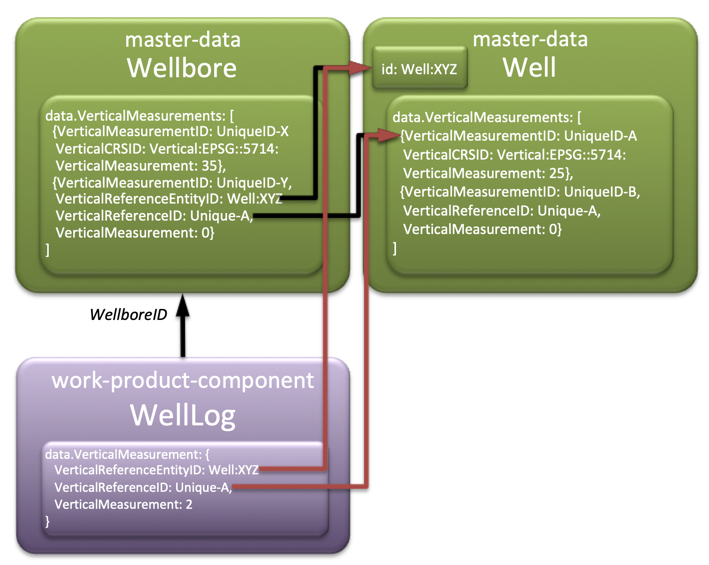

# Migration and Adoption of `osdu:wks:AbstractFacilityVerticalMeasurement:1.0.0`

[`AbstractFacilityVerticalMeasurement:1.0.0`](../../../E-R/abstract/AbstractFacilityVerticalMeasurement.1.0.0.md) has
been augmented (in-place due to previous schema status DEVELOPMENT) with a new property `VerticalReferenceEntityID`,
which indicates where the `data.VerticalMeasurements[]` array element with `VerticalReferenceID` is found.

The new property has the following description: _This relationship identifies the entity (aka record) in which the
VerticalReferenceID is found; It could be a different OSDU entity or a self-reference. For example, a Wellbore
VerticalMeasurement may reference a member of a VerticalMeasurements[] array in its parent Well record. Alternatively,
VerticalReferenceEntityID may be populated with the ID of its own Wellbore record to make explicit that
VerticalReferenceID is intended to be found in this record, not another._

The relationships are exemplified by the following figure:

## Case 1: No References

In case of vertical measurement definitions without any references to external `data.VerticalMeasurements[]` members 
then **_no migration is required_**.

## Case 2: Internal References

In case of vertical measurement definitions with internal references, i.e., `VerticalReferenceID` referring to members 
in the same record, no mandatory migration is required, however, for clarity it is **_recommended to populate_** the 
`VerticalReferenceEntityID` with the record `id`, followed by the version separator colon.

## Case 3: External References, Migration

In case of vertical measurement definitions with internal references, i.e., `VerticalReferenceID` referring to members 
in another record, e.g., a `VerticalReferenceID` in a WellLog's `data.VerticalMeasurement` that refers to an element in 
`data.VerticalMeasurements[]` parent Well, then the `VerticalReferenceEntityID` relationship **_must be populated_** with the 
Well's `id`.

Further guidance is provided in the [Schema Usage Guide](../../Chapters/03-VerticalMeasurements.md#34-recommendations-best-practice).

---

# Links

* [Back to Milestone](README.md)
* [Back to Migration Guides](../README.md)
* [Back to Guides](../../README.md)
