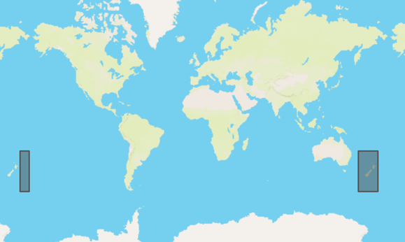

<a name="TOC"></a>

[[_TOC_]]

# Migration to `osdu:wks:reference-data--CoordinateTransformation:1.1.0`

Migrating  [`osdu:wks:reference-data--CoordinateTransformation:1.0.0`](../../../E-R/reference-data/CoordinateTransformation.1.0.0.md)
to [`osdu:wks:reference-data--CoordinateTransformation:1.1.0`](../../../E-R/reference-data/CoordinateTransformation.1.1.0.md)
means adding one new property `data.Wgs84Coordinates`. OSDU reference values will populate this.

## New Property for CoordinateTransformation:1.1.0

| Property             | Value Type                | Description                                                                                                                                                                                                                                                                                                                                                                                                                       | Migration Instructions                                                                                                                                             |
|----------------------|---------------------------|-----------------------------------------------------------------------------------------------------------------------------------------------------------------------------------------------------------------------------------------------------------------------------------------------------------------------------------------------------------------------------------------------------------------------------------|--------------------------------------------------------------------------------------------------------------------------------------------------------------------|
| data.Wgs84Coordinate | AbstractFeatureCollection | The 2-dimensional bounding box derived from the extent (Polygon or MultiPolygon) based on WGS 84 (EPSG:4326). The schema of this substructure is identical to the GeoJSON FeatureCollection https://geojson.org/schema/FeatureCollection.json. The coordinate sequence follows GeoJSON standard, i.e. longitude, latitude. CoordinateTransformations with an extent crossing the anti-meridian are represented by a MultiPolygon. | Extent derived bounding box, provided for the OSDU example CRSs and CTs                                                                                            |

[Back to TOC](#TOC)

## Polygons

data.Wgs84Coordinate will for most cases contain a FeatureCollection with one Polygon box, for extents crossing the
anti-meridian a MultiPolygon is used. The latter case is illustrated below.



<details><summary>Example for a BoundCRS with its bounding box crossing the anti-meridian <code>BoundProjected:EPSG::3851_EPSG::1565</code></summary>

```json
{
  "PreferredUsage": {
    "Extent": {
      "AuthorityCode": {
        "Authority": "EPSG",
        "Code": 3593
      },
      "BoundingBoxEastBoundLongitude": -171.2,
      "BoundingBoxNorthBoundLatitude": -25.88,
      "BoundingBoxSouthBoundLatitude": -55.95,
      "BoundingBoxWestBoundLongitude": 160.6,
      "Description": "New Zealand - offshore.",
      "Name": "New Zealand - offshore"
    }
  },
  "Wgs84Coordinates": {
    "type": "FeatureCollection",
    "features": [
      {
        "type": "Feature",
        "properties": {},
        "geometry": {
          "type": "MultiPolygon",
          "coordinates": [
            [
              [
                [
                  160.6,
                  -55.95
                ],
                [
                  180.0,
                  -55.95
                ],
                [
                  180.0,
                  -25.88
                ],
                [
                  160.6,
                  -25.88
                ],
                [
                  160.6,
                  -55.95
                ]
              ],
              [
                [
                  -180.0,
                  -55.95
                ],
                [
                  -171.2,
                  -55.95
                ],
                [
                  -171.2,
                  -25.88
                ],
                [
                  -180.0,
                  -25.88
                ],
                [
                  -180.0,
                  -55.95
                ]
              ]
            ]
          ]
        }
      }
    ]
  }
}
```

</details>

[Back to TOC](#TOC)

---

# Links

* [Back to Milestone](README.md)
* [Back to Migration Guides](../README.md)
* [Back to Guides](../../README.md)