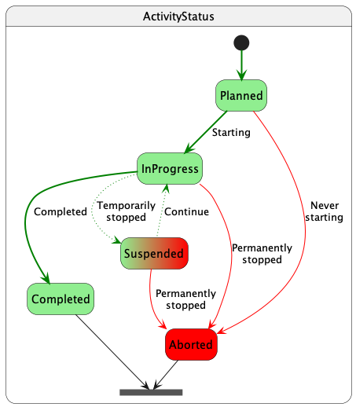

[[_TOC_]]

# Migration to `osdu:wks:work-product-component--Activity:1.1.0`

A new property is added to record the history of `ActivityStates[]` and — for convenience — the `LatestActivityState`
status of an activity:

| Cumulative Name                                                                                                      | Value Type                                                                                                                                                               | Description                                                                                                                                                                                                                                                          | Migration Instructions            |
|----------------------------------------------------------------------------------------------------------------------|--------------------------------------------------------------------------------------------------------------------------------------------------------------------------|----------------------------------------------------------------------------------------------------------------------------------------------------------------------------------------------------------------------------------------------------------------------|-----------------------------------|
| _data.ActivityStates[]_                                                                                              | _[AbstractWPCActivity.1.1.0](../../../E-R/abstract/AbstractWPCActivity.1.1.0.md) [AbstractActivityState.1.0.0](../../../E-R/abstract/AbstractActivityState.1.0.0.md)_    | _The (non-overlapping) historical activity states and effective start and termination dates. The last state is replicated in the single LastActivityState for simpler queries. Fragment Description: One step/interval in an Activity's or ProjectActivity's state._ | New property, no action required. |
| data.ActivityStates[].EffectiveDateTime                                                                              | string [AbstractWPCActivity.1.1.0](../../../E-R/abstract/AbstractWPCActivity.1.1.0.md) [AbstractActivityState.1.0.0](../../../E-R/abstract/AbstractActivityState.1.0.0.md) | The date and time at which the activity status becomes effective.                                                                                                                                                                                                    | New property, no action required. |
| data.ActivityStates[].TerminationDateTime                                                                            | string [AbstractWPCActivity.1.1.0](../../../E-R/abstract/AbstractWPCActivity.1.1.0.md) [AbstractActivityState.1.0.0](../../../E-R/abstract/AbstractActivityState.1.0.0.md)           | The date and time at which the activity status is no longer in effect For still effective activity states, the TerminationDateTime is left absent. For zero-duration intervals (events), the TerminationDateTime set to the same value as EffectiveDateTime.         | New property, no action required. |
| data.ActivityStates[].ActivityStatusID &rarr; [ActivityStatus](../../../E-R/reference-data/ActivityStatus.1.0.0.md)  | [AbstractWPCActivity.1.1.0](../../../E-R/abstract/AbstractWPCActivity.1.1.0.md) [AbstractActivityState.1.0.0](../../../E-R/abstract/AbstractActivityState.1.0.0.md)      | The ActivityStatus is a set of major activity phases that are significant to business stakeholders.                                                                                                                                                                  | New property, no action required. |
| data.ActivityStates[].Remark                                                                                         | string [AbstractWPCActivity.1.1.0](../../../E-R/abstract/AbstractWPCActivity.1.1.0.md) [AbstractActivityState.1.0.0](../../../E-R/abstract/AbstractActivityState.1.0.0.md) | An optional remark associated with the ActivityStatus and time interval.                                                                                                                                                                                             | New property, no action required. |
| _data.LastActivityState_                                                                                             | _[AbstractWPCActivity.1.1.0](../../../E-R/abstract/AbstractWPCActivity.1.1.0.md) [AbstractActivityState.1.0.0](../../../E-R/abstract/AbstractActivityState.1.0.0.md)_    | _The current or last state this activity transitioned to. It is a copy of the last element in ActivityStates[]. Fragment Description: One step/interval in an Activity's or ProjectActivity's state._                                                                | New property, no action required. |
| data.LastActivityState.EffectiveDateTime                                                                             | string [AbstractWPCActivity.1.1.0](../../../E-R/abstract/AbstractWPCActivity.1.1.0.md) [AbstractActivityState.1.0.0](../../../E-R/abstract/AbstractActivityState.1.0.0.md) | The date and time at which the activity status becomes effective.                                                                                                                                                                                                    | New property, no action required. |
| data.LastActivityState.TerminationDateTime                                                                           | string [AbstractWPCActivity.1.1.0](../../../E-R/abstract/AbstractWPCActivity.1.1.0.md) [AbstractActivityState.1.0.0](../../../E-R/abstract/AbstractActivityState.1.0.0.md) | The date and time at which the activity status is no longer in effect For still effective activity states, the TerminationDateTime is left absent. For zero-duration intervals (events), the TerminationDateTime set to the same value as EffectiveDateTime.         | New property, no action required. |
| data.LastActivityState.ActivityStatusID &rarr; [ActivityStatus](../../../E-R/reference-data/ActivityStatus.1.0.0.md) | [AbstractWPCActivity.1.1.0](../../../E-R/abstract/AbstractWPCActivity.1.1.0.md) [AbstractActivityState.1.0.0](../../../E-R/abstract/AbstractActivityState.1.0.0.md)      | The ActivityStatus is a set of major activity phases that are significant to business stakeholders.                                                                                                                                                                  | New property, no action required. |
| data.LastActivityState.Remark                                                                                        | string [AbstractWPCActivity.1.1.0](../../../E-R/abstract/AbstractWPCActivity.1.1.0.md) [AbstractActivityState.1.0.0](../../../E-R/abstract/AbstractActivityState.1.0.0.md) | An optional remark associated with the ActivityStatus and time interval.                                                                                                                                                                                             | New property, no action required. |

There is really no way in hindsight what kind of state the activity instances went through or finally completed with. No
migration without external knowledge.

The following state transitions are possible:

[Back to TOC](#TOC)

---

# Links

* [Back to Milestone](README.md)
* [Back to Migration Guides](../README.md)
* [Back to Guides](../../README.md)
