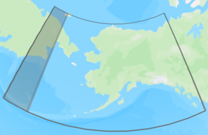
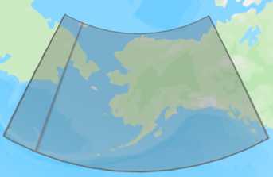

[[_TOC_]]

# Migration to `osdu:wks:reference-data--CoordinateReferenceSystem:1.1.0`

Content changes (schema unchanged) [osdu:wks:reference-data--CoordinateReferenceSystem:1.1.0](../../../E-R/reference-data/CoordinateReferenceSystem.1.1.0.md) are listed below.

1. Correction of malformed GeoJSON `Wgs84Coordinates`:
    * CoordinateReferenceSystems extents, which cross the anti-meridian, must be split into two polygons. The resulting
      MultiPolygon data were however shipped as single polygon with two rings, where the second ring was mistaken as an
      interior wing (hole), which was outside the exterior ring.   The issue is illustrated by CRS
      Projected:EPSG::2964 "NAD27 / Alaska Albers" below.  
      
    * The records containing MultiPolygon extents have been updated/corrected with a MultiPolygon containing two
      individual polygons, see below.  
      
2. When regenerating the CoordinateReferenceSystem manifest, the content was updated to the IOGP version 12.022 dated
   2025-08-29, see https://apps.epsg.org/api/v1/VersionHistory/392.

[//]: # "The Schema property change table contains manual comments, which must be protected? (Yes/No): No"
[//]: # "Please do not add any comments below this line. The following lines are auto-generated."

# Schema Changes

**_No Schema Changes._**

[//]: # "End of section Schema Changes"

# Reference Data Changes

| `id` | Name | Description | Change Notes |
| ----- | ----- | ----- | ----- |
| partition-id:reference-data--CoordinateReferenceSystem:BoundGeographic2D:EPSG::4141_EPSG::1073 | Israel 1993 * SoI-Isr [4141,1073] | No Description | Changes in PreferredUsage, RevisionDate, Usages |
| partition-id:reference-data--CoordinateReferenceSystem:BoundGeographic2D:EPSG::4149_EPSG::1766 | CH1903 * BfL-CH 2 [4149,1766] | No Description | Changes in PreferredUsage, RevisionDate, Usages, Wgs84Coordinates |
| partition-id:reference-data--CoordinateReferenceSystem:BoundGeographic2D:EPSG::4167_EPSG::1565 | NZGD2000 * OSG-Nzl [4167,1565] | No Description | Changes in RevisionDate, Wgs84Coordinates |
| partition-id:reference-data--CoordinateReferenceSystem:BoundGeographic2D:EPSG::4230_EPSG::1075 | ED50 * TPAO-Tur [4230,1075] | No Description | Changes in PreferredUsage, RevisionDate, Usages |
| partition-id:reference-data--CoordinateReferenceSystem:BoundGeographic2D:EPSG::4258_EPSG::1149 | ETRS89 * EPSG-eur [4258,1149] | No Description | Changes in PreferredUsage, RevisionDate, Usages, Wgs84Coordinates |
| partition-id:reference-data--CoordinateReferenceSystem:BoundGeographic2D:EPSG::4267_EPSG::15864 | NAD27 * OGP-Usa AK [4267,15864] | No Description | Changes in RevisionDate, Wgs84Coordinates |
| partition-id:reference-data--CoordinateReferenceSystem:BoundGeographic2D:EPSG::4281_EPSG::1074 | Palestine 1923 * EPSG-Isr [4281,1074] | No Description | Changes in PreferredUsage, RevisionDate, Usages |
| partition-id:reference-data--CoordinateReferenceSystem:BoundGeographic2D:EPSG::4281_EPSG::8650 | Palestine 1923 * SoI-Isr [4281,8650] | No Description | Changes in PreferredUsage, RevisionDate, Usages |
| partition-id:reference-data--CoordinateReferenceSystem:BoundGeographic2D:EPSG::4284_EPSG::1254 | Pulkovo 1942 * DMA-Rus [4284,1254] | No Description | Changes in RevisionDate, Wgs84Coordinates |
| partition-id:reference-data--CoordinateReferenceSystem:BoundGeographic2D:EPSG::4284_EPSG::1291 | Pulkovo 1942 * NIMA-Kaz [4284,1291] | No Description | Changes in PreferredUsage, RevisionDate, Usages |
| partition-id:reference-data--CoordinateReferenceSystem:BoundGeographic2D:EPSG::4284_EPSG::15865 | Pulkovo 1942 * OGP-Rus [4284,15865] | No Description | Changes in RevisionDate, Wgs84Coordinates |
| partition-id:reference-data--CoordinateReferenceSystem:BoundGeographic2D:EPSG::4284_EPSG::5044 | Pulkovo 1942 * GOST-Rus 2008 [4284,5044] | No Description | Changes in RevisionDate, Wgs84Coordinates |
| partition-id:reference-data--CoordinateReferenceSystem:BoundGeographic2D:EPSG::4301_EPSG::1230 | Tokyo * DMA-Jpn Kor [4301,1230] | No Description | Changes in PreferredUsage, RevisionDate, Usages |
| partition-id:reference-data--CoordinateReferenceSystem:BoundGeographic2D:EPSG::4301_EPSG::15484 | Tokyo * OGP-Jpn [4301,15484] | No Description | Changes in PreferredUsage, RevisionDate, Usages |
| partition-id:reference-data--CoordinateReferenceSystem:BoundGeographic2D:EPSG::4618_EPSG::1867 | SAD69 * DMA-Bra [4618,1867] | No Description | Changes in PreferredUsage, RevisionDate, Usages, Wgs84Coordinates |
| partition-id:reference-data--CoordinateReferenceSystem:BoundGeographic2D:EPSG::4747_EPSG::15879 | GR96 * OGP-Grl [4747,15879] | No Description | Changes in PreferredUsage, RevisionDate, Usages |
| partition-id:reference-data--CoordinateReferenceSystem:BoundProjected:EPSG::2039_EPSG::1073 | Israel 1993 * SoI-Isr / Israeli TM Grid [2039,1073] | No Description | Changes in PreferredUsage, RevisionDate, Usages |
| partition-id:reference-data--CoordinateReferenceSystem:BoundProjected:EPSG::21781_EPSG::1766 | CH1903 * BfL-CH 2 / LV03 [21781,1766] | No Description | Changes in PreferredUsage, RevisionDate, Usages, Wgs84Coordinates |
| partition-id:reference-data--CoordinateReferenceSystem:BoundProjected:EPSG::21896_EPSG::1597 | Bogota 1975 * BP-Col CusCup / Colombia West zone [21896,1597] | No Description | Changes in PreferredUsage, RevisionDate, Usages |
| partition-id:reference-data--CoordinateReferenceSystem:BoundProjected:EPSG::21897_EPSG::1125 | Bogota 1975 * DMA-Col / Colombia Bogota zone [21897,1125] | No Description | Changes in PreferredUsage, RevisionDate, Usages |
| partition-id:reference-data--CoordinateReferenceSystem:BoundProjected:EPSG::21898_EPSG::1125 | Bogota 1975 * DMA-Col / Colombia East Central zone [21898,1125] | No Description | Changes in PreferredUsage, RevisionDate, Usages |
| partition-id:reference-data--CoordinateReferenceSystem:BoundProjected:EPSG::2205_EPSG::1188 | NAD83 * DMA-N Am / Kentucky North [2205,1188] | No Description | Changes in Projection, RevisionDate |
| partition-id:reference-data--CoordinateReferenceSystem:BoundProjected:EPSG::2227_EPSG::1188 | NAD83 * DMA-N Am / California zone 3 (ftUS) [2227,1188] | No Description | Changes in Projection, RevisionDate |
| partition-id:reference-data--CoordinateReferenceSystem:BoundProjected:EPSG::2229_EPSG::1188 | NAD83 * DMA-N Am / California zone 5 (ftUS) [2229,1188] | No Description | Changes in Projection, RevisionDate |
| partition-id:reference-data--CoordinateReferenceSystem:BoundProjected:EPSG::2231_EPSG::1188 | NAD83 * DMA-N Am / Colorado North (ftUS) [2231,1188] | No Description | Changes in Projection, RevisionDate |
| partition-id:reference-data--CoordinateReferenceSystem:BoundProjected:EPSG::2254_EPSG::1188 | NAD83 * DMA-N Am / Mississippi East (ftUS) [2254,1188] | No Description | Changes in Projection, RevisionDate |
| partition-id:reference-data--CoordinateReferenceSystem:BoundProjected:EPSG::2271_EPSG::1188 | NAD83 * DMA-N Am / Pennsylvania North (ftUS) [2271,1188] | No Description | Changes in Projection, RevisionDate |
| partition-id:reference-data--CoordinateReferenceSystem:BoundProjected:EPSG::2272_EPSG::1188 | NAD83 * DMA-N Am / Pennsylvania South (ftUS) [2272,1188] | No Description | Changes in Projection, RevisionDate |
| partition-id:reference-data--CoordinateReferenceSystem:BoundProjected:EPSG::2276_EPSG::1188 | NAD83 * DMA-N Am / Texas North Central (ftUS) [2276,1188] | No Description | Changes in Projection, RevisionDate |
| partition-id:reference-data--CoordinateReferenceSystem:BoundProjected:EPSG::2277_EPSG::1188 | NAD83 * DMA-N Am / Texas Central (ftUS) [2277,1188] | No Description | Changes in Projection, RevisionDate |
| partition-id:reference-data--CoordinateReferenceSystem:BoundProjected:EPSG::2278_EPSG::1188 | NAD83 * DMA-N Am / Texas South Central (ftUS) [2278,1188] | No Description | Changes in Projection, RevisionDate |
| partition-id:reference-data--CoordinateReferenceSystem:BoundProjected:EPSG::2279_EPSG::1188 | NAD83 * DMA-N Am / Texas South (ftUS) [2279,1188] | No Description | Changes in Projection, RevisionDate |
| partition-id:reference-data--CoordinateReferenceSystem:BoundProjected:EPSG::2285_EPSG::1188 | NAD83 * DMA-N Am / Washington North (ftUS) [2285,1188] | No Description | Changes in Projection, RevisionDate |
| partition-id:reference-data--CoordinateReferenceSystem:BoundProjected:EPSG::2286_EPSG::1188 | NAD83 * DMA-N Am / Washington South (ftUS) [2286,1188] | No Description | Changes in Projection, RevisionDate |
| partition-id:reference-data--CoordinateReferenceSystem:BoundProjected:EPSG::23031_EPSG::1133 | ED50 * DMA-mean / UTM zone 31N [23031,1133] | No Description | Changes in PreferredUsage, RevisionDate, Usages, Wgs84Coordinates |
| partition-id:reference-data--CoordinateReferenceSystem:BoundProjected:EPSG::23031_EPSG::1134 | ED50 * DMA-cenEur / UTM zone 31N [23031,1134] | No Description | Changes in PreferredUsage, RevisionDate, Usages, Wgs84Coordinates |
| partition-id:reference-data--CoordinateReferenceSystem:BoundProjected:EPSG::23031_EPSG::1138 | ED50 * DMA-Irl Gbr / UTM zone 31N [23031,1138] | No Description | Changes in PreferredUsage, RevisionDate, Usages |
| partition-id:reference-data--CoordinateReferenceSystem:BoundProjected:EPSG::23031_EPSG::1142 | ED50 * DMA-Ita Sard / UTM zone 31N [23031,1142] | No Description | Changes in PreferredUsage, RevisionDate, Usages, Wgs84Coordinates |
| partition-id:reference-data--CoordinateReferenceSystem:BoundProjected:EPSG::23031_EPSG::1145 | ED50 * DMA-Prt Esp / UTM zone 31N [23031,1145] | No Description | Changes in PreferredUsage, RevisionDate, Usages |
| partition-id:reference-data--CoordinateReferenceSystem:BoundProjected:EPSG::23031_EPSG::1275 | ED50 * IGN-Fra / UTM zone 31N [23031,1275] | No Description | Changes in PreferredUsage, RevisionDate, Usages, Wgs84Coordinates |
| partition-id:reference-data--CoordinateReferenceSystem:BoundProjected:EPSG::23031_EPSG::1311 | ED50 * UKOOA-CO / UTM zone 31N [23031,1311] | No Description | Changes in PreferredUsage, RevisionDate, Usages, Wgs84Coordinates |
| partition-id:reference-data--CoordinateReferenceSystem:BoundProjected:EPSG::23031_EPSG::1612 | ED50 * EPSG-Nor N62 2001 / UTM zone 31N [23031,1612] | No Description | Changes in PreferredUsage, RevisionDate, Usages, Wgs84Coordinates |
| partition-id:reference-data--CoordinateReferenceSystem:BoundProjected:EPSG::23031_EPSG::1613 | ED50 * EPSG-Nor S62 2001 / UTM zone 31N [23031,1613] | No Description | Changes in PreferredUsage, RevisionDate, Usages, Wgs84Coordinates |
| partition-id:reference-data--CoordinateReferenceSystem:BoundProjected:EPSG::23031_EPSG::1627 | ED50 * EPSG-Dnk / UTM zone 31N [23031,1627] | No Description | Changes in PreferredUsage, RevisionDate, Usages, Wgs84Coordinates |
| partition-id:reference-data--CoordinateReferenceSystem:BoundProjected:EPSG::23031_EPSG::1633 | ED50 * EPSG-Esp / UTM zone 31N [23031,1633] | No Description | Changes in PreferredUsage, RevisionDate, Usages |
| partition-id:reference-data--CoordinateReferenceSystem:BoundProjected:EPSG::23031_EPSG::1810 | ED50 * wgc72-Egy / UTM zone 31N [23031,1810] | No Description | Changes in PreferredUsage, RevisionDate, Usages, Wgs84Coordinates |
| partition-id:reference-data--CoordinateReferenceSystem:BoundProjected:EPSG::23032_EPSG::1133 | ED50 * DMA-mean / UTM zone 32N [23032,1133] | No Description | Changes in PreferredUsage, RevisionDate, Usages, Wgs84Coordinates |
| partition-id:reference-data--CoordinateReferenceSystem:BoundProjected:EPSG::23032_EPSG::1612 | ED50 * EPSG-Nor N62 2001 / UTM zone 32N [23032,1612] | No Description | Changes in PreferredUsage, RevisionDate, Usages, Wgs84Coordinates |
| partition-id:reference-data--CoordinateReferenceSystem:BoundProjected:EPSG::23032_EPSG::1627 | ED50 * EPSG-Dnk / UTM zone 32N [23032,1627] | No Description | Changes in PreferredUsage, RevisionDate, Usages, Wgs84Coordinates |
| partition-id:reference-data--CoordinateReferenceSystem:BoundProjected:EPSG::23032_EPSG::1810 | ED50 * wgc72-Egy / UTM zone 32N [23032,1810] | No Description | Changes in PreferredUsage, RevisionDate, Usages, Wgs84Coordinates |
| partition-id:reference-data--CoordinateReferenceSystem:BoundProjected:EPSG::23032_EPSG::8047 | ED50 * NMA-Nor N65 1991 / UTM zone 32N [23032,8047] | No Description | Changes in PreferredUsage, RevisionDate, Usages, Wgs84Coordinates |
| partition-id:reference-data--CoordinateReferenceSystem:BoundProjected:EPSG::23033_EPSG::1627 | ED50 * EPSG-Dnk / UTM zone 33N [23033,1627] | No Description | Changes in PreferredUsage, RevisionDate, Usages, Wgs84Coordinates |
| partition-id:reference-data--CoordinateReferenceSystem:BoundProjected:EPSG::23035_EPSG::1075 | ED50 * TPAO-Tur / UTM zone 35N [23035,1075] | No Description | Changes in PreferredUsage, RevisionDate, Usages |
| partition-id:reference-data--CoordinateReferenceSystem:BoundProjected:EPSG::23036_EPSG::1075 | ED50 * TPAO-Tur / UTM zone 36N [23036,1075] | No Description | Changes in PreferredUsage, RevisionDate, Usages |
| partition-id:reference-data--CoordinateReferenceSystem:BoundProjected:EPSG::23037_EPSG::1075 | ED50 * TPAO-Tur / UTM zone 37N [23037,1075] | No Description | Changes in PreferredUsage, RevisionDate, Usages |
| partition-id:reference-data--CoordinateReferenceSystem:BoundProjected:EPSG::23095_EPSG::1311 | ED50 * UKOOA-CO / TM 5 NE [23095,1311] | No Description | Changes in PreferredUsage, RevisionDate, Usages, Wgs84Coordinates |
| partition-id:reference-data--CoordinateReferenceSystem:BoundProjected:EPSG::23095_EPSG::1627 | ED50 * EPSG-Dnk / TM 5 NE [23095,1627] | No Description | Changes in PreferredUsage, RevisionDate, Usages, Wgs84Coordinates |
| partition-id:reference-data--CoordinateReferenceSystem:BoundProjected:EPSG::25828_EPSG::1149 | ETRS89 * EPSG-eur / UTM zone 28N [25828,1149] | No Description | Changes in PreferredUsage, RevisionDate, Usages |
| partition-id:reference-data--CoordinateReferenceSystem:BoundProjected:EPSG::25829_EPSG::1149 | ETRS89 * EPSG-eur / UTM zone 29N [25829,1149] | No Description | Changes in PreferredUsage, RevisionDate, Usages, Wgs84Coordinates |
| partition-id:reference-data--CoordinateReferenceSystem:BoundProjected:EPSG::25830_EPSG::1149 | ETRS89 * EPSG-eur / UTM zone 30N [25830,1149] | No Description | Changes in PreferredUsage, RevisionDate, Usages, Wgs84Coordinates |
| partition-id:reference-data--CoordinateReferenceSystem:BoundProjected:EPSG::25831_EPSG::1149 | ETRS89 * EPSG-eur / UTM zone 31N [25831,1149] | No Description | Changes in PreferredUsage, RevisionDate, Usages |
| partition-id:reference-data--CoordinateReferenceSystem:BoundProjected:EPSG::25832_EPSG::1149 | ETRS89 * EPSG-eur / UTM zone 32N [25832,1149] | No Description | Changes in PreferredUsage, RevisionDate, Usages, Wgs84Coordinates |
| partition-id:reference-data--CoordinateReferenceSystem:BoundProjected:EPSG::25833_EPSG::1149 | ETRS89 * EPSG-eur / UTM zone 33N [25833,1149] | No Description | Changes in PreferredUsage, RevisionDate, Usages, Wgs84Coordinates |
| partition-id:reference-data--CoordinateReferenceSystem:BoundProjected:EPSG::25835_EPSG::1149 | ETRS89 * EPSG-eur / UTM zone 35N [25835,1149] | No Description | Changes in PreferredUsage, RevisionDate, Usages, Wgs84Coordinates |
| partition-id:reference-data--CoordinateReferenceSystem:BoundProjected:EPSG::26729_EPSG::15851 | NAD27 * OGP-Usa Conus / Alabama East [26729,15851] | No Description | Changes in PreferredUsage, RevisionDate, Usages |
| partition-id:reference-data--CoordinateReferenceSystem:BoundProjected:EPSG::26771_EPSG::15851 | NAD27 * OGP-Usa Conus / Illinois East [26771,15851] | No Description | Changes in PreferredUsage, RevisionDate, Usages, Wgs84Coordinates |
| partition-id:reference-data--CoordinateReferenceSystem:BoundProjected:EPSG::26772_EPSG::15851 | NAD27 * OGP-Usa Conus / Illinois West [26772,15851] | No Description | Changes in PreferredUsage, RevisionDate, Usages, Wgs84Coordinates |
| partition-id:reference-data--CoordinateReferenceSystem:BoundProjected:EPSG::26774_EPSG::15851 | NAD27 * OGP-Usa Conus / Indiana West [26774,15851] | No Description | Changes in PreferredUsage, RevisionDate, Usages, Wgs84Coordinates |
| partition-id:reference-data--CoordinateReferenceSystem:BoundProjected:EPSG::26776_EPSG::15851 | NAD27 * OGP-Usa Conus / Iowa South [26776,15851] | No Description | Changes in PreferredUsage, RevisionDate, Usages, Wgs84Coordinates |
| partition-id:reference-data--CoordinateReferenceSystem:BoundProjected:EPSG::26852_EPSG::1188 | NAD83 * DMA-N Am / Nebraska (ftUS) [26852,1188] | No Description | Changes in Projection, RevisionDate |
| partition-id:reference-data--CoordinateReferenceSystem:BoundProjected:EPSG::26929_EPSG::1188 | NAD83 * DMA-N Am / Alabama East [26929,1188] | No Description | Changes in PreferredUsage, Projection, RevisionDate, Usages |
| partition-id:reference-data--CoordinateReferenceSystem:BoundProjected:EPSG::26930_EPSG::1188 | NAD83 * DMA-N Am / Alabama West [26930,1188] | No Description | Changes in Projection, RevisionDate |
| partition-id:reference-data--CoordinateReferenceSystem:BoundProjected:EPSG::26934_EPSG::1188 | NAD83 * DMA-N Am / Alaska zone 4 [26934,1188] | No Description | Changes in Projection, RevisionDate |
| partition-id:reference-data--CoordinateReferenceSystem:BoundProjected:EPSG::26935_EPSG::1188 | NAD83 * DMA-N Am / Alaska zone 5 [26935,1188] | No Description | Changes in Projection, RevisionDate |
| partition-id:reference-data--CoordinateReferenceSystem:BoundProjected:EPSG::26941_EPSG::1188 | NAD83 * DMA-N Am / California zone 1 [26941,1188] | No Description | Changes in Projection, RevisionDate |
| partition-id:reference-data--CoordinateReferenceSystem:BoundProjected:EPSG::26942_EPSG::1188 | NAD83 * DMA-N Am / California zone 2 [26942,1188] | No Description | Changes in Projection, RevisionDate |
| partition-id:reference-data--CoordinateReferenceSystem:BoundProjected:EPSG::26943_EPSG::1188 | NAD83 * DMA-N Am / California zone 3 [26943,1188] | No Description | Changes in Projection, RevisionDate |
| partition-id:reference-data--CoordinateReferenceSystem:BoundProjected:EPSG::26944_EPSG::1188 | NAD83 * DMA-N Am / California zone 4 [26944,1188] | No Description | Changes in Projection, RevisionDate |
| partition-id:reference-data--CoordinateReferenceSystem:BoundProjected:EPSG::26945_EPSG::1188 | NAD83 * DMA-N Am / California zone 5 [26945,1188] | No Description | Changes in Projection, RevisionDate |
| partition-id:reference-data--CoordinateReferenceSystem:BoundProjected:EPSG::26946_EPSG::1188 | NAD83 * DMA-N Am / California zone 6 [26946,1188] | No Description | Changes in Projection, RevisionDate |
| partition-id:reference-data--CoordinateReferenceSystem:BoundProjected:EPSG::26948_EPSG::1188 | NAD83 * DMA-N Am / Arizona East [26948,1188] | No Description | Changes in Projection, RevisionDate |
| partition-id:reference-data--CoordinateReferenceSystem:BoundProjected:EPSG::26949_EPSG::1188 | NAD83 * DMA-N Am / Arizona Central [26949,1188] | No Description | Changes in Projection, RevisionDate |
| partition-id:reference-data--CoordinateReferenceSystem:BoundProjected:EPSG::26950_EPSG::1188 | NAD83 * DMA-N Am / Arizona West [26950,1188] | No Description | Changes in Projection, RevisionDate |
| partition-id:reference-data--CoordinateReferenceSystem:BoundProjected:EPSG::26953_EPSG::1188 | NAD83 * DMA-N Am / Colorado North [26953,1188] | No Description | Changes in Projection, RevisionDate |
| partition-id:reference-data--CoordinateReferenceSystem:BoundProjected:EPSG::26954_EPSG::1188 | NAD83 * DMA-N Am / Colorado Central [26954,1188] | No Description | Changes in Projection, RevisionDate |
| partition-id:reference-data--CoordinateReferenceSystem:BoundProjected:EPSG::26955_EPSG::1188 | NAD83 * DMA-N Am / Colorado South [26955,1188] | No Description | Changes in Projection, RevisionDate |
| partition-id:reference-data--CoordinateReferenceSystem:BoundProjected:EPSG::26958_EPSG::1188 | NAD83 * DMA-N Am / Florida East [26958,1188] | No Description | Changes in Projection, RevisionDate |
| partition-id:reference-data--CoordinateReferenceSystem:BoundProjected:EPSG::26959_EPSG::1188 | NAD83 * DMA-N Am / Florida West [26959,1188] | No Description | Changes in Projection, RevisionDate |
| partition-id:reference-data--CoordinateReferenceSystem:BoundProjected:EPSG::26960_EPSG::1188 | NAD83 * DMA-N Am / Florida North [26960,1188] | No Description | Changes in Projection, RevisionDate |
| partition-id:reference-data--CoordinateReferenceSystem:BoundProjected:EPSG::26966_EPSG::1188 | NAD83 * DMA-N Am / Georgia East [26966,1188] | No Description | Changes in Projection, RevisionDate |
| partition-id:reference-data--CoordinateReferenceSystem:BoundProjected:EPSG::26967_EPSG::1188 | NAD83 * DMA-N Am / Georgia West [26967,1188] | No Description | Changes in Projection, RevisionDate |
| partition-id:reference-data--CoordinateReferenceSystem:BoundProjected:EPSG::26975_EPSG::1188 | NAD83 * DMA-N Am / Iowa North [26975,1188] | No Description | Changes in Projection, RevisionDate |
| partition-id:reference-data--CoordinateReferenceSystem:BoundProjected:EPSG::26976_EPSG::1188 | NAD83 * DMA-N Am / Iowa South [26976,1188] | No Description | Changes in PreferredUsage, Projection, RevisionDate, Usages, Wgs84Coordinates |
| partition-id:reference-data--CoordinateReferenceSystem:BoundProjected:EPSG::26977_EPSG::1188 | NAD83 * DMA-N Am / Kansas North [26977,1188] | No Description | Changes in Projection, RevisionDate |
| partition-id:reference-data--CoordinateReferenceSystem:BoundProjected:EPSG::26978_EPSG::1188 | NAD83 * DMA-N Am / Kansas South [26978,1188] | No Description | Changes in Projection, RevisionDate |
| partition-id:reference-data--CoordinateReferenceSystem:BoundProjected:EPSG::26980_EPSG::1188 | NAD83 * DMA-N Am / Kentucky South [26980,1188] | No Description | Changes in Projection, RevisionDate |
| partition-id:reference-data--CoordinateReferenceSystem:BoundProjected:EPSG::26981_EPSG::1188 | NAD83 * DMA-N Am / Louisiana North [26981,1188] | No Description | Changes in Projection, RevisionDate |
| partition-id:reference-data--CoordinateReferenceSystem:BoundProjected:EPSG::26982_EPSG::1188 | NAD83 * DMA-N Am / Louisiana South [26982,1188] | No Description | Changes in Projection, RevisionDate |
| partition-id:reference-data--CoordinateReferenceSystem:BoundProjected:EPSG::26994_EPSG::1188 | NAD83 * DMA-N Am / Mississippi East [26994,1188] | No Description | Changes in Projection, RevisionDate |
| partition-id:reference-data--CoordinateReferenceSystem:BoundProjected:EPSG::26995_EPSG::1188 | NAD83 * DMA-N Am / Mississippi West [26995,1188] | No Description | Changes in Projection, RevisionDate |
| partition-id:reference-data--CoordinateReferenceSystem:BoundProjected:EPSG::28192_EPSG::1074 | Palestine 1923 * EPSG-Isr / Palestine Belt [28192,1074] | No Description | Changes in PreferredUsage, RevisionDate, Usages |
| partition-id:reference-data--CoordinateReferenceSystem:BoundProjected:EPSG::29192_EPSG::1867 | SAD69 * DMA-Bra / UTM zone 22S [29192,1867] | No Description | Changes in PreferredUsage, RevisionDate, Usages, Wgs84Coordinates |
| partition-id:reference-data--CoordinateReferenceSystem:BoundProjected:EPSG::29193_EPSG::1867 | SAD69 * DMA-Bra / UTM zone 23S [29193,1867] | No Description | Changes in PreferredUsage, RevisionDate, Usages, Wgs84Coordinates |
| partition-id:reference-data--CoordinateReferenceSystem:BoundProjected:EPSG::2964_EPSG::15864 | NAD27 * OGP-Usa AK / Alaska Albers [2964,15864] | No Description | Changes in RevisionDate, Wgs84Coordinates |
| partition-id:reference-data--CoordinateReferenceSystem:BoundProjected:EPSG::2966_EPSG::1188 | NAD83 * DMA-N Am / Indiana West (ftUS) [2966,1188] | No Description | Changes in PreferredUsage, Projection, RevisionDate, Usages, Wgs84Coordinates |
| partition-id:reference-data--CoordinateReferenceSystem:BoundProjected:EPSG::29872_EPSG::1852 | Timbalai 1948 * SSB-Mys E / RSO Borneo (ftSe) [29872,1852] | No Description | Changes in Projection, RevisionDate |
| partition-id:reference-data--CoordinateReferenceSystem:BoundProjected:EPSG::29873_EPSG::1228 | Timbalai 1948 * DMA-Borneo / RSO Borneo (m) [29873,1228] | No Description | Changes in Projection, RevisionDate |
| partition-id:reference-data--CoordinateReferenceSystem:BoundProjected:EPSG::29873_EPSG::1592 | Timbalai 1948 * BSP-Brn / RSO Borneo (m) [29873,1592] | No Description | Changes in Projection, RevisionDate |
| partition-id:reference-data--CoordinateReferenceSystem:BoundProjected:EPSG::29873_EPSG::1852 | Timbalai 1948 * SSB-Mys E / RSO Borneo (m) [29873,1852] | No Description | Changes in Projection, RevisionDate |
| partition-id:reference-data--CoordinateReferenceSystem:BoundProjected:EPSG::3034_EPSG::1149 | ETRS89-extended * EPSG-eur / LCC Europe [3034,1149] | No Description | Changes in PreferredUsage, RevisionDate, Usages, Wgs84Coordinates |
| partition-id:reference-data--CoordinateReferenceSystem:BoundProjected:EPSG::3093_EPSG::1305 | Tokyo * NIMA-Kor / UTM zone 52N [3093,1305] | No Description | Changes in PreferredUsage, RevisionDate, Usages |
| partition-id:reference-data--CoordinateReferenceSystem:BoundProjected:EPSG::3114_EPSG::15738 | MAGNA-SIRGAS * EPSG / Colombia Far West zone [3114,15738] | No Description | Changes in PreferredUsage, RevisionDate, Usages |
| partition-id:reference-data--CoordinateReferenceSystem:BoundProjected:EPSG::3115_EPSG::15738 | MAGNA-SIRGAS * EPSG / Colombia West zone [3115,15738] | No Description | Changes in PreferredUsage, RevisionDate, Usages |
| partition-id:reference-data--CoordinateReferenceSystem:BoundProjected:EPSG::3116_EPSG::15738 | MAGNA-SIRGAS * EPSG / Colombia Bogota zone [3116,15738] | No Description | Changes in PreferredUsage, RevisionDate, Usages, Wgs84Coordinates |
| partition-id:reference-data--CoordinateReferenceSystem:BoundProjected:EPSG::3117_EPSG::15738 | MAGNA-SIRGAS * EPSG / Colombia East Central zone [3117,15738] | No Description | Changes in PreferredUsage, RevisionDate, Usages |
| partition-id:reference-data--CoordinateReferenceSystem:BoundProjected:EPSG::3118_EPSG::15738 | MAGNA-SIRGAS * EPSG / Colombia East zone [3118,15738] | No Description | Changes in PreferredUsage, RevisionDate, Usages |
| partition-id:reference-data--CoordinateReferenceSystem:BoundProjected:EPSG::31466_EPSG::1777 | DHDN * EPSG-Deu W 3m / 3-degree Gauss-Kruger zone 2 [31466,1777] | No Description | Changes in PreferredUsage, RevisionDate, Usages, Wgs84Coordinates |
| partition-id:reference-data--CoordinateReferenceSystem:BoundProjected:EPSG::32064_EPSG::15851 | NAD27 * OGP-Usa Conus / BLM 14N (ftUS) [32064,15851] | No Description | Changes in PreferredUsage, Projection, RevisionDate, Usages |
| partition-id:reference-data--CoordinateReferenceSystem:BoundProjected:EPSG::32065_EPSG::15851 | NAD27 * OGP-Usa Conus / BLM 15N (ftUS) [32065,15851] | No Description | Changes in PreferredUsage, Projection, RevisionDate, Usages |
| partition-id:reference-data--CoordinateReferenceSystem:BoundProjected:EPSG::32066_EPSG::15851 | NAD27 * OGP-Usa Conus / BLM 16N (ftUS) [32066,15851] | No Description | Changes in PreferredUsage, Projection, RevisionDate, Usages |
| partition-id:reference-data--CoordinateReferenceSystem:BoundProjected:EPSG::32067_EPSG::15851 | NAD27 * OGP-Usa Conus / BLM 17N (ftUS) [32067,15851] | No Description | Changes in Projection, RevisionDate |
| partition-id:reference-data--CoordinateReferenceSystem:BoundProjected:EPSG::32099_EPSG::15851 | NAD27 * OGP-Usa Conus / Louisiana Offshore [32099,15851] | No Description | Changes in PreferredUsage, RevisionDate, Usages, Wgs84Coordinates |
| partition-id:reference-data--CoordinateReferenceSystem:BoundProjected:EPSG::32100_EPSG::1188 | NAD83 * DMA-N Am / Montana [32100,1188] | No Description | Changes in Projection, RevisionDate |
| partition-id:reference-data--CoordinateReferenceSystem:BoundProjected:EPSG::32104_EPSG::1188 | NAD83 * DMA-N Am / Nebraska [32104,1188] | No Description | Changes in Projection, RevisionDate |
| partition-id:reference-data--CoordinateReferenceSystem:BoundProjected:EPSG::32112_EPSG::1188 | NAD83 * DMA-N Am / New Mexico East [32112,1188] | No Description | Changes in Projection, RevisionDate |
| partition-id:reference-data--CoordinateReferenceSystem:BoundProjected:EPSG::32113_EPSG::1188 | NAD83 * DMA-N Am / New Mexico Central [32113,1188] | No Description | Changes in Projection, RevisionDate |
| partition-id:reference-data--CoordinateReferenceSystem:BoundProjected:EPSG::32114_EPSG::1188 | NAD83 * DMA-N Am / New Mexico West [32114,1188] | No Description | Changes in Projection, RevisionDate |
| partition-id:reference-data--CoordinateReferenceSystem:BoundProjected:EPSG::32120_EPSG::1188 | NAD83 * DMA-N Am / North Dakota North [32120,1188] | No Description | Changes in Projection, RevisionDate |
| partition-id:reference-data--CoordinateReferenceSystem:BoundProjected:EPSG::32121_EPSG::1188 | NAD83 * DMA-N Am / North Dakota South [32121,1188] | No Description | Changes in Projection, RevisionDate |
| partition-id:reference-data--CoordinateReferenceSystem:BoundProjected:EPSG::32122_EPSG::1188 | NAD83 * DMA-N Am / Ohio North [32122,1188] | No Description | Changes in Projection, RevisionDate |
| partition-id:reference-data--CoordinateReferenceSystem:BoundProjected:EPSG::32123_EPSG::1188 | NAD83 * DMA-N Am / Ohio South [32123,1188] | No Description | Changes in Projection, RevisionDate |
| partition-id:reference-data--CoordinateReferenceSystem:BoundProjected:EPSG::32124_EPSG::1188 | NAD83 * DMA-N Am / Oklahoma North [32124,1188] | No Description | Changes in Projection, RevisionDate |
| partition-id:reference-data--CoordinateReferenceSystem:BoundProjected:EPSG::32125_EPSG::1188 | NAD83 * DMA-N Am / Oklahoma South [32125,1188] | No Description | Changes in Projection, RevisionDate |
| partition-id:reference-data--CoordinateReferenceSystem:BoundProjected:EPSG::32128_EPSG::1188 | NAD83 * DMA-N Am / Pennsylvania North [32128,1188] | No Description | Changes in Projection, RevisionDate |
| partition-id:reference-data--CoordinateReferenceSystem:BoundProjected:EPSG::32133_EPSG::1188 | NAD83 * DMA-N Am / South Carolina [32133,1188] | No Description | Changes in Projection, RevisionDate |
| partition-id:reference-data--CoordinateReferenceSystem:BoundProjected:EPSG::32134_EPSG::1188 | NAD83 * DMA-N Am / South Dakota North [32134,1188] | No Description | Changes in Projection, RevisionDate |
| partition-id:reference-data--CoordinateReferenceSystem:BoundProjected:EPSG::32135_EPSG::1188 | NAD83 * DMA-N Am / South Dakota South [32135,1188] | No Description | Changes in Projection, RevisionDate |
| partition-id:reference-data--CoordinateReferenceSystem:BoundProjected:EPSG::32137_EPSG::1188 | NAD83 * DMA-N Am / Texas North [32137,1188] | No Description | Changes in Projection, RevisionDate |
| partition-id:reference-data--CoordinateReferenceSystem:BoundProjected:EPSG::32138_EPSG::1188 | NAD83 * DMA-N Am / Texas North Central [32138,1188] | No Description | Changes in Projection, RevisionDate |
| partition-id:reference-data--CoordinateReferenceSystem:BoundProjected:EPSG::32139_EPSG::1188 | NAD83 * DMA-N Am / Texas Central [32139,1188] | No Description | Changes in Projection, RevisionDate |
| partition-id:reference-data--CoordinateReferenceSystem:BoundProjected:EPSG::32140_EPSG::1188 | NAD83 * DMA-N Am / Texas South Central [32140,1188] | No Description | Changes in Projection, RevisionDate |
| partition-id:reference-data--CoordinateReferenceSystem:BoundProjected:EPSG::32141_EPSG::1188 | NAD83 * DMA-N Am / Texas South [32141,1188] | No Description | Changes in Projection, RevisionDate |
| partition-id:reference-data--CoordinateReferenceSystem:BoundProjected:EPSG::32142_EPSG::1188 | NAD83 * DMA-N Am / Utah North [32142,1188] | No Description | Changes in Projection, RevisionDate |
| partition-id:reference-data--CoordinateReferenceSystem:BoundProjected:EPSG::32143_EPSG::1188 | NAD83 * DMA-N Am / Utah Central [32143,1188] | No Description | Changes in Projection, RevisionDate |
| partition-id:reference-data--CoordinateReferenceSystem:BoundProjected:EPSG::32144_EPSG::1188 | NAD83 * DMA-N Am / Utah South [32144,1188] | No Description | Changes in Projection, RevisionDate |
| partition-id:reference-data--CoordinateReferenceSystem:BoundProjected:EPSG::32146_EPSG::1188 | NAD83 * DMA-N Am / Virginia North [32146,1188] | No Description | Changes in Projection, RevisionDate |
| partition-id:reference-data--CoordinateReferenceSystem:BoundProjected:EPSG::32147_EPSG::1188 | NAD83 * DMA-N Am / Virginia South [32147,1188] | No Description | Changes in Projection, RevisionDate |
| partition-id:reference-data--CoordinateReferenceSystem:BoundProjected:EPSG::32150_EPSG::1188 | NAD83 * DMA-N Am / West Virginia North [32150,1188] | No Description | Changes in Projection, RevisionDate |
| partition-id:reference-data--CoordinateReferenceSystem:BoundProjected:EPSG::32151_EPSG::1188 | NAD83 * DMA-N Am / West Virginia South [32151,1188] | No Description | Changes in Projection, RevisionDate |
| partition-id:reference-data--CoordinateReferenceSystem:BoundProjected:EPSG::32155_EPSG::1188 | NAD83 * DMA-N Am / Wyoming East [32155,1188] | No Description | Changes in Projection, RevisionDate |
| partition-id:reference-data--CoordinateReferenceSystem:BoundProjected:EPSG::32157_EPSG::1188 | NAD83 * DMA-N Am / Wyoming West Central [32157,1188] | No Description | Changes in Projection, RevisionDate |
| partition-id:reference-data--CoordinateReferenceSystem:BoundProjected:EPSG::32158_EPSG::1188 | NAD83 * DMA-N Am / Wyoming West [32158,1188] | No Description | Changes in Projection, RevisionDate |
| partition-id:reference-data--CoordinateReferenceSystem:BoundProjected:EPSG::32164_EPSG::1188 | NAD83 * DMA-N Am / BLM 14N (ftUS) [32164,1188] | No Description | Changes in PreferredUsage, Projection, RevisionDate, Usages |
| partition-id:reference-data--CoordinateReferenceSystem:BoundProjected:EPSG::32165_EPSG::1188 | NAD83 * DMA-N Am / BLM 15N (ftUS) [32165,1188] | No Description | Changes in PreferredUsage, Projection, RevisionDate, Usages |
| partition-id:reference-data--CoordinateReferenceSystem:BoundProjected:EPSG::32166_EPSG::1188 | NAD83 * DMA-N Am / BLM 16N (ftUS) [32166,1188] | No Description | Changes in PreferredUsage, Projection, RevisionDate, Usages |
| partition-id:reference-data--CoordinateReferenceSystem:BoundProjected:EPSG::32167_EPSG::1188 | NAD83 * DMA-N Am / BLM 17N (ftUS) [32167,1188] | No Description | Changes in Projection, RevisionDate |
| partition-id:reference-data--CoordinateReferenceSystem:BoundProjected:EPSG::3338_EPSG::1188 | NAD83 * DMA-N Am / Alaska Albers [3338,1188] | No Description | Changes in Projection, RevisionDate |
| partition-id:reference-data--CoordinateReferenceSystem:BoundProjected:EPSG::3419_EPSG::1188 | NAD83 * DMA-N Am / Kansas North (ftUS) [3419,1188] | No Description | Changes in Projection, RevisionDate |
| partition-id:reference-data--CoordinateReferenceSystem:BoundProjected:EPSG::3420_EPSG::1188 | NAD83 * DMA-N Am / Kansas South (ftUS) [3420,1188] | No Description | Changes in Projection, RevisionDate |
| partition-id:reference-data--CoordinateReferenceSystem:BoundProjected:EPSG::3435_EPSG::1188 | NAD83 * DMA-N Am / Illinois East (ftUS) [3435,1188] | No Description | Changes in PreferredUsage, Projection, RevisionDate, Usages, Wgs84Coordinates |
| partition-id:reference-data--CoordinateReferenceSystem:BoundProjected:EPSG::3436_EPSG::1188 | NAD83 * DMA-N Am / Illinois West (ftUS) [3436,1188] | No Description | Changes in PreferredUsage, Projection, RevisionDate, Usages, Wgs84Coordinates |
| partition-id:reference-data--CoordinateReferenceSystem:BoundProjected:EPSG::3451_EPSG::1188 | NAD83 * DMA-N Am / Louisiana North (ftUS) [3451,1188] | No Description | Changes in Projection, RevisionDate |
| partition-id:reference-data--CoordinateReferenceSystem:BoundProjected:EPSG::3452_EPSG::1188 | NAD83 * DMA-N Am / Louisiana South (ftUS) [3452,1188] | No Description | Changes in Projection, RevisionDate |
| partition-id:reference-data--CoordinateReferenceSystem:BoundProjected:EPSG::3736_EPSG::1188 | NAD83 * DMA-N Am / Wyoming East (ftUS) [3736,1188] | No Description | Changes in Projection, RevisionDate |
| partition-id:reference-data--CoordinateReferenceSystem:BoundProjected:EPSG::3737_EPSG::1188 | NAD83 * DMA-N Am / Wyoming East Central (ftUS) [3737,1188] | No Description | Changes in Projection, RevisionDate |
| partition-id:reference-data--CoordinateReferenceSystem:BoundProjected:EPSG::3738_EPSG::1188 | NAD83 * DMA-N Am / Wyoming West Central (ftUS) [3738,1188] | No Description | Changes in Projection, RevisionDate |
| partition-id:reference-data--CoordinateReferenceSystem:BoundProjected:EPSG::3739_EPSG::1188 | NAD83 * DMA-N Am / Wyoming West (ftUS) [3739,1188] | No Description | Changes in Projection, RevisionDate |
| partition-id:reference-data--CoordinateReferenceSystem:BoundProjected:EPSG::3844_EPSG::15995 | Pulkovo 1942(58) * OGP-Rom / Stereo70 [3844,15995] | No Description | Changes in PreferredUsage, RevisionDate, Usages |
| partition-id:reference-data--CoordinateReferenceSystem:BoundProjected:EPSG::3851_EPSG::1565 | NZGD2000 * OSG-Nzl / NZCS2000 [3851,1565] | No Description | Changes in RevisionDate, Wgs84Coordinates |
| partition-id:reference-data--CoordinateReferenceSystem:BoundProjected:EPSG::4399_EPSG::15864 | NAD27 * OGP-Usa AK / BLM 59N (ftUS) [4399,15864] | No Description | Changes in Projection, RevisionDate |
| partition-id:reference-data--CoordinateReferenceSystem:BoundProjected:EPSG::4400_EPSG::15864 | NAD27 * OGP-Usa AK / BLM 60N (ftUS) [4400,15864] | No Description | Changes in Projection, RevisionDate |
| partition-id:reference-data--CoordinateReferenceSystem:BoundProjected:EPSG::4401_EPSG::15864 | NAD27 * OGP-Usa AK / BLM 1N (ftUS) [4401,15864] | No Description | Changes in Projection, RevisionDate |
| partition-id:reference-data--CoordinateReferenceSystem:BoundProjected:EPSG::4402_EPSG::15864 | NAD27 * OGP-Usa AK / BLM 2N (ftUS) [4402,15864] | No Description | Changes in Projection, RevisionDate |
| partition-id:reference-data--CoordinateReferenceSystem:BoundProjected:EPSG::4403_EPSG::15864 | NAD27 * OGP-Usa AK / BLM 3N (ftUS) [4403,15864] | No Description | Changes in Projection, RevisionDate |
| partition-id:reference-data--CoordinateReferenceSystem:BoundProjected:EPSG::4404_EPSG::15864 | NAD27 * OGP-Usa AK / BLM 4N (ftUS) [4404,15864] | No Description | Changes in Projection, RevisionDate |
| partition-id:reference-data--CoordinateReferenceSystem:BoundProjected:EPSG::4405_EPSG::15864 | NAD27 * OGP-Usa AK / BLM 5N (ftUS) [4405,15864] | No Description | Changes in Projection, RevisionDate |
| partition-id:reference-data--CoordinateReferenceSystem:BoundProjected:EPSG::4406_EPSG::15864 | NAD27 * OGP-Usa AK / BLM 6N (ftUS) [4406,15864] | No Description | Changes in Projection, RevisionDate |
| partition-id:reference-data--CoordinateReferenceSystem:BoundProjected:EPSG::4406_EPSG::1693 | NAD27 * EPSG-Can / BLM 6N (ftUS) [4406,1693] | No Description | Changes in Projection, RevisionDate |
| partition-id:reference-data--CoordinateReferenceSystem:BoundProjected:EPSG::4407_EPSG::15864 | NAD27 * OGP-Usa AK / BLM 7N (ftUS) [4407,15864] | No Description | Changes in Projection, RevisionDate |
| partition-id:reference-data--CoordinateReferenceSystem:BoundProjected:EPSG::4408_EPSG::15851 | NAD27 * OGP-Usa Conus / BLM 8N (ftUS) [4408,15851] | No Description | Changes in Projection, RevisionDate |
| partition-id:reference-data--CoordinateReferenceSystem:BoundProjected:EPSG::4409_EPSG::15851 | NAD27 * OGP-Usa Conus / BLM 9N (ftUS) [4409,15851] | No Description | Changes in Projection, RevisionDate |
| partition-id:reference-data--CoordinateReferenceSystem:BoundProjected:EPSG::4410_EPSG::15851 | NAD27 * OGP-Usa Conus / BLM 10N (ftUS) [4410,15851] | No Description | Changes in Projection, RevisionDate |
| partition-id:reference-data--CoordinateReferenceSystem:BoundProjected:EPSG::4411_EPSG::15851 | NAD27 * OGP-Usa Conus / BLM 11N (ftUS) [4411,15851] | No Description | Changes in Projection, RevisionDate |
| partition-id:reference-data--CoordinateReferenceSystem:BoundProjected:EPSG::4412_EPSG::15851 | NAD27 * OGP-Usa Conus / BLM 12N (ftUS) [4412,15851] | No Description | Changes in Projection, RevisionDate |
| partition-id:reference-data--CoordinateReferenceSystem:BoundProjected:EPSG::4413_EPSG::15851 | NAD27 * OGP-Usa Conus / BLM 13N (ftUS) [4413,15851] | No Description | Changes in Projection, RevisionDate |
| partition-id:reference-data--CoordinateReferenceSystem:BoundProjected:EPSG::4418_EPSG::15851 | NAD27 * OGP-Usa Conus / BLM 18N (ftUS) [4418,15851] | No Description | Changes in Projection, RevisionDate |
| partition-id:reference-data--CoordinateReferenceSystem:BoundProjected:EPSG::4419_EPSG::15851 | NAD27 * OGP-Usa Conus / BLM 19N (ftUS) [4419,15851] | No Description | Changes in Projection, RevisionDate |
| partition-id:reference-data--CoordinateReferenceSystem:BoundProjected:EPSG::4423_EPSG::1188 | NAD83 * DMA-N Am / BLM 3N (ftUS) [4423,1188] | No Description | Changes in Projection, RevisionDate |
| partition-id:reference-data--CoordinateReferenceSystem:BoundProjected:EPSG::4426_EPSG::1188 | NAD83 * DMA-N Am / BLM 6N (ftUS) [4426,1188] | No Description | Changes in Projection, RevisionDate |
| partition-id:reference-data--CoordinateReferenceSystem:BoundProjected:EPSG::4433_EPSG::1188 | NAD83 * DMA-N Am / BLM 13N (ftUS) [4433,1188] | No Description | Changes in Projection, RevisionDate |
| partition-id:reference-data--CoordinateReferenceSystem:BoundProjected:EPSG::4438_EPSG::1188 | NAD83 * DMA-N Am / BLM 18N (ftUS) [4438,1188] | No Description | Changes in Projection, RevisionDate |
| partition-id:reference-data--CoordinateReferenceSystem:BoundProjected:EPSG::4439_EPSG::1188 | NAD83 * DMA-N Am / BLM 19N (ftUS) [4439,1188] | No Description | Changes in Projection, RevisionDate |
| partition-id:reference-data--CoordinateReferenceSystem:BoundProjected:EPSG::4647_EPSG::1149 | ETRS89 * EPSG-eur / UTM zone 32N (zE-N) [4647,1149] | No Description | Changes in PreferredUsage, RevisionDate, Usages, Wgs84Coordinates |
| partition-id:reference-data--CoordinateReferenceSystem:BoundProjected:EPSG::5649_EPSG::1149 | ETRS89 * EPSG-eur / UTM zone 31N (zE-N) [5649,1149] | No Description | Changes in PreferredUsage, RevisionDate, Usages, Wgs84Coordinates |
| partition-id:reference-data--CoordinateReferenceSystem:BoundProjected:EPSG::5650_EPSG::1149 | ETRS89 * EPSG-eur / UTM zone 33N (zE-N) [5650,1149] | No Description | Changes in PreferredUsage, RevisionDate, Usages |
| partition-id:reference-data--CoordinateReferenceSystem:BoundProjected:EPSG::6072_EPSG::1149 | ETRS89 * EPSG-eur / EPSG Arctic zone 4-28 [6072,1149] | No Description | Changes in PreferredUsage, RevisionDate, Usages, Wgs84Coordinates |
| partition-id:reference-data--CoordinateReferenceSystem:BoundProjected:EPSG::6074_EPSG::1149 | ETRS89 * EPSG-eur / EPSG Arctic zone 5-13 [6074,1149] | No Description | Changes in PreferredUsage, RevisionDate, Usages, Wgs84Coordinates |
| partition-id:reference-data--CoordinateReferenceSystem:BoundProjected:EPSG::6201_EPSG::15851 | NAD27 * OGP-Usa Conus / Michigan Central [6201,15851] | No Description | Changes in PersistableReference, RevisionDate |
| partition-id:reference-data--CoordinateReferenceSystem:BoundProjected:EPSG::6202_EPSG::15851 | NAD27 * OGP-Usa Conus / Michigan South [6202,15851] | No Description | Changes in PersistableReference, RevisionDate |
| partition-id:reference-data--CoordinateReferenceSystem:Geocentric:EPSG::4908 | GR96 | No Description | Changes in Datum, PreferredUsage, RevisionDate, Usages |
| partition-id:reference-data--CoordinateReferenceSystem:Geocentric:EPSG::4936 | ETRS89 | Has been realized through ETRF89, ETRF90, ETRF91, ETRF92, ETRF93, ETRF94, ETRF96, ETRF97, ETRF2000, ETRF2005 and ETRF2014. This 'ensemble' covers any or all of these realizations without distinction. | Changes in PreferredUsage, RevisionDate, Usages, Wgs84Coordinates |
| partition-id:reference-data--CoordinateReferenceSystem:Geocentric:EPSG::4958 | NZGD2000 | No Description | Changes in Wgs84Coordinates |
| partition-id:reference-data--CoordinateReferenceSystem:Geocentric:EPSG::4984 | WGS 72 | Replaced by WGS 84. | Changes in PersistableReference |
| partition-id:reference-data--CoordinateReferenceSystem:Geocentric:EPSG::4986 | WGS 72BE | Broadcast ephemeris. Replaced by WGS 84. | Changes in PersistableReference |
| partition-id:reference-data--CoordinateReferenceSystem:Geocentric:EPSG::4996 | MAGNA-SIRGAS | For high accuracy purposes replaced by MAGNA-SIRGAS 2018 (code 20044). | Changes in Description, RevisionDate |
| partition-id:reference-data--CoordinateReferenceSystem:Geocentric:EPSG::6317 | NAD83(2011) | Replaces NAD83(CORS96) and NAD83(NSRS2007) (CRS codes 6781 and 4892). | Changes in Wgs84Coordinates |
| partition-id:reference-data--CoordinateReferenceSystem:Geocentric:EPSG::7681 | GSK-2011 | No Description | Changes in Wgs84Coordinates |
| partition-id:reference-data--CoordinateReferenceSystem:Geographic2D:EPSG::4141 | Israel 1993 | Replaces Palestine 1923 (CRS code 4281) from June 1998. Replaced by IGD05 (CRS code 6980) from January 2005. | Changes in PreferredUsage, Usages |
| partition-id:reference-data--CoordinateReferenceSystem:Geographic2D:EPSG::4149 | CH1903 | Replaced by CH1903+. | Changes in PreferredUsage, Usages, Wgs84Coordinates |
| partition-id:reference-data--CoordinateReferenceSystem:Geographic2D:EPSG::4167 | NZGD2000 | Replaces NZGD49 (code 4272) and CI79 (code 4673) from March 2000. | Changes in Wgs84Coordinates |
| partition-id:reference-data--CoordinateReferenceSystem:Geographic2D:EPSG::4168 | Accra | Ellipsoid semi-major axis (a)=20926201 exactly Gold Coast feet. Replaced by Leigon (code 4250) in 1978. | Changes in Description, RevisionDate |
| partition-id:reference-data--CoordinateReferenceSystem:Geographic2D:EPSG::4200 | Pulkovo 1995 | Decree #1463 of 2012-12-28 announced that S-95 to be phased out and replaced by GSK-11 (CRS code 7683) by 2017. | Changes in Wgs84Coordinates |
| partition-id:reference-data--CoordinateReferenceSystem:Geographic2D:EPSG::4201 | Adindan | The 12th parallel traverse of 1966-70 (geogCRS Point 58, code 4620) is connected to the Blue Nile 1958 network in western Sudan. This has given rise to misconceptions that the Blue Nile 1958 network is used in west Africa. | Changes in RevisionDate |
| partition-id:reference-data--CoordinateReferenceSystem:Geographic2D:EPSG::4258 | ETRS89 | Has been realized through ETRF89, ETRF90, ETRF91, ETRF92, ETRF93, ETRF94, ETRF96, ETRF97, ETRF2000, ETRF2005 and ETRF2014. This 'ensemble' covers any or all of these realizations without distinction. | Changes in PreferredUsage, RevisionDate, Usages, Wgs84Coordinates |
| partition-id:reference-data--CoordinateReferenceSystem:Geographic2D:EPSG::4267 | NAD27 | Note: this CRS includes longitudes which are POSITIVE EAST. Replaced by NAD27(76) (code 4608) in Ontario, CGQ77 (code 4609) in Quebec, Mexican Datum of 1993 (code 4483) in Mexico, NAD83 (code 4269) in Canada (excl. Ontario & Quebec) & USA. | Changes in Wgs84Coordinates |
| partition-id:reference-data--CoordinateReferenceSystem:Geographic2D:EPSG::4269 | NAD83 | Longitude is POSITIVE EAST. The adjustment included connections to Greenland and Mexico but the system was not adopted there. For applications with an accuracy of better than 1m replaced by NAD83(HARN) in the US and PRVI and by NAD83(CSRS) in Canada. | Changes in Wgs84Coordinates |
| partition-id:reference-data--CoordinateReferenceSystem:Geographic2D:EPSG::4281 | Palestine 1923 | No Description | Changes in PreferredUsage, Usages |
| partition-id:reference-data--CoordinateReferenceSystem:Geographic2D:EPSG::4284 | Pulkovo 1942 | Extended to Eastern Europe through Uniform Astro-Geodetic Network (UAGN) of 1956 - see CRS code 4179. | Changes in Wgs84Coordinates |
| partition-id:reference-data--CoordinateReferenceSystem:Geographic2D:EPSG::4289 | Amersfoort | Use of geographic2D CRS Amersfoort (code 4289) for spatial referencing is discouraged. Use projected CRS Amersfoort / RD New (code 28992). | Changes in RevisionDate |
| partition-id:reference-data--CoordinateReferenceSystem:Geographic2D:EPSG::4301 | Tokyo | In Japan, replaces Tokyo 1892 (CRS code 5132) and replaced by JGD2000 (code 4612) from April 2002. In Korea used only for geodetic applications before being replaced by Korean 1985 (code 4162). | Changes in PreferredUsage, Usages |
| partition-id:reference-data--CoordinateReferenceSystem:Geographic2D:EPSG::4326 | WGS 84 | No Description | Changes in PreferredUsage, Usages |
| partition-id:reference-data--CoordinateReferenceSystem:Geographic2D:EPSG::4611 | Hong Kong 1980 | Replaces Hong Kong 1963 and Hong Kong 1963(67). | Changes in PreferredUsage, Usages |
| partition-id:reference-data--CoordinateReferenceSystem:Geographic2D:EPSG::4686 | MAGNA-SIRGAS | Replaces Bogota 1975 (CRS code 4218). For high accuracy purposes replaced by MAGNA-SIRGAS 2018 (code 20046). | Changes in Description, RevisionDate |
| partition-id:reference-data--CoordinateReferenceSystem:Geographic2D:EPSG::4747 | GR96 | Replaces all earlier Greenland geographic CRSs (Ammassalik 1958, Qoornoq 1927 and Scoresbysund 1952). | Changes in Datum, Description, PreferredUsage, RevisionDate, Usages |
| partition-id:reference-data--CoordinateReferenceSystem:Geographic2D:EPSG::6318 | NAD83(2011) | Note: this CRS includes longitudes which are POSITIVE EAST. Replaces NAD83(CORS96) and NAD83(NSRS2007) (CRS codes 6783 and 4759). | Changes in Wgs84Coordinates |
| partition-id:reference-data--CoordinateReferenceSystem:Geographic2D:EPSG::7683 | GSK-2011 | Replaces Pulkovo 1995 (CRS code 4200) with effect from 21st October 2011. | Changes in Wgs84Coordinates |
| partition-id:reference-data--CoordinateReferenceSystem:Geographic3D:EPSG::4909 | GR96 | No Description | Changes in Datum, PreferredUsage, RevisionDate, Usages |
| partition-id:reference-data--CoordinateReferenceSystem:Geographic3D:EPSG::4937 | ETRS89 | Has been realized through ETRF89, ETRF90, ETRF91, ETRF92, ETRF93, ETRF94, ETRF96, ETRF97, ETRF2000, ETRF2005 and ETRF2014. This 'ensemble' covers any or all of these realizations without distinction. | Changes in PreferredUsage, RevisionDate, Usages, Wgs84Coordinates |
| partition-id:reference-data--CoordinateReferenceSystem:Geographic3D:EPSG::4959 | NZGD2000 | No Description | Changes in Wgs84Coordinates |
| partition-id:reference-data--CoordinateReferenceSystem:Geographic3D:EPSG::4997 | MAGNA-SIRGAS | For high accuracy purposes replaced by MAGNA-SIRGAS 2018 (code 20045). | Changes in Description, RevisionDate |
| partition-id:reference-data--CoordinateReferenceSystem:Geographic3D:EPSG::6319 | NAD83(2011) | Note: this CRS includes longitudes which are POSITIVE EAST. Replaces NAD83(CORS96) and NAD83(NSRS2007) (CRS codes 6782 and 4893). | Changes in Wgs84Coordinates |
| partition-id:reference-data--CoordinateReferenceSystem:Geographic3D:EPSG::7682 | GSK-2011 | No Description | Changes in Wgs84Coordinates |
| partition-id:reference-data--CoordinateReferenceSystem:Geographic3D:EPSG::9701 | ETRF2000-PL | Adopted from 2012-12-01. | Changes in PersistableReference |
| partition-id:reference-data--CoordinateReferenceSystem:Geographic3D:EPSG::9893 | LUREF | Ellipsoidal height approximates to NG95 gravity-related heights to within 5-15cm. For accurate heighting use compound CRS LUREF / Luxembourg TM + NG95 height (code 9897). | Changes in PersistableReference |
| partition-id:reference-data--CoordinateReferenceSystem:Projected:EPSG::2039 | Israel 1993 / Israeli TM Grid | Replaces Israeli CS Grid (EPSG code 28193) from June 1998. Replaced by Israeli Grid 05 (IG05) (CRS code 6984) for precise applications. | Changes in PreferredUsage, Usages |
| partition-id:reference-data--CoordinateReferenceSystem:Projected:EPSG::2136 | Accra / Ghana National Grid | Ellipsoid semi-major axis (a)=20926201 Gold Coast feet. ProjCRS sometimes found in metric form: 1 Gold Coast foot = 0.3047997101815 m. Replaced by Leigon / Ghana Metric Grid from 1978. | Changes in Description, RevisionDate |
| partition-id:reference-data--CoordinateReferenceSystem:Projected:EPSG::21781 | CH1903 / LV03 | Replaces LV03C (CRS code 21780) in Switzerland, but used only occasionally in Liechtenstein. Replaced by CH1903+ / LV95 (CRS code 2056). | Changes in PreferredUsage, Usages, Wgs84Coordinates |
| partition-id:reference-data--CoordinateReferenceSystem:Projected:EPSG::21896 | Bogota 1975 / Colombia West zone | Replaced by MAGNA-SIRGAS / Colombia Far West zone and MAGNA-SIRGAS / Colombia West zone (CRS codes 3114 and 3115). | Changes in PreferredUsage, Usages |
| partition-id:reference-data--CoordinateReferenceSystem:Projected:EPSG::21897 | Bogota 1975 / Colombia Bogota zone | Replaced by MAGNA-SIRGAS / Colombia Bogota zone (CRS code 3116). | Changes in PreferredUsage, Usages |
| partition-id:reference-data--CoordinateReferenceSystem:Projected:EPSG::21898 | Bogota 1975 / Colombia East Central zone | Replaced by MAGNA-SIRGAS / Colombia East Central zone (CRS code 3117). | Changes in PreferredUsage, Usages |
| partition-id:reference-data--CoordinateReferenceSystem:Projected:EPSG::2205 | NAD83 / Kentucky North | State law defines system in US survey feet. See code 2246 for equivalent non-metric definition. For applications with an accuracy of better than 1m, replaced by NAD83(HARN) / SPCS. | Changes in Projection |
| partition-id:reference-data--CoordinateReferenceSystem:Projected:EPSG::2227 | NAD83 / California zone 3 (ftUS) | State law defines system in US survey feet. Federal definition is metric - see code 26943. For applications with an accuracy of better than 3 feet, replaced by NAD83(HARN) / SPCS. | Changes in Projection |
| partition-id:reference-data--CoordinateReferenceSystem:Projected:EPSG::2229 | NAD83 / California zone 5 (ftUS) | State law defines system in US survey feet. Federal definition is metric - see code 26945. For applications with an accuracy of better than 3 feet, replaced by NAD83(HARN) / SPCS. | Changes in Projection |
| partition-id:reference-data--CoordinateReferenceSystem:Projected:EPSG::2231 | NAD83 / Colorado North (ftUS) | State law defines system in US survey feet. Federal definition is metric - see code 26953. For applications with an accuracy of better than 3 feet, replaced by NAD83(HARN) / SPCS. | Changes in Projection |
| partition-id:reference-data--CoordinateReferenceSystem:Projected:EPSG::2254 | NAD83 / Mississippi East (ftUS) | State law defines system in US survey feet. Federal definition is metric - see code 26994. For applications with an accuracy of better than 3 feet, replaced by NAD83(HARN) / SPCS. | Changes in Projection |
| partition-id:reference-data--CoordinateReferenceSystem:Projected:EPSG::2271 | NAD83 / Pennsylvania North (ftUS) | State law defines system in US survey feet. Federal definition is metric - see code 32128. For applications with an accuracy of better than 3 feet, replaced by NAD83(HARN) / SPCS. | Changes in Projection |
| partition-id:reference-data--CoordinateReferenceSystem:Projected:EPSG::2272 | NAD83 / Pennsylvania South (ftUS) | State law defines system in US survey feet. Federal definition is metric - see code 32129. For applications with an accuracy of better than 3 feet, replaced by NAD83(HARN) / SPCS. | Changes in Projection |
| partition-id:reference-data--CoordinateReferenceSystem:Projected:EPSG::2276 | NAD83 / Texas North Central (ftUS) | State law defines system in US survey feet. Federal definition is metric - see code 32138. For applications with an accuracy of better than 3 feet, replaced by NAD83(HARN) / SPCS. | Changes in Projection |
| partition-id:reference-data--CoordinateReferenceSystem:Projected:EPSG::2277 | NAD83 / Texas Central (ftUS) | State law defines system in US survey feet. Federal definition is metric - see code 32139. For applications with an accuracy of better than 3 feet, replaced by NAD83(HARN) / SPCS. | Changes in Projection |
| partition-id:reference-data--CoordinateReferenceSystem:Projected:EPSG::2278 | NAD83 / Texas South Central (ftUS) | State law defines system in US survey feet. Federal definition is metric - see code 32140. For onshore applications with an accuracy of better than 3 feet, replaced by NAD83(HARN) / SPCS. | Changes in Projection |
| partition-id:reference-data--CoordinateReferenceSystem:Projected:EPSG::2279 | NAD83 / Texas South (ftUS) | State law defines system in US survey feet. Federal definition is metric - see code 32141. For onshore applications with an accuracy of better than 3 feet, replaced by NAD83(HARN) / SPCS. | Changes in Projection |
| partition-id:reference-data--CoordinateReferenceSystem:Projected:EPSG::2285 | NAD83 / Washington North (ftUS) | State law defines system in US survey feet. Federal definition is metric - see code 32148. For applications with an accuracy of better than 3 feet, replaced by NAD83(HARN) / SPCS. | Changes in Projection |
| partition-id:reference-data--CoordinateReferenceSystem:Projected:EPSG::2286 | NAD83 / Washington South (ftUS) | State law defines system in US survey feet. Federal definition is metric - see code 32149. For applications with an accuracy of better than 3 feet, replaced by NAD83(HARN) / SPCS. | Changes in Projection |
| partition-id:reference-data--CoordinateReferenceSystem:Projected:EPSG::23031 | ED50 / UTM zone 31N | No Description | Changes in PreferredUsage, Usages, Wgs84Coordinates |
| partition-id:reference-data--CoordinateReferenceSystem:Projected:EPSG::23032 | ED50 / UTM zone 32N | No Description | Changes in PreferredUsage, Usages, Wgs84Coordinates |
| partition-id:reference-data--CoordinateReferenceSystem:Projected:EPSG::23095 | ED50 / TM 5 NE | No Description | Changes in PreferredUsage, Usages, Wgs84Coordinates |
| partition-id:reference-data--CoordinateReferenceSystem:Projected:EPSG::25828 | ETRS89 / UTM zone 28N | See ETRS89 / UTM zone 28N (N-E) (CRS code 3040) for alternative CRS with north-east axis order. | Changes in Description, PreferredUsage, RevisionDate, Usages |
| partition-id:reference-data--CoordinateReferenceSystem:Projected:EPSG::25829 | ETRS89 / UTM zone 29N | See ETRS89 / UTM zone 29N (N-E) (CRS code 3041) for alternative CRS with north-east axis order. | Changes in Description, PreferredUsage, RevisionDate, Usages, Wgs84Coordinates |
| partition-id:reference-data--CoordinateReferenceSystem:Projected:EPSG::25830 | ETRS89 / UTM zone 30N | See ETRS89 / UTM zone 30N (N-E) (CRS code 3042) for alternative CRS with north-east axis order. | Changes in Description, PreferredUsage, RevisionDate, Usages, Wgs84Coordinates |
| partition-id:reference-data--CoordinateReferenceSystem:Projected:EPSG::25831 | ETRS89 / UTM zone 31N | See ETRS89 / UTM zone 31N (N-E) (CRS code 3043) for alternative CRS with north-east axis order. | Changes in Description, PreferredUsage, RevisionDate, Usages |
| partition-id:reference-data--CoordinateReferenceSystem:Projected:EPSG::25832 | ETRS89 / UTM zone 32N | See ETRS89 / UTM zone 32N (N-E) (CRS code 3044) for alternative CRS with north-east axis order. | Changes in Description, PreferredUsage, RevisionDate, Usages, Wgs84Coordinates |
| partition-id:reference-data--CoordinateReferenceSystem:Projected:EPSG::25833 | ETRS89 / UTM zone 33N | See ETRS89 / UTM zone 33N (N-E) (CRS code 3045) for alternative CRS with north-east axis order. | Changes in Description, PreferredUsage, RevisionDate, Usages, Wgs84Coordinates |
| partition-id:reference-data--CoordinateReferenceSystem:Projected:EPSG::25835 | ETRS89 / UTM zone 35N | See ETRS89 / UTM zone 35N (N-E) (CRS code 3047) for alternative CRS with north-east axis order. | Changes in Description, PreferredUsage, RevisionDate, Usages, Wgs84Coordinates |
| partition-id:reference-data--CoordinateReferenceSystem:Projected:EPSG::26729 | NAD27 / Alabama East | No Description | Changes in PreferredUsage, Usages |
| partition-id:reference-data--CoordinateReferenceSystem:Projected:EPSG::26771 | NAD27 / Illinois East | No Description | Changes in PreferredUsage, Usages, Wgs84Coordinates |
| partition-id:reference-data--CoordinateReferenceSystem:Projected:EPSG::26772 | NAD27 / Illinois West | No Description | Changes in PreferredUsage, Usages, Wgs84Coordinates |
| partition-id:reference-data--CoordinateReferenceSystem:Projected:EPSG::26774 | NAD27 / Indiana West | No Description | Changes in PreferredUsage, Usages, Wgs84Coordinates |
| partition-id:reference-data--CoordinateReferenceSystem:Projected:EPSG::26776 | NAD27 / Iowa South | No Description | Changes in PreferredUsage, Usages, Wgs84Coordinates |
| partition-id:reference-data--CoordinateReferenceSystem:Projected:EPSG::26852 | NAD83 / Nebraska (ftUS) | State law defines use of US survey feet. Federal definition is metric - see code 32104. For applications with an accuracy of better than 3ft, replaced by NAD83(HARN) / SPCS. | Changes in Projection |
| partition-id:reference-data--CoordinateReferenceSystem:Projected:EPSG::26929 | NAD83 / Alabama East | For applications with an accuracy of better than 1m, replaced by NAD83(HARN) / SPCS. | Changes in PreferredUsage, Projection, Usages |
| partition-id:reference-data--CoordinateReferenceSystem:Projected:EPSG::26930 | NAD83 / Alabama West | For applications with an accuracy of better than 1m, replaced by NAD83(HARN) / SPCS. | Changes in Projection |
| partition-id:reference-data--CoordinateReferenceSystem:Projected:EPSG::26934 | NAD83 / Alaska zone 4 | No Description | Changes in Projection |
| partition-id:reference-data--CoordinateReferenceSystem:Projected:EPSG::26935 | NAD83 / Alaska zone 5 | No Description | Changes in Projection |
| partition-id:reference-data--CoordinateReferenceSystem:Projected:EPSG::26941 | NAD83 / California zone 1 | State law defines system in US survey feet. See code 2225 for equivalent non-metric definition. For applications with an accuracy of better than 1m, replaced by NAD83(HARN) / SPCS. | Changes in Projection |
| partition-id:reference-data--CoordinateReferenceSystem:Projected:EPSG::26942 | NAD83 / California zone 2 | State law defines system in US survey feet. See code 2226 for equivalent non-metric definition. For applications with an accuracy of better than 1m, replaced by NAD83(HARN) / SPCS. | Changes in Projection |
| partition-id:reference-data--CoordinateReferenceSystem:Projected:EPSG::26943 | NAD83 / California zone 3 | State law defines system in US survey feet. See code 2227 for equivalent non-metric definition. For applications with an accuracy of better than 1m, replaced by NAD83(HARN) / SPCS. | Changes in Projection |
| partition-id:reference-data--CoordinateReferenceSystem:Projected:EPSG::26944 | NAD83 / California zone 4 | State law defines system in US survey feet. See code 2228 for equivalent non-metric definition. For applications with an accuracy of better than 1m, replaced by NAD83(HARN) / SPCS. | Changes in Projection |
| partition-id:reference-data--CoordinateReferenceSystem:Projected:EPSG::26945 | NAD83 / California zone 5 | State law defines system in US survey feet. See code 2229 for equivalent non-metric definition. For applications with an accuracy of better than 1m, replaced by NAD83(HARN) / SPCS. | Changes in Projection |
| partition-id:reference-data--CoordinateReferenceSystem:Projected:EPSG::26946 | NAD83 / California zone 6 | State law defines system in US survey feet. See code 2230 for equivalent non-metric definition. For applications with an accuracy of better than 1m, replaced by NAD83(HARN) / SPCS. | Changes in Projection |
| partition-id:reference-data--CoordinateReferenceSystem:Projected:EPSG::26948 | NAD83 / Arizona East | State law defines system in International feet (note: not US survey feet). See code 2222 for equivalent non-metric definition. For applications with an accuracy of better than 1m, replaced by NAD83(HARN) / SPCS. | Changes in Projection |
| partition-id:reference-data--CoordinateReferenceSystem:Projected:EPSG::26949 | NAD83 / Arizona Central | State law defines system in International feet (note: not US survey feet). See code 2223 for equivalent non-metric definition. For applications with an accuracy of better than 1m, replaced by NAD83(HARN) / SPCS. | Changes in Projection |
| partition-id:reference-data--CoordinateReferenceSystem:Projected:EPSG::26950 | NAD83 / Arizona West | State law defines system in International feet (note: not US survey feet). See code 2224 for equivalent non-metric definition. For applications with an accuracy of better than 1m, replaced by NAD83(HARN) / SPCS. | Changes in Projection |
| partition-id:reference-data--CoordinateReferenceSystem:Projected:EPSG::26953 | NAD83 / Colorado North | State law defines system in US survey feet. See code 2231 for equivalent non-metric definition. For applications with an accuracy of better than 1m, replaced by NAD83(HARN) / SPCS. | Changes in Projection |
| partition-id:reference-data--CoordinateReferenceSystem:Projected:EPSG::26954 | NAD83 / Colorado Central | State law defines system in US survey feet. See code 2232 for equivalent non-metric definition. For applications with an accuracy of better than 1m, replaced by NAD83(HARN) / SPCS. | Changes in Projection |
| partition-id:reference-data--CoordinateReferenceSystem:Projected:EPSG::26955 | NAD83 / Colorado South | State law defines system in US survey feet. See code 2233 for equivalent non-metric definition. For applications with an accuracy of better than 1m, replaced by NAD83(HARN) / SPCS. | Changes in Projection |
| partition-id:reference-data--CoordinateReferenceSystem:Projected:EPSG::26958 | NAD83 / Florida East | State law defines system in US survey feet. See code 2236 for equivalent non-metric definition. For applications with an accuracy of better than 1m, replaced by NAD83(HARN) / SPCS. | Changes in Projection |
| partition-id:reference-data--CoordinateReferenceSystem:Projected:EPSG::26959 | NAD83 / Florida West | State law defines system in US survey feet. See code 2237 for equivalent non-metric definition. For applications with an accuracy of better than 1m, replaced by NAD83(HARN) / SPCS. | Changes in Projection |
| partition-id:reference-data--CoordinateReferenceSystem:Projected:EPSG::26960 | NAD83 / Florida North | State law defines system in US survey feet. See code 2238 for equivalent non-metric definition. For applications with an accuracy of better than 1m, replaced by NAD83(HARN) / SPCS. | Changes in Projection |
| partition-id:reference-data--CoordinateReferenceSystem:Projected:EPSG::26966 | NAD83 / Georgia East | State law defines system in US survey feet. See code 2239 for equivalent non-metric definition. For applications with an accuracy of better than 1m, replaced by NAD83(HARN) / SPCS. | Changes in Projection |
| partition-id:reference-data--CoordinateReferenceSystem:Projected:EPSG::26967 | NAD83 / Georgia West | State law defines system in US survey feet. See code 2240 for equivalent non-metric definition. For applications with an accuracy of better than 1m, replaced by NAD83(HARN) / SPCS. | Changes in Projection |
| partition-id:reference-data--CoordinateReferenceSystem:Projected:EPSG::26975 | NAD83 / Iowa North | State law defines system in US survey feet. See code 3417 for equivalent non-metric definition. For applications with an accuracy of better than 1m, replaced by NAD83(HARN) / SPCS. | Changes in Projection |
| partition-id:reference-data--CoordinateReferenceSystem:Projected:EPSG::26976 | NAD83 / Iowa South | State law defines system in US survey feet. See code 3418 for equivalent non-metric definition. For applications with an accuracy of better than 1m, replaced by NAD83(HARN) / SPCS. | Changes in PreferredUsage, Projection, Usages, Wgs84Coordinates |
| partition-id:reference-data--CoordinateReferenceSystem:Projected:EPSG::26977 | NAD83 / Kansas North | State law defines system in US survey feet. See code 3419 for equivalent non-metric definition. For applications with an accuracy of better than 1m, replaced by NAD83(HARN) / SPCS. | Changes in Projection |
| partition-id:reference-data--CoordinateReferenceSystem:Projected:EPSG::26978 | NAD83 / Kansas South | State law defines system in US survey feet. See code 3420 for equivalent non-metric definition. For applications with an accuracy of better than 1m, replaced by NAD83(HARN) / SPCS. | Changes in Projection |
| partition-id:reference-data--CoordinateReferenceSystem:Projected:EPSG::26980 | NAD83 / Kentucky South | State law defines system in US survey feet. See code 2247 for equivalent non-metric definition. For applications with an accuracy of better than 1m, replaced by NAD83(HARN) / SPCS. | Changes in Projection |
| partition-id:reference-data--CoordinateReferenceSystem:Projected:EPSG::26981 | NAD83 / Louisiana North | State law defines system in US survey feet. See code 3451 for equivalent non-metric definition. For applications with an accuracy of better than 1m, replaced by NAD83(HARN) / SPCS. | Changes in Projection |
| partition-id:reference-data--CoordinateReferenceSystem:Projected:EPSG::26982 | NAD83 / Louisiana South | State law defines system in US survey feet. See code 3452 for equivalent non-metric definition. For onshore applications with an accuracy of better than 1m, replaced by NAD83(HARN) / SPCS. | Changes in Projection |
| partition-id:reference-data--CoordinateReferenceSystem:Projected:EPSG::26994 | NAD83 / Mississippi East | State law defines system in US survey feet. See code 2254 for equivalent non-metric definition. For applications with an accuracy of better than 1m, replaced by NAD83(HARN) / SPCS. | Changes in Projection |
| partition-id:reference-data--CoordinateReferenceSystem:Projected:EPSG::26995 | NAD83 / Mississippi West | State law defines system in US survey feet. See code 2255 for equivalent non-metric definition. For applications with an accuracy of better than 1m, replaced by NAD83(HARN) / SPCS. | Changes in Projection |
| partition-id:reference-data--CoordinateReferenceSystem:Projected:EPSG::28192 | Palestine 1923 / Palestine Belt | See projection remarks. Also found without 1 million added to FN: see CRS code 7142. | Changes in PreferredUsage, Usages |
| partition-id:reference-data--CoordinateReferenceSystem:Projected:EPSG::28193 | Palestine 1923 / Israeli CS Grid | See projection remarks. Replaced by Israeli TM Grid (EPSG code 2039). | Changes in PreferredUsage, Usages |
| partition-id:reference-data--CoordinateReferenceSystem:Projected:EPSG::2964 | NAD27 / Alaska Albers | No Description | Changes in Wgs84Coordinates |
| partition-id:reference-data--CoordinateReferenceSystem:Projected:EPSG::2966 | NAD83 / Indiana West (ftUS) | State law defines system in US survey feet. Federal definition is metric - see code 26974. For applications with an accuracy of better than 3 feet, replaced by NAD83(HARN) / SPCS. | Changes in PreferredUsage, Projection, Usages, Wgs84Coordinates |
| partition-id:reference-data--CoordinateReferenceSystem:Projected:EPSG::29872 | Timbalai 1948 / RSO Borneo (ftSe) | Used by Shell in East Malaysia. Original projection definition in chains (1 chain = 66 feet) - see CRS code 29871. See also CRS code 29873 for metric version. | Changes in Projection |
| partition-id:reference-data--CoordinateReferenceSystem:Projected:EPSG::29873 | Timbalai 1948 / RSO Borneo (m) | Originally defined in chains of 792 inches, see CRS 29871 and 29872. Adopts Sears 1922 conversion of 39.370147 inches per metre. Replaced by CRS 3376 in East Malaysia and CRS 5247 in Brunei. See also CRS 29874 used by the Sarawak Land and Survey Dept. | Changes in Projection |
| partition-id:reference-data--CoordinateReferenceSystem:Projected:EPSG::3031 | WGS 84 / Antarctic Polar Stereographic | No Description | Changes in RevisionDate |
| partition-id:reference-data--CoordinateReferenceSystem:Projected:EPSG::3114 | MAGNA-SIRGAS / Colombia Far West zone | Partially replaces Bogota 1975 / Colombia West zone (CRS code 21896). Replaced by MAGNA-SIRGAS 2018 / Colombia Far West zone (CRS code 11114). | Changes in Description, PreferredUsage, RevisionDate, Usages |
| partition-id:reference-data--CoordinateReferenceSystem:Projected:EPSG::3115 | MAGNA-SIRGAS / Colombia West zone | Partially replaces Bogota 1975 / Colombia West zone (CRS code 21896). Replaced by MAGNA-SIRGAS 2018 / Colombia West zone (CRS code 11115). | Changes in Description, PreferredUsage, RevisionDate, Usages |
| partition-id:reference-data--CoordinateReferenceSystem:Projected:EPSG::3116 | MAGNA-SIRGAS / Colombia Bogota zone | Replaces Bogota 1975 / Colombia Bogota zone (CRS code 21897). Replaced by MAGNA-SIRGAS 2018 / Colombia Bogota zone (CRS code 11116). MAGNA-SIRGAS 2018 / Origen-Nacional should be used for national topographic mapping. | Changes in Description, PreferredUsage, RevisionDate, Usages, Wgs84Coordinates |
| partition-id:reference-data--CoordinateReferenceSystem:Projected:EPSG::3117 | MAGNA-SIRGAS / Colombia East Central zone | Replaces Bogota 1975 / Colombia East Central zone (CRS code 21898). Replaced by MAGNA-SIRGAS 2018 / Colombia East Central zone (CRS code 11117). | Changes in Description, PreferredUsage, RevisionDate, Usages |
| partition-id:reference-data--CoordinateReferenceSystem:Projected:EPSG::3118 | MAGNA-SIRGAS / Colombia East zone | Replaces Bogota 1975 / Colombia East zone (CRS code 21899). Replaced by MAGNA-SIRGAS 2018 / Colombia East zone (CRS code 11118). | Changes in Description, PreferredUsage, RevisionDate, Usages |
| partition-id:reference-data--CoordinateReferenceSystem:Projected:EPSG::31466 | DHDN / 3-degree Gauss-Kruger zone 2 | Zone width 3 degrees. Also used offshore between 4.5°E and 7.5°E by State Geological Surveys. Not used offshore in oil industry. See CRS code 5676 for variant with axes order reversed to easting before northing for use in GIS applications. | Changes in PreferredUsage, Usages, Wgs84Coordinates |
| partition-id:reference-data--CoordinateReferenceSystem:Projected:EPSG::32064 | NAD27 / BLM 14N (ftUS) | No Description | Changes in PreferredUsage, Projection, Usages |
| partition-id:reference-data--CoordinateReferenceSystem:Projected:EPSG::32065 | NAD27 / BLM 15N (ftUS) | No Description | Changes in PreferredUsage, Projection, Usages |
| partition-id:reference-data--CoordinateReferenceSystem:Projected:EPSG::32066 | NAD27 / BLM 16N (ftUS) | No Description | Changes in PreferredUsage, Projection, Usages |
| partition-id:reference-data--CoordinateReferenceSystem:Projected:EPSG::32067 | NAD27 / BLM 17N (ftUS) | No Description | Changes in Projection |
| partition-id:reference-data--CoordinateReferenceSystem:Projected:EPSG::32099 | NAD27 / Louisiana Offshore | This system is NOT used for oil industry purposes. Use NAD27 / Louisiana South (CRS code 26782) in state waters and on LA OCS shelf and NAD27 / BLM (CRS codes 32065-66) in OCS deep water protraction areas. | Changes in PreferredUsage, RevisionDate, Usages, Wgs84Coordinates |
| partition-id:reference-data--CoordinateReferenceSystem:Projected:EPSG::32100 | NAD83 / Montana | State law defines system in International feet (note: not US survey feet). See code 2256 for equivalent non-metric definition. For applications with an accuracy of better than 1m, replaced by NAD83(HARN) / SPCS. | Changes in Projection |
| partition-id:reference-data--CoordinateReferenceSystem:Projected:EPSG::32104 | NAD83 / Nebraska | State law defines system in US survey feet. See CRS code 26852 for equivalent non-metric definition. For applications with an accuracy of better than 1m, replaced by NAD83(HARN) / SPCS. | Changes in Projection |
| partition-id:reference-data--CoordinateReferenceSystem:Projected:EPSG::32112 | NAD83 / New Mexico East | State law defines system in US survey feet. See code 2257 for equivalent non-metric definition. For applications with an accuracy of better than 1m, replaced by NAD83(HARN) / SPCS. | Changes in Projection |
| partition-id:reference-data--CoordinateReferenceSystem:Projected:EPSG::32113 | NAD83 / New Mexico Central | State law defines system in US survey feet. See code 2258 for equivalent non-metric definition. For applications with an accuracy of better than 1m, replaced by NAD83(HARN) / SPCS. | Changes in Projection |
| partition-id:reference-data--CoordinateReferenceSystem:Projected:EPSG::32114 | NAD83 / New Mexico West | State law defines system in US survey feet. See code 2259 for equivalent non-metric definition. For applications with an accuracy of better than 1m, replaced by NAD83(HARN) / SPCS. | Changes in Projection |
| partition-id:reference-data--CoordinateReferenceSystem:Projected:EPSG::32120 | NAD83 / North Dakota North | State law defines system in International feet (note: not US survey feet). See code 2265 for equivalent non-metric definition. For applications with an accuracy of better than 1m, replaced by NAD83(HARN) / SPCS. | Changes in Projection |
| partition-id:reference-data--CoordinateReferenceSystem:Projected:EPSG::32121 | NAD83 / North Dakota South | State law defines system in International feet (note: not US survey feet). See code 2266 for equivalent non-metric definition. For applications with an accuracy of better than 1m, replaced by NAD83(HARN) / SPCS. | Changes in Projection |
| partition-id:reference-data--CoordinateReferenceSystem:Projected:EPSG::32122 | NAD83 / Ohio North | State law defines system in US survey feet. See code 3734 for equivalent non-metric definition. For applications with an accuracy of better than 1m, replaced by NAD83(HARN) / SPCS. | Changes in Projection |
| partition-id:reference-data--CoordinateReferenceSystem:Projected:EPSG::32123 | NAD83 / Ohio South | State law defines system in US survey feet. See code 3735 for equivalent non-metric definition. For applications with an accuracy of better than 1m, replaced by NAD83(HARN) / SPCS. | Changes in Projection |
| partition-id:reference-data--CoordinateReferenceSystem:Projected:EPSG::32124 | NAD83 / Oklahoma North | State law defines system in US survey feet. See code 2267 for equivalent non-metric definition. For applications with an accuracy of better than 1m, replaced by NAD83(HARN) / SPCS. | Changes in Projection |
| partition-id:reference-data--CoordinateReferenceSystem:Projected:EPSG::32125 | NAD83 / Oklahoma South | State law defines system in US survey feet. See code 2268 for equivalent non-metric definition. For applications with an accuracy of better than 1m, replaced by NAD83(HARN) / SPCS. | Changes in Projection |
| partition-id:reference-data--CoordinateReferenceSystem:Projected:EPSG::32128 | NAD83 / Pennsylvania North | State law defines system in US survey feet. See code 2271 for equivalent non-metric definition. For applications with an accuracy of better than 1m, replaced by NAD83(HARN) / SPCS. | Changes in Projection |
| partition-id:reference-data--CoordinateReferenceSystem:Projected:EPSG::32130 | NAD83 / Rhode Island | State law defines system in US survey feet. See code 3438 for equivalent non-metric definition. For applications with an accuracy of better than 1m, replaced by NAD83(HARN) / SPCS. | Changes in Projection |
| partition-id:reference-data--CoordinateReferenceSystem:Projected:EPSG::32133 | NAD83 / South Carolina | State law defines system in International feet (note: not US survey feet). See code 2273 for equivalent non-metric definition. For applications with an accuracy of better than 1m, replaced by NAD83(HARN) / SPCS. | Changes in Projection |
| partition-id:reference-data--CoordinateReferenceSystem:Projected:EPSG::32134 | NAD83 / South Dakota North | State law defines system in US survey feet. See code 4457 for equivalent non-metric definition. For applications with an accuracy of better than 1m, replaced by NAD83(HARN) / SPCS. | Changes in Projection |
| partition-id:reference-data--CoordinateReferenceSystem:Projected:EPSG::32135 | NAD83 / South Dakota South | State law defines system in US survey feet. See code 3455 for equivalent non-metric definition. For applications with an accuracy of better than 1m, replaced by NAD83(HARN) / SPCS. | Changes in Projection |
| partition-id:reference-data--CoordinateReferenceSystem:Projected:EPSG::32137 | NAD83 / Texas North | State law defines system in US survey feet. See code 2275 for equivalent non-metric definition. For applications with an accuracy of better than 1m, replaced by NAD83(HARN) / SPCS. | Changes in Projection |
| partition-id:reference-data--CoordinateReferenceSystem:Projected:EPSG::32138 | NAD83 / Texas North Central | State law defines system in US survey feet. See code 2276 for equivalent non-metric definition. For applications with an accuracy of better than 1m, replaced by NAD83(HARN) / SPCS. | Changes in Projection |
| partition-id:reference-data--CoordinateReferenceSystem:Projected:EPSG::32139 | NAD83 / Texas Central | State law defines system in US survey feet. See code 2277 for equivalent non-metric definition. For applications with an accuracy of better than 1m, replaced by NAD83(HARN) / SPCS. | Changes in Projection |
| partition-id:reference-data--CoordinateReferenceSystem:Projected:EPSG::32140 | NAD83 / Texas South Central | State law defines system in US survey feet. See code 2278 for equivalent non-metric definition. For onshore applications with an accuracy of better than 1m, replaced by NAD83(HARN) / SPCS. | Changes in Projection |
| partition-id:reference-data--CoordinateReferenceSystem:Projected:EPSG::32141 | NAD83 / Texas South | State law defines system in US survey feet. See code 2279 for equivalent non-metric definition. For onshore applications with an accuracy of better than 1m, replaced by NAD83(HARN) / SPCS. | Changes in Projection |
| partition-id:reference-data--CoordinateReferenceSystem:Projected:EPSG::32142 | NAD83 / Utah North | State law of 2009 defines system in US survey feet: see CRS code 3560. An earlier state law of 1988 defining system in International feet was withdrawn in 2001. For onshore applications with an accuracy of better than 1m, replaced by NAD83(HARN) / SPCS. | Changes in Projection |
| partition-id:reference-data--CoordinateReferenceSystem:Projected:EPSG::32143 | NAD83 / Utah Central | State law of 2009 defines system in US survey feet: see CRS code 3566. An earlier state law of 1988 defining system in International feet was withdrawn in 2001. For onshore applications with an accuracy of better than 1m, replaced by NAD83(HARN) / SPCS. | Changes in Projection |
| partition-id:reference-data--CoordinateReferenceSystem:Projected:EPSG::32144 | NAD83 / Utah South | State law of 2009 defines system in US survey feet: see CRS code 3567. An earlier state law of 1988 defining system in International feet was withdrawn in 2001. For onshore applications with an accuracy of better than 1m, replaced by NAD83(HARN) / SPCS. | Changes in Projection |
| partition-id:reference-data--CoordinateReferenceSystem:Projected:EPSG::32146 | NAD83 / Virginia North | State law defines system in US survey feet. See code 2283 for equivalent non-metric definition. For applications with an accuracy of better than 1m, replaced by NAD83(HARN) / SPCS. | Changes in Projection |
| partition-id:reference-data--CoordinateReferenceSystem:Projected:EPSG::32147 | NAD83 / Virginia South | State law defines system in US survey feet. See code 2284 for equivalent non-metric definition. For applications with an accuracy of better than 1m, replaced by NAD83(HARN) / SPCS. | Changes in Projection |
| partition-id:reference-data--CoordinateReferenceSystem:Projected:EPSG::32150 | NAD83 / West Virginia North | State law defines system in US survey feet. See CRS code 26853 for equivalent non-metric definition. For applications with an accuracy of better than 1m, replaced by NAD83(HARN) / SPCS. | Changes in Projection |
| partition-id:reference-data--CoordinateReferenceSystem:Projected:EPSG::32151 | NAD83 / West Virginia South | State law defines system in US survey feet. See CRS code 26854 for equivalent non-metric definition. For applications with an accuracy of better than 1m, replaced by NAD83(HARN) / SPCS. | Changes in Projection |
| partition-id:reference-data--CoordinateReferenceSystem:Projected:EPSG::32155 | NAD83 / Wyoming East | State law defines system in US survey feet. See code 3736 for equivalent non-metric definition. For applications with an accuracy of better than 1m, replaced by NAD83(HARN) / SPCS. | Changes in Projection |
| partition-id:reference-data--CoordinateReferenceSystem:Projected:EPSG::32157 | NAD83 / Wyoming West Central | State law defines system in US survey feet. See code 3738 for equivalent non-metric definition. For applications with an accuracy of better than 1m, replaced by NAD83(HARN) / SPCS. | Changes in Projection |
| partition-id:reference-data--CoordinateReferenceSystem:Projected:EPSG::32158 | NAD83 / Wyoming West | State law defines system in US survey feet. See code 3739 for equivalent non-metric definition. For applications with an accuracy of better than 1m, replaced by NAD83(HARN) / SPCS. | Changes in Projection |
| partition-id:reference-data--CoordinateReferenceSystem:Projected:EPSG::32164 | NAD83 / BLM 14N (ftUS) | See NAD83 / UTM zone 14N (code 26914) for metric equivalent. See NAD27 / BLM 14N (ftUS) (code 32064) for system used in US Gulf of Mexico oil operations. | Changes in PreferredUsage, Projection, Usages |
| partition-id:reference-data--CoordinateReferenceSystem:Projected:EPSG::32165 | NAD83 / BLM 15N (ftUS) | See NAD83 / UTM zone 15N (code 26915) for metric equivalent. See NAD27 / BLM 14N (ftUS) (code 32065) for system used in US Gulf of Mexico oil operations. | Changes in PreferredUsage, Projection, Usages |
| partition-id:reference-data--CoordinateReferenceSystem:Projected:EPSG::32166 | NAD83 / BLM 16N (ftUS) | See NAD83 / UTM zone 16N (code 26916) for metric equivalent. See NAD27 / BLM 16N (ftUS) (code 32066) for system used in US Gulf of Mexico oil operations. | Changes in PreferredUsage, Projection, Usages |
| partition-id:reference-data--CoordinateReferenceSystem:Projected:EPSG::32167 | NAD83 / BLM 17N (ftUS) | See NAD83 / UTM zone 17N (code 26917) for metric equivalent. See NAD27 / BLM 17N (ftUS) (code 32067) for system used in US Gulf of Mexico oil operations. | Changes in Projection |
| partition-id:reference-data--CoordinateReferenceSystem:Projected:EPSG::32629 | WGS 84 / UTM zone 29N | No Description | Changes in PreferredUsage, Usages, Wgs84Coordinates |
| partition-id:reference-data--CoordinateReferenceSystem:Projected:EPSG::32636 | WGS 84 / UTM zone 36N | In Moldova used with axes reversed - use CRS code 4038. | Changes in PreferredUsage, Usages |
| partition-id:reference-data--CoordinateReferenceSystem:Projected:EPSG::32643 | WGS 84 / UTM zone 43N | No Description | Changes in PreferredUsage, Usages |
| partition-id:reference-data--CoordinateReferenceSystem:Projected:EPSG::32651 | WGS 84 / UTM zone 51N | No Description | Changes in PreferredUsage, Usages |
| partition-id:reference-data--CoordinateReferenceSystem:Projected:EPSG::32652 | WGS 84 / UTM zone 52N | No Description | Changes in PreferredUsage, Usages |
| partition-id:reference-data--CoordinateReferenceSystem:Projected:EPSG::32664 | WGS 84 / BLM 14N (ftUS) | See WGS 84 / UTM zone 14N (code 32614) for metric equivalent. See NAD27 / BLM 14N (ftUS) (code 32064) for system used in US Gulf of Mexico oil operations. | Changes in PreferredUsage, Projection, Usages |
| partition-id:reference-data--CoordinateReferenceSystem:Projected:EPSG::32665 | WGS 84 / BLM 15N (ftUS) | See WGS 84 / UTM zone 15N (code 32615) for metric equivalent. See NAD27 / BLM 15N (ftUS) (code 32065) for system used in US Gulf of Mexico oil operations. | Changes in PreferredUsage, Projection, Usages |
| partition-id:reference-data--CoordinateReferenceSystem:Projected:EPSG::32666 | WGS 84 / BLM 16N (ftUS) | See WGS 84 / UTM zone 16N (code 32616) for metric equivalent. See NAD27 / BLM 16N (ftUS) (code 32066) for system used in US Gulf of Mexico oil operations. | Changes in PreferredUsage, Projection, Usages |
| partition-id:reference-data--CoordinateReferenceSystem:Projected:EPSG::32667 | WGS 84 / BLM 17N (ftUS) | See WGS 84 / UTM zone 17N (code 32617) for metric equivalent. See NAD27 / BLM 17N (ftUS) (code 32067) for system used in US Gulf of Mexico oil operations. | Changes in Projection |
| partition-id:reference-data--CoordinateReferenceSystem:Projected:EPSG::3338 | NAD83 / Alaska Albers | No Description | Changes in Projection, Wgs84Coordinates |
| partition-id:reference-data--CoordinateReferenceSystem:Projected:EPSG::3419 | NAD83 / Kansas North (ftUS) | State law defines system in US survey feet. Federal definition is metric - see code 26977. For applications with an accuracy of better than 3 feet, replaced by NAD83(HARN) / SPCS. | Changes in Projection |
| partition-id:reference-data--CoordinateReferenceSystem:Projected:EPSG::3420 | NAD83 / Kansas South (ftUS) | State law defines system in US survey feet. Federal definition is metric - see code 26978. For applications with an accuracy of better than 3 feet, replaced by NAD83(HARN) / SPCS. | Changes in Projection |
| partition-id:reference-data--CoordinateReferenceSystem:Projected:EPSG::3435 | NAD83 / Illinois East (ftUS) | State law defines system in US survey feet. Federal definition is metric - see code 26971. For applications with an accuracy of better than 3 feet, replaced by NAD83(HARN) / SPCS. | Changes in PreferredUsage, Projection, Usages, Wgs84Coordinates |
| partition-id:reference-data--CoordinateReferenceSystem:Projected:EPSG::3436 | NAD83 / Illinois West (ftUS) | State law defines system in US survey feet. Federal definition is metric - see code 26972. For applications with an accuracy of better than 3 feet, replaced by NAD83(HARN) / SPCS. | Changes in PreferredUsage, Projection, Usages, Wgs84Coordinates |
| partition-id:reference-data--CoordinateReferenceSystem:Projected:EPSG::3438 | NAD83 / Rhode Island (ftUS) | State law defines system in US survey feet. Federal definition is metric - see code 32130. For applications with an accuracy of better than 3 feet, replaced by NAD83(HARN) / SPCS. | Changes in Projection |
| partition-id:reference-data--CoordinateReferenceSystem:Projected:EPSG::3451 | NAD83 / Louisiana North (ftUS) | State law defines system in US survey feet. Federal definition is metric - see code 26981. For applications with an accuracy of better than 3 feet, replaced by NAD83(HARN) / SPCS. | Changes in Projection |
| partition-id:reference-data--CoordinateReferenceSystem:Projected:EPSG::3452 | NAD83 / Louisiana South (ftUS) | State law defines system in US survey feet. Federal definition is metric - see code 26982. For applications with an accuracy of better than 3 feet, replaced by NAD83(HARN) / SPCS. | Changes in Projection |
| partition-id:reference-data--CoordinateReferenceSystem:Projected:EPSG::3736 | NAD83 / Wyoming East (ftUS) | State law defines use of US survey feet. Federal definition is metric - see code 32155. Replaced by NAD83(HARN) / SPCS for applications with an accuracy of better than 3 feet. | Changes in Projection |
| partition-id:reference-data--CoordinateReferenceSystem:Projected:EPSG::3737 | NAD83 / Wyoming East Central (ftUS) | State law defines use of US survey feet. Federal definition is metric - see code 32156. Replaced by NAD83(HARN) / SPCS for applications with an accuracy of better than 3 feet. | Changes in Projection |
| partition-id:reference-data--CoordinateReferenceSystem:Projected:EPSG::3738 | NAD83 / Wyoming West Central (ftUS) | State law defines use of US survey feet. Federal definition is metric - see code 32157. Replaced by NAD83(HARN) / SPCS for applications with an accuracy of better than 3 feet. | Changes in Projection |
| partition-id:reference-data--CoordinateReferenceSystem:Projected:EPSG::3739 | NAD83 / Wyoming West (ftUS) | State law defines use of US survey feet. Federal definition is metric - see code 32158. Replaced by NAD83(HARN) / SPCS for applications with an accuracy of better than 3 feet. | Changes in Projection |
| partition-id:reference-data--CoordinateReferenceSystem:Projected:EPSG::3832 | WGS 84 / PDC Mercator | No Description | Changes in Wgs84Coordinates |
| partition-id:reference-data--CoordinateReferenceSystem:Projected:EPSG::3844 | Pulkovo 1942(58) / Stereo70 | No Description | Changes in PreferredUsage, RevisionDate, Usages |
| partition-id:reference-data--CoordinateReferenceSystem:Projected:EPSG::3851 | NZGD2000 / NZCS2000 | See WGS 84 / NIWA Albers (CRS code 9191) for oceanic data statistical analysis. | Changes in Wgs84Coordinates |
| partition-id:reference-data--CoordinateReferenceSystem:Projected:EPSG::3994 | WGS 84 / Mercator 41 | For projects extending within the 12 nautical mile line or onshore, NIWA recommends using NZCS2000 (CRS code 3851). For offshore statistical analysis see WGS 84 / NIWA Albers (CRS code 9191). | Changes in Wgs84Coordinates |
| partition-id:reference-data--CoordinateReferenceSystem:Projected:EPSG::4399 | NAD27 / BLM 59N (ftUS) | No Description | Changes in Projection |
| partition-id:reference-data--CoordinateReferenceSystem:Projected:EPSG::4400 | NAD27 / BLM 60N (ftUS) | No Description | Changes in Projection |
| partition-id:reference-data--CoordinateReferenceSystem:Projected:EPSG::4401 | NAD27 / BLM 1N (ftUS) | No Description | Changes in Projection |
| partition-id:reference-data--CoordinateReferenceSystem:Projected:EPSG::4402 | NAD27 / BLM 2N (ftUS) | No Description | Changes in Projection |
| partition-id:reference-data--CoordinateReferenceSystem:Projected:EPSG::4403 | NAD27 / BLM 3N (ftUS) | No Description | Changes in Projection |
| partition-id:reference-data--CoordinateReferenceSystem:Projected:EPSG::4404 | NAD27 / BLM 4N (ftUS) | No Description | Changes in Projection |
| partition-id:reference-data--CoordinateReferenceSystem:Projected:EPSG::4405 | NAD27 / BLM 5N (ftUS) | No Description | Changes in Projection |
| partition-id:reference-data--CoordinateReferenceSystem:Projected:EPSG::4406 | NAD27 / BLM 6N (ftUS) | No Description | Changes in Projection |
| partition-id:reference-data--CoordinateReferenceSystem:Projected:EPSG::4407 | NAD27 / BLM 7N (ftUS) | No Description | Changes in Projection |
| partition-id:reference-data--CoordinateReferenceSystem:Projected:EPSG::4408 | NAD27 / BLM 8N (ftUS) | No Description | Changes in Projection |
| partition-id:reference-data--CoordinateReferenceSystem:Projected:EPSG::4409 | NAD27 / BLM 9N (ftUS) | No Description | Changes in Projection |
| partition-id:reference-data--CoordinateReferenceSystem:Projected:EPSG::4410 | NAD27 / BLM 10N (ftUS) | No Description | Changes in Projection |
| partition-id:reference-data--CoordinateReferenceSystem:Projected:EPSG::4411 | NAD27 / BLM 11N (ftUS) | No Description | Changes in Projection |
| partition-id:reference-data--CoordinateReferenceSystem:Projected:EPSG::4412 | NAD27 / BLM 12N (ftUS) | No Description | Changes in Projection |
| partition-id:reference-data--CoordinateReferenceSystem:Projected:EPSG::4413 | NAD27 / BLM 13N (ftUS) | No Description | Changes in Projection |
| partition-id:reference-data--CoordinateReferenceSystem:Projected:EPSG::4418 | NAD27 / BLM 18N (ftUS) | No Description | Changes in Projection |
| partition-id:reference-data--CoordinateReferenceSystem:Projected:EPSG::4419 | NAD27 / BLM 19N (ftUS) | No Description | Changes in Projection |
| partition-id:reference-data--CoordinateReferenceSystem:Projected:EPSG::4423 | NAD83 / BLM 3N (ftUS) | No Description | Changes in Projection |
| partition-id:reference-data--CoordinateReferenceSystem:Projected:EPSG::4426 | NAD83 / BLM 6N (ftUS) | No Description | Changes in Projection |
| partition-id:reference-data--CoordinateReferenceSystem:Projected:EPSG::4433 | NAD83 / BLM 13N (ftUS) | No Description | Changes in Projection |
| partition-id:reference-data--CoordinateReferenceSystem:Projected:EPSG::4438 | NAD83 / BLM 18N (ftUS) | No Description | Changes in Projection |
| partition-id:reference-data--CoordinateReferenceSystem:Projected:EPSG::4439 | NAD83 / BLM 19N (ftUS) | No Description | Changes in Projection |
| partition-id:reference-data--CoordinateReferenceSystem:Projected:EPSG::4647 | ETRS89 / UTM zone 32N (zE-N) | Variant used in Germany of ETRS89 / UTM zone 32N (CRS code 25832) in which easting has zone prefix. Does not distinguish between different realizations of ETRS89. For cadastre and engineering survey use ETRS89/DREF91/2016 (CRS code 10289). | Changes in Description, PreferredUsage, RevisionDate, Usages, Wgs84Coordinates |
| partition-id:reference-data--CoordinateReferenceSystem:Projected:EPSG::5649 | ETRS89 / UTM zone 31N (zE-N) | Variant used in Germany of ETRS89 / UTM zone 31N (CRS code 25831) in which easting has zone prefix. Does not distinguish between different realizations of ETRS89. For cadastre and engineering survey use ETRS89/DREF91/2016 (CRS code 10287). | Changes in Description, PreferredUsage, RevisionDate, Usages, Wgs84Coordinates |
| partition-id:reference-data--CoordinateReferenceSystem:Projected:EPSG::5650 | ETRS89 / UTM zone 33N (zE-N) | Variant used in Germany of ETRS89 / UTM zone 33N (CRS code 25833) in which easting has zone prefix. Does not distinguish between different realizations of ETRS89. For cadastre and engineering survey use ETRS89/DREF91/2016 (CRS code 10291). | Changes in Description, PreferredUsage, RevisionDate, Usages |
| partition-id:reference-data--CoordinateReferenceSystem:Projected:EPSG::5925 | WGS 84 / EPSG Arctic Regional zone A5 | No Description | Changes in Wgs84Coordinates |
| partition-id:reference-data--CoordinateReferenceSystem:Projected:EPSG::5930 | WGS 84 / EPSG Arctic Regional zone B5 | No Description | Changes in Wgs84Coordinates |
| partition-id:reference-data--CoordinateReferenceSystem:Projected:EPSG::5935 | WGS 84 / EPSG Arctic Regional zone C5 | No Description | Changes in Wgs84Coordinates |
| partition-id:reference-data--CoordinateReferenceSystem:Projected:EPSG::6086 | WGS 84 / EPSG Arctic zone 4-40 | No Description | Changes in Wgs84Coordinates |
| partition-id:reference-data--CoordinateReferenceSystem:Projected:EPSG::6093 | WGS 84 / EPSG Arctic zone 5-27 | No Description | Changes in Wgs84Coordinates |
| partition-id:reference-data--CoordinateReferenceSystem:Projected:EPSG::6120 | WGS 84 / EPSG Arctic zone 2-10 | No Description | Changes in Wgs84Coordinates |
| partition-id:reference-data--CoordinateReferenceSystem:Projected:EPSG::6122 | WGS 84 / EPSG Arctic zone 3-21 | No Description | Changes in Wgs84Coordinates |
| partition-id:reference-data--CoordinateReferenceSystem:Projected:EPSG::6201 | NAD27 / Michigan Central | From 1964 this Lambert Conic Conformal (LCC) zone replaces the northern parts of the Transverse Mercator (TM) NAD27 / Michigan East and Old Central zones (CRS codes 5623 and 5624). | Changes in PersistableReference |
| partition-id:reference-data--CoordinateReferenceSystem:Projected:EPSG::6202 | NAD27 / Michigan South | From 1964 this Lambert Conic Conformal (LCC) zone replaces the southern parts of the Transverse Mercator (TM) NAD27 / Michigan East and Old Central zones (CRS codes 5623 and 5624). | Changes in PersistableReference |
| partition-id:reference-data--CoordinateReferenceSystem:Projected:EPSG::8677 | MGI 1901 / Balkans zone 5 | Introduced in 1924. In Slovenia replaced by D48 / GK (CRS code 3912). In Croatia replaced by HTRS96 / Croatia TM (CRS code 3765). In Bosnia and Herzegovina replaced by BH_ETRS89 / TM (CRS code 10329). | Changes in Description, RevisionDate |
| partition-id:reference-data--CoordinateReferenceSystem:Projected:EPSG::8678 | MGI 1901 / Balkans zone 6 | Introduced in 1924. In Croatia replaced by HTRS96 / Croatia TM (CRS code 3765). In Bosnia and Herzegovina replaced by BH_ETRS89 / TM (CRS code 10329). | Changes in Description, RevisionDate |
| partition-id:reference-data--CoordinateReferenceSystem:Vertical:EPSG::3855 | EGM2008 height | Zero-height surface approximating mean sea level resulting from the application of the EGM2008 spherical harmonic coefficients to the WGS 84 ellipsoid. May be approximated by application of the EGM2008 geoid model grid. Replaces EGM96 height (CRS code 5773). | Changes in Description, RevisionDate |
| partition-id:reference-data--CoordinateReferenceSystem:Vertical:EPSG::5612 | Baltic 1977 depth | No Description | Changes in Wgs84Coordinates |
| partition-id:reference-data--CoordinateReferenceSystem:Vertical:EPSG::5703 | NAVD88 height | No Description | Changes in Wgs84Coordinates |
| partition-id:reference-data--CoordinateReferenceSystem:Vertical:EPSG::5705 | Baltic 1977 height | The adjustment also included the Czech and Slovak Republics but not adopted there, with earlier 1957 adjustment remaining in use: see CRS code 8357. | Changes in RevisionDate, Wgs84Coordinates |
| partition-id:reference-data--CoordinateReferenceSystem:Vertical:EPSG::5713 | CGVD28 height | Supplemented by CGVD28(HTv2.0) height (CRS code 10588) outside area where levelling network exists. From November 2013 replaced by CGVD2013 height (CRS code 6647). | Changes in Description, PreferredUsage, RevisionDate, Usages, Wgs84Coordinates |
| partition-id:reference-data--CoordinateReferenceSystem:Vertical:EPSG::5714 | MSL height | Approximate because not specific to any location or epoch. Users are advised to not use this generic CRS but instead use one with a specific datum origin (e.g. "Mean Sea Level at xxx during yyyy-yyyy") or defined through a specified geoid/hydroid model. | Changes in RevisionDate |
| partition-id:reference-data--CoordinateReferenceSystem:Vertical:EPSG::5715 | MSL depth | Approximate because not specific to any location or epoch. Users are advised to not use this generic CRS but instead use one with a specific datum origin (e.g. "Mean Sea Level at xxx during yyyy-yyyy") or defined through a specified geoid/hydroid model. | Changes in RevisionDate |
| partition-id:reference-data--CoordinateReferenceSystem:Vertical:EPSG::6357 | NAVD88 depth | No Description | Changes in Wgs84Coordinates |
| partition-id:reference-data--CoordinateReferenceSystem:Vertical:EPSG::7837 | DHHN2016 height | Replaces DHHN92 height (CRS code 5783) from 2016-12-01. | Changes in Description, PreferredUsage, RevisionDate, Usages, Wgs84Coordinates |
| partition-id:reference-data--CoordinateReferenceSystem:Vertical:EPSG::8050 | MSL height (ft) | Approximate because not specific to any location or epoch. Users are advised to not use this generic CRS but instead use one with a specific datum origin (e.g. "Mean Sea Level at xxx during yyyy-yyyy") or defined through a specified geoid/hydroid model. | Changes in RevisionDate |
| partition-id:reference-data--CoordinateReferenceSystem:Vertical:EPSG::8051 | MSL depth (ft) | Approximate because not specific to any location or epoch. Users are advised to not use this generic CRS but instead use one with a specific datum origin (e.g. "Mean Sea Level at xxx during yyyy-yyyy") or defined through a specified geoid/hydroid model. | Changes in RevisionDate |
| partition-id:reference-data--CoordinateReferenceSystem:Vertical:EPSG::8052 | MSL height (ftUS) | Approximate because not specific to any location or epoch. Users are advised to not use this generic CRS but instead use one with a specific datum origin (e.g. "Mean Sea Level at xxx during yyyy-yyyy") or defined through a specified geoid/hydroid model. | Changes in RevisionDate, Wgs84Coordinates |
| partition-id:reference-data--CoordinateReferenceSystem:Vertical:EPSG::8053 | MSL depth (ftUS) | Approximate because not specific to any location or epoch. Users are advised to not use this generic CRS but instead use one with a specific datum origin (e.g. "Mean Sea Level at xxx during yyyy-yyyy") or defined through a specified geoid/hydroid model. | Changes in RevisionDate, Wgs84Coordinates |

# Value Spreadsheet and Manifest

* &rarr; [Reference value workbook CRS_CT_EBCRS_list_OSDU.xlsx](../../../ReferenceValues/Resources/IOGP/OSDU/CRS_CT_EBCRS_list_OSDU.xlsx)
* &rarr; [Manifest record CoordinateReferenceSystem.1.json](../../../ReferenceValues/Manifests/reference-data/LOCAL/CoordinateReferenceSystem.1.json)

[Back to TOC](#TOC)

---

[//]: # "End of section Reference Data Changes"

# Links

* [Back to Milestone](README.md)
* [Back to Migration Guides](../README.md)
* [Back to Guides](../../README.md)