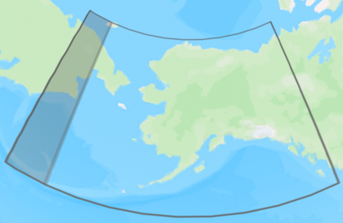
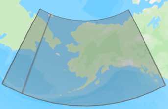

[[_TOC_]]

# Migration to `osdu:wks:reference-data--CoordinateTransformation:1.1.0`

Content changes (schema unchanged) [osdu:wks:reference-data--CoordinateTransformation:1.1.0](../../../E-R/reference-data/CoordinateTransformation.1.1.0.md) are listed below.

1. Correction of malformed GeoJSON `Wgs84Coordinates`:
    * CoordinateTransformation extents, which cross the anti-meridian, must be split into two polygons. The resulting
      MultiPolygon data were however shipped as single polygon with two rings, where the second ring was mistaken as an
      interior ring (hole), which was outside the exterior ring.   The issue is illustrated by CRS
      Projected:EPSG::2964 "NAD27 / Alaska Albers" below - but applies to CoordinateTransformation records as well.  
      
    * The records containing MultiPolygon extents have been updated/corrected with a MultiPolygon containing two
      individual polygons, see below.  
      
2. When regenerating the CoordinateTransformation manifest, the content was updated to the IOGP version 12.022 dated
   2025-08-29, see https://apps.epsg.org/api/v1/VersionHistory/392.

[//]: # "The Schema property change table contains manual comments, which must be protected? (Yes/No): No"
[//]: # "Please do not add any comments below this line. The following lines are auto-generated."

# Schema Changes

**_No Schema Changes._**

[//]: # "End of section Schema Changes"

# Reference Data Changes

| `id` | Name | Description | Change Notes |
| ----- | ----- | ----- | ----- |
| partition-id:reference-data--CoordinateTransformation:EPSG::1067 | Minna to WGS 84 (11) | Used by Statoil for deep water blocks 210, 213, 217 and 218. Parameter values interpolated from Racal Survey geocentric translation contour charts for each of these four blocks and then averaged. | Changes in Description, RevisionDate |
| partition-id:reference-data--CoordinateTransformation:EPSG::1071 | Palestine 1923 to Israel 1993 (1) | For more accurate transformation contact Survey of Israel. | Changes in PreferredUsage, Usages |
| partition-id:reference-data--CoordinateTransformation:EPSG::1073 | Israel 1993 to WGS 84 (1) | For more accurate transformation contact Survey of Israel. | Changes in PreferredUsage, Usages |
| partition-id:reference-data--CoordinateTransformation:EPSG::1074 | Palestine 1923 to WGS 84 (1) | Accuracy: 1m to north and 5m to south of east-west line through Beersheba (31°15'N). Not recognised by Survey of Israel. See Palestine 1923 to WGS 84 (2) (code 8650). | Changes in PreferredUsage, Usages |
| partition-id:reference-data--CoordinateTransformation:EPSG::1075 | ED50 to WGS 84 (38) | Derived in 1987 by Geodetic for TPAO. Used on BP 1991/92 2D seismic surveys in central and eastern Turkish sector of Black Sea. In Turkey, replaced by tfm code 1784. Also adopted for use offshore Israel. | Changes in PreferredUsage, Usages |
| partition-id:reference-data--CoordinateTransformation:EPSG::1113 | Arc 1950 to WGS 84 (1) | Derived at 41 stations. Accuracy 20m, 33m and 20m in X, Y and Z axes. Note: Eswatini and Lesotho do not use Arc 1950 but do use Cape (CRS code 4222); Cape and Arc 1950 datums share a common fundamental point. | Changes in Description, RevisionDate |
| partition-id:reference-data--CoordinateTransformation:EPSG::1146 | ED87 to WGS 84 (1) | No Description | Changes in PreferredUsage, Usages, Wgs84Coordinates |
| partition-id:reference-data--CoordinateTransformation:EPSG::1149 | ETRS89 to WGS 84 (1) | ETRS89 and WGS 84 are realizations of ITRS coincident to within 1 metre. This transformation has an accuracy equal to the coincidence figure. | Changes in PreferredUsage, RevisionDate, Usages, Wgs84Coordinates |
| partition-id:reference-data--CoordinateTransformation:EPSG::1226 | Schwarzeck to WGS 84 (1) | Derived at 3 stations. Accuracy 20m in each axis. Beware! Source CRS uses German legal metres, transformation parameter values are in (International) metres. See tfm code 1271 for example. | Changes in Description, RevisionDate |
| partition-id:reference-data--CoordinateTransformation:EPSG::1230 | Tokyo to WGS 84 (1) | Derived at 31 stations. Accuracy 20m, 5m and 20m in X, Y and Z axes. | Changes in PreferredUsage, Usages |
| partition-id:reference-data--CoordinateTransformation:EPSG::1240 | WGS 72BE to WGS 84 (1) | No Description | Changes in PreferredUsage, RevisionDate, Usages |
| partition-id:reference-data--CoordinateTransformation:EPSG::1243 | NAD27 to NAD83 (2) | Uses NADCON method which expects longitudes positive west; EPSG GeogCRS NAD27 (code 4267) and NAD83 (code 4269) have longitudes positive east. May be used as transformation to WGS 84 - see NAD27 to WGS 84 (85) (code 15864). | Changes in Wgs84Coordinates |
| partition-id:reference-data--CoordinateTransformation:EPSG::1254 | Pulkovo 1942 to WGS 84 (1) | Accuracy estimate not available. | Changes in Wgs84Coordinates |
| partition-id:reference-data--CoordinateTransformation:EPSG::1291 | Pulkovo 1942 to WGS 84 (7) | Derived at 2 stations. | Changes in PreferredUsage, Usages |
| partition-id:reference-data--CoordinateTransformation:EPSG::1305 | Tokyo to WGS 84 (5) | Derived at 29 stations. Accuracy 2m in each axis. Replaces Tokyo to WGS 84 (3) (code 1232). | Changes in PreferredUsage, Usages |
| partition-id:reference-data--CoordinateTransformation:EPSG::1565 | NZGD2000 to WGS 84 (1) | No Description | Changes in Wgs84Coordinates |
| partition-id:reference-data--CoordinateTransformation:EPSG::15753 | ED50 to ED87 (1) | Latitude differences from ED50 to ED87 in decimal degrees given by coefficients A0 through A14 where U=(latitude - 55) degrees and V=longitude in decimal degrees. Longitude differences given through coefficients B0 through B14. | Changes in PersistableReference, PreferredUsage, Usages, Wgs84Coordinates |
| partition-id:reference-data--CoordinateTransformation:EPSG::15864 | NAD27 to WGS 84 (85) | Parameter files are from NAD27 to NAD83 (2) (code 1243) assuming that NAD83 is equivalent to WGS 84 within the accuracy of this tfm. Uses NADCON method which expects longitudes positive west; EPSG CRS codes 4267 and 4326 have longitudes positive east. | Changes in Wgs84Coordinates |
| partition-id:reference-data--CoordinateTransformation:EPSG::15865 | Pulkovo 1942 to WGS 84 (16) | Derived via PZ-90 at 30 stations throughout USSR (Former Soviet Union, FSU) through concatenation of Pulkovo 1942 to PZ-90 (1) (tfm code 15844) and PZ-90 to WGS 84 (1) (tfm code 15843). | Changes in Wgs84Coordinates |
| partition-id:reference-data--CoordinateTransformation:EPSG::15874 | Nord Sahara 1959 to WGS 84 (7) | Derived at 11 stations throughout blocks 317b, 319b, 321b and 322b. Network based on station P4 (horizontal) and benchmark RN51 (vertical) using EGM96 geoid height. Used by Equinor in Hassi Mouina. May be taken as a transformation to RGSH2020 (CT 10342). | Changes in Description, RevisionDate |
| partition-id:reference-data--CoordinateTransformation:EPSG::15927 | JAD69 to WGS 84 (3) | Derived at 4 stations, tested at a further 9. Also used as tfm to JAD69 to JAD2001 (see code 15926). Note: Info source paper contains an error in sign of dS, subsequently confirmed by primary author and NLA of Jamaica, and corrected in this record. | Changes in Description, RevisionDate |
| partition-id:reference-data--CoordinateTransformation:EPSG::1612 | ED50 to WGS 84 (23) | Parameter values are taken from ED50 to ETRS89 (1), code 1588, (rotations converted from μrad). Adopted for ED50 to WGS 84 CTs offshore Norway north of 62°N from April 2001, replacing code 1590. Included in Statens Kartverk programme wsktrans from v4.0. | Changes in Description, RevisionDate |
| partition-id:reference-data--CoordinateTransformation:EPSG::1627 | ED50 to WGS 84 (25) | Parameter values from ED50 to ETRS89 (4) (code 1626). Assumes ETRS89 and WGS 84 can be considered the same to within the accuracy of the transformation. | Changes in PreferredUsage, Usages, Wgs84Coordinates |
| partition-id:reference-data--CoordinateTransformation:EPSG::1766 | CH1903 to WGS 84 (2) | Parameters values from CH1903 to ETRS89 (1) (tfm code 1646) assuming ETRS89 and WGS 84 can be considered the same to within the accuracy of the transformation. Replaces CH1903 to WGS 84 (1) (code 1753). Replaced by CH1903 to WGS 84 (3) (code 7788). | Changes in PreferredUsage, Usages, Wgs84Coordinates |
| partition-id:reference-data--CoordinateTransformation:EPSG::1807 | Pulkovo 1942 to WGS 84 (13) | Derived via WGS72 values taken from SOCAR Magnavox 1502 manual. Used by AIOC 1995-1997 then replaced by the AIOC97 values (tfm code 1808). Do not confuse with AIOC95 vertical datum as used in southern Caspian Sea and at Sangachal terminal by AIOC. | Changes in Description, RevisionDate |
| partition-id:reference-data--CoordinateTransformation:EPSG::1815 | Nord Sahara 1959 to WGS 84 (4) | Used by BP in District 3 and In Salah Gas. May be taken as a transformation to RGSH2020 - see CT 10339. | Changes in Description, RevisionDate |
| partition-id:reference-data--CoordinateTransformation:EPSG::1816 | Nord Sahara 1959 to WGS 84 (5) | Derived at astro station central to concession. Significant and varying differences (>100m) at 4 neighbouring astro stations. May be taken as a transformation to RGSH2020 - see CT 10340. | Changes in Description, RevisionDate |
| partition-id:reference-data--CoordinateTransformation:EPSG::1817 | Nord Sahara 1959 to WGS 84 (6) | Derived at astro station Guerrara. May be taken as a transformation to RGSH2020 - see CT 10341. | Changes in Description, RevisionDate |
| partition-id:reference-data--CoordinateTransformation:EPSG::1820 | Minna to WGS 84 (6) | Derived by Nortech at station L40 Minna using NNPC 1989 GPS network tied to 4 ADOS stations. Used by Conoco in OPLs 219-220 to cm precision and ExxonMobil in OPL 209 to dm precision. | Changes in Description, RevisionDate |
| partition-id:reference-data--CoordinateTransformation:EPSG::1825 | Hong Kong 1980 to WGS 84 (1) | Derived via ITRF96 @ 1998.121. Published 2002-03-01. Parameter values from Hong Kong 1980 to Hong Kong Geodetic CS (1) (code 9913) assuming Hong Kong Geodetic CS and WGS 84 are equivalent within the accuracy of the CT. | Changes in PreferredUsage, Usages |
| partition-id:reference-data--CoordinateTransformation:EPSG::1838 | Segara to WGS 84 (4) | Datum shift derived through ITRF93. In Pertamina Hulu Mahakam replaced by ITRF2014 to Segara (1) (CT code 10589). | Changes in Description, RevisionDate |
| partition-id:reference-data--CoordinateTransformation:EPSG::1867 | SAD69 to WGS 84 (4) | Derived at 22 stations. Accuracy 3m, 5m and 5m in X, Y and Z axes. | Changes in PreferredUsage, Usages, Wgs84Coordinates |
| partition-id:reference-data--CoordinateTransformation:EPSG::5044 | Pulkovo 1942 to WGS 84 (20) | Derived through concatenation of Pulkovo 1942 to PZ-90.02 to WGS 84. Replaces Pulkovo 1942 to WGS 84 (17) (code 1267). | Changes in Wgs84Coordinates |
| partition-id:reference-data--CoordinateTransformation:EPSG::5630 | Nord Sahara 1959 to WGS 84 (8) | Derived at 1 station (L38).  May be taken as a transformation to RGSH2020 - see CT 10343. | Changes in Description, RevisionDate |
| partition-id:reference-data--CoordinateTransformation:EPSG::6373 | Mexico ITRF2008 to WGS 84 (1) | Approximation at the +/- 1m level assuming that Mexico ITRF2008 is equivalent to WGS 84. | Changes in Description, RevisionDate |
| partition-id:reference-data--CoordinateTransformation:EPSG::7000 | Amersfoort to ETRS89 (7) | Consistent to within 1mm with official RNAPTRANS(TM)2008 at ground level onshore and at MSL offshore. The horizontal deviation using this NTv2 grid is approximately 1mm per 50m height difference from ground level or MSL. | Changes in PreferredUsage, RevisionDate, Usages |
| partition-id:reference-data--CoordinateTransformation:EPSG::7698 | NAD27 to WGS 84 (89) | Derived at stations in the provinces of Colón, Panamá, Coclé, Veraguas, Herrera, Los Santos y Chiriquí. Standard deviation 0.871m in north and 0.531m in east. | Changes in Description, RevisionDate |
| partition-id:reference-data--CoordinateTransformation:EPSG::8650 | Palestine 1923 to WGS 84 (2) | Accuracy: 1m to north and 10m to south of east-west line through Beersheba (31°15'N). Can be implemented as a geocentric translation tfm with param. Values dX = -229m, dY = -67m, dZ= +277m. | Changes in PreferredUsage, Usages |
| partition-id:reference-data--CoordinateTransformation:EPSG::8653 | ED50 to WGS 84 (14) | 1990 agreement between Denmark, Germany, Great Britain, Netherlands and Norway. Replaces 1981 6-nations agreement between ED50 and WGS72 or WGS72BE. Only actively used offshore Norway but see ED50 to WGS 84 (24) (code 1613) for simpler transformation. | Changes in PersistableReference, PreferredUsage, Usages, Wgs84Coordinates |
| partition-id:reference-data--CoordinateTransformation:EPSG::8971 | NAD83 to NAD83(2011) (1) | No Description | Changes in PersistableReference |
| partition-id:reference-data--CoordinateTransformation:EPSG::9225 | WGS 84 to ETRS89 (2) | Parameter values derived from ITRF2008 to ETRF2000 (1), code 7951, as a time-specific transformation @2014.81, assuming ITRF2008 = WGS 84 (G1762) = WGS 84 and ETRF2000 = ETRS89. | Changes in PersistableReference |

# Value Spreadsheet and Manifest

* &rarr; [Reference value workbook CRS_CT_EBCRS_list_OSDU.xlsx](../../../ReferenceValues/Resources/IOGP/OSDU/CRS_CT_EBCRS_list_OSDU.xlsx)
* &rarr; [Manifest record CoordinateTransformation.1.json](../../../ReferenceValues/Manifests/reference-data/LOCAL/CoordinateTransformation.1.json)

[Back to TOC](#TOC)

---

[//]: # "End of section Reference Data Changes"

# Links

* [Back to Milestone](README.md)
* [Back to Migration Guides](../README.md)
* [Back to Guides](../../README.md)