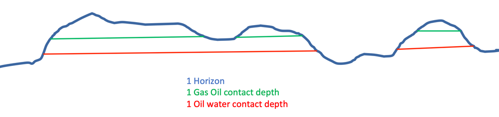
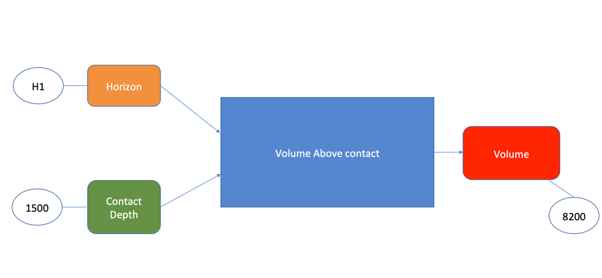
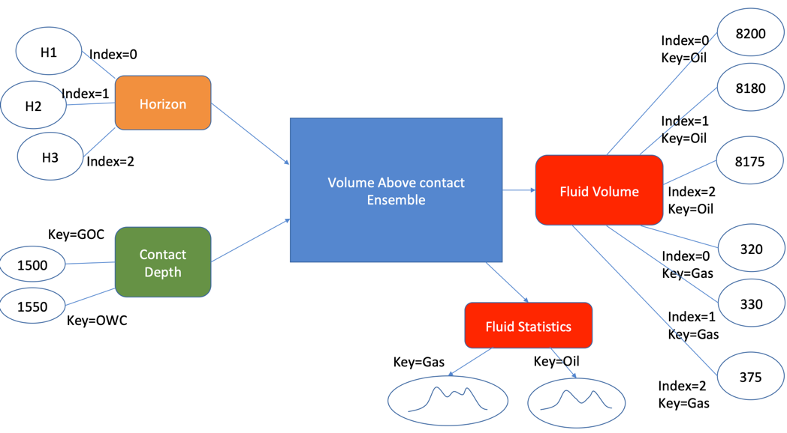
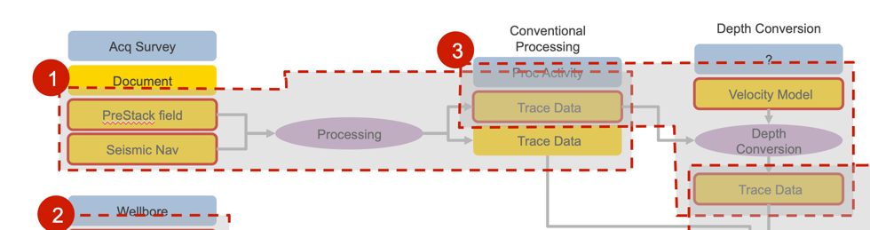

<a name="TOC"></a>

[[_TOC_]]

# Worked Examples, Activity

The examples are based on the following scenario of constant contacts, and a horizon for top reservoir.


[Back to TOC](#TOC)

---

## Simple Example

Starting with the simplest possible case, here the 'Compute volume above contact' activity:



The H1 Horizon is the single representation of the Horizon, the contact depth at 1500 m is the single contact depth.

[Back to TOC](#TOC)

---

### Activity Record

The example record below reflects this case.

<details>
<summary markdown="span">Simple Activity Example Record</summary>

<OsduImportJSON>[Simple Activity Example, full Activity record](Activity_Simple.1.0.0.json#only.data)</OsduImportJSON>

```json
{
  "data": {
    "Source": "Made-up Example",
    "ExistenceKind": "namespace:reference-data--ExistenceKind:Actual:",
    "IsExtendedLoad": false,
    "IsDiscoverable": true,
    "Name": "Volume Above Contact Computation Activity",
    "Description": "Example activity record demonstrating the 'compute volume above contact'.",
    "CreationDateTime": "2021-04-04T09:13:15.55Z",
    "LineageAssertions": [
      {
        "ID": "namespace:work-product-component--SeismicHorizon:H1-4ed87e4f-9919-4011-aa39-499953051cce:",
        "LineageRelationshipType": "namespace:reference-data--LineageRelationshipType:Direct:"
      }
    ],
    "ActivityTemplateID": "namespace:master-data--ActivityTemplate:SimpleExample-44d649a3-8d8b-532c-8b77-b10f589a876b:",
    "ParentActivityID": "namespace:work-product-component--AnyActivity:AnyActivity-911bb71f-06ab-4deb-8e68-b8c9229dc76b:",
    "Parameters": [
      {
        "Title": "Horizon Above Contact",
        "Selection": "Selected by end-user",
        "DataObjectParameter": "namespace:work-product-component--SeismicHorizon:H1-4ed87e4f-9919-4011-aa39-499953051cce:",
        "ParameterKindID": "namespace:reference-data--ParameterKind:DataObject:",
        "ParameterRoleID": "namespace:reference-data--ParameterRole:Input:"
      },
      {
        "Title": "Contact Depth",
        "Selection": "Selected by end-user",
        "DataQuantityParameter": 1500.0,
        "ParameterKindID": "namespace:reference-data--ParameterKind:Double:",
        "ParameterRoleID": "namespace:reference-data--ParameterRole:Input:",
        "DataQuantityParameterUOMID": "namespace:reference-data--UnitOfMeasure:m:"
      },
      {
        "Title": "Volume above Contact",
        "Selection": "Computed by the process",
        "DataQuantityParameter": 8200.0,
        "ParameterKindID": "namespace:reference-data--ParameterKind:Double:",
        "ParameterRoleID": "namespace:reference-data--ParameterRole:Output:",
        "DataQuantityParameterUOMID": "namespace:reference-data--UnitOfMeasure:m3:"
      }
    ],
    "PriorActivityIDs": [
      "namespace:work-product-component--AnyActivity:AnyActivity-911bb71f-06ab-4deb-8e68-b8c9229dc76b:"
    ],
    "ExtensionProperties": {}
  }
}
```

</details>

The two inputs and single output are recorded in the Simple Activity example's `Parameters array`:

<details>
<summary markdown="span">Input [H1 Horizon]</summary>

<OsduImportJSON>[Input "H1 Horizon", full Activity Record](Activity_Simple.1.0.0.json#only.data.Parameters[0])</OsduImportJSON>

```json
{
  "data": {
    "Parameters": [
      {
        "Title": "Horizon Above Contact",
        "Selection": "Selected by end-user",
        "DataObjectParameter": "namespace:work-product-component--SeismicHorizon:H1-4ed87e4f-9919-4011-aa39-499953051cce:",
        "ParameterKindID": "namespace:reference-data--ParameterKind:DataObject:",
        "ParameterRoleID": "namespace:reference-data--ParameterRole:Input:"
      }
    ]
  }
}
```

</details>

<details>
<summary markdown="span">Input [1500 Contact Depth]</summary>

<OsduImportJSON>[Input "1500 Contact Depth", full Activity record](Activity_Simple.1.0.0.json#only.data.Parameters[1])</OsduImportJSON>

```json
{
  "data": {
    "Parameters": [
      {
        "Title": "Contact Depth",
        "Selection": "Selected by end-user",
        "DataQuantityParameter": 1500.0,
        "ParameterKindID": "namespace:reference-data--ParameterKind:Double:",
        "ParameterRoleID": "namespace:reference-data--ParameterRole:Input:",
        "DataQuantityParameterUOMID": "namespace:reference-data--UnitOfMeasure:m:"
      }
    ]
  }
}
```

</details>

<details>
<summary markdown="span">Output [Volume 8200]</summary>

<OsduImportJSON>[Output "Volume 8200", full Activity record"](Activity_Simple.1.0.0.json#only.data.Parameters[2])</OsduImportJSON>

```json
{
  "data": {
    "Parameters": [
      {
        "Title": "Volume above Contact",
        "Selection": "Computed by the process",
        "DataQuantityParameter": 8200.0,
        "ParameterKindID": "namespace:reference-data--ParameterKind:Double:",
        "ParameterRoleID": "namespace:reference-data--ParameterRole:Output:",
        "DataQuantityParameterUOMID": "namespace:reference-data--UnitOfMeasure:m3:"
      }
    ]
  }
}
```

</details>

<details>
<summary markdown="span">Finally, the complete <code>Parameters</code> array</summary>

<OsduImportJSON>[Parameters array, full Activity record](Activity_Simple.1.0.0.json#only.data.Parameters)</OsduImportJSON>

```json
{
  "data": {
    "Parameters": [
      {
        "Title": "Horizon Above Contact",
        "Selection": "Selected by end-user",
        "DataObjectParameter": "namespace:work-product-component--SeismicHorizon:H1-4ed87e4f-9919-4011-aa39-499953051cce:",
        "ParameterKindID": "namespace:reference-data--ParameterKind:DataObject:",
        "ParameterRoleID": "namespace:reference-data--ParameterRole:Input:"
      },
      {
        "Title": "Contact Depth",
        "Selection": "Selected by end-user",
        "DataQuantityParameter": 1500.0,
        "ParameterKindID": "namespace:reference-data--ParameterKind:Double:",
        "ParameterRoleID": "namespace:reference-data--ParameterRole:Input:",
        "DataQuantityParameterUOMID": "namespace:reference-data--UnitOfMeasure:m:"
      },
      {
        "Title": "Volume above Contact",
        "Selection": "Computed by the process",
        "DataQuantityParameter": 8200.0,
        "ParameterKindID": "namespace:reference-data--ParameterKind:Double:",
        "ParameterRoleID": "namespace:reference-data--ParameterRole:Output:",
        "DataQuantityParameterUOMID": "namespace:reference-data--UnitOfMeasure:m3:"
      }
    ]
  }
}
```

</details>


The activity can be related to a TemplateActivity:

### TemplateActivity Record

**The `Title` values in the Parameters array must match.**

TemplateActivity is a master-data item and can be referred to by many activity runs.

<details>
<summary markdown="span">See <code>ActivityTemplateID</code></summary>

<OsduImportJSON>[ActivityTemplateID, full Activity record](Activity_Simple.1.0.0.json#only.data.ActivityTemplateID)</OsduImportJSON>

```json
{
  "data": {
    "ActivityTemplateID": "namespace:master-data--ActivityTemplate:SimpleExample-44d649a3-8d8b-532c-8b77-b10f589a876b:"
  }
}
```

</details>

The expected inputs and outputs are declared in the ActivityTemplate_Simple example's `Parameters array`:

<details>
<summary markdown="span">Input Horizon Above Contact as a relationship to an object of type <code>DataObjectContentType</code> 
as <code>work-product-component--SeismicHorizon</code></summary>

<OsduImportJSON>[Input Horizon Above Contact, full ActivityTemplate record](ActivityTemplate_Simple.1.0.0.json#only.data.Parameters[0])</OsduImportJSON>

```json
{
  "data": {
    "Parameters": [
      {
        "AllowedParameterKind": "namespace:reference-data--ParameterKind:DataObject:",
        "IsInput": true,
        "IsOutput": false,
        "Title": "Horizon Above Contact",
        "DataObjectContentType": [
          "work-product-component--SeismicHorizon"
        ],
        "MaxOccurs": 1,
        "MinOccurs": 1
      }
    ]
  }
}
```

</details>

<details>
<summary markdown="span">Input Contact Depth as a number of type double</summary>

<OsduImportJSON>[Input Contact Depth, full ActivityTemplate record](ActivityTemplate_Simple.1.0.0.json#only.data.Parameters[1])</OsduImportJSON>

```json
{
  "data": {
    "Parameters": [
      {
        "AllowedParameterKind": "namespace:reference-data--ParameterKind:Double:",
        "IsInput": true,
        "IsOutput": false,
        "Title": "Contact Depth",
        "MaxOccurs": 1,
        "MinOccurs": 1,
        "PropertyType": {
          "Name": "depth",
          "PropertyTypeID": "namespace:reference-data--PropertyType:4364b378-899a-403a-8401-b06abd4fc0cf:"
        }
      }
    ]
  }
}
```

</details>

<details>
<summary markdown="span">Output Volume above Contact</summary>

<OsduImportJSON>[Output Volume above Contact, full ActivityTemplate record](ActivityTemplate_Simple.1.0.0.json#only.data.Parameters[2])</OsduImportJSON>

```json
{
  "data": {
    "Parameters": [
      {
        "AllowedParameterKind": "namespace:reference-data--ParameterKind:Double:",
        "IsInput": false,
        "IsOutput": true,
        "Title": "Volume above Contact",
        "MaxOccurs": 1,
        "MinOccurs": 1,
        "PropertyType": {
          "Name": "Volume",
          "PropertyTypeID": "namespace:reference-data--PropertyType:2dc6dc83-e1f9-48f6-87f2-57bcdd42738b:"
        }
      }
    ]
  }
}
```

</details>

<details>
<summary markdown="span">Finally the entire <code>Parameters</code> array.</summary>

<OsduImportJSON>[Parameters array, full ActivityTemplate record](ActivityTemplate_Simple.1.0.0.json#only.data.Parameters)</OsduImportJSON>

```json
{
  "data": {
    "Parameters": [
      {
        "AllowedParameterKind": "namespace:reference-data--ParameterKind:DataObject:",
        "IsInput": true,
        "IsOutput": false,
        "Title": "Horizon Above Contact",
        "DataObjectContentType": [
          "work-product-component--SeismicHorizon"
        ],
        "MaxOccurs": 1,
        "MinOccurs": 1
      },
      {
        "AllowedParameterKind": "namespace:reference-data--ParameterKind:Double:",
        "IsInput": true,
        "IsOutput": false,
        "Title": "Contact Depth",
        "MaxOccurs": 1,
        "MinOccurs": 1,
        "PropertyType": {
          "Name": "depth",
          "PropertyTypeID": "namespace:reference-data--PropertyType:4364b378-899a-403a-8401-b06abd4fc0cf:"
        }
      },
      {
        "AllowedParameterKind": "namespace:reference-data--ParameterKind:Double:",
        "IsInput": false,
        "IsOutput": true,
        "Title": "Volume above Contact",
        "MaxOccurs": 1,
        "MinOccurs": 1,
        "PropertyType": {
          "Name": "Volume",
          "PropertyTypeID": "namespace:reference-data--PropertyType:2dc6dc83-e1f9-48f6-87f2-57bcdd42738b:"
        }
      }
    ]
  }
}
```

</details>

[Back to TOC](#TOC)

---

# Non-trivial Example

This time the list of inputs and outputs is dynamic. A number of optional horizons are defined, which can be processed
in an uncertainty scenario. Simultaneously, the volume can be computed against multiple contacts.



[Back to TOC](#TOC)

---

### TemplateActivity Record

The `ActivityTemplate` for this non-trivial activity has four parameters types declared, all of them as arrays with
unlimited number of elements, minimum 1 though:

<details>

<summary markdown="span">Inputs "Horizon Above Contact" of type <code>work-product-component--SeismicHorizon</code>.</summary>

<OsduImportJSON>[Inputs "Horizon Above Contact", full ActivityTemplate record](ActivityTemplate_NonTrivial.1.0.0.json#only.data.Parameters[0])</OsduImportJSON>

```json
{
  "data": {
    "Parameters": [
      {
        "AllowedParameterKind": "namespace:reference-data--ParameterKind:DataObject:",
        "IsInput": true,
        "IsOutput": false,
        "Title": "Horizon Above Contact",
        "DataObjectContentType": [
          "work-product-component--SeismicHorizon"
        ],
        "MaxOccurs": -1,
        "MinOccurs": 1
      }
    ]
  }
}
```

</details>   

<details>

<summary markdown="span">Inputs "Contact Depth" - of type <code>Double</code> value</summary>

<OsduImportJSON>[Inputs "Contact Depth", full ActivityTemplate record](ActivityTemplate_NonTrivial.1.0.0.json#only.data.Parameters[1])</OsduImportJSON>

```json
{
  "data": {
    "Parameters": [
      {
        "AllowedParameterKind": "namespace:reference-data--ParameterKind:Double:",
        "IsInput": true,
        "IsOutput": false,
        "Title": "Contact Depth",
        "MaxOccurs": -1,
        "MinOccurs": 1,
        "PropertyType": {
          "Name": "depth",
          "PropertyTypeID": "namespace:reference-data--PropertyType:4364b378-899a-403a-8401-b06abd4fc0cf:"
        }
      }
    ]
  }
}
```

</details>

<details>

<summary markdown="span">Inputs "Fluid Phase" - of type <code>Double</code> value</summary>

<OsduImportJSON>[Inputs "Fluid Phase", full ActivityTemplate record](ActivityTemplate_NonTrivial.1.0.0.json#only.data.Parameters[2])</OsduImportJSON>

```json
{
  "data": {
    "Parameters": [
      {
        "AllowedParameterKind": "namespace:reference-data--ParameterKind:String:",
        "IsInput": true,
        "IsOutput": false,
        "Title": "Fluid Phase",
        "MaxOccurs": -1,
        "MinOccurs": 1,
        "DefaultValue": {
          "Title": "Fluids",
          "ParameterKindID": "namespace:reference-data--ParameterKind:String:",
          "ParameterRoleID": "namespace:reference-data--ParameterRole:Input:",
          "Keys": [
            {
              "ParameterKey": "Oil"
            },
            {
              "ParameterKey": "Gas"
            }
          ]
        }
      }
    ]
  }
}
```

</details>

<details>

<summary markdown="span">Outputs "Fluid Volume above Contact" - of type <code>Double</code> value</summary>

<OsduImportJSON>[Outputs "Fluid Volume above Contact", full ActivityTemplate record](ActivityTemplate_NonTrivial.1.0.0.json#only.data.Parameters[3])</OsduImportJSON>

```json
{
  "data": {
    "Parameters": [
      {
        "AllowedParameterKind": "namespace:reference-data--ParameterKind:Double:",
        "IsInput": false,
        "IsOutput": true,
        "Title": "Fluid Volume above Contact",
        "MaxOccurs": -1,
        "MinOccurs": 1,
        "PropertyType": {
          "Name": "Volume",
          "PropertyTypeID": "namespace:reference-data--PropertyType:2dc6dc83-e1f9-48f6-87f2-57bcdd42738b:"
        }
      }
    ]
  }
}
```

</details>

<details>

<summary markdown="span">Outputs "Fluid Statistics" - (assuming a <code>work-product-component--FluidStatistics</code> type). Note that this output is constrained by the "Fluid Phase" input keys via <code>KeyConstraints</code>.</summary>

<OsduImportJSON>[Outputs "Fluid Statistics", full ActivityTemplate record](ActivityTemplate_NonTrivial.1.0.0.json#only.data.Parameters[4])</OsduImportJSON>

```json
{
  "data": {
    "Parameters": [
      {
        "AllowedParameterKind": "namespace:reference-data--ParameterKind:DataObject:",
        "IsInput": false,
        "IsOutput": true,
        "Title": "Fluid Statistics",
        "DataObjectContentType": [
          "work-product-component--FluidStatistics"
        ],
        "MaxOccurs": -1,
        "MinOccurs": 1,
        "KeyConstraints": [
          "Fluid Phase"
        ]
      }
    ]
  }
}
```

</details>

[Back to TOC](#TOC)

---

### Activity Record

The `Activity` record picks up the parameter definitions from the `ActivityTemplate`.

#### Inputs "Horizon Above Contact"

<details>

<summary markdown="span">1. H1 object reference</summary>

<OsduImportJSON>[H1 object reference, full Activity record](Activity_NonTrivial.1.0.0.json#only.data.Parameters[0])</OsduImportJSON>

```json
{
  "data": {
    "Parameters": [
      {
        "Title": "Horizon Above Contact",
        "Index": 0,
        "Selection": "Selected by end-user",
        "DataObjectParameter": "namespace:work-product-component--SeismicHorizon:H1-4ed87e4f-9919-4011-aa39-499953051cce:",
        "ParameterKindID": "namespace:reference-data--ParameterKind:DataObject:",
        "ParameterRoleID": "namespace:reference-data--ParameterRole:Input:"
      }
    ]
  }
}
```

</details>

<details>

<summary markdown="span">2. H2 object reference</summary>

<OsduImportJSON>[H2 object reference, full Activity record](Activity_NonTrivial.1.0.0.json#only.data.Parameters[1])</OsduImportJSON>

```json
{
  "data": {
    "Parameters": [
      {
        "Title": "Horizon Above Contact",
        "Index": 1,
        "Selection": "Selected by end-user",
        "DataObjectParameter": "namespace:work-product-component--SeismicHorizon:H2-cf71e25c-2581-4f0f-acfc-06c59b8304c3:",
        "ParameterKindID": "namespace:reference-data--ParameterKind:DataObject:",
        "ParameterRoleID": "namespace:reference-data--ParameterRole:Input:"
      }
    ]
  }
}
```

</details>

<details>

<summary markdown="span">3. H3 object reference</summary>

<OsduImportJSON>[H3 object reference, full Activity record](Activity_NonTrivial.1.0.0.json#only.data.Parameters[2])</OsduImportJSON>

```json
{
  "data": {
    "Parameters": [
      {
        "Title": "Horizon Above Contact",
        "Index": 2,
        "Selection": "Selected by end-user",
        "DataObjectParameter": "namespace:work-product-component--SeismicHorizon:H3-ac47fe1d-c64c-488a-a1ce-051b45666420:",
        "ParameterKindID": "namespace:reference-data--ParameterKind:DataObject:",
        "ParameterRoleID": "namespace:reference-data--ParameterRole:Input:"
      }
    ]
  }
}
```

</details>

#### Inputs "Contact Depth"

<details>

<summary markdown="span">1. GOC number</summary>

<OsduImportJSON>[GOC number, full Activity record](Activity_NonTrivial.1.0.0.json#only.data.Parameters[3])</OsduImportJSON>

```json
{
  "data": {
    "Parameters": [
      {
        "Title": "Contact Depth",
        "Index": 0,
        "Selection": "Selected by end-user",
        "DataQuantityParameter": 1500.0,
        "ParameterKindID": "namespace:reference-data--ParameterKind:Double:",
        "ParameterRoleID": "namespace:reference-data--ParameterRole:Input:",
        "DataQuantityParameterUOMID": "namespace:reference-data--UnitOfMeasure:m:",
        "Keys": [
          {
            "ParameterKey": "GOC"
          }
        ]
      }
    ]
  }
}
```

</details>

<details>

<summary markdown="span">2. GOC number</summary>

<OsduImportJSON>[GOC number, full Activity record](Activity_NonTrivial.1.0.0.json#only.data.Parameters[4])</OsduImportJSON>

```json
{
  "data": {
    "Parameters": [
      {
        "Title": "Contact Depth",
        "Index": 1,
        "Selection": "Selected by end-user",
        "DataQuantityParameter": 1550.0,
        "ParameterKindID": "namespace:reference-data--ParameterKind:Double:",
        "ParameterRoleID": "namespace:reference-data--ParameterRole:Input:",
        "DataQuantityParameterUOMID": "namespace:reference-data--UnitOfMeasure:m:",
        "Keys": [
          {
            "ParameterKey": "OWC"
          }
        ]
      }
    ]
  }
}
```

</details>

#### Implicit Inputs via ActivityTemplate

<details>

<summary markdown="span">Implicit Input "Fluid Phase", which constrains the Output Fluid Statistics.</summary>

<OsduImportJSON>[Implicit Input "Fluid Phase", full ActivityTemplate record](ActivityTemplate_NonTrivial.1.0.0.json#only.data.Parameters[2])</OsduImportJSON>

```json
{
  "data": {
    "Parameters": [
      {
        "AllowedParameterKind": "namespace:reference-data--ParameterKind:String:",
        "IsInput": true,
        "IsOutput": false,
        "Title": "Fluid Phase",
        "MaxOccurs": -1,
        "MinOccurs": 1,
        "DefaultValue": {
          "Title": "Fluids",
          "ParameterKindID": "namespace:reference-data--ParameterKind:String:",
          "ParameterRoleID": "namespace:reference-data--ParameterRole:Input:",
          "Keys": [
            {
              "ParameterKey": "Oil"
            },
            {
              "ParameterKey": "Gas"
            }
          ]
        }
      }
    ]
  }
}
```

</details>

#### Outputs "Fluid Volume above Contact"

<details>

<summary markdown="span">1. H1, Oil number</summary>

<OsduImportJSON>[H1, Oil number, full Activity record](Activity_NonTrivial.1.0.0.json#only.data.Parameters[5])</OsduImportJSON>

```json
{
  "data": {
    "Parameters": [
      {
        "Title": "Fluid Volume above Contact",
        "Index": 0,
        "Selection": "Computed by the process",
        "DataQuantityParameter": 8200.0,
        "ParameterKindID": "namespace:reference-data--ParameterKind:Double:",
        "ParameterRoleID": "namespace:reference-data--ParameterRole:Output:",
        "DataQuantityParameterUOMID": "namespace:reference-data--UnitOfMeasure:m3:",
        "Keys": [
          {
            "ParameterKey": "Oil"
          }
        ]
      }
    ]
  }
}
```

</details>

<details>

<summary markdown="span">2. H2, Oil number</summary>

<OsduImportJSON>[H2, Oil number, full Activity record](Activity_NonTrivial.1.0.0.json#only.data.Parameters[6])</OsduImportJSON>

```json
{
  "data": {
    "Parameters": [
      {
        "Title": "Fluid Volume above Contact",
        "Index": 1,
        "Selection": "Computed by the process",
        "DataQuantityParameter": 8180.0,
        "ParameterKindID": "namespace:reference-data--ParameterKind:Double:",
        "ParameterRoleID": "namespace:reference-data--ParameterRole:Output:",
        "DataQuantityParameterUOMID": "namespace:reference-data--UnitOfMeasure:m3:",
        "Keys": [
          {
            "ParameterKey": "Oil"
          }
        ]
      }
    ]
  }
}
```

</details>

<details>

<summary markdown="span">3. H3, Oil number</summary>

<OsduImportJSON>[H3, Oil number, full Activity record](Activity_NonTrivial.1.0.0.json#only.data.Parameters[7])</OsduImportJSON>

```json
{
  "data": {
    "Parameters": [
      {
        "Title": "Fluid Volume above Contact",
        "Index": 2,
        "Selection": "Computed by the process",
        "DataQuantityParameter": 8175.0,
        "ParameterKindID": "namespace:reference-data--ParameterKind:Double:",
        "ParameterRoleID": "namespace:reference-data--ParameterRole:Output:",
        "DataQuantityParameterUOMID": "namespace:reference-data--UnitOfMeasure:m3:",
        "Keys": [
          {
            "ParameterKey": "Oil"
          }
        ]
      }
    ]
  }
}
```

</details>

<details>

<summary markdown="span">4. H1, Gas number</summary>

<OsduImportJSON>[H1, Gas number, full Activity record](Activity_NonTrivial.1.0.0.json#only.data.Parameters[8])</OsduImportJSON>

```json
{
  "data": {
    "Parameters": [
      {
        "Title": "Fluid Volume above Contact",
        "Index": 0,
        "Selection": "Computed by the process",
        "DataQuantityParameter": 320.0,
        "ParameterKindID": "namespace:reference-data--ParameterKind:Double:",
        "ParameterRoleID": "namespace:reference-data--ParameterRole:Output:",
        "DataQuantityParameterUOMID": "namespace:reference-data--UnitOfMeasure:m3:",
        "Keys": [
          {
            "ParameterKey": "Gas"
          }
        ]
      }
    ]
  }
}
```

</details>

<details>

<summary markdown="span">5. H2, Gas number</summary>

<OsduImportJSON>[H2, Gas number, full Activity record](Activity_NonTrivial.1.0.0.json#only.data.Parameters[9])</OsduImportJSON>

```json
{
  "data": {
    "Parameters": [
      {
        "Title": "Fluid Volume above Contact",
        "Index": 1,
        "Selection": "Computed by the process",
        "DataQuantityParameter": 330.0,
        "ParameterKindID": "namespace:reference-data--ParameterKind:Double:",
        "ParameterRoleID": "namespace:reference-data--ParameterRole:Output:",
        "DataQuantityParameterUOMID": "namespace:reference-data--UnitOfMeasure:m3:",
        "Keys": [
          {
            "ParameterKey": "Gas"
          }
        ]
      }
    ]
  }
}
```

</details>

<details>

<summary markdown="span">6. H3, Gas number</summary>

<OsduImportJSON>[H3, Gas number, full Activity record](Activity_NonTrivial.1.0.0.json#only.data.Parameters[10])</OsduImportJSON>

```json
{
  "data": {
    "Parameters": [
      {
        "Title": "Fluid Volume above Contact",
        "Index": 2,
        "Selection": "Computed by the process",
        "DataQuantityParameter": 375.0,
        "ParameterKindID": "namespace:reference-data--ParameterKind:Double:",
        "ParameterRoleID": "namespace:reference-data--ParameterRole:Output:",
        "DataQuantityParameterUOMID": "namespace:reference-data--UnitOfMeasure:m3:",
        "Keys": [
          {
            "ParameterKey": "Gas"
          }
        ]
      }
    ]
  }
}
```

</details>

#### Outputs "Fluid Statistics"

<details>

<summary markdown="span">1. Oil object reference</summary>

<OsduImportJSON>[Oil object reference, full Activity record](Activity_NonTrivial.1.0.0.json#only.data.Parameters[11])</OsduImportJSON>

```json
{
  "data": {
    "Parameters": [
      {
        "Title": "Fluid Statistics",
        "Index": 0,
        "Selection": "Computed by the process",
        "DataObjectParameter": "namespace:work-product-component--FluidStatistics:Oil-009ff575-b0fa-482d-95ed-a5580c22795e:",
        "ParameterKindID": "namespace:reference-data--ParameterKind:DataObject:",
        "ParameterRoleID": "namespace:reference-data--ParameterRole:Output:",
        "DataQuantityParameterUOMID": "namespace:reference-data--UnitOfMeasure:m3:",
        "Keys": [
          {
            "ParameterKey": "Oil"
          }
        ]
      }
    ]
  }
}
```

</details>

<details>

<summary markdown="span">2. Gas object reference</summary>

<OsduImportJSON>[Gas object reference, full Activity record](Activity_NonTrivial.1.0.0.json#only.data.Parameters[12])</OsduImportJSON>

```json
{
  "data": {
    "Parameters": [
      {
        "Title": "Fluid Statistics",
        "Index": 1,
        "Selection": "Computed by the process",
        "DataObjectParameter": "namespace:work-product-component--FluidStatistics:Gas-0b1d8bda-12f3-47ba-86d5-5cb28d43c459:",
        "ParameterKindID": "namespace:reference-data--ParameterKind:DataObject:",
        "ParameterRoleID": "namespace:reference-data--ParameterRole:Output:",
        "DataQuantityParameterUOMID": "namespace:reference-data--UnitOfMeasure:m3:",
        "Keys": [
          {
            "ParameterKey": "Gas"
          }
        ]
      }
    ]
  }
}
```

</details>

[Back to TOC](#TOC)

---

# Building Workflows

Using `ActivityTemplate` and `ActivityTemplateArc` enables the construction of workflows, i.e. chaining activities and
binding the output (Parameters array elements)
to input (Parameters array elements).

The use case has two activities (1) and (3), which are linked. The output of (1)
is used by (3).



<details>

<summary markdown="span">(1) Seismic Processing ActivityTemplate</summary>

<OsduImportJSON>[Seismic Processing ActivityTemplate, full ActivityTemplate record](ActivityTemplate_SeismicProcessing.1.0.0.json#only.data)</OsduImportJSON>

```json
{
  "data": {
    "Name": "Seismic Processing",
    "Description": "A template for a seismic processing work-step. This template is likely consisting of multiple child activity templates, which are not worked out here. The main purpose is to demonstrate the linking of activity templates via ActivityTemplateArc.",
    "Source": "Ian Adams, Shell",
    "ExistenceKind": "namespace:reference-data--ExistenceKind:Prototype:",
    "VersionCreationReason": "Demonstrate workflow design",
    "Parameters": [
      {
        "AllowedParameterKind": "namespace:reference-data--ParameterKind:DataObject:",
        "IsInput": true,
        "IsOutput": false,
        "Title": "Pre-stack Seismic data",
        "DataObjectContentType": [
          "work-product-component--SeismicTraceData"
        ],
        "MaxOccurs": 1,
        "MinOccurs": 1
      },
      {
        "AllowedParameterKind": "namespace:reference-data--ParameterKind:DataObject:",
        "IsInput": true,
        "IsOutput": false,
        "Title": "Pre-stack Navigation",
        "DataObjectContentType": [
          "work-product-component--SeismicLineGeometry"
        ],
        "MaxOccurs": 1,
        "MinOccurs": 1
      },
      {
        "AllowedParameterKind": "namespace:reference-data--ParameterKind:DataObject:",
        "IsInput": false,
        "IsOutput": true,
        "Title": "Post-stack Seismic",
        "DataObjectContentType": [
          "work-product-component--SeismicTraceData"
        ],
        "MaxOccurs": 1,
        "MinOccurs": 1
      },
      {
        "AllowedParameterKind": "namespace:reference-data--ParameterKind:DataObject:",
        "IsInput": false,
        "IsOutput": true,
        "Title": "Velocity Volume",
        "DataObjectContentType": [
          "work-product-component--SeismicTraceData"
        ],
        "MaxOccurs": 1,
        "MinOccurs": 1
      }
    ],
    "ExtensionProperties": {}
  }
}
```

</details>

<details>

<summary markdown="span">with ActivityTemplateArc</summary>

<OsduImportJSON>[ActivityTemplateArc, full record](ActivityTemplateArc_1.1.0.0.json)</OsduImportJSON>

```json
{
  "id": "namespace:master-data--ActivityTemplateArc:908c2239-bea8-59ec-a918-24b5994f6fa8",
  "kind": "osdu:wks:master-data--ActivityTemplateArc:1.1.0",
  "version": 1562066009929332,
  "acl": {
    "owners": [
      "someone@company.com"
    ],
    "viewers": [
      "someone@company.com"
    ]
  },
  "legal": {
    "legaltags": [
      "Example legaltags"
    ],
    "otherRelevantDataCountries": [
      "US"
    ],
    "status": "compliant"
  },
  "tags": {
    "NameOfKey": "String value"
  },
  "createTime": "2020-12-16T11:46:20.163Z",
  "createUser": "some-user@some-company-cloud.com",
  "modifyTime": "2020-12-16T11:52:24.477Z",
  "modifyUser": "some-user@some-company-cloud.com",
  "ancestry": {
    "parents": []
  },
  "meta": [],
  "data": {
    "Source": "Ian Adams, Shell",
    "ExistenceKind": "namespace:reference-data--ExistenceKind:Prototype:",
    "VersionCreationReason": "Example VersionCreationReason",
    "Name": "Connection between Seismic Processing and Depth Conversion",
    "OutputInputArcs": [
      {
        "ProducingActivityTemplateID": "namespace:master-data--ActivityTemplate:SeismicProcessing-9f807479-29bf-4b39-a2a1-c1d89826c5fa:",
        "ProducingParameterTitle": "Post-stack Seismic",
        "ConsumingActivityTemplateID": "namespace:master-data--ActivityTemplate:SeismicDepthConversion-161dccd5-aed8-4940-a4f3-7cfa2e5c76fb:",
        "ConsumingParameterTitle": "Seismic Data Time Domain"
      },
      {
        "ProducingActivityTemplateID": "namespace:master-data--ActivityTemplate:SeismicProcessing-9f807479-29bf-4b39-a2a1-c1d89826c5fa:",
        "ProducingParameterTitle": "Velocity Volume",
        "ConsumingActivityTemplateID": "namespace:master-data--ActivityTemplate:SeismicDepthConversion-161dccd5-aed8-4940-a4f3-7cfa2e5c76fb:",
        "ConsumingParameterTitle": "Velocity Volume"
      }
    ],
    "ActivityArcs": [
      {
        "PrecedingActivityTemplateID": "namespace:master-data--ActivityTemplate:SeismicProcessing-9f807479-29bf-4b39-a2a1-c1d89826c5fa:",
        "SucceedingActivityTemplateID": "namespace:master-data--ActivityTemplate:SeismicDepthConversion-161dccd5-aed8-4940-a4f3-7cfa2e5c76fb:"
      }
    ],
    "ExtensionProperties": {}
  }
}
```

</details>

This 'arc' links two outputs from the producing activity template to the inputs of the consuming activity template. This
is by reference to the ActivityTemplate record
`id`s and the ActivityTemplate's `data.Parameters[].Title` references.
<details>

<summary markdown="span">OutputInputArcs (1) > (3) Output SeismicTraceData to Depth Conversion input</summary>

<OsduImportJSON>[OutputInputArcs (1)> (3) Output SeismicTraceData to Depth Conversion input, full ActivityTemplateArc record](ActivityTemplateArc_1.1.0.0.json#only.data.OutputInputArcs[0])</OsduImportJSON>

```json
{
  "data": {
    "OutputInputArcs": [
      {
        "ProducingActivityTemplateID": "namespace:master-data--ActivityTemplate:SeismicProcessing-9f807479-29bf-4b39-a2a1-c1d89826c5fa:",
        "ProducingParameterTitle": "Post-stack Seismic",
        "ConsumingActivityTemplateID": "namespace:master-data--ActivityTemplate:SeismicDepthConversion-161dccd5-aed8-4940-a4f3-7cfa2e5c76fb:",
        "ConsumingParameterTitle": "Seismic Data Time Domain"
      }
    ]
  }
}
```

</details>

<details>

<summary markdown="span">OutputInputArcs (1) > (3) Output Velocity to Depth Conversion Velocity input</summary>

<OsduImportJSON>[OutputInputArcs (1) > (3) Output Velocity to Depth Conversion Velocity input, full ActivityTemplateArc record](ActivityTemplateArc_1.1.0.0.json#only.data.OutputInputArcs[1])</OsduImportJSON>

```json
{
  "data": {
    "OutputInputArcs": [
      {
        "ProducingActivityTemplateID": "namespace:master-data--ActivityTemplate:SeismicProcessing-9f807479-29bf-4b39-a2a1-c1d89826c5fa:",
        "ProducingParameterTitle": "Velocity Volume",
        "ConsumingActivityTemplateID": "namespace:master-data--ActivityTemplate:SeismicDepthConversion-161dccd5-aed8-4940-a4f3-7cfa2e5c76fb:",
        "ConsumingParameterTitle": "Velocity Volume"
      }
    ]
  }
}
```

</details>

<details>

<summary markdown="span">(3) Depth Conversion ActivityTemplate</summary>

<OsduImportJSON>[(3) Depth Conversion ActivityTemplate, full ActivityTemplate record](ActivityTemplate_SeismicDepthConversion.1.0.0.json#only.data)</OsduImportJSON>

```json
{
  "data": {
    "Name": "Seismic Depth Conversion",
    "Description": "A template for a seismic depth conversion work-step.",
    "Source": "Ian Adams, Shell",
    "ExistenceKind": "namespace:reference-data--ExistenceKind:Prototype:",
    "VersionCreationReason": "Demonstrate workflow design",
    "Parameters": [
      {
        "AllowedParameterKind": "namespace:reference-data--ParameterKind:DataObject:",
        "IsInput": true,
        "IsOutput": false,
        "Title": "Seismic Data Time Domain",
        "DataObjectContentType": [
          "work-product-component--SeismicTraceData"
        ],
        "MaxOccurs": 1,
        "MinOccurs": 1
      },
      {
        "AllowedParameterKind": "namespace:reference-data--ParameterKind:DataObject:",
        "IsInput": true,
        "IsOutput": false,
        "Title": "Velocity Volume",
        "DataObjectContentType": [
          "work-product-component--SeismicTraceData"
        ],
        "MaxOccurs": 1,
        "MinOccurs": 1
      },
      {
        "AllowedParameterKind": "namespace:reference-data--ParameterKind:DataObject:",
        "IsInput": false,
        "IsOutput": true,
        "Title": "Seismic Data Depth Domain",
        "DataObjectContentType": [
          "work-product-component--SeismicTraceData"
        ],
        "MaxOccurs": 1,
        "MinOccurs": 1
      }
    ],
    "ExtensionProperties": {}
  }
}
```

</details>

The following `ActivityArcs` element is **redundant**, however included here to demonstrate that `ActivityTemplate`
instances can be linked - even in a non-linear way by of pairs **without** sharing outputs and inputs.

<details>

<summary markdown="span"><code>ActivityArcs</code> element</summary>

<OsduImportJSON>[`ActivityArcs` element, full ActivityTemplateArc record](ActivityTemplateArc_1.1.0.0.json#only.data.ActivityArcs[0])</OsduImportJSON>

```json
{
  "data": {
    "ActivityArcs": [
      {
        "PrecedingActivityTemplateID": "namespace:master-data--ActivityTemplate:SeismicProcessing-9f807479-29bf-4b39-a2a1-c1d89826c5fa:",
        "SucceedingActivityTemplateID": "namespace:master-data--ActivityTemplate:SeismicDepthConversion-161dccd5-aed8-4940-a4f3-7cfa2e5c76fb:"
      }
    ]
  }
}
```

</details>

[Back to TOC](#TOC)

---

# ActivityStatus 

From milestone 14 on, activity carry a new `ActivityStates[]` array property, which indicates the historical record of
activity states with the effective time intervals and potential remarks.

<details>

<summary markdown="span">ActivityStates array and LastActivityState</summary>

<OsduImportJSON>[Full Activity record](Activity_NonTrivial.1.0.0.json#only.data.ActivityStates|LastActivityState)</OsduImportJSON>

```json
{
  "data": {
    "ActivityStates": [
      {
        "EffectiveDateTime": "2020-02-13T09:13:15.55Z",
        "TerminationDateTime": "2020-07-21T10:09:02.00Z",
        "ActivityStatusID": "namespace:reference-data--ActivityStatus:Planned:",
        "Remark": "Rather long planning phase."
      },
      {
        "EffectiveDateTime": "2020-07-21T10:09:02.00Z",
        "TerminationDateTime": "2020-07-25T14:07:45.00Z",
        "ActivityStatusID": "namespace:reference-data--ActivityStatus:InProgress:",
        "Remark": "Example Remark"
      },
      {
        "EffectiveDateTime": "2020-07-25T14:07:45.00Z",
        "TerminationDateTime": "2020-07-25T14:07:45.00Z",
        "ActivityStatusID": "namespace:reference-data--ActivityStatus:Completed:",
        "Remark": "Success"
      }
    ],
    "LastActivityState": {
      "EffectiveDateTime": "2020-07-25T14:07:45.00Z",
      "TerminationDateTime": "2020-07-25T14:07:45.00Z",
      "ActivityStatusID": "namespace:reference-data--ActivityStatus:Completed:",
      "Remark": "Success"
    }
  }
}
```

</details>

[ActivityStatus](../../../E-R/reference-data/ActivityStatus.1.0.0.md) is a `OPEN` reference value list
with pre-defined values. The following state transitions are possible according to the OSDU set of values:


[Back to TOC](#TOC)

---
