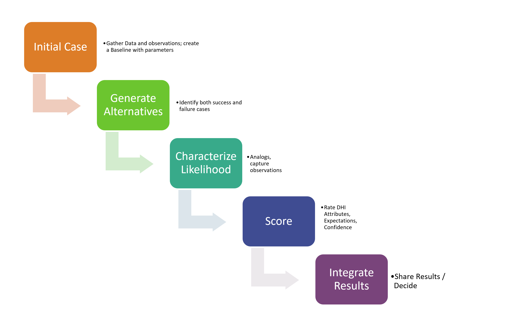
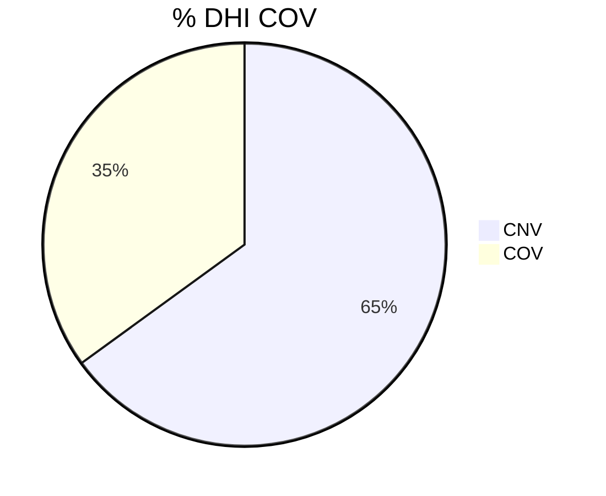
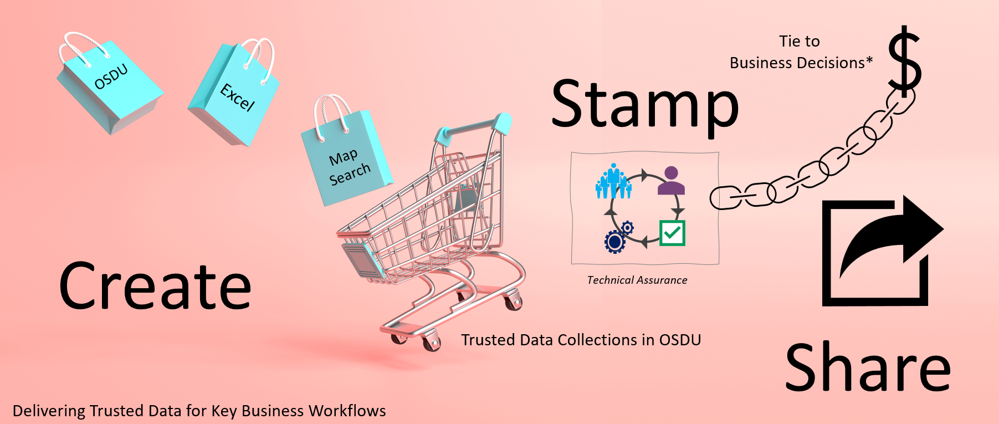
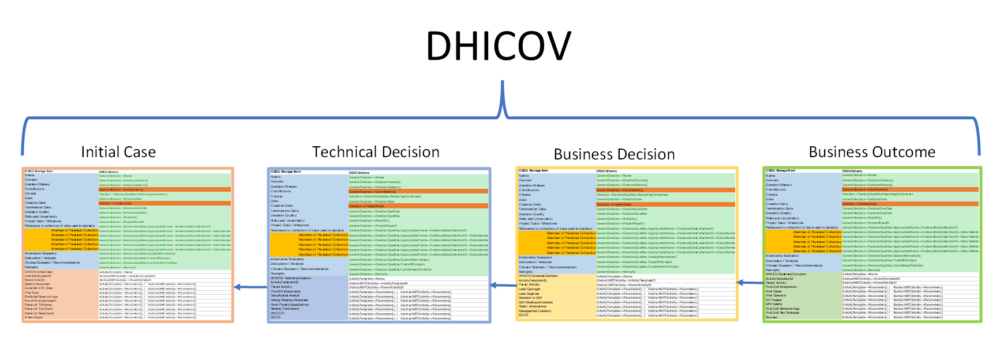
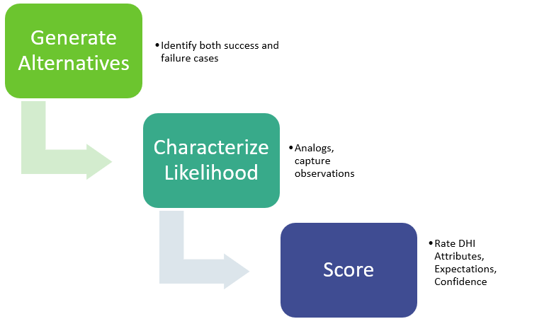

<a name="TOC">Table of Contents</a>

[[_TOC_]]

# Direct Hydrocarbon Indicator Chance of Validity (DHI COV)

A direct hydrocarbon indicator (DHI) is a seismic anomaly that suggests the presence of hydrocarbons in an oil or gas reservoir. It is caused by a change in the acoustic properties of the rock due to the displacement of water by oil or gas in the pore space and the seismic response can differ depending on the density of the fluids, pressure, and porosity of the rock. DHIs are useful for geologically de-risking the potential drilling program for exploration wells.

The Chance of Validity (COV) is the percent chance that something has for being valid or realistic. In this case, the DHI COV is a percent chance that the seismic response is able to depict accurately the trapped hydrocarbons in the subsurface.

The DHICOV is a standard process that many operators go through to help the business make the decision to drill a prospect or not. The general workflow is depicted below in general and begins with forming an initial case with the available data and observations.

<details>

<summary markdown="span">DHICOV Workflow</summary>
The DHICOV workflow consists of the following:
<br>
<br>

<br>

</details>

<details>

<summary markdown="span">DHICOV Example Output</summary>
The DHICOV outcome might be as simple as a 35% chance the DHI is valid as shown below, but that result is only one part of what is truely needed to capture the context of a decision.
<br><br>
    While the DHI COV result is a percentage between 0% and 100% - 100% being the highest likelyhood and 0 being the lowest that the DHI is real and represents hydrocarbons in the subsuface expressed through the contrast of amplitudes across seismic traces and depth.


</details>

## 1. Background

>_In order to trust a decision, we need to understand what went into it. This requires that we capture the input data, the people involved, the methods used, and any other parameters or insights at each state leading up to a business decision and ultimately the business outcome with any learnings._ <br>
>_-Ryan Jarvis_


<details>

<summary markdown="span">Trusted Business Decisions</summary>
Only when we tie collections of trusted data to business decisions and capture that context historically do we get what we need to make better decisions."
<br>

<br>
</details>


- [Technical Assurance and Business Decisions PPT](https://gitlab.opengroup.org/osdu/presentations/-/blob/master/2023%20October%20Houston%20Presentations/2023%20October%2031%20presentations/DataGovernance_TechAssurance_Oct-Nov_Houston_F2F_XOM_EPAM_ROI_FINAL.pptx?ref_type=heads)
- [DHICOV and Technical Assurance PPT](https://gitlab.opengroup.org/osdu/subcommittees/data-def/projects/core-concepts/docs/-/blob/master/Design%20Documents/BusinessDecisions/TechAssurance_into_BusinessDecisionsPart2.pptx)

The business use case for a DHICOV highlights the use of 4 general activity states in a simple workflow succession:
<br>

<br>
Using the business decision schema, we can capture the common set of metadata for any decision.
<br>
<br>
<details>

<summary markdown="span">Business Decision Schema Metadata <br>View an example of the common metadata used to capture a decision</summary>

<OsduImportJSON>[Full example record for DHI COV Initial case](master-data/DHICOV_InitialCase.json#only.data.Name|DecisionOwners|DecisionMakers|Contributors|DecisionQualities|ActivityTemplateID)</OsduImportJSON>

```json
{
  "data": {
    "Name": "DHICOV_NorthAmericaGOM_InitialCase",
    "DecisionOwners": [
      {
        "UserProfileID": "partition-id:master-data--UserProfile:MikeTheManager:"
      }
    ],
    "DecisionMakers": [
      {
        "EmailAddress": "decisionmaker@company.com",
        "PhoneNumber": "1-555-281-5555",
        "RoleTypeID": "partition-id:reference-data--ContactRoleType:AccountOwner:",
        "DataGovernanceRoleTypeID": "partition-id:reference-data--DataGovernanceRoleType:ExecutiveSponsor:",
        "WorkflowPersonaTypeID": "partition-id:reference-data--WorkflowPersonaType:All:",
        "Comment": "I make the best decisions because they are data driven!",
        "OrganisationID": "partition-id:master-data--Organisation:SomeAmazingOrganisationID:",
        "Name": "Example Name",
        "UserProfileID": "partition-id:master-data--UserProfile:EricaExecutiveSponsor:"
      }
    ],
    "Contributors": [
      {
        "UserProfileID": "partition-id:master-data--UserProfile:JohnyPrincipal:"
      },
      {
        "UserProfileID": "partition-id:master-data--UserProfile:PattyChief:"
      },
      {
        "UserProfileID": "partition-id:master-data--UserProfile:LindaSeniorPrincipal:"
      },
      {
        "UserProfileID": "partition-id:master-data--UserProfile:GaryGeophysicsSME:"
      }
    ],
    "DecisionQualities": {
      "AppropriateFrame": {
        "EvidenceAsText": "The most up to date trusted Seismic Volumes for Country X that should be used for DHI Analysis",
        "EvidenceDocumentID": "partition-id:work-product-component--Document:Document-911bb71f-06ab-4deb-8e68-b8c9229dc76b:",
        "EvidenceDataCollectionID": "partition-id:work-product-component--PersistedCollection:PersistedCollection-911bb71f-06ab-4deb-8e68-b8c9229dc76b:",
        "Remarks": [
          {
            "RemarkSequenceNumber": 1,
            "Remark": "Example Remark",
            "RemarkSource": "Example Remark Source",
            "RemarkDate": "2020-02-13"
          }
        ],
        "AssessmentID": "partition-id:reference-data--AssessedDecisionQuality:Sufficient:"
      },
      "DoableAlternatives": [
        {
          "SequenceNumber": 2,
          "Triggers": [
            {
              "Condition": "Example Condition",
              "Remarks": [
                {
                  "RemarkSequenceNumber": 1,
                  "Remark": "Example Remark",
                  "RemarkSource": "Example Remark Source",
                  "RemarkDate": "2020-02-13"
                }
              ],
              "WorkflowIDs": [
                "partition-id:master-data--ActivityTemplate:SomeUniqueActivityTemplateID:"
              ]
            }
          ],
          "EvidenceAsText": "Example Evidence as Text",
          "EvidenceDocumentID": "partition-id:work-product-component--Document:Document-911bb71f-06ab-4deb-8e68-b8c9229dc76b:",
          "EvidenceDataCollectionID": "partition-id:work-product-component--PersistedCollection:PersistedCollection-911bb71f-06ab-4deb-8e68-b8c9229dc76b:",
          "Remarks": [
            {
              "RemarkSequenceNumber": 1,
              "Remark": "Example Remark",
              "RemarkSource": "Example Remark Source",
              "RemarkDate": "2020-02-13"
            }
          ],
          "AssessmentID": "partition-id:reference-data--AssessedDecisionQuality:Sufficient:"
        }
      ],
      "InformationReliability": {
        "EvidenceAsText": "Example Evidence as Text",
        "EvidenceDocumentID": "partition-id:work-product-component--Document:Document-911bb71f-06ab-4deb-8e68-b8c9229dc76b:",
        "EvidenceDataCollectionID": "partition-id:work-product-component--PersistedCollection:PersistedCollection-911bb71f-06ab-4deb-8e68-b8c9229dc76b:",
        "Remarks": [
          {
            "RemarkSequenceNumber": 1,
            "Remark": "Example Remark",
            "RemarkSource": "Example Remark Source",
            "RemarkDate": "2020-02-13"
          }
        ],
        "AssessmentID": "partition-id:reference-data--AssessedDecisionQuality:Sufficient:"
      },
      "TradeOffAnalysis": {
        "EvidenceAsText": "Example Evidence as Text",
        "EvidenceDocumentID": "partition-id:work-product-component--Document:Document-911bb71f-06ab-4deb-8e68-b8c9229dc76b:",
        "EvidenceDataCollectionID": "partition-id:work-product-component--PersistedCollection:PersistedCollection-911bb71f-06ab-4deb-8e68-b8c9229dc76b:",
        "Remarks": [
          {
            "RemarkSequenceNumber": 1,
            "Remark": "Example Remark",
            "RemarkSource": "Example Remark Source",
            "RemarkDate": "2020-02-13"
          }
        ],
        "AssessmentID": "partition-id:reference-data--AssessedDecisionQuality:Sufficient:"
      },
      "ReasoningCorrectness": {
        "EvidenceAsText": "Criteria as TEXT (FILL ME OUT)",
        "EvidenceDocumentID": "partition-id:work-product-component--Document:Document-911bb71f-06ab-4deb-8e68-b8c9229dc76b:",
        "EvidenceDataCollectionID": "partition-id:work-product-component--PersistedCollection:PersistedCollection-911bb71f-06ab-4deb-8e68-b8c9229dc76b:",
        "Remarks": [
          {
            "RemarkSequenceNumber": 1,
            "Remark": "Example Remark",
            "RemarkSource": "Example Remark Source",
            "RemarkDate": "2020-02-13"
          }
        ],
        "AssessmentID": "partition-id:reference-data--AssessedDecisionQuality:Sufficient:"
      },
      "CommitmentToAction": {
        "EvidenceAsText": "Example Evidence as Text",
        "EvidenceDocumentID": "partition-id:work-product-component--Document:Document-911bb71f-06ab-4deb-8e68-b8c9229dc76b:",
        "EvidenceDataCollectionID": "partition-id:work-product-component--PersistedCollection:PersistedCollection-911bb71f-06ab-4deb-8e68-b8c9229dc76b:",
        "Remarks": [
          {
            "RemarkSequenceNumber": 1,
            "Remark": "Example Remark",
            "RemarkSource": "Example Remark Source",
            "RemarkDate": "2020-02-13"
          }
        ],
        "AssessmentID": "partition-id:reference-data--AssessedDecisionQuality:Sufficient:"
      }
    },
    "ActivityTemplateID": "partition-id:master-data--ActivityTemplate:DHICOV_InitialCase_Template:"
  }
}
```
</details>


<details>

<summary markdown="span">DHICOV Seismic Volumes<br>For this DHICOV worked example, the main dataset is 5 seismic trace volumes with different offsets that we refer to through a persisted collection as shown below in the JSON code snippet.</summary>

<OsduImportJSON>[Full example record for DHI COV Initial case](master-data/DHICOV_InitialCase.json#only.data.Parameters[9])</OsduImportJSON>

```json
{
  "data": {
    "Parameters": [
      {
        "Title": "Seismic Volumes",
        "Selection": "Required Project Activity Element for DHICOV",
        "ParameterKindID": "partition-id:reference-data--ParameterKind:DataObject:",
        "DataObjectParameter": "partition-id:work-product-component--PersistedCollection:28d3f85c-164d-428d-8686-2ea1e984f0dc:"
      }
    ]
  }
}
```
</details>

For specific business use cases such as the DHICOV, there tends to be additional metadata that we want to capture for each activity state. The business decisions framework utilizes the activity template to give us the flexibility to standardize any additional metadata within an array of key parameters without having to modify the common business decisions schema.


Below is an example of how each activity state of the DHICOV contains a common set of standard metadata available in the schema, as well as a custom list of key parameters unique to each activity state. [View the DHICOV Spreadsheet](https://gitlab.opengroup.org/osdu/subcommittees/data-def/projects/core-concepts/docs/-/blob/master/Design%20Documents/BusinessDecisions/SeismicDHICOV_BusinessDecisionV2.xlsx)

<br>

<br>

Each activity state will necessarily capture different information during a phase of the decision process stored as seperate JSON files.

Each activity can also represent a single scenario, but more often than not in practice, we will need to capture multiple scenarios for each activity. For Example, It is common to produce a high side, most likely, and low side scenarios to express options and represent different possible outcomes.


## 2. Initial Case
Gather data and observations; Create a baseline with parameters.
<br>

<br>

Here are a list of some unique metadata for the initial case:
  - Seismic Interpreter
  - Expected AVO Class
  - Prospect Type
  - Predicted Reservoir Age
  - Pre-drill column height
  - Reservoir Thickness
  - Reservoir Top Depth
  - Reservoir Base Depth
  - Water Depth

In the expandable section below, you can see what the Predicted Reservoir Age looks like as a key parameter declared in the activity template.

<details>

<summary markdown="span">Relationship to Activity,<br>Parameter Example, Initial Case, "Predicted Reservoir Age" </summary>

<OsduImportJSON>[Full example record for DHI COV Initial case](master-data/DHICOV_InitialCase.json#only.data.ActivityTemplateID|Parameters[3])</OsduImportJSON>

```json
{
  "data": {
    "ActivityTemplateID": "partition-id:master-data--ActivityTemplate:DHICOV_InitialCase_Template:",
    "Parameters": [
      {
        "Title": "Predicted Reservoir Age",
        "Selection": "Required Project Activity Element for DHICOV",
        "DataObjectParameter": "partition-id:reference-data-ChronoStratigraphy:GTS2020.Phanerozoic.Mesozoic.Cretaceous.LateCretaceous:",
        "ParameterKindID": "partition-id:reference-data--ParameterKind:DataObject:"
      }
    ]
  }
}
```

</details>

The activity template parameter definition will look like:

<details>

<summary markdown="span">ActivityTemplate Parameter Example, Initial Case, "Predicted Reservoir Age"</summary>

<OsduImportJSON>[Full ActivityTemplate example record for DHI COV Initial case](master-data/DHICOV_InitialCase_template.json#only.data.Parameters[3])</OsduImportJSON>

```json
{
  "data": {
    "Parameters": [
      {
        "Title": "Predicted Reservoir Age",
        "AllowedParameterKind": "partition-id:reference-data--ParameterKind:DataObject:",
        "IsInput": true,
        "IsOutput": false,
        "DataObjectContentType": [
          "reference-data--ChronoStratigraphy"
        ],
        "MaxOccurs": 1,
        "MinOccurs": 1
      }
    ]
  }
}
```

</details>


## 3. Technical Decision

As the workflow for DHI COV contiues, there are certain steps that need to be taken in order to make be prepared for a technical decision. One of the critical pieces of the technical decision is deciding as a group what DHICOV score or rating to give the prospect.

- Generate Alternatives: Identify both success and failure cases
- Characterize Likelihood: Analogs, Capture Observations
- Score: Rate DHI attributes, Expectations, Confidence

<br>

<br>
<br>

Here are a list of some unique metadata for the technical decision:
- Pre-Drill Interpreters
- Geophysical Analyst
- Rating Meeting Attendees
- Rock Physics Expectations
- Seismic Confidence
- DHI COV
- GCOS

After we integrate the data, we make the technical decision and share the results.

<br>

<br>

## 4. Business Decision

Here are a list of some unique metadata for the business decision:

- Lead Geologist
- Lead Engineer
- Decision to Drill
- Drill Meeting Attendees
- Management Decision
- ECOS


After we integrate the financial data, we make the business decision and share the results.

<br>

<br>


## 5. Business Outcome

After the well is drilled, we need to make sure we see how we did. Did we have a geologic success? Did we have a commercial success? How well did our DHI COV workflow help us predict?

Here are a list of some unique metadata for the business outcome:

- Post-Drill Interpreters
- Well Name
- Well Operator
- HC Present
- DHI Validity
- Post Drill Reservoir Age
- Post Drill Res Thickness
- Success

---

[&rarr; Back to TOC](#TOC)