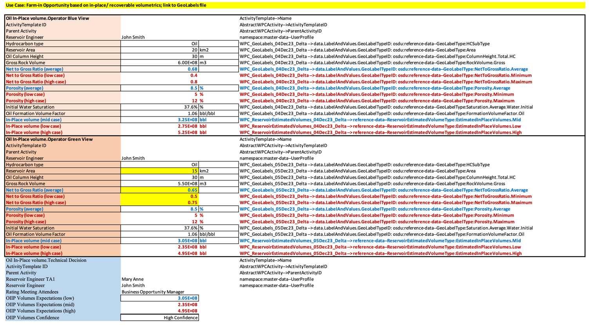

<a name="TOC">Table of Contents</a>

[[_TOC_]]

# Farm-In

## Background Information

### Use Case

There are two main players, the current _"Operator Blue"_ offering data about a farm-in opportunity and the _"Operator Green"_,
evaluating it.

* There is a farm-in opportunity, which is represented by project with code name "Delta".
* The current Operator Blue has provided a data package to interested companies, including reservoir properties, indicating
  the uncertainty ranges (low, mid, high) for Net to Gross ratio and Porosity
    * Operator Blue’s reservoir properties have been captured as GeoLabels (WPC_GeoLabels_04Dec23_Delta)
* However, Operator Green is a partner in an adjacent block and decides to use a different range of reservoir properties
    * Operator Green’s reservoir properties have been captured as GeoLabels (WPC_GeoLabels_05Dec23_Delta)
* Based on the input parameters, Operator Green has calculated the Oil Initially In Place (low, mid, high) for two cases:
    * Operator Blue’s view à Estimated Volumes have been stored using WPC ReservoirEstimatedVolumes (
      ReservoirEstimatedVolumes_04Dec23_Delta)
    * Operator Green’s view à Estimated Volumes have been stored using WPC ReservoirEstimatedVolumes    (
      ReservoirEstimatedVolumes_05Dec23_Delta)

### Technical Decision

* Includes a review and assurance (by a TA1) to decide which OIIP scenario should be used, the Operator Blue’s or
  Operator Green’s

The basis for the decision is provided by [GeoLabelSets](../../../../E-R/work-product-component/GeoLabelSet.1.1.0.md)
(see also [WorkedExamples for GeoLabelSets](../../ReservoirManagement/GeoLabels/README.md)).



The [BusinessDecision](../../../../E-R/master-data/BusinessDecision.1.0.0.md) record lists the data references as
parameters together with the approved expectations.

<details>

<summary markdown="span">Farm-In Decision Data References</summary>

<OsduImportJSON>[Full BusinessDecision example record for Farm-In case](master-data/FarmIn-Delta.json#only.data.Parameters[])</OsduImportJSON>

```json
{
  "data": {
    "Parameters": [
      {
        "Title": "External-DataPackage-As-GeoLabelSet",
        "Selection": "Data package as provided by Operator Blue",
        "DataObjectParameter": "partition-id:work-product-component--GeoLabelSet:WPC_GeoLabels_04Dec23_Delta:",
        "ParameterKindID": "partition-id:reference-data--ParameterKind:DataObject:",
        "ParameterRoleID": "partition-id:reference-data--ParameterRole:Input:"
      },
      {
        "Title": "External-ReservoirEstimatedVolumes",
        "Selection": "ReservoirEstimatedVolumes as provided by Operator Blue",
        "DataObjectParameter": "partition-id:work-product-component--ReservoirEstimatedVolumes:WPC_ReservoirEstimatedVolumes_04Dec23_Delta:",
        "ParameterKindID": "partition-id:reference-data--ParameterKind:DataObject:",
        "ParameterRoleID": "partition-id:reference-data--ParameterRole:Input:"
      },
      {
        "Title": "Internal-DataPackage-As-GeoLabelSet",
        "Selection": "Opportunity evaluation by Operator Green",
        "DataObjectParameter": "partition-id:work-product-component--GeoLabelSet:WPC_GeoLabels_05Dec23_Delta:",
        "ParameterKindID": "partition-id:reference-data--ParameterKind:DataObject:",
        "ParameterRoleID": "partition-id:reference-data--ParameterRole:Input:"
      },
      {
        "Title": "Internal-ReservoirEstimatedVolumes",
        "Selection": "ReservoirEstimatedVolumes as estimated by Operator Green",
        "DataObjectParameter": "partition-id:work-product-component--ReservoirEstimatedVolumes:WPC_ReservoirEstimatedVolumes_05Dec23_Delta:",
        "ParameterKindID": "partition-id:reference-data--ParameterKind:DataObject:",
        "ParameterRoleID": "partition-id:reference-data--ParameterRole:Input:"
      },
      {
        "Title": "OIIP-Volumes-Expectations (low)",
        "Selection": "Estimated by Operator Green",
        "DataQuantityParameter": 304604800.0,
        "ParameterKindID": "partition-id:reference-data--ParameterKind:Double:",
        "DataQuantityParameterUOMID": "partition-id:reference-data--UnitOfMeasure:bbl:"
      },
      {
        "Title": "OIIP-Volumes-Expectations (mid)",
        "Selection": "Estimated by Operator Green",
        "DataQuantityParameter": 234604829.0,
        "ParameterKindID": "partition-id:reference-data--ParameterKind:Double:",
        "DataQuantityParameterUOMID": "partition-id:reference-data--UnitOfMeasure:bbl:"
      },
      {
        "Title": "OIIP-Volumes-Expectations (high)",
        "Selection": "Estimated by Operator Green",
        "DataQuantityParameter": 494604830,
        "ParameterKindID": "partition-id:reference-data--ParameterKind:Double:",
        "DataQuantityParameterUOMID": "partition-id:reference-data--UnitOfMeasure:bbl:"
      },
      {
        "Title": "OIIP-Volumes-Confidence",
        "Selection": "Confidence is high",
        "DataObjectParameter": "partition-id:reference-data--SubjectiveClassificationRating:Confidence.Confident:",
        "ParameterKindID": "partition-id:reference-data--ParameterKind:DataObject:",
        "ParameterRoleID": "partition-id:reference-data--ParameterRole:Input:"
      }
    ]
  }
}
```

</details>

---

[&rarr; Back to TOC](#TOC)

## Mechanics

What may seem ad-hoc in the `data.Parameters[]` can be organized by an
[ActivityTemplate](../../../../E-R/master-data/ActivityTemplate.1.2.0.md). For a given data relationship or value, a
parameter element matches a template prescription by `Title`.

### Relationship to GeoLabelSet (Input)

<details>

<summary markdown="span">Farm-In BusinessDecision "External-DataPackage-As-GeoLabelSet" data.Parameter element</summary>

<OsduImportJSON>[Full BusinessDecision example record for Farm-In case](master-data/FarmIn-Delta.json#only.data.Parameters[0])</OsduImportJSON>

```json
{
  "data": {
    "Parameters": [
      {
        "Title": "External-DataPackage-As-GeoLabelSet",
        "Selection": "Data package as provided by Operator Blue",
        "DataObjectParameter": "partition-id:work-product-component--GeoLabelSet:WPC_GeoLabels_04Dec23_Delta:",
        "ParameterKindID": "partition-id:reference-data--ParameterKind:DataObject:",
        "ParameterRoleID": "partition-id:reference-data--ParameterRole:Input:"
      }
    ]
  }
}
```

</details>

<details>

<summary markdown="span">Farm-In ActivityTemplate "External-DataPackage-As-GeoLabelSet" data.Parameter element</summary>

<OsduImportJSON>[Full ActivityTemplate example record for Farm-In case](master-data/FarmIn-Template.json#only.data.Parameters[0])</OsduImportJSON>

```json
{
  "data": {
    "Parameters": [
      {
        "Title": "External-DataPackage-As-GeoLabelSet",
        "AllowedParameterKind": "partition-id:reference-data--ParameterKind:DataObject:",
        "IsInput": true,
        "IsOutput": false,
        "DataObjectContentType": [
          "work-product-component--GeoLabelSet"
        ],
        "MaxOccurs": 1,
        "MinOccurs": 0
      }
    ]
  }
}
```

</details>

### Value Definition (Output)

<details>

<summary markdown="span">Farm-In BusinessDecision "OIIP-Volumes-Expectations (high)" data.Parameter element</summary>

<OsduImportJSON>[Full BusinessDecision example record for Farm-In case](master-data/FarmIn-Delta.json#only.data.Parameters[6])</OsduImportJSON>

```json
{
  "data": {
    "Parameters": [
      {
        "Title": "OIIP-Volumes-Expectations (high)",
        "Selection": "Estimated by Operator Green",
        "DataQuantityParameter": 494604830,
        "ParameterKindID": "partition-id:reference-data--ParameterKind:Double:",
        "DataQuantityParameterUOMID": "partition-id:reference-data--UnitOfMeasure:bbl:"
      }
    ]
  }
}
```

</details>

<details>

<summary markdown="span">Farm-In ActivityTemplate "OIIP-Volumes-Expectations (high)" data.Parameter element</summary>

<OsduImportJSON>[Full ActivityTemplate example record for Farm-In case](master-data/FarmIn-Template.json#only.data.Parameters[6])</OsduImportJSON>

```json
{
  "data": {
    "Parameters": [
      {
        "Title": "OIIP-Volumes-Expectations (high)",
        "AllowedParameterKind": "partition-id:reference-data--ParameterKind:Double:",
        "IsInput": false,
        "IsOutput": true,
        "MaxOccurs": 1,
        "MinOccurs": 0,
        "UnitQuantityID": "partition-id:reference-data--UnitQuantity:volume:"
      }
    ]
  }
}
```

</details>

---

[&rarr; Back to TOC](#TOC)

## Discussion

What we would like to test and get your views on:

* Pointing the different schemas e.g. technical decision to WPCs where e.g. the properties and estimated volumes are
  captured.
* Dealing with multiple scenarios reflecting uncertainties (low, mid, high) e.g. "Operator Blue View's OIIP" and "
  Operator Green's OIIP" **Answer:** Stored in separate `data.Parameter[]` elements in the same decision record.
* At what level should the assurance take place? At the activity level? At the object data level? **Open Question**
* We have two scenarios (Operator Blue View and Operator Green's) - do we combine them into one activity model or split?
  **Answer:** Stored in separate `data.Parameter[]` elements in the same decision record.
* Where is the actual decision "title or name" and "description" captured:
    * Example of a Technical Decision "title or name": Endorse the L-M-H Volumetric range for the "Delta" Farm in
      opportunity, based on Operator Blue's data and Operator Green due diligence? **Answer**: In `data.Parameter[]`
      elements, which are defined/prescribed in ActivityTemplate.
    * Example of a Technical Decision "description": The opportunity evaluation team has evaluated both the Operator
      Blue and Operator Green's view based on provided properties and existent analogues. It has been decided that
      Operator Green's in place volumes provide a better volumetric ranges to cover the subsurface uncertainties. *
      *Answer:** Currently in `data.DecisionSummary` see below.

<details>

<summary markdown="span">Farm-In Decision Note in DecisionSummary</summary>

<OsduImportJSON>[Full BusinessDecision example record for Farm-In case](master-data/FarmIn-Delta.json#only.data.DecisionSummary)</OsduImportJSON>

```json
{
  "data": {
    "DecisionSummary": "The opportunity evaluation team has evaluated both the Operator Blue and Operator Green's view based on provided properties and existent analogues. It has been decided that Operator Green's in place volumes provide a better volumetric ranges to cover the subsurface uncertainties"
  }
}
```

</details>

---

[&rarr; Back to TOC](#TOC)