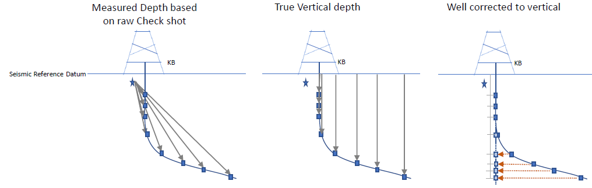
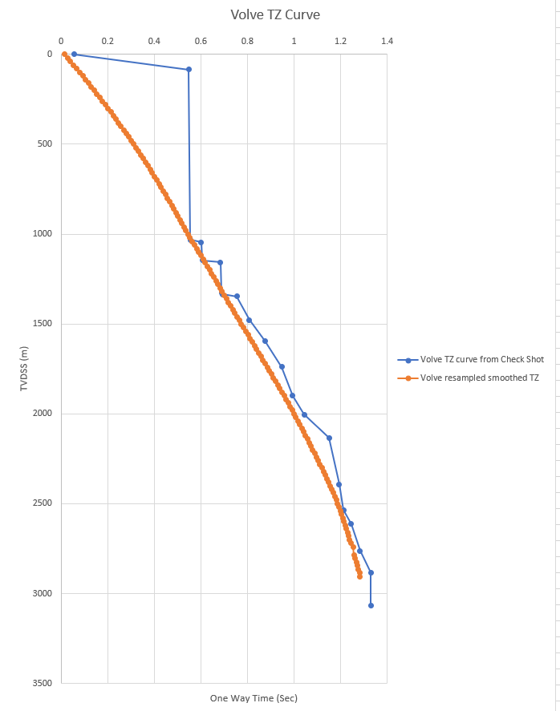
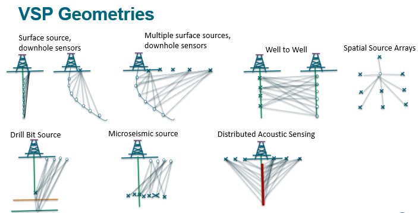
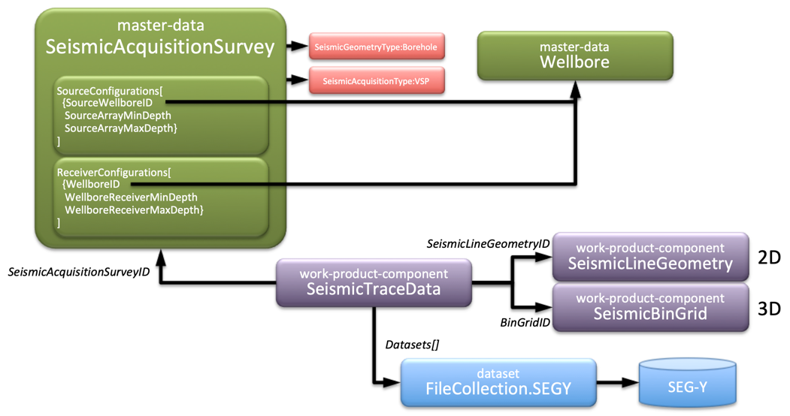

[[_TOC_]]

# Time Depth Curves and VSP

## Time Depth Curves

### Time-Depth Curve Definitions

- **TZ curve**  : A simple time to depth relationship used for conversions of well data (depth) to time  (seismic)
  domain. They also form inputs to velocity models time to depth conversions by providing well calibration points.
- **Creation**:   TZ-curves can be generated from a range of data types such as check shot or VSP by picking first break
  times at various receivers, or derived from borehole data such as sonic logs.
- **Units**: Time can be measured in milliseconds, seconds, or microseconds and can represent one-way or two-way times.
  Depths are in feet/inches, or meters/centimeters.

### Travel Time representations in a TZ curve

In OSDU checkshots, time-depth curves are represented as
[WellLog](../../../E-R/work-product-component/WellLog.1.5.0.md).



### User Stories

#### Data Manager

- Load TZ curve history including
- Data used in derivation
- Processed or unprocessed
- Datum
- Resampled or irregular sampling
- Drift curve values and travel time representation

#### User

- Search wells with TZ curves, checkshots
- Deliver the following:

- Raw Checkshots
- Processed TZ curves
- TZ curve processing history
- TZ curve datums
- Smoothed or raw curved

### TZ Curve Properties

- TZ curves are derived from check shot or VSP data, or from integrated sonic logs
- Check shot data generally has a very sparse and irregular vertical sampling
- VSP can have very fine sampling but generally regular
- Either case needs some processing before use.
    - Seismic well tie in general needs regular sampling but not over sampled.
- Values are edited for bad or erroneous measurements
- Curves are smoothed before use and resampled. Care needs to be taken not to break the time to depth relationship
  during processing.
- There are tools that use a 'least squares' approach to smoothing and resampling that limits the amount of drift from
  the original curve. Drift curves are produced as a QC for this.
- During velocity model building pseudo well locations are often generated to help extrapolation/interpolation from
  sparse locations to a 3D model and may need to be saved for future model building.
- TZ curves contain only 2 columns to establish the time to depth relationship and is attached to a known well or well
  location.
- It is important to understand what the curve is representing.

### Time Depth Curve Resampled and Smoothed

The original and smoothed/resampled curve are compared:



The smoothed curve is constrained to a misfit of 4 ms.

### Time-Depth Curve Manifest Examples

- The original manifest contains the checkshot times in curve "OWT" (one-way time). The IsRegular flag is false.
  - [load_log.1.1.0_NPD-2105.json](manifests/load_log.1.1.0_NPD-2105.json) .
- The resampled and smoothed curve manifest has the IsRegular flag set true, and has the SamplingIncrement set to 20.
  - [load_log.1.1.0_NPD-2105_resamp.json](manifests/load_log.1.1.0_NPD-2105_resamp.json)

Please note the **_two_** vertical references for time and depth defining the zero depth and zero time:

<details>

<summary markdown="span"><code>SeismicReferenceElevation</code> (zero time) and <code>VerticalMeasurement</code> (zero depth)</summary>

<OsduImportJSON>[load_log.1.1.0_NPD-2105.json, Full](manifests/load_log.1.1.0_NPD-2105.json#only.Data.WorkProductComponents[0].data.SeismicReferenceElevation|VerticalMeasurement)</OsduImportJSON>

```json
{
  "Data": {
    "WorkProductComponents": {
      "data": {
        "SeismicReferenceElevation": {
          "VerticalMeasurement": 0.0,
          "VerticalMeasurementTypeID": "partition-id:reference-data--VerticalMeasurementType:SeismicReferenceDatum:",
          "VerticalMeasurementPathID": "partition-id:reference-data--VerticalMeasurementPath:TrueVerticalHeight:",
          "VerticalMeasurementUnitOfMeasureID": "partition-id:reference-data--UnitOfMeasure:m:",
          "VerticalCRSID": "partition-id:reference-data--CoordinateReferenceSystem:Vertical:EPSG::5715:",
          "VerticalMeasurementSourceID": "partition-id:reference-data--VerticalMeasurementSource:LOG:",
          "VerticalMeasurementDescription": "Zero time reference: Mean sea level"
        },
        "VerticalMeasurement": {
          "VerticalMeasurement": 22.0,
          "VerticalMeasurementTypeID": "partition-id:reference-data--VerticalMeasurementType:KellyBushing:",
          "VerticalMeasurementPathID": "partition-id:reference-data--VerticalMeasurementPath:TrueVerticalHeight:",
          "VerticalMeasurementUnitOfMeasureID": "partition-id:reference-data--UnitOfMeasure:m:",
          "VerticalCRSID": "partition-id:reference-data--CoordinateReferenceSystem:Vertical:EPSG::5715:",
          "VerticalMeasurementSourceID": "partition-id:reference-data--VerticalMeasurementSource:LOG:",
          "VerticalMeasurementDescription": "Zero depth point for TVD."
        }
      }
    }
  }
}
```

</details>


## Vertical Seismic Profiles (VSP)

Vertical Seismic Profiles, or VSPs, initially referred to seismic recordings in which the source was on the surface, and
receivers were in a borehole. The recorded seismic traces, containing both direct arrivals and reflections, have both a
time axis and a depth axis. They can be used to accurately identify the depths of reflectors seen in surface seismic
data. The types of source-receiver geometries have evolved, now including the types identified below.

### VSP Types Illustration



- The conventional VSP has surface sources and downhole receivers.  Receivers are often multi-component.
- There may be multiple sources at the surface.
- The well to well is another option, often used for tomography.
- Source arrays may be single, multiple, or spatial.
- The drill bit can be the source, with receivers at the surface.
- Microseismic uses receivers at the surface or in a borehole to record wave-fields produced by hydraulic fracturing.
- Distributed Acoustic Sensing, DAS, uses continuous sensing from downhole fiber-optic cable.

### User Stories

#### Data Manager

- Load VSP trace data in all formats in which data is received, e.g., SEG-Y, others
- Geometry, sources, receivers
- Store processing history and processed volumes
- Ingest metadata as needed for search
- Link VSP to well
- Store extracted data, checkshots, T-Z, velocity, [see above](#travel-time-representations-in-a-tz-curve)

#### User Requirements

Search and Deliver
- Wells with VSPs
- All components of multi-component VSP
- All VSPs within a seismic survey area
- VSP and processing products including T-Z curves, VSP extracted trace, VSP stacks
- Find All VSPs within survey area

### VSP Model Illustration



Adding support for VSPs to the current seismic data model required these additions to
[master-data--SeismicAcquisitionSurvey](../../../E-R/master-data/SeismicAcquisitionSurvey.1.4.0.md).

- Source configuration array
  - SourceWellboreID
  - SourceArrayMinDepth
  - SourceArrayMaxDepth
- Receiver configuration array
  - WellboreID
  - WellboreReceiverMinDepth
  - WellboreReceiverMaxDepth

There are no changes to [SeismicTraceData](../../../E-R/work-product-component/SeismicTraceData.1.8.0.md).

SeismicFieldNavigation can accommodate the navigation files containing source and receiver locations in formats
including P1/90, and P1/11.

### Example

<details>

<summary markdown="span"><code>SeismicAcquisitionSurvey</code> VSP example record</summary>

<OsduImportJSON>[Complete VSP SeismicAcquisitionSurvey record](./master-data/VSP-Acquisition.json#only.data)</OsduImportJSON>

```json
{
  "data": {
    "VersionCreationReason": "Initial version",
    "ProjectName": "ACVME 1 VSP",
    "Purpose": "Exploration",
    "ProjectBeginDate": "2010-07-12",
    "ProjectEndDate": "2010-07-19",
    "Operator": "partition-id:master-data--Organisation:Chevron:",
    "Contractors": [
      {
        "ContractorOrganisationID": "partition-id:master-data--Organisation:Schlumberger:",
        "ContractorTypeID": "partition-id:reference-data--ContractorType:Record:"
      }
    ],
    "SeismicGeometryTypeID": "partition-id:reference-data--SeismicGeometryType:Borehole:",
    "AcquisitionTypeID": "partition-id:reference-data--SeismicAcquisitionType:VSP:",
    "OperatingEnvironmentID": "partition-id:reference-data--OperatingEnvironment:Offshore:",
    "SampleInterval": 1.0,
    "RecordLength": 5000.0,
    "ShootingAzimuthAngle": 118,
    "SourceConfigurations": [
      {
        "VesselName": "Atwood Eagle Rig",
        "EnergySourceTypeID": "partition-id:reference-data--SeismicEnergySourceType:AirGun:",
        "SourceArrayCount": 3,
        "SourceArrayDepth": 5.7,
        "SourceArrayVolume": 750.0,
        "Remarks": "Delta G-Gun cluster with three airguns deployed from rig.  Minimum 5 shots per level."
      }
    ],
    "ReceiverConfigurations": [
      {
        "VesselName": "Atwood Eagle Rig",
        "ReceiverTypeID": "partition-id:reference-data--SeismicReceiverType:3-ComponentGeophone:",
        "CableCount": 1,
        "ReceiverCount": 8,
        "ReceiverSpacingInterval": 15.1,
        "ReceiverGroupSpacing": 120.0,
        "Remarks": "This survey included Rig Source VSP measurements from 4700 m MD DF to seabed. The data were acquired using an 8 shuttle (15.12 m spacing) VSI downhole Tool",
        "WellboreID": "partition-id:master-data--Wellbore:Acme-1:",
        "WellboreReceiverMinDepth": 844.0,
        "WellboreReceiverMaxDepth": 4700.0
      }
    ],
    "ExtensionProperties": {}
  }
}
```

</details>

The initial model does not explicitly support the files used for DAS or microseismic configurations.

- Source configuration
  - The source was an airgun using a Delta G-gun cluster.   The cluster has 3 airguns.
  - The source is at 5.7 m below sea level.   There is no downhole source, so the wellbore ID is not populated.

- Receiver configurations
  - The receivers were a downhole array tool with 8 3-component geophones, spaced at 15 m apart.
  - The group spacing describes the distance between a set-up of the receiver string and the next set-up.
  - The `WellboreID` identifies the [wellbore](../../../E-R/master-data/Wellbore.1.5.1.md).

  ### Loadable Example – Acme-1 Well

A loadable VSP and associated data are available in the Open Test directory, NOPIMS.  The data is provided by the Australian National Offshore Petroleum Information System (NOPIMS).

- The VSP trace data is in the shared s3 repository,
  at [trace data](s3://osdu-seismic-test-data/nopims/seismic/CVX_Acme-1_upp.sgy).
- The  [Instances directory](https://community.opengroup.org/osdu/data/open-test-data/-/tree/master/rc--3.0.0/4-instances/NOPIMS)
  contains loadable manifests.Subdirectories are:
- Master data contains well and wellbore. The Misc_master_data contains manifests for context including Basin, Field,
  GeopoliticalEntity, Organisation, Prospect, and Rig. It also contains SeismicAcquisitionSurvey, which describes the
  VSP source and receiver configurations.
- Reference Data contains the reference values needed, including BasinType, OperatingEnvironment.
  SeismicEnergySourceType, SpatialMeasurementType, and VerticalMeasurementPath. It is assumed that the standard
  reference values, like for CRS, CT, and UOM are already loaded. The Reference values included in the NOPIMS directory
  are only values that are not in the standard set.
- The work-products `/seismics` directory contains the trace data manifest.

The [Data Directory](https://community.opengroup.org/osdu/data/open-test-data/-/tree/master/rc--3.0.0/1-data/3-provided/NOPIMS) contains csv files formatted for input to the Python scripts that generate the JSON manifests. They are not needed if you will  be loading the JSON manifests from the Instances directory.