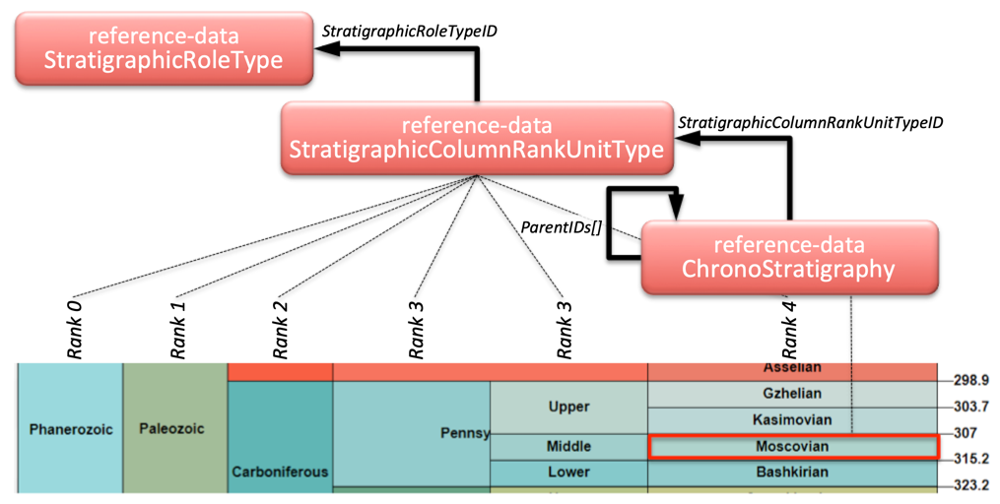

<a name="TOC"></a>

[[_TOC_]]

# ChronoStratigraphy

The OSDU reference values re-publish the contents of
the [International Chronostratigraphic Chart](https://stratigraphy.org/timescale/) published by ICS
(International Commission on Stratigraphy) at [stratigraphy.org](https://stratigraphy.org).

As an example, we look at Moscovian in the chronostratigraphic chart in the context of the OSDU data model consisting
of:

* [`osdu:wks:reference-data--StratigraphicRoleType:1.*.*`](../../../E-R/reference-data/StratigraphicRoleType.1.0.0.md)
* [`osdu:wks:reference-data--StratigraphicColumnRankUnitType:1.*.*`](../../../E-R/reference-data/StratigraphicColumnRankUnitType.1.1.0.md)
* [`osdu:wks:reference-data--ChronoStratigraphy:1.*.*0`](../../../E-R/reference-data/ChronoStratigraphy.1.1.0.md)

For ChronoStratigraphy all records are in the context
of [`StratigraphicRoleType`](../../../E-R/reference-data/StratigraphicRoleType.1.0.0.md)
== [`ChronoStratigraphic`](records/Chronostratigraphic.json)
.



The above figure shows the ChronoStratigraphy-relevant types and their relations. The example Muscovian is shown in
context of the chart. The column rank is given via the `StratigraphicColumnRankUnitType` `data.Rank`.

[Back to TOC](#TOC)

###### Moscovian

* The [record](records/Moscovian.json) is associated to the rank [`Chronostratigraphic.Stage`](records/C.4.Stage.json),
  which has Rank 4 (the rightmost column).
* The `id` contains the full, cumulative
  hierarchy `Phanerozoic.Paleozoic.Carboniferous.Pennsylvanian.MiddlePennsylvanian.Moscovian`.
* `ParentIDs` has one member, relating to MiddlePennsylvanian.
* `ChildCodes` is empty since this is a leaf in the tree. Note that this property is not defined as relationship - to
  avoid cyclic dependencies in the relationships.

<details>

<summary markdown="span">Moscovian Record (fragment)</summary>

<OsduImportJSON>[Complete Moscovian Record](./records/Moscovian.json#only.data)</OsduImportJSON>

```json
{
  "data": {
    "Name": "Moscovian",
    "NameAlias": [
      {
        "AliasName": "Moscovian",
        "AliasNameTypeID": "{{NAMESPACE}}:reference-data--AliasNameType:UniqueIdentifier:",
        "DefinitionOrganisationID": "{{NAMESPACE}}:reference-data--StandardsOrganisation:ICS:"
      }
    ],
    "Description": "The Moscovian Age [315.2-307.0]",
    "Code": "Phanerozoic.Paleozoic.Carboniferous.Pennsylvanian.MiddlePennsylvanian.Moscovian",
    "AttributionAuthority": "ICS https://stratigraphy.org",
    "AttributionPublication": "https://github.com/CSIRO-enviro-informatics/interactive-geological-timescale/tree/master/src/assets",
    "AgeBegin": 315.2,
    "AgeEnd": 307,
    "ChildCodes": [],
    "Colour": "#AFD3CC",
    "StratigraphicColumnRankUnitTypeID": "{{NAMESPACE}}:reference-data--StratigraphicColumnRankUnitType:Chronostratigraphic.Stage:",
    "ParentIDs": [
      "{{NAMESPACE}}:reference-data--ChronoStratigraphy:Phanerozoic.Paleozoic.Carboniferous.Pennsylvanian.MiddlePennsylvanian:"
    ],
    "Source": "Workbook Authoring/ChronoStratigraphy.1.0.0.xlsx; commit SHA 4aad0c73."
  }
}
```
</details>


##### Middle Pennsylvanian

* The  [record](records/MiddlePennsylvanian.json) is associated to the
  rank [`Chronostratigraphic.Series`](records/C.3.Series.json), which has Rank 3.
* The `id` contains the full, cumulative
  hierarchy `Phanerozoic.Paleozoic.Carboniferous.Pennsylvanian.MiddlePennsylvanian`.
* `ParentIDs` has one member, relating to Pennsylvanian.
* `ChildCodes` has one member, the full cumulative code for Moscovian. Note that this property is not defined as
  relationship - to avoid cyclic dependencies in the relationships.

<details>

<summary markdown="span">Middle Pennsylvanian Record (fragment)</summary>

<OsduImportJSON>[Complete Middle Pennsylvanian Record](./records/MiddlePennsylvanian.json#only.data)</OsduImportJSON>

```json
{
  "data": {
    "Name": "Middle Pennsylvanian",
    "NameAlias": [
      {
        "AliasName": "MiddlePennsylvanian",
        "AliasNameTypeID": "{{NAMESPACE}}:reference-data--AliasNameType:UniqueIdentifier:",
        "DefinitionOrganisationID": "{{NAMESPACE}}:reference-data--StandardsOrganisation:ICS:"
      }
    ],
    "Description": "The Middle Pennsylvanian Epoch Sub-Epoch [315.2-307.0]",
    "Code": "Phanerozoic.Paleozoic.Carboniferous.Pennsylvanian.MiddlePennsylvanian",
    "AttributionAuthority": "ICS https://stratigraphy.org",
    "AttributionPublication": "https://github.com/CSIRO-enviro-informatics/interactive-geological-timescale/tree/master/src/assets",
    "AgeBegin": 315.2,
    "AgeEnd": 307,
    "ChildCodes": [
      "Phanerozoic.Paleozoic.Carboniferous.Pennsylvanian.MiddlePennsylvanian.Moscovian"
    ],
    "Colour": "#A1CFCC",
    "StratigraphicColumnRankUnitTypeID": "{{NAMESPACE}}:reference-data--StratigraphicColumnRankUnitType:Chronostratigraphic.Series:",
    "ParentIDs": [
      "{{NAMESPACE}}:reference-data--ChronoStratigraphy:Phanerozoic.Paleozoic.Carboniferous.Pennsylvanian:"
    ],
    "Source": "Workbook Authoring/ChronoStratigraphy.1.0.0.xlsx; commit SHA 4aad0c73."
  }
}
```
</details>

#### Pennsylvanian

* The [record](records/Pennsylvanian.json) is associated to the
  rank [`Chronostratigraphic.Series`](records/C.3.Series.json), which also has Rank 3. MiddlePennsylvanian is the child
  series or sub-series of Pennsylvanian, meaning that MiddlePennsylvanian and Pennsylvanian share the same column by
  Rank, but Pennsylvanian appears 'left of' MiddlePennsylvanian due to the parent-child relationship in a common rank.
* The `id` contains the full, cumulative hierarchy `Phanerozoic.Paleozoic.Carboniferous.Pennsylvanian`.
* `ParentIDs` has one member, relating to Carboniferous.
* `ChildCodes` has four members, all a full cumulative codes for the siblings of MiddlePennsylvanian. Note that this
  property is not defined as relationship - to avoid cyclic dependencies in the relationships.

<details>

<summary markdown="span">Pennsylvanian Record (fragment)</summary>

<OsduImportJSON>[Complete Pennsylvanian Record](./records/C.3.Series.json#only.data)</OsduImportJSON>

```json
{
  "data": {
    "Name": "Series",
    "NameAlias": [
      {
        "AliasName": "Epoch"
      }
    ],
    "Description": "Series are subdivisions of rock layers based on the age of the rock and formally defined by international conventions of the geological timescale. A series is therefore a sequence of strata defining a chronostratigraphic unit. Series are subdivisions of systems and are themselves divided into stages.",
    "Code": "Chronostratigraphic.Series",
    "AttributionPublication": "https://en.wikipedia.org/wiki/Series_(stratigraphy)",
    "Rank": 3,
    "StratigraphicRoleTypeID": "{{NAMESPACE}}:reference-data--StratigraphicRoleType:Chronostratigraphic:",
    "Source": "Workbook Authoring/StratigraphicColumnRankUnitType.1.0.0.xlsx; commit SHA 71749e18."
  }
}
```
</details>

### Carboniferous

* The [record](records/Carboniferous.json) is associated to the
  rank [`Chronostratigraphic.System`](records/C.2.System.json), which has Rank 2.
* The `id` contains the full, cumulative hierarchy `Phanerozoic.Paleozoic.Carboniferous`.
* `ParentIDs` has one member, relating to Paleozoic.
* `ChildCodes` has two members, full cumulative codes for Mississippian and Pennsylvanian. Note that this
  property is not defined as relationship - to avoid cyclic dependencies in the relationships.

<details>

<summary markdown="span">Carboniferous Record (fragment)</summary>

<OsduImportJSON>[Complete Carboniferous Record](./records/C.2.System.json#only.data)</OsduImportJSON>

```json
{
  "data": {
    "Name": "System",
    "NameAlias": [
      {
        "AliasName": "Period"
      }
    ],
    "Description": "A system in stratigraphy is a unit of rock layers that were laid down together within the same corresponding geological period. The associated period is a chronological time unit, a part of the geological time scale, while the system is a unit of chronostratigraphy. Systems are unrelated to lithostratigraphy, which subdivides rock layers on their lithology. Systems are subdivisions of erathems and are themselves divided into series and stages.",
    "Code": "Chronostratigraphic.System",
    "AttributionPublication": "https://en.wikipedia.org/wiki/System_(stratigraphy)",
    "Rank": 2,
    "StratigraphicRoleTypeID": "{{NAMESPACE}}:reference-data--StratigraphicRoleType:Chronostratigraphic:",
    "Source": "Workbook Authoring/StratigraphicColumnRankUnitType.1.0.0.xlsx; commit SHA 71749e18."
  }
}
```
</details>

## Paleozoic

* The [record](records/Paleozoic.json) is associated to the
  rank [`Chronostratigraphic.Erathem`](records/C.1.Erathem.json), which has Rank 1.
* The `id` contains the full, cumulative hierarchy `Phanerozoic.Paleozoic`.
* `ParentIDs` has one member, relating to Phanerozoic.
* `ChildCodes` has six members, full cumulative codes from Permian to Cambrian. Note that this
  property is not defined as relationship - to avoid cyclic dependencies in the relationships.

<details>

<summary markdown="span">Paleozoic Record (fragment)</summary>

<OsduImportJSON>[Complete Paleozoic Record](./records/C.1.Erathem.json#only.data)</OsduImportJSON>

```json
{
  "data": {
    "Name": "Erathem",
    "NameAlias": [
      {
        "AliasName": "Era"
      }
    ],
    "Description": "In stratigraphy, paleontology, geology, and geobiology an erathem is the total stratigraphic unit deposited during a certain corresponding span of time during an era in the geologic timescale.",
    "Code": "Chronostratigraphic.Erathem",
    "AttributionPublication": "https://en.wikipedia.org/wiki/Erathem",
    "Rank": 1,
    "StratigraphicRoleTypeID": "{{NAMESPACE}}:reference-data--StratigraphicRoleType:Chronostratigraphic:",
    "Source": "Workbook Authoring/StratigraphicColumnRankUnitType.1.0.0.xlsx; commit SHA 71749e18."
  }
}
```
</details>

# Phanerozoic

* The [record](records/Phanerozoic.json) is associated to the
  rank [`Chronostratigraphic.Eonothem`](records/C.0.Eonothem.json), which has Rank 0.
* The `id` contains only the code `Phanerozoic`.
* `ParentIDs` is an empty array meaning the root level of the hierarchy is found.
* `ChildCodes` has three members, full cumulative codes from Cenozoic to Paleozoic. Note that this
  property is not defined as relationship - to avoid cyclic dependencies in the relationships.

<details>

<summary markdown="span">Phanerozoic Record (fragment)</summary>

<OsduImportJSON>[Complete Phanerozoic Record](./records/C.0.Eonothem.json#only.data)</OsduImportJSON>

```json
{
  "data": {
    "Name": "Eonothem",
    "NameAlias": [
      {
        "AliasName": "Eon"
      }
    ],
    "Description": "In stratigraphy and geology, an eonothem is the totality of rock strata laid down in the stratigraphic record deposited during a certain eon of the continuous geologic timescale.",
    "Code": "Chronostratigraphic.Eonothem",
    "AttributionPublication": "https://en.wikipedia.org/wiki/Eonothem",
    "Rank": 0,
    "StratigraphicRoleTypeID": "{{NAMESPACE}}:reference-data--StratigraphicRoleType:Chronostratigraphic:",
    "Source": "Workbook Authoring/StratigraphicColumnRankUnitType.1.0.0.xlsx; commit SHA 71749e18."
  }
}
```
</details>

[Back to TOC](#TOC)
