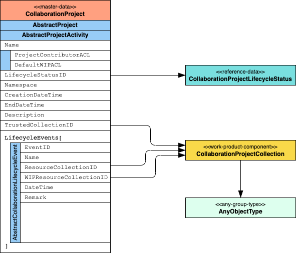

<a name="TOC">Table of Contents</a>

[[_TOC_]]

# Collaboration Project

Currently work in progress related to the OSDU System
[Project and Workflow service](https://community.opengroup.org/osdu/platform/system/project-and-workflow). The
following elements have been created:

1. Main object [master-data--CollaborationProject](../../../E-R/master-data/CollaborationProject.1.0.0.md), the central
   connection point.
    1. It includes the fragment
       [AbstractCollaborationLifecycleEvent](../../../E-R/abstract/AbstractCollaborationLifecycleEvent.1.0.0.md) to
       record relevant collaboration events causing notifications to collaborators (but this is only the record, the
       notification is managed by the service).
2. The state of the CollaborationProject can have specific values with specific semantics associated.
   [reference-data--CollaborationProjectLifecycleStatus](../../../E-R/reference-data/CollaborationProjectLifecycleStatus.1.0.0.md).
   <br>The following states are currently defined: `Created` &rarr; `Open` &rarr; `Closed`.
3. CollaborationProject and AbstractCollaborationLifecycleEvent refer to
   [work-product-component--CollaborationProjectCollection](../../../E-R/work-product-component/CollaborationProjectCollection.1.0.0.md).
   This collection type can hold references to any kind of platform Storage record.



Currently, only auto-generated examples are available for
* [master-data--CollaborationProject](../../master-data/CollaborationProject.1.0.0.json)
* [work-product-component--CollaborationProjectCollection](../../work-product-component/CollaborationProjectCollection.1.0.0.json)

<details>

<summary markdown="span"><code>master-data--CollaborationProject</code> record with main components.</summary>

<OsduImportJSON>[`master-data--CollaborationProject`, full record](../../master-data/CollaborationProject.1.0.0.json#only.data.ProjectName|LifecycleStatusID|Namespace|Description|TrustedCollectionID|LifecycleEvents)</OsduImportJSON>

```json
{
  "data": {
    "ProjectName": "Example ProjectName",
    "LifecycleStatusID": "namespace:reference-data--CollaborationProjectLifecycleStatus:Open:",
    "Namespace": "project-f3e451d1-9d49-559f-93d8-2e36722016fb",
    "Description": "Find all the hydrocarbons on the moon",
    "TrustedCollectionID": "namespace:work-product-component--CollaborationProjectCollection:CollaborationProjectCollection-911bb71f-06ab-4deb-8e68-b8c9229dc76b:",
    "LifecycleEvents": [
      {
        "EventID": "CreationEvent",
        "Name": "Example Name",
        "DateTime": "2020-02-13T09:13:15.55Z",
        "Remark": "Example Remark",
        "ResourceCollectionID": "namespace:work-product-component--CollaborationProjectCollection:CollaborationProjectCollection-911bb71f-06ab-4deb-8e68-b8c9229dc76b:",
        "WIPResourceCollectionID": "namespace:work-product-component--CollaborationProjectCollection:CollaborationProjectCollection-911bb71f-06ab-4deb-8e68-b8c9229dc76b:"
      }
    ]
  }
}
```

</details>

<details>

<summary markdown="span"><code>work-product-component--CollaborationProjectCollection</code> record with main components.</summary>

<OsduImportJSON>[`work-product-component--CollaborationProjectCollection`, full record](../../work-product-component/CollaborationProjectCollection.1.0.0.json#only.data.Name|ResourceIDs)</OsduImportJSON>

```json
{
  "data": {
    "Name": "Example Name",
    "ResourceIDs": [
      "namespace:work-product-component--SeismicHorizon:a7a81843-9bea-5ce4-913c-f67e4ea154ff:321",
      "namespace:master-data--Well:6c60ceb0-3521-57b7-9bd8-e1d7c9f66230:432",
      "namespace:master-data--Wellbore:c7c421a7-f496-5aef-8093-298c32bfdea9:543",
      "namespace:master-data--WellboreOpening:0e3c8b85-f442-5239-89ad-9d933a1c562e:654",
      "namespace:master-data--Basin:SomeUniqueBasinID:765",
      "namespace:master-data--Field:SomeUniqueFieldID:876",
      "namespace:master-data--Play:SomeUniquePlayID:987",
      "namespace:master-data--Prospect:SomeUniqueProspectID:123"
    ]
  }
}
```

</details>


[Back to TOC](#TOC)

---