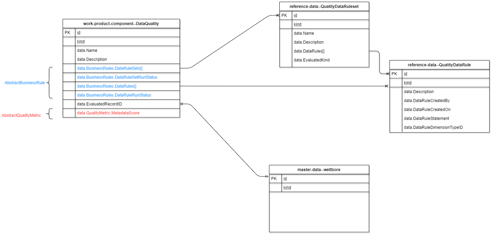

<a name="TOC">Table of Contents</a>

[[_TOC_]]

# Usage of `work-product-component--DataQuality`

Identifying the fit-for-purpose data is important for any consumer of a data platform. This can be done by creating
quality rules for the data for performing different quality checks.

OSDU has defined a number of schemas for the creation of Business rule(s) and rule-set(s) as required, and the generated
work-product-component indicating the overall quality of the data for the evaluated OSDU data type record.

- [work-product-component--DataQuality](../../../E-R/work-product-component/DataQuality.1.3.0.md) is used to
  store the results from a run of Data Quality Metric Evaluation engine. It captures summary information, such as which
  Business rule-set(s) and rule(s) have been used, when this was run and by whom. It also captures the evaluated quality
  metrics for the evaluated OSDU data type record.
    - [AbstractBusinessRules](../../../E-R/abstract/AbstractBusinessRule.1.0.0.md) schema fragment defines the
      Business Rule, which is a collection of one or more data quality rule-sets with their run status, as well as a
      collection of individual data quality rules with their run status.
    - [AbstractQualityMetric](../../../E-R/abstract/AbstractQualityMetric.1.1.0.md) schema fragment contains the
      properties for data profiling and data metrics of OSDU data types.
- [reference-data--QualityDataRule](../../../E-R/reference-data/QualityDataRule.1.1.1.md) is used to create data
  quality rule(s), and the output of rule(s) execution is stored
  in [work-product-component--DataQuality](../../../E-R/work-product-component/DataQuality.1.3.0.md).
- [reference-data--QualityDataRuleSet](../../../E-R/reference-data/QualityDataRuleSet.2.0.1.md) is used as a
  collection of multiple data quality rules.

The entity relationships are shown in the diagram below:



The different data elements
of [work-product-component--DataQuality](../../../E-R/work-product-component/DataQuality.1.3.0.md) have
undergone revision. This document outlines the specific revision in the different schemas and relationship
to `work-product-component--DataQuality`. This document also provides example of how multiple Business rules can be
created for a specific OSDU data type, and how the data quality metric score is stored in
`work-product-component--DataQuality` record after the rules are executed.

## Changes compared to `work-product-component--DataQuality:1.0.0`

The purpose of the new changes were:

### 1. Update in [AbstractQualityMetric](../../../E-R/abstract/AbstractQualityMetric.1.1.0.md) &rarr; `data.QualityMetric.MetadataScore`

`data.QualityMetric.MetadataScore` property is introduced
in [AbstractQualityMetric](../../../E-R/abstract/AbstractQualityMetric.1.1.0.md) to allow storing of the score
in % for the evaluated record.

`data.QualityMetric`
in [work-product-component--DataQuality](../../../E-R/work-product-component/DataQuality.1.3.0.md) refers
to [AbstractQualityMetric](../../../E-R/abstract/AbstractQualityMetric.1.1.0.md).

## Changes compared to `reference-data--QualityDataRule:1.0.0`

The purpose of the new changes were:

### 1. DataRuleDimensionTypes

`data.DataRuleDimensionTypeID` property is introduced
in [reference-data--QualityDataRule](../../../E-R/reference-data/QualityDataRule.1.1.1.md).

In the Data Quality Management space, there are widely known data quality dimensions, which are important to be able to
assess the specific aspects of the data and clearly distinguish different rule purposes, such as:

- Accuracy
- Availability
- Completeness
- Conformance
- Consistency

<ins>Note</ins>:
OSDU [reference-data--DataRuleDimensionType](../../../E-R/reference-data/DataRuleDimensionType.1.0.0.md)
with its Governance Model defined as **Open** adopts the published reference values list from
PPDM [Quality_Data_Rule_Set_PPDM_20220328](https://og.enterprise.slack.com/files/U027UFFRUUA/F038SGPGDRU/quality_data_rule_set_ppdm_20220328.xlsx), which list follows Quality dimensions defined in ISO/IEC 25012.

## Changes compared to `reference-data--QualityDataRuleSet:1.0.0`

The purpose of the new changes were:

### 1. AbstractReferenceType

[AbstractReferenceType](../../../E-R/abstract/AbstractReferenceType.1.0.0.md), which was missing in
previous `reference-data--QualityDataRuleSet:1.0.0`, is now included
in [reference-data--QualityDataRuleSet](../../../E-R/reference-data/QualityDataRuleSet.2.0.1.md).

### 2. EvaluatedKind

`data.EvaluatedKind` property is introduced
in [reference-data--QualityDataRuleSet](../../../E-R/reference-data/QualityDataRuleSet.2.0.1.md) to be able to
know which OSDU data type this rule-set applies to.

<ins>A few important notes</ins>:

- Version-specific and non-version-specific kind can be defined. For example, osdu:wks:master-data--Well:1 (requiring
  only the major version and permits any minor and patch version); osdu:wks:master-data--Wellbore:1.0.0 (this is
  version-specific); osdu:wks:work-product-component--WellLog (this is unspecific accepting any version).
- A total wildcard would have to end with a `:` like this: `osdu:wks:group-type--EntityType:`.

## Use Case Examples

In the following example use case, multiple Business rules can be created for `master-data--Wellbore` 8816 OSDU data
type record, and how the data quality metric score is stored in `work-product-component--DataQuality` record after the
rules are executed.

<details>

<summary markdown="span">Here is a snippet of a data block of <code>master-data--Wellbore</code> 8816 JSON Schema Fragment Example</summary>

<OsduImportJSON>[`master-data--Wellbore`, Full](master-data/wellbore.json#only.data)</OsduImportJSON>

```json
{
  "data": {
    "NameAliases": [
      {
        "AliasName": "8816",
        "AliasNameTypeID": "partition-id:reference-data--AliasNameType:UniqueIdentifier:"
      },
      {
        "AliasName": "L15-FA-103",
        "AliasNameTypeID": "partition-id:reference-data--AliasNameType:Borehole%20Code:"
      },
      {
        "AliasName": "L15-FA-103",
        "AliasNameTypeID": "partition-id:reference-data--AliasNameType:Borehole:"
      }
    ],
    "GeoContexts": [
      {
        "GeoPoliticalEntityID": "partition-id:master-data--GeoPoliticalEntity:L15:",
        "GeoTypeID": "partition-id:reference-data--GeoPoliticalEntityType:BlockID:"
      },
      {
        "FieldID": "partition-id:master-data--Field:L15b-A:",
        "GeoTypeID": "Field"
      }
    ],
    "InitialOperatorID": "partition-id:master-data--Organisation:NAM:",
    "CurrentOperatorID": "partition-id:master-data--Organisation:Neptune%20Energy%20Netherlands%20B.V.:",
    "OperatingEnvironmentID": "partition-id:reference-data--OperatingEnvironment:OFF:",
    "FacilityName": "Example FacilityName",
    "FacilityStates": [
      {
        "FacilityStateTypeID": "partition-id:reference-data--FacilityStateType:Technisch%20mislukt%20en%20sidetracked:"
      }
    ],
    "FacilityEvents": [
      {
        "FacilityEventTypeID": "partition-id:reference-data--FacilityEventType:Drilling%20Start:",
        "EffectiveDateTime": "1992-04-10T00:00:00"
      },
      {
        "FacilityEventTypeID": "partition-id:reference-data--FacilityEventType:Drilling%20Finish:",
        "EffectiveDateTime": "1992-06-11T00:00:00"
      }
    ],
    "WellID": "partition-id:master-data--Well:8816:",
    "FacilityTypeID": "namespace:reference-data--FacilityType:Wellbore:",
    "SequenceNumber": 1,
    "VerticalMeasurements": [
      {
        "VerticalMeasurementID": "Measured_From",
        "VerticalMeasurement": 42.51,
        "VerticalMeasurementTypeID": "partition-id:reference-data--VerticalMeasurementType:RotaryTable:",
        "VerticalMeasurementPathID": "partition-id:reference-data--VerticalMeasurementPath:TrueVerticalHeight:",
        "VerticalMeasurementUnitOfMeasureID": "partition-id:reference-data--UnitOfMeasure:m:",
        "VerticalCRSID": "partition-id:reference-data--CoordinateReferenceSystem:Vertical:EPSG::5714:"
      },
      {
        "VerticalMeasurementID": "TD-Original",
        "VerticalMeasurement": 2790.0,
        "VerticalMeasurementTypeID": "partition-id:reference-data--VerticalMeasurementType:TotalDepth:",
        "VerticalMeasurementPathID": "partition-id:reference-data--VerticalMeasurementPath:MeasuredDepth:",
        "VerticalMeasurementUnitOfMeasureID": "partition-id:reference-data--UnitOfMeasure:m:",
        "VerticalReferenceID": "Measured_From"
      },
      {
        "VerticalMeasurementID": "PBD",
        "EffectiveDateTime": "2020-02-13T09:13:15.55Z",
        "VerticalMeasurement": 1456,
        "VerticalMeasurementTypeID": "namespace:reference-data--VerticalMeasurementType:PlugBackDepth:",
        "VerticalMeasurementPathID": "namespace:reference-data--VerticalMeasurementPath:MeasuredDepth:",
        "VerticalMeasurementUnitOfMeasureID": "namespace:reference-data--UnitOfMeasure:m:",
        "VerticalReferenceID": "Measured_From"
      },
      {
        "VerticalMeasurementID": "KB",
        "VerticalMeasurement": 2596.72,
        "VerticalMeasurementTypeID": "namespace:reference-data--VerticalMeasurementType:KellyBushing:",
        "VerticalMeasurementPathID": "namespace:reference-data--VerticalMeasurementPath:MeasuredDepth:",
        "VerticalMeasurementUnitOfMeasureID": "namespace:reference-data--UnitOfMeasure:m:",
        "VerticalReferenceID": "Measured_From"
      }
    ],
    "DefaultVerticalMeasurementID": "Measured_From",
    "DrillingReasons": [
      {
        "LaheeClassID": "partition-id:reference-data--LaheeClass:Development:"
      }
    ],
    "TrajectoryTypeID": "partition-id:reference-data--WellboreTrajectoryType:Gedevieerd:",
    "PrimaryMaterialID": "partition-id:reference-data--MaterialType:FLR:",
    "ProjectedBottomHoleLocation": {
      "AsIngestedCoordinates": {
        "type": "AnyCrsFeatureCollection",
        "CoordinateReferenceSystemID": "partition-id:reference-data--CoordinateReferenceSystem:BoundProjected:EPSG::23031_EPSG::1133:",
        "persistableReferenceCrs": "{\"authCode\":{\"auth\":\"OSDU\",\"code\":\"23031001\"},\"lateBoundCRS\":{\"authCode\":{\"auth\":\"EPSG\",\"code\":\"23031\"},\"name\":\"ED_1950_UTM_Zone_31N\",\"type\":\"LBC\",\"ver\":\"PE_10_9_1\",\"wkt\":\"PROJCS[\\\"ED_1950_UTM_Zone_31N\\\",GEOGCS[\\\"GCS_European_1950\\\",DATUM[\\\"D_European_1950\\\",SPHEROID[\\\"International_1924\\\",6378388.0,297.0]],PRIMEM[\\\"Greenwich\\\",0.0],UNIT[\\\"Degree\\\",0.0174532925199433]],PROJECTION[\\\"Transverse_Mercator\\\"],PARAMETER[\\\"False_Easting\\\",500000.0],PARAMETER[\\\"False_Northing\\\",0.0],PARAMETER[\\\"Central_Meridian\\\",3.0],PARAMETER[\\\"Scale_Factor\\\",0.9996],PARAMETER[\\\"Latitude_Of_Origin\\\",0.0],UNIT[\\\"Meter\\\",1.0],AUTHORITY[\\\"EPSG\\\",23031]]\"},\"name\":\"ED50 * DMA-mean / UTM zone 31N [23031,1133]\",\"singleCT\":{\"authCode\":{\"auth\":\"EPSG\",\"code\":\"1133\"},\"name\":\"ED_1950_To_WGS_1984_1\",\"type\":\"ST\",\"ver\":\"PE_10_9_1\",\"wkt\":\"GEOGTRAN[\\\"ED_1950_To_WGS_1984_1\\\",GEOGCS[\\\"GCS_European_1950\\\",DATUM[\\\"D_European_1950\\\",SPHEROID[\\\"International_1924\\\",6378388.0,297.0]],PRIMEM[\\\"Greenwich\\\",0.0],UNIT[\\\"Degree\\\",0.0174532925199433]],GEOGCS[\\\"GCS_WGS_1984\\\",DATUM[\\\"D_WGS_1984\\\",SPHEROID[\\\"WGS_1984\\\",6378137.0,298.257223563]],PRIMEM[\\\"Greenwich\\\",0.0],UNIT[\\\"Degree\\\",0.0174532925199433]],METHOD[\\\"Geocentric_Translation\\\"],PARAMETER[\\\"X_Axis_Translation\\\",-87.0],PARAMETER[\\\"Y_Axis_Translation\\\",-98.0],PARAMETER[\\\"Z_Axis_Translation\\\",-121.0],AUTHORITY[\\\"EPSG\\\",1133]]\"},\"type\":\"EBC\",\"ver\":\"PE_10_9_1\"}",
        "features": [
          {
            "type": "AnyCrsFeature",
            "geometry": {
              "type": "AnyCrsPoint",
              "coordinates": [
                622814.1397135333,
                5910169.953753791,
                -2500.7606121688996
              ]
            },
            "properties": {}
          }
        ]
      },
      "Wgs84Coordinates": {
        "type": "FeatureCollection",
        "features": [
          {
            "type": "Feature",
            "geometry": {
              "type": "Point",
              "coordinates": [
                4.84256724021784,
                53.32455542464951,
                -2500.7606121688996
              ]
            },
            "properties": {}
          }
        ]
      },
      "AppliedOperations": [
        "conversion from ED_1950_TM_5_NE to GCS_European_1950; 1 points converted",
        "conversion from GCS_European_1950 to ED_1950_UTM_Zone_31N; 1 points converted",
        "conversion from ED_1950_UTM_Zone_31N to GCS_European_1950; 1 points converted",
        "transformation GCS_European_1950 to GCS_WGS_1984 using ED_1950_To_WGS_1984_1; 1 points successfully transformed"
      ]
    },
    "DefinitiveTrajectoryID": "partition-id:work-product-component--WellboreTrajectory:0362ff79-26c2-440f-98a7-7aad2305022b:"
  }
}
```

</details>

For such `master-data--Wellbore` 8816 record, rules of **Completeness data quality dimension** can be created to check
for two properties not being null.

### 1. **Completeness** QualityDataRule # 1

<details>

<summary markdown="span">Completeness QualityDataRule # 1 to check for "FacilityName should not be null" JSON Schema Fragment Example</summary>

<OsduImportJSON>[Completeness QualityDataRule1, Full](reference-data/QualityDataRule1-Completeness-FacilityNameNotNull.json#only.data)</OsduImportJSON>

```json
{
  "data": {
    "Name": "Completeness rule for FacilityName",
    "ExternalRuleID": "Example ExternalRuleID",
    "DataRuleStatement": "FacilityName should not be null",
    "DataRuleRevision": "Example DataRuleRevision",
    "DataRuleStatus": "Example DataRuleStatus",
    "DataRuleCreatedOn": "2020-02-13T09:13:15.55Z",
    "DataRuleCreatedBy": "Example DataRuleCreatedBy",
    "DataRulePublishedOn": "2020-02-13T09:13:15.55Z",
    "DataRuleUpdatedOn": "2020-02-13T09:13:15.55Z",
    "DataRuleDimensionTypeID": "partition_id:reference-data--DataRuleDimensionType:Completeness:",
    "ExtensionProperties": {}
  }
}
```

</details>

### 2. **Completeness** QualityDataRule # 2

<details>

<summary markdown="span">Completeness QualityDataRule # 2 to check for "FacilityTypeID should not be null" JSON Schema Fragment Example</summary>

<OsduImportJSON>[Completeness QualityDataRule2, Full](reference-data/QualityDataRule2-Completeness-FacilityTypeIDNotNull.json#only.data)</OsduImportJSON>

```json
{
  "data": {
    "Name": "Completeness rule for FacilityTypeID",
    "ExternalRuleID": "Example ExternalRuleID",
    "DataRuleStatement": "FacilityTypeID should not be null",
    "DataRuleRevision": "Example DataRuleRevision",
    "DataRuleStatus": "Example DataRuleStatus",
    "DataRuleCreatedOn": "2020-02-13T09:13:15.55Z",
    "DataRuleCreatedBy": "Example DataRuleCreatedBy",
    "DataRulePublishedOn": "2020-02-13T09:13:15.55Z",
    "DataRuleUpdatedOn": "2020-02-13T09:13:15.55Z",
    "DataRuleDimensionTypeID": "partition_id:reference-data--DataRuleDimensionType:Completeness:",
    "ExtensionProperties": {}
  }
}
```

</details>

Similarly, rules of **Validity data quality dimension** can be created to check for two properties having expected
values.

### 3. **Validity** QualityDataRule # 1

<details>

<summary markdown="span">Validity QualityDataRule # 1 to check for "VerticalMeasurement should be greater than 1000m" when <code>VerticalMeasurements.VerticalMeasurementTypeID</code> = <code>PBD</code> JSON Schema Fragment Example</summary>

<OsduImportJSON>[Validity QualityDataRule1, Full](reference-data/QualityDataRule1-Validity-VerticalMeasurementGreaterThan1000m.json#only.data)</OsduImportJSON>

```json
{
  "data": {
    "Name": "Validity rule for VerticalMeasurement",
    "ExternalRuleID": "Example ExternalRuleID",
    "DataRuleStatement": "VerticalMeasurements.VerticalMeasurement should be greater than 1000m when VerticalMeasurements.VerticalMeasurementTypeID is namespace:reference-data--VerticalMeasurementType:PlugBackDepth",
    "DataRuleRevision": "Example DataRuleRevision",
    "DataRuleStatus": "Example DataRuleStatus",
    "DataRuleCreatedOn": "2020-02-13T09:13:15.55Z",
    "DataRuleCreatedBy": "Example DataRuleCreatedBy",
    "DataRulePublishedOn": "2020-02-13T09:13:15.55Z",
    "DataRuleUpdatedOn": "2020-02-13T09:13:15.55Z",
    "DataRuleDimensionTypeID": "partition_id:reference-data--DataRuleDimensionType:Validity:",
    "ExtensionProperties": {}
  }
}
```

</details>

### 4. **Validity** QualityDataRule # 2

<details>

<summary markdown="span">Validity QualityDataRule # 2 to check for "VerticalMeasurement should be less than 2000m" when <code>VerticalMeasurements.VerticalMeasurementTypeID</code> = <code>KB</code> JSON Schema Fragment Example</summary>

<OsduImportJSON>[Validity QualityDataRule2, Full](reference-data/QualityDataRule2-Validity-VerticalMeasurementLessThan2000m.json#only.data)</OsduImportJSON>

```json
{
  "data": {
    "Name": "Validity rule for VerticalMeasurement",
    "ExternalRuleID": "Example ExternalRuleID",
    "DataRuleStatement": "VerticalMeasurements.VerticalMeasurement should be less than 2000m when VerticalMeasurements.VerticalMeasurementTypeID is namespace:reference-data--VerticalMeasurementType:KellyBushing",
    "DataRuleRevision": "Example DataRuleRevision",
    "DataRuleStatus": "Example DataRuleStatus",
    "DataRuleCreatedOn": "2020-02-13T09:13:15.55Z",
    "DataRuleCreatedBy": "Example DataRuleCreatedBy",
    "DataRulePublishedOn": "2020-02-13T09:13:15.55Z",
    "DataRuleUpdatedOn": "2020-02-13T09:13:15.55Z",
    "DataRuleDimensionTypeID": "partition_id:reference-data--DataRuleDimensionType:Validity:",
    "ExtensionProperties": {}
  }
}
```

</details>

### 5. QualityDataRuleSet (with 4 different data quality dimension rules)

The above 4 different data quality dimension rules can then be added into a rule-set for `data.EvaluatedKind`
= `osdu:wks:master-data-Wellbore:1.0.0`.

<details>

<summary markdown="span">QualityDataRuleSet to check for <code>data.EvaluatedKind</code> = <code>osdu:wks:master-data-Wellbore:1.0.0</code> JSON Schema Fragment Example</summary>

<OsduImportJSON>[QualityDataRuleSet, Full](reference-data/QualityDataRuleSet1-4Rules.json#only.data)</OsduImportJSON>

```json
{
  "data": {
    "Name": "Ruleset for osdu:wks:master-data--Wellbore:1.5.1",
    "DataRules": [
      {
        "DataRuleID": "namespace:reference-data--QualityDataRule:CompletenessRule1:",
        "DataRulePurposeClass": "namespace:reference-data--DataRulePurposeType:Information:"
      },
      {
        "DataRuleID": "namespace:reference-data--QualityDataRule:CompletenessRule2:",
        "DataRulePurposeClass": "namespace:reference-data--DataRulePurposeType:Information:"
      },
      {
        "DataRuleID": "namespace:reference-data--QualityDataRule:ValidityRule1:",
        "DataRulePurposeClass": "namespace:reference-data--DataRulePurposeType:Error:"
      },
      {
        "DataRuleID": "namespace:reference-data--QualityDataRule:ValidityRule2:",
        "DataRulePurposeClass": "namespace:reference-data--DataRulePurposeType:Error:"
      }
    ],
    "EvaluatedKind": "osdu:wks:master-data-Wellbore:1.0.0",
    "ExtensionProperties": {}
  }
}
```

</details>

### 6. `work-product-component--DataQuality` record generated with `data.QualityMetric.MetadataScore` from Single QualityDataRuleSet

When those Business rules are executed for the `master-data--Wellbore` 8816 evaluated OSDU data type record,
a `work-product-component--DataQuality` record is generated, which contains the details about the rules executed and the
overall quality score for the record as per those rules. In the example of `master-data--Wellbore` evaluated OSDU data
type record, let us say that two of the **Completeness** QualityDataRules and **Validity** QualityDataRule # 1 will
pass. **Validity** QualityDataRule # 2 will fail as VerticalMeasurement in the record is greater than 2000m. Since 3
rules out of 4 are passing, therefore `data.QualityMetric.MetadataScore` will be 75%.

<details>

<summary markdown="span"><code>work-product-component--DataQuality</code> record generated with <code>data.QualityMetric.MetadataScore</code> = 75% after rule-set execution JSON Schema Fragment Example</summary>

<OsduImportJSON>[`work-product-component-DataQuality` with `data.QualityMetric.MetadataScore` from Single QualityDataRuleSet, Full](work-product-component/DataQuality1.json#only.data.QualityMetric.MetadataScore)</OsduImportJSON>

```json
{
  "data": {
    "QualityMetric": {
      "MetadataScore": 75
    }
  }
}
```

</details>

### 7. `work-product-component--DataQuality` record generated with `data.QualityMetric.MetadataScore` from Multiple QualityDataRuleSets

To understand the use case where a `work-product-component--DataQuality` record is generated for multiple rule-sets, let
us create **2 new** data quality dimension rules and add them in **a new** rule-set.

#### 7.1 **Uniqueness** QualityDataRule # 1

<details>

<summary markdown="span">Uniqueness QualityDataRule # 1 to check for "NameAliases.AliasName should be Unique" when <code>NameAliases.AliasNameTypeID</code> = <code>namespace:reference-data--AliasNameType:UniqueIdentifier:</code> JSON Schema Fragment Example</summary>

<OsduImportJSON>[Uniqueness QualityDataRule1, Full](reference-data/QualityDataRule1-Uniqueness-AliasNameUnique.json#only.data)</OsduImportJSON>

```json
{
  "data": {
    "Name": "Uniqueness rule for AliasName",
    "ExternalRuleID": "Example ExternalRuleID",
    "DataRuleStatement": "NameAliases.AliasName should be Unique when NameAliases.AliasNameTypeID is namespace:reference-data--AliasNameType:UniqueIdentifier:",
    "DataRuleRevision": "Example DataRuleRevision",
    "DataRuleStatus": "Example DataRuleStatus",
    "DataRuleCreatedOn": "2020-02-13T09:13:15.55Z",
    "DataRuleCreatedBy": "Example DataRuleCreatedBy",
    "DataRulePublishedOn": "2020-02-13T09:13:15.55Z",
    "DataRuleUpdatedOn": "2020-02-13T09:13:15.55Z",
    "DataRuleDimensionTypeID": "partition_id:reference-data--DataRuleDimensionType:Uniqueness:",
    "ExtensionProperties": {}
  }
}
```

</details>

#### 7.2 **Completeness** QualityDataRule # 3

<details>

<summary markdown="span">Completeness QualityDataRule # 3 to check for "CurrentOperatorID should not be null" JSON Schema Fragment Example</summary>

<OsduImportJSON>[Completeness QualityDataRule3, Full](reference-data/QualityDataRule3-Completeness-CurrentOperatorIDNotNull.json#only.data)</OsduImportJSON>

```json
{
  "data": {
    "Name": "Completeness rule for CurrentOperatorID",
    "ExternalRuleID": "Example ExternalRuleID",
    "DataRuleStatement": "CurrentOperatorID should not be null",
    "DataRuleRevision": "Example DataRuleRevision",
    "DataRuleStatus": "Example DataRuleStatus",
    "DataRuleCreatedOn": "2020-02-13T09:13:15.55Z",
    "DataRuleCreatedBy": "Example DataRuleCreatedBy",
    "DataRulePublishedOn": "2020-02-13T09:13:15.55Z",
    "DataRuleUpdatedOn": "2020-02-13T09:13:15.55Z",
    "DataRuleDimensionTypeID": "partition_id:reference-data--DataRuleDimensionType:Completeness:",
    "ExtensionProperties": {}
  }
}
```

</details>

#### 7.3 QualityDataRuleSet (**_NEW_** rule-set with **2 new** data quality dimension rules)

<details>

<summary markdown="span">NEW QualityDataRuleSet with 2 new data quality dimension rules to check for <code>data.EvaluatedKind</code> = <code>osdu:wks:master-data-Wellbore:1.0.0</code> JSON Schema Fragment Example</summary>

<OsduImportJSON>[QualityDataRuleSet, Full](reference-data/QualityDataRuleSet2-2Rules.json#only.data)</OsduImportJSON>

```json
{
  "data": {
    "Name": "NEW Ruleset for osdu:wks:master-data--Wellbore:1.5.1",
    "DataRules": [
      {
        "DataRuleID": "namespace:reference-data--QualityDataRule:CompletenessRule3:",
        "DataRulePurposeClass": "namespace:reference-data--DataRulePurposeType:Information:"
      },
      {
        "DataRuleID": "namespace:reference-data--QualityDataRule:UniquenessRule1:",
        "DataRulePurposeClass": "namespace:reference-data--DataRulePurposeType:Information:"
      }
    ],
    "EvaluatedKind": "osdu:wks:master-data-Wellbore:1.0.0",
    "ExtensionProperties": {}
  }
}
```

</details>

#### 7.4 `work-product-component--DataQuality` record generated from Multiple QualityDataRuleSets

As we can see, we now have 2 rule-sets for the same `master-data-Wellbore` evaluated OSDU data type record:

- First QualityDataRuleSet contains 4 data quality dimension rules as shown
  in [Use Case Example # 5](#5-qualitydataruleset-with-4-different-data-quality-dimension-rules).
- Second QualityDataRuleSet contains 2 data quality dimension rules as shown
  in [Use Case Example # 7.3](#73-qualitydataruleset-new-rule-set-with-2-new-data-quality-dimension-rules).

When the 2 rule-sets are executed for the same `master-data--Wellbore` evaluated OSDU data type record, a
single `work-product-component--DataQuality` record is generated. It contains the details about all the Business rules
executed from the 2 rule-sets and the overall quality score for the record as per those rules. In the example
of `master-data--Wellbore` 8816 evaluated OSDU data type record, let us say that all three **Completeness**
QualityDataRules and **Validity** QualityDataRule # 1 will pass. **Validity** QualityDataRule # 2 will fail as
VerticalMeasurement in the record is greater than 2000m. Also, if the Well identifier is not unique, then the
**Uniqueness** QualityDataRule # 1 will fail. Since 4 rules out of 6 are passing,
therefore `data.QualityMetric.MetadataScore` will be 66.67%.

<details>

<summary markdown="span"><code>work-product-component--DataQuality</code> record generated with <code>data.QualityMetric.MetadataScore</code> = 66.67% after 2 rule-sets execution JSON Schema Fragment Example</summary>

<OsduImportJSON>[`work-product-component-DataQuality` with `data.QualityMetric.MetadataScore` from Multiple QualityDataRuleSets, Full](work-product-component/DataQuality2.json#only.data.QualityMetric.MetadataScore)</OsduImportJSON>

```json
{
  "data": {
    "QualityMetric": {
      "MetadataScore": 66.67
    }
  }
}
```

</details>