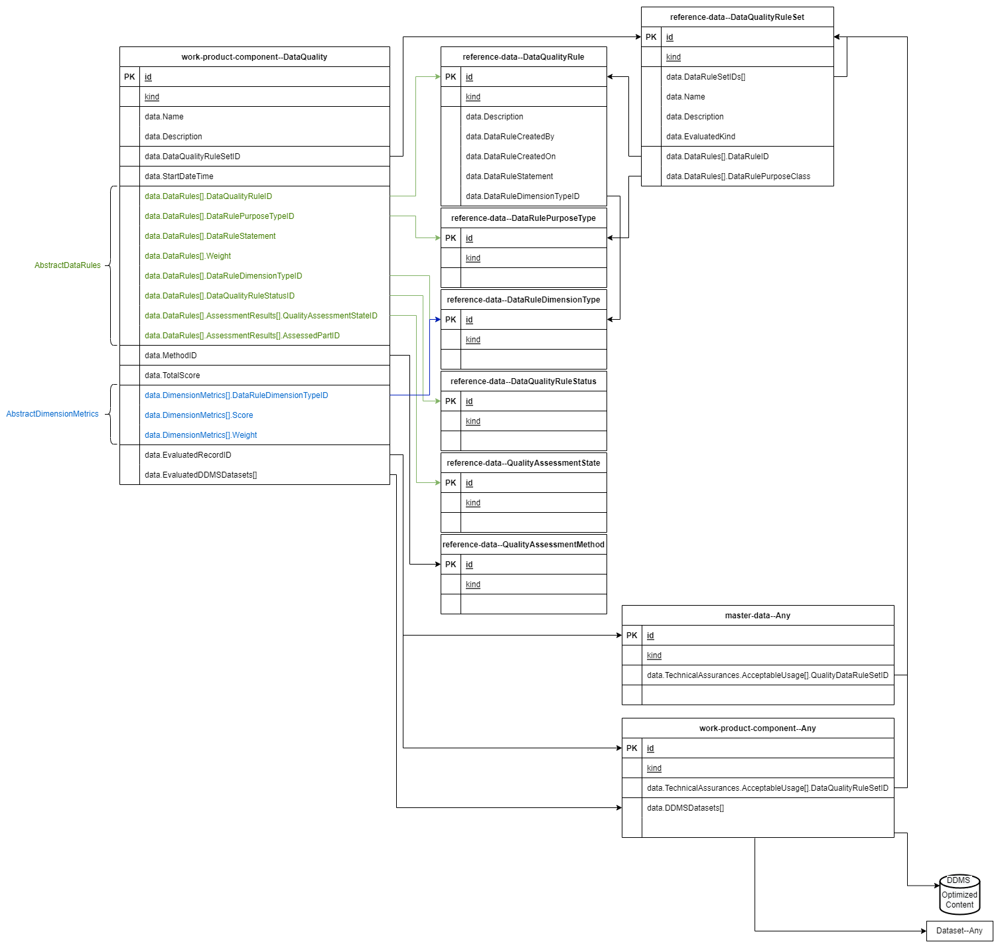
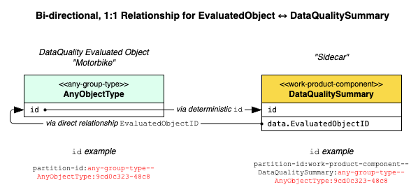
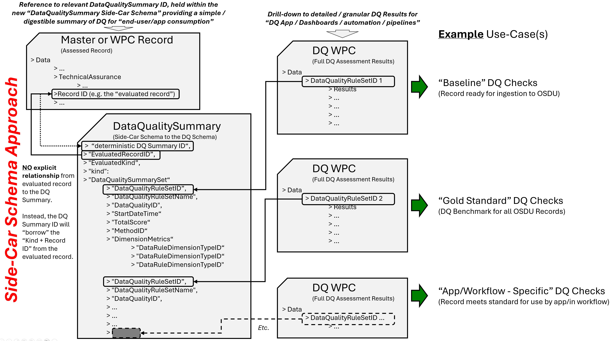

<a name="TOC">Table of Contents</a>

[[_TOC_]]

# Usage of `work-product-component--DataQuality`

Here the entity relationship diagram for the items involved in the use case below:



[Back to TOC](#TOC)

---

## Use Case Example

In the following example use case, multiple data rules can be aggregated into one data rule set for `abstract--WPCGroupType.DDMSDatasets` of TOC Pyrolysis Analysis data, and how the data quality assessment results and metric scores are stored for each data rule and the integrated data rule set in `work-product-component--DataQuality` record. The data rule set results are then used in `abstract--TechnicalAssurance` to describe the Pyrolysis Analysis data suitability for Source Rock Screening.

For such `abstract--WPCGroupType.DDMSDatasets`, rules of **Conformance data quality dimension** and **Consistency data quality dimension** can be created to check
for TOC Pyrolysis Analysis measurements having expected values and overall suitability for consumption in source rock screening.

### 1. Conformance DataQualityRule # 1

<details>

<summary markdown="span">Conformance DataQualityRule # 1 to check for "Hydrogen Index HI value should not be negative" JSON Schema Fragment Example</summary>

<OsduImportJSON>[Conformance DataQualityRule1, full record](reference-data/DataQualityRule1-Validity-HINotNegative.json#only.data)</OsduImportJSON>

```json
{
  "data": {
    "Name": "Validity rule for HydrogenIndex",
    "ExternalRuleID": "Example ExternalRuleID",
    "DataRuleStatement": "HydrogenIndex should not be negative",
    "DataRuleRevision": "Example DataRuleRevision",
    "DataRuleStatus": "Example DataRuleStatus",
    "DataRuleCreatedOn": "2020-02-13T09:13:15.55Z",
    "DataRuleCreatedBy": "Example DataRuleCreatedBy",
    "DataRulePublishedOn": "2020-02-13T09:13:15.55Z",
    "DataRuleUpdatedOn": "2020-02-13T09:13:15.55Z",
    "DataRuleDimensionTypeID": "partition_id:reference-data--DataRuleDimensionType:Conformance:",
    "ExtensionProperties": {}
  }
}
```

</details>

[Back to TOC](#TOC)

---

### 2. Conformance DataQualityRule # 2

<details>

<summary markdown="span">Conformance DataQualityRule # 2 to check for "Oxygen Index OI should not be outside allowed range" JSON Schema Fragment Example</summary>

<OsduImportJSON>[Conformance DataQualityRule2, full record](reference-data/DataQualityRule2-Validity-OINotOutsideRange.json#only.data)</OsduImportJSON>

```json
{
  "data": {
    "Name": "Validity rule for OxygenIndex",
    "ExternalRuleID": "Example ExternalRuleID",
    "DataRuleStatement": "OxygenIndex should not be outside allowed range",
    "DataRuleRevision": "Example DataRuleRevision",
    "DataRuleStatus": "Example DataRuleStatus",
    "DataRuleCreatedOn": "2020-02-13T09:13:15.55Z",
    "DataRuleCreatedBy": "Example DataRuleCreatedBy",
    "DataRulePublishedOn": "2020-02-13T09:13:15.55Z",
    "DataRuleUpdatedOn": "2020-02-13T09:13:15.55Z",
    "DataRuleDimensionTypeID": "partition_id:reference-data--DataRuleDimensionType:Conformance:",
    "ExtensionProperties": {}
  }
}
```

</details>

### 3. Conformance DataQualityRule # 3

<details>

<summary markdown="span">Conformance DataQualityRule # 3 to check for "Organic Matter Production Index PI value should not be outside allowed range" JSON Schema Fragment Example</summary>

<OsduImportJSON>[Conformance DataQualityRule3, full record](reference-data/DataQualityRule3-Validity-PINotOutsideRange.json#only.data)</OsduImportJSON>

```json
{
  "data": {
    "Name": "Validity rule for ProductionIndex",
    "ExternalRuleID": "Example ExternalRuleID",
    "DataRuleStatement": "ProductionIndex should not be outside allowed range",
    "DataRuleRevision": "Example DataRuleRevision",
    "DataRuleStatus": "Example DataRuleStatus",
    "DataRuleCreatedOn": "2020-02-13T09:13:15.55Z",
    "DataRuleCreatedBy": "Example DataRuleCreatedBy",
    "DataRulePublishedOn": "2020-02-13T09:13:15.55Z",
    "DataRuleUpdatedOn": "2020-02-13T09:13:15.55Z",
    "DataRuleDimensionTypeID": "partition_id:reference-data--DataRuleDimensionType:Conformance:",
    "ExtensionProperties": {}
  }
}
```

</details>

Similarly, rules of **Conformance data quality dimension** can be created to check for S1, S2, S3, TMax and TOC having expected
values.

[Back to TOC](#TOC)

---

### 4. Consistency DataQualityRule # 1

<details>

<summary markdown="span">Consistency DataQualityRule # 1 to check for "TOC and source potential S2 values combination should be consistent" JSON Schema Fragment Example</summary>

<OsduImportJSON>[Consistency DataQualityRule1, full record](reference-data/DataQualityRule1-Consistency-SourcePotentialConsistent.json#only.data)</OsduImportJSON>

```json
{
  "data": {
    "Name": "Consistency rule for SourcePotential",
    "ExternalRuleID": "Example ExternalRuleID",
    "DataRuleStatement": "TOC and source potential S2 values combination should be consistent",
    "DataRuleRevision": "Example DataRuleRevision",
    "DataRuleStatus": "Example DataRuleStatus",
    "DataRuleCreatedOn": "2020-02-13T09:13:15.55Z",
    "DataRuleCreatedBy": "Example DataRuleCreatedBy",
    "DataRulePublishedOn": "2020-02-13T09:13:15.55Z",
    "DataRuleUpdatedOn": "2020-02-13T09:13:15.55Z",
    "DataRuleDimensionTypeID": "partition_id:reference-data--DataRuleDimensionType:Consistency:",
    "ExtensionProperties": {}
  }
}
```

</details>

[Back to TOC](#TOC)

---

### 5. DataQualityRuleSet (with 9 different data quality rules)

The above different data quality rules can then be aggregated into a rule-set for `data.EvaluatedKind`
= `osdu:wks:DDMSDatasets`.

<details>

<summary markdown="span">DataQualityRuleSet to check for to check for the dataset score against Source Rock Screening rules JSON Schema Fragment Example</summary>

<OsduImportJSON>[DataQualityRuleSet, full record](reference-data/DataQualityRuleSet1-SourceRockScreening.json#only.data)</OsduImportJSON>

```json
{
  "data": {
    "Name": "Ruleset for osdu:wks:DDMSDatasets",
    "DataRuleSetIDs": [],
    "DataRules": [
      {
        "DataRuleID": "namespace:reference-data--DataQualityRule:CGG.ValidityHI:",
        "DataRulePurposeTypeID": "namespace:reference-data--DataRulePurposeType:Warning:"
      },
      {
        "DataRuleID": "namespace:reference-data--DataQualityRule:CGG.ValidityOI:",
        "DataRulePurposeTypeID": "namespace:reference-data--DataRulePurposeType:Warning:"
      },
      {
        "DataRuleID": "namespace:reference-data--DataQualityRule:CGG.ValidityPI:",
        "DataRulePurposeTypeID": "namespace:reference-data--DataRulePurposeType:Warning:"
      },
      {
        "DataRuleID": "namespace:reference-data--DataQualityRule:CGG.ValidityS1:",
        "DataRulePurposeTypeID": "namespace:reference-data--DataRulePurposeType:Warning:"
      },
      {
        "DataRuleID": "namespace:reference-data--DataQualityRule:CGG.ValidityS2:",
        "DataRulePurposeTypeID": "namespace:reference-data--DataRulePurposeType:Warning:"
      },
      {
        "DataRuleID": "namespace:reference-data--DataQualityRule:CGG.ValidityS3:",
        "DataRulePurposeTypeID": "namespace:reference-data--DataRulePurposeType:Warning:"
      },
      {
        "DataRuleID": "namespace:reference-data--DataQualityRule:CGG.ValidityTMax:",
        "DataRulePurposeTypeID": "namespace:reference-data--DataRulePurposeType:Warning:"
      },
      {
        "DataRuleID": "namespace:reference-data--DataQualityRule:CGG.ValidityTOC:",
        "DataRulePurposeTypeID": "namespace:reference-data--DataRulePurposeType:Warning:"
      },
      {
        "DataRuleID": "namespace:reference-data--DataQualityRule:CGG.ConsistencySourcePotential:",
        "DataRulePurposeTypeID": "namespace:reference-data--DataRulePurposeType:Warning:"
      }
    ],
    "EvaluatedKind": "osdu:wks:DDMSDatasets:",
    "ExtensionProperties": {}
  }
}
```

</details>

[Back to TOC](#TOC)

---

### 6. `work-product-component--DataQuality`

A record generated with `data.DataRules`, `data.AssessmentResults` and `data.DimenstionMetrics`  from aggregating multiple data rules into a single data rule-set.

When the above rules are executed for the DDMSDatasets with TOC Pyrolysis Analysis data,
a `work-product-component--DataQuality` record is generated, which contains the details about the rules executed, the score of each rule, the aggregation rule-set and the
overall quality score for the record as per the aggregation of those rules.
In this example of TOC Pyrolysis Data, let us say the following rules of validity have passed ("ValidityHI", "ValidityOI", "ValidityPI", "ValidityS1", "ValidityS2", "ValidityS3"), while the remaining rules have failed ("ValidityTMax", "ValidityTOC"). Let us also say that the consistency rule has failed ("ConsistencySourcePotential"). The weight attribute for each data rule is here important to the overall score calculations as data would have a lower quality score if S2 and TMax values are misleading, hence they were assigned higher weights.
Since 6 rules out of 9 are passing, but "ValidityTMax" and "ConsistencySourcePotential" that failed have a higher weight, the source rock screening `data.Score` can be then calculated with `WeightedAverageAssessment` as the `data.MethodID` to be 57.5%. The `data.DimensionMetrics.Score` for each `DataRuleDimensionTypeID` can be calculated the same way to be 0% with a weight of 0.15 for Consistency and 67.65% with a weight of 0.85 for Validity.

<details>

<summary markdown="span"><code>work-product-component--DataQuality</code> record generated with <code>data.Score</code> = 57.5% after rule-set execution JSON Schema Fragment Example</summary>

<OsduImportJSON>[`work-product-component-DataQuality` with `data.Score` from Aggregated Single DataQualityRuleSet, full record](work-product-component/DataQuality1.json#only.data)</OsduImportJSON>

```json
{
  "data": {
    "Datasets": [
      "namespace:dataset--AnyDataset:SomeUniqueAnyDatasetID:"
    ],
    "Artefacts": [
      {
        "RoleID": "namespace:reference-data--ArtefactRole:AdaptedContent:",
        "ResourceKind": "namespace:source_name:group_type--IndividualType:0.0.0",
        "ResourceID": "namespace:dataset--AnyDataset:SomeUniqueAnyDatasetID:"
      }
    ],
    "LineageAssertions": [
      {
        "ID": "namespace:any-group-type--work-product-component--Activity:XxxAssessmentEngineRun-bcab6f05-d832-4b52-942e-91e508bf7053:",
        "LineageRelationshipType": "namespace:reference-data--LineageRelationshipType:Direct:"
      }
    ],
    "IsExtendedLoad": true,
    "IsDiscoverable": true,
    "EvaluatedRecordID": "namespace:work-product-component--SampleAnalyses:53cf0bae-355b-461b-9d60-a6800d451315:",
    "EvaluatedDDMSDatasets": [
      "urn://wddms-3/uuid:20840361-adc0-4842-999b-5639bd07bb38"
    ],
    "EvaluatedKind": "osdu:wks:group-type--EntityType:2",
    "DataQualityRuleSetID": "namespace:reference-data--DataQualityRuleSet:CGG.SourceRockScreening:",
    "StartDateTime": "2020-02-13T09:13:15.55Z",
    "DataRules": [
      {
        "DataQualityRuleID": "namespace:reference-data--DataQualityRule:CGG.ValidityHI:",
        "DataRulePurposeTypeID": "namespace:reference-data--DataRulePurposeType:Warning:",
        "DataRuleStatement": "HydrogenIndex should not be negative",
        "Weight": 0.075,
        "DataRuleDimensionTypeID": "namespace:reference-data--DataRuleDimensionType:Conformance:",
        "ExecutionTime": 23.0,
        "AssessmentResults": [
          {
            "QualityAssessmentStateID": "namespace:reference-data--QualityAssessmentState:Pass:",
            "ExtensionProperties": {}
          }
        ]
      },
      {
        "DataQualityRuleID": "namespace:reference-data--DataQualityRule:CGG.ValidityOI:",
        "DataRulePurposeTypeID": "namespace:reference-data--DataRulePurposeType:Warning:",
        "DataRuleStatement": "OxygenIndex should not be outside allowed range",
        "Weight": 0.075,
        "DataRuleDimensionTypeID": "namespace:reference-data--DataRuleDimensionType:Conformance:",
        "ExecutionTime": 23.0,
        "AssessmentResults": [
          {
            "QualityAssessmentStateID": "namespace:reference-data--QualityAssessmentState:Pass:",
            "ExtensionProperties": {}
          }
        ]
      },
      {
        "DataQualityRuleID": "namespace:reference-data--DataQualityRule:CGG.ValidityPI:",
        "DataRulePurposeTypeID": "namespace:reference-data--DataRulePurposeType:Warning:",
        "DataRuleStatement": "ProductionIndex should not be outside allowed range",
        "Weight": 0.075,
        "DataRuleDimensionTypeID": "namespace:reference-data--DataRuleDimensionType:Conformance:",
        "ExecutionTime": 23.0,
        "AssessmentResults": [
          {
            "QualityAssessmentStateID": "namespace:reference-data--QualityAssessmentState:Pass:",
            "ExtensionProperties": {}
          }
        ]
      },
      {
        "DataQualityRuleID": "namespace:reference-data--DataQualityRule:CGG.ValidityS1:",
        "DataRulePurposeTypeID": "namespace:reference-data--DataRulePurposeType:Warning:",
        "DataRuleStatement": "S1 should not be outside allowed range",
        "Weight": 0.075,
        "DataRuleDimensionTypeID": "namespace:reference-data--DataRuleDimensionType:Conformance:",
        "ExecutionTime": 23.0,
        "AssessmentResults": [
          {
            "QualityAssessmentStateID": "namespace:reference-data--QualityAssessmentState:Pass:",
            "ExtensionProperties": {}
          }
        ]
      },
      {
        "DataQualityRuleID": "namespace:reference-data--DataQualityRule:CGG.ValidityS2:",
        "DataRulePurposeTypeID": "namespace:reference-data--DataRulePurposeType:Warning:",
        "DataRuleStatement": "S2 should not be outside allowed range",
        "Weight": 0.2,
        "DataRuleDimensionTypeID": "namespace:reference-data--DataRuleDimensionType:Conformance:",
        "ExecutionTime": 22.0,
        "AssessmentResults": [
          {
            "AssessedPartID": "S2-index-1",
            "QualityAssessmentStateID": "namespace:reference-data--QualityAssessmentState:Pass:",
            "ExtensionProperties": {}
          },
          {
            "AssessedPartID": "S2-index-2",
            "QualityAssessmentStateID": "namespace:reference-data--QualityAssessmentState:Pass:",
            "ExtensionProperties": {}
          }
        ]
      },
      {
        "DataQualityRuleID": "namespace:reference-data--DataQualityRule:CGG.ValidityS3:",
        "DataRulePurposeTypeID": "namespace:reference-data--DataRulePurposeType:Warning:",
        "DataRuleStatement": "S3 should not be outside allowed range",
        "Weight": 0.075,
        "DataRuleDimensionTypeID": "namespace:reference-data--DataRuleDimensionType:Conformance:",
        "ExecutionTime": 23.0,
        "AssessmentResults": [
          {
            "QualityAssessmentStateID": "namespace:reference-data--QualityAssessmentState:Pass:",
            "ExtensionProperties": {}
          }
        ]
      },
      {
        "DataQualityRuleID": "namespace:reference-data--DataQualityRule:CGG.ValidityTMax:",
        "DataRulePurposeTypeID": "namespace:reference-data--DataRulePurposeType:Warning:",
        "DataRuleStatement": "TMax should not be outside allowed range",
        "Weight": 0.2,
        "DataRuleDimensionTypeID": "namespace:reference-data--DataRuleDimensionType:Conformance:",
        "ExecutionTime": 23.0,
        "AssessmentResults": [
          {
            "QualityAssessmentStateID": "namespace:reference-data--QualityAssessmentState:Fail:",
            "ExtensionProperties": {}
          }
        ]
      },
      {
        "DataQualityRuleID": "namespace:reference-data--DataQualityRule:CGG.ValidityTOC:",
        "DataRulePurposeTypeID": "namespace:reference-data--DataRulePurposeType:Warning:",
        "DataRuleStatement": "TOC should not be negative and TOC should not be outside allowed range",
        "Weight": 0.075,
        "DataRuleDimensionTypeID": "namespace:reference-data--DataRuleDimensionType:Conformance:",
        "ExecutionTime": 23.0,
        "AssessmentResults": [
          {
            "QualityAssessmentStateID": "namespace:reference-data--QualityAssessmentState:Fail:",
            "ExtensionProperties": {}
          }
        ]
      },
      {
        "DataQualityRuleID": "namespace:reference-data--DataQualityRule:CGG.ConsistencySourcePotential:",
        "DataRulePurposeTypeID": "namespace:reference-data--DataRulePurposeType:Warning:",
        "DataRuleStatement": "TOC and source potential S2 values combination should be consistent",
        "Weight": 0.15,
        "DataRuleDimensionTypeID": "namespace:reference-data--DataRuleDimensionType:Consistency:",
        "ExecutionTime": 23.0,
        "AssessmentResults": [
          {
            "QualityAssessmentStateID": "namespace:reference-data--QualityAssessmentState:Fail:",
            "ExtensionProperties": {}
          }
        ]
      }
    ],
    "MethodID": "namespace:reference-data--QualityAssessmentMethod:WeightedAverageAssessment:",
    "TotalScore": 57.5,
    "DimensionMetrics": [
      {
        "DataRuleDimensionTypeID": "namespace:reference-data--DataRuleDimensionType:Conformance:",
        "Score": 67.65,
        "Weight": 0.85
      },
      {
        "DataRuleDimensionTypeID": "namespace:reference-data--DataRuleDimensionType:Consistency:",
        "Score": 0,
        "Weight": 0.15
      }
    ]
  }
}
```

</details>

Since the source rock screening data rule-set did not pass for all the data rules, the TOC Pyrolysis data is considered suitable for general geochemistry usages, for example, calculating other data derivatives, but deemed unacceptable for **Source Rock Screening** and **Source Rock Characterization** `WorkflowUsage`.

example Technical Assurance results using the Source Rock Screening data rule-set.

<details>

<summary markdown="span"><code>TechnicalAssurances[]</code> fragment</summary>

```json
{
  "TechnicalAssurances": [
    {
      "TechnicalAssuranceTypeID": "namespace:reference-data--TechnicalAssuranceType:Suitable:",
      "Reviewers": [
        {
          "RoleTypeID": "namespace:reference-data--ContactRoleType:Geochemist:",
          "OrganisationID": "namespace:master-data--Organisation:SomeUniqueOrganisationID:",
          "Name": "Example Name"
        }
      ],
      "AcceptableUsage": [
        {
          "WorkflowUsageTypeID": "namespace:reference-data--WorkflowUsageType:GeneralGeochemistryAnalysis:",
          "WorkflowPersonaTypeID": "namespace:reference-data--WorkflowPersonaType:Geochemist:",
          "DataQualityRuleSetID": "namespace:reference-data--DataQualityRuleSet:CGG.SourceRockScreening:"
        }
      ],
      "UnacceptableUsage": [
        {
          "WorkflowUsageTypeID": "namespace:reference-data--WorkflowUsageType:SourceRockScreening:",
          "WorkflowPersonaTypeID": "namespace:reference-data--WorkflowPersonaType:Geochemist:",
          "DataQualityRuleSetID": "namespace:reference-data--DataQualityRuleSet:CGG.SourceRockScreening:"
        },
        {
          "WorkflowUsageTypeID": "namespace:reference-data--WorkflowUsageType:SourceRockCharacterisation:",
          "WorkflowPersonaTypeID": "namespace:reference-data--WorkflowPersonaType:PetroleumSystemAnalyst:",
          "DataQualityRuleSetID": "namespace:reference-data--DataQualityRuleSet:CGG.SourceRockScreening:"
        }
      ],
      "EffectiveDate": "2020-02-13",
      "Comment": "This is free form text from reviewer, e.g. restrictions on use"
    }
  ]
}
```

</details>

[Back to TOC](#TOC)

---

## DataQuality

The [DataQuality schema](../../../E-R/work-product-component/DataQuality.2.0.0.md) contains a number of optional
properties, which are intended as de-normalized values derived from
[reference-data--DataQualityRuleSet](../../../E-R/reference-data/DataQualityRuleSet.1.0.1.md)s and
the [reference-data--DataQualityRule](../../../E-R/reference-data/DataQualityRule.1.1.0.md)s at the time of assessment.
The `data.DataRules[].DataQualityRuleID` is mandatory for each element in the array of `data.DataRules[]`.

### De-Normalizations in DataQuality

The optional, de-normalized properties in question are - note the _as captured during the assessment_ in the property
descriptions as follows (DataQuality `DeNormalizedPropertyName` &larr; SourceKind `SourcePropertyName`):

1. `data.DataRules[].DataRulePurposeTypeID` &larr; [reference-data--DataQualityRuleSet](../../../E-R/reference-data/DataQualityRuleSet.1.0.1.md) `data.DataRules[].DataRulePurposeTypeID`; _this DataQualityRuleSet may be nested_.
2. `data.DataRules[].Weight` &larr; [reference-data--DataQualityRuleSet](../../../E-R/reference-data/DataQualityRuleSet.1.0.1.md) `data.DataRules[].Weight`; _this DataQualityRuleSet may be nested_.
3. `data.DataRules[].DataRuleStatement` &larr; [reference-data--DataRule](../../../E-R/reference-data/DataQualityRule.1.1.0.md) `data.DataRuleStatement`
4. `data.DataRules[].DataRuleDimensionTypeID` &larr; [reference-data--DataRule](../../../E-R/reference-data/DataQualityRule.1.1.0.md) `data.DataRuleDimensionTypeID`
5. `data.DataRules[].DataQualityRuleStatusID` &larr; [reference-data--DataRule](../../../E-R/reference-data/DataQualityRule.1.1.0.md) `data.DataRuleStatus`

Note that the DataQualityRuleSet supports composition, that means, a DataQualityRuleSet can aggregate DataQualityRules
and other DataQualityRuleSets, each of them can exist in multiple record versions.

Without the business rule **"All DataQuality assessments must be re-executed if any of the rules or rule sets change"**,
the de-normalizations help to understand the results without complex navigation from DataQuality &rarr;
DataQualityRuleSet &rarr; DataQualityRule.

[Back to TOC](#TOC)

---

### Absent De-Normalizations

If the quality assessment engine is set up to **_always_** process **_all_** records then the de-normalized values can
be kept absent. In such cases, the complex navigation to the source values is left to the consumer, but the values
can be cached.

> * **Recommendation**
>   * Use an activity record work-product-component--Activity, which records the version of
      the [reference-data--DataQualityRuleSet](../../../E-R/reference-data/DataQualityRuleSet.1.0.1.md), which was used
      by the assessment engine together with other relevant parameters in the `data.Parameters[]` section.
>   * Record the activity record `id` in the work-product-component--DataQuality `data.LineageAssertions[].ID` with
      reference-data--LineageRelationshipType:Direct.

Recording activities, which last updated work-product-components is always a good idea. The following example shows how this is done for DataQuality:

<details>

<summary markdown="span"><code>work-product-component--DataQuality</code> record with LineageAssertions to an Activity.</summary>

<OsduImportJSON>[`work-product-component-DataQuality` with `data.Score` from Aggregated Single DataQualityRuleSet, full record](work-product-component/DataQuality1.json#only.data.LineageAssertions)</OsduImportJSON>

```json
{
  "data": {
    "LineageAssertions": [
      {
        "ID": "namespace:any-group-type--work-product-component--Activity:XxxAssessmentEngineRun-bcab6f05-d832-4b52-942e-91e508bf7053:",
        "LineageRelationshipType": "namespace:reference-data--LineageRelationshipType:Direct:"
      }
    ]
  }
}
```

</details>

The activity record can also capture engine run specific parameters as shown in the snippet below:

<details>

<summary markdown="span"><code>work-product-component--Activity</code> record with versioned reference to DataQualityRuleSet and custom parameter.</summary>

<OsduImportJSON>[`work-product-component-Activity`, full record](work-product-component/AssessmentActivity.json#only.data.Parameters)</OsduImportJSON>

```json
{
  "data": {
    "Parameters": [
      {
        "Title": "DataQualityRuleSet",
        "Selection": "Selected by end-user",
        "DataObjectParameter": "namespace:reference-data--DataQualityRuleSet:CGG.SourceRockScreening:1562066009929332",
        "ParameterKindID": "namespace:reference-data--ParameterKind:DataObject:",
        "ParameterRoleID": "namespace:reference-data--ParameterRole:Input:"
      },
      {
        "Title": "ChunkSize",
        "Selection": "Selected by end-user",
        "IntegerQuantityParameter": 500,
        "ParameterKindID": "namespace:reference-data--ParameterKind:Integer:",
        "ParameterRoleID": "namespace:reference-data--ParameterRole:Input:"
      }
    ]
  }
}
```

</details>

[Back to TOC](#TOC)

---

# DataQualitySummary

## Navigation Evaluated Object ↔︎ DataQualitySummary

[DataQualitySummary](../../../E-R/work-product-component/DataQualitySummary.1.0.0.md) records are expected to be 1:1
sidecar records to the evaluated object record (the motorbike). It is important to be able to navigate the relationship
in both directions. This is achieved by using deterministic record ids for the DataQualitySummary as demonstrated in the
following diagram:



The side car approach along with a deterministic reference to the side car from the original object enables a relationship without explicitly adding the reference in the original object.

The relationship between the DataQualitySummary record and the evaluated WPC/Master Object is captured directly from the DataQualitySummary using the required EvaluatedRecordID field, and indirectly from the evaluated WPC/Master Object using a deterministically constructed DataQualitySummaryID that, although it isn't stored within the WPC/Master Object, can be dynamically constructed on the fly without requiring a search to discover it. Thus the relationship is cross-referenceable from both directions using direct navigation.   This mode of navigation between related objects avoids making schema changes on WPC/Master Objects to store references, it also avoids having to use search to discover the relationship from the child DataQualitySummary and enables direct navigation both ways, via 1) EvaluatedRecordID from the summary to evaluated record and 2) from the evaluated record via constructing the deterministic id to the summary record. See the Data Quality Summary Diagram below to further illustrate this concept.

<details>
<summary markdown="span"><b>Data Quality Summary Diagram</b></summary>



</details>

## Data Quality Summary Worked Example - Well Log

For our worked example we will use the Work Product Component WellLog with the following ID to construct our
dynamic Data Quality Summary `id`.

```text
WellLog "id":            "namespace:work-product-component--WellLog:c2c79f1c-90ca-5c92-b8df-04dbe438f414"
DataQualitySummary "id": "namespace:work-product-component--DataQualitySummary:work-product-component--WellLog:c2c79f1c-90ca-5c92-b8df-04dbe438f414"
```

<details>

<summary markdown="span"><code>work-product-component--WellLog</code></summary>

<OsduImportJSON>[`work-product-component-WellLog`, full record](work-product-component/WellLog01.json#only.id|kind|data)</OsduImportJSON>

```json
{
  "id": "namespace:work-product-component--WellLog:c2c79f1c-90ca-5c92-b8df-04dbe438f414",
  "kind": "osdu:wks:work-product-component--WellLog:1.5.0",
  "data": {
    "ResourceHomeRegionID": "namespace:reference-data--OSDURegion:AWSEastUSA:",
    "ResourceHostRegionIDs": [
      "namespace:reference-data--OSDURegion:AWSEastUSA:"
    ],
    "ResourceCurationStatus": "namespace:reference-data--ResourceCurationStatus:Created:",
    "ResourceLifecycleStatus": "namespace:reference-data--ResourceLifecycleStatus:Loading:",
    "Source": "Example Data Source",
    "ExistenceKind": "namespace:reference-data--ExistenceKind:Prototype:",
    "Datasets": [
      "namespace:dataset--AnyDataset:SomeUniqueAnyDatasetID:"
    ],
    "DDMSDatasets": [
      "eml://rddms-1/dataspace('demo/Volve')/resqml20.obj_ContinuousProperty(1615d8d2-2a2d-482c-885e-14225b89e90c)"
    ],
    "WellboreID": "namespace:master-data--Wellbore:SomeUniqueWellboreID:",
    "WellLogClassID": "namespace:reference-data--WellLogClass:PetrophysicalLogs:",
    "WellLogTypeID": "namespace:reference-data--LogType:Raw:",
    "NullValue": "-999.25",
    "LogServiceDateInterval": {
      "StartDate": "2020-02-13T09:13:15.55Z",
      "EndDate": "2020-02-13T09:13:15.55Z"
    },
    "Curves": [
      {
        "CurveID": "Example CurveID",
        "DateStamp": "2020-02-13T09:13:15.55Z",
        "CurveQuality": "Example CurveQuality",
        "InterpreterName": "Example InterpreterName",
        "IsRegularlySampled": true,
        "NullValue": true,
        "SamplingStart": 12345.6,
        "SamplingStop": 12345.6,
        "DepthUnit": "namespace:reference-data--UnitOfMeasure:m:",
        "CurveUnit": "namespace:reference-data--UnitOfMeasure:m:",
        "Mnemonic": "PRES_HDRB.BAR",
        "LogCurveBusinessValueID": "namespace:reference-data--LogCurveBusinessValue:High:",
        "LogCurveMainFamilyID": "namespace:reference-data--LogCurveMainFamily:Acoustic:",
        "LogCurveFamilyID": "namespace:reference-data--LogCurveFamily:Acoustic%20Amplitude:",
        "NumberOfColumns": 192,
        "CurveSampleTypeID": "namespace:reference-data--CurveSampleType:float:",
        "CurveDescription": "CBL Adjustment Factor, Resistivity Inversion Selection, Detector 1 Barite Constant"
      }
    ]
  }
}
```

</details>

The DataQualitySummary record `id` will be `namespace:work-product-component--DataQualitySummary:` with the evaluated object `id` (with `namespace:` (=partition-id) removed), in this case for the WellLog record.
```text
"id": "namespace:work-product-component--DataQualitySummary:work-product-component--WellLog:c2c79f1c-90ca-5c92-b8df-04dbe438f414"
"EvaluatedRecordID": "namespace:work-product-component--WellLog:c2c79f1c-90ca-5c92-b8df-04dbe438f414:"
```

A quality assessment engine run will use the DataQualityRuleSet and produce a DataQuality record with the assessment
results. An example is presented here:

<details>

<summary markdown="span"><code>work-product-component--DataQuality:a8116688-1313-421c-9fdc-de9f75c1071b</code></summary>

<OsduImportJSON>[`work-product-component-DataQuality`, full record](work-product-component/WellLog-DataQuality.json)</OsduImportJSON>

```json
{
  "id": "namespace:work-product-component--DataQuality:a8116688-1313-421c-9fdc-de9f75c1071b",
  "kind": "osdu:wks:work-product-component--DataQuality:2.0.0",
  "data": {
    "IsExtendedLoad": true,
    "IsDiscoverable": true,
    "ExtensionProperties": {
      "assessmentStatus": "osdu:reference-data--QualityAssessmentState:Passed:"
    },
    "EvaluatedRecordID": "namespace:work-product-component--WellLog:c2c79f1c-90ca-5c92-b8df-04dbe438f414:",
    "EvaluatedKind": "osdu:wks:work-product-component--WellLog:1.5.0",
    "DataQualityRuleSetID": "namespace:reference-data--DataQualityRuleSet:6e658-f2a01-ffffffffffffffff:",
    "StartDateTime": "2024-06-25T04:50:10Z",
    "DataRules": [
      {
        "DataQualityRuleID": "namespace:reference-data--DataQualityRule:6c6962-5061747465726e20436865636b:",
        "DataRulePurposeTypeID": "namespace:reference-data--DataRulePurposeType:INFO:",
        "DataRuleStatement": "Pattern Check",
        "DataRuleDimensionTypeID": "namespace:reference-data--DataRuleDimensionType:Completeness:",
        "DataQualityRuleStatusID": "namespace:reference-data--DataQualityRuleStatus:Active:",
        "AssessmentResults": [
          {
            "QualityAssessmentStateID": "namespace:reference-data--QualityAssessmentState:Passed:",
            "ExtensionProperties": {
              "attribute": "legal.otherRelevantDataCountries",
              "message": "Pattern valid for legal.otherRelevantDataCountries",
              "hint": "",
              "attributeValue": "US"
            }
          }
        ]
      },
      {
        "DataQualityRuleID": "namespace:reference-data--DataQualityRule:6c6962-5061747465726e20436865636b:",
        "DataRulePurposeTypeID": "namespace:reference-data--DataRulePurposeType:INFO:",
        "DataRuleStatement": "Pattern Check",
        "DataRuleDimensionTypeID": "namespace:reference-data--DataRuleDimensionType:Completeness:",
        "DataQualityRuleStatusID": "namespace:reference-data--DataQualityRuleStatus:Active:",
        "AssessmentResults": [
          {
            "QualityAssessmentStateID": "namespace:reference-data--QualityAssessmentState:Passed:",
            "ExtensionProperties": {
              "attribute": "acl.viewers",
              "message": "Pattern valid for acl.viewers",
              "hint": "",
              "attributeValue": "data.default.viewers@namespace.group"
            }
          }
        ]
      },
      {
        "DataQualityRuleID": "namespace:reference-data--DataQualityRule:6c6962-5061747465726e20436865636b:",
        "DataRulePurposeTypeID": "namespace:reference-data--DataRulePurposeType:INFO:",
        "DataRuleStatement": "Pattern Check",
        "DataRuleDimensionTypeID": "namespace:reference-data--DataRuleDimensionType:Completeness:",
        "DataQualityRuleStatusID": "namespace:reference-data--DataQualityRuleStatus:Active:",
        "AssessmentResults": [
          {
            "QualityAssessmentStateID": "namespace:reference-data--QualityAssessmentState:Passed:",
            "ExtensionProperties": {
              "attribute": "acl.owners",
              "message": "Pattern valid for acl.owners",
              "hint": "",
              "attributeValue": "data.default.owners@namespace.group"
            }
          }
        ]
      },
      {
        "DataQualityRuleID": "namespace:reference-data--DataQualityRule:6c6962-5061747465726e20436865636b:",
        "DataRulePurposeTypeID": "namespace:reference-data--DataRulePurposeType:INFO:",
        "DataRuleStatement": "Pattern Check",
        "DataRuleDimensionTypeID": "namespace:reference-data--DataRuleDimensionType:Completeness:",
        "DataQualityRuleStatusID": "namespace:reference-data--DataQualityRuleStatus:Active:",
        "AssessmentResults": [
          {
            "QualityAssessmentStateID": "namespace:reference-data--QualityAssessmentState:Passed:",
            "ExtensionProperties": {
              "attribute": "legal.status",
              "message": "Pattern valid for legal.status",
              "hint": "",
              "attributeValue": "compliant"
            }
          }
        ]
      },
      {
        "DataQualityRuleID": "namespace:reference-data--DataQualityRule:6c6962-5061747465726e20436865636b:",
        "DataRulePurposeTypeID": "namespace:reference-data--DataRulePurposeType:INFO:",
        "DataRuleStatement": "Pattern Check",
        "DataRuleDimensionTypeID": "namespace:reference-data--DataRuleDimensionType:Completeness:",
        "DataQualityRuleStatusID": "namespace:reference-data--DataQualityRuleStatus:Active:",
        "AssessmentResults": [
          {
            "QualityAssessmentStateID": "namespace:reference-data--QualityAssessmentState:Passed:",
            "ExtensionProperties": {
              "attribute": "kind",
              "message": "Pattern valid for kind",
              "hint": "",
              "attributeValue": "osdu:wks:work-product-component--WellLog:1.5.0"
            }
          }
        ]
      },
      {
        "DataQualityRuleID": "namespace:reference-data--DataQualityRule:6c6962-5061747465726e20436865636b:",
        "DataRulePurposeTypeID": "namespace:reference-data--DataRulePurposeType:INFO:",
        "DataRuleStatement": "Pattern Check",
        "DataRuleDimensionTypeID": "namespace:reference-data--DataRuleDimensionType:Completeness:",
        "DataQualityRuleStatusID": "namespace:reference-data--DataQualityRuleStatus:Active:",
        "AssessmentResults": [
          {
            "QualityAssessmentStateID": "namespace:reference-data--QualityAssessmentState:Passed:",
            "ExtensionProperties": {
              "attribute": "id",
              "message": "Pattern valid for id",
              "hint": "",
              "attributeValue": "namespace:work-product-component--WellLog"
            }
          }
        ]
      },
      {
        "DataQualityRuleID": "namespace:reference-data--DataQualityRule:6c6962-4e61747572616c204b657920436865636b:",
        "DataRulePurposeTypeID": "namespace:reference-data--DataRulePurposeType:INFO:",
        "DataRuleStatement": "Natural Key Check",
        "DataRuleDimensionTypeID": "namespace:reference-data--DataRuleDimensionType:Uniqueness:",
        "DataQualityRuleStatusID": "namespace:reference-data--DataQualityRuleStatus:Active:",
        "AssessmentResults": [
          {
            "QualityAssessmentStateID": "namespace:reference-data--QualityAssessmentState:Passed:",
            "ExtensionProperties": {
              "attribute": "data.Name",
              "message": "Value of data.Name is unique",
              "hint": "",
              "attributeValue": "Example Name"
            }
          }
        ]
      },
      {
        "DataQualityRuleID": "namespace:reference-data--DataQualityRule:6c6962-52657175697265642050726f70657274696573:",
        "DataRulePurposeTypeID": "namespace:reference-data--DataRulePurposeType:INFO:",
        "DataRuleStatement": "Required Properties Check",
        "DataRuleDimensionTypeID": "namespace:reference-data--DataRuleDimensionType:Completeness:",
        "DataQualityRuleStatusID": "namespace:reference-data--DataQualityRuleStatus:Active:",
        "AssessmentResults": [
          {
            "QualityAssessmentStateID": "namespace:reference-data--QualityAssessmentState:Passed:",
            "ExtensionProperties": {
              "attribute": "acl",
              "message": "Found required property acl",
              "hint": "",
              "attributeValue": "{viewers=[data.default.viewers@namespace.group], owners=[data.default.owners@namespace.group]}"
            }
          }
        ]
      },
      {
        "DataQualityRuleID": "namespace:reference-data--DataQualityRule:6c6962-52657175697265642050726f70657274696573:",
        "DataRulePurposeTypeID": "namespace:reference-data--DataRulePurposeType:INFO:",
        "DataRuleStatement": "Required Properties Check",
        "DataRuleDimensionTypeID": "namespace:reference-data--DataRuleDimensionType:Completeness:",
        "DataQualityRuleStatusID": "namespace:reference-data--DataQualityRuleStatus:Active:",
        "AssessmentResults": [
          {
            "QualityAssessmentStateID": "namespace:reference-data--QualityAssessmentState:Passed:",
            "ExtensionProperties": {
              "attribute": "kind",
              "message": "Found required property kind",
              "hint": "",
              "attributeValue": "osdu:wks:work-product-component--WellLog:1.5.0"
            }
          }
        ]
      },
      {
        "DataQualityRuleID": "namespace:reference-data--DataQualityRule:6c6962-52657175697265642050726f70657274696573:",
        "DataRulePurposeTypeID": "namespace:reference-data--DataRulePurposeType:INFO:",
        "DataRuleStatement": "Required Properties Check",
        "DataRuleDimensionTypeID": "namespace:reference-data--DataRuleDimensionType:Completeness:",
        "DataQualityRuleStatusID": "namespace:reference-data--DataQualityRuleStatus:Active:",
        "AssessmentResults": [
          {
            "QualityAssessmentStateID": "namespace:reference-data--QualityAssessmentState:Passed:",
            "ExtensionProperties": {
              "attribute": "legal",
              "message": "Found required property legal",
              "hint": "",
              "attributeValue": "{legaltags=[namespace-default-data-tag], status=compliant, otherRelevantDataCountries=[US]}"
            }
          }
        ]
      },
      {
        "DataQualityRuleID": "namespace:reference-data--DataQualityRule:6c6962-52657175697265642050726f70657274696573:",
        "DataRulePurposeTypeID": "namespace:reference-data--DataRulePurposeType:INFO:",
        "DataRuleStatement": "Required Properties Check",
        "DataRuleDimensionTypeID": "namespace:reference-data--DataRuleDimensionType:Completeness:",
        "DataQualityRuleStatusID": "namespace:reference-data--DataQualityRuleStatus:Active:",
        "AssessmentResults": [
          {
            "QualityAssessmentStateID": "namespace:reference-data--QualityAssessmentState:Passed:",
            "ExtensionProperties": {
              "attribute": "legal.otherRelevantDataCountries",
              "message": "Found required property legal.otherRelevantDataCountries",
              "hint": "",
              "attributeValue": "[US]"
            }
          }
        ]
      },
      {
        "DataQualityRuleID": "namespace:reference-data--DataQualityRule:6c6962-52657175697265642050726f70657274696573:",
        "DataRulePurposeTypeID": "namespace:reference-data--DataRulePurposeType:INFO:",
        "DataRuleStatement": "Required Properties Check",
        "DataRuleDimensionTypeID": "namespace:reference-data--DataRuleDimensionType:Completeness:",
        "DataQualityRuleStatusID": "namespace:reference-data--DataQualityRuleStatus:Active:",
        "AssessmentResults": [
          {
            "QualityAssessmentStateID": "namespace:reference-data--QualityAssessmentState:Passed:",
            "ExtensionProperties": {
              "attribute": "acl.owners",
              "message": "Found required property acl.owners",
              "hint": "",
              "attributeValue": "[data.default.owners@namespace.group]"
            }
          }
        ]
      },
      {
        "DataQualityRuleID": "namespace:reference-data--DataQualityRule:6c6962-52657175697265642050726f70657274696573:",
        "DataRulePurposeTypeID": "namespace:reference-data--DataRulePurposeType:INFO:",
        "DataRuleStatement": "Required Properties Check",
        "DataRuleDimensionTypeID": "namespace:reference-data--DataRuleDimensionType:Completeness:",
        "DataQualityRuleStatusID": "namespace:reference-data--DataQualityRuleStatus:Active:",
        "AssessmentResults": [
          {
            "QualityAssessmentStateID": "namespace:reference-data--QualityAssessmentState:Passed:",
            "ExtensionProperties": {
              "attribute": "acl.viewers",
              "message": "Found required property acl.viewers",
              "hint": "",
              "attributeValue": "[data.default.viewers@namespace.group]"
            }
          }
        ]
      },
      {
        "DataQualityRuleID": "namespace:reference-data--DataQualityRule:6c6962-52657175697265642050726f70657274696573:",
        "DataRulePurposeTypeID": "namespace:reference-data--DataRulePurposeType:INFO:",
        "DataRuleStatement": "Required Properties Check",
        "DataRuleDimensionTypeID": "namespace:reference-data--DataRuleDimensionType:Completeness:",
        "DataQualityRuleStatusID": "namespace:reference-data--DataQualityRuleStatus:Active:",
        "AssessmentResults": [
          {
            "QualityAssessmentStateID": "namespace:reference-data--QualityAssessmentState:Passed:",
            "ExtensionProperties": {
              "attribute": "legal.legaltags",
              "message": "Found required property legal.legaltags",
              "hint": "",
              "attributeValue": "[namespace-default-data-tag]"
            }
          }
        ]
      }
    ],
    "MethodID": "namespace:reference-data--QualityAssessmentMethod:AverageAssessment:",
    "TotalScore": 100.0,
    "DimensionMetrics": [
      {
        "DataRuleDimensionTypeID": "namespace:reference-data--DataRuleDimensionType:Accuracy:",
        "Score": 100.0
      },
      {
        "DataRuleDimensionTypeID": "namespace:reference-data--DataRuleDimensionType:Completeness:",
        "Score": 100.0
      }
    ]
  },
  "acl": {
    "viewers": [
      "data.default.viewers@namespace.group"
    ],
    "owners": [
      "data.default.owners@namespace.group"
    ]
  },
  "legal": {
    "legaltags": [
      "namespace-demo-legaltag"
    ],
    "otherRelevantDataCountries": [
      "US"
    ],
    "status": "compliant"
  }
}

```
</details>

Contributions from potentially many data quality assessment runs are the summarized in the DataQualitySummary record,
summary sidecar to the evaluated object, in this case the WellLog.

<details>

<summary markdown="span"><code>work-product-component--DataQualitySummary</code></summary>

<OsduImportJSON>[`work-product-component-DataQualitySummary`, full record](work-product-component/DataQualitySummaryExample.json)</OsduImportJSON>

```json
{
  "id": "namespace:work-product-component--DataQualitySummary:work-product-component--WellLog:c2c79f1c-90ca-5c92-b8df-04dbe438f414",
  "kind": "osdu:wks:work-product-component--DataQualitySummary:1.0.0",
  "data": {
    "EvaluatedRecordID": "namespace:work-product-component--WellLog:c2c79f1c-90ca-5c92-b8df-04dbe438f414:",
    "EvaluatedKind": "osdu:wks:work-product-component--WellLog:1.5.0",
    "DataQualitySummarySet": [
      {
        "DataQualityRuleSetID": "namespace:reference-data--DataQualityRuleSet:6e658-f2a01-ffffffffffffffff:",
        "DataQualityRuleSetName": "Base line RuleSet for WellLog",
        "DataQualityID": "namespace:work-product-component--DataQuality:a8116688-1313-421c-9fdc-de9f75c3093c:",
        "StartDateTime": "2023-10-26T07:15:51.518Z",
        "TotalScore": 100,
        "MethodID": "namespace:reference-data--QualityAssessmentMethod:AverageAssessment:",
        "DimensionMetrics": [
          {
            "DataRuleDimensionTypeID": "namespace:reference-data--DataRuleDimensionType:Accuracy:",
            "Score": 100.0
          },
          {
            "DataRuleDimensionTypeID": "namespace:reference-data--DataRuleDimensionType:Completeness:",
            "Score": 100.0
          }
        ]
      },
      {
        "DataQualityRuleSetID": "namespace:reference-data--DataQualityRuleSet:4354knfdgdgjk3hjsdfh8:",
        "DataQualityRuleSetName": "Gold RuleSet for WellLog",
        "DataQualityID": "namespace:work-product-component--DataQuality:2d042b28-21b9-4eee-9d8e-42f800f6a627:",
        "StartDateTime": "2023-10-30T07:15:51.518Z",
        "TotalScore": 90,
        "MethodID": "namespace:reference-data--QualityAssessmentMethod:AverageAssessment:",
        "DimensionMetrics": [
          {
            "DataRuleDimensionTypeID": "namespace:reference-data--DataRuleDimensionType:Accuracy:",
            "Score": 90.0
          },
          {
            "DataRuleDimensionTypeID": "namespace:reference-data--DataRuleDimensionType:Completeness:",
            "Score": 90.0
          }
        ]
      }
    ]
  },
  "acl": {
    "viewers": [
      "data.default.viewers@namespace.group"
    ],
    "owners": [
      "data.default.owners@namespace.group"
    ]
  },
  "legal": {
    "legaltags": [
      "namespace-default-data-tag"
    ],
    "otherRelevantDataCountries": [
      "US"
    ],
    "status": "compliant"
  }
}

```
</details>

For an example, here is the DataQualityRuleSet that corresponds with the "DataQualityRuleSetID":
"namespace:reference-data--DataQualityRuleSet:6e658-f2a01-ffffffffffffffff:"

<details>

<summary markdown="span"><code>reference-data--DataQualityRuleSet:6e658-f2a01-ffffffffffffffff</code></summary>

<OsduImportJSON>[`reference-data--DataQualityRuleSet`, full record](reference-data/WellLog-RuleSet.json)</OsduImportJSON>

```json
{
  "id": "namespace:reference-data--DataQualityRuleSet:6e658-f2a01-ffffffffffffffff",
  "kind": "osdu:wks:reference-data--DataQualityRuleSet:1.0.1",
  "data": {
    "Source": "Alloy",
    "ID": "Default Rule Set for osdu:wks:work-product-component--WellLog:1.5.0",
    "Description": "Default Rule Set for osdu:wks:work-product-component--WellLog:1.5.0",
    "Code": "Default Rule Set for osdu:wks:work-product-component--WellLog:1.5.0",
    "Name": "Base line RuleSet for WellLog",
    "EvaluatedKind": "osdu:wks:work-product-component--WellLog:1.5.0",
    "DataRules": [
      {
        "DataRuleID": "namespace:reference-data--DataQualityRule:6c6962-5061747465726e20436865636b:",
        "DataRulePurposeTypeID": "namespace:reference-data--DataRulePurposeType:INFO:"
      },
      {
        "DataRuleID": "namespace:reference-data--DataQualityRule:6c6962-4e61747572616c204b657920436865636b:",
        "DataRulePurposeTypeID": "namespace:reference-data--DataRulePurposeType:INFO:"
      },
      {
        "DataRuleID": "namespace:reference-data--DataQualityRule:6c6962-52657175697265642050726f70657274696573:",
        "DataRulePurposeTypeID": "namespace:reference-data--DataRulePurposeType:INFO:"
      }
    ],
    "ExtensionProperties": {
      "RuleNames": [
        {
          "DataRuleID": "namespace:reference-data--DataQualityRule:6c6962-5061747465726e20436865636b:",
          "RuleName": "Pattern Check"
        },
        {
          "DataRuleID": "namespace:reference-data--DataQualityRule:6c6962-4e61747572616c204b657920436865636b:",
          "RuleName": "Natural Key Check"
        },
        {
          "DataRuleID": "namespace:reference-data--DataQualityRule:6c6962-52657175697265642050726f70657274696573:",
          "RuleName": "Required Properties Check"
        }
      ]
    }
  },
  "acl": {
    "viewers": [
      "data.default.viewers@namespace.group"
    ],
    "owners": [
      "data.default.owners@namespace.group"
    ]
  },
  "legal": {
    "legaltags": [
      "namespace-default-data-tag"
    ],
    "otherRelevantDataCountries": [
      "US"
    ],
    "status": "compliant"
  }
}

```

</details>

This DataQualityRuleSet, in turn refers to three individual rules. The example is presented as a reference value
manifest. The individual rules are:

<details>

<summary markdown="span"><code>reference-data--DataQualityRule:6c6962-5061747465726e20436865636b</code></summary>

<OsduImportJSON>[DataQualityRule Manifest, full record](reference-data/WellLog-Rules.json#only.ReferenceData[0])</OsduImportJSON>

```json
{
  "ReferenceData": [
    {
      "id": "namespace:reference-data--DataQualityRule:6c6962-5061747465726e20436865636b",
      "kind": "osdu:wks:reference-data--DataQualityRule:1.1.0",
      "data": {
        "Source": "Alloy",
        "AttributionAuthority": "Alloy",
        "ID": "Pattern Check",
        "Code": "Pattern Check",
        "DataRuleStatement": "Pattern Check",
        "DataRuleDimensionTypeID": "namespace:reference-data--DataRuleDimensionType:Completeness:"
      },
      "acl": {
        "viewers": [
          "data.default.viewers@namespace.group"
        ],
        "owners": [
          "data.default.owners@namespace.group"
        ]
      },
      "legal": {
        "legaltags": [
          "namespace-demo-legaltag"
        ],
        "otherRelevantDataCountries": [
          "US"
        ],
        "status": "compliant"
      }
    }
  ]
}
```

</details>
<details>

<summary markdown="span"><code>reference-data--DataQualityRule:6c6962-4e61747572616c204b657920436865636b</code></summary>

<OsduImportJSON>[DataQualityRule Manifest, full record](reference-data/WellLog-Rules.json#only.ReferenceData[1])</OsduImportJSON>

```json
{
  "ReferenceData": [
    {
      "id": "namespace:reference-data--DataQualityRule:6c6962-4e61747572616c204b657920436865636b",
      "kind": "osdu:wks:reference-data--DataQualityRule:1.1.0",
      "data": {
        "Source": "Alloy",
        "AttributionAuthority": "Alloy",
        "ID": "Natural Key Check",
        "Code": "Natural Key Check",
        "DataRuleStatement": "Natural Key Check",
        "DataRuleDimensionTypeID": "namespace:reference-data--DataRuleDimensionType:Uniqueness:"
      },
      "acl": {
        "viewers": [
          "data.default.viewers@namespace.group"
        ],
        "owners": [
          "data.default.owners@namespace.group"
        ]
      },
      "legal": {
        "legaltags": [
          "namespace-demo-legaltag"
        ],
        "otherRelevantDataCountries": [
          "US"
        ],
        "status": "compliant"
      }
    }
  ]
}
```

</details>
<details>

<summary markdown="span"><code>reference-data--DataQualityRule:6c6962-52657175697265642050726f70657274696573</code></summary>

<OsduImportJSON>[DataQualityRule Manifest, full record](reference-data/WellLog-Rules.json#only.ReferenceData[2])</OsduImportJSON>

```json
{
  "ReferenceData": [
    {
      "id": "namespace:reference-data--DataQualityRule:6c6962-52657175697265642050726f70657274696573",
      "kind": "osdu:wks:reference-data--DataQualityRule:1.1.0",
      "data": {
        "Source": "Alloy",
        "AttributionAuthority": "Alloy",
        "ID": "Required Properties Check",
        "Code": "Required Properties Check",
        "DataRuleStatement": "Required Properties Check",
        "DataRuleDimensionTypeID": "namespace:reference-data--DataRuleDimensionType:Completeness:"
      },
      "acl": {
        "viewers": [
          "data.default.viewers@namespace.group"
        ],
        "owners": [
          "data.default.owners@namespace.group"
        ]
      },
      "legal": {
        "legaltags": [
          "namespace-demo-legaltag"
        ],
        "otherRelevantDataCountries": [
          "US"
        ],
        "status": "compliant"
      }
    }
  ]
}
```

</details>


## `DataQualitySummary` Usage Guidelines
>   * The Responsibility to properly create and maintain the DataQualitySummary for each record is on the creator and updater of DataQualitySummary records. It is critical that the ID's are properly constructed to ensure the DataQualitySummaryID has a deterministic ID with the infused relationship back to the parent so it can be accessed quickly if it exists.
>   * There is only 1 DataQualitySummary per kind record, and there is an array of DataQualitySummaries contained in the DataQualitySummary. The unique key for each item in the DataQualitySummarySet is the DataQualityRuleSetID.
>   * If you are adding additional rule sets that act on the same parent record, you will need to append your evaluation result to the DataQualitySummarySet[].
>   * If you are updating an existing quality evaluation run, you will need to replace the record in DataQualitySummarySet[] with the latest results (Keep in mind that all the results are stored in the DataQuality objects, but you are only storing the latest and most up to date summary in the DataQualitySummary's DataQualitySummarySet)


[Back to TOC](#TOC)

---