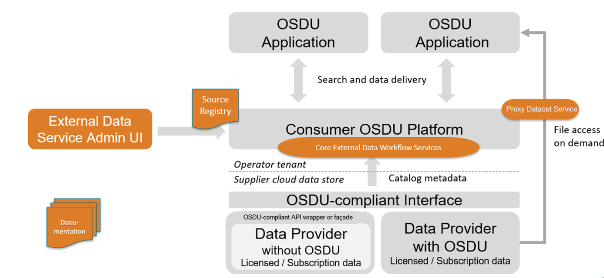
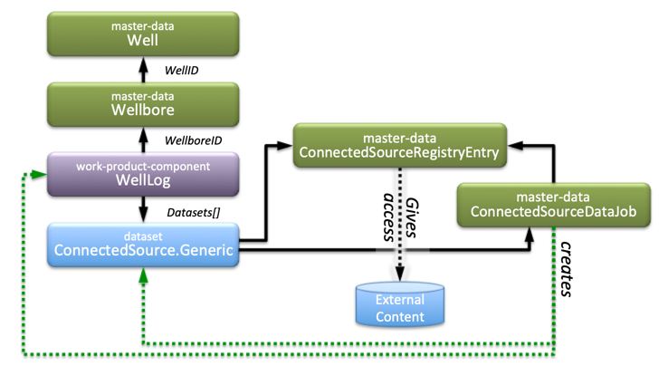

<a name="TOC"></a>

[[_TOC_]]

# External Data Services

## Definitions and Terminology

The following terms are used throughout the document:

- **Administrator**:  a privileged user of the OSDU platform that is entitled to use the External Data Sources (EDS)
  module within the OSDU Admin UI.

- **Connected Source Registry Entry**:  an OSDU master-data type that defines high-level business and technical
  information about an External Data Source. Administrators use the EDS module to register external data sources, which
  in turn creates a Connected Source Registry Entry in the Administrator’s OSDU Platform.

- **Connected Source Data Job**:  an OSDU master-data type that defines technical configuration for scheduled data jobs
  that will be executed by OSDU EDS workflow services to retrieve and ingest master data, work product component data
  and/or reference data from an external source specified in a parent Connected Source Registry Entry. There is a
  zero-to-many relationship between a Connected Source Registry Entry and a Connected Source Data Job; given one
  Connected Source Registry Entry record, there can be zero or many associated Connected Source Data Job records.
  Administrators use the EDS module to create scheduled data jobs, which in turn creates one or more Connected Source
  Data Job records in the Administrator’s OSDU Platform.

- **Core External Data Workflow Services**:  Software on the Administrator’s OSDU Platform that automatically consumes
  Connected Source Registry Entry and Connected Source Data Job records to schedule automated data jobs, retrieve
  metadata from an external data source, and ingest it into an Administrator’s OSDU platform.

- **External Data Source**:  any data source that is external to the Administrator’s OSDU Platform. The information
  contained in the Connected Source Registry Entry and associated Connected Source Data Job records for this source are
  used by automated EDS Core Workflow services to retrieve and ingest data.

- **JSON**:  JavaScript Object Notation, which is a structure for data exchange and is the current method of data
  exchange for OSDU APIs.

- **JSON payload**:  the request or response body of an OSDU API call, in JSON format.

- **JSON schema**:  a JSON document that describes the accepted representation of an object in JSON format.

- **Record**: a JSON document of a certain data type persisted in the OSDU platform.

- **Source Registry**: a term used to describe entire collection of records of type ConnectedSourceRegistryEntry and
  ConnectedSourceDataJob persisted in the Consuming OSDU Platform.

[Back to TOC](#TOC)

---

## High-level Overview



The objectives of the External Data Service (EDS) functionality are to retrieve metadata from a registered External Data
Source and ingest it into the Administrator’s OSDU Platform so that the data can be discoverable and accessible to
consuming OSDU applications through the OSDU Search API (just like any other data ingested into the system) while
leaving the associated bulk data, or files, stored at the external source for delivery on demand.

From a consumer’s perspective (the perspective of the Administrator’s organization), one of the most valuable use cases
this functionality satisfies is the ability to search for data that the Administrator’s organization has licensed from
an External Data Source from its own OSDU platform without enduring the overhead of storing the bulk data files the
ingested metadata refers to. From an external supplier’s perspective, the most valuable use case this functionality
satisfies is the ability to participate in the OSDU ecosystem to supply and advertise offerings to their customers even
if they do not have an OSDU implementation. For those without a full OSDU implementation, all that is required is an
OSDU-compliant “wrapper” that presents an OSDU-compliant interface for Search and Dataset services.

Connected Source Registry and Connected Source Data Job records, collectively known as the Source Registry, are created
by an Administrator using the External Data Service module in the OSDU Admin UI. This is the only part of the solution
that requires human intervention. From there the Source Registry information is automatically consumed by the Core
External Workflow Service engine to schedule data jobs and begin automatically fetching the desired master data, work
product component, and/or reference data from the specified external source and ingesting it into the Administrator’s
OSDU Platform.

Upon ingestion, the data is search-indexed just like any other piece of data and is accessible to end-users using the
Search API (entitlements permitting). If a user decides to retrieve the bulk data file or files associated with a work
product component the Platform will detect whether the file is stored externally or not. If it is, the Proxy Dataset
Service is used to retrieve the file from the registered external source and deliver it to the user. This process is
transparent to the end user.

## Example Records

The following workflow delivers the context to the example records:



1. a `ConnectedSourceRegistryEntry` is set up to represent the external data
   source ([example record](./master-data/ConnectedSourceRegistryEntry-Example.json)).
2. a job (`ConnectedSourceDataJob`) to synchronize/make the external data discoverable is executed, represented by
   this [example record](./master-data/ConnectedSourceDataJob-Example.json). This job creates
    1. the discoverable work-product-component - here a [WellLog](./work-product-component/WellLog.fromTGS.json), which
       is of course referring to a `Wellbore` and `Well`, and
    2. the dataset with the relations to the `ConnectedSourceRegistryEntry`
       and `ConnectedSourceDataJob` [example record](./dataset/ConnectedSource.Generic-Example.json).

Consumers will want to discover all accessible records, search for kind `work-product-component--WellLog` using the
Search service. Assume that Search will return a record of interest:

* `work-product-component--WellLog` with
  id: [`partition-id:work-product-component--WellLog:c2c79f1c-90ca-5c92-b8df-04dbe438f414`](./work-product-component/WellLog.fromTGS.json)
  .

This record refers to a dataset via the `data.Datasets[]` property. This leads on to:

* `dataset--ConnectedSource.Generic` with
  id: [`partition-id:dataset--ConnectedSource.Generic:72e981d6-aa5f-51ea-a76b-f3f2f01eb53a`](./dataset/ConnectedSource.Generic-Example.json)

The `dataset--ConnectedSource.Generic` refers back to the

* `master-data--ConnectedSourceRegistryEntry`, the critical information block to get access to the content, with
  id: [`partition-id:master-data--ConnectedSourceRegistryEntry:0ae7be1c-5df7-5656-98c3-f7c5509a7dfa`](./master-data/ConnectedSourceRegistryEntry-Example.json)
  , and
* the historical record, which created the `work-product-component--WellLog` and `dataset--ConnectedSource.Generic`
  , `master-data--ConnectedSourceDataJob`
  with [`partition-id:master-data--ConnectedSourceDataJob:77f02eed-9c3a-5795-8eda-84d91cbb2614`](./master-data/ConnectedSourceDataJob-Example.json).

[Back to TOC](#TOC)

---

### ConnectedSourceDataJob as Activity

The use of OSDU [the activity concepts](../../../E-R/abstract/AbstractProjectActivity.1.1.0.md) offers flexible
adaptation and customizations of ConnectedSourceDataJob instances. Frequently used properties are conveniently modelled
as properties while others are expressed via named parameters.

For some applications it turned out that an additional schema authority identifier for the source system/platform
instance. for this a `data.Parameter` with the Title "ConnectedSourceSchemaAuthority" was added. In
version `ConnectedDataSourceJob:1.5.0` the activity parameter definition was migrated into the schema - see the
updated `data.Parameters[].Selection` values.

<details>

<summary markdown="span">ConnectedSourceDataJob - Supplementary ConnectedSourceSchemaAuthority</summary>

<OsduImportJSON>[ConnectedSourceDataJob, full record](master-data/ConnectedSourceDataJob-Example.json#only.data.ActivityTemplateID|Parameters)</OsduImportJSON>

```json
{
  "data": {
    "ActivityTemplateID": "partition-id:master-data--ActivityTemplate:ConnectedDataSourceJob-ActivityTemplate-001:",
    "Parameters": [
      {
        "Title": "ConnectedSourceSchemaAuthority",
        "Selection": "Legacy parameter setting: from osdu:wks:master-data--ConnectedSourceDataJob:1.9.0 to the more convenient property data.ConnectedSourceSchemaAuthority should be used/populated.",
        "StringParameter": "osdu",
        "ParameterKindID": "partition-id:reference-data--ParameterKind:String:",
        "ParameterRoleID": "partition-id:reference-data--ParameterRole:Input:"
      },
      {
        "Title": "FetchStartDateTime",
        "Selection": "Legacy parameter setting: from osdu:wks:master-data--ConnectedSourceDataJob:1.9.0 to the more convenient property data.FetchStartDateTime should be used/populated.",
        "StringParameter": "2020-02-01T09:28:56.321-10:00",
        "ParameterKindID": "partition-id:reference-data--ParameterKind:String:",
        "ParameterRoleID": "partition-id:reference-data--ParameterRole:Output:"
      },
      {
        "Title": "FetchEndDateTime",
        "Selection": "Legacy parameter setting: from osdu:wks:master-data--ConnectedSourceDataJob:1.9.0 to the more convenient property data.FetchEndDateTime should be used/populated.",
        "StringParameter": "2020-02-01T09:28:56.321-10:00",
        "ParameterKindID": "partition-id:reference-data--ParameterKind:String:",
        "ParameterRoleID": "partition-id:reference-data--ParameterRole:Output:"
      }
    ]
  }
}
```

</details>

Please note the `data.ActivityTemplateID` in the example above — this reference identifies an ActivityTemplate record,
which defines the expected parameter details — which value type, cardinality, and potential defaults. The example
ActivityTemplate record contains only one parameter definition, the parameter with title
"ConnectedSourceSchemaAuthority". Again, from version `ConnectedDataSourceJob:1.5.0` this parameter is replaced by an
easier to use `data.ConnectedSourceSchemaAuthority` schema property.

<details>

<summary markdown="span">ActivityTemplate - Defining the expected parameters (for ConnectedSourceDataJob:1.4.0 and earlier)</summary>

<OsduImportJSON>[ActivityTemplate, full record](master-data/ConnectedSourceDataJob-ActivityTemplate-001.json#only.data.Parameters)</OsduImportJSON>

```json
{
  "data": {
    "Parameters": [
      {
        "Title": "ConnectedSourceSchemaAuthority",
        "AllowedParameterKind": "partition-id:reference-data--ParameterKind:String:",
        "IsInput": true,
        "IsOutput": false,
        "MaxOccurs": 1,
        "MinOccurs": 1,
        "DefaultValue": {
          "Title": "ConnectedSourceSchemaAuthority",
          "Selection": "Legacy parameter setting: from osdu:wks:master-data--ConnectedSourceDataJob:1.9.0 to the more convenient property data.ConnectedSourceSchemaAuthority should be used/populated.",
          "StringParameter": "osdu",
          "ParameterKindID": "partition-id:reference-data--ParameterKind:String:",
          "ParameterRoleID": "partition-id:reference-data--ParameterRole:Input:"
        },
        "Constraint": "Legacy parameter setting: from osdu:wks:master-data--ConnectedSourceDataJob:1.9.0 to the more convenient property data.ConnectedSourceSchemaAuthority should be used/populated."
      },
      {
        "Title": "FetchStartDateTime",
        "AllowedParameterKind": "partition-id:reference-data--ParameterKind:String:",
        "IsInput": false,
        "IsOutput": true,
        "MaxOccurs": 1,
        "MinOccurs": 0,
        "Constraint": "Legacy parameter setting: from osdu:wks:master-data--ConnectedSourceDataJob:1.9.0 to the more convenient property data.FetchStartDateTime should be used/populated."
      },
      {
        "Title": "FetchEndDateTime",
        "AllowedParameterKind": "partition-id:reference-data--ParameterKind:String:",
        "IsInput": false,
        "IsOutput": true,
        "MaxOccurs": 1,
        "MinOccurs": 0,
        "Constraint": "Legacy parameter setting: from osdu:wks:master-data--ConnectedSourceDataJob:1.9.0 to the more convenient property data.FetchEndDateTime should be used/populated."
      }
    ]
  }
}
```

</details>

### Activity Parameter Migration to Schema Properties (ConnectedSourceDataJob)

The usage of activity parameters enabled External Data Services to stay agile and independent of the schema definition
process while trading off usability. With M23, External Data Services has reached a level of maturity that warrants
migrating essential parameters to ConnectedSourceDataJob schema properties.

<details>

<summary markdown="span">ConnectedSourceDataJob:1.5.0 and later - Parameters promoted to Properties</summary>

<OsduImportJSON>[ConnectedSourceDataJob, full record](master-data/ConnectedSourceDataJob-Example.json#only.data.OnIngestionSchemaAuthority|FetchStartDateTime|FetchEndDateTime|ParentDataMappingDummyMasterIDs|IsDummyParentMappingEnabled|EdsIngestWaitTime)</OsduImportJSON>

```json
{
  "data": {
    "OnIngestionSchemaAuthority": "osdu",
    "FetchStartDateTime": "2021-08-07T16:02:33.985Z",
    "FetchEndDateTime": "2021-08-07T16:20:13.895Z",
    "ParentDataMappingDummyMasterIDs": [
      "master-data--Well:DummyWell",
      "master-data--Wellbore:DummyWellbore"
    ],
    "IsDummyParentMappingEnabled": true,
    "EdsIngestWaitTime": 60.0
  }
}
```

</details>


### ConnectedSourceRegistryEntry as Activity

Similar to ConnectedSourceDataJob, the use of OSDU
[the activity concepts](../../../E-R/abstract/AbstractProjectActivity.1.1.0.md) offers flexible
adaptation and customizations of ConnectedSourceRegistryEntry instances. Frequently used properties are conveniently
modelled as properties while others are expressed via named parameters.

<details>

<summary markdown="span">ConnectedSourceRegistryEntry:1.4.0 and later - Parameters promoted to Properties</summary>

<OsduImportJSON>[ConnectedSourceDataJob, full record](master-data/ConnectedSourceRegistryEntry-Example.json#only.data.DatasetURL|SearchURL|StorageURL)</OsduImportJSON>

```json
{
  "data": {
    "DatasetURL": "https://ww.api.enterprise.com/api/dataset/v2/",
    "SearchURL": "https://ww.api.enterprise.com/api/search/v3/",
    "StorageURL": "https://ww.api.enterprise.com/api/storage/v2/"
  }
}
```

</details>


[Back to TOC](#TOC)

---

## Matching and Mapping

Over time support for matching and value mapping has been added. One of the challenges is to match parent objects on the
connected source system to the appropriate, existing parent in the target platform.

OSDU offers ways to configure and customize the mapping via [reference-data--ParentMatchingRuleSets](../../../E-R/reference-data/ParentMatchingRuleSets.1.2.0.md).
This reference value list is under LOCAL governance; the OSDU shipped content is only considered as an example. The
delivered values can, however, serve as a useful example here.

### Use Case 'Match Wellbore Parent'

The example is based on the user story "The matching rules to identify a parent Well for a Wellbore in the EDS matching
namespace". Matching rules may be defined for different sources, thus a namespace is defined to disambiguate competing
rules. The example uses `ExternalCatalogNamespace:EDS`, which is also repeated in the `Code`. In reality, a namespace
specific to the source should be defined and selected
([ExternalCatalogNamespace Schema](../../../E-R/reference-data/ExternalCatalogNamespace.1.0.0.md)).


<details>

<summary markdown="span">ParentMatchingRuleSets "header"</summary>

<OsduImportJSON>[ParentMatchingRuleSets manifest, full record](../../../ReferenceValues/Manifests/reference-data/LOCAL/ParentMatchingRuleSets.1.json#only.ReferenceData[0].data.Name|Description|NamespaceID|Code|SourceKind|TargetKind)</OsduImportJSON>

```json
{
  "ReferenceData": {
    "data": {
      "Name": "Match Wellbore Parent",
      "Description": "The matching rules to identify a parent Well for a Wellbore in the EDS matching namespace.",
      "NamespaceID": "{{NAMESPACE}}:reference-data--ExternalCatalogNamespace:EDS:",
      "Code": "EDS.WellboreParentMatch",
      "SourceKind": "master-data--Wellbore",
      "TargetKind": "master-data--Well"
    }
  }
}
```

</details>

The rules are defined via the `MatchingRuleSets[]` array. It delivers a prioritized list of matching rules, with each
member listing the conditions which **all** have to be satisfied (logical AND).

[Back to TOC](#TOC)

#### Rule 'Match by FacilityName'

<details>

<summary markdown="span">ParentMatchingRuleSets, MatchingRuleSets Name=MatchByFacilityName and ReplaceAttributes specifications</summary>

<OsduImportJSON>[ParentMatchingRuleSets manifest, full record](../../../ReferenceValues/Manifests/reference-data/LOCAL/ParentMatchingRuleSets.1.json#only.ReferenceData[0].data.MatchingRuleSets[0])</OsduImportJSON>

```json
{
  "ReferenceData": {
    "data": {
      "MatchingRuleSets": [
        {
          "RuleName": "MatchByFacilityName",
          "Description": "Match between source FacilityName and target FacilityName",
          "Conditions": [
            {
              "SourceProperty": "data.FacilityName",
              "TargetKind": "master-data--Well:1.0.0",
              "TargetProperty": "data.FacilityName",
              "ReplaceProperty": "data.WellID"
            }
          ]
        }
      ]
    }
  }
}
```

</details>

[Back to TOC](#TOC)

### Use Case 'Match WellLog's Wellbore Parent'

<details>

<summary markdown="span">ParentMatchingRuleSets, MatchingRuleSets Name=MatchByName and Name=MatchByServiceCompanyID</summary>

<OsduImportJSON>[ParentMatchingRuleSets manifest, full record](../../../ReferenceValues/Manifests/reference-data/LOCAL/ParentMatchingRuleSets.1.json#only.ReferenceData[1].data.MatchingRuleSets)</OsduImportJSON>

```json
{
  "ReferenceData": {
    "data": {
      "MatchingRuleSets": [
        {
          "RuleName": "MatchByName",
          "Description": "Match between source Name and target Name",
          "Conditions": [
            {
              "SourceProperty": "data.Name",
              "TargetKind": "master-data--Wellbore:1.0.0",
              "TargetProperty": "data.FacilityName",
              "ReplaceProperty": "data.WellboreID"
            }
          ]
        },
        {
          "RuleName": "MatchByServiceCompanyID",
          "Description": "Match between source data.ServiceCompanyID and target InitialOperatorID",
          "Conditions": [
            {
              "SourceProperty": "data.ServiceCompanyID",
              "TargetKind": "master-data--Wellbore:1.0.0",
              "TargetProperty": "data.InitialOperatorID",
              "ReplaceProperty": "data.ServiceCompanyID"
            }
          ]
        }
      ]
    }
  }
}
```

</details>

[Back to TOC](#TOC)

### Use Case 'Match Organisation to SeismicAcquisitionSurvey'

<details>

<summary markdown="span">ParentMatchingRuleSets, MatchingRuleSets Name=MatchByOrganisationName and Name=MatchByContractorContractorTypeID</summary>

<OsduImportJSON>[ParentMatchingRuleSets manifest, full record](../../../ReferenceValues/Manifests/reference-data/LOCAL/ParentMatchingRuleSets.1.json#only.ReferenceData[2].data.MatchingRuleSets)</OsduImportJSON>

```json
{
  "ReferenceData": {
    "data": {
      "MatchingRuleSets": [
        {
          "RuleName": "MatchByOrganisationName",
          "Description": "Match between source Operator and target OrganisationName",
          "Conditions": [
            {
              "SourceProperty": "data.Operator",
              "TargetKind": "master-data--Organisation:1.0.0",
              "TargetProperty": "data.OrganisationName",
              "ReplaceProperty": "data.Operator"
            }
          ]
        },
        {
          "RuleName": "MatchByContractorContractorTypeID",
          "Description": "Match between source ContractorTypeID and target OrganisationName",
          "Conditions": [
            {
              "SourceProperty": "data.Contractors.ContractorTypeID:opendes:reference-data--ContractorType:AcquisitionContractor",
              "TargetKind": "master-data--Organisation:1.0.0",
              "TargetProperty": "data.OrganisationName",
              "ReplaceProperty": "data.Contractors.ContractorOrganisationID"
            }
          ]
        }
      ]
    }
  }
}
```

</details>


[Back to TOC](#TOC)

---

## Reference Value Mapping

Reference values need to be mapped between source and target platform. OSDU offers a dedicated reference value mapping
schema employing the
[reference-data--ExternalReferenceValueMapping](../../../E-R/reference-data/ExternalReferenceValueMapping.1.0.0.md).
For details, please refer to the dedicated, worked example
[Reference Value Mappings (Ingestion)](../ReferenceValueMappings/README.md)

[Back to TOC](#TOC)

---