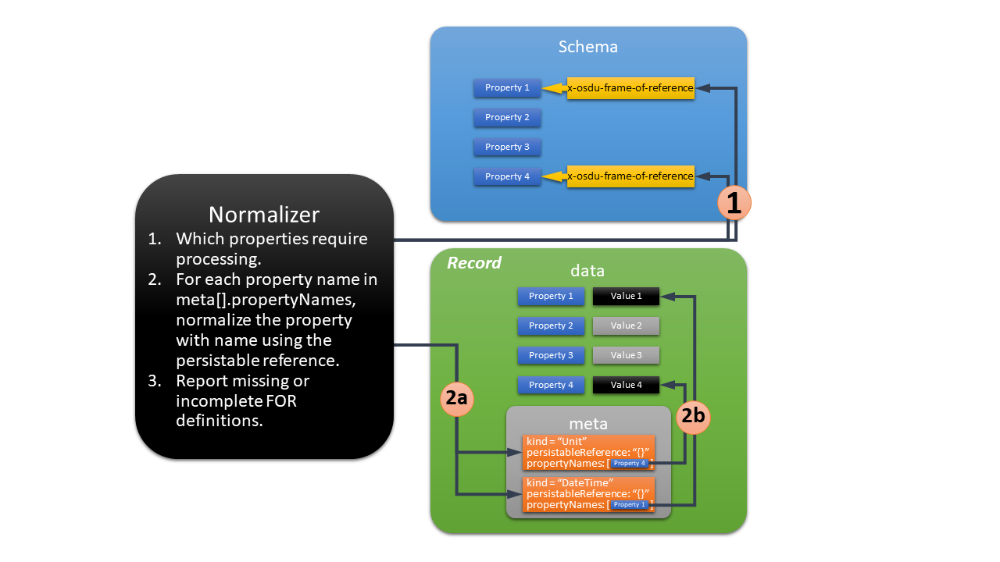

[[_TOC_]]

# Frame Of Reference

## Principles

### Preserve Original Frame of Reference

Any conversion can compromise the precision of the data. The OSDU ecosystem shall preserve data in their native context

* Unit of Measure
* Coordinate Reference System
* Date or Date Time and time zone
* Azimuth Reference

It is the data loader's responsibility to populate data records with this context. If this is not possible, the data
become unavailable to general workflows.

### Enable Cross-computation, Comparability, Analytics-Readiness

The first principle is an obstacle to consumers. It is error-prone to expect that consumers remember to convert data
before using them. Instead, the ecosystem must offer a service, which provides a normalized view.

* Unit of Measure &rarr; base unit, usually the SI base unit {scale=1.0, offset=0.0} or {A=0, B=1, C=1, D=0}
* Coordinate Reference System &rarr; "WGS 84" EPSG:4326 (2D) or "WGS 84" EPSG:4326 + "MSL height" EPSG:5714 (3D)
* Date or Date Time and time zone &rarr; UTC
* Azimuth Reference &rarr; True North

Indexing and Analytics __must__ consume normalized data.

It is the __Normalizer__'s responsibility to perform this activity. On error, consumers, e.g., indexer and analytics,
must be protected from consuming non-normalized data. The Normalizer is embedded in the
[Storage Service](https://community.opengroup.org/osdu/platform/system/storage/-/blob/master/docs/api/storage_openapi.yaml)
using the endpoint `/query/records:batch`, with the header parameter
`"frame-of-reference"` and value `"units=SI;crs=wgs84;elevation=msl;azimuth=true north;dates=utc;"`.
[See implementation.](https://community.opengroup.org/osdu/platform/system/storage/-/blob/master/storage-core/src/main/java/org/opengroup/osdu/storage/service/BatchServiceImpl.java)

### Low Demand on Ingestion

It shall be possible to load data with incomplete or entirely absent Frame of Reference information. The ecosystem must
be robust enough to protect consumers from incompletely referenced data. Numbers, coordinates, times,... must be
reliable.

This includes non-OSDU endorsed schemas, which describe source schemas incompatible with the OSDU governed entity
schemas. Enrichment processes must ensure that the frame of reference context is carried forward.

## Consequences

1. It must be possible to find the Frame of Reference for a data record's properties unambiguously. Required by __
   Normalizer__ and consumers operating in non-normalized frame of references.
1. The __Normalizer__ must know, which record properties are subject to normalization. Required by the __Normalizer__
   when the record's frame of reference is incomplete: fail the normalization

# Implementation [Proposal]

## Overview



1. Schemas contain tags, which identify properties that are subject to frame of reference conversions. The __
   Normalizer__ consumes the tags to ensure completeness.
1. The record contains a `meta` block outside the `data` block, which aggregates the Frame of reference definitions. The
   definitions
   ([AbstractMetaItem](../../../E-R/abstract/AbstractMetaItem.1.0.0.md)) link to the record property names and provide
   the self-contained `PersistableReference` string.
1. Comparison with the schema's property tags, it is possible to report missing items in the `meta`.
1. Individual unit of measure of CRS identifiers next to the property names are no longer required and _were_ generally
   removed from the schema.

## Property Tagging - Schema Level

Properties, which are subject to frame of reference conversions are marked with the `x-osdu-frame-of-reference`:

* Unit of Measure
    * The property is tagged by (example)<br>`"x-osdu-frame-of-reference": "UOM:volume per volume"`
    * The value provides the [UnitQuantity](../../../E-R/reference-data/UnitQuantity.1.0.0.md)
      constraint.
    * Unconstrained properties are tagged with<br>
      `"x-osdu-frame-of-reference": "UOM:"`
    * Properties in arrays may get their context from a UnitOfMeasure reference from a sibling property. <br/>
      `"x-osdu-frame-of-reference": UOM_via_property:UnitOfMeasureID` <br/>
      where `UnitOfMeasureID` is the property name containing the unit reference. This option is currently not yet
      supported by the normalizer. However, recently
      (after R3 milestone 7)
      the Normalizer handles such definitions via the `meta[]` using the `[]` as array notation for property name
      reference in the `propertyNames[]` array. This way it is possible to provide unit contexts for objects in arrays.
      Examples:
        * `"VerticalMeasurements[].VerticalMeasurement"` &rarr; **_all_** objects in the `
          VerticalMeasurements[]` array refer to the same unit as declare in the given `
          ` element.
        * `"VerticalMeasurements[2].VerticalMeasurement"` &rarr; the unit context in the given `meta[]` array element
          applies **_only to the third object_**.
* Coordinate Reference System
    * The property is tagged by<br>
      `"x-osdu-frame-of-reference": "CRS:"` for structured spatial structures, e.g.
      [`AbstractAnyCrsFeatureCollection`](../../../E-R/abstract/AbstractAnyCrsFeatureCollection.1.0.0.md).
    * Not so much relevant to OSDU schemas: native schemas may carry coordinates as individual properties. These
      properties need to be grouped, representing e.g., multiple locations or the same location with different
      references. The instructions to the normalizer are built as follows: (1) key ´CRS´, followed by
      (2) a sequence number grouping the coordinates belonging to the same location, followed by (3) the axis
      identifier. The elements are separated by the colon `:`
        * `"x-osdu-frame-of-reference": "CRS:0:X"` for first coordinate, e.g., X, East, Longitude.
          __Note:__ The unit is defined via the CRS.
        * `"x-osdu-frame-of-reference": "CRS:0:Y"` for second coordinate, e.g., Y, North, Latitude.
          __Note:__ The unit is defined via the CRS.
        * `"x-osdu-frame-of-reference": "CRS:0:Z-Height"` for the third coordinate as height
          (upwards positive). __Note:__ The unit is defined via the CRS if the CRS is a 3D. For 2D CRSs the Z-unit must
          be declared via a separate `Unit` item in the record.
        * `"x-osdu-frame-of-reference": "CRS:0:Z-Depth"` for the third coordinate as depth
          (downwards positive). __Note:__ The unit is implicitly defined via the CRS if the CRS is a 3D. For 2D CRSs the
          Z-unit can be declared via a separate `Unit` item in the record.
* Date or Date Time and time zone
    * The property is tagged by<br>
      `"x-osdu-frame-of-reference": "DateTime"`.
* Azimuth Reference
    * The property is tagged by<br>
      `"x-osdu-frame-of-reference": "AzimuthReference"`.<br>
      This tag implies the unit quantity `plane angle`. The actual unit must be declared in the record with a `Unit`
      item in addition to the `AzimuthReference`.

The tags added to the schema are later associated with the record level `meta`
FrameOfReference definitions to let the __Normalizer__ perform the normalization work and validate completeness.

#### Example 1: Tagged Schema

 ```json
{
  "properties": {
    "Porosity": {
      "description": "The porosity estimated at the location.",
      "type": "number",
      "x-osdu-frame-of-reference": "UOM:volume per volume"
    },
    "MeasurementTime": {
      "description": "The date and time of the measurement.",
      "type": "string",
      "x-osdu-frame-of-reference": "DateTime"
    },
    "Dip": {
      "description": "The dip of the horizon intersection.",
      "type": "number",
      "x-osdu-frame-of-reference": "UOM:plane angle"
    },
    "Azimuth": {
      "description": "The azimuth of the horizon intersection.",
      "type": "number",
      "x-osdu-frame-of-reference": "AzimuthReference"
    },
    "X": {
      "description": "x is Easting or Longitude.",
      "type": "number",
      "x-osdu-frame-of-reference": "CRS:0:X"
    },
    "Y": {
      "description": "y is Northing or Latitude.",
      "type": "number",
      "x-osdu-frame-of-reference": "CRS:0:Y"
    },
    "Z": {
      "description": "Z as height, positive upwards.",
      "type": "number",
      "x-osdu-frame-of-reference": "CRS:0:Z-Height"
    },
    "Iterations": {
      "description": "Number of iterations required. (Example of a property without frame of reference requirements.",
      "type": "number"
    }
  }
}
```

#### Example 2: Record Values

With this schema the record value example (`data` block, here omitted for brevity)

```json
{
  "Porosity": 12.3,
  "MeasurementTime": "2019-04-02  17:25",
  "Dip": 5,
  "Azimuth": 225,
  "X": 658017.24,
  "Y": 6542464.14,
  "Z": 49.21,
  "Iterations": 11.5
}
```

enables the __Normalizer__ find the relevant Frame of Reference information in the
_and_ validate that enough context is provided.

## `meta` Block, Record Level

The purpose of this schema component is to enable the association of a unit, CRS, date-time or azimuth to a named
property in the record.

This schema fragment is included as part of the
[SystemProperties](../../../E-R/abstract/AbstractSystemProperties.1.0.0.md), which is included in _all_ entity schemas.

The `meta` property (Frame of Reference) refers to an array of
[AbstractMetaItem](../../../E-R/abstract/AbstractMetaItem.1.0.0.md), which is a `oneOf` construct defining

* Unit of Measure &rarr; Kind `UOM`
* Coordinate Reference System &rarr; Kind `CRS`
* Date or Date Time and time zone &rarr; Kind `DateTime`
* Azimuth Reference &rarr; Kind `AzimuthReference`

Given the Example 2: Record Values, it is known that `Porosity`,
`MeasurementTime`, `Dip`, `Azimuth`, `X`, `Y`, `Z` are subject to frame of reference normalization. Each of the
properties must be found mentioned in one of the `AbstractMetaItem` members in
`meta`.

#### Example 3: Record with `meta` as FrameOfReference definition

```json
{
  "data": {
    "Porosity": 12.3,
    "MeasurementTime": "2019-04-02  17:25",
    "Dip": 5,
    "Azimuth": 225,
    "X": 658017.24,
    "Y": 6542464.14,
    "Z": 49.21,
    "Iterations": 11.5
  },
  "meta": [
    {
      "kind": "Unit",
      "name": "%",
      "persistableReference": "{\"abcd\":{\"a\":0.0,\"b\":0.01,\"c\":1.0,\"d\":0.0},\"symbol\":\"%\",\"baseMeasurement\":{\"ancestry\":\"1\",\"type\":\"UM\"},\"type\":\"UAD\"}",
      "unitOfMeasureID": "namespace:reference-data--UnitOfMeasure:%:",
      "propertyNames": [
        "Porosity"
      ]
    },
    {
      "kind": "Unit",
      "name": "ft",
      "persistableReference": "{\"abcd\":{\"a\":0.0,\"b\":0.3048,\"c\":1.0,\"d\":0.0},\"symbol\":\"ft\",\"baseMeasurement\":{\"ancestry\":\"L\",\"type\":\"UM\"},\"type\":\"UAD\"}",
      "unitOfMeasureID": "namespace:reference-data--UnitOfMeasure:ft:",
      "propertyNames": [
        "Z"
      ]
    },
    {
      "kind": "Unit",
      "name": "dega",
      "persistableReference": "{\"abcd\":{\"a\":0.0,\"b\":3.14159265358979,\"c\":180.0,\"d\":0.0},\"symbol\":\"dega\",\"baseMeasurement\":{\"ancestry\":\"A\",\"type\":\"UM\"},\"type\":\"UAD\"}",
      "unitOfMeasureID": "namespace:reference-data--UnitOfMeasure:dega:",
      "propertyNames": [
        "Azimuth",
        "Dip"
      ]
    },
    {
      "kind": "CRS",
      "name": "ED50 * EPSG-Nor S62 2001 / UTM zone 31N [23031,1613]",
      "persistableReference": "{\"authCode\":{\"auth\":\"OSDU\",\"code\":\"23031024\"},\"lateBoundCRS\":{\"authCode\":{\"auth\":\"EPSG\",\"code\":\"23031\"},\"name\":\"ED_1950_UTM_Zone_31N\",\"type\":\"LBC\",\"ver\":\"PE_10_9_1\",\"wkt\":\"PROJCS[\\\"ED_1950_UTM_Zone_31N\\\",GEOGCS[\\\"GCS_European_1950\\\",DATUM[\\\"D_European_1950\\\",SPHEROID[\\\"International_1924\\\",6378388.0,297.0]],PRIMEM[\\\"Greenwich\\\",0.0],UNIT[\\\"Degree\\\",0.0174532925199433]],PROJECTION[\\\"Transverse_Mercator\\\"],PARAMETER[\\\"False_Easting\\\",500000.0],PARAMETER[\\\"False_Northing\\\",0.0],PARAMETER[\\\"Central_Meridian\\\",3.0],PARAMETER[\\\"Scale_Factor\\\",0.9996],PARAMETER[\\\"Latitude_Of_Origin\\\",0.0],UNIT[\\\"Meter\\\",1.0],AUTHORITY[\\\"EPSG\\\",23031]]\"},\"name\":\"ED50 * EPSG-Nor S62 2001 / UTM zone 31N [23031,1613]\",\"singleCT\":{\"authCode\":{\"auth\":\"EPSG\",\"code\":\"1613\"},\"name\":\"ED_1950_To_WGS_1984_24\",\"type\":\"ST\",\"ver\":\"PE_10_9_1\",\"wkt\":\"GEOGTRAN[\\\"ED_1950_To_WGS_1984_24\\\",GEOGCS[\\\"GCS_European_1950\\\",DATUM[\\\"D_European_1950\\\",SPHEROID[\\\"International_1924\\\",6378388.0,297.0]],PRIMEM[\\\"Greenwich\\\",0.0],UNIT[\\\"Degree\\\",0.0174532925199433]],GEOGCS[\\\"GCS_WGS_1984\\\",DATUM[\\\"D_WGS_1984\\\",SPHEROID[\\\"WGS_1984\\\",6378137.0,298.257223563]],PRIMEM[\\\"Greenwich\\\",0.0],UNIT[\\\"Degree\\\",0.0174532925199433]],METHOD[\\\"Position_Vector\\\"],PARAMETER[\\\"X_Axis_Translation\\\",-90.365],PARAMETER[\\\"Y_Axis_Translation\\\",-101.13],PARAMETER[\\\"Z_Axis_Translation\\\",-123.384],PARAMETER[\\\"X_Axis_Rotation\\\",0.333],PARAMETER[\\\"Y_Axis_Rotation\\\",0.077],PARAMETER[\\\"Z_Axis_Rotation\\\",0.894],PARAMETER[\\\"Scale_Difference\\\",1.994],OPERATIONACCURACY[1.0],AUTHORITY[\\\"EPSG\\\",1613]]\"},\"type\":\"EBC\",\"ver\":\"PE_10_9_1\"}",
      "coordinateReferenceSystemID": "namespace:reference-data--CoordinateReferenceSystem:BoundProjected:EPSG::23031_EPSG::1613:",
      "propertyNames": [
        "X",
        "Y",
        "Z"
      ]
    },
    {
      "kind": "DateTime",
      "name": "UTC-ISO8601",
      "persistableReference": "{\"format\":\"yyyy-MM-dd  HH:mm\",\"timeZone\":\"UTC\",\"type\":\"DTM\"}",
      "propertyNames": [
        "MeasurementTime"
      ]
    },
    {
      "kind": "AzimuthReference",
      "name": "TN",
      "persistableReference": "{\"code\":\"TrueNorth\",\"type\":\"AZR\"}",
      "propertyNames": [
        "Azimuth"
      ]
    }
  ]
}
```

Example in words:

1. The `Porosity` value 12.3 gets its context from `meta[0]`
   and would appear normalized as 0.123 Euc.
1. The `MeasurementTime` value "2019-04-02 17:25" gets its context from
   `meta[4]`, and would appear normalized as "2019-04-02T17:25:00Z"
1. The `Dip` value 5 gets its context from
   `meta[2]`, and would appear normalized as 0.0872664626 rad.
1. The `Azimuth` value 225 gets it context from
   `meta[2]` and `meta[5]`
   and would appear normalized as 3.9269908170 rad. The normalized reference is TrueNorth, which means no rotation is
   applied.
1. The `X`, `Y` and `Z` values get their context from
   `meta[3]`;
   `Z` gets additional context from
   `meta[1]` because the CRS is only 2D and implies only
   `X` and `Y`. See [details below](#CRS_Operation). The normalized values would be:
    * `"X": 5.748556725798516` dega
    * `"Y": 58.99057196925515` dega
    * `"Z": 15` m
1. The `Iterations` value is not altered.

<a name="CRS_Operation">Details about the CRS normalization operation</a>:

`meta[3]` declares
`"ED50 * EPSG-Nor S62 2001 / UTM zone 31N [23031,1613]"` as coordinate reference system. This is a Bound CRS, i.e., a
CRS bound to a transformation to WGS 84. The CRS
`"ED50 * EPSG-Nor S62 2001 / UTM zone 31N [23031,1613]"`
is based on ED50 and requires a transformation to WGS 84. The bound CT EPSG:1613 is available for this operation.

<details>

<summary markdown="span">The Geodetic API response contains the following audit log:</summary>

<OsduImportJSON>[wrp_23031001_to_4326_response, Full record](../WellboreTrajectory/crs_operations/wrp_23031001_to_4326_response.json#only.operationsApplied)</OsduImportJSON>

```json
{
  "operationsApplied": [
    "conversion from ED_1950_UTM_Zone_31N to GCS_European_1950; 1 points converted",
    "transformation GCS_European_1950 to GCS_WGS_1984 using ED_1950_To_WGS_1984_1; 1 points successfully transformed"
  ]
}
```

</details>

# Future Optimizations

1. Currently, the [`persistableReference`](../../../E-R/abstract/AbstractPersistableReference.1.0.0.md)
   is required by the data platform. It guarantees that the data context is
   _always_ accessible and self-contained because it is embedded in the data record. Over time this requirement can be
   replaced by ID references to reference-data (represented by `unitOfMeasureID`
   and `coordinateReferenceSystemID`). This reduces the size of the
   `meta` but introduces the risk that the references become unresolvable during data sharing.
1. [`UnitOfMeasureConfiguration`](../../../E-R/reference-data/UnitOfMeasureConfiguration.1.0.0.md)
   can deliver a more customized set of units applicable to applications and end-users. Details and examples are
   explained in
   [UnitOfMeasureConfiguration](../UnitOfMeasureConfiguration/README.md).