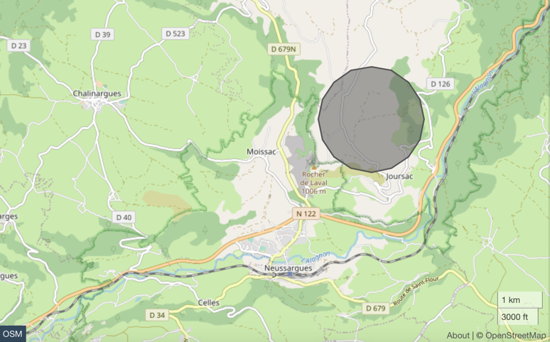
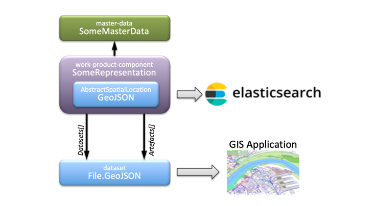

[[_TOC_]]

# Generic Geometries

As a simple geometry we use a circle-shaped 17-point polygon with the center at Easting=500,000 and Northing=5,000,000 m
in a ED50 UTM zone 31 projection.



## GeoJSON

An introduction to the GeoJSON format is available in [Wikipedia](https://en.wikipedia.org/wiki/GeoJSON). OSDU promotes
the highest level `FeatureCollection` in for example
[AbstractSpatialLocation](../../../E-R/abstract/AbstractSpatialLocation.1.0.0.md)
`Wgs84Coordinates`, with schema
fragment [`AbstractFeatureCollection`](../../../E-R/abstract/AbstractFeatureCollection.1.0.0.md).

### Embedded GeoJSON versus `dataset--File.GeoJSON`

OSDU master-data, work-product and work-product-component group-type support embedded GeoJSON for small, simple
geometries. Larger geometries must be kept outside the work-product-component Storage record. This is
where `dataset--File.GeoJSON` offers the solution:



The use of GeoJSON in Storage records is limited due to the size limitation of Storage records. The embedded GeoJSON is
intended as a low-resolution geometry approximation 'good enough' for the spatial search capabilities on Storage records
via Elastic. Large, arbitrary sizes of GeoJSON geometries must be handled
via [`dataset--File.GeoJSON`](../../../E-R/dataset/File.GeoJSON.1.1.0.md) with SchemaFormatTypeID
`partition-id:reference-data--SchemaFormatType:GeoJSON.FeatureCollection:`. GIS applications should prefer the full
resolution `dataset--File.GeoJSON` over the embedded, approximated GeoJSON.

The GeoJSON file as content example is available [here](./GeoJSON/CircleInFra.json). In the interest of the example the
size is minimal - and could easily be represented _inside_ a Storage record. Here, however, the focus is on
demonstrating the relation of work-product-components with datasets and geometry 'files'. The file is ingested/uploaded
using the File Service or Dataset Service.

<details>

<summary markdown="span">GeoJSON file example.</summary>

<OsduImportJSON>[GeoJSON file](./GeoJSON/CircleInFra.json)</OsduImportJSON>

```json
{
  "type": "FeatureCollection",
  "features": [
    {
      "type": "Feature",
      "properties": {},
      "geometry": {
        "type": "Polygon",
        "coordinates": [
          [
            [
              3.01156019,
              45.15163973,
              -2000.00
            ],
            [
              3.01059247,
              45.15508459,
              -2000.00
            ],
            [
              3.00783506,
              45.15800514,
              -2000.00
            ],
            [
              3.00370761,
              45.15995665,
              -2000.00
            ],
            [
              2.99883863,
              45.16064191,
              -2000.00
            ],
            [
              45.15995655,
              2.99396967,
              -2000.00
            ],
            [
              2.98984230,
              45.15800496,
              -2000.00
            ],
            [
              2.98708501,
              45.15508435,
              -2000.00
            ],
            [
              2.98611743,
              45.15163947,
              -2000.00
            ],
            [
              2.98708656,
              45.14819482,
              -2000.00
            ],
            [
              2.98984456,
              45.14527476,
              -2000.00
            ],
            [
              2.99397142,
              45.14332375,
              -2000.00
            ],
            [
              2.99883899,
              45.14263870,
              -2000.00
            ],
            [
              3.00370653,
              45.14332385,
              -2000.00
            ],
            [
              3.00783331,
              45.14527495,
              -2000.00
            ],
            [
              3.01059120,
              45.14819506,
              -2000.00
            ],
            [
              3.01156019,
              45.15163973,
              -2000.00
            ]
          ]
        ]
      }
    }
  ]
}
```

</details>

GeoJSON is by definition always based on the WGS 84 geographic CRS. Therefore, the dataset does not include
the [`AbstractSpatialReference`](../../../E-R/abstract/AbstractSpatialReference.1.0.0.md)

The existence of GeoJSON content is advertised via the
[following record](./datasets/File.GeoJSON.json) (typically created by the File/Dataset service using the Storage
service).

<details>

<summary markdown="span">A <code>dataset--File.GeoJSON</code> record (fragment).</summary>

<OsduImportJSON>[Complete GeoJSON record](./datasets/File.GeoJSON.json#only.data)</OsduImportJSON>

```json
{
  "data": {
    "Source": "Liberated from Petrel",
    "ExistenceKind": "partition-id:reference-data--ExistenceKind:Prototype:",
    "Name": "A Circle in France",
    "Description": "A circular shape positioned in France.",
    "TotalSize": "2013",
    "EncodingFormatTypeID": "partition-id:reference-data--EncodingFormatType:application%2Fgeo%2Bjson:",
    "SchemaFormatTypeID": "partition-id:reference-data--SchemaFormatType:GeoJSON.FeatureCollection:",
    "DatasetProperties": {
      "FileSourceInfo": {
        "FileSource": "s3://default_bucket/r1/data/provided/documents/GeoJSON/CircleInFra.json",
        "PreloadFilePath": "s3://staging-area/r7/raw-data/provided/documents/GeoJSON/CircleInFra.json",
        "Name": "CircleInFra.json",
        "FileSize": "2013",
        "EncodingFormatTypeID": "partition-id:reference-data--EncodingFormatType:application%2Fgeo%2Bjson:"
      }
    },
    "ExtensionProperties": {}
  }
}
```

</details>

## Esri Shapefile

An introduction to the shapefile format is available in
[Wikipedia](https://en.wikipedia.org/wiki/Shapefile). A shapefile is an ensemble of files with particular roles as
define in the standard.

The ensemble of files for a given shape - same as in the GeoJSON example above - can be
found [in this folder](./ShapeFileCollection).

The shapefile ensemble is ingested/uploaded by the File service or Dataset service. The existence of the available
content is advertised via the following record:

<details>

<summary markdown="span">A <code>dataset--FileCollection.Esri.Shape</code> record (fragment).</summary>

<OsduImportJSON>[Open complete example record](./datasets/Esri.Shape.ExampleRecord.json#only.data)</OsduImportJSON>

```json
{
  "data": {
    "Source": "Liberated from Petrel",
    "ExistenceKind": "partition-id:reference-data--ExistenceKind:Prototype:",
    "Name": "A Circle in France",
    "Description": "A circular shape positioned in France.",
    "TotalSize": "6613",
    "EncodingFormatTypeID": "namespace:reference-data--EncodingFormatType:x-gis%2Fx-shapefile:",
    "SchemaFormatTypeID": "namespace:reference-data--SchemaFormatType:Esri.ShapeFile:",
    "Endian": "BIG",
    "DatasetProperties": {
      "FileCollectionPath": "s3://default_bucket/opendes/data/made-up-path/my-shape/",
      "IndexFilePath": "s3://default_bucket/opendes/data/made-up-path/my-shape/CircleInFra.shx",
      "FileSourceInfos": [
        {
          "FileSource": "s3://default_bucket/opendes/data/made-up-path/my-shape/CircleInFra.shp",
          "PreloadFilePath": "s3://staging-area/r7/raw-data/provided/documents/ShapeFileCollection/CircleInFra.shp",
          "Name": "CircleInFra.shp"
        },
        {
          "FileSource": "s3://default_bucket/opendes/data/made-up-path/my-shape/CircleInFra.prj",
          "PreloadFilePath": "s3://staging-area/r7/raw-data/provided/documents/ShapeFileCollection/CircleInFra.prj",
          "Name": "CircleInFra.prj"
        },
        {
          "FileSource": "s3://default_bucket/opendes/data/made-up-path/my-shape/CircleInFra.dbf",
          "PreloadFilePath": "s3://staging-area/r7/raw-data/provided/documents/ShapeFileCollection/CircleInFra.dbf",
          "Name": "CircleInFra.dbf"
        },
        {
          "FileSource": "s3://default_bucket/opendes/data/made-up-path/my-shape/CircleInFra.shx",
          "PreloadFilePath": "s3://staging-area/r7/raw-data/provided/documents/ShapeFileCollection/CircleInFra.shx",
          "Name": "CircleInFra.shx"
        }
      ]
    },
    "SpatialReference": {
      "CoordinateReferenceSystemID": "namespace:reference-data--CoordinateReferenceSystem:BoundProjected:EPSG::23031_EPSG::1134:",
      "VerticalCoordinateReferenceSystemID": "namespace:reference-data--CoordinateReferenceSystem:Vertical:EPSG::5714:",
      "PersistableReferenceCRS": "{\"authCode\":{\"auth\":\"OSDU\",\"code\":\"23031002\"},\"lateBoundCRS\":{\"authCode\":{\"auth\":\"EPSG\",\"code\":\"23031\"},\"name\":\"ED_1950_UTM_Zone_31N\",\"type\":\"LBC\",\"ver\":\"PE_10_9_1\",\"wkt\":\"PROJCS[\\\"ED_1950_UTM_Zone_31N\\\",GEOGCS[\\\"GCS_European_1950\\\",DATUM[\\\"D_European_1950\\\",SPHEROID[\\\"International_1924\\\",6378388.0,297.0]],PRIMEM[\\\"Greenwich\\\",0.0],UNIT[\\\"Degree\\\",0.0174532925199433]],PROJECTION[\\\"Transverse_Mercator\\\"],PARAMETER[\\\"False_Easting\\\",500000.0],PARAMETER[\\\"False_Northing\\\",0.0],PARAMETER[\\\"Central_Meridian\\\",3.0],PARAMETER[\\\"Scale_Factor\\\",0.9996],PARAMETER[\\\"Latitude_Of_Origin\\\",0.0],UNIT[\\\"Meter\\\",1.0],AUTHORITY[\\\"EPSG\\\",23031]]\"},\"name\":\"ED50 * DMA-cenEur / UTM zone 31N [23031,1134]\",\"singleCT\":{\"authCode\":{\"auth\":\"EPSG\",\"code\":\"1134\"},\"name\":\"ED_1950_To_WGS_1984_2\",\"type\":\"ST\",\"ver\":\"PE_10_9_1\",\"wkt\":\"GEOGTRAN[\\\"ED_1950_To_WGS_1984_2\\\",GEOGCS[\\\"GCS_European_1950\\\",DATUM[\\\"D_European_1950\\\",SPHEROID[\\\"International_1924\\\",6378388.0,297.0]],PRIMEM[\\\"Greenwich\\\",0.0],UNIT[\\\"Degree\\\",0.0174532925199433]],GEOGCS[\\\"GCS_WGS_1984\\\",DATUM[\\\"D_WGS_1984\\\",SPHEROID[\\\"WGS_1984\\\",6378137.0,298.257223563]],PRIMEM[\\\"Greenwich\\\",0.0],UNIT[\\\"Degree\\\",0.0174532925199433]],METHOD[\\\"Geocentric_Translation\\\"],PARAMETER[\\\"X_Axis_Translation\\\",-87.0],PARAMETER[\\\"Y_Axis_Translation\\\",-96.0],PARAMETER[\\\"Z_Axis_Translation\\\",-120.0],AUTHORITY[\\\"EPSG\\\",1134]]\"},\"type\":\"EBC\",\"ver\":\"PE_10_9_1\"}",
      "PersistableReferenceVerticalCRS": "{\"authCode\":{\"auth\":\"EPSG\",\"code\":\"5714\"},\"name\":\"MSL_Height\",\"type\":\"LBC\",\"ver\":\"PE_10_9_1\",\"wkt\":\"VERTCS[\\\"MSL_Height\\\",VDATUM[\\\"Mean_Sea_Level\\\"],PARAMETER[\\\"Vertical_Shift\\\",0.0],PARAMETER[\\\"Direction\\\",1.0],UNIT[\\\"Meter\\\",1.0],AUTHORITY[\\\"EPSG\\\",5714]]\"}",
      "PersistableReferenceUnitZ": "{'scaleOffset': {'scale': 1.0, 'offset': 0.0}, 'symbol': 'm', 'baseMeasurement': {'ancestry': 'Length', 'type': 'UM'}, 'type': 'USO'}"
    },
    "ExtensionProperties": {}
  }
}
```

</details>

In this case the coordinate reference system of the data is a projected CRS, i.e., 'ED50 / UTM zone 31N'. This
definition is also present in the
[file with extension `.prj`](./ShapeFileCollection/CircleInFra.prj). This information is however insufficient to support
a placement of the data on a world map. Therefore, the dataset can be augmented in the
`data.SpatialReference` section in the dataset
[record](./datasets/Esri.Shape.ExampleRecord.json#65).

<details>

<summary markdown="span">SpatialReference in dataset record (fragment).</summary>

<OsduImportJSON>[dataset record](./datasets/Esri.Shape.ExampleRecord.json#only.data.SpatialReference)</OsduImportJSON>

```json
{
  "data": {
    "SpatialReference": {
      "CoordinateReferenceSystemID": "namespace:reference-data--CoordinateReferenceSystem:BoundProjected:EPSG::23031_EPSG::1134:",
      "VerticalCoordinateReferenceSystemID": "namespace:reference-data--CoordinateReferenceSystem:Vertical:EPSG::5714:",
      "PersistableReferenceCRS": "{\"authCode\":{\"auth\":\"OSDU\",\"code\":\"23031002\"},\"lateBoundCRS\":{\"authCode\":{\"auth\":\"EPSG\",\"code\":\"23031\"},\"name\":\"ED_1950_UTM_Zone_31N\",\"type\":\"LBC\",\"ver\":\"PE_10_9_1\",\"wkt\":\"PROJCS[\\\"ED_1950_UTM_Zone_31N\\\",GEOGCS[\\\"GCS_European_1950\\\",DATUM[\\\"D_European_1950\\\",SPHEROID[\\\"International_1924\\\",6378388.0,297.0]],PRIMEM[\\\"Greenwich\\\",0.0],UNIT[\\\"Degree\\\",0.0174532925199433]],PROJECTION[\\\"Transverse_Mercator\\\"],PARAMETER[\\\"False_Easting\\\",500000.0],PARAMETER[\\\"False_Northing\\\",0.0],PARAMETER[\\\"Central_Meridian\\\",3.0],PARAMETER[\\\"Scale_Factor\\\",0.9996],PARAMETER[\\\"Latitude_Of_Origin\\\",0.0],UNIT[\\\"Meter\\\",1.0],AUTHORITY[\\\"EPSG\\\",23031]]\"},\"name\":\"ED50 * DMA-cenEur / UTM zone 31N [23031,1134]\",\"singleCT\":{\"authCode\":{\"auth\":\"EPSG\",\"code\":\"1134\"},\"name\":\"ED_1950_To_WGS_1984_2\",\"type\":\"ST\",\"ver\":\"PE_10_9_1\",\"wkt\":\"GEOGTRAN[\\\"ED_1950_To_WGS_1984_2\\\",GEOGCS[\\\"GCS_European_1950\\\",DATUM[\\\"D_European_1950\\\",SPHEROID[\\\"International_1924\\\",6378388.0,297.0]],PRIMEM[\\\"Greenwich\\\",0.0],UNIT[\\\"Degree\\\",0.0174532925199433]],GEOGCS[\\\"GCS_WGS_1984\\\",DATUM[\\\"D_WGS_1984\\\",SPHEROID[\\\"WGS_1984\\\",6378137.0,298.257223563]],PRIMEM[\\\"Greenwich\\\",0.0],UNIT[\\\"Degree\\\",0.0174532925199433]],METHOD[\\\"Geocentric_Translation\\\"],PARAMETER[\\\"X_Axis_Translation\\\",-87.0],PARAMETER[\\\"Y_Axis_Translation\\\",-96.0],PARAMETER[\\\"Z_Axis_Translation\\\",-120.0],AUTHORITY[\\\"EPSG\\\",1134]]\"},\"type\":\"EBC\",\"ver\":\"PE_10_9_1\"}",
      "PersistableReferenceVerticalCRS": "{\"authCode\":{\"auth\":\"EPSG\",\"code\":\"5714\"},\"name\":\"MSL_Height\",\"type\":\"LBC\",\"ver\":\"PE_10_9_1\",\"wkt\":\"VERTCS[\\\"MSL_Height\\\",VDATUM[\\\"Mean_Sea_Level\\\"],PARAMETER[\\\"Vertical_Shift\\\",0.0],PARAMETER[\\\"Direction\\\",1.0],UNIT[\\\"Meter\\\",1.0],AUTHORITY[\\\"EPSG\\\",5714]]\"}",
      "PersistableReferenceUnitZ": "{'scaleOffset': {'scale': 1.0, 'offset': 0.0}, 'symbol': 'm', 'baseMeasurement': {'ancestry': 'Length', 'type': 'UM'}, 'type': 'USO'}"
    }
  }
}
```

</details>