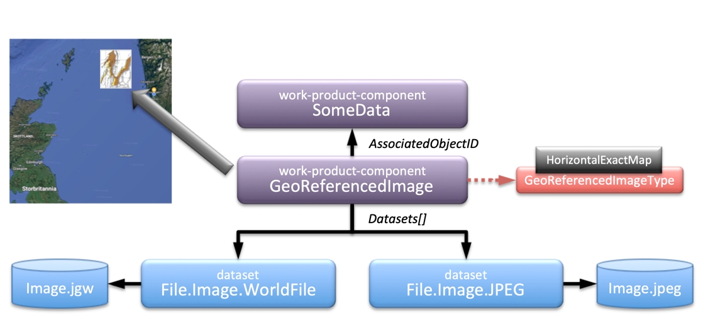
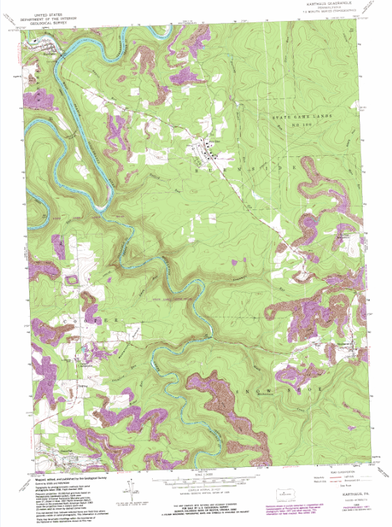
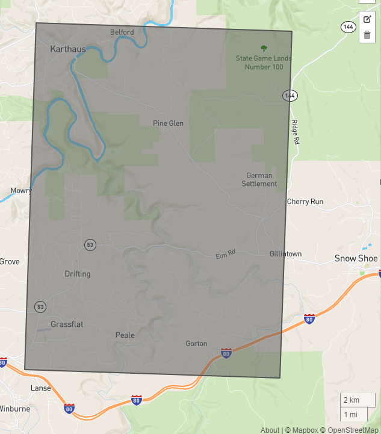
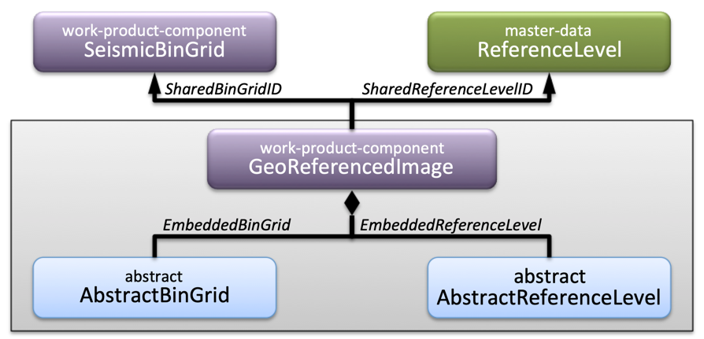
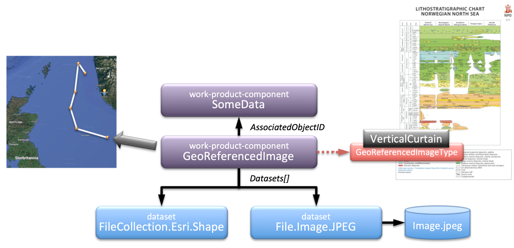

<a name="TOC"></a>

[[_TOC_]]

# Geo-Referenced Images

For background see the [Wikipedia article about Geo-referencing](https://en.wikipedia.org/wiki/Georeferencing). It deals
mainly with map references, i.e. images, which can be placed on a map (projection).

OSDU classifies references images
via [`osdu:wks:reference-data--GeoReferencedImageType:1.0.0`](../../../E-R/reference-data/GeoReferencedImageType.1.0.0.md)
as

| Code                     | Name                       | Description                                                                                                                                               |
|--------------------------|----------------------------|-----------------------------------------------------------------------------------------------------------------------------------------------------------|
| HorizontalExactMap       | Horizontal Exact Map       | An image, which is precisely geo-referenced using a bin grid definition (affine transform from pixel to map CRS coordinates).                             |
| HorizontalApproximateMap | Horizontal Approximate Map | An image, which does not deliver an exact affine transform from pixel to map CRS coordinates, but can be placed at least for one corner point on the map. |
| VerticalCurtain          | Vertical Curtain           | A vertical image, which is geo-referenced by a line segment or a polyline (GeoJSON type "LineString").                                                    |
| VerticalColumn           | Vertical Column            | A vertical image geo-referenced at a map position (no horizontal extent).                                                                                 |

[Back to TOC](#TOC)

## HorizontalExactMap

The model relationships for a horizontal map are shown in this diagram assuming a JPEG file type:



[Back to TOC](#TOC)

### Digital Map Example

For this example we are using a USGS chart from Pennsylvania, which is a public demo dataset available via
https://download.osgeo.org/geotiff/samples/usgs/. The thumbnail for the tif image looks like this:



The [`work-product-component--GeoReferencedImage`](work-product-component/ExactMap.json) record refers to

1. [`dataset--File.Image.TIFF`](dataset/File.Image.TIFF-Example.json) with
   actual [image here](https://download.osgeo.org/geotiff/samples/usgs/o41078a1.tif), and
2. [`dataset--File.Image.WorldFile`](dataset/File.Image.WorldFile-Example.json) referring to content as
   in [this file](dataset/o41078a1.lgo.txt).

<details>

<summary markdown="span">The world file provides the exact context to set up the <code>BinGrid</code> (expand here).</summary>

<OsduImportJSON>[Complete exact map example record](./work-product-component/ExactMap.json#only.data.EmbeddedBinGrid.P6TransformationMethod|P6BinGridOriginI|P6BinGridOriginJ|P6BinGridOriginEasting|P6BinGridOriginNorthing|P6ScaleFactorOfBinGrid|P6BinWidthOnIaxis|P6BinWidthOnJaxis|P6MapGridBearingOfBinGridJaxis|P6BinNodeIncrementOnIaxis|P6BinNodeIncrementOnJaxis)</OsduImportJSON>

```json
{
  "data": {
    "EmbeddedBinGrid": {
      "P6TransformationMethod": 1049,
      "P6BinGridOriginI": 0,
      "P6BinGridOriginJ": 0,
      "P6BinGridOriginEasting": 740726.437,
      "P6BinGridOriginNorthing": 4557390.415,
      "P6ScaleFactorOfBinGrid": 1.0,
      "P6BinWidthOnIaxis": 2.4384,
      "P6BinWidthOnJaxis": 2.4384,
      "P6MapGridBearingOfBinGridJaxis": 180.0,
      "P6BinNodeIncrementOnIaxis": 1.0,
      "P6BinNodeIncrementOnJaxis": 1.0
    }
  }
}
```
</details>

The CoordinateReferenceSystem definition is given by `PCS = 32617 (WGS 84 / UTM zone 17N)`, with
[this matching reference data record](reference-data/Projected.EPSG..32617.json). The image size is 5032 pixels in horizontal and
6793 pixels in vertical direction.

With this the AsIngestedCoordinates can be computed and checked against the corner coordinates.
The outline on the world map looks like this:



[Back to TOC](#TOC)

### Seismic Time Slice - Images with Vertical Location

This [example record](./work-product-component/SeismicImage-Example-embeddedSRD.json) demonstrates a horizontal seismic
slice as geo-referenced image with embedded vertical reference, i.e., the time/depth zero reference level. This is
conveniently used for ad-hoc references.

<details>

<summary markdown="span">Embedded Vertical Reference Level Definition.</summary>

The reference description looks like:

<OsduImportJSON>[Complete example record](./work-product-component/SeismicImage-Example-embeddedSRD.json#only.data.EmbeddedReferenceLevel)</OsduImportJSON>

```json
{
  "data": {
    "EmbeddedReferenceLevel": {
      "Height": 0.0,
      "VerticalCoordinateReferenceSystemID": "partition-id:reference-data--CoordinateReferenceSystem:Vertical::EPSG::5714:",
      "VerticalMeasurementTypeID": "namespace:reference-data--VerticalMeasurementType:SeismicReferenceDatum:",
      "VerticalMeasurementPathID": "namespace:reference-data--VerticalMeasurementPath:TrueVerticalHeight:",
      "VerticalUncertainty": 0.3,
      "SeismicReplacementVelocity": 1480.0
    }
  }
}
```

</details>


Alternatively, it is possible to create a
reusable `master-data--ReferenceLevel` [record](master-data/ReferenceLevel-SharedSRD.json) - like in this case a generic
seismic reference datum (SRD) aligned with Mean Sea Level.

<details>

<summary markdown="span">External <code>master-data--ReferenceLevel</code> record (fragment).</summary>

<OsduImportJSON>[Complete example `master-data--ReferenceLevel` record](master-data/ReferenceLevel-SharedSRD.json#only.data)</OsduImportJSON>

```json
{
  "data": {
    "ExistenceKind": "partition-id:reference-data--ExistenceKind:Actual:",
    "SpatialLocation": {
      "Wgs84Coordinates": {
        "type": "FeatureCollection",
        "features": [
          {
            "type": "Feature",
            "properties": {},
            "geometry": {
              "type": "Polygon",
              "coordinates": [
                [
                  [
                    -180.0,
                    -90.0
                  ],
                  [
                    180.0,
                    -90.0
                  ],
                  [
                    180.0,
                    90.0
                  ],
                  [
                    -180.0,
                    90.0
                  ],
                  [
                    -180.0,
                    -90.0
                  ]
                ]
              ]
            }
          }
        ]
      },
      "SpatialParameterTypeID": "partition-id:reference-data--SpatialParameterType:Outline:",
      "SpatialGeometryTypeID": "partition-id:reference-data--SpatialGeometryType:Polygon:"
    },
    "Name": "SRD at MSL",
    "Description": "The seismic reference datum at Mean Sea Level.",
    "Height": 0.0,
    "VerticalCoordinateReferenceSystemID": "partition-id:reference-data--CoordinateReferenceSystem:Vertical::EPSG::5714:",
    "VerticalMeasurementTypeID": "partition-id:reference-data--VerticalMeasurementType:SeismicReferenceDatum:",
    "WellboreTVDTrajectoryID": "partition-id:work-product-component--WellboreTrajectory:WellboreTrajectory-911bb71f-06ab-4deb-8e68-b8c9229dc76b:",
    "VerticalUncertainty": 0.3,
    "SeismicReplacementVelocity": 1480.0,
    "ExtensionProperties": {}
  }
}
```

</details>

<details>

<summary markdown="span">A <code>GeoReferencedImage</code> record referencing an external <code>master-data--ReferenceLevel</code> (fragment).</summary>

<OsduImportJSON>[Complete example record](work-product-component/SeismicImage-Example-sharedSRD.json#only.data.SharedReferenceLevelID)</OsduImportJSON>

```json
{
  "data": {
    "SharedReferenceLevelID": "partition-id:master-data--ReferenceLevel:SRD-at-MSL:"
  }
}
```
</details>

The following figure summarises the horizontal and vertica references in the `GeoReferencedImage` - it can carry the
full definition if ad-hoc reference are used: `AbstractBinGrid` and `AbstractReferenceLevel` - or relationships to
external `SeismicBinGrid` and/or `ReferenceLevel` records.



[Back to TOC](#TOC)

## VerticalCurtain



This example demonstrates a vertical spatial reference like a curtain. The curtain is hanging vertically from the
polyline path on the map. The image example is [available here](./dataset/NPD-LithoChartNorthSea.png), the respective
dataset record referring to the image is available here as [File.Image.PNG](./dataset/File.Image.PNG-Example.json). This
dataset, in turn, is referred to by
the [work-product-component--GeoReferencedImage record](./work-product-component/Curtain-Example.json)

<details>

<summary markdown="span">A <code>dataset--File.Image.PNG</code> record (fragment).</summary>

<OsduImportJSON>[Complete example `dataset--File.Image.PNG` record](./dataset/File.Image.PNG-Example.json#only.data)</OsduImportJSON>

```json
{
  "data": {
    "ExistenceKind": "partition-id:reference-data--ExistenceKind:Actual:",
    "Name": "NPD-LithoChartNorthSea",
    "Description": "As originally delivered by ACME.com.",
    "TotalSize": "13245217273",
    "EncodingFormatTypeID": "partition-id:reference-data--EncodingFormatType:image%2Fpng:",
    "SchemaFormatTypeID": "partition-id:reference-data--SchemaFormatType:Image.PNG:",
    "Endian": "BIG",
    "DatasetProperties": {
      "FileSourceInfo": {
        "FileSource": "s3://default_bucket/r1/data/provided/documents/geo-referenced-curtains/NPD-LithoChartNorthSea.png",
        "PreloadFilePath": "s3://staging-area/r7/raw-data/provided/documents/geo-referenced-curtains/NPD-LithoChartNorthSea.png",
        "PreloadFileCreateUser": "somebody@acme.org",
        "PreloadFileCreateDate": "2019-12-16T11:46:20.163Z",
        "PreloadFileModifyUser": "somebody.else@acme.org",
        "PreloadFileModifyDate": "2019-12-20T17:20:05.356Z",
        "Name": "NPD-LithoChartNorthSea.png",
        "FileSize": "95463",
        "EncodingFormatTypeID": "partition-id:reference-data--EncodingFormatType:image%2Fpng:",
        "Checksum": "d41d8cd98f00b204e9800998ecf8427e",
        "ChecksumAlgorithm": "SHA-256"
      }
    },
    "Checksum": "d41d8cd98f00b204e9800998ecf8427e",
    "ExtensionProperties": {}
  }
}
```

</details>

<details>

<summary markdown="span">A <code>work-product-component--GeoReferencedImage</code> NPD Lithostratigraphic Chart Norwegian North Sea example (fragment).</summary>

<OsduImportJSON>[Complete `work-product-component--GeoReferencedImage` record](./work-product-component/Curtain-Example.json#only.data)</OsduImportJSON>

```json
{
  "data": {
    "Source": "Example Data Source",
    "ExistenceKind": "partition-id:reference-data--ExistenceKind:Prototype:",
    "Datasets": [
      "partition-id:dataset--File.GenericImage.PNG:22dca0b5-943d-52cb-9312-8e6c6fb9b25d:"
    ],
    "Artefacts": [],
    "IsExtendedLoad": true,
    "IsDiscoverable": true,
    "Name": "NPD Lithostratigraphic Chart Norwegian North Sea",
    "Description": "Example Description",
    "CreationDateTime": "2020-02-13T09:13:15.55Z",
    "Tags": [
      "Example Tags"
    ],
    "SpatialArea": {
      "Wgs84Coordinates": {
        "type": "FeatureCollection",
        "features": [
          {
            "type": "Feature",
            "properties": {
              "CurtainHorizontalPixelPositions": [
                0,
                122,
                212,
                303,
                396,
                483,
                574,
                642
              ]
            },
            "geometry": {
              "type": "LineString",
              "coordinates": [
                [
                  6.13037109375,
                  57.27904276497778
                ],
                [
                  6.13037109375,
                  57.27904276497778
                ],
                [
                  2.79052734375,
                  57.71588512774503
                ],
                [
                  2.1752929687499996,
                  59.02924933736396
                ],
                [
                  2.5927734375,
                  59.833775202184206
                ],
                [
                  2.7685546874999996,
                  61.19621314083867
                ],
                [
                  3.44970703125,
                  60.909073282636484
                ],
                [
                  3.44970703125,
                  60.909073282636484
                ]
              ]
            }
          }
        ]
      },
      "SpatialGeometryTypeID": "partition-id:reference-data--SpatialGeometryType:LineString:"
    },
    "GeoContexts": [
      {
        "BasinID": "partition-id:master-data--Basin:SomeUniqueBasinID:",
        "GeoTypeID": "partition-id:reference-data--BasinType:ArcWrenchOceanContinent:"
      }
    ],
    "SubmitterName": "Example SubmitterName",
    "BusinessActivities": [
      "Example Business Activity"
    ],
    "AuthorIDs": [
      "NPD"
    ],
    "LineageAssertions": [
      {
        "ID": "partition-id:work-product-component--Document:NPD-NorthSea-Stratigraphy-1f855537-dea8-5b2a-a6d6-63fc9a0bbac1:",
        "LineageRelationshipType": "partition-id:reference-data--LineageRelationshipType:Direct:"
      }
    ],
    "AssociatedObjectID": "partition-id:work-product--AnyWorkProduct:AnyWorkProduct-911bb71f-06ab-4deb-8e68-b8c9229dc76b:",
    "ImageTypeID": "partition-id:reference-data--GeoReferencedImageType:HorizontalMap:",
    "ExtensionProperties": {}
  }
}
```
</details>

[Back to TOC](#TOC)

# Appendix

# Relevant Schemas

| Group-Type             | Entity Type Documentation                                                                                                    | Proposal Workbook                                                                                    |
|------------------------|------------------------------------------------------------------------------------------------------------------------------|------------------------------------------------------------------------------------------------------|
| abstract               | [`osdu:wks:AbstractReferenceLevel:1.*`](../../../E-R/abstract/AbstractReferenceLevel.1.0.0.md)                               | [AbstractReferenceLevel](../../../Proposals/abstract/AbstractReferenceLevel.1.0.0.xlsx)              |
| dataset                | [`osdu:wks:dataset--File.Image.JPEG:1.*`](../../../E-R/dataset/File.Image.JPEG.1.1.0.md)                                     | [File.Image.JPEG](../../../Proposals/dataset/File.Image.JPEG.1.0.0.xlsx)                             |
| dataset                | [`osdu:wks:dataset--File.Image.PNG:1.*`](../../../E-R/dataset/File.Image.PNG.1.1.0.md)                                       | [File.Image.PNG](../../../Proposals/dataset/File.Image.PNG.1.0.0.xlsx)                               |
| dataset                | [`osdu:wks:dataset--File.Image.TIFF:1.*`](../../../E-R/dataset/File.Image.TIFF.1.1.0.md)                                     | [File.Image.TIFF](../../../Proposals/dataset/File.Image.TIFF.1.0.0.xlsx)                             |
| dataset                | [`osdu:wks:dataset--File.Image.WorldFile:1.*`](../../../E-R/dataset/File.Image.WorldFile.1.1.0.md)                           | [File.Image.WorldFile](../../../Proposals/dataset/File.Image.WorldFile.1.0.0.xlsx)                   |
| dataset                | [`osdu:wks:dataset--File.OGC.GeoTIFF:1.*`](../../../E-R/dataset/File.OGC.GeoTIFF.1.1.0.md)                                   | [File.OGC.GeoTIFF](../../../Proposals/dataset/File.OGC.GeoTIFF.1.0.0.xlsx)                           |
| master-data            | [`osdu:wks:master-data--ReferenceLevel:1.*`](../../../E-R/master-data/ReferenceLevel.1.1.0.md)                               | [ReferenceLevel](../../../Proposals/master-data/ReferenceLevel.1.0.0.xlsx)                           |
| reference-data         | [`osdu:wks:reference-data--GeoReferencedImageType:1.*`](../../../E-R/reference-data/GeoReferencedImageType.1.0.0.md)         | [GeoReferencedImageType](../../../Proposals/reference-data/schema-GeoReferencedImageType.1.0.0.xlsx) |
| work-product-component | [`osdu:wks:work-product-component--GeoReferencedImage:1.*`](../../../E-R/work-product-component/GeoReferencedImage.1.3.0.md) | [GeoReferencedImage](../../../Proposals/work-product-component/GeoReferencedImage.1.1.0.xlsx)        |

GeoTIFF is a Tagged Image File Format (TIFF) image file which contains the spatial referencing information embedded
within the file With companion World Files [see Wikipedia](https://en.wikipedia.org/wiki/World_file)

| Raster format                                                  | Raster file name | World file name |
|----------------------------------------------------------------|------------------|-----------------|
| [GIF](https://en.wikipedia.org/wiki/GIF)                       | mymap.gif        | mymap.gfw       |
| [JPEG](https://en.wikipedia.org/wiki/JPEG)                     | mymap.jpg        | mymap.jgw       |
| [JPEG 2000](https://en.wikipedia.org/wiki/JPEG_2000)           | mymap.jp2        | mymap.j2w       |
| [PNG](https://en.wikipedia.org/wiki/Portable_Network_Graphics) | mymap.png        | mymap.pgw       |
| [TIFF](https://en.wikipedia.org/wiki/TIFF)                     | mymap.tif        | mymap.tfw       |