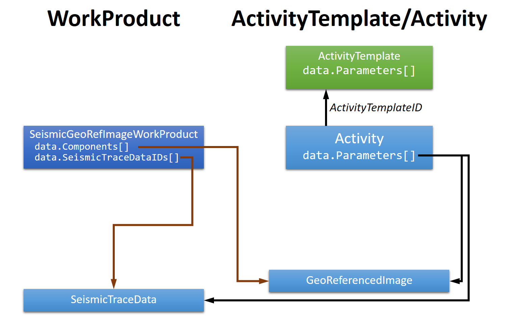

# WorkProduct versus ActivityTemplate/Activity

Traditionally, SDU used specialised WorkProduct types to represent a transaction/creation of a group of records with
interesting, business-relevant relationships. The following example record is using such a specialised `kind` as it
would exist in SDU.

<details>
<summary markdown="span">Specialised WorkProduct Record</summary>
This example record reflects a type/kind, which does not exist in OSDU.

```json
{
  "id": "partition-id:work-product--SeismicGeoRefImageWorkProduct:8817acd6-3190-5b64-92fa-849cbc5b2a33",
  "kind": "osdu:wks:work-product--SeismicGeoRefImageWorkProduct:1.0.0",
  "version": 1628848344929332,
  "acl": {
    "owners": [
      "someone@company.com"
    ],
    "viewers": [
      "someone@company.com"
    ]
  },
  "legal": {
    "legaltags": [
      "Example legaltags"
    ],
    "otherRelevantDataCountries": [
      "US"
    ],
    "status": "compliant"
  },
  "tags": {
    "NameOfKey": "String value"
  },
  "createTime": "2021-08-13T09:46:20.163Z",
  "createUser": "some-user@some-company-cloud.com",
  "modifyTime": "2021-08-13T09:52:24.477Z",
  "modifyUser": "some-user@some-company-cloud.com",
  "ancestry": {
    "parents": []
  },
  "meta": [],
  "data": {
    "ResourceHomeRegionID": "partition-id:reference-data--OSDURegion:AWSEastUSA:",
    "ResourceHostRegionIDs": [
      "partition-id:reference-data--OSDURegion:AWSEastUSA:"
    ],
    "ResourceCurationStatus": "partition-id:reference-data--ResourceCurationStatus:CREATED:",
    "ResourceLifecycleStatus": "partition-id:reference-data--ResourceLifecycleStatus:LOADING:",
    "Source": "Example Data Source",
    "ExistenceKind": "partition-id:reference-data--ExistenceKind:Actual:",
    "Components": [
      "partition-id:work-product-component--GeoReferencedImage:d1ab7738-7535-56ca-b726-2f95e0e2e522"
    ],
    "IsExtendedLoad": false,
    "IsDiscoverable": true,
    "Name": "Example Name",
    "Description": "Example Description",
    "CreationDateTime": "2021-08-13T09:13:15.55Z",
    "SubmitterName": "Example SubmitterName",
    "BusinessActivities": [],
    "AuthorIDs": [],
    "LineageAssertions": [],
    "SeismicTraceDataIDs": [
      "partition-id:work-product-component--SeismicTraceData:1f855537-dea8-5b2a-a6d6-63fc9a0bbac1:"
    ],
    "ImageFileCount": 1,
    "ExtensionProperties": {}
  }
}
```

</details>

The example describes a 'transaction' of creating the following records and their relationships, i.e.,

* one [SeismicTraceData record](../../SeismicLoadingManifests/Examples/Records/seismic/seismic-wpc.json) as input to an
  image extraction, and
* one [GeoReferencedImage output record](../work-product-component/SeismicImage-Example-embeddedSRD.json).
* the records are referenced by either
    * a `work-product--SeismicGeoRefImageWorkProduct`, or
    * a (not required, but helpful for organization) `master-data--ActivityTemplate`, (which corresponds to the 'schema'
      of the `SeismicGeoRefImageWorkProduct`), and a `work-product-component--Activity` record.



## ActivityTemplate/Activity

OSDU does - up to now - not use specialised `WorkProduct` types. Instead, an activity record is created, which conveys
the same content.

* Example record for [ActivityTemplate](ActivityTemplate_SeismicGeoRefImage.json)  (which corresponds to the 'schema' of
  the `SeismicGeoRefImageWorkProduct`)
* Example record for the [Activity instance](Activity_SeismicGeoRefImage.json).