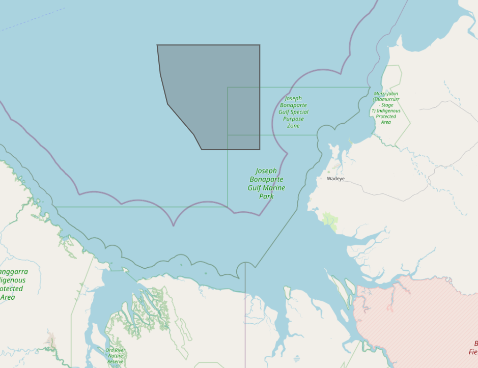
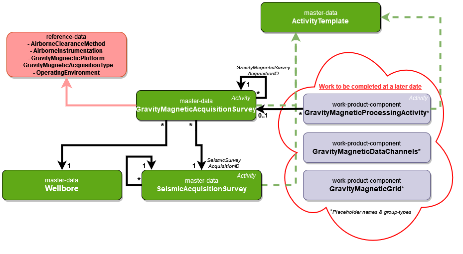

<a name="TOC"></a>

[[_TOC_]]

# Gravity Magnetic Acquisition Survey, Falcon NT/P66

## File and Document

The examples are built based on the [Falcon Airborne Gavity Gradiometry Survey](../../GravityMagnetic/AcquisitionSurvey/content/Falcon_Acquisition_Final_Report_1663.pdf)
The document itself is represented by a
generic `work-product-component--Document` referring to a `dataset--File.Generic` as Word .PDF.

<details>

<summary markdown="span">Completion Report, <code>dataset--File.Generic</code> example.</summary>

<OsduImportJSON>[Generic File (PDF), Full record](../../GravityMagnetic/AcquisitionSurvey/records/File.Generic-Falcon-Acquisition-Report.json#only.data)</OsduImportJSON>

```json
{
  "data": {
    "Name": "Falcon Airborne Gravity Gradiometer and Magnetic Geophysical Survey",
    "Description": "Acquisition and Processing Report; NT/P66; Survey Flown June 2004; FAS Job# 1663.",
    "TotalSize": "56939200",
    "EncodingFormatTypeID": "partition-id:reference-data--EncodingFormatType:application%2Fpdf:",
    "DatasetProperties": {
      "FileSourceInfo": {
        "FileSource": "s3://bhp-data/wcr/NT/P66/Falcon_Acquisition_Final_Report_1663.doc",
        "PreloadFilePath": "https://gitlab.opengroup.org/osdu/subcommittees/data-def/projects/seismic/docs/-/blob/master/Design%20Documents/GravityMagnetic/Falcon_Acquisition_Final_Report_1663.pdf",
        "Name": "Falcon_Airborne_Gravity_Gradiometer_Magnetic_Geophysical_SurveyAcquisition_Job1663.pdf",
        "FileSize": "56939200"
      }
    }
  }
}
```
</details>


<details>

<summary markdown="span">Completion Report, <code>work-product-component--Document</code> example.</summary>

<OsduImportJSON>[Document WPC, Full record](../../GravityMagnetic/AcquisitionSurvey/records/Document-SurveyAcquisition-Report-Falcon.json#only.data)</OsduImportJSON>

```json
{
  "data": {
    "TechnicalAssuranceID": "partition-id:reference-data--TechnicalAssuranceType:Certified:",
    "Datasets": [
      "partition-id:dataset--File.Generic:Falcon_SurveyAcquisitionReport_NT-P66:"
    ],
    "Artefacts": [],
    "Name": "Falcon Airborne Gravity Gradiometer and Magnetic Geophysical Survey",
    "Description": "Acquisition and Processing Report; NT/P66; Survey Flown June 2004; FAS Job# 1663",
    "CreationDateTime": "2023-02-13T09:13:15.55Z",
    "Tags": [
      "Example Tags"
    ],
    "SpatialArea": {
      "AsIngestedCoordinates": {
        "type": "AnyCrsFeatureCollection",
        "CoordinateReferenceSystemID": "partition-id:reference-data--CoordinateReferenceSystem:Projected:EPSG::32752:",
        "persistableReferenceCrs": "{\"authCode\":{\"auth\":\"EPSG\",\"code\":\"32752\"},\"name\":\"WGS_1984_UTM_Zone_52S\",\"type\":\"LBC\",\"ver\":\"PE_10_9_1\",\"wkt\":\"PROJCS[\\\"WGS_1984_UTM_Zone_52S\\\",GEOGCS[\\\"GCS_WGS_1984\\\",DATUM[\\\"D_WGS_1984\\\",SPHEROID[\\\"WGS_1984\\\",6378137.0,298.257223563]],PRIMEM[\\\"Greenwich\\\",0.0],UNIT[\\\"Degree\\\",0.0174532925199433]],PROJECTION[\\\"Transverse_Mercator\\\"],PARAMETER[\\\"False_Easting\\\",500000.0],PARAMETER[\\\"False_Northing\\\",10000000.0],PARAMETER[\\\"Central_Meridian\\\",129.0],PARAMETER[\\\"Scale_Factor\\\",0.9996],PARAMETER[\\\"Latitude_Of_Origin\\\",0.0],UNIT[\\\"Meter\\\",1.0],AUTHORITY[\\\"EPSG\\\",32752]]\"}",
        "features": [
          {
            "type": "AnyCrsFeature",
            "geometry": {
              "type": "AnyCrsPolygon",
              "coordinates": [
                [
                  [
                    451953.97,
                    8471277
                  ],
                  [
                    447406.47,
                    8489704
                  ],
                  [
                    445379,
                    8507672
                  ],
                  [
                    509149.88,
                    8507727
                  ],
                  [
                    509127.56,
                    8443214
                  ],
                  [
                    473154,
                    8443201
                  ],
                  [
                    468184.28,
                    8452412
                  ],
                  [
                    451953.97,
                    8471277
                  ]
                ]
              ]
            },
            "properties": {}
          }
        ]
      },
      "Wgs84Coordinates": {
        "type": "FeatureCollection",
        "features": [
          {
            "type": "Feature",
            "geometry": {
              "type": "Polygon",
              "coordinates": [
                [
                  [
                    128.5554244464313,
                    -13.827768104087594
                  ],
                  [
                    128.51369076769933,
                    -13.661073926184496
                  ],
                  [
                    128.4952877854856,
                    -13.498570668494214
                  ],
                  [
                    129.08454821767512,
                    -13.498566875843691
                  ],
                  [
                    129.08455166491348,
                    -14.081902627779284
                  ],
                  [
                    128.7513170613719,
                    -14.081906817108287
                  ],
                  [
                    128.70538781909215,
                    -13.998570519262502
                  ],
                  [
                    128.5554244464313,
                    -13.827768104087594
                  ]
                ]
              ]
            },
            "properties": {}
          }
        ]
      },
      "AppliedOperations": [
        "conversion from WGS_1984_UTM_Zone_52S to GCS_WGS_1984; 8 points converted"
      ]
    },
    "GeoContexts": [
      {
        "GeoPoliticalEntityID": "partition-id:master-data--GeoPoliticalEntity:P66:",
        "GeoTypeID": "partition-id:reference-data--GeoPoliticalEntityType:BlockID:"
      },
      {
        "BasinID": "partition-id:master-data--Basin:NT:",
        "GeoTypeID": "partition-id:reference-data--BasinType:PassiveMargin:"
      }
    ],
    "SubmitterName": "BHP Billiton",
    "BusinessActivities": [
      "Exploration"
    ],
    "AuthorIDs": [
      "Fugro Airborne Surveys"
    ],
    "LineageAssertions": [
      {
        "ID": "partition-id:master-data--GravityMagneticAcquisitionSurvey:Falcon-FAS1663:",
        "LineageRelationshipType": "partition-id:reference-data--LineageRelationshipType:Direct:"
      }
    ],
    "DocumentTypeID": "partition-id:reference-data--DocumentType:SurveyAcquisitionReport:",
    "NumberOfPages": 20,
    "SubTitle": "Acquisition and Processing Report",
    "DocumentSubject": "Falcon Airborne Gravity Gradiometer and Magnetic Geophysical Survey",
    "DatePublished": "2004-06-01",
    "DocumentLanguage": "English",
    "ExtensionProperties": {}
  }
}
```
</details>

[Back to TOC](#TOC)

#### Figure 1. Location Map


The figure above has been taken from the report, page 2. The coordinates in the table were converted into a GeoJSON polygon in original coordinates:

<details>

<summary markdown="span">Wgs84Coordinates of survey area with 'WGS 84 / UTM zone 52S'.</summary>

<OsduImportJSON>[Survey AsIngestedCoordinates, Full record](../../GravityMagnetic/AcquisitionSurvey/records/FalconGravityMagneticAcquisitionSurvey.1.0.0.json#only.data.SpatialLocation.AsIngestedCoordinates)</OsduImportJSON>

```json
{
  "data": {
    "SpatialLocation": {
      "AsIngestedCoordinates": {
        "type": "AnyCrsFeatureCollection",
        "CoordinateReferenceSystemID": "partition-id:reference-data--CoordinateReferenceSystem:Projected:EPSG::32752:",
        "persistableReferenceCrs": "{\"authCode\":{\"auth\":\"EPSG\",\"code\":\"32752\"},\"name\":\"WGS_1984_UTM_Zone_52S\",\"type\":\"LBC\",\"ver\":\"PE_10_9_1\",\"wkt\":\"PROJCS[\\\"WGS_1984_UTM_Zone_52S\\\",GEOGCS[\\\"GCS_WGS_1984\\\",DATUM[\\\"D_WGS_1984\\\",SPHEROID[\\\"WGS_1984\\\",6378137.0,298.257223563]],PRIMEM[\\\"Greenwich\\\",0.0],UNIT[\\\"Degree\\\",0.0174532925199433]],PROJECTION[\\\"Transverse_Mercator\\\"],PARAMETER[\\\"False_Easting\\\",500000.0],PARAMETER[\\\"False_Northing\\\",10000000.0],PARAMETER[\\\"Central_Meridian\\\",129.0],PARAMETER[\\\"Scale_Factor\\\",0.9996],PARAMETER[\\\"Latitude_Of_Origin\\\",0.0],UNIT[\\\"Meter\\\",1.0],AUTHORITY[\\\"EPSG\\\",32752]]\"}",
        "features": [
          {
            "type": "AnyCrsFeature",
            "geometry": {
              "type": "AnyCrsPolygon",
              "coordinates": [
                [
                  [
                    451953.97,
                    8471277
                  ],
                  [
                    447406.47,
                    8489704
                  ],
                  [
                    445379,
                    8507672
                  ],
                  [
                    509149.88,
                    8507727
                  ],
                  [
                    509127.56,
                    8443214
                  ],
                  [
                    473154,
                    8443201
                  ],
                  [
                    468184.28,
                    8452412
                  ],
                  [
                    451953.97,
                    8471277
                  ]
                ]
              ]
            },
            "properties": {}
          }
        ]
      }
    }
  }
}
```
</details>

<details>

<summary markdown="span">Wgs84Coordinates of survey area (GeoJSON).</summary>

<OsduImportJSON>[Survey Wgs84Coordinates, Full record](../../GravityMagnetic/AcquisitionSurvey/records/FalconGravityMagneticAcquisitionSurvey.1.0.0.json#only.data.SpatialLocation.Wgs84Coordinates)</OsduImportJSON>

```json
{
  "data": {
    "SpatialLocation": {
      "Wgs84Coordinates": {
        "type": "FeatureCollection",
        "features": [
          {
            "type": "Feature",
            "geometry": {
              "type": "Polygon",
              "coordinates": [
                [
                  [
                    128.5554244464313,
                    -13.827768104087594
                  ],
                  [
                    128.51369076769933,
                    -13.661073926184496
                  ],
                  [
                    128.4952877854856,
                    -13.498570668494214
                  ],
                  [
                    129.08454821767512,
                    -13.498566875843691
                  ],
                  [
                    129.08455166491348,
                    -14.081902627779284
                  ],
                  [
                    128.7513170613719,
                    -14.081906817108287
                  ],
                  [
                    128.70538781909215,
                    -13.998570519262502
                  ],
                  [
                    128.5554244464313,
                    -13.827768104087594
                  ]
                ]
              ]
            },
            "properties": {}
          }
        ]
      }
    }
  }
}
```
</details>

### Figure 2. GeoJSON Polygon

The GeoJSON object can be visualized in generic tools like https://geojson.io:




[Back to TOC](#TOC)

## Gravity Magnetic Acquisition Survey Schema

The current release of gravity and magnetic geophysical data only supports the survey acquisition as a master-data group type. Future releases are expected to include futher objects such as a processing activity, processed data channels, grids and maps.

### Figure 3. Conceptual Model



The Gravity Magnetic Acquisition Survey schema is of a group type master-data and the schema documentation can be found [here](../../../../E-R/master-data/GravityMagneticAcquisitionSurvey.1.0.0.md).

A Gravity Magnetic Acquisition Survey record captures the information related to a particular gravity, including gravity gradiometry, and magnetic geophysical acquisition survey. Information captured includes properties related to the overall acquisition project activity, such as financial and human resources information, location, spatial and technical assurance information, and gravity and magnetic survey acquisition specific properties such as; an array of data acquisition types, for example gravity, gradiometry, and magnetic, the platform method, such as land, airborne, marine, satellite and wellbore, the details of all the equipment used to acquire the geophysical data and the flying parameters for airborne surveys.

Relationships to other objects can be seen in figure 2 above and include; [SeismicAcquisitionSurvey](../../../../E-R/master-data/SeismicAcquisitionSurvey.1.4.0.md) record, applicable when gravity and magnetic surveys are carried out at the same time as a seismic survey, typically through a marine platform, and a [Wellbore](../../../../E-R/master-data/Wellbore.1.5.1.md) record, applicable  when gravity and magnetic surveys are acquired from a borehole or wellbore platform. When a wellbore survey is acquired the included wellbore [VerticalMeasurement](../../../../E-R/abstract/AbstractFacilityVerticalMeasurement.1.0.0.md) properties may also be required to be captured to identify the zero datum for that survey.

Time-lapse or 4D acquisition surveys are accommodated by populating the `PrecedingTimeLapseSurveyID` property. This property identifies the preceding Gravity Magnetic Acquisition Survey by the `GravityMagneticAcquisitionSurveyID`. The first survey record in the sequence has an empty or absent `PrecedingTimeLapseSurveyID` property.


### Below is a schema fragment of the GravityMagneticAcquisitionSurvey .data block with example values

<details>

<summary markdown="span">GravityMagneticAcquisitionSurvey - Data Block, <code>master-data--GravityMagneticAcquisitionSurvey</code> example.</summary>

<OsduImportJSON>[FalconGravityMagneticAcquisitionSurvey.1.0.0](records/FalconGravityMagneticAcquisitionSurvey.1.0.0.json#only.data.Datasets|DataAcquisitionTypeIDs|AcquisitionPlatformMethodID|OperatingEnvironmentIDs|AreaCalculated|AreaNominal|AverageStationDistance|EquipmentDetails|AcquisitionDateRange|ServiceCompanyID|Remarks|VerticalMeasurement|MovingPlatform|PrecedingTimeLapseSurveyID)</OsduImportJSON>

```json
{
  "data": {
    "Datasets": {},
    "DataAcquisitionTypeIDs": [
      "partition-id:reference-data--GravityMagneticDataAcquisitionType:GravityGradiometry:",
      "partition-id:reference-data--GravityMagneticDataAcquisitionType:Magnetic:"
    ],
    "AcquisitionPlatformMethodID": "partition-id:reference-data--GravityMagneticAcquisitionPlatform:Airborne:",
    "OperatingEnvironmentIDs": [
      "partition-id:reference-data--OperatingEnvironment:Offshore:"
    ],
    "AreaCalculated": 7485,
    "AreaNominal": 7485,
    "AverageStationDistance": 60,
    "EquipmentDetails": [
      {
        "Name": "Falcon Airborne Gravity Gradiometer",
        "Manufacturer": "Lockheed Martin",
        "Model": "Falcon Galileo AGG System",
        "SerialNumber": "Example SerialNumber",
        "Remarks": [
          {
            "RemarkSequenceNumber": 1,
            "Remark": "The AGG System is based on existing gravity gradiometer technology and has\nbeen optimized for airborne mineral exploration. The system is capable of supporting surveying activities in areas ranging from 1,000 ft below sea level to 13,000 ft above sea level with aircraft speeds from 70 to 130 knots. The AGG data streams were digitally recorded at different rates on removable drives installed in the AGG electronics rack.",
            "RemarkSource": "Acquisition Report",
            "RemarkDate": "2023-09-28"
          },
          {
            "RemarkSequenceNumber": 2,
            "Remark": "The FALCON\u00ae Airborne Gravity Gradiometry (AGG) family of technologies has been jointly developed by Xcalibur Multiphysics, BHP, and Lockheed Martin over the last 20 years. This has led to the only AGG instrument that is specifically designed to deal with the rigors of high-resolution data collection in a dynamic airborne environment.",
            "RemarkSource": "Xcalibur Multiphysics",
            "RemarkDate": "2023-09-28"
          }
        ]
      },
      {
        "Name": "Scintrex CS-2",
        "Manufacturer": "Scintrex",
        "Model": "CS-2 cesium",
        "SerialNumber": "Example SerialNumber",
        "Remarks": [
          {
            "RemarkSequenceNumber": 1,
            "Remark": "The ground magnetometer is Geometrics G-823B cesium sensor sampling at 1Hz",
            "RemarkSource": "Acquisition Report",
            "RemarkDate": "2023-09-28"
          },
          {
            "RemarkSequenceNumber": 2,
            "Remark": "The airborne cesium magnetometer mounted within the stinger is a Scintrex CS-2 magnetometer having a noise envelope of 0.002nT pk-pk in 0.01-1Hz bandwidth.  The ground magnetometer is Geometrics G-823B cesium sensor sampling at 1Hz",
            "RemarkSource": "Acquisition Report",
            "RemarkDate": "2023-09-28"
          }
        ]
      }
    ],
    "AcquisitionDateRange": {
      "StartDate": "2004-06-10",
      "EndDate": "2004-06-24"
    },
    "ServiceCompanyID": "partition-id:master-data--Organisation:Fugro:",
    "Remarks": [
      {
        "RemarkSequenceNumber": 1,
        "Remark": "Fugro Airborne Surveys Pty Ltd conducted a high-sensitivity aeromagnetic and gravity gradiometer survey over NT/P66 an offshore area on the Western Australia, Northern Territory border, under contract with BHP Billiton. The survey was flown from the Kununurra airport in Western Australia. ",
        "RemarkSource": "Acquisition Report",
        "RemarkDate": "2023-09-28"
      }
    ],
    "VerticalMeasurement": {},
    "MovingPlatform": {
      "IsMovingPlatformSurvey": true,
      "SamplingIntervalTime": 0.1,
      "CalculatedLineLength": 7485000,
      "NominalLineLength": 7485000,
      "PrimaryLineSpacing": 500,
      "TieLineSpacing": 10000,
      "FlyingHeightParameters": {
        "ClearanceMethodID": "partition-id:reference-data--AirborneClearanceMethod:Constant:",
        "MeasurementInstrumentationIDs": [
          "partition-id:reference-data--AirborneInstrumentation:Laser:",
          "partition-id:reference-data--AirborneInstrumentation:Radar:",
          "partition-id:reference-data--AirborneInstrumentation:GPS:"
        ],
        "VerticalCoordinateReferenceSystemID": "partition-id:reference-data--CoordinateReferenceSystem:Vertical:EPSG::5714:",
        "ExternalTopographicalInformation": "SRTM  v3",
        "AverageFlyingHeight": 120
      },
      "SeismicAcquisitionSurveyID": "partition-id:master-data--SeismicAcquisitionSurvey:SomeUniqueSeismicAcquisitionSurveyID:",
      "PlatformName": "Cessna 208B, Grand Caravan, registration VH-FAY"
    },
    "PrecedingTimeLapseSurveyID": "partition-id:master-data--GravityMagneticAcquisitionSurvey:SomeUniqueGravityMagneticAcquisitionSurveyID:"
  }
}
```
</details>

[Back to TOC](#TOC)

### Below is a complete, GravityMagneticAcquisitionSurvey generated schema with example values

<details>

<summary markdown="span">GravityMagneticAcquisitionSurvey, <code>master-data--GravityMagneticAcquisitionSurvey</code> example.</summary>

<OsduImportJSON>[FalconGravityMagneticAcquisitionSurvey.1.0.0](records/FalconGravityMagneticAcquisitionSurvey.1.0.0.json#only.data)</OsduImportJSON>

```json
{
  "data": {
    "ResourceHomeRegionID": "partition-id:reference-data--OSDURegion:AWSEastUSA:",
    "ResourceHostRegionIDs": [
      "partition-id:reference-data--OSDURegion:AWSEastUSA:"
    ],
    "ResourceCurationStatus": "partition-id:reference-data--ResourceCurationStatus:Created:",
    "ResourceLifecycleStatus": "partition-id:reference-data--ResourceLifecycleStatus:Loading:",
    "Source": "Australian NOPTA Database",
    "ExistenceKind": "partition-id:reference-data--ExistenceKind:Actual:",
    "NameAliases": [
      {
        "AliasName": "NT/P66",
        "AliasNameTypeID": "partition-id:reference-data--AliasNameType:RegulatoryIdentifier:",
        "DefinitionOrganisationID": "partition-id:master-data--Organisation:NOPTA:",
        "EffectiveDateTime": "2023-02-13T09:13:15.55Z",
        "TerminationDateTime": "2023-02-13T09:13:15.55Z"
      }
    ],
    "GeoContexts": [
      {
        "GeoPoliticalEntityID": "partition-id:master-data--GeoPoliticalEntity:P66:",
        "GeoTypeID": "partition-id:reference-data--GeoPoliticalEntityType:Area:"
      },
      {
        "BasinID": "partition-id:master-data--Basin:Bonaparte:",
        "GeoTypeID": "partition-id:reference-data--BasinType:PassiveMargin:"
      },
      {
        "FieldID": "partition-id:master-data--Field:P66:",
        "GeoTypeID": "Field"
      },
      {
        "PlayID": "partition-id:master-data--Play:P66A1:",
        "GeoTypeID": "partition-id:reference-data--PlayType:CarbonCaptureAndStorage:"
      },
      {
        "ProspectID": "partition-id:master-data--Prospect:P66A:",
        "GeoTypeID": "partition-id:reference-data--ProspectType:Structural.Anticline:"
      }
    ],
    "SpatialLocation": {
      "QuantitativeAccuracyBandID": "partition-id:reference-data--QuantitativeAccuracyBand:Length.LessThan1m:",
      "QualitativeSpatialAccuracyTypeID": "partition-id:reference-data--QualitativeSpatialAccuracyType:Assumed:",
      "CoordinateQualityCheckRemarks": [
        "Good as Gold"
      ],
      "AsIngestedCoordinates": {
        "type": "AnyCrsFeatureCollection",
        "CoordinateReferenceSystemID": "partition-id:reference-data--CoordinateReferenceSystem:Projected:EPSG::32752:",
        "persistableReferenceCrs": "{\"authCode\":{\"auth\":\"EPSG\",\"code\":\"32752\"},\"name\":\"WGS_1984_UTM_Zone_52S\",\"type\":\"LBC\",\"ver\":\"PE_10_9_1\",\"wkt\":\"PROJCS[\\\"WGS_1984_UTM_Zone_52S\\\",GEOGCS[\\\"GCS_WGS_1984\\\",DATUM[\\\"D_WGS_1984\\\",SPHEROID[\\\"WGS_1984\\\",6378137.0,298.257223563]],PRIMEM[\\\"Greenwich\\\",0.0],UNIT[\\\"Degree\\\",0.0174532925199433]],PROJECTION[\\\"Transverse_Mercator\\\"],PARAMETER[\\\"False_Easting\\\",500000.0],PARAMETER[\\\"False_Northing\\\",10000000.0],PARAMETER[\\\"Central_Meridian\\\",129.0],PARAMETER[\\\"Scale_Factor\\\",0.9996],PARAMETER[\\\"Latitude_Of_Origin\\\",0.0],UNIT[\\\"Meter\\\",1.0],AUTHORITY[\\\"EPSG\\\",32752]]\"}",
        "features": [
          {
            "type": "AnyCrsFeature",
            "geometry": {
              "type": "AnyCrsPolygon",
              "coordinates": [
                [
                  [
                    451953.97,
                    8471277
                  ],
                  [
                    447406.47,
                    8489704
                  ],
                  [
                    445379,
                    8507672
                  ],
                  [
                    509149.88,
                    8507727
                  ],
                  [
                    509127.56,
                    8443214
                  ],
                  [
                    473154,
                    8443201
                  ],
                  [
                    468184.28,
                    8452412
                  ],
                  [
                    451953.97,
                    8471277
                  ]
                ]
              ]
            },
            "properties": {}
          }
        ]
      },
      "Wgs84Coordinates": {
        "type": "FeatureCollection",
        "features": [
          {
            "type": "Feature",
            "geometry": {
              "type": "Polygon",
              "coordinates": [
                [
                  [
                    128.5554244464313,
                    -13.827768104087594
                  ],
                  [
                    128.51369076769933,
                    -13.661073926184496
                  ],
                  [
                    128.4952877854856,
                    -13.498570668494214
                  ],
                  [
                    129.08454821767512,
                    -13.498566875843691
                  ],
                  [
                    129.08455166491348,
                    -14.081902627779284
                  ],
                  [
                    128.7513170613719,
                    -14.081906817108287
                  ],
                  [
                    128.70538781909215,
                    -13.998570519262502
                  ],
                  [
                    128.5554244464313,
                    -13.827768104087594
                  ]
                ]
              ]
            },
            "properties": {}
          }
        ]
      },
      "AppliedOperations": [
        "conversion from WGS_1984_UTM_Zone_52S to GCS_WGS_1984; 8 points converted"
      ],
      "SpatialParameterTypeID": "partition-id:reference-data--SpatialParameterType:Outline:",
      "SpatialGeometryTypeID": "partition-id:reference-data--SpatialGeometryType:Point:"
    },
    "VersionCreationReason": "Initial loading into the OSDU Data Platform",
    "TechnicalAssuranceTypeID": "partition-id:reference-data--TechnicalAssuranceType:Certified:",
    "TechnicalAssurances": [
      {
        "TechnicalAssuranceTypeID": "partition-id:reference-data--TechnicalAssuranceType:Trusted:",
        "Reviewers": [
          {
            "RoleTypeID": "partition-id:reference-data--ContactRoleType:AccountOwner:",
            "DataGovernanceRoleTypeID": "partition-id:reference-data--DataGovernanceRoleType:SME:",
            "WorkflowPersonaTypeID": "partition-id:reference-data--WorkflowPersonaType:SeismicProcessor:",
            "OrganisationID": "partition-id:master-data--Organisation:SomeUniqueOrganisationID:",
            "Name": "John Smith"
          }
        ],
        "AcceptableUsage": [
          {
            "WorkflowUsageTypeID": "partition-id:reference-data--WorkflowUsageType:SeismicProcessing:",
            "WorkflowPersonaTypeID": "partition-id:reference-data--WorkflowPersonaType:SeismicProcessor:",
            "DataQualityRuleSetID": "partition-id:reference-data--DataQualityRuleSet:SeismicProcessingQCRuleSet:",
            "DataQualityID": "partition-id:work-product-component--DataQuality:6a433d16-07c8-4f4d-9ddc-5608e2ec4234:1562066077849221",
            "ValueChainStatusTypeID": "partition-id:reference-data--ValueChainStatusType:Exploration:"
          }
        ],
        "UnacceptableUsage": [
          {
            "WorkflowUsageTypeID": "partition-id:reference-data--WorkflowUsageType:SeismicInterpretation:",
            "WorkflowPersonaTypeID": "partition-id:reference-data--WorkflowPersonaType:SeismicInterpreter:",
            "DataQualityRuleSetID": "partition-id:reference-data--DataQualityRuleSet:SeismicInterpretationQCRuleSet:",
            "DataQualityID": "partition-id:work-product-component--DataQuality:d79bf97c-ff7c-4b82-89b5-c88520c15017:1562066009929332",
            "ValueChainStatusTypeID": "partition-id:reference-data--ValueChainStatusType:FieldDevelopment:"
          }
        ],
        "EffectiveDate": "2023-02-13",
        "Comment": "This is free form text from reviewer, e.g. restrictions on use"
      }
    ],
    "ProjectID": "Falcon NT/P66 FAS1663",
    "ProjectName": "Falcon Airborne Gravity Gradiometry and Magnetic",
    "Purpose": "Salt Modelling",
    "ProjectBeginDate": "2004-06-10T09:13:15.55Z",
    "ProjectEndDate": "2004-06-24T12:22:01.30Z",
    "FundsAuthorizations": [
      {
        "AuthorizationID": "GoSpendBig",
        "EffectiveDateTime": "2004-01-10T09:13:15.55Z",
        "FundsAmount": 5000000,
        "CurrencyID": "partition-id:reference-data--Currency:AUD:"
      }
    ],
    "ContractIDs": [
      "partition-id:master-data--Agreement:FugroFAS1663:"
    ],
    "Operator": "partition-id:master-data--Organisation:BHP:",
    "Contractors": [
      {
        "ContractorOrganisationID": "partition-id:master-data--Organisation:Fugro:",
        "ContractorCrew": "Every man and his dog",
        "ContractorTypeID": "partition-id:reference-data--ContractorType:Record:"
      }
    ],
    "Personnel": [
      {
        "PersonName": "Fido",
        "CompanyOrganisationID": "partition-id:master-data--Organisation:Fugro:",
        "ProjectRoleID": "partition-id:reference-data--ProjectRole:ProjMgr:"
      }
    ],
    "ProjectSpecifications": [
      {
        "EffectiveDateTime": "2004-02-13T09:13:15.55Z",
        "TerminationDateTime": "2005-02-13T09:13:15.55Z",
        "ProjectSpecificationQuantity": 12345.6,
        "ProjectSpecificationDateTime": "2020-02-13T09:13:15.55Z",
        "ProjectSpecificationIndicator": true,
        "ProjectSpecificationText": "Example ProjectSpecificationText",
        "UnitOfMeasureID": "partition-id:reference-data--UnitOfMeasure:m:",
        "ParameterTypeID": "partition-id:reference-data--ParameterType:SlotName:"
      }
    ],
    "ProjectStates": [
      {
        "EffectiveDateTime": "2020-02-13T09:13:15.55Z",
        "TerminationDateTime": "2020-02-13T09:13:15.55Z",
        "ProjectStateTypeID": "partition-id:reference-data--ProjectStateType:Prop:"
      }
    ],
    "ActivityTemplateID": "partition-id:master-data--ActivityTemplate:SomeUniqueActivityTemplateID:",
    "ParentProjectID": "partition-id:master-data--AnyMasterData:SomeUniqueAnyMasterDataID:",
    "Parameters": [
      {
        "Title": "Example Title",
        "Index": 2,
        "Selection": "Example Selection",
        "Keys": [
          {
            "ObjectParameterKey": "partition-id:any-group-type--AnyIndividualType:SomeUniqueAnyIndividualTypeID:",
            "TimeIndexParameterKey": "11:13:15.55+02:00",
            "ParameterKey": "Example Internal Parameter Key",
            "IntegerParameterKey": 2,
            "StringParameterKey": "Example String Parameter Key"
          }
        ],
        "IntegerQuantityParameter": 2,
        "ParameterKindID": "partition-id:reference-data--ParameterKind:Integer:",
        "ParameterRoleID": "partition-id:reference-data--ParameterRole:Input:",
        "DataQuantityParameterUOMID": "partition-id:reference-data--UnitOfMeasure:m:"
      }
    ],
    "ActivityStates": [
      {
        "EffectiveDateTime": "2020-02-13T09:13:15.55Z",
        "TerminationDateTime": "2020-02-13T09:13:15.55Z",
        "ActivityStatusID": "partition-id:reference-data--ActivityStatus:Planned:",
        "Remark": "Example Remark"
      }
    ],
    "LastActivityState": {
      "EffectiveDateTime": "2020-02-13T09:13:15.55Z",
      "TerminationDateTime": "2020-02-13T09:13:15.55Z",
      "ActivityStatusID": "partition-id:reference-data--ActivityStatus:Planned:",
      "Remark": "Example Remark"
    },
    "DataAcquisitionTypeIDs": [
      "partition-id:reference-data--GravityMagneticDataAcquisitionType:GravityGradiometry:",
      "partition-id:reference-data--GravityMagneticDataAcquisitionType:Magnetic:"
    ],
    "AcquisitionPlatformMethodID": "partition-id:reference-data--GravityMagneticAcquisitionPlatform:Airborne:",
    "OperatingEnvironmentIDs": [
      "partition-id:reference-data--OperatingEnvironment:Offshore:"
    ],
    "AreaCalculated": 7485,
    "AreaNominal": 7485,
    "AverageStationDistance": 60,
    "EquipmentDetails": [
      {
        "Name": "Falcon Airborne Gravity Gradiometer",
        "Manufacturer": "Lockheed Martin",
        "Model": "Falcon Galileo AGG System",
        "SerialNumber": "Example SerialNumber",
        "Remarks": [
          {
            "RemarkSequenceNumber": 1,
            "Remark": "The AGG System is based on existing gravity gradiometer technology and has\nbeen optimized for airborne mineral exploration. The system is capable of supporting surveying activities in areas ranging from 1,000 ft below sea level to 13,000 ft above sea level with aircraft speeds from 70 to 130 knots. The AGG data streams were digitally recorded at different rates on removable drives installed in the AGG electronics rack.",
            "RemarkSource": "Acquisition Report",
            "RemarkDate": "2023-09-28"
          },
          {
            "RemarkSequenceNumber": 2,
            "Remark": "The FALCON\u00ae Airborne Gravity Gradiometry (AGG) family of technologies has been jointly developed by Xcalibur Multiphysics, BHP, and Lockheed Martin over the last 20 years. This has led to the only AGG instrument that is specifically designed to deal with the rigors of high-resolution data collection in a dynamic airborne environment.",
            "RemarkSource": "Xcalibur Multiphysics",
            "RemarkDate": "2023-09-28"
          }
        ]
      },
      {
        "Name": "Scintrex CS-2",
        "Manufacturer": "Scintrex",
        "Model": "CS-2 cesium",
        "SerialNumber": "Example SerialNumber",
        "Remarks": [
          {
            "RemarkSequenceNumber": 1,
            "Remark": "The ground magnetometer is Geometrics G-823B cesium sensor sampling at 1Hz",
            "RemarkSource": "Acquisition Report",
            "RemarkDate": "2023-09-28"
          },
          {
            "RemarkSequenceNumber": 2,
            "Remark": "The airborne cesium magnetometer mounted within the stinger is a Scintrex CS-2 magnetometer having a noise envelope of 0.002nT pk-pk in 0.01-1Hz bandwidth.  The ground magnetometer is Geometrics G-823B cesium sensor sampling at 1Hz",
            "RemarkSource": "Acquisition Report",
            "RemarkDate": "2023-09-28"
          }
        ]
      }
    ],
    "AcquisitionDateRange": {
      "StartDate": "2004-06-10",
      "EndDate": "2004-06-24"
    },
    "ServiceCompanyID": "partition-id:master-data--Organisation:Fugro:",
    "Remarks": [
      {
        "RemarkSequenceNumber": 1,
        "Remark": "Fugro Airborne Surveys Pty Ltd conducted a high-sensitivity aeromagnetic and gravity gradiometer survey over NT/P66 an offshore area on the Western Australia, Northern Territory border, under contract with BHP Billiton. The survey was flown from the Kununurra airport in Western Australia. ",
        "RemarkSource": "Acquisition Report",
        "RemarkDate": "2023-09-28"
      }
    ],
    "VerticalMeasurement": {},
    "MovingPlatform": {
      "IsMovingPlatformSurvey": true,
      "SamplingIntervalTime": 0.1,
      "CalculatedLineLength": 7485000,
      "NominalLineLength": 7485000,
      "PrimaryLineSpacing": 500,
      "TieLineSpacing": 10000,
      "FlyingHeightParameters": {
        "ClearanceMethodID": "partition-id:reference-data--AirborneClearanceMethod:Constant:",
        "MeasurementInstrumentationIDs": [
          "partition-id:reference-data--AirborneInstrumentation:Laser:",
          "partition-id:reference-data--AirborneInstrumentation:Radar:",
          "partition-id:reference-data--AirborneInstrumentation:GPS:"
        ],
        "VerticalCoordinateReferenceSystemID": "partition-id:reference-data--CoordinateReferenceSystem:Vertical:EPSG::5714:",
        "ExternalTopographicalInformation": "SRTM  v3",
        "AverageFlyingHeight": 120
      },
      "SeismicAcquisitionSurveyID": "partition-id:master-data--SeismicAcquisitionSurvey:SomeUniqueSeismicAcquisitionSurveyID:",
      "PlatformName": "Cessna 208B, Grand Caravan, registration VH-FAY"
    },
    "PrecedingTimeLapseSurveyID": "partition-id:master-data--GravityMagneticAcquisitionSurvey:SomeUniqueGravityMagneticAcquisitionSurveyID:",
    "ExtensionProperties": {}
  }
}
```
</details>

[Back to TOC](#TOC)

## Schema Usage Guide References

See also [9.10 Non-Seismic Geophysics](../../../../Guides/Chapters/09-SeismicProjectsAndRelatedData.md#910-non-seismic-geophysics) in the Schema Usage
Guide.


[Back to TOC](#TOC)