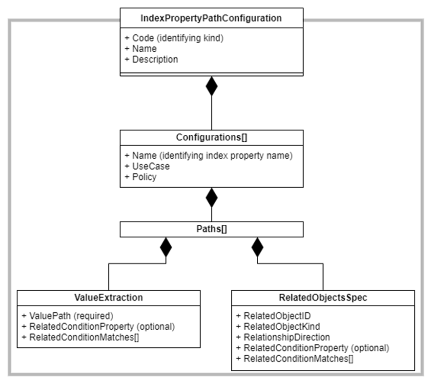

<a name="TOC">Table of Contents</a>

[[_TOC_]]

# Index Extensions



## Conventions

### Code

`Code` value is populated with the major `kind` (=schema id) version with a trailing `.` to declare an index extension
as valid for the entire series of minor and patch versions for a given major version. An example
is `"Code": "wks:master-data--Well:1."`.

### Policy

Contrary to other OSDU schemas, `Policy` values do not refer to a reference-data reference value list but two fixed values:

1. `ExtractFirstMatch` - creating a **single** index object of the same type as the source property identified
   by `ValuePath`
2. `ExtractAllMatches` - creating an **array** of the type specified by the source property

The `Policy` value list is not extensible unless the implementation in the indexer is adjusted. This justifies the
encoding of the `Policy` via the validation `"pattern": "^(ExtractFirstMatch|ExtractAllMatches)$"`.

### ValueExtraction

The `ValueExtraction` object has one mandatory property, `ValuePath`. The other optional two properties hold value
match conditions, i.e., the property containing the value to be matched and the value to match.

* If no `RelatedObjectsSpec` is present, the value is derived from the object being indexed.
* If `RelatedObjectsSpec` is provided, the value extraction is carried out in related objects - depending on
  the `RelationshipDirection` indirection parent/related object or children. The property holding the record id to
  follow is specified in `RelatedObjectID`, so is the expected target kind. As in ValueExtraction, the selection can
  be filtered by a match condition (`RelatedConditionProperty` and `RelatedConditionMatches`).

> **Note:**  Using regular expressions in `RelatedConditionMatches` is only supported in Milestone M21 (v0.24.*) and
> later.

# Examples

The following example configurations cover each of the index extension capabilities.

## 1. Well Example

The configuration adds three new queryable properties to the index for master-data--Well.1 (limited to major version 1):

1. `SpudDate` - in-record `ValueExtraction` with condition, Policy `ExtractFirstMatch`
2. `WellUWI` - in-record `ValueExtraction` with condition, Policy `ExtractFirstMatch`
3. `CountryNames` - unconditional `ValueExtraction` from related objects via `RelatedObjectsSpec`,
   Policy `ExtractAllMatches`

<details>

<summary markdown="span">Well Index Extension; add <code>SpudDate</code></summary>

<OsduImportJSON>[Full Well IndexPropertyPathConfiguration](./Configurations/Well.IndexExtension.json#only.data.Name|Configurations[0])</OsduImportJSON>

```json
{
  "data": {
    "Name": "Well-IndexPropertyPathConfiguration",
    "Configurations": [
      {
        "Name": "SpudDate",
        "Policy": "ExtractFirstMatch",
        "Paths": [
          {
            "ValueExtraction": {
              "RelatedConditionMatches": [
                "^[\\w\\-\\.]+:reference-data--FacilityEventType:Spud:$"
              ],
              "RelatedConditionProperty": "data.FacilityEvents[].FacilityEventTypeID",
              "ValuePath": "FacilityEvents[].EffectiveDateTime"
            }
          }
        ],
        "UseCase": "As a user I want to discover and match or sort Wells by their spud date. I am aware that there are nuances, however, I am able to satisfied to query on a single FacilityEventType to look up value in the FacilityEvents array."
      }
    ]
  }
}
```

</details>

<details>

<summary markdown="span">Well Index Extension; add <code>WellUWI</code></summary>

<OsduImportJSON>[Full Well IndexPropertyPathConfiguration](./Configurations/Well.IndexExtension.json#only.data.Name|Configurations[1])</OsduImportJSON>

```json
{
  "data": {
    "Name": "Well-IndexPropertyPathConfiguration",
    "Configurations": [
      {
        "Name": "WellUWI",
        "Policy": "ExtractFirstMatch",
        "Paths": [
          {
            "ValueExtraction": {
              "RelatedConditionMatches": [
                "^[\\w\\-\\.]+:reference-data--AliasNameType:UniqueIdentifier:$",
                "^[\\w\\-\\.]+:reference-data--AliasNameType:RegulatoryName:$",
                "^[\\w\\-\\.]+:reference-data--AliasNameType:PreferredName:$",
                "^[\\w\\-\\.]+:reference-data--AliasNameType:CommonName:$",
                "^[\\w\\-\\.]+:reference-data--AliasNameType:ShortName:$"
              ],
              "RelatedConditionProperty": "data.NameAliases[].AliasNameTypeID",
              "ValuePath": "NameAliases[].AliasName"
            }
          }
        ],
        "UseCase": "As a user I want to discover and match Wells by their UWI. I am aware that this is not globally reliable, however, I am able to specify a prioritized AliasNameType list to look up value in the NameAliases array."
      }
    ]
  }
}
```

</details>

<details>

<summary markdown="span">Well Index Extension; add <code>CountryNames</code></summary>

<OsduImportJSON>[Full Well IndexPropertyPathConfiguration](./Configurations/Well.IndexExtension.json#only.data.Name|Configurations[2])</OsduImportJSON>

```json
{
  "data": {
    "Name": "Well-IndexPropertyPathConfiguration",
    "Configurations": [
      {
        "Name": "CountryNames",
        "Policy": "ExtractAllMatches",
        "Paths": [
          {
            "RelatedObjectsSpec": {
              "RelationshipDirection": "ChildToParent",
              "RelatedObjectID": "data.GeoContexts[].GeoPoliticalEntityID",
              "RelatedObjectKind": "osdu:wks:master-data--GeoPoliticalEntity:1.",
              "RelatedConditionMatches": [
                "^[\\w\\-\\.]+:reference-data--GeoPoliticalEntityType:Country:$"
              ],
              "RelatedConditionProperty": "data.GeoContexts[].GeoTypeID"
            },
            "ValueExtraction": {
              "ValuePath": "GeoPoliticalEntityName"
            }
          }
        ],
        "UseCase": "As a user I want to find objects by a country name, with the understanding that an object may extend over country boundaries."
      }
    ]
  }
}
```

</details>


---

[Back to TOC](#TOC)

## 2. Wellbore Example

The configuration adds three new queryable properties to the index for master-data--Wellbore.1 (limited to major version
1):

1. `WellUWI` - this time taken from the index extension of the parent Well; unconditional `ValueExtraction` from related
   parent via `RelatedObjectsSpec`, Policy `ExtractFirstMatch`
2. `SpudDate` - this can independent of the parent Well; unconditional `ValueExtraction` from related parent
   via `RelatedObjectsSpec`, Policy `ExtractFirstMatch`
3. `WellLogCurveMnemonics` - collect the curve mnemonics from **_all_** the children WellLogs;
   unconditional `ValueExtraction` from related children via `RelatedObjectsSpec`, Policy `ExtractAllMatches`

<details>

<summary markdown="span">Well Index Extension; add <code>WellUWI</code></summary>

<OsduImportJSON>[Full Wellbore IndexPropertyPathConfiguration](./Configurations/Wellbore.IndexExtension.json#only.data.Name|Configurations[1])</OsduImportJSON>

```json
{
  "data": {
    "Name": "Wellbore-IndexPropertyPathConfiguration",
    "Configurations": [
      {
        "Name": "WellUWI",
        "Policy": "ExtractFirstMatch",
        "Paths": [
          {
            "RelatedObjectsSpec": {
              "RelationshipDirection": "ChildToParent",
              "RelatedObjectID": "data.WellID",
              "RelatedObjectKind": "osdu:wks:master-data--Well:1."
            },
            "ValueExtraction": {
              "ValuePath": "WellUWI"
            }
          }
        ],
        "UseCase": "As a user I want to discover and match Wellbores by their parent's UWI. I am aware that this is not globally reliable, however, I have arrived at a reasonable UWI selection at the parent Well."
      }
    ]
  }
}
```

</details>

<details>

<summary markdown="span">Well Index Extension; add <code>SpudDate</code></summary>

<OsduImportJSON>[Full Wellbore IndexPropertyPathConfiguration](./Configurations/Wellbore.IndexExtension.json#only.data.Name|Configurations[0])</OsduImportJSON>

```json
{
  "data": {
    "Name": "Wellbore-IndexPropertyPathConfiguration",
    "Configurations": [
      {
        "Name": "SpudDate",
        "Policy": "ExtractFirstMatch",
        "Paths": [
          {
            "ValueExtraction": {
              "RelatedConditionMatches": [
                "^[\\w\\-\\.]+:reference-data--FacilityEventType:Spud:$"
              ],
              "RelatedConditionProperty": "data.FacilityEvents[].FacilityEventTypeID",
              "ValuePath": "FacilityEvents[].EffectiveDateTime"
            }
          }
        ],
        "UseCase": "As a user I want to discover and match or sort Wellbores by their spud date. I am aware that there are nuances, however, I am able to satisfied to query on a single FacilityEventType to look up value in the FacilityEvents array."
      }
    ]
  }
}
```

</details>

<details>

<summary markdown="span">Well Index Extension; add <code>WellLogCurveMnemonics</code></summary>

<OsduImportJSON>[Full Wellbore IndexPropertyPathConfiguration](./Configurations/Wellbore.IndexExtension.json#only.data.Name|Configurations[2])</OsduImportJSON>

```json
{
  "data": {
    "Name": "Wellbore-IndexPropertyPathConfiguration",
    "Configurations": [
      {
        "Name": "WellLogCurveMnemonics",
        "Policy": "ExtractAllMatches",
        "Paths": [
          {
            "RelatedObjectsSpec": {
              "RelationshipDirection": "ParentToChildren",
              "RelatedObjectID": "data.WellboreID",
              "RelatedObjectKind": "osdu:wks:work-product-component--WellLog:1."
            },
            "ValueExtraction": {
              "ValuePath": "Curves[].Mnemonic"
            }
          }
        ],
        "UseCase": "As a user I want to find Wellbores by well log mnemonics."
      }
    ]
  }
}
```

</details>

---

[Back to TOC](#TOC)

## 3. WellLog Example

WellLog index extensions for three properties:

1. `WellName`, taken from the index extension of the parent Wellbore; `ValueExtraction` with condition from related
   parent via `RelatedObjectsSpec`, Policy `ExtractFirstMatch`
2. `TechnicalAssuranceReviewerNames`, unconditional, in-record extraction of all technical reviewers,
   Policy `ExtractAllMatches`
3. Similarly, `TechnicalAssuranceReviewerOrganisationNames`, unconditional, in-record extraction of all technical
   reviewer organisation names, Policy `ExtractAllMatches`

<details>

<summary markdown="span">WellLog Index Extension, <code>WellboreName</code></summary>

<OsduImportJSON>[Full WellLog IndexPropertyPathConfiguration](./Configurations/WellLog.IndexExtension.json#only.data.Configurations[0])</OsduImportJSON>

```json
{
  "data": {
    "Configurations": [
      {
        "Name": "WellboreName",
        "Policy": "ExtractFirstMatch",
        "Paths": [
          {
            "RelatedObjectsSpec": {
              "RelationshipDirection": "ChildToParent",
              "RelatedObjectKind": "osdu:wks:master-data--Wellbore:1.",
              "RelatedObjectID": "data.WellboreID"
            },
            "ValueExtraction": {
              "RelatedConditionMatches": [
                "^[\\w\\-\\.]+:reference-data--AliasNameType:PreferredName:$",
                "^[\\w\\-\\.]+:reference-data--AliasNameType:CommonName:$",
                "^[\\w\\-\\.]+:reference-data--AliasNameType:RegulatoryName:$",
                "^[\\w\\-\\.]+:reference-data--AliasNameType:ShortName:$"
              ],
              "RelatedConditionProperty": "data.NameAliases[].AliasNameTypeID",
              "ValuePath": "NameAliases[].AliasName"
            }
          },
          {
            "RelatedObjectsSpec": {
              "RelationshipDirection": "ChildToParent",
              "RelatedObjectKind": "osdu:wks:master-data--Wellbore:1.",
              "RelatedObjectID": "data.WellboreID"
            },
            "ValueExtraction": {
              "ValuePath": "VirtualProperties.DefaultName"
            }
          },
          {
            "RelatedObjectsSpec": {
              "RelationshipDirection": "ChildToParent",
              "RelatedObjectKind": "osdu:wks:master-data--Wellbore:1.",
              "RelatedObjectID": "data.WellboreID"
            },
            "ValueExtraction": {
              "ValuePath": "FacilityName"
            }
          }
        ],
        "UseCase": "As a user I want to discover WellLog instances by the wellbore's name value."
      }
    ]
  }
}
```

</details>

<details>

<summary markdown="span">WellLog Index Extension, <code>TechnicalAssuranceReviewerNames</code></summary>

<OsduImportJSON>[Full WellLog IndexPropertyPathConfiguration](./Configurations/WellLog.IndexExtension.json#only.data.Configurations[1])</OsduImportJSON>

```json
{
  "data": {
    "Configurations": [
      {
        "Name": "TechnicalAssuranceReviewerNames",
        "Policy": "ExtractAllMatches",
        "Paths": [
          {
            "ValueExtraction": {
              "ValuePath": "TechnicalAssurances[].Reviewers[].Name"
            }
          }
        ],
        "UseCase": "As a user I want to discover WellLog instances by the Technical Assurance reviewer name."
      }
    ]
  }
}
```

</details>

<details>

<summary markdown="span">WellLog Index Extension, <code>TechnicalAssuranceReviewerOrganisationNames</code></summary>

<OsduImportJSON>[Full WellLog IndexPropertyPathConfiguration](./Configurations/WellLog.IndexExtension.json#only.data.Configurations[2])</OsduImportJSON>

```json
{
  "data": {
    "Configurations": [
      {
        "Name": "TechnicalAssuranceReviewerOrganisationNames",
        "Policy": "ExtractAllMatches",
        "Paths": [
          {
            "RelatedObjectsSpec": {
              "RelationshipDirection": "ChildToParent",
              "RelatedObjectKind": "osdu:wks:master-data--Organisation:1.",
              "RelatedObjectID": "data.TechnicalAssurances[].Reviewers[].OrganisationID"
            },
            "ValueExtraction": {
              "ValuePath": "OrganisationName"
            }
          }
        ],
        "UseCase": "As a user I want to discover WellLog instances by the Technical Assurance Organisation name."
      }
    ]
  }
}
```

</details>


[Back to TOC](#TOC)

## 4. Document Example

This example supports the use case "As a user I want to discover Wellbore and Well Names which are associated with the
document.".

<details>

<summary markdown="span">Document Index Extension, <code>DocumentRelatedWellWellboreNames</code></summary>

<OsduImportJSON>[Full Document IndexPropertyPathConfiguration](./Configurations/Document.IndexExtension.json#only.data.Configurations[0])</OsduImportJSON>

```json
{
  "data": {
    "Configurations": [
      {
        "Name": "DocumentRelatedWellWellboreNames",
        "Policy": "ExtractAllMatches",
        "Paths": [
          {
            "RelatedObjectsSpec": {
              "RelatedObjectKind": "osdu:wks:master-data--Wellbore:1.",
              "RelatedObjectID": "data.LineageAssertions[].ID",
              "RelatedConditionMatches": [
                "^[\\w\\-\\.]+:master-data\\-\\-Wellbore:[\\w\\-\\.\\:\\%]+$"
              ],
              "RelatedConditionProperty": "data.LineageAssertions[].ID"
            },
            "ValueExtraction": {
              "ValuePath": "FacilityName"
            }
          },
          {
            "RelatedObjectsSpec": {
              "RelatedObjectKind": "osdu:wks:master-data--Well:1.",
              "RelatedObjectID": "data.LineageAssertions[].ID",
              "RelatedConditionMatches": [
                "^[\\w\\-\\.]+:master-data\\-\\-Well:[\\w\\-\\.\\:\\%]+$"
              ],
              "RelatedConditionProperty": "data.LineageAssertions[].ID"
            },
            "ValueExtraction": {
              "ValuePath": "FacilityName"
            }
          }
        ],
        "UseCase": "As a user I want to discover Wellbore and Well Names which are associated with the document."
      }
    ]
  }
}
```

</details>


---

[Back to TOC](#TOC)