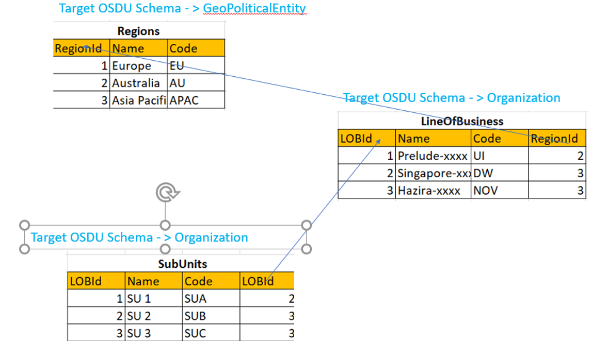

<a name="TOC">Table of Contents</a>

[[_TOC_]]

# Hierarchical Organisations

This document describes and provides examples for the use of the different data elements
of [`master-data--Organisation`](../../../E-R/master-data/Organisation.1.2.0.md) and the relationship
to [`master-data--GeoPoliticalEntity`](../../../E-R/master-data/GeoPoliticalEntity.1.1.0.md) .

The important update in `master-data--Organisation:1.1.0` is the introduction of parent-child relationship within the
Organisation data type.

Company A has a number of Line of Businesses (see **LineOfBusiness** table), which operate in different regions
(see **Regions** table). Within each Line of Business, there are so-called SubUnits (see **SubUnits** table). Company A
would like to consume OSDU schemas.

The entity relationships are shown in the diagram below:



In the examples below, see how Company A's entities are properly represented in comformance to OSDU schema definitions.

## Regions representation in `master-data--GeoPoliticalEntity` schema

For each record from the **Regions** table, the `RegionId` is represented in `data.GeoPoliticalEntityID` and the `Name`
is represented in `data.GeoPoliticalEntityName`. Here the `Code` is also represented in `data.NameAliases[].AliasName`.

#### Example Records

<details>

<summary markdown="span">GeoPoliticalEntity schema fragment for Europe Region "1,Europe,EU"</summary>

<OsduImportJSON>[GeoPoliticalEntity for Europe Region, Full record](./master-data/GeoPoliticalEntity-RegionEU.json#only.data)</OsduImportJSON>

```json
{
  "data": {
    "NameAliases": [
      {
        "AliasName": "EU",
        "AliasNameTypeID": "partition-id:reference-data--AliasNameType:Acronym:"
      }
    ],
    "GeoPoliticalEntityID": "1",
    "GeoPoliticalEntityTypeID": "partition-id:reference-data--GeoPoliticalEntityType:Region:",
    "GeoPoliticalEntityName": "Europe",
    "ExtensionProperties": {}
  }
}
```

</details>

<details>

<summary markdown="span">GeoPoliticalEntity schema fragment for Australia Region "2,Australia,AU"</summary>

<OsduImportJSON>[GeoPoliticalEntity for Australia Region, Full record](./master-data/GeoPoliticalEntity-RegionAU.json#only.data)</OsduImportJSON>

```json
{
  "data": {
    "NameAliases": [
      {
        "AliasName": "AU",
        "AliasNameTypeID": "partition-id:reference-data--AliasNameType:Acronym:"
      }
    ],
    "GeoPoliticalEntityID": "2",
    "GeoPoliticalEntityTypeID": "partition-id:reference-data--GeoPoliticalEntityType:Region:",
    "GeoPoliticalEntityName": "Australia",
    "ExtensionProperties": {}
  }
}
```

</details>

<details>

<summary markdown="span">GeoPoliticalEntity schema fragment for Asia Pacific Region "3,Asia Pacific,APAC"</summary>

<OsduImportJSON>[GeoPoliticalEntity for Asia Pacific Region, Full record](./master-data/GeoPoliticalEntity-RegionAPAC.json#only.data)</OsduImportJSON>

```json
{
  "data": {
    "NameAliases": [
      {
        "AliasName": "APAC",
        "AliasNameTypeID": "partition-id:reference-data--AliasNameType:Acronym:"
      }
    ],
    "GeoPoliticalEntityID": "3",
    "GeoPoliticalEntityTypeID": "partition-id:reference-data--GeoPoliticalEntityType:Region:",
    "GeoPoliticalEntityName": "Asia Pacific",
    "ExtensionProperties": {}
  }
}
```

</details>

## Line of Business representation in `master-data--Organisation` schema

For each record from the **LineOfBusiness** table, the `LOBId` is represented in `data.OrganisationID`, the `Name` is
represented in `data.OrganisationName`, and the `Code` is represented in `data.NameAliases[].AliasName`. Here for the
fact that the Line of Business operates in a Region, the `RegionId` as foreign key is represented
in `data.GeoContexts[].GeoPoliticalEntityID`, which is where the relationship to `master-data--GeoPoliticalEntity` is
established.

#### Example Records

<details>

<summary markdown="span">Organisation schema fragment for Prelude-xxxx Line of Business in Australia Region "1,Prelude-xxxx,UI,2"</summary>

<OsduImportJSON>[Organisation for Prelude-xxxx Line of Business in Australia Region, Full record](./master-data/Organisation-LOBUI.json#only.data)</OsduImportJSON>

```json
{
  "data": {
    "NameAliases": [
      {
        "AliasName": "UI",
        "AliasNameTypeID": "partition-id:reference-data--AliasNameType:Acronym:"
      }
    ],
    "GeoContexts": [
      {
        "GeoPoliticalEntityID": "partition-id:master-data--GeoPoliticalEntity:AU:",
        "GeoTypeID": "partition-id:reference-data--GeoPoliticalEntityType:Region:"
      }
    ],
    "OrganisationID": "1",
    "OrganisationName": "Prelude-xxxx",
    "InternalOrganisationIndicator": true,
    "OrganisationTypeID": "partition-id:reference-data--OrganisationType:OrganisationUnit:",
    "ExtensionProperties": {}
  }
}
```

</details>

<details>

<summary markdown="span">Organisation schema fragment for Singapore-xxxx Line of Business in Asia Pacific Region "2,Singapore-xxxx,DW,3"</summary>

<OsduImportJSON>[Organisation for Prelude-xxxx Line of Business in Australia Region, Full record](./master-data/Organisation-LOBDW.json#only.data)</OsduImportJSON>

```json
{
  "data": {
    "NameAliases": [
      {
        "AliasName": "DW",
        "AliasNameTypeID": "partition-id:reference-data--AliasNameType:Acronym:"
      }
    ],
    "GeoContexts": [
      {
        "GeoPoliticalEntityID": "partition-id:master-data--GeoPoliticalEntity:APAC:",
        "GeoTypeID": "partition-id:reference-data--GeoPoliticalEntityType:Region:"
      }
    ],
    "OrganisationID": "2",
    "OrganisationName": "Singapore-xxxx",
    "InternalOrganisationIndicator": true,
    "OrganisationTypeID": "partition-id:reference-data--OrganisationType:OrganisationUnit:",
    "ExtensionProperties": {}
  }
}
```

</details>

<details>

<summary markdown="span">Organisation schema fragment for Hazira-xxxx Line of Business in Asia Pacific Region "3,Hazira-xxxx,NOV,3"</summary>

<OsduImportJSON>[Organisation for Prelude-xxxx Line of Business in Australia Region, Full record](./master-data/Organisation-LOBNOV.json#only.data)</OsduImportJSON>

```json
{
  "data": {
    "NameAliases": [
      {
        "AliasName": "NOV",
        "AliasNameTypeID": "partition-id:reference-data--AliasNameType:Acronym:"
      }
    ],
    "GeoContexts": [
      {
        "GeoPoliticalEntityID": "partition-id:master-data--GeoPoliticalEntity:APAC:",
        "GeoTypeID": "partition-id:reference-data--GeoPoliticalEntityType:Region:"
      }
    ],
    "OrganisationID": "3",
    "OrganisationName": "Hazira-xxxx",
    "InternalOrganisationIndicator": true,
    "OrganisationTypeID": "partition-id:reference-data--OrganisationType:OrganisationUnit:",
    "ExtensionProperties": {}
  }
}
```

</details>

## SubUnits of Line of Business representation in `master-data--Organisation` schema with parent-child relationship

The SubUnit, as an organisation by itself, has similar properties as the Line of Business parent organisation. For each
record from the **SubUnits** table, the SubUnit's `LOBId` is represented in `data.OrganisationID`, the `Name`
is represented in `data.OrganisationName`, and the `Code` is represented in `data.NameAliases[].AliasName`. The region,
where the SubUnit organisation operates, is identifiable in `data.GeoContexts[].GeoPoliticalEntityID`.

The question now is how then SubUnit(s) within Line of Business(es) are supposed to be represented in Organisation data
type? To satisfy such parent-child relationship requirement, `data.ParentOrganisationID` property is introduced
in `master-data--Organisation:1.1.0` to identify the Line of Business parent organisation for the SubUnit organisation.
This property, if populated, indicates that the current SubUnit organisation is a sub-organisation or a department in a
Line of Business parent organisation. Hence, the second `LOBId` in the **SubUnits** table, which is the foreign key from
the **LineOfBusiness** table (aka parent organisation), refers to the LineOfBusiness record identifier and is
represented in `data.ParentOrganisationID` property in the SubUnit record.

#### Example Records

<details>

<summary markdown="span">Organisation schema fragment for SU 1 SubUnit (child) of the Singapore-xxxx Line of Business (parent) "1,SU 1,SUA,2"</summary>

<OsduImportJSON>[Organisation for SU 1 SubUnit (child) of the Singapore-xxxx Line of Business (parent), Full record](./master-data/Organisation-LOB-SubUnitSUA.json#only.data)</OsduImportJSON>

```json
{
  "data": {
    "NameAliases": [
      {
        "AliasName": "SUA",
        "AliasNameTypeID": "partition-id:reference-data--AliasNameType:Acronym:"
      }
    ],
    "GeoContexts": [
      {
        "GeoPoliticalEntityID": "partition-id:master-data--GeoPoliticalEntity:APAC:",
        "GeoTypeID": "partition-id:reference-data--GeoPoliticalEntityType:Region:"
      }
    ],
    "OrganisationID": "1",
    "OrganisationName": "SU 1",
    "InternalOrganisationIndicator": true,
    "OrganisationTypeID": "partition-id:reference-data--OrganisationType:OrganisationUnit:",
    "ParentOrganisationID": "partition-id:master-data--Organisation:DW:",
    "ExtensionProperties": {}
  }
}
```

</details>

<details>

<summary markdown="span">Organisation schema fragment for SU 2 SubUnit (child) of the Hazira-xxxx Line of Business (parent) "2,SU 2,SUB,3"</summary>

<OsduImportJSON>[Organisation for SU 2 SubUnit (child) of the Hazira-xxxx Line of Business (parent), Full record](./master-data/Organisation-LOB-SubUnitSUB.json#only.data)</OsduImportJSON>

```json
{
  "data": {
    "NameAliases": [
      {
        "AliasName": "SUB",
        "AliasNameTypeID": "partition-id:reference-data--AliasNameType:Acronym:"
      }
    ],
    "GeoContexts": [
      {
        "GeoPoliticalEntityID": "partition-id:master-data--GeoPoliticalEntity:APAC:",
        "GeoTypeID": "partition-id:reference-data--GeoPoliticalEntityType:Region:"
      }
    ],
    "OrganisationID": "2",
    "OrganisationName": "SU 2",
    "InternalOrganisationIndicator": true,
    "OrganisationTypeID": "partition-id:reference-data--OrganisationType:OrganisationUnit:",
    "ParentOrganisationID": "partition-id:master-data--Organisation:NOV:",
    "ExtensionProperties": {}
  }
}
```

</details>

<details>

<summary markdown="span">Organisation schema fragment for SU 3 SubUnit (child) of the Hazira-xxxx Line of Business (parent) "3,SU 3,SUC,3"</summary>

<OsduImportJSON>[Organisation for SU 3 SubUnit (child) of the Hazira-xxxx Line of Business (parent), Full record](./master-data/Organisation-LOB-SubUnitSUC.json#only.data)</OsduImportJSON>

```json
{
  "data": {
    "NameAliases": [
      {
        "AliasName": "SUC",
        "AliasNameTypeID": "partition-id:reference-data--AliasNameType:Acronym:"
      }
    ],
    "GeoContexts": [
      {
        "GeoPoliticalEntityID": "partition-id:master-data--GeoPoliticalEntity:APAC:",
        "GeoTypeID": "partition-id:reference-data--GeoPoliticalEntityType:Region:"
      }
    ],
    "OrganisationID": "3",
    "OrganisationName": "SU 3",
    "InternalOrganisationIndicator": true,
    "OrganisationTypeID": "partition-id:reference-data--OrganisationType:OrganisationUnit:",
    "ParentOrganisationID": "partition-id:master-data--Organisation:NOV:",
    "ExtensionProperties": {}
  }
}
```

</details>


