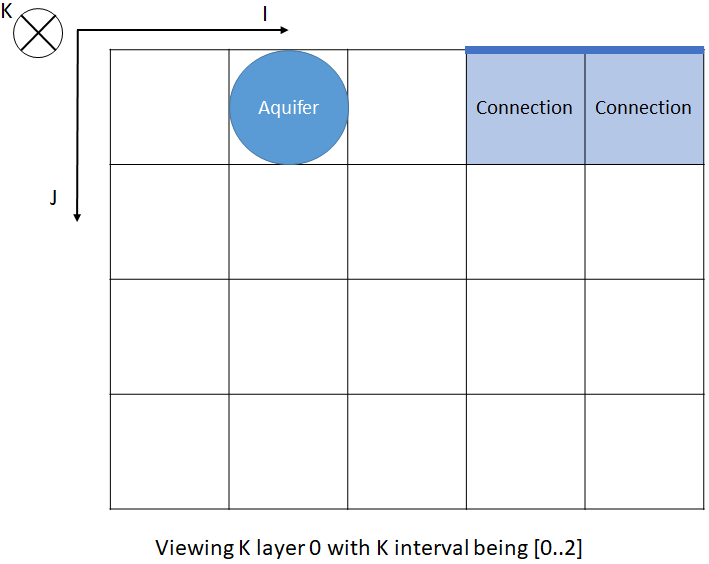

# Use case
- As a reservoir engineer, I would like to store some Aquifers in my OSDU platform in order to use them as inputs for flow simulation.
- I also would like to have a quick look at the Aquifer information before to download its associated dataset.

# Aquifer
It is a RockVolumeFeature by definition which can be interpreted various ways by various users over various times.

The more important point is about the Aquifer representation of such an interpreted Aquifer. It exists Numerical (gridded) and Analytical Aquifer representation and [several models](https://petrowiki.spe.org/Water_influx_models#Aquifer_models) such as Carter-Tracy, Fetkovich, ...

# Work Product Component Usage
## Feature level
Sometimes provided, the feature level intends to digitalize the physical Aquifer busines object and allows to group various interpretations of the same Aquifer together.

```json
{
  "id": "namespace:work-product-component--LocalRockVolumeFeature:d060ef73-dced-5e0e-8e60-e7fcea1dbf6f",
  "kind": "osdu:wks:work-product-component--LocalRockVolumeFeature:1.0.0",
  ...
  "data": {
    ...
    "Name": "My Aquifer feature",
    "Description": "My feature description",
    "CreationDateTime": "2020-02-13T09:13:15.55Z",
    ...
  }
}
```

## Interpretation level
Sometimes provided, the interpretation level intends to digitalize the opinion, point of view of someone at a certain time about an Aquifer feature. It also allows to group various representations of the same Aquifer together.

```json
{
  "id": "namespace:work-product-component--AquiferInterpretation:c6ad5dc7-b5ca-5d4e-98b0-70bf127a053b",
  "kind": "osdu:wks:work-product-component--AquiferInterpretation:1.0.0",
  ...
  "data": {
    ...
    "Name": "My Aquifer interpretation",
    "Description": "My Interpretation Description",
    ...
    "FeatureID": "namespace:work-product-component--LocalRockVolumeFeature:LocalRockVolumeFeature-d060ef73-dced-5e0e-8e60-e7fcea1dbf6f:",
    "FeatureName": "My Aquifer feature",
    ...
  }
}
```

## Representation level
Almost always provided, the representation level intends to formalize the physical Aquifer using a particular model. Thus, it can exist several Aquifer representation kinds and some may be added along OSDU releases.

### IJK Grid Numerical Aquifer

```json
{
  "id": "namespace:work-product-component--IjkGridNumericalAquiferRepresentation:99993780-bea8-4321-b9b3-2de9c9fac475",
  "kind": "osdu:wks:work-product-component--IjkGridNumericalAquiferRepresentation:1.0.0",
  ...
  "data": {
    ...
    "Name": "My numerical Aquifer representation",
    "Description": "My representation Description",
    ...
    "InterpretationID": "namespace:work-product-component--AquiferInterpretation:c6ad5dc7-b5ca-5d4e-98b0-70bf127a053b",
    "InterpretationName": "My Aquifer interpretation",
    ...
    "SingleCellAquiferSet": {
      "SupportingGridID": "namespace:work-product-component--IjkGridRepresentation:85348741-3433-406B-9189-22B298C3E2D2:",
      "I": 1,
      "J": 0,
      "K": 0,
      ...
    },
    "ConnectionSet": {
      "GridID": "namespace:work-product-component--IjkGridRepresentation:85348741-3433-406B-9189-22B298C3E2D2:",
      "LowerI": 3,
      "UpperI": 4,
      "LowerJ": 0,
      "UpperJ": 0,
      "LowerK": 0,
      "UpperK": 2,
      "Face": "J_MINUS",
      ...
    }
  }
}
```
