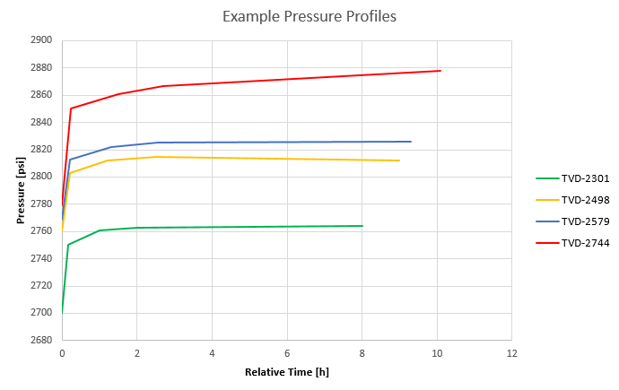
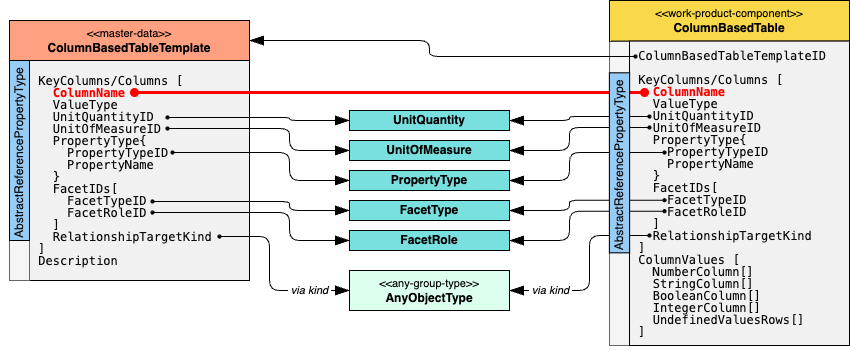

<a name="TOC"></a>
**Table of Contents**

[[_TOC_]]

# Usage of `work-product-component--ColumnBasedTable:1.*`

A WPC based on Energistics EML2.3 ColumnBasedTable which intends to store (not so big) column based table where each
column is defined by a property type and optionally facets. The main use cases demonstrated are:

- [Facies table](#facies-table)
- [Saturation Function](#saturation-function-water-oil-table) table
- [Pressure Profiles](#ad-hoc-table-pressure-profiles)

# Facies Table

This example implements a look-up table for facies names, given an integer index and a string value associated to the
index value. The simple table consisting of two columns looks like:

| Index | Facies Names |
|------:|--------------|
|     1 | sandstone    |
|     2 | clay         |
|     3 | limestone    |

The Index column is identified by the `KeyColumns[]` property, for details expand the section below. Multiple, combined
keys can be defined, therefore the array.

<details>

<summary>Facies Look-up Table as <code>ColumnBasedTable</code>: Index Column Definition.</summary>

<OsduImportJSON>[Full ColumnBasedTable record](./records/ColumnBasedTable.Facies.json#only.data.KeyColumns)</OsduImportJSON>

```json
{
  "data": {
    "KeyColumns": [
      {
        "ValueType": "integer",
        "ValueCount": 1,
        "PropertyType": {
          "PropertyTypeID": "namespace:reference-data--PropertyType:323df361-784e-4062-a346-ff4ba80a78f0:",
          "Name": "ordinal number"
        },
        "ColumnName": "Index"
      }
    ]
  }
}
```
</details>

The Value column is identified by the `Columns[]`. This array structure allows the declaration of multiple columns,
however, in this simple example only one colum is defined.

<details>

<summary>Facies Look-up Table as <code>ColumnBasedTable</code>: Value Column Definition.</summary>

<OsduImportJSON>[Full ColumnBasedTable record](./records/ColumnBasedTable.Facies.json#only.data.Columns)</OsduImportJSON>

```json
{
  "data": {
    "Columns": [
      {
        "ValueType": "string",
        "ValueCount": 1,
        "PropertyType": {
          "PropertyTypeID": "namespace:reference-data--PropertyType:838b1a9b-2fca-4e2e-aae3-323ef1bc59c7:",
          "Name": "facies type"
        },
        "ColumnName": "Facies Names"
      }
    ]
  }
}
```
</details>

Please note that in the cases above only the minimum of properties is populated. For
example, `UnitQuantityID`, `RelationshipTargetKind`, `Facets[]`, etc. are omitted.

Finally, the actual content as two columns with one array of integers and strings each:

<details>

<summary>Facies Look-up Table as <code>ColumnBasedTable</code>: Value Columns.</summary>

<OsduImportJSON>[Full ColumnBasedTable record](./records/ColumnBasedTable.Facies.json#only.data.ColumnSize|ColumnValues)</OsduImportJSON>

```json
{
  "data": {
    "ColumnSize": 3,
    "ColumnValues": [
      {
        "IntegerColumn": [
          1,
          2,
          3
        ]
      },
      {
        "StringColumn": [
          "sandstone",
          "clay",
          "limestone"
        ]
      }
    ]
  }
}
```
</details>

For the entire example record, please refer to [ColumnBasedTable JSON record](./records/ColumnBasedTable.Facies.json).

[Back to TOC](#TOC)

# Saturation Function : Water-Oil Table

| Water Saturation | Water Relative Permeability | Oil Relative Permeability | Oil-Water Capillary Pressure |
|------------------|-----------------------------|---------------------------|------------------------------|
| 0                | 0	                          | 1                         | 0                            |
| 0.157            | 0                           | 0.99999                   | 0                            |
| 0.173            | 0.000356                    | 0.886131                  | 0                            |
| 0.174325         | 0.0004392                   | 0.8767012                 | 0                            |
| 0.19             | 0.0014241                   | 0.7764308                 | 0                            |

This table contains columns with physical properties and unit of measures. Below, a few details are highlighted:

<details>

Please note the following details:

1. `"ValueType"` is set to `number`.
2. `"UnitOfMeasureID"` provides the frame of reference for the numbers, i.e. the unit with `"Code": "%"`, however,
   url-encoded to `%25`.
3. PropertyType `"PropertyTypeID"` provide additional context for the measurement as `UnitQuantityID` isn't providing
   sufficient scope.
4. The PropertyType `"Name"` offers denormalized access to the human-readable PropertyType's name "saturation".
5. `"FacetIDs"` adds more context to the values - in this case the 'what' is Water.
6. Finally, `"ColumnName"` offers an optional human-readable column label "Water Saturation".

<summary>RelPerm/CapPressure <code>ColumnBasedTable</code>: Water saturation Column Meta Data.</summary>

<OsduImportJSON>[Full ColumnBasedTable record](./records/ColumnBasedTable.KrPc.json#only.data.KeyColumns)</OsduImportJSON>

```json
{
  "data": {
    "KeyColumns": [
      {
        "ValueType": "number",
        "ValueCount": 1,
        "UnitOfMeasureID": "namespace:reference-data--UnitOfMeasure:%25:",
        "UnitQuantityID": "namespace:reference-data--UnitQuantity:dimensionless:",
        "PropertyType": {
          "PropertyTypeID": "namespace:reference-data--PropertyType:cfe9293f-d5a9-486d-815a-a957cace90b6:",
          "Name": "saturation"
        },
        "FacetIDs": [
          {
            "FacetTypeID": "namespace:reference-data--FacetType:what:",
            "FacetRoleID": "namespace:reference-data--FacetRole:Water:"
          }
        ],
        "ColumnName": "Water Saturation"
      }
    ]
  }
}
```
</details>

Following the column description above here the data content as numbers in % Water Saturation.

<details>

<summary>RelPerm/CapPressure <code>ColumnBasedTable</code>: Water saturation Value Column.</summary>

<OsduImportJSON>[Full ColumnBasedTable record](./records/ColumnBasedTable.KrPc.json#only.data.ColumnValues[0])</OsduImportJSON>

```json
{
  "data": {
    "ColumnValues": [
      {
        "NumberColumn": [
          0,
          0.157,
          0.173,
          0.174325,
          0.19
        ]
      }
    ]
  }
}
```
</details>

<details>

Please note the following details:

1. `"ValueType"` is set to `number`.
2. `"UnitOfMeasureID"` provides the frame of reference for the numbers, i.e. the unit with `"Code": "psi"`.
3. `"UnitQuantityID"` says that the numbers can be converted to other pressure units.
4. PropertyType `"PropertyTypeID"` provide additional context for the measurement as unit quantity pressure is still quite generic.
5. The PropertyType `"Name"` offers denormalized access to the human-readable PropertyType's name "capillary pressure".
6. `"FacetIDs"` adds more context to the values - in this case **two facet type/role pairs** - the order is providing the relationship Oil, Water.
7. Finally, `"ColumnName"` offers an optional human-readable column label "Oil-Water Capillary Pressure".

<summary>RelPerm/CapPressure <code>ColumnBasedTable</code>: Oil Water capillary Pressure Column Meta Data.</summary>

<OsduImportJSON>[Full ColumnBasedTable record](./records/ColumnBasedTable.KrPc.json#only.data.Columns[2])</OsduImportJSON>

```json
{
  "data": {
    "Columns": [
      {
        "ValueType": "number",
        "ValueCount": 1,
        "UnitOfMeasureID": "namespace:reference-data--UnitOfMeasure:psi:",
        "UnitQuantityID": "namespace:reference-data--UnitQuantity:pressure:",
        "PropertyType": {
          "PropertyTypeID": "namespace:reference-data--PropertyType:a816a113-1544-4f58-bc6d-7c030b65627b:",
          "Name": "capillary pressure"
        },
        "FacetIDs": [
          {
            "FacetTypeID": "namespace:reference-data--FacetType:what:",
            "FacetRoleID": "namespace:reference-data--FacetRole:Oil:"
          },
          {
            "FacetTypeID": "namespace:reference-data--FacetType:what:",
            "FacetRoleID": "namespace:reference-data--FacetRole:Water:"
          }
        ],
        "ColumnName": "Oil-Water Capillary Pressure"
      }
    ]
  }
}
```
</details>

---

Finally, here the entire table data as columns:

<details>

<summary>RelPerm/CapPressure <code>ColumnBasedTable</code>: All Value Columns.</summary>

<OsduImportJSON>[Full ColumnBasedTable record](./records/ColumnBasedTable.KrPc.json#only.data.ColumnSize|ColumnValues)</OsduImportJSON>

```json
{
  "data": {
    "ColumnSize": 5,
    "ColumnValues": [
      {
        "NumberColumn": [
          0,
          0.157,
          0.173,
          0.174325,
          0.19
        ]
      },
      {
        "NumberColumn": [
          0,
          0,
          0.000356,
          0.0004392,
          0.0014241
        ]
      },
      {
        "NumberColumn": [
          1,
          0.99999,
          0.886131,
          0.8767012,
          0.7764308
        ]
      },
      {
        "NumberColumn": [
          0,
          0,
          0,
          0,
          0
        ]
      }
    ]
  }
}
```
</details>

For the entire example record, please refer to [ColumnBasedTable JSON record](./records/ColumnBasedTable.KrPc.json).

[Back to TOC](#TOC)

# Ad-Hoc Table: Pressure Profiles

|  |
|:-----------------------------------------------------------:|
|                   Example data as a Graph                   |

The above dataset may not make a lot of sense in terms of relevance to any specific domain, but it may serve as an
example for an ad-hoc ColumnBasedTable with multiple values per KeyColumn 'index'.

This ColumnBasedTable instance demonstrates the possibility of describing 2-dimensional data structures in a table.
The vertical index is described again via the KeyColumns, here a TrueVertical depth with unit "m".

In addition, this instance does not carry a `ColumnBasedTableTypeID` — indicating that this is no well-known table with
expected columns and dimensions.

<details>

<summary>TVD Index <code>ColumnBasedTable KeyColumns[]</code>.</summary>

<OsduImportJSON>[Full ColumnBasedTable record](./records/ColumnBasedTable.PressureProfiles.json#only.data.KeyColumns)</OsduImportJSON>

```json
{
  "data": {
    "KeyColumns": [
      {
        "ValueType": "number",
        "ValueCount": 1,
        "UnitOfMeasureID": "namespace:reference-data--UnitOfMeasure:m:",
        "UnitQuantityID": "namespace:reference-data--UnitQuantity:length:",
        "PropertyType": {
          "PropertyTypeID": "namespace:reference-data--PropertyType:4364b378-899a-403a-8401-b06abd4fc0cf:",
          "Name": "depth"
        },
        "FacetIDs": [
          {
            "FacetTypeID": "namespace:reference-data--FacetType:direction:",
            "FacetRoleID": "namespace:reference-data--FacetRole:TrueVertical:"
          }
        ],
        "ColumnName": "True Vertical Depth"
      }
    ]
  }
}
```
</details>

The 2-dimensional arrays are indicated by the `"ValueCount": 5` settings in the `Columns[]`. The arrays are organized
such that the fastest index is running from `0` to `ValueCount-1` before the column index increments.

The example carries two arrays/columns, one as relative time, the other as pressure. Both columns have the
same `ValueCount`.

<details>

<summary>Pressure(Time) <code>ColumnBasedTable Columns[]</code> metadata.</summary>

<OsduImportJSON>[Full ColumnBasedTable record](./records/ColumnBasedTable.PressureProfiles.json#only.data.Columns)</OsduImportJSON>

```json
{
  "data": {
    "Columns": [
      {
        "ValueType": "number",
        "ValueCount": 5,
        "UnitOfMeasureID": "namespace:reference-data--UnitOfMeasure:h:",
        "UnitQuantityID": "namespace:reference-data--UnitQuantity:time:",
        "PropertyType": {
          "PropertyTypeID": "namespace:reference-data--PropertyType:96f00db8-5eb1-495f-9909-d8715254a924:",
          "Name": "relative time"
        },
        "ColumnName": "Relative Time"
      },
      {
        "ValueType": "number",
        "ValueCount": 5,
        "UnitOfMeasureID": "namespace:reference-data--UnitOfMeasure:psi:",
        "UnitQuantityID": "namespace:reference-data--UnitQuantity:pressure:",
        "PropertyType": {
          "PropertyTypeID": "namespace:reference-data--PropertyType:e703be06-9568-4bc6-ab1c-db15dd012e77:",
          "Name": "pressure"
        },
        "ColumnName": "Pressure over Time"
      }
    ]
  }
}
```
</details>

Finally, the data `ColumnValues` as defined by `KeyColumns[]` and `Columns[]` metadata:

<details>

<summary>Data <code>ColumnBasedTable ColumnValues[]</code> metadata.</summary>

<OsduImportJSON>[Full ColumnBasedTable record](./records/ColumnBasedTable.PressureProfiles.json#only.data.ColumnValues)</OsduImportJSON>

```json
{
  "data": {
    "ColumnValues": [
      {
        "NumberColumn": [
          2301,
          2498,
          2579,
          2744
        ]
      },
      {
        "NumberColumn": [
          0,
          0.167,
          1,
          2,
          8,
          0,
          0.2,
          1.2,
          2.5,
          9,
          0,
          0.21,
          1.3,
          2.55,
          9.3,
          0,
          0.22,
          1.5,
          2.7,
          10.1
        ]
      },
      {
        "NumberColumn": [
          2700,
          2750,
          2761,
          2763,
          2764,
          2760,
          2803,
          2812,
          2815,
          2812,
          2769,
          2813,
          2822,
          2825,
          2826,
          2779,
          2850,
          2861,
          2867,
          2878
        ]
      }
    ]
  }
}
```
</details>

For the entire example record, please refer to [ColumnBasedTable JSON record](./records/ColumnBasedTable.PressureProfiles.json).

[Back to TOC](#TOC)

# Governance via ColumnBasedTableTemplate

With [ColumnBasedTableTemplate](../../../../E-R/master-data/ColumnBasedTableTemplate.1.0.1.md), belonging to the
group-type master-data, it is possible to define reusable column definitions, which can be referred to by multiple
instances of [ColumnBasedTable](../../../../E-R/work-product-component/ColumnBasedTable.1.4.0.md)
work-product-components and/or entities including the schema fragment
[AbstractColumnBasedTable](../../../../E-R/abstract/AbstractColumnBasedTable.1.2.0.md).



[ColumnBasedTableTemplate](../../../../E-R/master-data/ColumnBasedTableTemplate.1.0.1.md) includes the same
[AbstractReferencePropertyType](../../../../E-R/abstract/AbstractReferencePropertyType.1.2.0.md) fragment for the
column metadata, `KeyColumns` and `Columns`. These column metadata have already been included in the ColumnBasedTable
and other types like [WellboreIntervalSet](../../../../E-R/work-product-component/WellboreIntervalSet.1.3.1.md)
via [AbstractColumnBasedTable](../../../../E-R/abstract/AbstractColumnBasedTable.1.2.0.md).

The new `ColumnBasedTableTemplateID` in
[ColumnBasedTable](../../../../E-R/work-product-component/ColumnBasedTable.1.4.0.md) and
[AbstractColumnBasedTable](../../../../E-R/abstract/AbstractColumnBasedTable.1.2.0.md) allows to group tables with
similar, compatible column definitions. This way it is much easier to find tables or tabular data, which can provide
the same kind of data for multiple sources, e.g., for data analytics.

It is **_not required_** to populate all columns in table instances, which defined in the ColumnBasedTableTemplate.
Table instances can be subsets and will only contain the `KeyColumns` and `Columns` metadata if the table contains data.

The column metadata objects are linked by identical `ColumnName` values as indicated by the red link between table
instance and ColumnBasedTableTemplate.

The mechanics of the ColumnBasedTableTemplate usage is best explained by examples:

## KeyColumns Metadata, Template, versus Table Instances

<details>

<summary>ColumnBasedTableTemplate, KeyColumns metadata example</summary>

<OsduImportJSON>[Full ColumnBasedTableTemplate record](./records/ColumnBasedTableTemplate.json#only.data.KeyColumns)</OsduImportJSON>

```json
{
  "data": {
    "KeyColumns": [
      {
        "ValueType": "integer",
        "ValueCount": 1,
        "PropertyType": {
          "PropertyTypeID": "namespace:reference-data--PropertyType:323df361-784e-4062-a346-ff4ba80a78f0:",
          "Name": "ordinal number"
        },
        "ColumnName": "Sample ID"
      }
    ]
  }
}
```
</details>
<details>

<summary>ColumnBasedTable, example instance 1, ColumnBasedTableTemplate relation and KeyColumns metadata example</summary>

<OsduImportJSON>[Full ColumnBasedTable record](./records/ColumnBasedTableTemplateBatch1.json#only.data.ColumnBasedTableTemplateID|KeyColumns)</OsduImportJSON>

```json
{
  "data": {
    "ColumnBasedTableTemplateID": "namespace:master-data--ColumnBasedTableTemplate:4fd4fc40-11f1-4244-b684-d2e7676fec8e:",
    "KeyColumns": [
      {
        "ValueType": "integer",
        "ValueCount": 1,
        "PropertyType": {
          "PropertyTypeID": "namespace:reference-data--PropertyType:323df361-784e-4062-a346-ff4ba80a78f0:",
          "Name": "ordinal number"
        },
        "ColumnName": "Sample ID"
      }
    ]
  }
}
```
</details>
<details>

<summary>ColumnBasedTable, example instance 2, ColumnBasedTableTemplate relation and KeyColumns metadata example</summary>

<OsduImportJSON>[Full ColumnBasedTable record](./records/ColumnBasedTableTemplateBatch2.json#only.data.ColumnBasedTableTemplateID|KeyColumns)</OsduImportJSON>

```json
{
  "data": {
    "ColumnBasedTableTemplateID": "namespace:master-data--ColumnBasedTableTemplate:4fd4fc40-11f1-4244-b684-d2e7676fec8e:",
    "KeyColumns": [
      {
        "ValueType": "integer",
        "ValueCount": 1,
        "PropertyType": {
          "PropertyTypeID": "namespace:reference-data--PropertyType:323df361-784e-4062-a346-ff4ba80a78f0:",
          "Name": "ordinal number"
        },
        "ColumnName": "Sample ID"
      }
    ]
  }
}
```
</details>

## Columns Metadata, Template, versus Table Instances

Example `data.Columns[]` pairing via `ColumnName` for a sparse table — in this case "Dissolved CO2":

<details>

<summary>ColumnBasedTableTemplate, Columns metadata example ColumnName "Dissolved CO2"</summary>

<OsduImportJSON>[Full ColumnBasedTableTemplate record](./records/ColumnBasedTableTemplate.json#only.data.Columns[3])</OsduImportJSON>

```json
{
  "data": {
    "Columns": [
      {
        "ValueType": "number",
        "ValueCount": 1,
        "UnitOfMeasureID": "namespace:reference-data--UnitOfMeasure:%25:",
        "UnitQuantityID": "namespace:reference-data--UnitQuantity:dimensionless:",
        "PropertyType": {
          "PropertyTypeID": "namespace:reference-data--PropertyType:3dbec38b-a205-4e0d-a4cb-70f9af7572e5:",
          "Name": "concentration"
        },
        "FacetIDs": [
          {
            "FacetTypeID": "namespace:reference-data--FacetType:what:",
            "FacetRoleID": "namespace:reference-data--FacetRole:CO2:"
          }
        ],
        "ColumnName": "Dissolved CO2"
      }
    ]
  }
}
```
</details>
<details>

<summary>ColumnBasedTable, example instance 1, Columns metadata example ColumnName "Dissolved CO2"</summary>

<OsduImportJSON>[Full ColumnBasedTable record](./records/ColumnBasedTableTemplateBatch1.json#only.data.Columns[2])</OsduImportJSON>

```json
{
  "data": {
    "Columns": [
      {
        "ValueType": "number",
        "ValueCount": 1,
        "UnitOfMeasureID": "namespace:reference-data--UnitOfMeasure:%25:",
        "UnitQuantityID": "namespace:reference-data--UnitQuantity:dimensionless:",
        "PropertyType": {
          "PropertyTypeID": "namespace:reference-data--PropertyType:3dbec38b-a205-4e0d-a4cb-70f9af7572e5:",
          "Name": "concentration"
        },
        "FacetIDs": [
          {
            "FacetTypeID": "namespace:reference-data--FacetType:what:",
            "FacetRoleID": "namespace:reference-data--FacetRole:CO2:"
          }
        ],
        "ColumnName": "Dissolved CO2"
      }
    ]
  }
}
```
</details>

Example `data.Columns[]` pairing via `ColumnName` for a second sparse table — in this case "Sample Density":

<details>

<summary>ColumnBasedTableTemplate, Columns metadata example ColumnName "Sample Density"</summary>

<OsduImportJSON>[Full ColumnBasedTableTemplate record](./records/ColumnBasedTableTemplate.json#only.data.Columns[1])</OsduImportJSON>

```json
{
  "data": {
    "Columns": [
      {
        "ValueType": "number",
        "ValueCount": 1,
        "UnitOfMeasureID": "namespace:reference-data--UnitOfMeasure:g%2Fcm3:",
        "UnitQuantityID": "namespace:reference-data--UnitQuantity:mass%20per%20volume:",
        "PropertyType": {
          "PropertyTypeID": "namespace:reference-data--PropertyType:8cf38da3-e98e-4134-a186-1c6f562d6430:",
          "Name": "bulk density"
        },
        "ColumnName": "Sample Density"
      }
    ]
  }
}
```
</details>
<details>

<summary>ColumnBasedTable, example instance 2, Columns metadata example ColumnName "Sample Density"</summary>

<OsduImportJSON>[Full ColumnBasedTable record](./records/ColumnBasedTableTemplateBatch2.json#only.data.Columns[0])</OsduImportJSON>

```json
{
  "data": {
    "Columns": [
      {
        "ValueType": "number",
        "ValueCount": 1,
        "UnitOfMeasureID": "namespace:reference-data--UnitOfMeasure:g%2Fcm3:",
        "UnitQuantityID": "namespace:reference-data--UnitQuantity:mass%20per%20volume:",
        "PropertyType": {
          "PropertyTypeID": "namespace:reference-data--PropertyType:8cf38da3-e98e-4134-a186-1c6f562d6430:",
          "Name": "bulk density"
        },
        "ColumnName": "Sample Density"
      }
    ]
  }
}
```
</details>

[Back to TOC](#TOC)