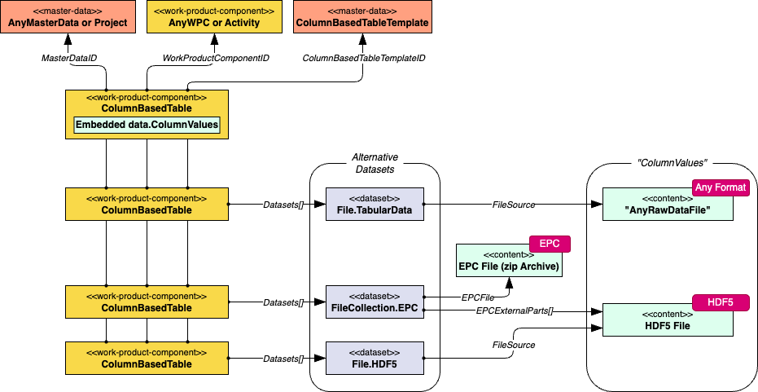
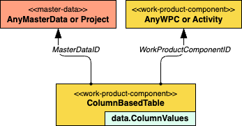
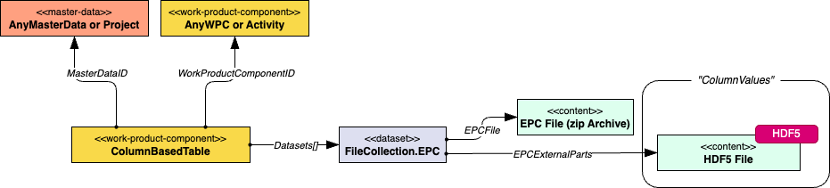
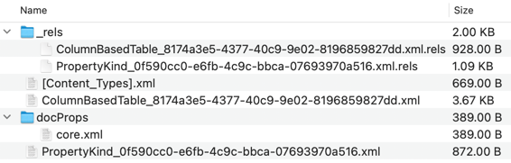
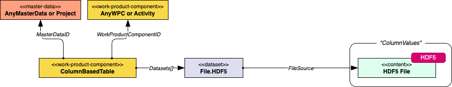

<a name="TOC"></a>
**Table of Contents**

[[_TOC_]]

# Tabular Data

## ColumnBasedTable Work Product Component

The [work-product-component--ColumnBasedTable](../../../../E-R/work-product-component/ColumnBasedTable.1.4.0.md) serves
as a 'Swiss army knife' for tabular data. There are multiple ways table content can be represented:

Common for all variants is the complete metadata definition in the `data` block of the work-product-component,
specifically:

* `KeyColumns`, mandatory for look-up tables, absent or empty for generic tabular data.
* `Columns`, all non-key data columns.
* `ColumnSize`, the number of 'rows' in the table.
* Since version 1.4.0, the ColumnBasedTable can refer explicitly to its context, either
    * via `MasterDataID` to projects or surveys or
    * via `WorkProductComponentID` to other work-product-components, e.g., Activity records.

There are significant differences in the way **_content_** is associated. Variants are explored in the following
diagram, all of them using work-product-component--ColumnBasedTable as 'catalog' record type:



The different variants are presented as worked example in the following chapters.

---

[Back to TOC](#TOC)

## 1. Small Look-up Tables



For small tables, often look-up tables, the tabular content can be embedded in the
work-product-component--ColumnBasedTable. A [Facies table](../ColumnBasedTable/README.md#facies-table) is demonstrated
in a related page.

Embedded content is placed inside the Storage record inside the `data` block under the `ColumnValues` array. Here the
columns defined under `KeyColumns` and `Columns` reappear as data arrays.

---

[Back to TOC](#TOC)

## 2. Size-Unlimited, Structured Data (JSON, XML, HDF5)

### 2.1 Energistics FileCollection.EPC



A RESQML-friendly representation, which is easily consumable in the Reservoir DDMS can be persisted
as [dataset--FileCollection.EPC](../../../../E-R/dataset/FileCollection.EPC.1.0.2.md). This schema holds a reference to
the inventory, the `data.EPCFile` and the 'external' `data.EPCExternalParts[]`. The EPCFile inventory contains in our
case:



The HDF5 file is viewable in https://myhdf5.hdfgroup.org/.
Our [example can be found here as NT66_AGG_AUSTRALIA.h5](./content/NT66_AGG_AUSTRALIA.h5).

Example [EML 2.3 ColumnBasedTable as XML (File ColumnBasedTable_8174a3e5-4377-40c9-9e02-8196859827dd.xml in the EPC archive)](./content/ColumnBasedTable_EPC-entry.xml)

The content is referred to by the
OSDU [dataset--FileCollection.EPC](../../../../E-R/dataset/FileCollection.EPC.1.0.2.md)
type, which links to the `data.DatasetProperties.EPCFile` and — in this case one —
`data.DatasetProperties.EPCExternalParts`.

<details>

<summary>3.1 FileCollection.EPC referring to EPC and external parts</summary>

<OsduImportJSON>[Full FileCollection.EPC record](./dataset/FileCollection.EPC.NT66-AGG-3col.json#only.data.Name|Description|DatasetProperties)</OsduImportJSON>

```json
{
  "data": {
    "Name": "NT66-AGG-Data",
    "Description": "As originally delivered by GeoSiris.",
    "DatasetProperties": {
      "EPCFile": {
        "FileSource": "s3://default_bucket/r1/data/Examples/WorkedExamples/Reservoir Data/Content-ColumnBasedTable/content/NT66_AGG_AUSTRALIA.epc",
        "PreloadFilePath": "https://community.opengroup.org/osdu/data/data-definitions/-/tree/master/WorkedExamples/Reservoir Data/Content-ColumnBasedTable/content/NT66_AGG_AUSTRALIA.epc",
        "PreloadFileCreateUser": "somebody@acme.org",
        "PreloadFileCreateDate": "2024-11-25T11:46:20.163Z",
        "PreloadFileModifyUser": "somebody.else@acme.org",
        "PreloadFileModifyDate": "2024-11-25T17:20:05.356Z",
        "Name": "NT66_AGG_AUSTRALIA.epc",
        "FileSize": "3795",
        "EncodingFormatTypeID": "namespace:reference-data--EncodingFormatType:application%2Fx-epc%2Bzip:",
        "Checksum": "d4846a3b0b4d06b72508b7a31f0aff46",
        "ChecksumAlgorithm": "MD5"
      },
      "EPCExternalParts": [
        {
          "FileSource": "s3://default_bucket/r1/data/Examples/WorkedExamples/Reservoir Data/Content-ColumnBasedTable/content/NT66_AGG_AUSTRALIA.h5",
          "PreloadFilePath": "https://community.opengroup.org/osdu/data/data-definitions/-/tree/master/Examples/WorkedExamples/Reservoir Data/Content-ColumnBasedTable/content/NT66_AGG_AUSTRALIA.h5",
          "PreloadFileCreateUser": "somebody@acme.org",
          "PreloadFileCreateDate": "2024-11-25T11:46:20.163Z",
          "PreloadFileModifyUser": "somebody.else@acme.org",
          "PreloadFileModifyDate": "2024-11-25T17:20:05.356Z",
          "Name": "NT66_AGG_AUSTRALIA.h5",
          "FileSize": "83296",
          "EncodingFormatTypeID": "namespace:reference-data--EncodingFormatType:application%2Fx-hdf5:",
          "Checksum": "6be6d8a6f309135fd3be8747a08dee25",
          "ChecksumAlgorithm": "MD5"
        }
      ]
    }
  }
}
```

</details>

<details>

<summary>3.1 work-product-component--ColumnBasedTable referring to dataset--FileCollection.EPC</summary>

<OsduImportJSON>[Full work-product-component--ColumnBasedTable record](./work-product-component/wpc--ColumnBasedTable-EPC-NT66-AGG-AUSTRALIA.json#only.data.Name|Description|Datasets|MasterDataID)</OsduImportJSON>

```json
{
  "data": {
    "Name": "NT66-AGG-AUSTRALIA, content in FileCollection.EPC",
    "Description": "Example of a Column Based Table using potentially very large data arrays.",
    "Datasets": [
      "namespace:dataset--FileCollection.EPC:9c8a3989-9dea-490f-b05c-c3e504efeff4:"
    ],
    "MasterDataID": "namespace:master-data--GravityMagneticAcquisitionSurvey:Falcon-FAS1663:"
  }
}
```

</details>

---

[Back to TOC](#TOC)

### 2.2 OSDU File.HDF5

It is also possible to refer directly to individual HDF5 files. We are using the same h5 file example as
in [2.1 Energistics FileCollection.EPC](#21-energistics-filecollectionepc). The HDF5 file is viewable
in https://myhdf5.hdfgroup.org/.
Our [example can be found here as NT66_AGG_AUSTRALIA.h5](./content/NT66_AGG_AUSTRALIA.h5).



<details>

<summary>3.2 File.HDF5 referring to the HDF5 file</summary>

<OsduImportJSON>[Full File.HDF5 record](./dataset/File.HDF5.H5-NT66-AGG.json#only.data.Name|Description|DatasetProperties)</OsduImportJSON>

```json
{
  "data": {
    "Name": "NT66-AGG-Data",
    "Description": "As originally delivered by TerraNexus, converted by Jean Fran\u00e7ois Rainaud.",
    "DatasetProperties": {
      "FileSourceInfo": {
        "FileSource": "s3://default_bucket/r1/data/Examples/WorkedExamples/Reservoir Data/Content-ColumnBasedTable/content/NT66_AGG_AUSTRALIA.h5",
        "PreloadFilePath": "https://community.opengroup.org/osdu/data/data-definitions/-/tree/master/Examples/WorkedExamples/Reservoir Data/Content-ColumnBasedTable/content/NT66_AGG_AUSTRALIA.h5",
        "PreloadFileCreateUser": "somebody@acme.org",
        "PreloadFileCreateDate": "2025-01-06T14:21:49+00:00",
        "PreloadFileModifyUser": "somebody.else@acme.org",
        "PreloadFileModifyDate": "2025-01-06T14:21:49+00:00",
        "Name": "NT66_AGG_AUSTRALIA.h5",
        "FileSize": "83296",
        "EncodingFormatTypeID": "namespace:reference-data--EncodingFormatType:application%2Fx-hdf5:",
        "Checksum": "6be6d8a6f309135fd3be8747a08dee25",
        "ChecksumAlgorithm": "MD5"
      }
    }
  }
}
```

</details>

<details>

<summary>3.2 work-product-component--ColumnBasedTable referring to dataset--File.HDF5</summary>

<OsduImportJSON>[Full work-product-component--ColumnBasedTable record](./work-product-component/wpc--ColumnBasedTable-HDF5-NT66-AGG-AUSTRALIA.json#only.data.Name|Description|Datasets|MasterDataID)</OsduImportJSON>

```json
{
  "data": {
    "Name": "NT66-AGG-AUSTRALIA, content in File.HDF5",
    "Description": "Example of a Column Based Table using potentially very large data arrays.",
    "Datasets": [
      "namespace:dataset--File.HDF5:content--HDF5-acfff0bf-ffd1-4d9f-a11e-c16d1b53095c:"
    ],
    "MasterDataID": "namespace:master-data--GravityMagneticAcquisitionSurvey:Falcon-FAS1663:"
  }
}
```

</details>

**_Note:_** This example **_does not_** follow the
[master-data--ColumnBasedTableTemplate:ASEG-GDF2-NT66-AGD](./master-data/master-data--ColumnBasedTableTemplate-ASEG-GDF2-NT66-AGD.json)
because the ColumnName values and the order are not aligned. If an arbitrary column definition in an HDF5 file needs to
be associated with a ColumnBasedTableTemplate, then the usage of the FileCollection.EPC is indicated. In this case the
EPC file's `PathInExternalFile` maps the ColumnBasedTableTemplate columns and ColumnNames to the structured content.

---

[Back to TOC](#TOC)