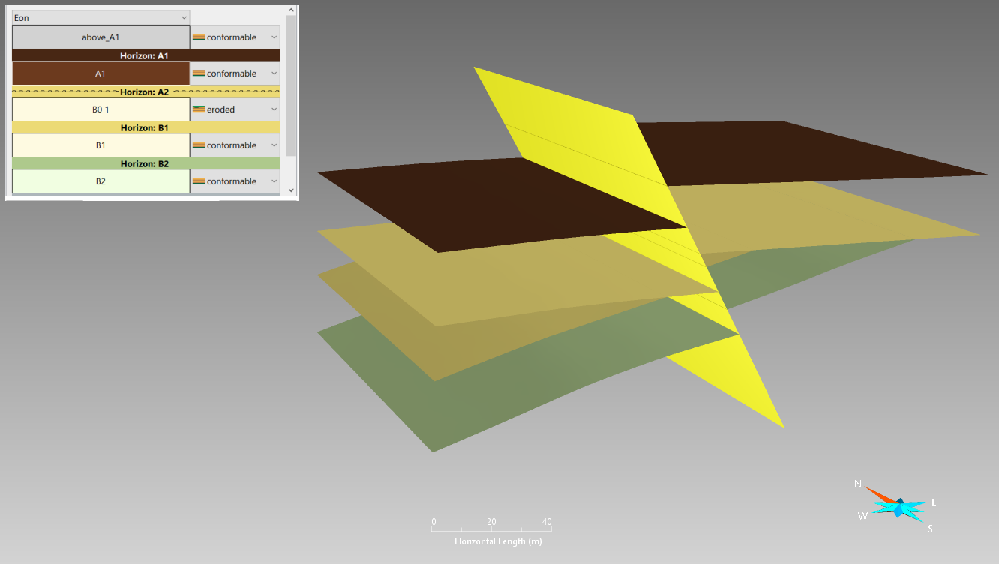

# HORIZONS AND FAULT EXAMPLE (data provided by Emerson)


**To realize this worked examples, The original V2.0.1 Epc were firstly migrated from RESQML V2.0.1 to V2.2, then by using the RESQML Web Studio some more information was added to populate by values some attributes.**

**Then a mapping plus some dedicated developpements were automatically processed to create these manifest parts JSON files.** 




Only corresponding data field of WPC were processed.

## HorizonInterpretation A1
```
{
    "DomainTypeID": "namespace:reference-data--DomainType:Depth",
    "FeatureID": "namespace:master-data--BoundaryFeature:BoundaryFeature-b835e0ab-048b-4816-8a6f-e950f6f83aa4:",
    "FeatureName": "A1",
    "FeatureTypeID": "namespace:reference-data--FeatureType:Top:",
    "HorizonStratigraphicRoleTypeID": [
    "namespace:reference-data--SequenceStratigraphySurfaceType:Lithostratigraphic:"
    ],
    "OlderPossibleAge": 30000000,
    "SequenceStratigraphySurfaceTypeID": "namespace:reference-data--String:flooding:",
    "YoungerPossibleAge": 10000000,
    "isConformableAbove": true,
    "isConformableBelow": false
}
```

## TriangulatedSetRepresentation A1
```
{
    "HorizonInterpretationID": "namespace:work-product-component--HorizonInterpretation": "be5e245d-98ea-40e0-8f92-3915e08acd01",
    "InterpretationName": "Interp A1",
    "Role": "namespace:reference-data--RepresentationRole:Map:",
    "Type": "namespace:reference-data--RepresentationType:TriangulatedSurface:"
}
```
## HorizonInterpretation A2
```
{
    "DomainTypeID": "namespace:reference-data--DomainType:Depth",
    "FeatureID": "namespace:master-data--BoundaryFeature:BoundaryFeature-987000fe-8958-466d-8362-aa5b245b7c41:",
    "FeatureName": "A2",
    "FeatureTypeID": "namespace:reference-data--FeatureType:Top:",
    "HorizonStratigraphicRoleTypeID": [
    "namespace:reference-data--SequenceStratigraphySurfaceType:Lithostratigraphic:"
    ],
    "OlderPossibleAge": "",
    "SequenceStratigraphySurfaceTypeID": "namespace:reference-data--String:null:",
    "YoungerPossibleAge": "",
    "isConformableAbove": true,
    "isConformableBelow": false
}
```

## TriangulatedSetRepresentation A2
```
{
    "HorizonInterpretationID": "namespace:work-product-component--HorizonInterpretation": "47c542b3-8ee3-4186-ae73-435205677a15",
    "InterpretationName": "Interp A2",
    "Role": "namespace:reference-data--RepresentationRole:Map:",
    "Type": "namespace:reference-data--RepresentationType:TriangulatedSurface:"
}
```

## HorizonInterpretation B1
```
{
    "DomainTypeID": "namespace:reference-data--DomainType:Depth",
    "FeatureID": "namespace:master-data--BoundaryFeature:BoundaryFeature-710188ed-3bc1-4946-a6d6-09a0d7b2f8f4:",
    "FeatureName": "B1",
    "FeatureTypeID": "namespace:reference-data--FeatureType:Top:",
    "HorizonStratigraphicRoleTypeID": [
    "namespace:reference-data--SequenceStratigraphySurfaceType:Biostratigraphic:"
    ],
    "OlderPossibleAge": 30000000,
    "SequenceStratigraphySurfaceTypeID": "namespace:reference-data--String:flooding:",
    "YoungerPossibleAge": 10000000,
    "isConformableAbove": true,
    "isConformableBelow": true
}
```

## TriangulatedSetRepresentation B1
```
{
    "HorizonInterpretationID": "namespace:work-product-component--HorizonInterpretation": "17d23f7e-8fda-4a72-9a6e-8ce266a641a3",
    "InterpretationName": "Interp B1",
    "Role": "namespace:reference-data--RepresentationRole:Map:",
    "Type": "namespace:reference-data--RepresentationType:TriangulatedSurface:"
}
```
## HorizonInterpretation B2

```
{
    "DomainTypeID": "namespace:reference-data--DomainType:Depth",
    "FeatureID": "namespace:master-data--BoundaryFeature:BoundaryFeature-0f481c72-015e-4d75-a8b8-8cf2b52f8cae:",
    "FeatureName": "B2",
    "FeatureTypeID": "namespace:reference-data--FeatureType:Top:",
    "HorizonStratigraphicRoleTypeID": [
    "namespace:reference-data--SequenceStratigraphySurfaceType:Lithostratigraphic:"
    ],
    "OlderPossibleAge": "",
    "SequenceStratigraphySurfaceTypeID": "namespace:reference-data--String:maximum flooding:",
    "YoungerPossibleAge": "",
    "isConformableAbove": true,
    "isConformableBelow": true
}
```

## TriangulatedSetRepresentation B2
```
{
    "HorizonInterpretationID": "namespace:work-product-component--HorizonInterpretation": "ebb05a22-4b74-4505-ae0a-0ca3bf60ef41",
    "InterpretationName": "Interp B2",
    "Role": "namespace:reference-data--RepresentationRole:Map:",
    "Type": "namespace:reference-data--RepresentationType:TriangulatedSurface:"
}
```

## FaultInterpretation F1
```
{
"DomainTypeID": "namespace:reference-data--DomainType:Depth",
"FeatureID": "namespace:work-product-component--LocalBoundaryFeature:LocalBoundaryFeature-740d0219-aeb7-46af-a4dc-112253eeb6bc:",
"FeatureName": "F1",
"FeatureTypeID": "namespace:reference-data--FeatureType:Fault:",
"IsSealed": false,
"MaximumFaultThrowValue": 30,
"OlderPossibleAge": 200000000,
"RepresentativeDipAngle": 0.5,
"RepresentativeDipDirection": 0.2,
"YoungerPossibleAge": 20000000
}
```

## TriangulatedSetRepresentation F1
```
{
    "FaultInterpretationID": "namespace:work-product-component--FaultInterpretation-70338101-6a42-4f76-87c6-b97c16e9f5d1",
    "InterpretationName": "Interp F1",
    "Role": "namespace:reference-data--RepresentationRole:Map:",
    "Type": "namespace:reference-data--RepresentationType:TriangulatedSurface:"
}
```

