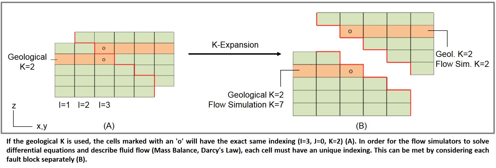

# Usage of `work-product-component--IjkGridRepresentation:1.0.0`

An IJK Grid which has more K layers than geologic layers. Usually used in stair step grid with reverse fault.

# K expanded Ijk Grid 
Uses the **ExpansionInDirection** metadata.
			

The following Energistics (c) products were used in the creation of this work: RESQML2.0.1 documentation via Energistics Online paragraph 11.9 (docs.energistics.org)

## Grid WPC : uuid 4c14b22e-3ef5-49d7-bcb4-560a6adea5a5
```json
  {
    ...
    "IndexableElementCount": [
      {
        "Count": 36,
        "IndexableElementID": "namespace:reference-data--IndexableElement:cells:"
      }
    ],
    "ActiveCellCount": 34,
    "HasNaNGeometry": false,
    "HasFiniteElementSubnodes": false,
    "HasNoGeometry": false,
    "Nk": 10,
    "KDirectionID": "namespace:reference-data--KDirectionType:down:",
    "HasCollocatedNodeInKDirection": false,
    "PillarShapeID": "namespace:reference-data--PillarShapeType:vertical:",
    "HasLateralGaps": false,
    "HasKGaps": false,
    "HasParametricGeometry": false,
    "HasSplitNode": false,
    "HasTruncations": false,
    "ExpansionInDirection": "K",
    "Ni": 6,
    "Nj": 0,
    "IsRightHanded": false,
    "IsRadial": false,
    ...
  }
```

## Geologic K Property

```json
  {
    ...
    "ValueType": "integer",
    "ValueCount": 1,
    "PropertyType": {
      "PropertyTypeID": "namespace:reference-data--PropertyType:493ed155-55fa-42d1-96e5-417855e1e036:",
      "Name": "geologic k"
    },
    "PropertyTopologyID": "namespace:work-product-component--IjkGridRepresentation:IjkGridRepresentation-4c14b22e-3ef5-49d7-bcb4-560a6adea5a5:",
    "IndexableElementID": "namespace:reference-data--IndexableElement:cells:",
    "UnitOfMeasureID": "namespace:reference-data--UnitOfMeasure:Euc:",
    ...
  }
```
