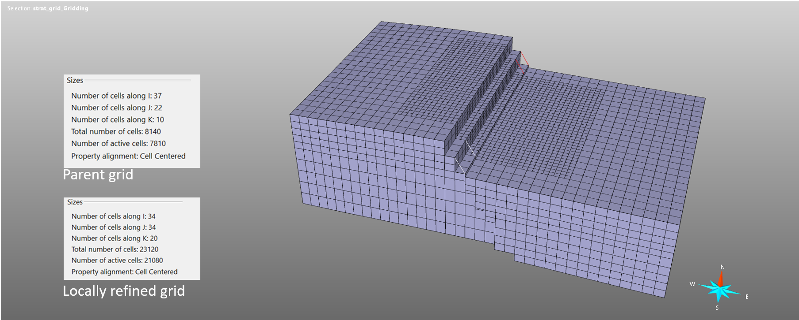

# Usage of `work-product-component--IjkGridRepresentation:1.0.0`

An IJK Grid which is nested into another coarser IJK grid.

# LGR 
			


## Coarse grid : uuid dda3b768-df8c-4915-a11d-7a6e314dc028
```json
  {
    ...
    "IndexableElementCount": [
      {
        "Count": 8140,
        "IndexableElementID": "namespace:reference-data--IndexableElement:cells:"
      }
    ],
    "ActiveCellCount": 7810,
    "HasNaNGeometry": false,
    "HasFiniteElementSubnodes": false,
    "HasNoGeometry": false,
    "Nk": 10,
    "KDirectionID": "namespace:reference-data--KDirectionType:down:",
    "HasCollocatedNodeInKDirection": true,
    "PillarShapeID": "namespace:reference-data--PillarShapeType:vertical:",
    "HasLateralGaps": false,
    "HasKGaps": false,
    "HasParametricGeometry": false,
    "HasSplitNode": false,
    "HasTruncations": false,
    "Ni": 37,
    "Nj": 22,
    "IsRightHanded": false,
    "IsRadial": false,
    ...
  }
```

## Refined grid
Uses the **ParentGridID** metadata.

```json
  {
    ...
    "IndexableElementCount": [
      {
        "Count": 23120,
        "IndexableElementID": "namespace:reference-data--IndexableElement:cells:"
      }
    ],
    "ActiveCellCount": 21080,
    "HasNaNGeometry": false,
    "ParentGridID": "namespace:work-product-component--IjkGridRepresentation:dda3b768-df8c-4915-a11d-7a6e314dc028:",
    "HasFiniteElementSubnodes": false,
    "HasNoGeometry": false,
    "Nk": 20,
    "KDirectionID": "namespace:reference-data--KDirectionType:down:",
    "HasCollocatedNodeInKDirection": true,
    "PillarShapeID": "namespace:reference-data--PillarShapeType:vertical:",
    "HasLateralGaps": false,
    "HasKGaps": false,
    "HasParametricGeometry": false,
    "HasSplitNode": false,
    "HasTruncations": false,
    "Ni": 34,
    "Nj": 34,
    "IsRightHanded": false,
    "IsRadial": false,
    ...
  }
```
