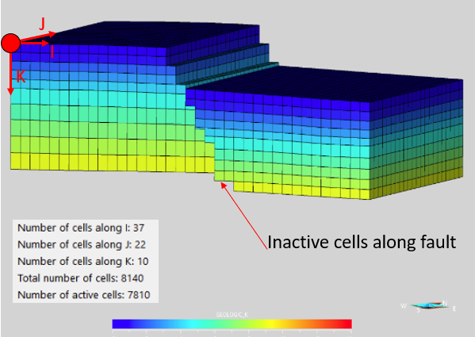
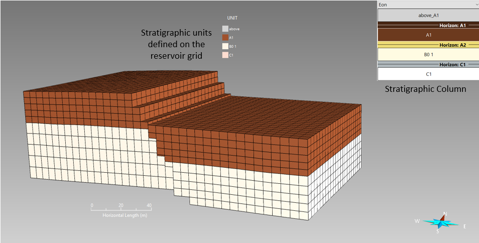

# Usage of `work-product-component--IjkGridRepresentation:1.0.0`

An IJK Grid is a collection of hexahedra which are organized and indexable by means of 3 (almost orthogonal) directions and called I, J and K.

# Basic left handed stair-stepped faulted IJK Grid 
			




```json
  {
    ...
    "IndexableElementCount": [
      {
        "Count": 8140,
        "IndexableElementID": "namespace:reference-data--IndexableElement:cells:"
      }
    ],
    "ActiveCellCount": 7810,
    "HasNaNGeometry": false,
    "StratigraphicUnits": {
      "StratigraphicUnitsIndices": [
        [1], [1], [1], [1], [1],
        [2], [2], [2], [2], [2]
      ],
      "StratigraphicOrganizationInterpretationID": "namespace:work-product-component--StratigraphicColumnRankInterpretation:85348741-3433-406B-9189-22B298C3E2D2:"
    },
    "HasFiniteElementSubnodes": false,
    "HasNoGeometry": false,
    "Nk": 10,
    "KDirectionID": "namespace:reference-data--KDirectionType:down:",
    "HasCollocatedNodeInKDirection": false,
    "PillarShapeID": "namespace:reference-data--PillarShapeType:vertical:",
    "HasLateralGaps": false,
    "HasKGaps": false,
    "HasParametricGeometry": false,
    "HasSplitNode": false,
    "HasTruncations": false,
    "Ni": 37,
    "Nj": 22,
    "IsRightHanded": false,
    "IsRadial": false,
    ...
  }
```
