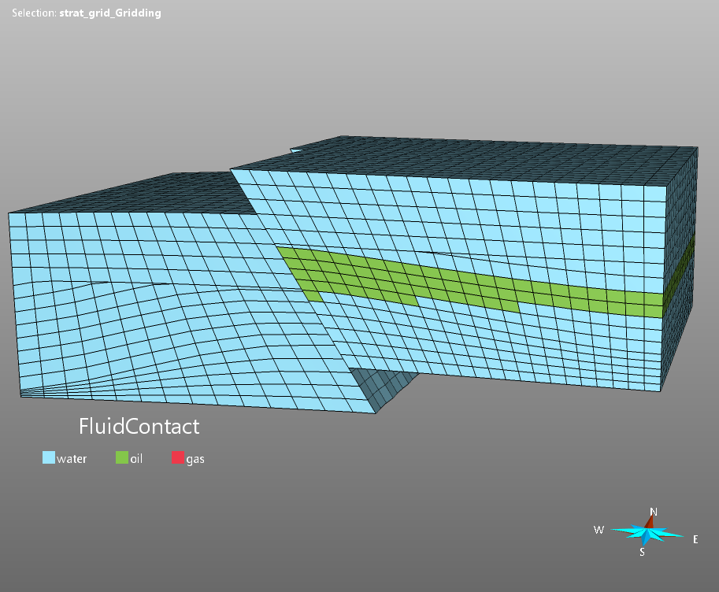

# Usage of `work-product-component--IjkGridRepresentation:1.0.0`

An IJK Grid which has got relationships to a rock fluid organization interpretation.

# IJK Grid associated to a Rock Fluid Organization 
Uses the **RockFluidOrganizationInterpretationIDS** metadata.
			


## Ijk Grid

```json
  {
    ...
    "IndexableElementCount": [
      {
        "Count": 12600,
        "IndexableElementID": "namespace:reference-data--IndexableElement:cells:"
      }
    ],
    "ActiveCellCount": 12600,
    "HasNaNGeometry": false,
    "RockFluidOrganizationInterpretationIDS": [
      "namespace:work-product-component--RockFluidOrganizationInterpretation:ccd2e557-68d0-4e2f-b826-8a4e69285466:"
    ],
    "HasFiniteElementSubnodes": false,
    "HasNoGeometry": false,
    "Nk": 18,
    "KDirectionID": "namespace:reference-data--KDirectionType:down:",
    "HasCollocatedNodeInKDirection": true,
    "PillarShapeID": "namespace:reference-data--PillarShapeType:straight:",
    "HasLateralGaps": false,
    "HasKGaps": false,
    "HasParametricGeometry": false,
    "HasSplitNode": false,
    "HasTruncations": false,
    "Ni": 35,
    "Nj": 20,
    "IsRightHanded": false,
    "IsRadial": false,
    ...
  }
```

## Rock Fluid Organization Interpretation

One unit for oil and one unit for water.

```json
  {
    "id": "namespace:work-product-component--RockFluidOrganizationInterpretation:ccd2e557-68d0-4e2f-b826-8a4e69285466",
  
    ...
    "MemberIDs": [
      "namespace:work-product-component--RockFluidUnitInterpretation:a7a81843-9bea-5ce4-913c-f67e4ea154ff:",
      "namespace:work-product-component--RockFluidUnitInterpretation:aff9a086-3da6-53c0-baef-222c2273a040:"
    ],
    ...
  }
```
