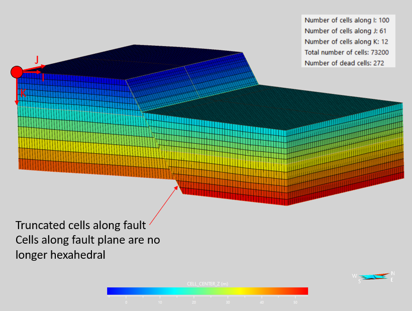

# Usage of `work-product-component--IjkGridRepresentation:1.0.0`

An IJK Grid where at least some of the pillars of the grid are truncated most of time along fault planes.

# Truncated IJK Grid 
Uses the **HasTruncations** metadata.
			


```json
  {
    ...
    "IndexableElementCount": [
      {
        "Count": 73200,
        "IndexableElementID": "namespace:reference-data--IndexableElement:cells:"
      }
    ],
    "ActiveCellCount": 72 928,
    "HasNaNGeometry": false,
    "HasFiniteElementSubnodes": false,
    "HasNoGeometry": false,
    "Nk": 12,
    "KDirectionID": "namespace:reference-data--KDirectionType:down:",
    "HasCollocatedNodeInKDirection": false,
    "PillarShapeID": "namespace:reference-data--PillarShapeType:vertical:",
    "HasLateralGaps": false,
    "HasKGaps": false,
    "HasParametricGeometry": false,
    "HasSplitNode": false,
    "HasTruncations": true,
    "Ni": 100,
    "Nj": 61,
    "IsRightHanded": false,
    "IsRadial": false,
    ...
  }
```
