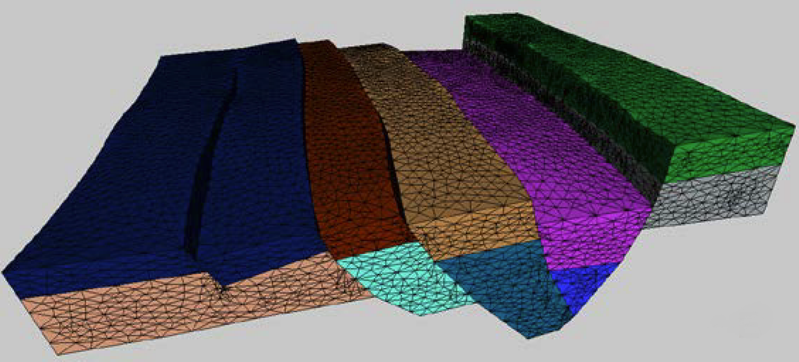

# Usage of `work-product-component--UnstructuredGridRepresentation:1.0.0`

An unstructured grid is a collection of polyhedra which are not organized in any dimension.

# Unstructured tetrahedral Grid



```json
  {
    ...
    "IndexableElementCount": [
      {
        "Count": 86735,
        "IndexableElementID": "namespace:reference-data--IndexableElement:cells:"
      }
    ],
    "ActiveCellCount": 86735,
    "HasNaNGeometry": false,
    "HasFiniteElementSubnodes": false,
    "HasNoGeometry": false,
    "FaceCount": 158325,
    "NodeCount": 133672,
    "CellShapeID": "namespace:reference-data--CellShapeType:tetrahedral:",
    ...
  }
```