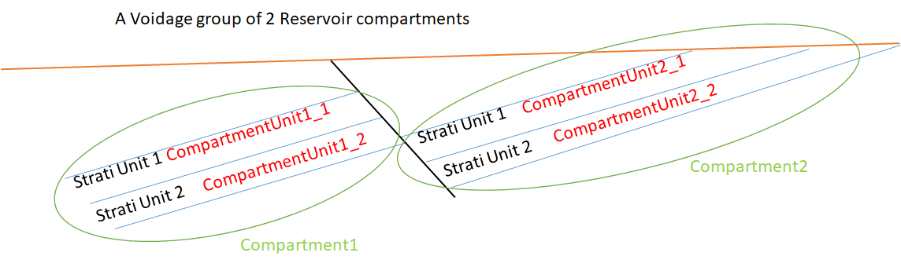
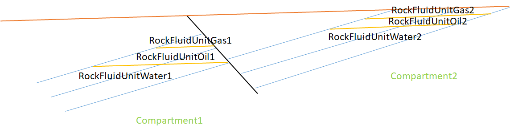

[[_TOC_]]

# Usage of `work-product-component--VoidageGroup:1.0.0`

Stratigraphic units are generally laterally (very) long. However, they are often disconnected cause of some faults or
other geological elements. When those stratigraphic units behave like reservoir and when some hydrocarbon traps occur,
one may want to distinguish more precisely how stratigraphic units parts are connected or not: this is where
ReservoirCompartments and Voidage Group play a role.

   
   

<details>

<summary markdown="span">Compartment1 Record Fragment</summary>

<OsduImportJSON>[Open the full example record.](json/ReservoirCompartment1Interpretation.json#only.data.ReservoirCompartmentUnits)</OsduImportJSON>

```json
{
  "data": {
    "ReservoirCompartmentUnits": [
      {
        "GeologicUnitID": "namespace:work-product-component--StratigraphicUnitInterpretation:StratiUnit1:",
        "RockFluidUnitIDs": [
          "namespace:work-product-component--RockFluidUnitInterpretation:RockFluidUnitGas1:",
          "namespace:work-product-component--RockFluidUnitInterpretation:RockFluidUnitOil1:",
          "namespace:work-product-component--RockFluidUnitInterpretation:RockFluidUnitWater1:"
        ]
      },
      {
        "GeologicUnitID": "namespace:work-product-component--StratigraphicUnitInterpretation:StratiUnit2:",
        "RockFluidUnitIDs": [
          "namespace:work-product-component--RockFluidUnitInterpretation:RockFluidUnitOil1:",
          "namespace:work-product-component--RockFluidUnitInterpretation:RockFluidUnitWater1:"
        ]
      }
    ]
  }
}
```

</details> 

<details>

<summary markdown="span">Compartment2 Record Fragment</summary>

<OsduImportJSON>[Open the full example record.](json/ReservoirCompartment2Interpretation.json#only.data.ReservoirCompartmentUnits)</OsduImportJSON>

```json
{
  "data": {
    "ReservoirCompartmentUnits": [
      {
        "GeologicUnitID": "namespace:work-product-component--StratigraphicUnitInterpretation:StratiUnit1:",
        "RockFluidUnitIDs": [
          "namespace:work-product-component--RockFluidUnitInterpretation:RockFluidUnitGas2:",
          "namespace:work-product-component--RockFluidUnitInterpretation:RockFluidUnitOil2:",
          "namespace:work-product-component--RockFluidUnitInterpretation:RockFluidUnitWater2:"
        ]
      },
      {
        "GeologicUnitID": "namespace:work-product-component--StratigraphicUnitInterpretation:StratiUnit2:",
        "RockFluidUnitIDs": [
          "namespace:work-product-component--RockFluidUnitInterpretation:RockFluidUnitGas2:",
          "namespace:work-product-component--RockFluidUnitInterpretation:RockFluidUnitOil2:",
          "namespace:work-product-component--RockFluidUnitInterpretation:RockFluidUnitWater2:"
        ]
      }
    ]
  }
}
```

</details> 

<details>

<summary markdown="span">Voidage Group Record Fragment</summary>

<OsduImportJSON>[Open the full example record.](json/VoidageGroupInterpretation.json#only.data.MemberIDs|RockFluidOrganizationInterpretationIDs|GeologicUnitOrganizationInterpretationIDs)</OsduImportJSON>

```json
{
  "data": {
    "MemberIDs": [
      "namespace:work-product-component--ReservoirCompartmentInterpretation:ReservoirCompartment1:",
      "namespace:work-product-component--ReservoirCompartmentInterpretation:ReservoirCompartment2:"
    ],
    "RockFluidOrganizationInterpretationIDs": [
      "namespace:work-product-component--RockFluidOrganizationInterpretation:b32e7c46-c4d4-417e-b07a-4d7b9daa6577:",
      "namespace:work-product-component--RockFluidOrganizationInterpretation:66bec115-a43c-49b9-9e68-06a2391f5ba9:"
    ],
    "GeologicUnitOrganizationInterpretationIDs": [
      "namespace:work-product-component--StratigraphicColumnRankInterpretation:568e29f3-6018-4b48-919b-32a11018a4a5:"
    ]
  }
}
```

</details> 