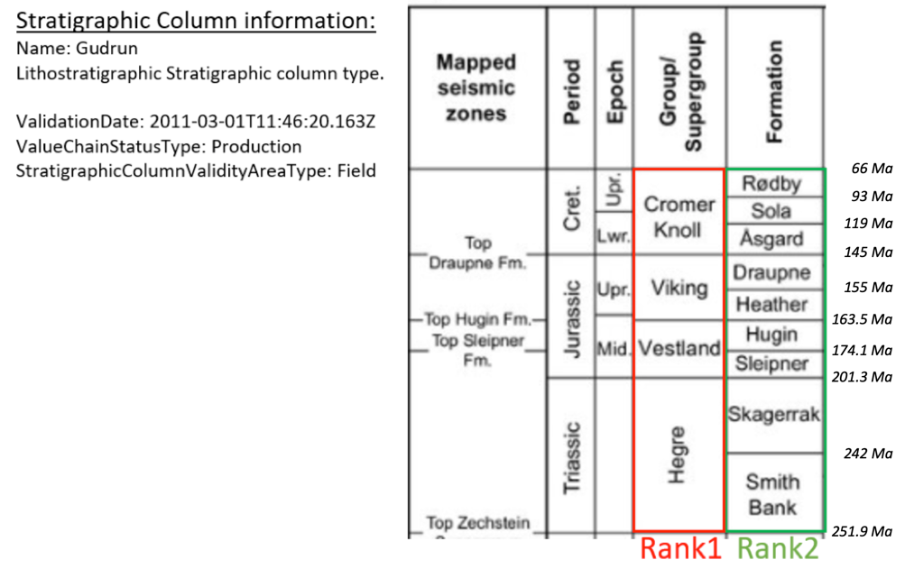
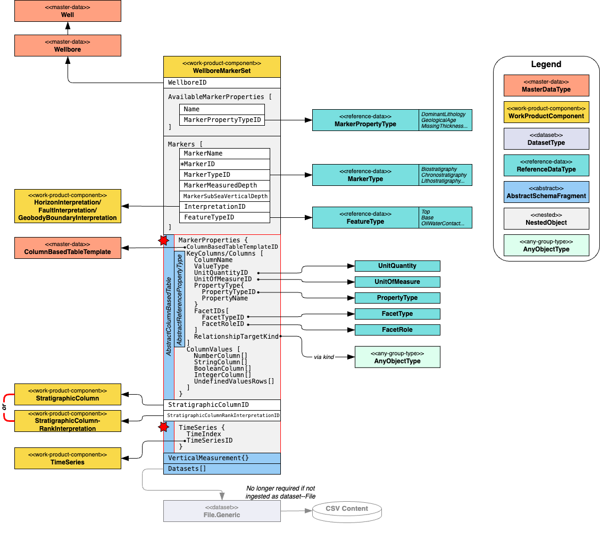
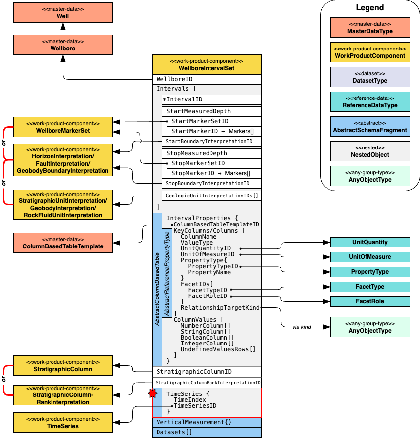

<a name="TOC"></a>

[[_TOC_]]

# Usage of `work-product-component--StratigraphicColumn:1.0.0`

A Stratigraphic Column is a collection of stratigraphic column ranks.

# Stratigraphic column with 4 Ranks



## Stratigraphic Column

A [`StratigraphicColumn`](../../../../E-R/work-product-component/StratigraphicColumn.1.2.0.md) contains an ordered list
of [`StratigraphicColumnRankInterpretation`](../../../../E-R/work-product-component/StratigraphicColumnRankInterpretation.1.3.0.md).
The first two ranks are chrono-stratigraphic Systems and Series, the last two are litho-stratigraphic Groups and
Formations.

<details>
<summary markdown="span"><code>StratigraphicColumn</code> Record Fragment</summary>

<OsduImportJSON>[Open the full example record.](Column/GudrunColumn.json#only.data.Name|StratigraphicColumnRankInterpretationSet|ValueChainStatusType|StratigraphicColumnValidityAreaType)</OsduImportJSON>

```json
{
  "data": {
    "Name": "Gudrun Stratigraphy",
    "StratigraphicColumnRankInterpretationSet": [
      "namespace-id:work-product-component--StratigraphicColumnRankInterpretation:Gudrun-ChronoStratigraphy-System-:",
      "namespace-id:work-product-component--StratigraphicColumnRankInterpretation:Gudrun-ChronoStratigraphy-Series-:",
      "namespace-id:work-product-component--StratigraphicColumnRankInterpretation:Gudrun-Rank1-:",
      "namespace-id:work-product-component--StratigraphicColumnRankInterpretation:Gudrun-Rank2-:"
    ],
    "ValueChainStatusType": "partition-id:reference-data--ValueChainStatusType:Production:",
    "StratigraphicColumnValidityAreaType": "partition-id:reference-data--StratigraphicColumnValidityAreaType:field:"
  }
}
```
</details>

[Back to TOC](#TOC)

## Stratigraphic Column Ranks

The chrono-stratigraphic System and Series are represented as reference data (see reference data manifests). References
to [`osdu:wks:reference-data--ChronoStratigraphic:1.*.*`](../../../../E-R/reference-data/ChronoStratigraphy.1.1.0.md)
are collected in the two `StratigraphicColumnRankInterpretation` records:

### Chrono-Stratigraphic Systems

Example for the chart above: [`StratigraphicColumnRankInterpretation` record](ChronoStratigraphySets/ColumnRankInterpretationSystem.json)

### Chrono-Stratigraphic Series

Example for the chart above: [`StratigraphicColumnRankInterpretation` record](ChronoStratigraphySets/ColumnRankInterpretationSeries.json)

[`StratigraphicColumnRankInterpretation`](../../../../E-R/work-product-component/StratigraphicColumnRankInterpretation.1.3.0.md)
collects an ordered list of [`StratigraphicUnitInterpretation`](../../../../E-R/work-product-component/StratigraphicUnitInterpretation.1.3.0.md)
with the intention to create a columns of non-overlapping intervals. Typically, the base of one
`StratigraphicUnitInterpretation` is the top of the next.

### Rank 1

<details>
<summary markdown="span"><code>StratigraphicUnitRankInterpretation</code> Record Fragment, Rank 1</summary>

<OsduImportJSON>[Open the full example StratigraphicUnitRankInterpretation Rank 1 record.](Rank1/ColumnRank1Interpretation.json#only.data.Name|StratigraphicRoleType|StratigraphicColumnRankUnitType|StratigraphicUnitInterpretationSet)</OsduImportJSON>

```json
{
  "data": {
    "Name": "Gudrun Group/Supergroup, Rank 1",
    "StratigraphicRoleType": "partition-id:reference-data--StratigraphicRoleType:Lithostratigraphic:",
    "StratigraphicColumnRankUnitType": "partition-id:reference-data--StratigraphicColumnRankUnitType:Lithostratigraphic.Group:",
    "StratigraphicUnitInterpretationSet": [
      "namespace-id:work-product-component--StratigraphicUnitInterpretation:Cromer-Knoll-:",
      "namespace-id:work-product-component--StratigraphicUnitInterpretation:Viking-:",
      "namespace-id:work-product-component--StratigraphicUnitInterpretation:Vestland-:",
      "namespace-id:work-product-component--StratigraphicUnitInterpretation:Hegre-:"
    ]
  }
}
```
</details>

### Rank 2

<details>
<summary markdown="span"><code>StratigraphicUnitRankInterpretation</code> Record Fragment, Rank 2</summary>

<OsduImportJSON>[Open the full example StratigraphicUnitRankInterpretation Rank 2 record.](Rank2/ColumnRank2Interpretation.json#only.data.Name|StratigraphicRoleType|StratigraphicColumnRankUnitType|StratigraphicUnitInterpretationSet)</OsduImportJSON>

```json
{
  "data": {
    "Name": "Gudrun Formation, Rank 1",
    "StratigraphicRoleType": "partition-id:reference-data--StratigraphicRoleType:Lithostratigraphic:",
    "StratigraphicColumnRankUnitType": "partition-id:reference-data--StratigraphicColumnRankUnitType:Lithostratigraphic.Formation:",
    "StratigraphicUnitInterpretationSet": [
      "namespace-id:work-product-component--StratigraphicUnitInterpretation:Roedby-:",
      "namespace-id:work-product-component--StratigraphicUnitInterpretation:Sola-:",
      "namespace-id:work-product-component--StratigraphicUnitInterpretation:Aasgard-:",
      "namespace-id:work-product-component--StratigraphicUnitInterpretation:Draupne-:",
      "namespace-id:work-product-component--StratigraphicUnitInterpretation:Heather-:",
      "namespace-id:work-product-component--StratigraphicUnitInterpretation:Hugin-:",
      "namespace-id:work-product-component--StratigraphicUnitInterpretation:Sleipner-:",
      "namespace-id:work-product-component--StratigraphicUnitInterpretation:Skagerrak-:",
      "namespace-id:work-product-component--StratigraphicUnitInterpretation:Smith-Bank-:"
    ]
  }
}
```
</details>

[Back to TOC](#TOC)

## StratigraphicUnitInterpretation Examples

<details>
<summary markdown="span"><code>StratigraphicUnitInterpretation</code> Record Fragment, Rødby</summary>

<OsduImportJSON>[Open the full example Rødby record.](Rank2/0-Roedby.json#only.data)</OsduImportJSON>

```json
{
  "data": {
    "IsDiscoverable": true,
    "Name": "R\u00f8dby",
    "LithologyTypeID": "partition-id:reference-data--LithologyType:sand:",
    "IsIntrusive": false,
    "GeologicUnitShapeTypeID": "partition-id:reference-data--GeologicUnitShapeType:Delta:",
    "OlderPossibleAge": 93.0,
    "YoungerPossibleAge": 66.0,
    "FeatureID": "partition-id:work-product-component--LocalRockVolumeFeature:Roedby-:",
    "FeatureName": "R\u00f8dby",
    "DepositionGeometryTypeID": "partition-id:reference-data--DepositionGeometryType:ParallelToTop:",
    "StratigraphicRoleTypeID": "partition-id:reference-data--StratigraphicRoleType:Lithostratigraphic:",
    "MinimumThickness": 2.0,
    "MaximumThickness": 100.0,
    "ColumnStratigraphicHorizonTopID": "partition-id:work-product-component--HorizonInterpretation:Top-Roedby-:",
    "ColumnStratigraphicHorizonBaseID": "partition-id:work-product-component--HorizonInterpretation:Top-Sola-:",
    "GeoContexts": [
      {
        "FieldID": "partition-id:master-data--Field:Gudrun:",
        "GeoTypeID": "Field"
      }
    ],
    "ExtensionProperties": {}
  }
}
```
</details>

### Rank 1 StratigraphicUnitInterpretation (Group)

Links to example records in the stratigraphic sequence established by the
[StratigraphicColumnRankInterpretation, rank 1](Rank1/ColumnRank1Interpretation.json):

1. [Cromer Knoll](Rank1/0-Cromer-Knoll.json)
2. [Viking](Rank1/1-Viking.json)
3. [Vestland](Rank1/2-Vestland.json)
4. [Hegre](Rank1/3-Hegre.json)

[Back to TOC](#TOC)

### Rank 2 StratigraphicUnitInterpretation (Formations)

Links to example records in the stratigraphic sequence established by the
[StratigraphicColumnRankInterpretation, rank 2](Rank2/ColumnRank2Interpretation.json):

1. [Rødby](Rank2/0-Roedby.json)
2. [Sola](Rank2/1-Sola.json)
3. [Åsgard](Rank2/2-Aasgard.json)
4. [Draupne](Rank2/3-Draupne.json)
5. [Heather](Rank2/4-Heather.json)
6. [Hugin](Rank2/5-Hugin.json)
7. [Sleipner](Rank2/6-Sleipner.json)
8. [Skagerrak](Rank2/7-Skagerrak.json)
9. [Smith Bank](Rank2/8-Smith-Bank.json)

[Back to TOC](#TOC)

## WellboreMarkerSet

Wellbore markers typically identify interfaces between stratigraphic units, i.e., feature boundaries. Markers can be
associated with [HorizonInterpretation](../../../../E-R/work-product-component/HorizonInterpretation.1.2.0.md),
[FaultInterpretation](../../../../E-R/work-product-component/FaultInterpretation.1.3.0.md) or
[GeobodyBoundaryInterpretation](../../../../E-R/work-product-component/GeobodyBoundaryInterpretation.1.2.0.md). Since
[WellboreMarkerSet](../../../../E-R/work-product-component/WellboreMarkerSet.1.5.1.md) this relationship can be
established.

The relationship to a [StratigraphicColumn](../../../../E-R/work-product-component/StratigraphicColumn.1.2.0.md) or
[StratigraphicColumnRankInterpretation](../../../../E-R/work-product-component/StratigraphicColumnRankInterpretation.1.3.0.md)
may provide the stratigraphic order, which is of critical importance to understand absent stratigraphic units.



The red stars mark the latest changes with [milestone M24.2](../../../../Guides/MigrationGuides/M24.2/README.md).
With this milestone WellboreMarkerSet offers embedded MarkerProperties similar to WellboreIntervalSet's IntervalProperties.

[Back to TOC](#TOC)

In the following examples, the wellbore markers refer to
[HorizonInterpretation](../../../../E-R/work-product-component/HorizonInterpretation.1.2.0.md). Example record referring
to the Rank 2 column tops are:

1. [Top Rødby](HorizonInterpretation/0-Top-Roedby.json) - shared with rank 1 "Cromer Knoll"
2. [Top Sola](HorizonInterpretation/1-Top-Sola.json)
3. [Top Åsgard](HorizonInterpretation/2-Top-Aasgard.json)
4. [Top Draupne](HorizonInterpretation/3-Top-Draupne.json) - shared with rank 1 "Viking"
5. [Top Heather](HorizonInterpretation/4-Top-Heather.json)
6. [Top Hugin](HorizonInterpretation/5-Top-Hugin.json) - shared with rank 1 "Vestland"
7. [Top Sleipner](HorizonInterpretation/6-Top-Sleipner.json)
8. [Top Smith Bank](HorizonInterpretation/7-Top-Skagerrak.json)

For the wellbore 15/3-7 the [Norwegian Offshore Directorate fact pages](https://factpages.sodir.no/en/wellbore/PageView/Exploration/All/4055) publish
the following set of markers, which relate to the stratigraphic column above:

| MeasuredDepth [m] | SubSeaVerticalDepth [m] | Formation    | Rank |
|-------------------|-------------------------|--------------|------|
| 3752              | 3733.93                 | Cromer Knoll | 1    |
| 3752              | 3733.93                 | Rødby        | 2    |
| 3867              | 3848.92                 | Sola         | 2    |
| 3895              | 3876.91                 | Åsgard       | 2    |
| 4049              | 4030.90                 | Viking       | 1    |
| 4049              | 4030.90                 | Draupne      | 2    |
| 4502              | 4483.85                 | Heather      | 2    |
| 4607              | 4588.84                 | Vestland     | 1    |
| 4607              | 4588.84                 | Hugin        | 2    |
| 4793              | 4774.82                 | Sleipner     | 2    |

Note: The SubSeaMeasured depth values are faked simulating a near vertical wellbore. The main difference is the subtracted Kelly Bushing Elevation of 18 m.

[Back to TOC](#TOC)

<details>
<summary markdown="span">Example <code>WellboreMarkerSet</code> Record Fragment, Hugin marker with relation to HorizonInterpretation.</summary>

<OsduImportJSON>[Open the full example WellboreMarkerSet record.](WellboreData/MarkerSet-Multi-Rank.json#only.data.Markers[8])</OsduImportJSON>

```json
{
  "data": {
    "Markers": [
      {
        "MarkerName": "Top Hugin",
        "MarkerID": "a2be6ed2-c5dd-4d79-8bc7-a216ca133603",
        "MarkerMeasuredDepth": 4607.0,
        "MarkerSubSeaVerticalDepth": 4588.84,
        "MarkerTypeID": "partition-id:reference-data--MarkerType:Lithostratigraphy:",
        "FeatureTypeID": "partition-id:reference-data--FeatureType:Top:",
        "FeatureName": "Hugin",
        "InterpretationID": "partition-id:work-product-component--HorizonInterpretation:Top-Hugin-:"
      }
    ]
  }
}
```
</details>


### Multi-Rank Marker Set

Please note the marker instances with identical MD values representing the tops 'belonging to' **_
different_** `StratigraphicColumnRankInterpretation` instances. The `WellboreMarkerSet` identifies
the ["Gudrun" &rarr; `StratigraphicColumn`](Column/GudrunColumn.json) via the `data.StratigraphicColumnID`. With this
stratigraphic framework context it is possible to understand that "Cromer Knoll", "Viking" and "Vestland" are **_not_**
tops of zero-thickness layers.

<details>
<summary markdown="span"><code>WellboreMarkerSet</code> relationship to <code>StratigraphicColumn</code>.</summary>

<OsduImportJSON>[Open the full example WellboreMarkerSet record.](WellboreData/MarkerSet-Multi-Rank.json#only.data.StratigraphicColumnID)</OsduImportJSON>

```json
{
  "data": {
    "StratigraphicColumnID": "partition-id:work-product-component--StratigraphicColumn:Gudrun:"
  }
}
```
</details>

The fact that the `WellboreMarkerSet` refers to a `StratigraphicColumn` also means that the marker set cannot be used to
create simple, implicit intervals where the top of the next interval is the base of the previous. A
complete `WellboreMarkerSet` example for such a scenario can be
found [&rarr; here](WellboreData/MarkerSet-Multi-Rank.json).

### Single Rank Marker Set, Implicit Interval Set

If, on the contrary, the `StratigraphicColumnRankInterpretationID` is populated with a reference to a
single `StratigraphicColumnRankInterpretation`, e.g. [&rarr; Gudrun Rank 2](Rank2/ColumnRank2Interpretation.json), the
WellboreMarkerSet **_can_** be used to create an implicit interval set. A complete example record is
shown [&rarr; here](WellboreData/MarkerSet-Rank2.json).

<details>
<summary markdown="span"><code>WellboreMarkerSet</code> relationship to <code>StratigraphicColumnRankInterpretation</code>.</summary>

<OsduImportJSON>[Open the full example WellboreMarkerSet record.](WellboreData/MarkerSet-Rank2.json#only.data.StratigraphicColumnRankInterpretationID)</OsduImportJSON>

```json
{
  "data": {
    "StratigraphicColumnRankInterpretationID": "partition-id:work-product-component--StratigraphicColumnRankInterpretation:Gudrun-Rank2-:"
  }
}
```
</details>

### Marker Properties

This section does not demonstrate the use of marker properties. Please rever to
the [worked examples for WellboreMarkerSet](../../WellboreMarkerSet/README.md#overview-wellboremarkerset-with-embedded-properties)
for this detail. It should be noted that
with [milestone M24.2](../../../../Guides/MigrationGuides/M24.2/work-product-component--WellboreMarkerSet.1.4.0.md) the
capabilities to carry properties has been aligned between WellboreMarkerSet and WellboreIntervalSet.

[Back to TOC](#TOC)

## WellboreIntervalSet

`WellboreIntervalSet` acts as a representation in the Earth Modelling sense. The set may refer to a
[StratigraphicColumn](../../../../E-R/work-product-component/StratigraphicColumn.1.2.0.md) or
[StratigraphicColumnRankInterpretation](../../../../E-R/work-product-component/StratigraphicColumnRankInterpretation.1.3.0.md)
to state the stratigraphic organisation.

Each interval structure in the `data.Intervals[]` may refer to
1. a list of unit interpretations, which are either
   1. [StratigraphicUnitInterpretation](../../../../E-R/work-product-component/StratigraphicUnitInterpretation.1.3.0.md) or
   2. [GeobodyInterpretation](../../../../E-R/work-product-component/GeobodyInterpretation.1.3.0.md) or
   3. [RockFluidUnitInterpretation](../../../../E-R/work-product-component/RockFluidUnitInterpretation.1.3.0.md)
2. a top interpretation and/or
3. a base interpretation, each of which can be of type:
   1. [HorizonInterpretation](../../../../E-R/work-product-component/HorizonInterpretation.1.2.0.md) or
   2. [FaultInterpretation](../../../../E-R/work-product-component/FaultInterpretation.1.3.0.md) or
   3. [GeobodyBoundaryInterpretation](../../../../E-R/work-product-component/GeobodyBoundaryInterpretation.1.2.0.md).



The red star marks an extension with [milestone M24.2](../../../../Guides/MigrationGuides/M24.2/work-product-component--WellboreIntervalSet.1.2.0.md).

The example demonstrates the handling of two interval properties:

1. Apparent Thickness (simple measured depth difference)
2. Neutron Porosity (average value over interval as read out from the well logs)


[Back to TOC](#TOC)

### WellboreIntervalSet with embedded ColumnBasedTable

A compact property representation is achieved by embedding the structure of a
[ColumnBasedTable](../../../../E-R/abstract/AbstractColumnBasedTable.1.0.0.md) inside the `WellboreIntervalSet`. Note
that the `AbstractColumnBasedTable` indexing hint for the `Columns[]` array is set to "nested", which allows for query
for particular property specifications.

#### Important Usage Rule for `IntervalID`

* `data.IntervalProperties.KeyColumns` are expected to contain one key column of type string.
* `data.IntervalProperties.ColumnValues[0].StringColumn[]` contain the `data.Intervals[].IntervalID` to enable the
  association of Intervals and IntervalProperties array members.

<details>
<summary markdown="span"><code>WellboreIntervalSet</code> with embedded <code>AbstractColumnBasedTable</code>; Interval structure.</summary>

<OsduImportJSON>[Open the full example WellboreIntervalSet record.](WellboreData/WellboreIntervalSet-ColumnBasedTable.json#only.data.Intervals[3])</OsduImportJSON>

This shows one interval object extracted - no properties inside.

```json
{
  "data": {
    "Intervals": [
      {
        "IntervalID": "ba829e6d-30e0-4375-906c-4e7c62c9f7ec",
        "GeologicUnitInterpretationIDs": [
          "partition-id:work-product-component--StratigraphicUnitInterpretation:Draupne-:"
        ],
        "StartMeasuredDepth": 4049.0,
        "StartSubSeaVerticalDepth": 4030.9,
        "StartIntervalName": "Top Draupne",
        "StartMarkerSetID": "partition-id:work-product-component--WellboreMarkerSet:15-3-7-SingleRank-:",
        "StartMarkerID": "a580a3bb-c2db-4845-bbc1-050b417307c0",
        "StartBoundaryInterpretationID": "partition-id:work-product-component--HorizonInterpretation:Top-Draupne-:",
        "StopMeasuredDepth": 4502.0,
        "StopSubSeaVerticalDepth": 4483.85,
        "StopIntervalName": "Top-Heather",
        "StopMarkerSetID": "partition-id:work-product-component--WellboreMarkerSet:15-3-7-SingleRank-:",
        "StopMarkerID": "7699229b-36e8-4aed-884f-a1e844e5b9d7",
        "StopBoundaryInterpretationID": "partition-id:work-product-component--HorizonInterpretation:Top-Heather-:"
      }
    ]
  }
}
```
</details>

<details>
<summary markdown="span"><code>WellboreIntervalSet</code> with embedded <code>AbstractColumnBasedTable</code>; KeyColumns and Columns metadata.</summary>

This shows the column declaration for the embedded column based table.

<OsduImportJSON>[Open the full example WellboreIntervalSet record.](WellboreData/WellboreIntervalSet-ColumnBasedTable.json#only.data.IntervalProperties.KeyColumns|Columns)</OsduImportJSON>

```json
{
  "data": {
    "IntervalProperties": {
      "KeyColumns": [
        {
          "ValueType": "string",
          "ValueCount": 1,
          "ColumnName": "IntervalID"
        }
      ],
      "Columns": [
        {
          "ValueType": "number",
          "ValueCount": 1,
          "UnitQuantityID": "partition-id:reference-data--UnitQuantity:length:",
          "PropertyType": {
            "PropertyTypeID": "partition-id:reference-data--PropertyType:19ce24e5-bf65-4e59-9a1f-e1c8d34abb83:",
            "Name": "apparent thickness"
          }
        },
        {
          "ValueType": "number",
          "ValueCount": 1,
          "UnitQuantityID": "partition-id:reference-data--UnitQuantity:UnitQuantity:volume%20per%20volume:",
          "PropertyType": {
            "PropertyTypeID": "partition-id:reference-data--PropertyType:85a39e16-0290-40ca-899d-dd20fed44b64:",
            "Name": "neutron porosity"
          }
        }
      ]
    }
  }
}
```
</details>

<details>
<summary markdown="span"><code>WellboreIntervalSet</code> with embedded <code>AbstractColumnBasedTable</code>; property values in <code>ColumnValues</code>.</summary>

This shows the column values for the embedded column based table. The `data.Intervals[]` array should be ordered the same
way as `data.IntervalProperties.ColumnValues[].NumberColumn[]` and the length must be identical
(matching `data.IntervalProperties.ColumnSize`).

<OsduImportJSON>[Open the full example WellboreIntervalSet record.](WellboreData/WellboreIntervalSet-ColumnBasedTable.json#only.data.IntervalProperties.ColumnSize|ColumnValues)</OsduImportJSON>

```json
{
  "data": {
    "IntervalProperties": {
      "ColumnSize": 7,
      "ColumnValues": [
        {
          "StringColumn": [
            "1a6ee381-05ad-4147-b910-0e73afcae5a6",
            "d361dc55-6ffd-4f11-a6f7-b4c922a9d352",
            "9ce31454-3866-4fb1-afba-0bb8c0bb00d2",
            "ba829e6d-30e0-4375-906c-4e7c62c9f7ec",
            "f9bed729-3500-4663-97aa-2e23e575bf6f",
            "980d7eea-51fc-42ea-b4c0-c6a29724f08a",
            "5d2c2c5a-00bd-4ca7-961d-e4b3844cceef"
          ]
        },
        {
          "NumberColumn": [
            115.0,
            28.0,
            154.0,
            453.0,
            105.0,
            186.0,
            25.0
          ]
        },
        {
          "NumberColumn": [
            0.0,
            0.0,
            0.0,
            0.23,
            0.26,
            0.2,
            0.25
          ],
          "UndefinedValueRows": [
            0,
            1,
            2
          ]
        }
      ]
    }
  }
}
```
</details>

[Back to TOC](#TOC)