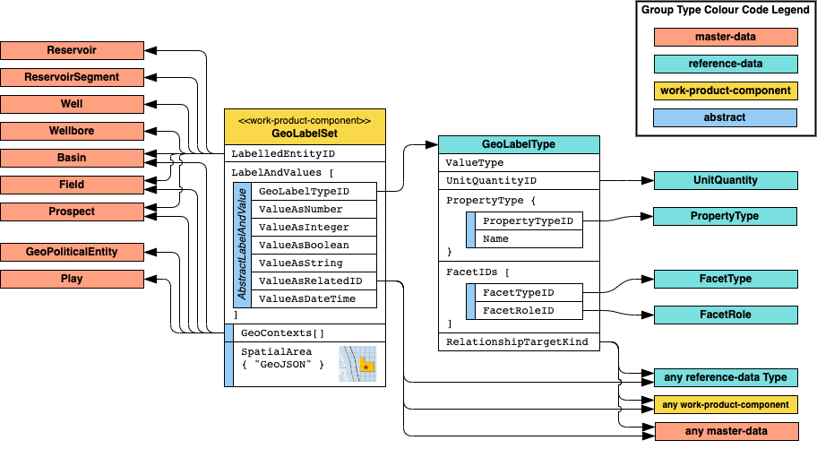
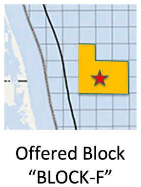
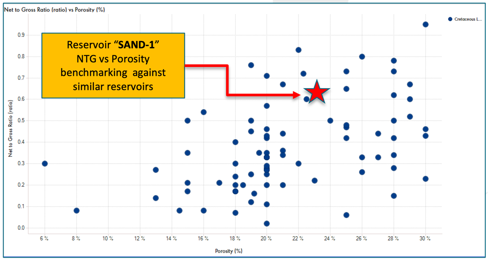
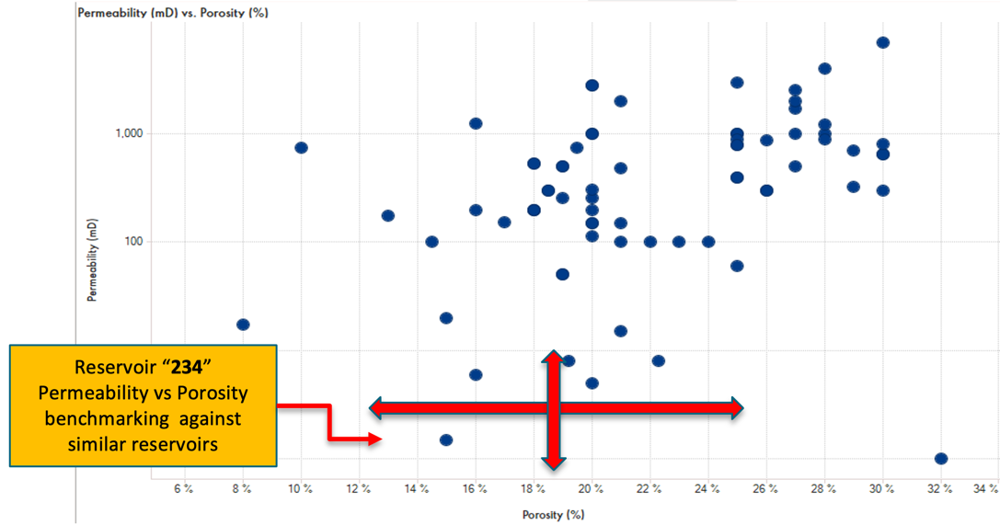
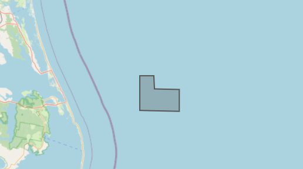

<a name="TOC"></a>

**Table of Contents**

[[_TOC_]]

# GeoLabelSet Usage

The following diagram shows the main relationships specific to
[GeoLabelSet](../../../../E-R/work-product-component/GeoLabelSet.1.1.0.md):

|  |
|:-------------------------------------------:|
|    Entity Relationships for GeoLabelSet     |

* A GeoLabelSet 'labels' master-data entities of type Basin, Field, Prospect, Reservoir, ReservoirSegment, Well,
  Wellbore via `LabelledEntityID`.
* A GeoLabelSet aggregates labels by means of the embedded array of
  [AbstractLabelAndValue](../../../../E-R/abstract/AbstractLabelAndValue.1.0.0.md).
  * An individual label is identified by the `GeoLabelTypeID`.
  * Given the metadata in the associated
    [GeoLabelType `data.ValueType`](../../../../E-R/reference-data/GeoLabelType.1.0.1.md), one for the value types is populated:
    * `ValueAsNumber` — a floating point number
    * `ValueAsInteger`
    * `ValueAsBoolean` — true or false
    * `ValueAsString` - text
    * `ValueAsRelatedID` — a reference to a related record, the expected type is given by the GeoLabelType `data.RelationshipTargetKind`
    * `ValueAsDateTime` — a date or date-time string
* A GeoLabelSet can be associated to geographical or geopolitical contexts as all work-product-component types via
  the `data.GeoContexts[]`.
* A GeoLabelSet can contain its own SpatialArea (as all work-product-component types) and participate in geographic
  search, provided the `data.SpatialArea.Wgs84Coordinates` is populated with a GeoJSON structure.

The UnitQuantity (for numerical values) is indicated in the GeoLabelType `data.UnitQuantityID`. The actual unit for the
value (in this case `ValueAsNumber`) is declared in the `meta[]` block. (The GeoLabelType
property `data.UnitOfMeasureID` does **_not_** apply as it would constrain the unit for all GeoLabelSet instances.)

[Back to TOC](#TOC)

# 1. Use Case License Round

There is an upcoming offshore license round in a new exploration frontier area; the national regulatory agency has made
a “data package” available with summarized/average reservoir properties for several reservoirs in the area. The data
entitlement and obligations allow this data to be loaded to the interested parties’ databases for an unlimited period.

Most of the reservoir properties have been estimated using 2D seismic studies and basin modelling. Limited calibration
has taken place against data from wells in adjacent blocks.

|  |  |
|:---------------------------------------------------------:|:---------------------------------------------------------------------:|
|                       Location Map                        |                          Benchmarking Graph                           |

A company “A”, looking for new exploration opportunities, is interested in a particular offered lease with code name
“BLOK-F”, which is covered by a reservoir “SAND-1”, represented by sandstones of Late Cretaceous age and “Heavy Oil”
prone.

The Data Management team will ingest this data, as summarized reservoir properties using the GeoLabels schema and
related Facets, to the local OSDU environment.

The company intends to evaluate this opportunity by carrying out a “reservoir quality” benchmarking exercise against
similar proprietary reservoir analogs, followed by a “hydrocarbon in place volumes calculation”. If the outcome is
positive, the company may consider bidding for the offered lease.

[Back to TOC](#TOC)

## 1.1. GeoLabelSet as Table

Below a human-readable version of the GeoLabelSet, the content shows a variety of different value types like numbers -

some with unit context, Booleans, strings - ome of them references to reference value lists. The table is translated
into an [OSDU GeoLabelSet record](./records/GeoLabelSet-BLOK-F-SAND-1.json).

| Reservoir Property                    | Value                | UoM  |
|---------------------------------------|----------------------|------|
| ReservoirSegment                      | BLOK-F-SAND-1        |      |
| Location                              | Offshore             |      |
| Area                                  | 60.97                | km2  |
| ---                                   | ---                  | ---  |
| GeologicalAge                         | Cretaceous Late      |      |
| GeologicalDuration                    | 65.3                 |      |
| ReservoirTectonic Setting             | Foreland thrust belt |      |
| SealDepositionalTectonicSetting       | Passive margin       |      |
| SourceRockDepositionalTectonicSetting | Passive margin       |      |
| TrappingMechanism                     | Stratigraphic        |      |
| ReservoirTectonic Stress Regime       | Extension            |      |
| ---                                   | ---                  | ---  |
| DominantLithologyID                   | sandstone            |      |
| DominantSealLithologyID               | salt                 |      |
| DominantSourceRockLithologyID         | coal                 |      |
| ---                                   | ---                  | ---  |
| DominantEnvironmentOfDeposition       | Clastic deep marine  |      |
| SecondaryEnvironmentOfDeposition      | Lower Slope          |      |
| TertiaryEnvironmentOfDeposition       | Confined Channel     |      |
| ---                                   | ---                  | ---  |
| HCType                                | Oil                  |      |
| HCSubType                             | Oil.Heavy            |      |
| ---                                   | ---                  | ---  |
| UnitTopDepth                          | 1500                 | m    |
| AverageGrossThickness                 | 365.76               | m    |
| TotalHCColumnHeight                   | 150                  | m    |
| GasColumnHeight                       | 100                  | m    |
| OilColumnHeight                       | 50                   | m    |
| NetToGrossRatio                       | 0.67                 | Euc  |
| ---                                   | ---                  | ---  |
| Temperature Max                       | 160                  | degC |
| AverageMaturityOil                    | 55.48                | %    |
| AveragePermeability                   | 0.6                  | mD   |
| AveragePorosity                       | 25                   | %    |
| IsFractured                           | TRUE                 |      |
| IsOverpressured                       | FALSE                |      |
| OilAPI                                | 9                    | API  |
| PressureOriginal                      | 10800                | psi  |
| AverageInitialWaterSaturation         | 40                   | %    |
| ---                                   | ---                  | ---  |
| Hydrogen Sulphide                     | 8                    | %    |
| Methane                               | 0.01                 | %    |
| Nitrogen                              | 5                    | %    |
| Carbon Dioxide                        | 13.4                 | %    |

[Back to TOC](#TOC)

## 1.2 Example Record

The table above is translated into an OSDU GeoLabelSet record
[GeoLabelSet-BLOK-F-SAND-1.json](./records/GeoLabelSet-BLOK-F-SAND-1.json). It is recommended, though, to study the
principles as explained in section [How GeoLabelSets Work](#3-how-geolabelsets-work), which offers focussed
explanations.

[Back to TOC](#TOC)

# 2. GeoLabelSet with Uncertainty

Continuing from the previous use case but using a shallower reservoir with code name “234”, which has been intersected
by multiple wells in adjacent blocks.

The knowledge about this reservoir is better and is based on in-house and 3rd party studies. The reservoir’s vertical
and horizontal heterogeneity is mainly driven by a different depositional environment setting. Reservoir permeability
and porosity vary significantly depending on the dominant facies.

|  |  |
|:---------------------------------------------------------:|:--------------------------------------------------------------------------------:|
|                       Location Map                        |                                Benchmarking Graph                                |

The reservoir properties, provided by the national agency, have been extended with company “A” own analogs, covering a
range of possible values (low/mid/high cases) and providing a better opportunity evaluation and de-risking.

The Data Management team will ingest this data, as summarized reservoir properties using the GeoLabels schema and
related Facets, to the local OSDU environment. In this case the “statistics” facets (minimum, average and maximum) will
be used.

As in the previous example, the company intends to evaluate this opportunity by carrying out a “reservoir quality”
benchmarking exercise against similar proprietary reservoir analogs, followed by a “hydrocarbon in place volumes
calculation”. The output of the in-place-estimated-volumes will be represented as a P10/P50/P90 estimate.

[Back to TOC](#TOC)

## 2.1 GeoLabelSet with Uncertainty as Table

| Reservoir Property                 | Value               | UoM    |
|------------------------------------|---------------------|--------|
| ReservoirSegment                   | BLOK-F-234          |        |
| Area                               | 100                 | km2    |
|                                    |                     |        |
| Geological Structure Type          | Anticline           |        |
| Drive Mechanism                    | Gas Cap             |        |
| Depositional Environment           | Clastic deep marine |        |
|                                    |                     |        |
| HCType                             | Oil                 |        |
|                                    |                     |        |
| Initial Hydrocarbon Column (oil)   | 50                  | m      |
| Net pay to Gross pay ratio         | 0.67                | Euc    |
| Gross sand thickness               | 38                  | ft     |
| **Average Net pay thickness**      | **25**              | **ft** |
| **Net pay (low case)**             | **20**              | **ft** |
| **Net pay (high case)**            | **30**              | **ft** |
| Initial Gas/Oil Ratio              | 60                  | %      |
| Reservoir Average Depth            | 1500                | ft     |
|                                    |                     |        |
| **Permeability**                   | **0.6**             | **mD** |
| **Permeability (low case)**        | **0.1**             | **mD** |
| **Permeability (high case)**       | **1.5**             | **mD** |
| **Porosity**                       | **25**              | **%**  |
| **Porosity (low case)**            | **12**              | **%**  |
| **Porosity (high case)**           | **30**              | **%**  |
| Oil Gravity API                    | 9                   | API    |
| Initial Hydrocarbon Saturation oil | 25                  | %      |
| Reservoir Average Temperature      | 200                 | degF   |
| In-situ oil viscosity              | 0.02                | cP     |
| Bubble Point                       | 1900                | psi    |
| Reservoir Initial Average Pressure | 8000                | psi    |
| Current Reservoir Pressure         | 6000                | psi    |

[Back to TOC](#TOC)

## 2.2 Example Record

The table above is translated into an OSDU GeoLabelSet record
[GeoLabelSet-BLOK-F-234-2.json](./records/GeoLabelSet-BLOK-F-234-2.json). It is recommended, though, to study the
principles as explained in section [How GeoLabelSets Work](#3-how-geolabelsets-work) below, which offers focussed
explanations.

Please note that 7 of the geo-labels used are extensions to the OSDU delivered reference values. As a demonstration, the
load manifest of the extended GeoLabelType elements are
offered [here in the records sub-folder](./records/GeoLabelType.Extensions.json).

## 2.3 Uncertainty Labels

The example record contains uncertainty ranges for Net Pay, Permeability and Porosity. The Permeability example is
demonstrated below.

### 2.3.1 Permeability Average

<details>
<summary markdown="span">GeoLabelSet Label Value for "Permeability" LabelAndValues[13]</summary>

<OsduImportJSON>[Open the full manifest.](./records/GeoLabelSet-BLOK-F-234-2.json#only.data.LabelAndValues[13])</OsduImportJSON>

```json
{
  "data": {
    "LabelAndValues": [
      {
        "LabelTypeID": "{{NAMESPACE}}:reference-data--GeoLabelType:Permeability.Average:",
        "ValueAsNumber": 0.6
      }
    ]
  }
}
```
</details>

### 2.3.2 Permeability (Low Case)

<details>
<summary markdown="span">GeoLabelSet Label Value for "Permeability (low case) LabelAndValues[14]"</summary>

<OsduImportJSON>[Open the full manifest.](./records/GeoLabelSet-BLOK-F-234-2.json#only.data.LabelAndValues[14])</OsduImportJSON>

```json
{
  "data": {
    "LabelAndValues": [
      {
        "LabelTypeID": "{{NAMESPACE}}:reference-data--GeoLabelType:Permeability.Minimum:",
        "ValueAsNumber": 0.1
      }
    ]
  }
}
```
</details>

### 2.3.3 Permeability (High Case)

<details>
<summary markdown="span">GeoLabelSet Label Value for "Permeability (high case) LabelAndValues[15]"</summary>

<OsduImportJSON>[Open the full manifest.](./records/GeoLabelSet-BLOK-F-234-2.json#only.data.LabelAndValues[15])</OsduImportJSON>

```json
{
  "data": {
    "LabelAndValues": [
      {
        "LabelTypeID": "{{NAMESPACE}}:reference-data--GeoLabelType:Permeability.Maximum:",
        "ValueAsNumber": 1.5
      }
    ]
  }
}
```
</details>

### 2.3.4 Permeability Unit Context

<details>
<summary markdown="span">GeoLabelSet Permeability Frame of Reference <code>mD</code> </summary>

<OsduImportJSON>[Open the full manifest.](./records/GeoLabelSet-BLOK-F-234-2.json#only.meta[4])</OsduImportJSON>

```json
{
  "meta": [
    {
      "kind": "Unit",
      "name": "mD",
      "persistableReference": "{\"abcd\":{\"a\":0.0,\"b\":0.000000000000001,\"c\":1.01325,\"d\":0.0},\"symbol\":\"mD\",\"baseMeasurement\":{\"ancestry\":\"L2\",\"type\":\"UM\"},\"type\":\"UAD\"}",
      "unitOfMeasureID": "osdu:reference-data--UnitOfMeasure:mD:",
      "propertyNames": [
        "LabelAndValues[13].ValueAsNumber",
        "LabelAndValues[14].ValueAsNumber",
        "LabelAndValues[15].ValueAsNumber"
      ]
    }
  ]
}
```
</details>

[Back to TOC](#TOC)

# 3. How GeoLabelSets Work

The OSDU GeoLabelSets [record BLOK-F-SAND-1](./records/GeoLabelSet-BLOK-F-SAND-1.json) and
[BLOK-F-234-2](./records/GeoLabelSet-BLOK-F-234-2.json) don't easily explain all the features and
interplay between [work-product-component--GeoLabelSet](../../../../E-R/work-product-component/GeoLabelSet.1.1.0.md)
and [reference-data--GeoLabelType](../../../../E-R/reference-data/GeoLabelType.1.0.1.md). The following sections
highlight some of the important details.

### 3.1. Simple, Numeric Value Label

#### 3.1.1 GeoLabelType Metadata

The label metadata are defined by the [GeoLabelType](../../../../E-R/reference-data/GeoLabelType.1.0.1.md), in this case
the "Area":

<details>
<summary markdown="span">GeoLabelType manifest record for Label "Area" <code>data</code> block</summary>

<OsduImportJSON>[Open the full manifest.](../../../../ReferenceValues/Manifests/reference-data/OPEN/GeoLabelType.1.json#only.ReferenceData[0].data)</OsduImportJSON>

```json
{
  "ReferenceData": {
    "data": {
      "Name": "Area",
      "NameAlias": [
        {
          "AliasName": "Area",
          "AliasNameTypeID": "{{NAMESPACE}}:reference-data--AliasNameType:DisplayName:"
        }
      ],
      "Description": "Represents the 2D area delineated by the lateral extent of the reservoir or  stratigraphic interval containing fluids of interest.",
      "Code": "Area",
      "ValueType": "number",
      "PropertyType": {
        "PropertyTypeID": "{{NAMESPACE}}:reference-data--PropertyType:9202511e-5250-4716-b1d5-6fc13307b59d:",
        "Name": "area"
      },
      "UnitQuantityID": "{{NAMESPACE}}:reference-data--UnitQuantity:area:",
      "Source": "Workbook ReferenceValues/Authoring/GeoLabelType.1.xlsx; commit SHA 56f7c736.",
      "CommitDate": "2024-02-09T16:51:15+00:00"
    }
  }
}
```

</details>

Notice the following in the expandable section above:

1. `ValueType` is declared as `number`, which means the GeoLabelSet's `LabelAndValues` element will have
   the `ValueAsNumber` populated.
2. `PropertyType` refers to an Energistics PWLS 3 property type definition standing for area.
3. `UnitQuantityID` declares that the unit of measure must belong to the area dimension (L2). Normalized values will be
   returned as `"m2"` as defined in UnitQuantity's `data.BaseForConversion`.

#### 3.1.2 GeoLabelSet with Numeric Value Label

<details>
<summary markdown="span">GeoLabelSet with Label "Area"</summary>

<OsduImportJSON>[Open the full example record.](records/GeoLabelSet-BLOK-F-SAND-1.json#only.data.LabelAndValues[0])</OsduImportJSON>

```json
{
  "data": {
    "LabelAndValues": [
      {
        "LabelTypeID": "{{NAMESPACE}}:reference-data--GeoLabelType:Area:",
        "ValueAsNumber": 60.97
      }
    ]
  }
}
```

</details>

#### 3.1.3 Unit Context for a Numeric Value Label Value

<details>
<summary markdown="span">GeoLabelSet with Label "Area", Unit specification km2</summary>

<OsduImportJSON>[Open the full example record.](records/GeoLabelSet-BLOK-F-SAND-1.json#only.meta[0])</OsduImportJSON>

```json
{
  "meta": [
    {
      "kind": "Unit",
      "name": "km2",
      "persistableReference": "{\"abcd\":{\"a\":0.0,\"b\":1000000.0,\"c\":1.0,\"d\":0.0},\"symbol\":\"km2\",\"baseMeasurement\":{\"ancestry\":\"L2\",\"type\":\"UM\"},\"type\":\"UAD\"}",
      "unitOfMeasureID": "osdu:reference-data--UnitOfMeasure:km2:",
      "propertyNames": [
        "LabelAndValues[0].ValueAsNumber"
      ]
    }
  ]
}
```

</details>

#### 3.1.4 Numeric Value Label without Unit Context

There are also exceptions, where the numerical values are not subject to a unit context or normalization. In such cases
the `PropertyType` object can be absent and the `UnitQuantityID` can be set
to `"partition-id:reference-data--UnitQuantity:none:"`.

<details>
<summary markdown="span">GeoLabelType manifest record for Label "GeologicalDuration" <code>data</code> block</summary>

<OsduImportJSON>[Open the full manifest.](../../../../ReferenceValues/Manifests/reference-data/OPEN/GeoLabelType.1.json#only.ReferenceData[53].data)</OsduImportJSON>

```json
{
  "ReferenceData": {
    "data": {
      "Name": "Geological Duration",
      "NameAlias": [
        {
          "AliasName": "GeologicalDuration",
          "AliasNameTypeID": "{{NAMESPACE}}:reference-data--AliasNameType:DisplayName:"
        }
      ],
      "Description": "The amount of geologic time (in millions of years) that has passed in any given event for a measured interval.",
      "Code": "GeologicalDuration",
      "ValueType": "number",
      "UnitQuantityID": "{{NAMESPACE}}:reference-data--UnitQuantity:none:",
      "Source": "Workbook ReferenceValues/Authoring/GeoLabelType.1.xlsx; commit SHA 56f7c736.",
      "CommitDate": "2024-02-09T16:51:15+00:00"
    }
  }
}
```

</details>

In this case the Description defines the unit as fixed to millions of years (Ma); the value will **not** be normalized
to the `BaseForConversion` unit for Time `"s"`.

<details>
<summary markdown="span">GeoLabelSet with Label "GeologicalDuration"</summary>

<OsduImportJSON>[Open the full example record.](records/GeoLabelSet-BLOK-F-SAND-1.json#only.data.LabelAndValues[3])</OsduImportJSON>

```json
{
  "data": {
    "LabelAndValues": [
      {
        "LabelTypeID": "{{NAMESPACE}}:reference-data--GeoLabelType:GeologicalDuration:",
        "ValueAsNumber": 65.3
      }
    ]
  }
}
```

</details>

[Back to TOC](#TOC)

### 3.2. Faceted Numeric Value Label

#### 3.2.1 GeoLabelType Metadata

<details>
<summary markdown="span">GeoLabelType manifest record for Label "Water.Saturation.Initial.Average" <code>data</code> block</summary>

<OsduImportJSON>[Open the full manifest.](../../../../ReferenceValues/Manifests/reference-data/OPEN/GeoLabelType.1.json#only.ReferenceData[11].data)</OsduImportJSON>

```json
{
  "ReferenceData": {
    "data": {
      "Name": "Water Saturation Initial Average",
      "NameAlias": [
        {
          "AliasName": "AverageInitialWaterSaturation",
          "AliasNameTypeID": "{{NAMESPACE}}:reference-data--AliasNameType:DisplayName:"
        }
      ],
      "Description": "The initial water saturation (SWi) is the fraction of formation water in an undisturbed reservoir with no prior production from any earlier well. The saturation is known as the total water saturation if the pore space is the total porosity, but is known as effective water saturation if the pore space is the effective porosity.",
      "Code": "Water.Saturation.Initial.Average",
      "ValueType": "number",
      "FacetIDs": [
        {
          "FacetTypeID": "{{NAMESPACE}}:reference-data--FacetType:what:",
          "FacetRoleID": "{{NAMESPACE}}:reference-data--FacetRole:Water:"
        },
        {
          "FacetTypeID": "{{NAMESPACE}}:reference-data--FacetType:qualifier:",
          "FacetRoleID": "{{NAMESPACE}}:reference-data--FacetRole:Initial:"
        },
        {
          "FacetTypeID": "{{NAMESPACE}}:reference-data--FacetType:statistics:",
          "FacetRoleID": "{{NAMESPACE}}:reference-data--FacetRole:Average:"
        }
      ],
      "PropertyType": {
        "PropertyTypeID": "{{NAMESPACE}}:reference-data--PropertyType:cfe9293f-d5a9-486d-815a-a957cace90b6:",
        "Name": "saturation"
      },
      "UnitQuantityID": "{{NAMESPACE}}:reference-data--UnitQuantity:dimensionless:",
      "Source": "Workbook ReferenceValues/Authoring/GeoLabelType.1.xlsx; commit SHA 56f7c736.",
      "CommitDate": "2024-02-09T16:51:15+00:00"
    }
  }
}
```

</details>

Notice the following in the expandable section above:

1. `ValueType` is declared as `number`, which means the GeoLabelSet's `LabelAndValues` element will have
   the `ValueAsNumber` populated.
2. `PropertyType` refers to an Energistics PWLS 3 property type definition standing for saturation.
3. `UnitQuantityID` declares that the unit of measure must belong to dimensionless (1). Normalized values will be
   returned as `Euc` as defined in UnitQuantity's `data.BaseForConversion`.
4. The saturation measurement is further scoped by the `FacetIDs` pairs of FacetType and FacetRole values:
    1. FacetType `what` pairs with FacetRole `Water` defining the type of material, for which saturation is estimated.
    2. FacetType `qualifier` pairs with FacetRole `Initial` expressing that the label captures the initial water
       saturation (and not, e.g., `Current`).
    3. FacetType `statistics` pairs with FacetRole `Average` indicating that the value is averaged (and not,
       e.g., `Maximum`)

#### 3.2.2 GeoLabelSet with Faceted Numeric Value

<details>
<summary markdown="span">GeoLabelSet with Label "Water.Saturation.Initial.Average"</summary>

<OsduImportJSON>[Open the full example record.](records/GeoLabelSet-BLOK-F-SAND-1.json#only.data.LabelAndValues[31])</OsduImportJSON>

```json
{
  "data": {
    "LabelAndValues": [
      {
        "LabelTypeID": "{{NAMESPACE}}:reference-data--GeoLabelType:Water.Saturation.Initial.Average:",
        "ValueAsNumber": 40
      }
    ]
  }
}
```

</details>

#### 3.2.3 Unit Context for a Faceted Numeric Value Label Value

<details>
<summary markdown="span">GeoLabelSet with Label "Water.Saturation.Initial.Average", Unit specification %</summary>

<OsduImportJSON>[Open the full example record.](records/GeoLabelSet-BLOK-F-SAND-1.json#only.meta[5])</OsduImportJSON>

```json
{
  "meta": [
    {
      "kind": "Unit",
      "name": "%",
      "persistableReference": "{\"abcd\":{\"a\":0.0,\"b\":0.01,\"c\":1.0,\"d\":0.0},\"symbol\":\"%\",\"baseMeasurement\":{\"ancestry\":\"1\",\"type\":\"UM\"},\"type\":\"UAD\"}",
      "unitOfMeasureID": "osdu:reference-data--UnitOfMeasure:%:",
      "propertyNames": [
        "LabelAndValues[24].ValueAsNumber",
        "LabelAndValues[29].ValueAsNumber",
        "LabelAndValues[30].ValueAsNumber",
        "LabelAndValues[31].ValueAsNumber",
        "LabelAndValues[32].ValueAsNumber",
        "LabelAndValues[33].ValueAsNumber"
      ]
    }
  ]
}
```

</details>

Notice that the unit definition for % is shared with 6 other LabelAndValues elements. Element 31 is
"Water.Saturation.Initial.Average".

[Back to TOC](#TOC)

### 3.3. Reference Value Controlled Label

#### 3.3.1 GeoLabelType Metadata

This GeoLabel carries a relationship to another record, in most cases record id references to reference-data or
reference value lists. The GeoLabelType sets the expectations and constraints.

<details>
<summary markdown="span">GeoLabelType manifest record for Label "GeologicalAgeID" <code>data</code> block</summary>

<OsduImportJSON>[Open the full manifest.](../../../../ReferenceValues/Manifests/reference-data/OPEN/GeoLabelType.1.json#only.ReferenceData[59].data)</OsduImportJSON>

```json
{
  "ReferenceData": {
    "data": {
      "Name": "Geological Age ID",
      "NameAlias": [
        {
          "AliasName": "GeologicalAgeID",
          "AliasNameTypeID": "{{NAMESPACE}}:reference-data--AliasNameType:DisplayName:"
        }
      ],
      "Description": "Refers to periods of marked change in the processes and events in the entire history of the earth during which a system of rocks formed. Points to specific units in the adopted geological time scale (GTS); for example, the  International Chronostratigraphic Chart.",
      "Code": "GeologicalAgeID",
      "ValueType": "string",
      "RelationshipTargetKind": "osdu:wks:reference-data--ChronoStratigraphy:",
      "Source": "Workbook ReferenceValues/Authoring/GeoLabelType.1.xlsx; commit SHA 56f7c736.",
      "CommitDate": "2024-02-09T16:51:15+00:00"
    }
  }
}
```

</details>
Notice the following in the expandable section above:

1. `ValueType` is declared as `string`, and
2. `RelationshipTargetKind` is declared, meaning that the GeoLabelSet's `LabelAndValues` element will have
   the `ValueAsRelatedID` populated.
3. `ValueAsRelatedID` must refer to a record of `kind` equal to `osdu:wks:reference-data--ChronoStratigraphy:` , where
   the schema version is not constrained

#### 3.3.2 GeoLabelSet with Reference Value Controlled Label Value

<details>
<summary markdown="span">GeoLabelSet with Label "GeologicalAgeID"</summary>

<OsduImportJSON>[Open the full example record.](records/GeoLabelSet-BLOK-F-SAND-1.json#only.data.LabelAndValues[2])</OsduImportJSON>

```json
{
  "data": {
    "LabelAndValues": [
      {
        "LabelTypeID": "{{NAMESPACE}}:reference-data--GeoLabelType:GeologicalAgeID:",
        "ValueAsRelatedID": "{{NAMESPACE}}:reference-date-Chronostratigraphy:Phanerozoic.Mesozoic.Cretaceous.LowerCretaceous:"
      }
    ]
  }
}
```

</details>

[Back to TOC](#TOC)

### 3.4. Simple String Value Label

#### 3.4.1 GeoLabelType Metadata

Sometimes GeoLabels can carry free text - in this case a human-friendly name for the `GeologicalAgeID` above

<details>
<summary markdown="span">GeoLabelType manifest record for Label "GeologicalAgeName" <code>data</code> block</summary>

<OsduImportJSON>[Open the full manifest.](../../../../ReferenceValues/Manifests/reference-data/OPEN/GeoLabelType.1.json#only.ReferenceData[58].data)</OsduImportJSON>

```json
{
  "ReferenceData": {
    "data": {
      "Name": "Geological Age Name",
      "NameAlias": [
        {
          "AliasName": "GeologicalAgeName",
          "AliasNameTypeID": "{{NAMESPACE}}:reference-data--AliasNameType:DisplayName:"
        }
      ],
      "Description": "Human-friendly label referring to periods of marked change in the processes and events in the entire history of the earth during which a system of rocks formed. Points to specific units in the adopted geological time scale (GTS); for example, the  International Chronostratigraphic Chart. Operators may set up a DataQualityRule to demand that the GeologicAgeName value must match a reference-data--ChronoStratigraphy record's Name property.",
      "Code": "GeologicalAgeName",
      "ValueType": "string",
      "Source": "Workbook ReferenceValues/Authoring/GeoLabelType.1.xlsx; commit SHA 56f7c736.",
      "CommitDate": "2024-02-09T16:51:15+00:00"
    }
  }
}
```

</details>

Notice the following in the expandable section above:

* `ValueType` is declared as `string`, no `RelationshipTargetKind` constraint is set. This means that `ValueAsString`
  is populated in the GeoLabelSet's `LabelAndValues` element.

#### 3.4.2 GeoLabelSet with String Label Value

<details>
<summary markdown="span">GeoLabelSet with Label "GeologicalAgeName"</summary>

<OsduImportJSON>[Open the full example record.](records/GeoLabelSet-BLOK-F-SAND-1.json#only.data.LabelAndValues[1])</OsduImportJSON>

```json
{
  "data": {
    "LabelAndValues": [
      {
        "LabelTypeID": "{{NAMESPACE}}:reference-data--GeoLabelType:GeologicalAgeName:",
        "ValueAsString": "Lower Cretaceous"
      }
    ]
  }
}
```

</details>

[Back to TOC](#TOC)

### 3.5. Boolean Value Label

#### 3.5.1 GeoLabelType Metadata

<details>
<summary markdown="span">GeoLabelType manifest record for Label "IsFractured" <code>data</code> block</summary>

<OsduImportJSON>[Open the full manifest.](../../../../ReferenceValues/Manifests/reference-data/OPEN/GeoLabelType.1.json#only.ReferenceData[68].data)</OsduImportJSON>

```json
{
  "ReferenceData": {
    "data": {
      "Name": "Is Fractured",
      "NameAlias": [
        {
          "AliasName": "IsFractured",
          "AliasNameTypeID": "{{NAMESPACE}}:reference-data--AliasNameType:DisplayName:"
        }
      ],
      "Description": "An overall TRUE/FALSE indication of whether the reservoir is considered to be fractured.",
      "Code": "IsFractured",
      "ValueType": "boolean",
      "Source": "Workbook ReferenceValues/Authoring/GeoLabelType.1.xlsx; commit SHA 56f7c736.",
      "CommitDate": "2024-02-09T16:51:15+00:00"
    }
  }
}
```

</details>

Notice the following in the expandable section above:

* `ValueType` is declared as `boolean`, which means the `ValueAsBoolean` is populated in the
  GeoLabelSet's `LabelAndValues` element.

#### 3.5.2 GeoLabelSet with Boolean Label Value

<details>
<summary markdown="span">GeoLabelSet with Label "IsFractured"</summary>

<OsduImportJSON>[Open the full example record.](records/GeoLabelSet-BLOK-F-SAND-1.json#only.data.LabelAndValues[27])</OsduImportJSON>

```json
{
  "data": {
    "LabelAndValues": [
      {
        "LabelTypeID": "{{NAMESPACE}}:reference-data--GeoLabelType:IsFractured:",
        "ValueAsBoolean": true
      }
    ]
  }
}
```

</details>

[Back to TOC](#TOC)

# 4. GeoLabelType Governance

It is desirable to aim for interoperability such that GeoLabelSets can be shared across platform instances. Therefore,
the governance is set to [OPEN](../../../../Guides/Chapters/02-GroupType.md#22-reference-data), i.e., extensible. The
record example [GeoLabelSet-BLOK-F-234-2.json](./records/GeoLabelSet-BLOK-F-234-2.json) refers to 7 reference value
records, which are not shipped by OSDU. These are found in the
[records/GeoLabelType.Extensions.json](./records/GeoLabelType.Extensions.json).

It is good practice to share the reference values with OSDU by requesting an augmentation of the
[GeoLabelType reference value definition workbook](../../../../ReferenceValues/Authoring/GeoLabelType.1.xlsx).

[Back to TOC](#TOC)

## 4.1 Conventions for Code/Name for Facets

Quite a number of GeoLabelType reference values use scoping by facets, i.e. by pairs
of [FacetType](../../../../E-R/reference-data/FacetType.1.0.0.md)
and [FacetRole](../../../../E-R/reference-data/FacetRole.1.1.0.md). In such cases `data.Code`, consequently record `id`,
and `data.Name` are composed by convention (in sequence of priority):

1. `data.FacetIDs[].FacetTypeID` value `what` (Example: "Rock")
2. `data.PropertyType.Name` (Example: "Thickness")<br>De-normalized from the record Name in `data.PropertyType.PropertyTypeID`, transformed into
   a PascalCased string, e.g., if `data.PropertyType.Name` is "formation volume factor" the PascalCase version becomes
   "FormationVolumeFactor".
3. `data.FacetIDs[].FacetTypeID` value `qualifier` (Example: "Source")
4. `data.FacetIDs[].FacetTypeID` value `direction` (Example: "TrueStratigraphic")
5. `data.FacetIDs[].FacetTypeID` value `statistics` (not used/present)
6. `data.FacetIDs[].FacetTypeID` value `netgross` (Example: "Net")
7. `data.FacetIDs[].FacetTypeID` value `conditions` (not used/present)

This results in `"Code": "Rock.Thickness.Source.TrueStratigraphic.Net"`.

[Back to TOC](#TOC)

## 4.2 Code/Name Conventions for GeoLabelType without Facets

Some GeoLabelTypes do not have Facets, typically references to other reference-data types. In this case the Code should
follow the OSDU standard CamelCase. An example for this is the GeoLabelType with code `DominantLithologyID` declaring
expected values as reference to `osdu:wks:reference-data--LithologyType:` (semantic version number is unspecified).

[Back to TOC](#TOC)

## 4.3 Common Industry Names

The [convention above](#41-conventions-for-codename-for-facets) may introduce unfamiliar 'terms'. To support general
user-friendliness it is recommended to add alternative names in `data.AliasName[]` elements — multiple alternative names
can be specified. Searching for commonly used names or terms should resolve to the relevant GeoLabelType record.

[Back to TOC](#TOC)


# 5. Geographical Placement

To enable discovery by spatial search it is necessary to associate some kind of geographic location. This can be done
via the `data.SpatialArea` property. In the worked examples only the WGS 84 coordinates are populated, but in principle
also original, e.g. projected map coordinates, can be used in `data.AsIngestedCoordinates`.

|  |
|:-----------------------------------------------------------:|
|                  A map view of the outline                  |

<details>
<summary markdown="span">GeoLabelSet Geographic Outline <code>data.SpatialArea</code> as GeoJSON.</summary>

<OsduImportJSON>[Open the full manifest.](./records/GeoLabelSet-BLOK-F-234-2.json#only.data.SpatialArea)</OsduImportJSON>

```json
{
  "data": {
    "SpatialArea": {
      "Wgs84Coordinates": {
        "type": "FeatureCollection",
        "features": [
          {
            "type": "Feature",
            "properties": {},
            "geometry": {
              "coordinates": [
                [
                  [
                    -75.03249772035784,
                    36.06610913491761
                  ],
                  [
                    -75.03249772035784,
                    35.84984299286968
                  ],
                  [
                    -74.72846795239404,
                    35.844242050990516
                  ],
                  [
                    -74.72846795239404,
                    35.980419282101565
                  ],
                  [
                    -74.91963818528026,
                    35.98414686537339
                  ],
                  [
                    -74.92424469691656,
                    36.06610913491761
                  ],
                  [
                    -75.03249772035784,
                    36.06610913491761
                  ]
                ]
              ],
              "type": "Polygon"
            }
          }
        ]
      },
      "SpatialParameterTypeID": "namespace:reference-data--SpatialParameterType:Outline:",
      "SpatialGeometryTypeID": "namespace:reference-data--SpatialGeometryType:Polygon:"
    }
  }
}
```

</details>