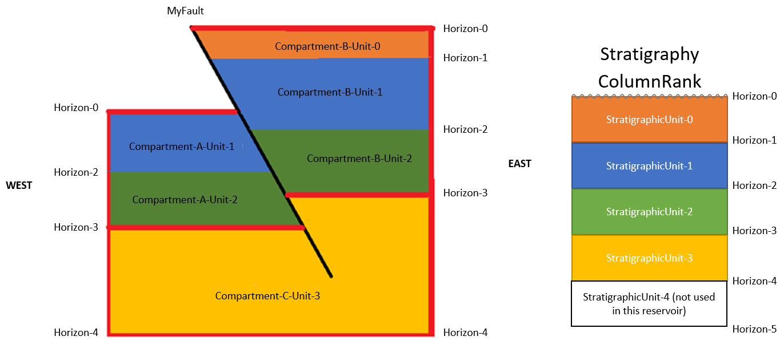
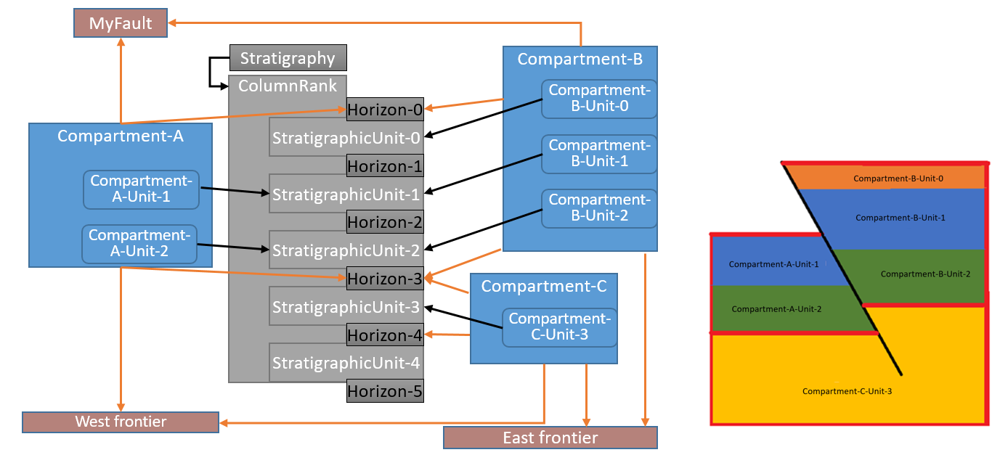
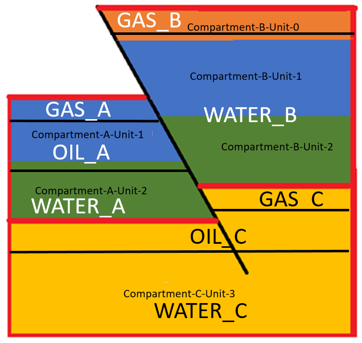
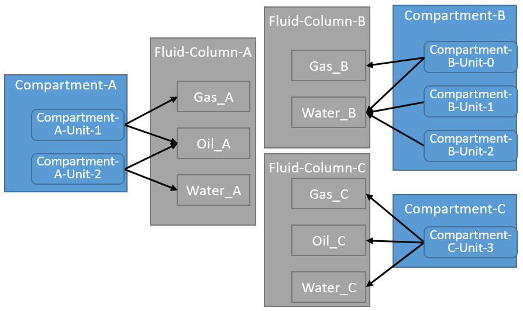

[[_TOC_]]

# Reservoir Segments by Compartments

This example set represents the reservoir via ReservoirSegments linked to ReservoirCompartmentInterpretation from an
earth model (RESQML).

## Rock Matrix

This model is partially split by a sealing fault and an impermeable interface between RockVolumeFeature "Yellow" and "Green".

### Stratigraphic Column

The StratigraphicColumn is constructed as follows:

* **Stratigraphy** &rarr; StratigraphicColumn with a single rank:
  * data.StratigraphicColumnRankInterpretationSet[0] &rarr; **ColumnRank** StratigraphicColumnRankInterpretation 

This rank holds the list of unit interpretations:

* **ColumnRank** &rarr; StratigraphicColumnRankInterpretation
  * data.StratigraphicUnitInterpretationSet[0] &rarr; **StratigraphicUnit-0** &rarr; StratigraphicUnitInterpretation &rarr; {Local}RockVolumeFeature "Orange"
  * data.StratigraphicUnitInterpretationSet[1] &rarr; **StratigraphicUnit-1** &rarr; StratigraphicUnitInterpretation &rarr; {Local}RockVolumeFeature "Blue"
  * data.StratigraphicUnitInterpretationSet[2] &rarr; **StratigraphicUnit-2** &rarr; StratigraphicUnitInterpretation &rarr; {Local}RockVolumeFeature "Green"
  * data.StratigraphicUnitInterpretationSet[3] &rarr; **StratigraphicUnit-3** &rarr; StratigraphicUnitInterpretation &rarr; {Local}RockVolumeFeature "Yellow"
 
The Horizon sequence derives from the StratigraphicUnitInterpretation sequence:

* **Horizon-0** &rarr; HorizonInterpretation &larr; StratigraphicUnitInterpretation data.ColumnStratigraphicHorizonTopID
  * **StratigraphicUnit-0** &rarr; StratigraphicUnitInterpretation &rarr; {Local}RockVolumeFeature "Orange"
* **Horizon-1** &rarr; HorizonInterpretation &larr; StratigraphicUnitInterpretation data.ColumnStratigraphicHorizonTopID
  * **StratigraphicUnit-1** &rarr; StratigraphicUnitInterpretation &rarr; {Local}RockVolumeFeature "Blue"
* **Horizon-2** &rarr; HorizonInterpretation &larr; StratigraphicUnitInterpretation data.ColumnStratigraphicHorizonTopID
  * **StratigraphicUnit-2** &rarr; StratigraphicUnitInterpretation &rarr; {Local}RockVolumeFeature "Green"
* **Horizon-3** &rarr; HorizonInterpretation &larr; StratigraphicUnitInterpretation data.ColumnStratigraphicHorizonTopID
  * **StratigraphicUnit-3** &rarr; StratigraphicUnitInterpretation &rarr; {Local}RockVolumeFeature "Yellow"
* **Horizon-4** &rarr; HorizonInterpretation &larr; StratigraphicUnitInterpretation data.ColumnStratigraphicHorizonBaseID

The elements above put in graphical "instance" context, introducing ReservoirCompartments, which reappear in the Pore
Fluid view below:

[Back to TOC](#TOC)

## Pore Fluid 

Here we have three hydraulically independent fluid columns:

### Fluid Column A

The volume left of the sealing "MyFault" above Horizon-3:

* **Fluid-Column-A** &rarr; RockFluidOrganizationInterpretation, with members
  * data.MemberIDs[0] &rarr; **Gas_A** RockFluidUnitInterpretation 
  * data.MemberIDs[1] &rarr; **Oil_A** RockFluidUnitInterpretation 
  * data.MemberIDs[2] &rarr; **Water_A** RockFluidUnitInterpretation 
* **Compartment-A** &rarr; ReservoirCompartmentInterpretation, with 
  * data.ReservoirCompartmentUnits[0] **Compartment-A-Unit-1** 
    * data.ReservoirCompartmentUnits[0].Identifier **Compartment-A-Unit-1**
    * data.ReservoirCompartmentUnits[0].GeologicUnitID[0] &rarr; **StratigraphicUnit-1** StratigraphicUnitInterpretation
    * data.ReservoirCompartmentUnits[0].RockFluidUnitIDs[0] &rarr; **Gas_A** RockFluidUnitInterpretation
    * data.ReservoirCompartmentUnits[0].RockFluidUnitIDs[1] &rarr; **Oil_A** RockFluidUnitInterpretation
  * data.ReservoirCompartmentUnits[1] **Compartment-A-Unit-2** 
    * data.ReservoirCompartmentUnits[1].Identifier **Compartment-A-Unit-2**
    * data.ReservoirCompartmentUnits[1].GeologicUnitID[0] &rarr; **StratigraphicUnit-2** StratigraphicUnitInterpretation
    * data.ReservoirCompartmentUnits[1].RockFluidUnitIDs[0] &rarr; **Oil_A** RockFluidUnitInterpretation
    * data.ReservoirCompartmentUnits[1].RockFluidUnitIDs[1] &rarr; **Water_A** RockFluidUnitInterpretation
  * data.BoundaryIDs[0] **MyFault**
  * data.BoundaryIDs[1] **Horizon-0**
  * data.BoundaryIDs[2] **WestFrontier**
  * data.BoundaryIDs[3] **Horizon-3**

[Back to TOC](#TOC)

### Fluid Column B

The volume right of the sealing "MyFault" above Horizon-3:

* **Fluid-Column-B** &rarr; RockFluidOrganizationInterpretation, with members
  * data.MemberIDs[0] &rarr; **Gas_B** RockFluidUnitInterpretation 
  * data.MemberIDs[1] &rarr; **Water_B** RockFluidUnitInterpretation 
* **Compartment-B** &rarr; ReservoirCompartmentInterpretation, with 
  * data.ReservoirCompartmentUnits[0] **Compartment-B-Unit-0** 
    * data.ReservoirCompartmentUnits[0].Identifier **Compartment-B-Unit-0**
    * data.ReservoirCompartmentUnits[0].GeologicUnitID[0] &rarr; **StratigraphicUnit-0** StratigraphicUnitInterpretation
    * data.ReservoirCompartmentUnits[0].RockFluidUnitIDs[0] &rarr; **Gas_B** RockFluidUnitInterpretation
    * data.ReservoirCompartmentUnits[0].RockFluidUnitIDs[0] &rarr; **Water_B** RockFluidUnitInterpretation
  * data.ReservoirCompartmentUnits[1] **Compartment-B-Unit-1** 
    * data.ReservoirCompartmentUnits[1].Identifier **Compartment-B-Unit-1**
    * data.ReservoirCompartmentUnits[1].GeologicUnitID[0] &rarr; **StratigraphicUnit-1** StratigraphicUnitInterpretation
    * data.ReservoirCompartmentUnits[1].RockFluidUnitIDs[0] &rarr; **Water_B** RockFluidUnitInterpretation
  * data.ReservoirCompartmentUnits[2] **Compartment-B-Unit-1** 
    * data.ReservoirCompartmentUnits[2].Identifier **Compartment-B-Unit-2**
    * data.ReservoirCompartmentUnits[2].GeologicUnitID[0] &rarr; **StratigraphicUnit-2** StratigraphicUnitInterpretation
    * data.ReservoirCompartmentUnits[2].RockFluidUnitIDs[0] &rarr; **Water_B** RockFluidUnitInterpretation
  * data.BoundaryIDs[0] **MyFault**
  * data.BoundaryIDs[1] **Horizon-0**
  * data.BoundaryIDs[2] **EastFrontier**
  * data.BoundaryIDs[3] **Horizon-3**

[Back to TOC](#TOC)

### Fluid Column C

The volume below Horizon-3:

* **Fluid-Column-C** &rarr; RockFluidOrganizationInterpretation, with members
  * data.MemberIDs[0] &rarr; **Gas_C** RockFluidUnitInterpretation 
  * data.MemberIDs[1] &rarr; **Oil_C** RockFluidUnitInterpretation 
  * data.MemberIDs[2] &rarr; **Water_C** RockFluidUnitInterpretation 
* **Compartment-C** &rarr; ReservoirCompartmentInterpretation, with 
  * data.ReservoirCompartmentUnits[0] **Compartment-C-Unit-3** 
    * data.ReservoirCompartmentUnits[0].Identifier **Compartment-C-Unit-3**
    * data.ReservoirCompartmentUnits[0].GeologicUnitID[0] &rarr; **StratigraphicUnit-3** StratigraphicUnitInterpretation
    * data.ReservoirCompartmentUnits[0].RockFluidUnitIDs[0] &rarr; **Gas_C** RockFluidUnitInterpretation
    * data.ReservoirCompartmentUnits[0].RockFluidUnitIDs[1] &rarr; **Oil_C** RockFluidUnitInterpretation
    * data.ReservoirCompartmentUnits[0].RockFluidUnitIDs[2] &rarr; **Water_C** RockFluidUnitInterpretation
  * data.BoundaryIDs[0] **MyFault**
  * data.BoundaryIDs[1] **Horizon-3**
  * data.BoundaryIDs[2] **WestFrontier**
  * data.BoundaryIDs[3] **EastFrontier**
  * data.BoundaryIDs[4] **Horizon-4**

[Back to TOC](#TOC)

Below, the fluid columns presented graphically, with the names as used above.

[Back to TOC](#TOC)

[Back to ReservoirManagement](../README.md)