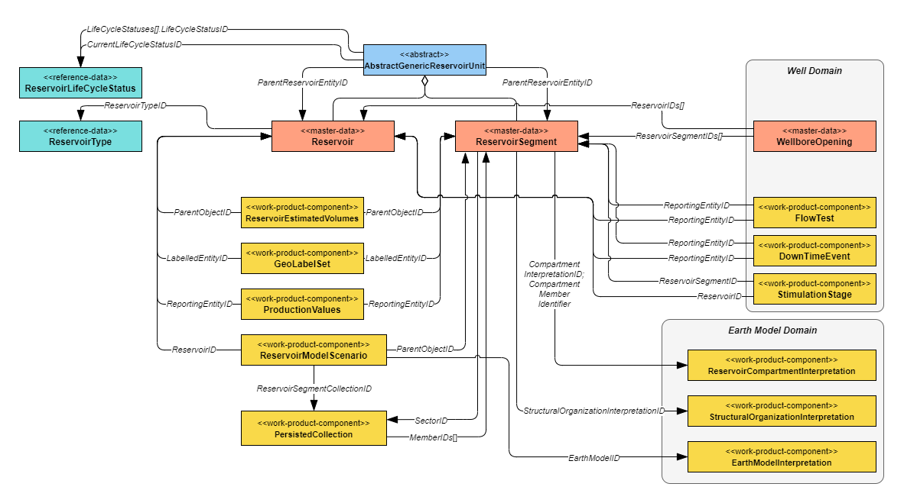
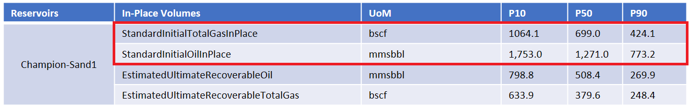
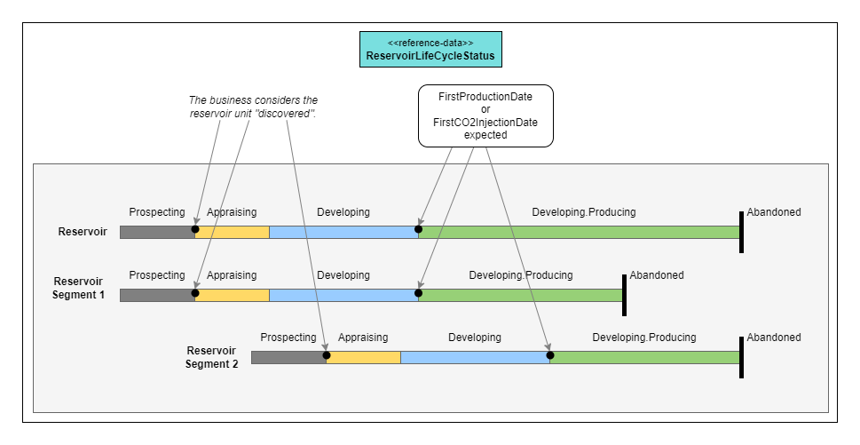
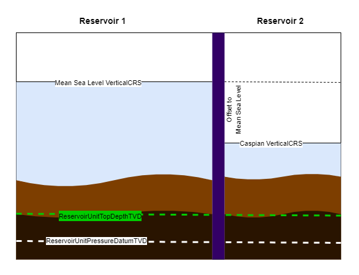

<a name="TOC"></a>

[[_TOC_]]

# Reservoir Management

## Overview

_Updates Nov. 2024, with Reservoir, ReservoirSegment v. 2.0.0:_



* [`master-data--Reservoir`](../../../E-R/master-data/Reservoir.1.2.0.md)
  and/or [`master-data--ReservoirSegment`](../../../E-R/master-data/ReservoirSegment.1.2.0.md) are referred to by the
  well domain from [`master-data--WellboreOpening`](../../../E-R/master-data/WellboreOpening.1.2.0.md). The wellbore opening links to perforated interval or isolated
  intervals.
  * [`master-data--ReservoirSegment`](../../../E-R/master-data/ReservoirSegment.1.2.0.md) is subdividing the
    [`master-data--Reservoir`](../../../E-R/master-data/Reservoir.1.2.0.md) and permits relationships to earth modeling
    entities supported by
    the [Reservoir DDMS](https://community.opengroup.org/osdu/platform/domain-data-mgmt-services/reservoir/home/-/blob/main/README.md).
    Reservoir segments can relate to
    * A [`work-product-component--ReservoirCompartmentInterpretation`](../../../E-R/work-product-component/ReservoirCompartmentInterpretation.1.2.0.md) via `CompartmentInterpretationID` and
    * refer to a `data.ReservoirCompartmentUnits[]` **_member_** of the ReservoirCompartmentInterpretation via `CompartmentMemberIdentifier`.
  * See also a worked example of a segmented reservoir in this dedicated section [**Model by Compartments**](./ModelByCompartments/README.md).
* The [`work-product-component--ReservoirEstimatedVolumes`](../../../E-R/work-product-component/ReservoirEstimatedVolumes.1.1.1.md)
  link to the [`master-data--Reservoir`](../../../E-R/master-data/Reservoir.1.2.0.md)
  or [`master-data--ReservoirSegment`](../../../E-R/master-data/ReservoirSegment.1.2.0.md) and are comprised of original
  in-place volumes and technical recoverables.
* The [`work-product-component--ReservoirModelScenario`](../../../E-R/work-product-component/ReservoirModelScenario.1.0.0.md)
  represents a specific model hypothesis from a real studied reservoir context. Using multiple instances of reservoir
  model scenarios can relate one Reservoir to different, 'opinionated' earth model interpretations or evolutions of
  static/dynamic models.
* [`reference-data--ReservoirType`](../../../E-R/reference-data/ReservoirType.1.0.1.md) was added to describe whether
  the reservoir is conventional, or administrative, geological or oil sand deposit.
* The [`reference-data--ReservoirSegmentType`](../../../E-R/reference-data/ReservoirSegmentType.1.0.1.md) is an
  attribute to elaborate on the intent, purpose for which it is being segmented or to be used.
* Both `master-data--Reservoir` and `master-data--ReservoirSegment` include
  [`AbstractGenericReservoirUnit`](../../../E-R/abstract/AbstractGenericReservoirUnit.1.1.0.md) containing
  the common properties of a reservoir/reservoir segment:
  * A list of previous and current reservoir states, each containing a [`reference-data--ReservoirStatusType`](../../../E-R/reference-data/ReservoirStatusType.1.0.1.md) is
    a reference type: abandoned, active, discovery, first injection and first production.
  * A size indicator with an area measure as well as the pressure datum depth.
  * An indicator whether the Reservoir or ReservoirSegment is (further) segmented.

At this time, the worked examples are in progress, and we have provided the diagram to illustrate the relationships
between data entities along with a summary description.

[Back to TOC](#TOC)

## Reservoir Segmentation

As with most OSDU schemas, properties are generally defined as optional. This allows the creation of records to manage
reservoirs segmented or unsegmented.

Unsegmented reservoirs are represented by
a [`master-data--Reservoir`](../../../E-R/master-data/Reservoir.1.2.0.md) `"IsSegmented": false`.

Segmented reservoirs start with a '
parent' [`master-data--Reservoir`](../../../E-R/master-data/Reservoir.1.2.0.md) with  `"IsSegmented": true` and an arbitrarily deep
hierarchy of [`master-data--ReservoirSegment`](../../../E-R/master-data/ReservoirSegment.1.2.0.md).

Further grouping across the hierarchy of segments can be achieved by
defining [`work-product-component--PersistedCollections`](../../../E-R/work-product-component/PersistedCollection.1.2.0.md) via a `SectorID`.

[`master-data--WellboreOpening`](../../../E-R/master-data/WellboreOpening.1.2.0.md) records can now relate to the Reservoir/ReservoirSegment.

[Back to TOC](#TOC)

## Reservoir Segmentation with Reference to Earth Models

When a static or dynamic reservoir model has been built, the [`master-data--Reservoir`](../../../E-R/master-data/Reservoir.1.2.0.md)
and [`master-data--ReservoirSegment`](../../../E-R/master-data/ReservoirSegment.1.2.0.md) can be tied to earth model compartments
managed and created by the [Reservoir DDMS](https://community.opengroup.org/osdu/platform/domain-data-mgmt-services/reservoir/home/-/blob/main/README.md).

A scenario for a hypothetical faulted and segmented reservoir is demonstrated in the
[Model by Compartments](./ModelByCompartments/README.md) section.

[Back to TOC](#TOC)

## ReservoirEstimatedVolumes

Below is a worked example, just focussing on the column base table in the [`work-product-component--ReservoirEstimatedVolumes`](../../../E-R/work-product-component/ReservoirEstimatedVolumes.1.1.1.md).

Here is the simple use case:



ReservoirEstimatedVolumes does not mix In-Place volumes and Estimated Ultimate Recoverable volumes - they are split into
different records.

### Columns with Homogeneous UnitOfMeasure Context

The spreadsheet is altered such that the columns have a well-defined unit context. The probability columns are
replicated until all have homogenous unit contexts:

| In-Place Volumes                                                         | P10 bscf | P10 mmsbbl | P50 bscf | P50 mmsbbl | P90 bscf | P90 mmsbbl |
|--------------------------------------------------------------------------|----------|------------|----------|------------|----------|------------|
| namespace:reference-data--ReservoirEstimatedVolumePropertyType:TotalGas: | 1064.1   | absent     | 699.0    | absent     | 424.1    | absent     |
| namespace:reference-data--ReservoirEstimatedVolumePropertyType:Oil:      | absent   | 1753.0     | absent   | 1271.0     | absent   | 773.2      |

[Back to TOC](#TOC)

#### Column Definition

<details>
<summary markdown="span">First Column Definition embedded in <code>ReservoirEstimatedVolumes</code></summary>

<OsduImportJSON>[Open the full example record.](work-product-component/ReservoirEstimatedVolumes-homogeneous.json#only.data.Volumes.Columns[0])</OsduImportJSON>

```json
{
  "data": {
    "Volumes": {
      "Columns": [
        {
          "ValueType": "string",
          "ValueCount": 1,
          "ColumnName": "In-Place Volumes",
          "PropertyType": {},
          "RelationshipTargetKind": "osdu:wks:reference-data--ReservoirEstimatedVolumePropertyType:"
        }
      ]
    }
  }
}
```
</details>

It is referring to reference values declared in
[reference-data--ReservoirEstimatedVolumePropertyType](../../../E-R/reference-data/ReservoirEstimatedVolumePropertyType.1.0.0.md).
Compared to the original table, the unit of measure is included in the column definition and homogenous for each column:


<details>
<summary markdown="span">Value Column P10 with mscf unit embedded in <code>ReservoirEstimatedVolumes</code></summary>

<OsduImportJSON>[Open the full example record.](work-product-component/ReservoirEstimatedVolumes-homogeneous.json#only.data.Volumes.Columns[1])</OsduImportJSON>

```json
{
  "data": {
    "Volumes": {
      "Columns": [
        {
          "ColumnName": "P10 bscf",
          "ValueType": "number",
          "ValueCount": 1,
          "UnitOfMeasureID": "namespace:reference-data--UnitOfMeasure:bscf:",
          "UnitQuantityID": "namespace:reference-data--UnitQuantity:volume:",
          "PropertyType": {
            "PropertyTypeID": "namespace:reference-data--PropertyType:2dc6dc83-e1f9-48f6-87f2-57bcdd42738b:",
            "Name": "volume"
          },
          "FacetIDs": [
            {
              "FacetTypeID": "namespace:reference-data--FacetType:statistics:",
              "FacetRoleID": "namespace:reference-data--FacetRole:P10:"
            },
            {
              "FacetTypeID": "namespace:reference-data--FacetType:condition:",
              "FacetRoleID": "namespace:reference-data--FacetRole:surface:"
            }
          ]
        }
      ]
    }
  }
}
```
</details>

<details>
<summary markdown="span">Value Column P10 with mmsbbl unit embedded in <code>ReservoirEstimatedVolumes</code></summary>

<OsduImportJSON>[Open the full example record.](work-product-component/ReservoirEstimatedVolumes-homogeneous.json#only.data.Volumes.Columns[2])</OsduImportJSON>

```json
{
  "data": {
    "Volumes": {
      "Columns": [
        {
          "ColumnName": "P10 mmsbbl",
          "ValueType": "number",
          "ValueCount": 1,
          "UnitOfMeasureID": "namespace:reference-data--UnitOfMeasure:mmsbbl:",
          "UnitQuantityID": "namespace:reference-data--UnitQuantity:volume:",
          "PropertyType": {
            "PropertyTypeID": "namespace:reference-data--PropertyType:2dc6dc83-e1f9-48f6-87f2-57bcdd42738b:",
            "Name": "volume"
          },
          "FacetIDs": [
            {
              "FacetTypeID": "namespace:reference-data--FacetType:statistics:",
              "FacetRoleID": "namespace:reference-data--FacetRole:P10:"
            },
            {
              "FacetTypeID": "namespace:reference-data--FacetType:condition:",
              "FacetRoleID": "namespace:reference-data--FacetRole:surface:"
            }
          ]
        }
      ]
    }
  }
}
```
</details>

Similar pairs of columns are created for P50 and P90.

#### Value Table

The first value column is identical to the source table:

<details>
<summary markdown="span">Value table embedded in <code>ReservoirEstimatedVolumes</code></summary>

<OsduImportJSON>[Open the full example record.](work-product-component/ReservoirEstimatedVolumes-homogeneous.json#only.data.Volumes.ColumnSize|ColumnValues[0])</OsduImportJSON>

```json
{
  "data": {
    "Volumes": {
      "ColumnSize": 2,
      "ColumnValues": [
        {
          "StringColumn": [
            "namespace:reference-data--ReservoirEstimatedVolumePropertyType:TotalGas:",
            "namespace:reference-data--ReservoirEstimatedVolumePropertyType:Oil:"
          ],
          "UndefinedValueRows": []
        }
      ]
    }
  }
}
```
</details>

The number columns, however, appear as replicated with homogeneous unit context and some absent values - here with the example of P10 bscf and P10 mmsbbl:

<details>
<summary markdown="span">Value table column P10 bscf embedded in <code>ReservoirEstimatedVolumes</code></summary>

<OsduImportJSON>[Open the full example record.](work-product-component/ReservoirEstimatedVolumes-homogeneous.json#only.data.Volumes.ColumnSize|ColumnValues[1])</OsduImportJSON>

```json
{
  "data": {
    "Volumes": {
      "ColumnSize": 2,
      "ColumnValues": [
        {
          "NumberColumn": [
            1064.1,
            0
          ],
          "UndefinedValueRows": [
            1
          ]
        }
      ]
    }
  }
}
```
</details>

<details>
<summary markdown="span">Value table column P10 mmsbbl embedded in <code>ReservoirEstimatedVolumes</code></summary>

<OsduImportJSON>[Open the full example record.](work-product-component/ReservoirEstimatedVolumes-homogeneous.json#only.data.Volumes.ColumnSize|ColumnValues[2])</OsduImportJSON>

```json
{
  "data": {
    "Volumes": {
      "ColumnSize": 2,
      "ColumnValues": [
        {
          "NumberColumn": [
            0,
            1753.0
          ],
          "UndefinedValueRows": [
            0
          ]
        }
      ]
    }
  }
}
```
</details>

P50 and P90 are very similar, see [entire example record](./work-product-component/ReservoirEstimatedVolumes-homogeneous.json).

---

The table of values may not be embedded the ReservoirEstimatedVolumes record but only stored in content, e.g. in a
CSV file or spreadsheet associated via `data.Datasets[]`. Then the `data.Volumes[].Columns[].ColumnName` allow the
association between `data.Volumes[].Columns[]` definitions and dataset columns.

---

## Reservoir Life Cycle Status

* An array of `LifeCycleStatuses` can be captured, with effective and termination dates, to easily see the historical progress of these statuses.
* For ease of discovery, `CurrentLifeCycleStatus` is an additional, denormalized, property. (This follows a pattern established elsewhere in the OSDU Data Model for operators in AbstractFacilityOperators.)



## Reservoir TVD Measurements

`Reservoir` and `ReservoirSegment` both have the ability to capture certain TVD measurements (via `AbstractGenericReservoirUnit`).

The "zero depth point" of these TVD measurements is captured by `data.VerticalCRSID`. In the case that the selected VerticalCRS is _not_ Mean Sea Level (MSL) (such as a regional or custom Vertical CRS), `data.VerticalDatumOffsetToMeanSeaLevel` can be used to easily reference the data back to MSL if needed for broad analytics or for data exchange.




[Back to TOC](#TOC)